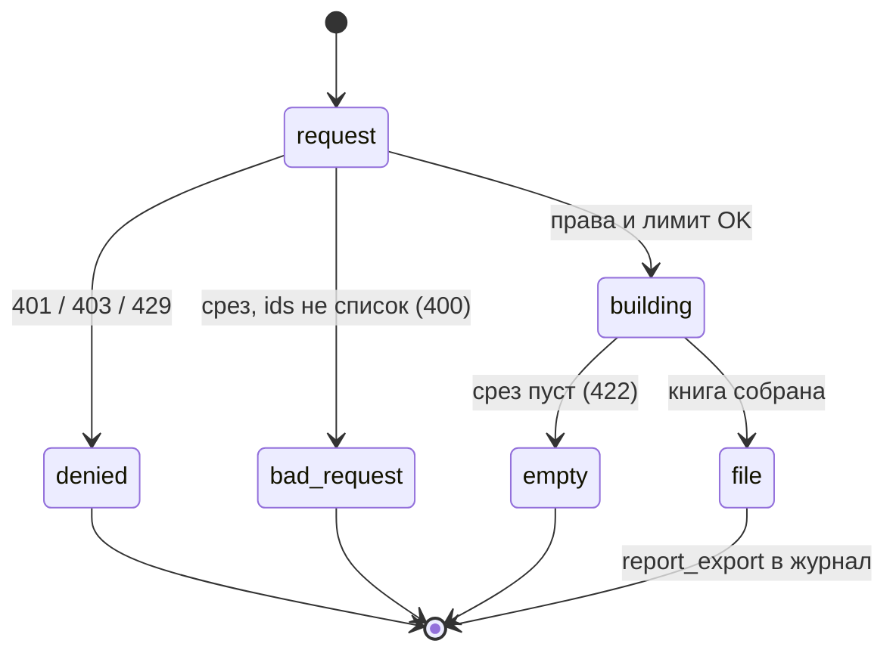
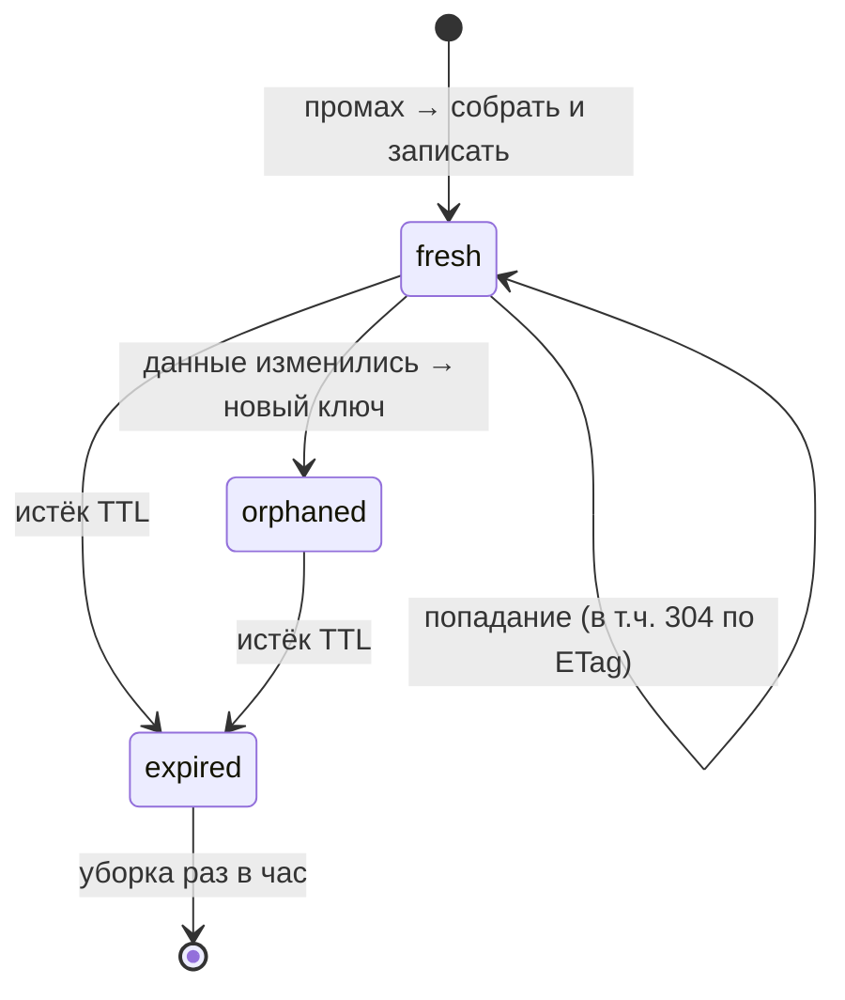

# Домен «Аналитика и отчёты» (analytics)

Отчёты «По тендерам», «По КП», «По контрагентам» для экрана и выгрузки в Excel (целиком и «как на экране»), выгрузка среза реестра тендеров, правила маскировки финансов в отчётах, а также общий для тяжёлых экранов механизм: кэш тяжёлых чтений (`heavy_read_cache`) и лимит частоты. Здесь же — где в системе считаются расходы и экономия.

Связанные разделы: API — [../04-api/endpoints-reports.md](../04-api/endpoints-reports.md) (полный состав колонок, тела запросов и ошибки); экраны — [../03-screens/reports.md](../03-screens/reports.md), [../03-screens/expenses.md](../03-screens/expenses.md) (расходы на ИИ — домен биллинга); цены тендера — [tenders-comparison.md §6.6](tenders-comparison.md#66-цены-реестра); кэш и производительность — [../07-architecture/scalability.md §6.1](../07-architecture/scalability.md#61-кэш-тяжёлых-чтений); модель данных — [heavy_read_cache](../05-data-model/tables.md#heavy_read_cache), [rate_limit_counters](../05-data-model/tables.md#rate_limit_counters).

## 1. Назначение и границы

Система должна:

1. собирать три отчёта по **периметру пользователя** (объекты из его грантов, администратору — всё): по тендерам, по КП, по контрагентам;
2. отдавать строки отчёта экрану целиком (постранично до 200 строк, клиент забирает все страницы), а фильтрацию, поиск и сортировку выполнять **на клиенте**;
3. выгружать отчёт в `.xlsx` двумя способами: **целиком** (все строки, все колонки) и **экранным срезом** — ровно те строки (по списку id) и колонки (в порядке экрана), что видит пользователь; срез реестра тендеров — тем же механизмом со своими колонками;
4. без права видеть цены скрывать финансовые поля в JSON и колонки в `.xlsx`; файлы с деньгами помечать грифом коммерческой тайны;
5. записывать каждую выгрузку файла в журнал ИБ;
6. защищать тяжёлые чтения (отчёты, сравнительная таблица, протокол, ИИ-разбор, сводка бюджета) общим лимитом частоты на пользователя и общим серверным кэшем готовых ответов.

Своих таблиц у домена нет: он читает тендеры, приглашения, КП и их версии, строки КП, контрагентов, дерево портфелей и объектов.

**Расходы и экономия — где считаются.** Отдельного отчёта «Экономия» в исходной системе нет (см. открытые вопросы). Показатели экономии живут в других доменах:

| Показатель | Формула | Где |
|---|---|---|
| Отклонение факта от плана тендера | `лучшее предложение − плановая сумма` (минус — экономия) | [budget.md §5](budget.md#5-расчёты-и-формулы), ручка план/факт бюджета |
| «Дельта» в протоколе | `итог победителя − бюджет тендера` (больше нуля — перерасход, меньше — экономия) | [tenders-documents.md §3](tenders-documents.md#3-протокол-тендера-docx) |
| Потенциал экономии по позиции/КП | расстояние до «честного минимума» | [tenders-comparison.md §5.5](tenders-comparison.md#55-потенциал-экономии-расчётный) |
| Свободный остаток / перерасход бюджета | `выделено − в работе − израсходовано` | [budget.md](budget.md) |
| Расходы на ИИ (экран «Расходы») | списания токенов | [billing.md](billing.md) |

Пороги аномалий и разброса, которыми пользуется сравнительная таблица и которые администратор правит в «Настройках», домен отчётов не применяет; их смысл — [tenders-comparison.md §9](tenders-comparison.md#9-пороги-системные-настройки).

## 2. Сущности и ключевые поля

Хранимых сущностей нет. Строки отчётов — проекции:

| Отчёт | Строка = | Ключевые поля (полный состав и заголовки — [API](../04-api/endpoints-reports.md#колонки-отчётов)) |
|---|---|---|
| По тендерам | тендер периметра | `id`, `number`, `title`, `project` («объект / подобъект»), `status`, `responsible`, `kpCount`, `minPrice`, `maxPrice`, `incompleteMinPrice`, `incompleteMissing` |
| По КП | КП (его текущая версия) по тендерам периметра, **в любом статусе**, включая черновики и отозванные | `id` (`Q-<id>`), `supplier`, `tender` (номер), `status`, `amount`, `version`, `submitted` (дата) |
| По контрагентам | неудалённый контрагент (при ограниченном доступе — только приглашавшиеся в тендеры периметра) | `id`, `name`, `inn`, `category`, `status`, `registered` (дата заведения), `tenders` (число приглашений) |
| Срез реестра | тендер периметра | `id` (в ячейку — номер), `title`, `project` («портфель / объект / подобъект»), `kind`, `status`, `statusChanged`, `owner`, `start`, `end`, `deadline`, `invited`, `bestPrice`, `incompleteMinPrice`, `incompleteMissing`, `created` |

Служебные таблицы платформы, которыми пользуется домен:

| Таблица | Назначение |
|---|---|
| [heavy_read_cache](../05-data-model/tables.md#heavy_read_cache) | Готовые сжатые ответы тяжёлых чтений по ключу, со сроком жизни; общая для всех процессов, без журнала транзакций (UNLOGGED) |
| [rate_limit_counters](../05-data-model/tables.md#rate_limit_counters) | Счётчики лимитов частоты по ключу `<корзина>:user:<id>` |

## 3. Жизненный цикл

Статусов у отчёта нет: каждый запрос собирает строки заново из текущих данных. Жизненный цикл есть у **запроса выгрузки** и у **записи кэша**.

### 3.1. Выгрузка `.xlsx`

| Из | В | Кто | Условие | Побочные эффекты |
|---|---|---|---|---|
| Запрос | Отказ 401/403 | система | Нет сессии / нет права `reports.view` | `permission_denied` в журнале ИБ (403) |
| Запрос | Отказ 429 | система | Исчерпан лимит тяжёлых чтений | — |
| Запрос (срез) | Отказ 400 | система | `ids` не список | — |
| Запрос | Сборка строк | система | Права и лимит в порядке | Строки — только по периметру; колонки — с учётом права на финансы |
| Сборка (срез) | Отказ 422 | система | Ни одна строка из `ids` не нашлась в периметре | — |
| Сборка | Файл отдан | система | — | Событие `report_export` |



### 3.2. Запись кэша тяжёлого чтения

| Из | В | Условие | Побочные эффекты |
|---|---|---|---|
| — | Свежая | Промах кэша: ответ собран и записан (в память процесса и в общую таблицу) | Клиенту — `ETag` |
| Свежая | Свежая | Попадание: тот же ключ, срок не истёк | Ответ из памяти или таблицы без пересборки; при совпавшем `If-None-Match` — 304 без тела |
| Свежая | Устаревшая | Истёк срок жизни | Не отдаётся; при следующем запросе — пересборка |
| Устаревшая | Удалена | Ежечасная уборка | — |
| Свежая | Неактуальная по смыслу | Данные изменились | Явной инвалидации нет: меняются части ключа (ревизия, отпечаток), запрос идёт по новому ключу, старая запись доживает срок |



## 4. Правила и валидации

### 4.1. Периметр и маскировка

1. Периметр — объекты из грантов пользователя (портфель/объект с подобъектами); администратор видит всё. Тендеры — тендеры периметра; КП — КП тендеров периметра; контрагенты — для ограниченного доступа «мои контрагенты» (приглашавшиеся в тендеры периметра), для администратора — все неудалённые. Обход дерева «портфель → объект → подобъект» тот же, что у реестра тендеров, чтобы отчёт и реестр не расходились.
2. Без права на финансы (`finance.view` или персональный флаг «видит финансы»): в JSON поля `minPrice`, `maxPrice`, `incompleteMinPrice`, `incompleteMissing`, `amount`, `bestPrice` приходят `null` и признак `financeMasked = true`; в `.xlsx` эти колонки не выводятся вовсе. Число «нет ставок» скрывается вместе с деньгами — без суммы оно вводит в заблуждение. Экран прячет денежные колонки и плитки, пока роль пользователя не известна.
3. ИНН в отчёте по контрагентам не маскируется (см. открытые вопросы API-3).

### 4.2. Экранный срез

1. Тело: `ids` — список id строк в порядке экрана (синоним `tender_ids`), `columns` — ключи колонок в порядке экрана; не список → 400 «Укажите ids — список строк среза».
2. Неизвестные ключи колонок отбрасываются; пусто — все колонки в каноническом порядке.
3. Колонка-спутник: если выбрана «Мин. неполного КП», за ней автоматически добавляется «Неполное КП: нет ставок» (на экране это одна ячейка «сумма · нет ставок: N», в файле — две колонки, потому что у суммы денежный формат).
4. Порядок строк в файле — порядок `ids`; id вне периметра молча пропускаются; id отчёта по КП принимаются как `Q-<id>` или число, нераспознанные — игнорируются.
5. Ничего не нашлось → 422 «Срез пуст — нечего выгружать». Экран сам не отправляет пустой срез: «В отчёте нет строк — нечего выгружать».
6. Срез не повторяет фильтры сервером: фильтрация живёт только на клиенте, сервер получает её результат списком id (две реализации одних условий дали бы «две правды» об одном экране).
7. Выгрузки реестра **целиком** нет — только срез.

### 4.3. Книга Excel

| Элемент | Правило |
|---|---|
| Лист | Один: «Тендеры» / «КП» / «Контрагенты» |
| Гриф | Если в итоговом составе колонок есть хотя бы одна денежная — в A1 курсивом «ГРИФ: КОММЕРЧЕСКАЯ ТАЙНА / КОНФИДЕНЦИАЛЬНО. Документ содержит сведения ограниченного доступа. Передача третьим лицам без основания запрещена.», заголовки с 3-й строки; иначе заголовки с 1-й |
| Заголовки | Жирные, серый фон |
| Форматы | Деньги `#,##0.00 "₽"`, целые `#,##0`, даты `ДД.ММ.ГГГГ` — настоящие значения Excel (работают сортировка и фильтр) |
| Статус | Русская подпись вместо кода (в JSON — код, экран переводит сам). Отчёт по тендерам и реестр подписывают статусы по-разному («Сбор предложений» — в реестре) — каждый как на своём экране |
| Имена файлов | Целиком: `report_tenders.xlsx`, `report_quotes.xlsx`, `report_suppliers.xlsx`; срез: `<отчёт>_srez.xlsx` (`tenders_srez`, `quotes_srez`, `suppliers_srez`, `registry_srez`) |
| Сборка | В пуле потоков (не блокирует обработку других запросов) |

### 4.4. Фильтры и плитки экрана (клиентские)

| Вкладка | Поиск | Фильтры | Плитки |
|---|---|---|---|
| По тендерам | номер или название | проект, статус, ответственный | «Всего тендеров», «Идёт сбор» (`open`), «Завершённых» (`closed`), «Без откликов» (`kpCount = 0`) |
| По КП | контрагент | статус, тендер, период подачи (с/по, календарь) | «Всего КП», «Подано» (`submitted`), «Черновики / отозвано», «Средняя сумма поданных» (только при праве на финансы) |
| По контрагентам | название или ИНН | статус, категория | «Всего контрагентов», «Одобрено», «В процессе квалификации», «Отклонено» |

Значения выпадающих фильтров собираются из самих строк (уникальные, по алфавиту). Сбой загрузки показывается по вкладке («Не удалось загрузить отчёт.»), а не пустой таблицей. Кнопка «Скачать отчёт в Excel» выгружает экранный срез.

### 4.5. Лимит частоты

Все ручки отчётов, а также сравнительная таблица и её выгрузка, протокол и его выгрузка, ИИ-разбор тендера и сводка бюджета делят **одну корзину** `heavy-read` на пользователя: `HEAVY_READ_RATE_LIMIT` запросов за `HEAVY_READ_RATE_WINDOW` секунд (60 за 60 с). Превышение — 429 «Слишком много запросов — попробуйте немного позже». Счётчики общие для всех процессов (таблица в БД).

## 5. Расчёты и формулы

### 5.1. Отчёт «По тендерам»

| Колонка | Формула |
|---|---|
| Подано КП (`kpCount`) | число КП тендера в статусах «Подано», «На доработке», «Принят», у текущей версии которых есть хотя бы одна учитываемая строка (см. [budget.md §5](budget.md#5-расчёты-и-формулы)) |
| Мин. цена / Макс. цена | минимум / максимум итога среди **полных** КП (как «Лидер» в обзоре тендера, [tenders-comparison.md §6.2](tenders-comparison.md#62-итог-кп-и-полнота)); нет полных — пусто |
| Мин. неполного КП | минимальный итог среди неполных КП с итогом > 0 |
| Неполное КП: нет ставок | число позиций без цены у **этого** неполного КП; 0 — итог несопоставим по объёмам; пусто, если неполных нет |

Цены берутся из того же кэшированного расчёта, что «Лучшая цена» реестра (ключ: ревизия тендера + отпечаток КП + версии формул и денежных правил, срок 24 ч).

### 5.2. Отчёты «По КП» и «По контрагентам»

| Колонка | Формула |
|---|---|
| Сумма КП (`amount`) | итог текущей версии по учитываемым строкам; нет строк — 0 |
| Версия | номер текущей версии КП |
| Подано | дата подачи текущей версии (календарная дата момента подачи по UTC) |
| Участий (`tenders`) | число приглашений контрагента в тендеры периметра (все приглашения, включая отозванные) |
| Средняя сумма поданных (плитка) | `Σ amount / N` по видимым строкам со статусом «Подано» (`submitted`); при `N = 0` делитель 1 |
| В процессе квалификации (плитка) | контрагенты в статусах «Новая анкета», «На согласовании», «Проверяется», «На доработке» |

### 5.3. Кэш тяжёлых чтений и лимит частоты

Применяется к сравнительной таблице тендера (домен тендеров), сводке бюджета ([budget.md §4.5](budget.md#45-сводка-года-частота-и-кэш)) и ценам реестра/отчёта «По тендерам».

| Величина | Правило |
|---|---|
| Ключ | `пространство:` + первые 32 символа SHA-256 от списка частей ключа (пространство, затем части: ревизия/отпечаток данных, набор доступных объектов, версии формул и т.п.) |
| `ETag` | слабый: `W/"<пространство>:<ключ>"`; `Cache-Control: private, no-cache` (тело зависит от прав смотрящего — общему прокси хранить нельзя; браузер сверяет ETag на каждом запросе) |
| Условный запрос | `If-None-Match` содержит этот ETag (список через запятую) → 304 без тела |
| Срок жизни ответа | `HEAVY_READ_CACHE_SECONDS` (60 с); 0 — кэш выключен целиком (ни заголовков, ни таблицы) |
| Хранение | Готовые байты, сжатые gzip (уровень `GZIP_LEVEL`): попадание = чтение и отправка без повторной сериализации; клиенту без gzip — разжатое |
| Память процесса | Перед таблицей — горячая копия в памяти до 64 МБ на процесс (вытесняются самые старые); тела больше 16 МБ в память не кладутся |
| Отказ кэша | Недоступная таблица кэша — это «нет кэша», а не ошибка ручки: ответ собирается и отдаётся |
| Мелкие значения пачкой | Для цен реестра: попадания читаются одним запросом, промахи считаются одним вызовом и пишутся одной транзакцией; «значения нет» тоже кэшируется |
| Уборка | Просроченные записи удаляются раз в час |

Лимит частоты: см. §4.5; ключ счётчика `heavy-read:user:<id>`, окно скользящее по счётчику с истечением.

## 6. Права доступа

| Действие | Админ | Тенд. специалист | СБ | Юрист | Контрагент | Лид | Владелец |
|---|---|---|---|---|---|---|---|
| Смотреть отчёты, выгружать `.xlsx`, выгружать срез реестра (`reports.view`) | ✅ | ⚙✅ (объекты из грантов) | ⚙ | ⚙ | ❌ | ❌ | ❌ |
| Видеть цены в отчётах (`finance.view` или персональный флаг) | ✅ | ⚙ (флаг) | ⚙ | ⚙ | ❌ | ❌ | ❌ |
| Экран «Отчёты» в интерфейсе | ✅ | ✅ | ❌ | ❌ | ❌ | ❌ | ❌ |

Обозначения — как в [../01-product/users-and-roles.md](../01-product/users-and-roles.md#4-матрица-роль--действие). Отказ — 403 «Недостаточно прав для этого действия — обратитесь к администратору системы» и `permission_denied` в журнале ИБ.

## 7. События, уведомления, аудит

| Действие | Событие журнала ИБ | `details` |
|---|---|---|
| Скачан отчёт целиком | `report_export` (`entity_type = report`) | `{"report": "<отчёт>.xlsx", "rows": N}` (отчёт — `tenders`, `quotes` или `suppliers`) |
| Скачан экранный срез (в т.ч. реестра) | `report_export` | `{"report": "<…>.xlsx", "scope": "screen_slice", "rows": N}` |

Просмотр отчёта на экране (JSON) в журнал не пишется. Уведомлений и событий живого потока домен не создаёт.

## 8. Фоновые задачи и периодика

Своих задач нет; плановой рассылки отчётов нет. Платформенная задача `shared-store-purge` (раз в час, только у лидера фоновых задач) удаляет просроченные записи `heavy_read_cache` и счётчики `rate_limit_counters`.

## 9. Настройки и флаги

| Имя | По умолчанию | Влияние |
|---|---|---|
| `HEAVY_READ_CACHE_SECONDS` | 60 | Срок жизни кэша тяжёлых чтений; 0 — выключен |
| `HEAVY_READ_RATE_LIMIT` | 60 | Запросов на пользователя за окно в корзине `heavy-read` |
| `HEAVY_READ_RATE_WINDOW` | 60 с | Окно лимита |
| `GZIP_LEVEL` | 6 | Уровень сжатия кэшированных тел |

Флаг `CONTACTS_MASK_ENABLED` на отчёты не действует (см. §4.1).

## 10. Граничные случаи

1. **Нет ни одного полного КП** — «Мин. цена» и «Макс. цена» пусты, показывается только «Мин. неполного КП».
2. **КП без единой цены** (итог 0) ценой не считается и в «Мин. неполного КП» не попадает.
3. **КП, у которого все строки — отказы**, в «Подано КП» не учитывается, хотя статус «Подано».
4. **Отчёт по КП** показывает и черновики, и отозванные КП; «Подано КП» в отчёте по тендерам считает только поданные — числа по одному тендеру в двух отчётах могут различаться (заголовок колонки называет вещь так, как она посчитана).
5. **Отозванные приглашения** учитываются в «Участий» контрагента.
6. **Даты** подачи и создания берутся по UTC (подача в 01:30 по Москве попадает в предыдущий день), а «Дата изменения статуса» в реестре — московский день. Рекомендуется единообразно считать даты по Москве.
7. **Большой периметр**: экран забирает все строки страницами по 200, и каждая страница расходует лимит `heavy-read`; при тысячах тендеров рекомендуется серверная фильтрация и постраничный показ.
8. **Срез с «лишними» id** (чужой периметр) не даёт ошибки — такие строки просто не попадают в файл; если не попала ни одна — 422.
9. **Без права на финансы** выгрузка без денежных колонок идёт без грифа; с правом, но без денежных колонок в срезе — тоже без грифа (гриф ставится по составу колонок, а не по отчёту).
10. **Кэш недоступен** (сбой таблицы) — ответы собираются без кэша, в лог пишется предупреждение.

## 11. Пример

Тендер T-2026-100 «Витражи, дворовой фасад» (объект «Жилые корпуса / МКД-1», ответственный «Петров Пётр Петрович»), поданы 7 КП с итогами от 222 878 133,64 до 321 568 972,22 (данные демо-стенда). Расчёт сравнения признал полными КП с итогами от 269 413 821,41 (лидер) до 321 568 972,22; все более дешёвые КП — неполные, самое дешёвое из них — 222 878 133,64 с 14 позициями без цены.

Строка отчёта «По тендерам» (пользователь с правом на финансы):

```json
{"id": 100, "number": "T-2026-100", "title": "Витражи, дворовой фасад", "project": "Жилые корпуса / МКД-1",
 "status": "open", "responsible": "Петров Пётр Петрович", "kpCount": 7, "minPrice": 269413821.41,
 "maxPrice": 321568972.22, "incompleteMinPrice": 222878133.64, "incompleteMissing": 14}
```

Тот же запрос пользователя без права на финансы: `minPrice`, `maxPrice`, `incompleteMinPrice`, `incompleteMissing` — `null`, `financeMasked: true`.

Экранный срез: пользователь отфильтровал вкладку по статусу «Сбор предложений», отсортировал по убыванию цены и выгрузил колонки «№», «Название», «Мин. неполного КП». Клиент шлёт `{"ids": [104, 100, 101], "columns": ["number", "title", "incompleteMinPrice"]}`. Сервер добавляет спутник `incompleteMissing`, ставит гриф в A1 (есть денежная колонка), заголовки «№ | Название | Мин. неполного КП | Неполное КП: нет ставок» в строке 3, строки — в порядке 104, 100, 101; файл `tenders_srez.xlsx`; в журнал — `report_export {"report": "tenders.xlsx", "scope": "screen_slice", "rows": 3}`.

Кэш: специалист дважды за минуту открывает сравнение T-2026-100 — второй ответ 304 по ETag; в промежутке поставщик подаёт новую версию КП → меняется отпечаток КП → новый ключ → ответ собирается заново, старая запись доживает 60 с и удаляется ближайшей ежечасной уборкой. Шестьдесят первый тяжёлый запрос пользователя в пределах минуты получает 429.

Для того же тендера план/факт бюджета берёт минимум **всех** поданных КП (222 878 133,64, неполное), а отчёт — минимум полных (269 413 821,41); расхождение разобрано в [budget.md §10](budget.md#10-граничные-случаи).

## 12. Оценка сложности

**M.** Три отчёта — проекции существующих данных, но требуют: единого периметра с реестром, переиспользования кэшированного расчёта цен сравнения, двух режимов выгрузки (целиком и экранный срез с порядком строк/колонок и колонкой-спутником), маскировки финансов в JSON и файле, грифа по составу колонок, форматированного `.xlsx` вне цикла событий, журнала выгрузок. Общий кэш тяжёлых чтений (память + таблица, ETag/304, сжатые байты) и лимит частоты — ещё **S–M**, если не учтены в архитектуре платформы.

## 13. Связанные разделы

- API: [../04-api/endpoints-reports.md](../04-api/endpoints-reports.md), общие соглашения о лимитах и условных GET — [../04-api/overview.md](../04-api/overview.md).
- Экраны: [../03-screens/reports.md](../03-screens/reports.md), [../03-screens/expenses.md](../03-screens/expenses.md).
- Бизнес-логика: [budget.md](budget.md), [tenders-comparison.md](tenders-comparison.md), [tenders-documents.md](tenders-documents.md), [billing.md](billing.md), [settings.md](settings.md) (пороги аномалий), [audit.md](audit.md#71-каталог-событий).
- Архитектура: [../07-architecture/scalability.md](../07-architecture/scalability.md#61-кэш-тяжёлых-чтений), [../07-architecture/architecture.md](../07-architecture/architecture.md).
- Таблицы: [heavy_read_cache](../05-data-model/tables.md#heavy_read_cache), [rate_limit_counters](../05-data-model/tables.md#rate_limit_counters).
- Открытые вопросы — `../_oq/BL-4.md` (а также `../_oq/API-3.md`).
