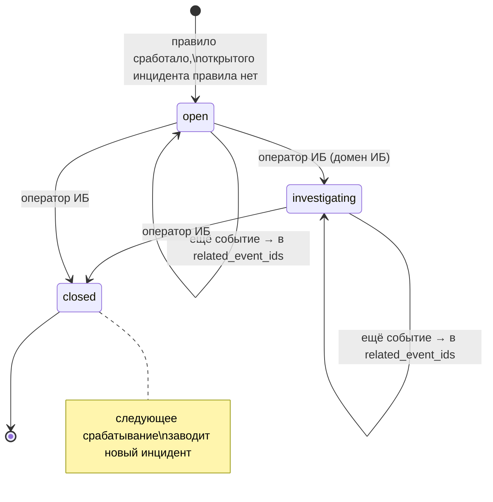

# Домен «Журнал событий ИБ» (audit)

Закрытый каталог событий безопасности, единая функция записи события в защищённый журнал и движок автоинцидентов по правилам. Это самый нижний домен: в него пишут почти все остальные, сам он ни от кого не зависит.

Связанные разделы: требования ИБ — [../07-architecture/security.md](../07-architecture/security.md#5-аудит-и-журнал-иб) (SEC-29…SEC-33); экраны журнала, инцидентов, SIEM и пакетов для регулятора — домен ИБ ([security.md](security.md), API — [../04-api/endpoints-security.md](../04-api/endpoints-security.md)); модель данных — [security_audit_log](../05-data-model/tables.md#security_audit_log), [security_incident_rules](../05-data-model/tables.md#security_incident_rules), [security_incidents](../05-data-model/tables.md#security_incidents).

## 1. Назначение и границы домена

Система должна:

1. вести **журнал событий ИБ** — неизменяемую (append-only) ленту значимых действий пользователей и системы: входы, отказы в доступе, правки прав, выгрузки, изменения справочников, биллинга, загрузки файлов и т. д.;
2. принимать в журнал только события из **закрытого каталога**: у каждого кода — подпись по-русски, категория и критичность; событие с неизвестным кодом не записывается (это ошибка разработчика, а не данных);
3. на каждое записанное событие применять **правила автоинцидентов**: при совпадении условий и достижении порога «N событий за M минут» заводить инцидент ИБ или дописывать событие в уже открытый инцидент того же правила;
4. сообщать вышестоящему домену ИБ, что заведён инцидент (внутреннее событие «инцидент создан»), — уведомлять людей журнал сам не умеет.

Вне границ домена (описано в [security.md](security.md)): экран журнала и его фильтры, выгрузки CSV/JSONL/TXT, карточка и лента инцидента, конструктор правил, передача в SIEM, пакеты сведений для регулятора, уведомление ответственных об инциденте. Вне границ также история действий по тендеру (лента активности тендера — [tenders.md](tenders.md)) — это другой журнал с другим назначением.

## 2. Сущности и ключевые поля

| Сущность | Таблица | Ключевые поля |
|---|---|---|
| Событие журнала | [security_audit_log](../05-data-model/tables.md#security_audit_log) | `id`, `created_at` (время сервера), `action` (код из каталога), `user_id` (автор, может быть пусто — аноним/система), `entity_type`, `entity_id` (объект действия), `ip_address` (IP клиента после разбора доверенных прокси), `details` (JSON с подробностями), `correlation_id` (сквозной `X-Request-Id` запроса) |
| Правило автоинцидента | [security_incident_rules](../05-data-model/tables.md#security_incident_rules) | `action` (код события), `title`, `severity` (`low`/`medium`/`high`/`critical`), `enabled`, `conditions` (плоский И-список `{field, op, value}`), `window_minutes`, `threshold`, `recipients` (внешние адреса для письма) |
| Инцидент | [security_incidents](../05-data-model/tables.md#security_incidents) | `title`, `severity`, `status` (`open`/`investigating`/`closed`), `description`, `related_event_ids` (список id событий), `source_rule_id`, `created_by`, `assignee_id`, `closed_at` |

Поля **категория**, **критичность**, **подпись** и **результат** (успех/отказ) у события не хранятся — они выводятся из кода события по каталогу (§5). Это позволяет менять подписи и категории без переписывания неизменяемой таблицы.

## 3. Жизненный цикл

### 3.1. Событие

У события нет статусов: оно создаётся один раз и больше не меняется и не удаляется. Неизменяемость обеспечивается **на уровне БД** (триггеры запрещают `UPDATE` и `DELETE` таблицы журнала), а не только кодом приложения.

### 3.2. Инцидент глазами журнала

Журнал только создаёт инцидент и дописывает в него события; смену статусов (`open → investigating → closed`), назначение ответственного и ленту ведёт домен ИБ.

| Из | В | Кто | Условие | Побочные эффекты |
|---|---|---|---|---|
| — | `open` | система (правило) | Событие совпало с условиями включённого правила, порог окна достигнут, открытого (не `closed`) инцидента этого правила нет | Инцидент: название = название правила (пустое — «Автоинцидент: `<код>`»), критичность правила, описание «Создано правилом «`<название>`» (#`<id правила>`) по событию #`<id события>`.», `related_event_ids = [id события]`, автор = автор события; событие журнала `incident_created` (`details.auto = true`); внутреннее событие «инцидент создан» → домен ИБ рассылает уведомления ([notifications.md](notifications.md#5-каталог-событий)) |
| `open` / `investigating` | тот же | система (правило) | Новое совпавшее событие при уже открытом инциденте этого правила | id события дописывается в `related_event_ids` (без дублей); нового инцидента и уведомлений нет |
| `closed` | — | — | Правило снова сработало | Заводится **новый** инцидент |

## 4. Правила и валидации

1. **Закрытый каталог.** Запись события с кодом вне каталога должна завершаться ошибкой разработчика (исключение, 500), а не записью «как есть»: фильтры журнала и правила инцидентов работают по точному совпадению кода, опечатка в коде — это дыра в журнале. Чтение журнала, наоборот, должно показывать и строки с кодами, которых уже нет в каталоге (подпись «Неизвестное событие», без категории, критичность `low`).
2. **Фиксация вне основной транзакции.** Событие должно попасть в журнал, даже если основное действие запроса потом откатится (например, `login_failed` записывается и тогда, когда сам вход отклонён). В исходной системе это сделано немедленным `commit` общей сессии запроса; при воссоздании рекомендуется писать событие отдельной транзакцией (см. §10).
3. **Сквозной идентификатор.** Каждое событие несёт `correlation_id` = `X-Request-Id` текущего запроса — им связываются события одного действия между собой и с логами приложения.
4. **IP клиента** — уже разобранный с учётом доверенных прокси (см. [../07-architecture/security.md §4](../07-architecture/security.md#4-доверенные-прокси-и-ip-клиента)).
5. **Условия правила** — плоский список, все условия соединены по И (вложенных ИЛИ-групп нет намеренно: конструктор должен оставаться заполняемым оператором):
   - допустимые поля: `action`, `entity_type`, `entity_id`, `ip_address`, `user_id`;
   - допустимые операции: `eq` (равно), `ne` (не равно), `in` (входит в список);
   - сравнение строковое (`str(значение события)` против `str(значения условия)`);
   - условие с незнакомым полем или операцией, а также не-объект в списке условий — правило **не срабатывает** (молча игнорировать условие опаснее, чем не сработать).
6. **Окно и порог.** Если `threshold ≤ 1` или `window_minutes ≤ 0` (или пусто) — правило срабатывает на каждое совпавшее событие. Иначе — только когда число событий того же кода, совпавших с условиями, за последние `window_minutes` минут (включая текущее) не меньше `threshold`.
7. **Защита от цикла.** Событие `incident_created` правилами не обрабатывается.
8. Выключенное правило (`enabled = false`) не проверяется.

## 5. Расчёты и формулы

| Величина | Правило |
|---|---|
| Подпись, категория, критичность события | Из каталога по коду (§7.1); код вне каталога — «Неизвестное событие», категория пустая, `low` |
| Результат (`outcome`) | `failure`, если код входит в множество отказов: `login_failed`, `account_locked`, `permission_denied`, `session_idle_timeout`, `session_reuse_detected`, `incident_created`, `chat_rate_limited`, `chat_thread_cap_reached`, `file_upload_rejected`; иначе `success` |
| Фильтр «категории» и «критичность от X и выше» | Превращается в множество кодов: коды, чья категория входит в выбранные и чья критичность ≥ X по шкале `low < medium < high < critical` |
| Срабатывание правила | `совпало(условия, событие) ∧ (threshold ≤ 1 ∨ window ≤ 0 ∨ count{e: e.action = rule.action ∧ e.created_at ≥ now − window ∧ совпало(условия, e)} ≥ threshold)` |
| Машинный вид события (выгрузка JSONL и SIEM) | `{id, created_at (ISO), action, outcome, category, severity, user_id, entity_type, entity_id, ip_address (строкой), correlation_id, details}` |

## 6. Права доступа

| Действие | Админ | Тендерный специалист | СБ | Юрист | Поставщик | Лид | Владелец площадки |
|---|---|---|---|---|---|---|---|
| Запись событий | система (от имени любого пользователя и анонимно) | ← | ← | ← | ← | ← | ← |
| Читать журнал целиком, инциденты, правила, выгрузки | ✅ | при праве `security.manage` | ✅ (право выдано по умолчанию) | при праве `security.manage` | ❌ | ❌ | ❌ |
| История событий конкретного пользователя (вкладка карточки пользователя) | ✅ | при праве `users.manage` | при праве `users.manage` | при праве `users.manage` | ❌ | ❌ | ❌ |
| Последние изменения прав ролей (блок под матрицей) | ✅ | при праве `users.manage` | при праве `users.manage` | при праве `users.manage` | ❌ | ❌ | ❌ |

Изменить или удалить событие не может никто, включая администратора и владельца площадки.

## 7. События, уведомления, аудит

### 7.1. Каталог событий

11 категорий (порядок в интерфейсе): «Аутентификация и доступ», «Пользователи и роли», «Отчёты и чувствительные просмотры», «Шифрование и ИБ-операции», «Контрагенты и тендеры», «ИИ и автоматизация», «Справочники и бюджет», «Портфели и проекты», «Шаблоны», «Биллинг», «Наблюдаемость». Шкала критичности: `low`, `medium`, `high`, `critical` (по умолчанию ни одно событие каталога не имеет `critical`; эта ступень используется инцидентами и правилами).

| Код | Подпись | Категория | Критичность | Отказ? | Кто пишет |
|---|---|---|---|---|---|
| `login_success` | Успешный вход | Аутентификация и доступ | low | | [identity](identity.md) |
| `login_failed` | Неуспешный вход | Аутентификация и доступ | medium | да | identity (неверный пароль/код, отключённая учётка, приостановленная организация) |
| `account_locked` | Блокировка учётной записи | Аутентификация и доступ | high | да | **никто** (в каталоге есть, в коде не пишется — см. §10) |
| `permission_denied` | Отказ в доступе | Аутентификация и доступ | medium | да | identity (гейт по праву или «только администратор») |
| `mfa_enabled` | Включена MFA | Аутентификация и доступ | low | | identity |
| `mfa_disabled` | Отключена MFA | Аутентификация и доступ | high | | identity |
| `password_changed` | Смена пароля | Аутентификация и доступ | low | | identity |
| `password_reset_requested` | Запрос восстановления пароля | Аутентификация и доступ | low | | identity |
| `password_reset_completed` | Пароль восстановлен | Аутентификация и доступ | medium | | identity |
| `initial_password_set` | Первый пароль установлен | Аутентификация и доступ | low | | identity |
| `mfa_reset` | Сброс MFA администратором | Аутентификация и доступ | high | | identity |
| `session_idle_timeout` | Выход по неактивности | Аутентификация и доступ | low | да | identity |
| `logout` | Выход из системы | Аутентификация и доступ | low | | identity |
| `sessions_revoked_all` | Завершены все сессии | Аутентификация и доступ | medium | | identity |
| `session_reuse_detected` | Повторное использование токена сессии | Аутентификация и доступ | high | да | identity |
| `role_changed` | Изменение роли | Пользователи и роли | high | | identity, [контрагенты](suppliers.md) (выдача доступа в ЛК) |
| `user_created` | Создание пользователя | Пользователи и роли | medium | | identity |
| `lead_submitted` | Заявка с лендинга | Пользователи и роли | medium | | identity (автор пуст; скрыто в журнале при `LEADS_ENABLED=false`) |
| `user_activation_reissued` | Повторная выдача ссылки активации | Пользователи и роли | low | | identity |
| `user_deactivated` | Деактивация пользователя | Пользователи и роли | medium | | identity |
| `user_reactivated` | Повторная активация пользователя | Пользователи и роли | medium | | identity |
| `project_access_changed` | Изменён доступ по проектам | Пользователи и роли | medium | | [portfolios](portfolios.md) |
| `account_unlocked` | Снятие блокировки учётной записи | Пользователи и роли | medium | | identity |
| `finance_access_changed` | Изменено право видеть финансы | Пользователи и роли | high | | identity |
| `role_permissions_changed` | Изменены права роли | Пользователи и роли | high | | identity |
| `report_export` | Выгрузка отчёта | Отчёты и чувствительные просмотры | medium | | отчёты, тендеры (выгрузки СТ, протокола), ИБ (выгрузки журнала) |
| `finance_viewed` | Просмотр финансового блока | Отчёты и чувствительные просмотры | medium | | контрагенты |
| `crypto_selftest` | Самопроверка шифрования | Шифрование и ИБ-операции | low | | ИБ |
| `incident_created` | Создан инцидент ИБ | Шифрование и ИБ-операции | high | да | журнал (автоинцидент), ИБ (ручной) |
| `rkn_draft_exported` | Пакет сведений для РКН | Шифрование и ИБ-операции | high | | ИБ |
| `mail_switch_changed` | Изменён выключатель почты | Шифрование и ИБ-операции | medium | | [settings](settings.md) |
| `supplier_registered` | Новый контрагент в реестре | Контрагенты и тендеры | low | | контрагенты |
| `supplier_checks_run` | Автопроверки контрагента | Контрагенты и тендеры | low | | контрагенты |
| `supplier_qualification_decided` | Решение по квалификации контрагента | Контрагенты и тендеры | medium | | контрагенты |
| `anomaly_thresholds_changed` | Изменены пороги аномалий | Контрагенты и тендеры | medium | | settings |
| `supplier_requisites_changed` | Изменены реквизиты контрагента | Контрагенты и тендеры | medium | | контрагенты |
| `supplier_work_types_changed` | Изменены виды работ контрагента | Контрагенты и тендеры | medium | | контрагенты |
| `mail_template_changed` | Изменён шаблон письма | Контрагенты и тендеры | medium | | settings |
| `participant_access_restored` | Восстановлен доступ участника | Контрагенты и тендеры | medium | | тендеры |
| `participant_access_revoked` | Отозван доступ участника | Контрагенты и тендеры | medium | | тендеры |
| `winner_non_accredited_confirmed` | Победитель выбран без аккредитации | Контрагенты и тендеры | medium | | тендеры |
| `quote_status_changed` | Смена статуса КП | Контрагенты и тендеры | low | | тендеры |
| `chat_message_created` | Сообщение в чате | Контрагенты и тендеры | low | | чат |
| `chat_message_edited` | Сообщение в чате изменено | Контрагенты и тендеры | low | | чат |
| `chat_message_deleted` | Сообщение в чате удалено | Контрагенты и тендеры | medium | | чат |
| `chat_thread_exported` | Выгрузка переписки | Контрагенты и тендеры | medium | | чат |
| `chat_cell_bridged` | Комментарий ячейки отправлен контрагенту | Контрагенты и тендеры | medium | | чат |
| `chat_rate_limited` | Сработал антифлуд чата | Контрагенты и тендеры | medium | да | чат |
| `chat_thread_cap_reached` | Достигнут суточный потолок треда | Контрагенты и тендеры | medium | да | чат |
| `comment_created` | Комментарий | Контрагенты и тендеры | low | | комментарии |
| `file_uploaded` | Загрузка файла | Контрагенты и тендеры | low | | [files](files.md) |
| `file_presigned` | Выдана ссылка на прямую загрузку файла | Контрагенты и тендеры | low | | files |
| `file_upload_rejected` | Файл не принят | Контрагенты и тендеры | medium | да | files |
| `ai_prompt_changed` | Изменение промпта ИИ | ИИ и автоматизация | medium | | **никто** (см. §10) |
| `ai_analysis_run` | Запуск ИИ-анализа | ИИ и автоматизация | low | | ИИ-аналитика |
| `ai_analysis_transition` | Переход по результату ИИ-анализа | ИИ и автоматизация | low | | ИИ-аналитика |
| `budget_position_created` | Создана бюджетная позиция | Справочники и бюджет | low | | бюджет |
| `budget_position_changed` | Изменена бюджетная позиция | Справочники и бюджет | low | | бюджет |
| `budget_transfer_undone` | Отмена переноса бюджета | Справочники и бюджет | medium | | бюджет |
| `budget_allocation_changed` | Изменён бюджет периода | Справочники и бюджет | medium | | бюджет |
| `work_type_created` | Создан вид работ | Справочники и бюджет | low | | [catalog](catalog.md) |
| `work_type_changed` | Изменён вид работ | Справочники и бюджет | low | | catalog (в т. ч. архивирование) |
| `portfolio_created` | Создан портфель | Портфели и проекты | low | | portfolios |
| `portfolio_changed` | Изменён портфель | Портфели и проекты | low | | portfolios |
| `portfolio_archived` | Портфель в архив | Портфели и проекты | medium | | portfolios |
| `project_created` | Создан проект | Портфели и проекты | low | | portfolios |
| `project_changed` | Изменён проект | Портфели и проекты | low | | portfolios |
| `project_archived` | Проект в архив | Портфели и проекты | medium | | portfolios |
| `template_created` | Создан шаблон тендера | Шаблоны | low | | тендеры |
| `template_changed` | Изменён шаблон тендера | Шаблоны | low | | тендеры |
| `template_deleted` | Удалён шаблон тендера | Шаблоны | medium | | тендеры |
| `billing_entry_created` | Запись в балансе токенов | Биллинг | low | | [billing](billing.md) |
| `billing_client_updated` | Изменены данные клиента биллинга | Биллинг | medium | | billing |
| `billing_owner_settings_updated` | Изменены настройки биллинга | Биллинг | medium | | billing |
| `billing_topup_fulfilled` | Пополнение баланса зачислено | Биллинг | medium | | billing |
| `billing_topup_rejected` | Пополнение баланса отклонено | Биллинг | low | | billing |
| `log_pattern_rule_changed` | Изменено правило-паттерн техлогов | Наблюдаемость | medium | | ИБ |

Формат `details` у событий задаёт пишущий домен (описан в его файле); общие договорённости: правки — `{"before": …, "after": …}` или `{поле: {"from", "to"}}`; изменения наборов — `{"added": […], "removed": […]}`; в `details` не кладутся пароли, токены, секреты и тексты писем.

### 7.2. Уведомления

Сам журнал писем и записей в центре уведомлений не создаёт. На событие «инцидент создан» подписан домен ИБ: он через каталог уведомлений рассылает тип `security_incident_created` носителям роли СБ и администраторам (запись в центре — всегда, письмо — по галочке) и отдельным фоновым заданием шлёт письма адресам из правила ([notifications.md](notifications.md#5-каталог-событий)).

## 8. Фоновые задачи и периодика

У домена своих фоновых задач нет. Применение правил выполняется синхронно в запросе, записавшем событие. Задание отправки письма об инциденте (`security_incident_email`) и дренаж журнала в SIEM принадлежат домену ИБ.

Очистки журнала по сроку хранения нет — журнал растёт бессрочно (см. открытые вопросы).

## 9. Настройки и флаги

| Имя | По умолчанию | Влияние |
|---|---|---|
| `LEADS_ENABLED` | `false` | При `false` событие `lead_submitted` скрыто из каталога событий журнала (фильтров) |
| `FORWARDED_ALLOW_IPS` | частные сети | Откуда брать IP клиента для `ip_address` (см. security.md) |

Правила автоинцидентов — данные (таблица), их ведёт оператор ИБ в интерфейсе; конфигурационных флагов у журнала нет.

## 10. Граничные случаи

1. **Откат основной операции.** Событие фиксируется до ответа и не откатывается. В исходной системе `commit` общей сессии фиксирует заодно и все несохранённые изменения вызывающего кода — при воссоздании запись события надо вести отдельной транзакцией/соединением, чтобы журнал не «протаскивал» в БД половину неудавшейся операции.
2. **Мёртвые коды каталога.** `account_locked` и `ai_prompt_changed` есть в каталоге (и в фильтрах), но ни одно действие их не пишет: блокировки учётки как таковой больше нет (её заменила пауза по паре «учётка + IP», см. [identity.md](identity.md#4-правила-и-валидации)), правки промптов ИИ из интерфейса нет. Решение — оставить коды для старых строк или убрать из фильтров — см. открытые вопросы.
3. **Действия без следа в журнале.** Не журналируются: правка и архивирование единиц измерения и пользовательских статусов, правка SMTP-сервера в интерфейсе, смена галочек уведомлений, ручное начисление «по умолчанию» приветственного бонуса (оно системное). Для воссоздания рекомендуется добавить коды хотя бы для SMTP и статусов (см. открытые вопросы).
4. **Анонимные события** (`login_failed` по несуществующему email, `password_reset_requested`, `lead_submitted`) пишутся с пустым автором; email попытки кладётся в `details`.
5. **Порог по окну** считает только события того же кода; правило на `login_failed` с условием `ip_address eq X` считает попытки с этого IP, а не все неудачи.
6. **Гонка двух событий** в одном окне может завести два инцидента одного правила, если оба запроса не увидели открытого инцидента друг друга (блокировки на поиск открытого инцидента нет). Рекомендуется сериализовать создание инцидента по правилу.
7. **Шифрованные поля** в журнал не попадают в расшифрованном виде: в `details` кладутся только идентификаторы и неперсональные признаки (исключение — email попытки входа/восстановления и email цели сброса MFA).

## 11. Пример

Правило: «Подбор пароля с одного адреса», `action = login_failed`, условия `[]`, `threshold = 5`, `window_minutes = 10`, критичность `high`.

| Время | Событие | Счёт за 10 мин | Результат |
|---|---|---|---|
| 10:00:05 | #9001 `login_failed`, `details.email = user@example.com`, IP 203.0.113.7 | 1 | — |
| 10:01:10 … 10:03:40 | #9002–#9004 | 2–4 | — |
| 10:04:02 | #9005 | 5 | Создан инцидент #41 «Подбор пароля с одного адреса», `high`, `related_event_ids=[9005]`; событие #9006 `incident_created` (`auto: true`); СБ и администраторы получают запись в центре уведомлений и (по галочке) письмо |
| 10:05:30 | #9007 `login_failed` | 6 | В инцидент #41 дописан #9007 |
| 10:30:00 | #9050 `login_failed` (инцидент #41 уже `closed`) | 1 | — (порог окна не достигнут) |

## 12. Оценка сложности

**M.** Таблица и функция записи просты, но требуют: закрытого каталога из ~80 кодов с категориями и критичностью, append-only на уровне БД (триггеры), записи вне основной транзакции, движка правил с окном и порогом, связи с доменом ИБ через внутреннее событие и строгой дисциплины вызовов из всех доменов.

## 13. Связанные разделы

- API: [../04-api/endpoints-security.md](../04-api/endpoints-security.md) (журнал, инциденты, правила), [../04-api/endpoints-identity.md](../04-api/endpoints-identity.md) (`GET /users/{id}/events`, `GET /permissions/changes`).
- Экраны: журнал безопасности — [../03-screens/security-log.md](../03-screens/security-log.md); карточка пользователя, вкладка «История» — [../03-screens/users.md](../03-screens/users.md); блок изменений прав — [../03-screens/settings.md](../03-screens/settings.md).
- Таблицы: [security_audit_log](../05-data-model/tables.md#security_audit_log), [security_incident_rules](../05-data-model/tables.md#security_incident_rules), [security_incidents](../05-data-model/tables.md#security_incidents).
- Открытые вопросы — `../_oq/BL-1.md`.
