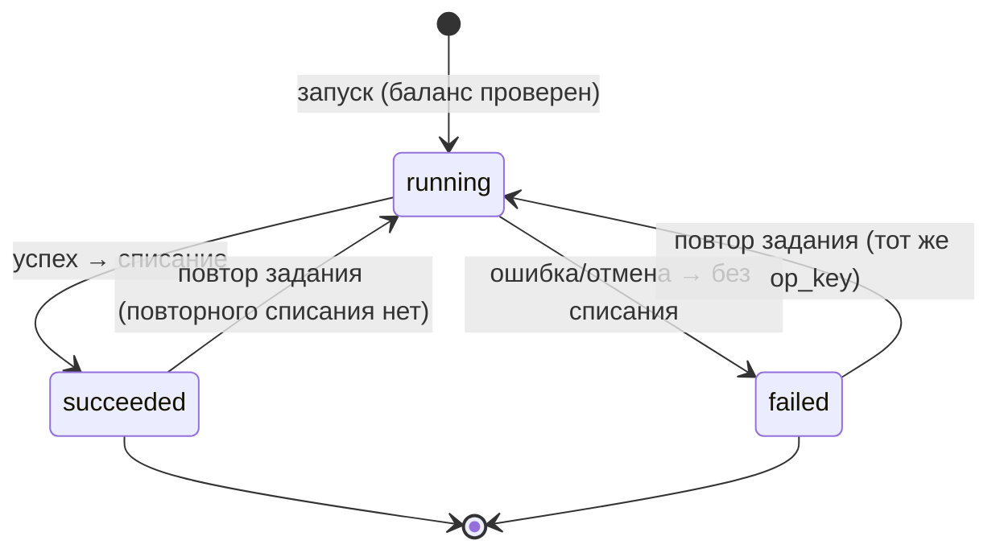
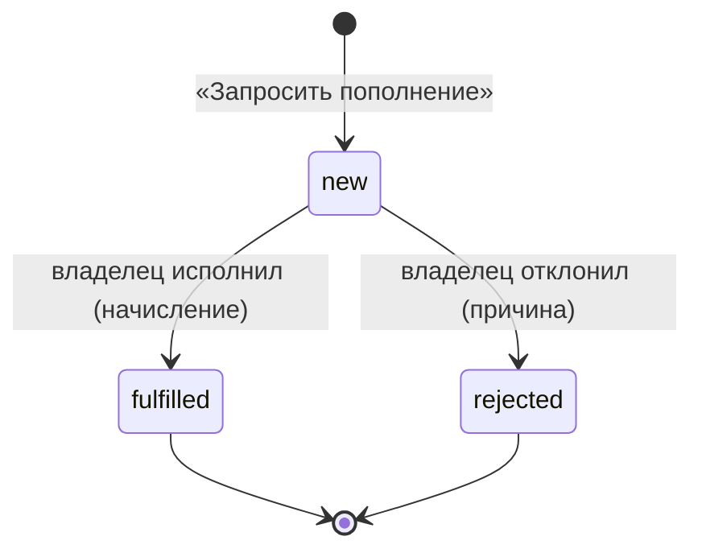

# Домен «Биллинг ИИ» (billing)

Учёт расходов на нейросеть во внутренней валюте — токенах: журнал каждого обращения к модели с себестоимостью, ИИ-операции как единицы списания, баланс клиента (начисления, списания, корректировки), заявки на пополнение, блокировка при нуле и порог «заканчивается», раздел владельца площадки с себестоимостью и маржой.

Связанные разделы: API — [../04-api/endpoints-billing.md](../04-api/endpoints-billing.md); ИИ-конвейеры, которые порождают обращения, — [../06-ai/](../06-ai/); учётка владельца — [identity.md §4.9](identity.md#49-владелец-площадки); журнал — [audit.md](audit.md); модель данных — [billing_clients](../05-data-model/tables.md#billing_clients), [billing_owner_settings](../05-data-model/tables.md#billing_owner_settings), [ai_operations](../05-data-model/tables.md#ai_operations), [ai_calls](../05-data-model/tables.md#ai_calls), [billing_entries](../05-data-model/tables.md#billing_entries), [topup_requests](../05-data-model/tables.md#topup_requests).

## 1. Назначение и границы домена

Система должна:

1. записывать **каждое** обращение к нейросети (журнал обращений) с моделью, токенами модели, себестоимостью в долларах и рублях, контекстом (кто, тендер, контрагент, раунд) — всегда, независимо от того, включён ли биллинг клиента;
2. объединять обращения одного действия пользователя в **ИИ-операцию** и списывать с баланса клиента одну сумму токенов за успешную операцию;
3. вести баланс клиента как сумму неизменяемых записей: приветственный бонус, пополнения по заявкам, ручные начисления, корректировки, списания;
4. не запускать новые ИИ-операции при исчерпанном балансе, если у клиента включена блокировка;
5. давать администратору Заказчика кабинет «Расходы» (только токены, без рублей себестоимости), а владельцу площадки — раздел с клиентами, заявками, себестоимостью, маржой и журналом обращений;
6. уведомлять владельца о новых заявках и о падении баланса ниже порога.

Модель денег (решение по архитектуре): **токен привязан к себестоимости**, наценка — множителем клиента при списании. 100 токенов = 1 ₽ себестоимости при множителе 1; клиент покупает токены по неизменной цене 100 токенов за 1 ₽. Множитель запоминается в каждом списании.

Вне границ: онлайн-оплата, счета и акты, оценка стоимости до запуска, письма администратору клиента о балансе, тарификация чего-либо кроме ИИ, мультиарендность данных площадки (сейчас одна установка = один клиент; модель биллинга к нескольким клиентам готова, см. открытые вопросы координатора).

## 2. Сущности и ключевые поля

| Сущность | Таблица | Ключевые поля |
|---|---|---|
| Клиент | [billing_clients](../05-data-model/tables.md#billing_clients) | `code` (уникален, из `CLIENT_CODE`), `name` (из `CLIENT_NAME`, иначе код), `multiplier` (>0, по умолчанию 1), `block_at_zero` (по умолчанию нет), `low_balance_threshold` (по умолчанию 1000 токенов), `low_balance_notified` (уведомление о пересечении уже ушло) |
| Настройки владельца | [billing_owner_settings](../05-data-model/tables.md#billing_owner_settings) | Одна строка на установку: `usd_rate` (₽ за $, по умолчанию 100), `payment_details` (реквизиты для оплаты, текст) |
| ИИ-операция | [ai_operations](../05-data-model/tables.md#ai_operations) | `client_id`, `purpose` (вид), `status` (`running`/`succeeded`/`failed`), `op_key` (ключ фонового задания `job:<id>`, уникален), `user_id`, `tender_id`, `round_no`, `started_at`, `finished_at` |
| Обращение к модели | [ai_calls](../05-data-model/tables.md#ai_calls) | `operation_id` (пусто — системное), `purpose`, `kind` (вид вызова: генерация/эмбеддинг), `model`, `ok`, `error`, `duration_ms`, `prompt_tokens`, `output_tokens`, `cost_usd`, `usd_rate` (курс на момент обращения), `cost_rub`, контекст (`user_id`, `tender_id`, `supplier_code`, `round_no`), `prompt_text`, `response_text` (только при включённом хранении) |
| Запись баланса | [billing_entries](../05-data-model/tables.md#billing_entries) | `kind` (`welcome`, `topup`, `manual`, `correction`, `charge`), `tokens` (со знаком), `operation_id` (у списания, уникален), `topup_request_id`, `multiplier` и `cost_rub` (у списания), `comment`, `created_by` (пусто — «Система») |
| Заявка на пополнение | [topup_requests](../05-data-model/tables.md#topup_requests) | `tokens` (запрошено), `comment`, `status` (`new`/`fulfilled`/`rejected`), `requested_by`, `decided_by`, `decided_at`, `reject_reason` |

Виды ИИ-операций (как их видит клиент):

| Код | Подпись | Что внутри | Проверка баланса перед запуском |
|---|---|---|---|
| `file_recognition` | Распознавание файла | Обогащение структуры при создании тендера из Excel и резервный разбор структуры файла моделью | да (у фонового разбора — только на первой попытке) |
| `tender_analysis` | ИИ-анализ тендера | «Анализ»: повестка торга | да, при постановке задания |
| `pair_analysis` | Разбор пары | Разбор двух финалистов | да, при постановке задания |
| `supplier_letter` | Письмо поставщику | Генерация письма | да |
| `table_question` | Вопрос по таблице | Одна реплика ИИ-чата по сравнительной таблице | да |
| `position_matching` | Сопоставление позиций | Подбор соответствий позиций (по умолчанию выключено) | да |
| `system` | Системное | Обращение вне операции — себестоимость владельца, клиенту не списывается | — |

Подписи видов записей: «Списание», «Приветственный бонус», «Пополнение по заявке», «Начисление», «Корректировка». Статусы заявки: «Новая», «Исполнена», «Отклонена».

## 3. Жизненный цикл

### 3.1. ИИ-операция

| Из | В | Кто | Условие | Побочные эффекты |
|---|---|---|---|---|
| — | `running` | система при действии пользователя | Если требуется проверка: биллинг включён, у клиента блокировка и баланс ≤ 0 → отказ 402 (операция не создаётся) | Все обращения к модели внутри действия пишутся с id операции |
| `running` | `succeeded` | система | Действие завершилось без ошибки | При `BILLING_ENABLED=true`: одно списание (если у операции есть обращения и списания ещё нет); затем проверка порога |
| `running` | `failed` | система | Действие упало, отменено, исчерпало попытки | Списания нет; себестоимость остаётся у владельца как «не списано» |
| `failed`/`succeeded` | `running` | система | Повтор фонового задания с тем же `op_key` | Та же операция; повторного списания нет (списание одно на операцию) |

### 3.2. Заявка на пополнение

| Из | В | Кто | Условие | Побочные эффекты |
|---|---|---|---|---|
| — | `new` | администратор Заказчика (`billing.view`), при `BILLING_ENABLED` | 0 < токенов ≤ 100 000 000 | Уведомление владельцу «Заявка на пополнение от «`<клиент>`»: N токенов на X ₽. `<ФИО>`: `<комментарий>`» |
| `new` | `fulfilled` | владелец | Сумма > 0; если сумма изменена — комментарий обязателен | Начисление `topup` на сумму (по умолчанию запрошенную), ссылка на заявку; событие `billing_topup_fulfilled`; проверка порога |
| `new` | `rejected` | владелец | Причина обязательна | Событие `billing_topup_rejected`; клиент видит причину |
| `fulfilled`/`rejected` | — | — | Конечные | Повторное решение — 409 «Заявка уже рассмотрена» |

### 3.3. Порог «заканчивается»

| Из | В | Условие | Побочные эффекты |
|---|---|---|---|
| не уведомлён | уведомлён | баланс < порога | Одно уведомление владельцу «Баланс клиента «`<клиент>`» ниже порога» (текст «Баланс: N токенов, порог: M.») |
| уведомлён | не уведомлён | баланс ≥ порога | Пометка снимается без уведомления |

Проверка выполняется после списания, ручного начисления/корректировки, исполнения заявки и правки клиента владельцем (смена порога может сразу вызвать уведомление).

## 4. Правила и валидации

1. **Записи баланса не правятся и не удаляются.** Ошибка исправляется корректировкой (отрицательная запись); клиент видит её в истории.
2. **Себестоимость — из ответа провайдера** (поле стоимости использования, запрашивается у провайдера в каждом обращении), а не из своего прайса. Нет стоимости в ответе — обращение пишется с пустой себестоимостью, списание операции считается по известным обращениям.
3. **Курс и множитель действуют на новые события.** В каждом обращении хранится курс на момент обращения, в каждом списании — множитель на момент списания; прошлое не пересчитывается.
4. **Журнал обращений и операции пишутся в собственной транзакции** — обращение остаётся в журнале, даже если операция упала и её транзакция откатилась.
5. **Платно всё, что запускает пользователь клиента**; бесплатных видов нет (подарить — начисление или множитель). Системные обращения вне операции клиенту не списываются; проверка доступности модели (служебная, 1 токен ответа) идёт в обход общего транспорта и в журнал не попадает.
6. **Списание пишется при завершении операции.** Операция без обращений (ответ из кэша) не списывается и в истории клиента не видна; с обращениями, но с нулевой себестоимостью — строка со списанием 0.
7. **Блокировка при нуле**: при `BILLING_ENABLED=true`, `block_at_zero=true` и балансе ≤ 0 новая операция не запускается — 402 `{"code": "tokens_exhausted", "message": "Баланс токенов исчерпан — обратитесь к администратору"}`. Уже идущая операция доходит до конца; баланс может уйти в минус.
8. **Баланс может быть отрицательным** (блокировка выключена или последняя операция стоила больше остатка).
9. **Ручное начисление/корректировка владельца**: вид `manual` или `correction` («Неизвестный тип начисления»), количество > 0 («Количество токенов должно быть больше нуля»), комментарий обязателен («Комментарий обязателен»), клиент существует («Клиент не найден»). Владелец вводит положительное число, корректировка записывается со знаком минус.
10. **Правка клиента владельцем**: множитель > 0 и ≤ 1000, порог ≥ 0, блокировка — да/нет; изменяются только присланные поля.
11. **Настройки владельца**: курс > 0 и ≤ 10 000, реквизиты — свободный текст (обрезка пробелов).
12. **Клиенту не отдаются** — ни в интерфейсе, ни в API — рубли себестоимости, курс, множитель, токены модели, модели, промпты, неуспешные операции. Ограничение держит сервер (ответы кабинета клиента собираются без этих полей).
13. **Кабинет клиента выключен** при `BILLING_ENABLED=false`: все ручки `/billing/*` отвечают 404 «Раздел недоступен», пункт «Расходы» скрыт; раздел владельца при этом работает (себестоимость и журнал обращений), но без клиентов и заявок в навигации.
14. **Текст промптов и ответов** (содержит данные КП) хранится только при `AI_PROMPT_LOG_ENABLED=true` и стирается через `AI_PROMPT_LOG_DAYS` (30) дней; числа, цель и контекст остаются. Видит только владелец.
15. Отчёты владельца: группировка — `purpose` | `tender` | `client` («Неизвестная группировка»); период — даты включительно, по умолчанию последние 30 дней по сегодняшний; график клиента — `week` | `month` («Период — неделя или месяц»), число столбцов 1–52 (по умолчанию 12).

## 5. Расчёты и формулы

| Величина | Формула |
|---|---|
| Себестоимость обращения, ₽ | `cost_usd × usd_rate` (курс на момент обращения) |
| Себестоимость операции, ₽ | `Σ cost_rub` всех её обращений, включая повторы и отброшенные ответы |
| Списание, токенов | `⌈себестоимость операции ₽ × 100 × множитель⌉` (округление вверх до целого); в записи — со знаком минус |
| Цена покупки | `токены / 100` ₽ (сумма к оплате в заявке) |
| Баланс | `Σ tokens` всех записей клиента |
| «Мало» (плашка в кабинете) | `баланс < low_balance_threshold` |
| «Заблокирован» | `block_at_zero ∧ баланс ≤ 0` |
| Расходы за период (график клиента) | `Σ (−tokens)` списаний по началу недели (понедельник) / месяца, UTC |
| Отчёт владельца, строка группы | `cost_rub` = Σ себестоимости обращений периода; `charged_tokens` = Σ списаний периода; `charged_rub` = `charged_tokens / 100`; `charged_cost_rub` = Σ себестоимости списанных операций; `uncharged_rub` = `cost_rub − charged_cost_rub`; `margin_rub` = `charged_rub − charged_cost_rub`; итог — сумма строк |

Пример: обращения операции стоили $0,0069 при курсе 100 → 0,69 ₽. При множителе 1 списание `⌈0,69 × 100 × 1⌉ = 69` токенов; при множителе 10 — 690 токенов (6,90 ₽ по цене покупки, маржа 6,21 ₽).

## 6. Права доступа

| Действие | Админ | Тенд. специалист | СБ | Юрист | Поставщик | Лид | Владелец площадки |
|---|---|---|---|---|---|---|---|
| Кабинет «Расходы»: баланс, история, график, свои заявки, создать заявку | ✅ (при `BILLING_ENABLED`) | при праве `billing.view` | при `billing.view` | при `billing.view` | ❌ | ❌ | ❌ |
| Клиенты: список с балансом, множитель, блокировка, порог | ❌ | ❌ | ❌ | ❌ | ❌ | ❌ | ✅ |
| Начисление и корректировка | ❌ | ❌ | ❌ | ❌ | ❌ | ❌ | ✅ |
| Заявки: список всех, исполнить, отклонить | ❌ | ❌ | ❌ | ❌ | ❌ | ❌ | ✅ |
| Курс доллара и реквизиты | ❌ | ❌ | ❌ | ❌ | ❌ | ❌ | ✅ |
| Себестоимость против списанного; журнал обращений (с текстами промптов, если хранятся) | ❌ | ❌ | ❌ | ❌ | ❌ | ❌ | ✅ |
| Запустить платную ИИ-операцию | по правам соответствующего экрана ИИ ([../06-ai/](../06-ai/)); баланс проверяется для всех одинаково | | | | | | |

Право `billing.view` по умолчанию есть только у администратора; в интерфейсе пункт «Расходы» показывается только роли «Администратор» (см. [../01-product/users-and-roles.md](../01-product/users-and-roles.md)). Раздел владельца закрыт признаком владельца, а не матрицей.

## 7. События, уведомления, аудит

| Действие | Журнал | Уведомление |
|---|---|---|
| Ручное начисление / корректировка | `billing_entry_created` `{client_id, kind, tokens}` | — |
| Правка клиента | `billing_client_updated` (присланные поля) | возможно «ниже порога» |
| Правка курса и реквизитов | `billing_owner_settings_updated` `{usd_rate}` | — |
| Исполнение заявки | `billing_topup_fulfilled` `{tokens, requested}` | — |
| Отклонение заявки | `billing_topup_rejected` | — |
| Новая заявка | — | Владельцу: Telegram или письмо |
| Баланс ниже порога (один раз на пересечение) | — | Владельцу: Telegram или письмо |
| Списание, приветственный бонус | — (системные) | — |

**Канал уведомления владельцу**: при `BILLING_TELEGRAM_ENABLED=true` и заданном `BILLING_TELEGRAM_CHAT_ID` — сообщение в чат биллинга (тот же бот, что технические алерты, но отдельный чат и отдельный включатель); если Telegram не задан или отправка не удалась — письмо на `BILLING_OWNER_EMAIL`; нет ни того, ни другого — только запись в лог. Сбой уведомления не отменяет заявку и не ломает списание. Письма администратору клиента о балансе не отправляются. Записей в центре уведомлений и событий живого потока домен не создаёт.

## 8. Фоновые задачи и периодика

| Задача | Когда | Что делает |
|---|---|---|
| Заведение клиента | при старте приложения | Если клиента с кодом `CLIENT_CODE` нет — создать его и **один раз** начислить приветственный бонус `BILLING_WELCOME_BONUS` (если > 0); создать строку настроек владельца, если её нет |
| `ai-prompt-purge` | каждые 6 ч | Стереть `prompt_text` и `response_text` у обращений старше `AI_PROMPT_LOG_DAYS` |

Повторы ИИ-операций — через повтор фонового задания, которое их запускает (одна операция на все попытки, см. §3.1).

## 9. Настройки и флаги

| Имя | По умолчанию | Назначение |
|---|---|---|
| `BILLING_ENABLED` | false | Клиентская часть: кабинет, списания, заявки, блокировка. Журнал обращений и себестоимость пишутся всегда |
| `CLIENT_CODE` | demo | Код клиента установки |
| `CLIENT_NAME` | пусто | Название клиента (иначе — код) |
| `BILLING_WELCOME_BONUS` | 0 | Приветственный бонус, токенов |
| `BILLING_OWNER_EMAIL` | пусто | Почта владельца для уведомлений |
| `BILLING_TELEGRAM_ENABLED` | false | Уведомления владельцу в Telegram |
| `BILLING_TELEGRAM_CHAT_ID` | пусто | Чат биллинга (токен бота — секрет `TELEGRAM_BOT_TOKEN`) |
| `TELEGRAM_HTTP_PROXY` | пусто | Прокси для Telegram API |
| `AI_PROMPT_LOG_ENABLED` | false | Хранить тексты промптов и ответов |
| `AI_PROMPT_LOG_DAYS` | 30 | Срок хранения текстов |

Курс доллара и реквизиты — данные (настройки владельца в интерфейсе), а не конфигурация. Константы: 100 токенов = 1 ₽; максимум заявки — 100 000 000 токенов.

## 10. Граничные случаи

1. **Включение биллинга на живой установке**: операции, завершённые при `BILLING_ENABLED=false`, не списываются и потом — задним числом списаний нет.
2. **Повтор фонового задания** продолжает ту же операцию (`op_key`), статус снова `running`; если первая попытка уже списала — второго списания нет (уникальность списания по операции).
3. **Баланс проверяется при постановке задания**, а не при каждой попытке: задание, поставленное при положительном балансе, дорабатывает даже при уходе в минус.
4. **Отчёт владельца на границе периода**: себестоимость считается по времени обращений, списания — по времени записи списания; операция, начатая до полуночи и завершённая после, попадёт в разные дни. Итоговые суммы за длинный период сходятся.
5. **Обращение без себестоимости** (провайдер не вернул стоимость) видно владельцу в журнале с пустым значением; в «не списано» оно не попадает (суммируются только известные значения).
6. **Владелец удалил/не задал реквизиты** — в окне заявки клиента блок реквизитов пустой.
7. **Неуспешные операции** клиент не видит вовсе; владелец видит их в журнале обращений (статус операции) и в «не списано».
8. **Строка истории клиента**: автор «Система», если записи создала система (бонус, списание); «Владелец площадки», если автор — владелец или удалённый пользователь; иначе ФИО.
9. **Одна установка — один клиент**: «текущий клиент» определяется в одном месте (по `CLIENT_CODE`); при переходе к нескольким клиентам на установке меняется только это место.

## 11. Пример

Клиент «demo»: множитель 1,5; блокировка включена; порог 1000; баланс 1 050.

1. Специалист запускает «Вопрос по таблице»: проверка баланса (1 050 > 0) — проходит. Два обращения к модели: $0,0040 и $0,0012 при курсе 100 → 0,40 ₽ и 0,12 ₽. Операция успешна → списание `⌈0,52 × 100 × 1,5⌉ = 78` токенов. Баланс 972 < 1000 → владельцу одно сообщение «Баланс клиента «demo» ниже порога. Баланс: 972 токенов, порог: 1000.».
2. Администратор Заказчика создаёт заявку на 5 000 токенов («к оплате 50 ₽», реквизиты владельца на экране). Владелец получает уведомление, после оплаты исполняет заявку на 5 000 — начисление «Пополнение по заявке» +5 000, баланс 5 972 ≥ 1000 → пометка «уведомлён» снята.
3. В отчёте владельца по видам операций за день: «Вопрос по таблице» — себестоимость 0,52 ₽, списано 78 токенов = 0,78 ₽, себестоимость списанного 0,52 ₽, не списано 0,00 ₽, маржа 0,26 ₽.

## 12. Оценка сложности

**L.** Нужны: сквозной учёт каждого обращения к модели через единую точку вызова с собственной транзакцией, контекст операции, проходящий через асинхронные вызовы и фоновые задания с идемпотентным списанием, неизменяемая книга баланса, блокировка при нуле во всех точках запуска ИИ, заявки с двумя каналами уведомлений, отчёт себестоимость/списано/маржа с группировками, журнал обращений с ограниченным хранением текстов, строгое разделение того, что видит клиент и владелец.

## 13. Связанные разделы

- API: [../04-api/endpoints-billing.md](../04-api/endpoints-billing.md) (`/billing/*`, `/owner/*`).
- Экраны: [../03-screens/expenses.md](../03-screens/expenses.md), [../03-screens/owner-clients.md](../03-screens/owner-clients.md), [../03-screens/owner-requests.md](../03-screens/owner-requests.md), [../03-screens/owner-costs.md](../03-screens/owner-costs.md), [../03-screens/owner-calls.md](../03-screens/owner-calls.md), [../03-screens/owner-settings.md](../03-screens/owner-settings.md).
- Таблицы: [billing_clients](../05-data-model/tables.md#billing_clients), [billing_owner_settings](../05-data-model/tables.md#billing_owner_settings), [ai_operations](../05-data-model/tables.md#ai_operations), [ai_calls](../05-data-model/tables.md#ai_calls), [billing_entries](../05-data-model/tables.md#billing_entries), [topup_requests](../05-data-model/tables.md#topup_requests).
- Открытые вопросы — `../_oq/BL-1.md`.
