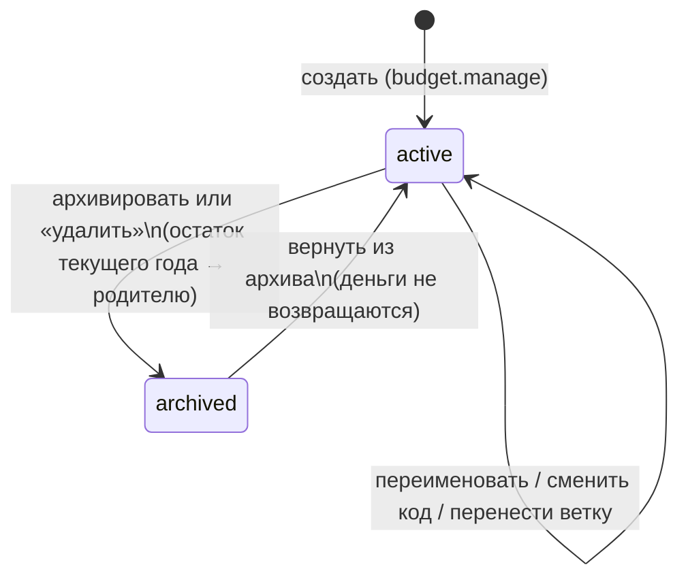
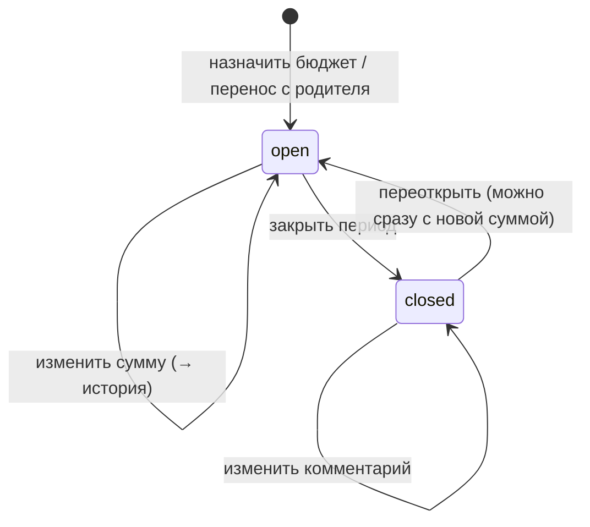

# Домен «Бюджет» (budget)

Дерево бюджетных позиций (статей), распределение сумм по календарным годам с историей изменений, переносы сумм между родителем и подпозицией, вычисляемые метрики «в работе / израсходовано / свободно» по тендерам и КП, сводка года с сигналами и «манометр» бюджета на главной.

Связанные разделы: API — [../04-api/endpoints-budget.md](../04-api/endpoints-budget.md) (сводка, распределение, план/факт) и [../04-api/endpoints-catalog.md](../04-api/endpoints-catalog.md) (CRUD `/budget-positions`); привязка тендера к позиции и плановая сумма — [tenders-lifecycle.md §11](tenders-lifecycle.md#11-виды-работ-бюджетная-позиция-плановая-сумма); итог КП — [tenders-comparison.md §6.2](tenders-comparison.md#62-итог-кп-и-полнота); экраны — [../03-screens/budget.md](../03-screens/budget.md), [../03-screens/budget-position.md](../03-screens/budget-position.md), [../03-screens/home.md](../03-screens/home.md); модель данных — [budget_positions](../05-data-model/tables.md#budget_positions), [budget_period_allocations](../05-data-model/tables.md#budget_period_allocations), [budget_allocation_history](../05-data-model/tables.md#budget_allocation_history).

## 1. Назначение и границы

Бюджетная позиция — финансовый классификатор: статья, из которой оплачивается тендер. Позицию выбирают вручную при создании тендера (автоподстановки по виду работ нет), поэтому оператор должен видеть, есть ли на позиции деньги. Цель раздела — понимать, «прошёл ли тендер по этой позиции», а не строить финансовую отчётность.

Модель — два слоя:

| Слой | Что это | Как меняется |
|---|---|---|
| **Позиция** | Узел классификатора: код, название, место в дереве. Живёт «вечно», не привязана к году | Редко; создаёт и правит держатель права `budget.manage` |
| **Бюджет периода** | Сумма «Выделено» на позицию за календарный год + статус периода (открыт/закрыт) + комментарий. У позиции может быть несколько лет | В течение года, каждое изменение суммы — в историю |

Система должна:

1. вести дерево позиций глубиной **не более 5 уровней** с уникальностью названия в пределах родителя и уникальностью кода среди действующих позиций, с мягким удалением (архивом);
2. хранить **только** «Выделено» на пару «позиция × год»; «В работе», «Израсходовано», «Свободно» и число тендеров — **вычислять** из тендеров и КП, а не хранить (хранимые копии разошлись бы с тендерами);
3. писать в историю каждое изменение выделенной суммы (было → стало, комментарий, кто, когда);
4. при создании подпозиции позволять **перенести** часть суммы родителя за год одним действием и **отменить** перенос; при архивации подпозиции — возвращать её остаток текущего года родителю;
5. считать метрики по самой позиции и **по ветке** (позиция + все потомки);
6. отдавать сводку года: итоги, сигналы (перерасход, тендеры на позиции без бюджета, тендеры без позиции) и метрики всех позиций для дерева; та же сводка питает манометр на главной;
7. отвечать домену тендеров на вопросы «есть ли позиция», «её путь в дереве», «закрыт ли период» (через порт — тендеры не знают устройства бюджета).

Вне границ: проверки привязки позиции при создании/правке тендера и тексты отказов ([tenders-lifecycle.md](tenders-lifecycle.md#11-виды-работ-бюджетная-позиция-плановая-сумма)); расчёт итога КП и полноты ([tenders-comparison.md](tenders-comparison.md#62-итог-кп-и-полнота)); «Дельта» протокола тендера ([tenders-documents.md](tenders-documents.md#3-протокол-тендера-docx)). Связи «вид работ ↔ бюджетная позиция» нет намеренно: справочники связывает только тендер (одна позиция + один или несколько видов работ). Позиция привязывается к тендеру целиком, не к позициям ФКП. Импорта годового бюджета из Excel в исходной системе нет (см. открытые вопросы).

## 2. Сущности и ключевые поля

| Сущность | Таблица | Ключевые поля |
|---|---|---|
| Бюджетная позиция | [budget_positions](../05-data-model/tables.md#budget_positions) | `name` (≤ 255), `code` (≤ 64, необязателен), `parent_id` (пусто — корень), `is_active` (архив = `false`) |
| Бюджет периода (распределение) | [budget_period_allocations](../05-data-model/tables.md#budget_period_allocations) | `budget_position_id`, `period_year`, `allocated_amount` (numeric 18,2, ≥ 0), `status` (`open`/`closed`), `comment`; уникальность «позиция × год» |
| Запись истории суммы | [budget_allocation_history](../05-data-model/tables.md#budget_allocation_history) | `allocation_id`, `old_amount` (пусто — первое назначение), `new_amount`, `comment`, `changed_by`, `created_at`; только дописывается |

Поля других доменов, на которые опирается бюджет:

| Поле | Где | Смысл для бюджета |
|---|---|---|
| `budget_position_id` | [tenders](../05-data-model/tables.md#tenders) | Привязка тендера к позиции (ровно одна; обязательна при создании тендера) |
| `budget_amount` | tenders | **Плановая сумма** тендера (в интерфейсе — «Бюджет»), может быть пуста |
| `status`, `start_date`, `created_at` | tenders | Статус (см. §5) и отчётный год |
| Итоги текущих версий КП | quotes / quote_versions / quote_items | «Лучшее предложение» тендера для «Израсходовано» и плана/факта |

Вычисляемые показатели позиции за год (`BudgetPositionMetrics`, полный состав полей — в [API](../04-api/endpoints-catalog.md)): `allocated`, `in_work`, `spent`, `free`, `has_funds`, их ветковые варианты `branch_*`, `tenders_total/open/closed`, `branch_tenders_total`, `path` (путь через « › »), `depth` (0 — корень), реквизиты распределения года.

Терминология денег по тендеру:

| Термин | Что это | Источник |
|---|---|---|
| Плановая сумма | Заданный при создании тендера бюджет тендера | `tenders.budget_amount` |
| Лучшее предложение (в бюджете) | Минимальный итог среди **поданных** текущих версий КП тендера, включая неполные | §5 |
| «Лучшая цена» (реестр, отчёты) | Итог лидера — минимум только среди **полных** КП | [tenders-comparison.md §6.6](tenders-comparison.md#66-цены-реестра) |
| Законтрактовано | Отдельной величины в исходной системе **нет**; ближайший аналог — «Израсходовано» по завершённым тендерам | см. открытые вопросы |

## 3. Жизненный цикл

### 3.1. Бюджетная позиция

| Из | В | Кто | Условие | Побочные эффекты |
|---|---|---|---|---|
| — | Активна | `budget.manage` | Название непустое и свободно у родителя, код свободен, глубина ≤ 5 | Журнал ИБ `budget_position_created`; при переносе суммы — см. §4.3 |
| Активна | Активна | `budget.manage` | Переименование, смена кода, перенос в другую ветку (§4.1) | `budget_position_changed` (`fields` — список изменённых полей) |
| Активна | Архив | `budget.manage` | `is_active=false` в правке или «удаление» (повтор идемпотентен) | Возврат остатка текущего года родителю (§4.4), две записи истории; `budget_position_changed` (`returned_to_parent`, при удалении `via: delete`). Подпозиции **не** архивируются автоматически |
| Архив | Активна | `budget.manage` | `is_active=true` в правке | Деньги, возвращённые родителю при архивации, обратно **не** переносятся |
| любое | удалена физически | — | Не предусмотрено: на позицию ссылаются тендеры, суммы и история | — |

Архивная позиция не выбирается в новом тендере («Нельзя привязать архивную бюджетную позицию»), но остаётся в старых тендерах и карточке.

### 3.2. Бюджет периода (позиция × год)

| Из | В | Кто | Условие | Побочные эффекты |
|---|---|---|---|---|
| — | Открыт | `budget.manage` | Назначение бюджета позиции на год; сумма по умолчанию 0 | История: `old = пусто`, комментарий из запроса или «Назначение бюджета»; журнал `budget_allocation_changed` |
| — | Открыт | система | Перенос при создании подпозиции, когда у родителя или ребёнка ещё нет записи года | Запись создаётся с суммой 0 (у родителя) или суммой переноса (у ребёнка) |
| Открыт | Открыт | `budget.manage` | Изменение суммы / комментария | При смене суммы — запись истории (комментарий или «Изменение суммы») |
| Открыт | Закрыт | `budget.manage` | Смена статуса | Сумма заморожена; новые тендеры на позицию за этот год привязать нельзя; история **не** пишется |
| Закрыт | Закрыт | `budget.manage` | Можно поменять только комментарий | Попытка сменить сумму — «Закрытый период нельзя менять» |
| Закрыт | Открыт | `budget.manage` | Переоткрытие; в том же запросе можно задать новую сумму | При смене суммы — запись истории |

Статус периода и активность позиции — **два независимых флага**: архивная позиция может иметь открытый период, закрытый период не делает позицию архивной; в следующем году период открывается заново.

## 4. Правила и валидации

### 4.1. Позиция

| Правило | Текст отказа |
|---|---|
| Название обязательно (после обрезки пробелов) | 400 «Введите название бюджетной позиции» |
| Название уникально в пределах родителя, без учёта регистра (у корней — среди корней) | 409 «Имя уже занято в пределах этого родителя» |
| Код необязателен; если задан — уникален среди **действующих** позиций без учёта регистра; пустая строка в правке очищает код | 409 «Код уже используется активной позицией» |
| Родитель существует | 400 «Родительская позиция не найдена» |
| Глубина: уровень новой позиции ≤ 5 (корень — уровень 1); при переносе ветки — уровень позиции + высота её поддерева ≤ 5 | 400 «Дерево не глубже 5 уровней» |
| Перенос не в саму себя и не в свою подветку | 400 «Нельзя перенести позицию в саму себя или в свою подветку» |
| Нет позиции | 404 «Бюджетная позиция не найдена» |

Ограничение глубины дублируется на клиенте (константа 5), чтобы не предлагать родителя, под которым позицию завести нельзя. Порядок братьев в дереве: по коду с числовым сравнением («5.4.9» раньше «5.4.10»), позиции без кода — после, по названию.

### 4.2. Бюджет периода

| Правило | Текст отказа |
|---|---|
| Сумма ≥ 0 | 400 «Сумма не может быть отрицательной» |
| Статус — `open` или `closed` | 400 «Статус: open или closed» |
| Сумму закрытого периода менять нельзя, если в том же запросе период не переоткрывается | 400 «Закрытый период нельзя менять» |
| Нет записи распределения (правка по id) | 404 «Бюджет периода не найден» |
| Одна запись на «позиция × год» (уникальный индекс); назначение — upsert | — |

- Год по умолчанию — текущий календарный год.
- Комментарий из запроса: пустой → `null`; он же становится комментарием записи истории при смене суммы.
- Запись истории создаётся только при **фактическом** изменении суммы (то же значение — без записи).
- В форме «Назначить бюджет» интерфейс показывает подсказку «У родителя «<путь>» на <год> свободно <сумма> — столько можно распределить.» и ошибку поля «Больше, чем свободно у родителя (<сумма>).», если введено больше свободного остатка родителя за тот же год. Это **клиентская** проверка; сервер сумму ребёнка с остатком родителя не сверяет (см. §10).
- Выбор года на экранах: прошлый, текущий, следующий.

### 4.3. Перенос суммы при создании подпозиции

1. Поле «Сумма переноса» ≥ 0 («Сумма переноса не может быть отрицательной»); > 0 допустимо только при заданном родителе («Перенос суммы возможен только при создании подпозиции»).
2. Год переноса — переданный, иначе текущий.
3. Если у родителя нет записи на этот год — она создаётся с суммой 0 (и перенос > 0 тогда отклоняется п. 5).
4. Период родителя закрыт → 400 «Закрытый период родителя нельзя менять».
5. Сумма переноса ≤ **выделенной** сумме родителя на год → иначе 400 «Сумма превышает нераспределённый остаток родителя (<сумма с двумя знаками>)». Сверка идёт с «Выделено» родителя, а не со «Свободно» (см. §10).
6. Результат одним действием: «Выделено» родителя уменьшается на сумму, подпозиции назначается эта сумма; две записи истории: у родителя «Перенос на подпозицию «<имя>» (−<сумма>)», у ребёнка «Перенос с родителя id=<id> (+<сумма>)».
7. Ответ содержит «квитанцию отмены» `{child_id, parent_id, period_year, amount}`; интерфейс показывает её кнопкой «Отменить» в уведомлении.

**Отмена переноса:** обязательны id ребёнка и родителя и сумма > 0 («Некорректные параметры отмены»); обе позиции существуют (404 «Позиция не найдена»); ни один из периодов не закрыт («Закрытый период нельзя менять»). Возвращается `min(сумма квитанции, текущее «Выделено» ребёнка)`; две записи истории «Отмена переноса»; журнал `budget_transfer_undone`.

В текущем интерфейсе форма создания позиции сумму **не** переносит (деньги назначаются на вкладке «Бюджеты»), механизм переноса и отмены доступен через API. Какой сценарий целевой — см. открытые вопросы.

### 4.4. Возврат остатка при архивации подпозиции

При переводе позиции с родителем в архив (правкой или «удалением») система должна:

1. взять запись распределения позиции на **текущий календарный год** (не выбранный на экране);
2. если её сумма > 0, её период не закрыт и период родителя на этот год не закрыт (запись родителя создаётся при необходимости) — обнулить сумму позиции и прибавить её к родителю;
3. записать историю: у позиции «Возврат при архивации подпозиции» / «Возврат при удалении подпозиции», у родителя «Возврат с архивированной подпозиции «<имя>»» / «Возврат с удалённой подпозиции «<имя>»»;
4. вернуть в ответе `returned_to_parent` (сумма или `null`).

Суммы других лет у архивной позиции остаются на ней.

### 4.5. Сводка года: частота и кэш

Сводка — тяжёлое чтение: общий лимит «тяжёлых чтений» пользователя (`HEAVY_READ_RATE_LIMIT` запросов за `HEAVY_READ_RATE_WINDOW` секунд, по умолчанию 60/60) и серверный кэш на `HEAVY_READ_CACHE_SECONDS` (60 с) с `ETag`. Ключ кэша: год, набор доступных пользователю объектов, версия денежных правил, **отпечаток данных** — максимум времени изменения тендеров, число тендеров, максимум времени изменения КП, последний id истории распределения, число позиций и максимальный id позиции. Механика кэша — в [analytics.md §5.3](analytics.md#53-кэш-тяжёлых-чтений-и-лимит-частоты).

## 5. Расчёты и формулы

Обозначения: `p` — позиция, `Y` — год, `T(p, Y)` — тендеры с `budget_position_id = p` и отчётным годом `Y`, **кроме отменённых** (`cancelled` в метриках не участвует вовсе).

| Величина | Формула |
|---|---|
| Отчётный год тендера | `Y(t) = год(start_date)`, если дата начала задана; иначе год `created_at` (по UTC) |
| Выделено | `allocated(p,Y)` = сумма записи «p × Y», нет записи — 0 |
| В работе | `in_work(p,Y) = Σ budget_amount(t)` по `t ∈ T(p,Y)` со статусом `draft` или `open`; пустая плановая сумма = 0 |
| Лучшее предложение тендера | `best(t) = min итог(КП)` по КП тендера в статусах «Подано», «На доработке», «Принят» (текущие версии) |
| Израсходовано тендером | `S(t) = best(t)`, если есть поданные КП; иначе `budget_amount(t)`, если задана; иначе 0 |
| Израсходовано | `spent(p,Y) = Σ S(t)` по `t ∈ T(p,Y)` со статусом `closed` |
| Свободно | `free = allocated − in_work − spent`; `has_funds = free > 0` |
| Тендеров | `tenders_total = count(T(p,Y))`; `tenders_open` — `draft`+`open`; `tenders_closed` — `closed` |
| По ветке | `branch_x(p) = x(p) + Σ branch_x(c)` по **всем** детям `c` (включая архивных); `branch_free = branch_allocated − branch_in_work − branch_spent`; `branch_tenders_total` аналогично |
| Итоги года (сводка) | `totals.x = Σ x(p)` по **действующим** позициям, собственные значения (не ветковые — иначе деньги учлись бы дважды) |
| Сигнал «перерасход» | действующие `p` с `free < 0` |
| Сигнал «нулевой бюджет при тендерах» | действующие `p` с `allocated = 0` и `tenders_total > 0` |
| Сигнал «тендеры без позиции» | тендеры года (кроме отменённых) без позиции, **только доступных пользователю объектов** |
| Освоение (карточка позиции) | `used = min(100, round((in_work + spent) / allocated × 100))` при `allocated > 0`, иначе 0; бейдж «Превышение» при `free < 0` |
| План/факт тендера | `actual = best(t)` или `null`, если КП нет; `deviation = actual − budget_amount` (отрицательное — экономия), если обе величины есть |
| Путь позиции | названия от корня через « › »; `depth` = число предков |

Итог КП: сумма по учитываемым строкам текущей версии, строка = `round(M × q, 2) + round(W × q, 2)`, где `M`, `W` — ставки материалов и работ за единицу, `q` — принятый специалистом объём поставщика, иначе объём ФКП, иначе 1 (у строк с ценой «за строку» — 1); не учитываются строки с отказом поставщика и не принятые новые позиции. Это то же правило, что у сравнения ([tenders-comparison.md](tenders-comparison.md#62-итог-кп-и-полнота)).

**Манометр на главной** (сводка текущего года):

| Элемент | Правило |
|---|---|
| Основа полосы | `base = max(allocated, spent + in_work)` |
| Сегменты (слева направо) | «Израсходовано» `spent`, «В работе» `in_work`, «Свободно» `free` — либо «Перерасход» `abs(free)` при `free < 0`; ширина сегмента = `max(0, value / base × 100) %` |
| Главное число | `free` («свободно из <allocated> ₽»), при перерасходе — «−<abs(free)> ₽ перерасход из <allocated> ₽» |
| Процент в легенде | `round(value / allocated × 100) %`, при `allocated = 0` — «—» |
| Сигналы под полосой (только ненулевые, ссылкой на раздел «Бюджет») | «N позиций в перерасходе», «N тендеров без бюджетной позиции», «N позиций с тендерами, но без бюджета» |
| Подпись для экранного диктора | «Выделено X ₽: израсходовано a %, в работе b %, свободно c %.» (или «перерасход Y ₽.») |

Манометр показывается только администратору и тендерному специалисту **и** только если пользователю видны финансы (право `finance.view` или персональный флаг): сервер суммы бюджета не маскирует, а пустой прибор хуже его отсутствия.

## 6. Права доступа

Права по умолчанию и настраиваемость — [../01-product/users-and-roles.md](../01-product/users-and-roles.md#44-справочники-и-бюджет).

| Действие | Админ | Тенд. специалист | СБ | Юрист | Контрагент | Лид | Владелец |
|---|---|---|---|---|---|---|---|
| Справочник позиций с метриками, карточка позиции (история, тендеры) | ✅ | ✅ | ✅ | ✅ | ❌ | ❌ | ❌ |
| Сводка года, распределение по статьям, план/факт (`budget.view`) | ✅ | ⚙✅ | ⚙ | ⚙ | ❌ | ❌ | ❌ |
| Создать/изменить/архивировать позицию, перенос и отмена переноса, назначить/изменить бюджет периода, закрыть/открыть период (`budget.manage`) | ✅ | ⚙ | ⚙ | ⚙ | ❌ | ❌ | ❌ |
| Манометр на главной | ✅ | ✅ при финансах и `budget.view` | ❌ (нет экрана) | ❌ | ❌ | ❌ | ❌ |
| Раздел «Бюджет» в интерфейсе | ✅ | ✅ | ❌ | ❌ | ❌ | ❌ | ❌ |

✅ — всегда; ⚙✅ — по умолчанию, настраивается; ⚙ — можно выдать в матрице; ❌ — нельзя. Отказ по праву — 403 «Недостаточно прав для этого действия — обратитесь к администратору системы» и событие `permission_denied`. Метрики позиций считаются по **всем** тендерам года независимо от грантов пользователя на объекты; ограничение по объектам действует только на план/факт по тендерам и на сигнал «тендеры без позиции» (см. открытые вопросы API-3). Суммы бюджета правом `finance.view` не маскируются.

## 7. События, уведомления, аудит

| Действие | Событие журнала ИБ (`entity_type = budget_position`) | `details` |
|---|---|---|
| Создание позиции | `budget_position_created` | `{name, code, parent_id, transfer}` |
| Правка / архивация | `budget_position_changed` | `{fields: [...], returned_to_parent}` |
| «Удаление» (архив) | `budget_position_changed` | `{via: "delete", returned_to_parent}` |
| Отмена переноса | `budget_transfer_undone` | `{parent_id, period_year, returned}` |
| Назначение/изменение бюджета позиции (через карточку позиции) | `budget_allocation_changed` | `{period_year, allocated_amount, status}` |
| Правка распределения из реестра «Бюджеты» (по id записи) | **не пишется** | — (рекомендуется писать `budget_allocation_changed`, см. §10) |

Подписи, категория («Справочники и бюджет») и критичность кодов — [audit.md §7.1](audit.md#71-каталог-событий). Каждое изменение суммы, кроме того, оставляет запись в истории распределения — это рабочая история для пользователя (вкладка «История» карточки позиции, новые сверху), а журнал ИБ — для разбора.

Уведомлений в центр уведомлений, писем и событий живого потока домен не создаёт.

## 8. Фоновые задачи и периодика

Своих фоновых задач нет. Все метрики считаются на лету в запросе одним проходом по позициям и тендерам года (без запросов на каждую позицию). Просроченные записи кэша тяжёлых чтений удаляет общая платформенная задача раз в час (`shared-store-purge`, [../07-architecture/architecture.md](../07-architecture/architecture.md)).

## 9. Настройки и флаги

| Имя | По умолчанию | Влияние |
|---|---|---|
| `HEAVY_READ_CACHE_SECONDS` | 60 | Срок жизни кэша сводки года; 0 — кэш выключен |
| `HEAVY_READ_RATE_LIMIT` / `HEAVY_READ_RATE_WINDOW` | 60 / 60 с | Общий лимит тяжёлых чтений пользователя (сводка бюджета входит в него) |

Глубина дерева (5) — константа кода, не настройка. Других флагов у домена нет.

## 10. Граничные случаи

1. **«Израсходовано» не по победителю.** Для завершённого тендера берётся минимальный итог среди всех поданных КП, **включая неполные** (итог неполного занижен на позиции без цены), а не итог КП победителя, хотя победитель обязателен при закрытии ([tenders-lifecycle.md §8](tenders-lifecycle.md#8-закрытие-тендера-и-выбор-победителя)). То же в плане/факте. Требование к воссозданию — см. открытые вопросы; рекомендация — «Израсходовано» = итог КП победителя (статус «Принят»), а при его отсутствии — минимум полных КП.
2. **Тендер без плановой суммы** в черновике или сборе предложений не занимает денег: позиция выглядит свободной.
3. **Завершённый тендер без КП и без плановой суммы** расходует 0.
4. **Отменённый тендер** исчезает из всех метрик и сигналов.
5. **Смена даты начала** переносит тендер в другой отчётный год; тендер без даты начала относится к году создания (по UTC). «Текущий год» по умолчанию тоже берётся по UTC — в первые часы 1 января по Москве открывается прошлый год; при воссоздании рекомендуется считать год по московскому времени.
6. **Закрытый период** замораживает только «Выделено» и запрет привязки новых тендеров; «В работе» и «Израсходовано» продолжают меняться вместе со статусами уже привязанных тендеров.
7. **Архивная позиция** выпадает из итогов и сигналов сводки, но её значения входят в ветковые суммы родителя; поэтому сумма `branch_*` корней может не совпадать с `totals`. Деньги других лет у архивной позиции остаются на ней и из итогов пропадают.
8. **Перенос сверяется с «Выделено» родителя, а не со «Свободно»**: можно перенести деньги, уже занятые открытыми тендерами родителя, и увести его «Свободно» в минус. Рекомендуется сверять с `free` родителя; клиентская подсказка в форме назначения уже считает по `free`.
9. **Отмена переноса** не проверяет, что позиции действительно связаны «родитель — ребёнок» и что квитанция свежая; рекомендуется хранить квитанцию на сервере (одноразовую, с привязкой к пользователю).
10. **Гонка переносов**: два одновременных переноса с одного родителя без блокировки строки распределения могут увести его сумму в минус; при воссоздании — блокировать запись родителя на время переноса.
11. **Правка распределения из реестра «Бюджеты»** не пишет журнал ИБ (в отличие от правки из карточки позиции) и принимает тело без схемы: нечисловая сумма даёт 500 (см. открытые вопросы API-3). Требование: единая проверка (422) и единое событие журнала для обоих путей.
12. **Кэш сводки** не видит переименование позиции и смену только статуса периода (они не меняют отпечаток данных) — такие правки доезжают до экрана в пределах TTL (60 с).
13. **Позиции-сироты** (родитель отсутствует) считаются как самостоятельные корни.
14. **Сумма перевода в тексте истории** форматируется с двумя знаками без разделителей разрядов («−15000000.00»); интерфейс показывает историю как есть.

## 11. Пример

Год 2026. Фрагмент дерева (данные демо-стенда, коды условные):

| Позиция | Код | Уровень | Выделено, ₽ | Тендеры года |
|---|---|---|---|---|
| ЖК «Северный парк» | NP | 1 | 25 000 000 | — |
| › Жилые корпуса | NP-MKD | 2 | 23 000 000 | — |
| › › Устройство фасадов | NP-MKD.06 | 3 | 195 000 000 | T-2026-109 «Завершён», план 179 800 000; поданы КП 150 031 118,06 (победитель), 174 350 810,31, 216 808 450,63 |
| › › Витражи и оконные блоки | NP-MKD.09 | 3 | 570 000 000 | T-2026-100 и T-2026-103 «Сбор предложений», планы 269 100 000 и 243 300 000 |

Расчёт:

| Позиция | Выделено | В работе | Израсходовано | Свободно | Освоение |
|---|---|---|---|---|---|
| NP-MKD.06 | 195 000 000 | 0 | 150 031 118,06 (минимум поданных КП T-2026-109) | 44 968 881,94 | round(150 031 118,06 / 195 000 000 × 100) = 77 % |
| NP-MKD.09 | 570 000 000 | 269 100 000 + 243 300 000 = 512 400 000 | 0 | 57 600 000 | round(512 400 000 / 570 000 000 × 100) = 90 % |
| NP-MKD (своё) | 23 000 000 | 0 | 0 | 23 000 000 | 0 % |
| NP-MKD (ветка) | 23 000 000 + 195 000 000 + 570 000 000 = 788 000 000 | 512 400 000 | 150 031 118,06 | 125 568 881,94 | — |

История NP-MKD за 2026 (новые сверху): «Перенос на подпозицию «Витражи и оконные блоки» (−15000000.00)» 38 000 000 → 23 000 000; …; у NP-MKD.09 парная запись «Перенос с родителя id=… (+15000000.00)» 555 000 000 → 570 000 000.

Перенос с отменой: администратор создаёт под NP-MKD подпозицию «Кровля» (NP-MKD.07) с переносом 5 000 000 за 2026. Итог: NP-MKD 23 000 000 → 18 000 000, «Кровля» 0 → 5 000 000, две записи истории, ответ с квитанцией `{child_id, parent_id: NP-MKD, period_year: 2026, amount: 5000000}`. Нажатие «Отменить» возвращает `min(5 000 000, 5 000 000) = 5 000 000`: NP-MKD снова 23 000 000, «Кровля» 0, две записи «Отмена переноса».

Манометр главной за 2026 (вся сводка стенда): выделено 1 149 000 000; в работе 793 500 000 (все тендеры в черновике и сборе); израсходовано 150 031 118,06; свободно 205 468 881,94. `base = max(1 149 000 000; 943 531 118,06) = 1 149 000 000`; легенда: израсходовано 13 %, в работе 69 %, свободно 18 %; главное число «205 468 881,94 ₽ свободно из 1 149 000 000 ₽»; сигналов нет.

План/факт T-2026-100: план 269 100 000; лучшее предложение 222 878 133,64 — это **неполное** КП («нет ставок: 14»), отклонение −46 221 866,36. В отчёте «По тендерам» для того же тендера «Мин. цена» (только полные КП) = 269 413 821,41 — иллюстрация расхождения из §10.1.

## 12. Оценка сложности

**M** для серверной логики (дерево с защитой от циклов и ограничением глубины, два слоя «позиция × год», перенос/отмена/возврат с историей, расчёт метрик позиции и ветки одним проходом, сводка с сигналами и кэшем). Вместе с экранами (раздел с вкладками «Обзор», «Бюджеты», «Позиции», «Сигналы», карточка позиции, манометр на главной) — **L**.

## 13. Связанные разделы

- API: [../04-api/endpoints-budget.md](../04-api/endpoints-budget.md), [../04-api/endpoints-catalog.md](../04-api/endpoints-catalog.md) (`/budget-positions`).
- Экраны: [../03-screens/budget.md](../03-screens/budget.md), [../03-screens/budget-position.md](../03-screens/budget-position.md), [../03-screens/home.md](../03-screens/home.md) (манометр).
- Бизнес-логика: [catalog.md](catalog.md) (справочники), [tenders-lifecycle.md](tenders-lifecycle.md#11-виды-работ-бюджетная-позиция-плановая-сумма) (привязка тендера), [tenders-comparison.md](tenders-comparison.md) (итог КП, «Лучшая цена»), [analytics.md](analytics.md) (кэш тяжёлых чтений, отчёты), [audit.md](audit.md#71-каталог-событий).
- Таблицы: [budget_positions](../05-data-model/tables.md#budget_positions), [budget_period_allocations](../05-data-model/tables.md#budget_period_allocations), [budget_allocation_history](../05-data-model/tables.md#budget_allocation_history), [heavy_read_cache](../05-data-model/tables.md#heavy_read_cache).
- Открытые вопросы — `../_oq/BL-4.md` (а также `../_oq/API-3.md`, `../_oq/API-1.md`).
