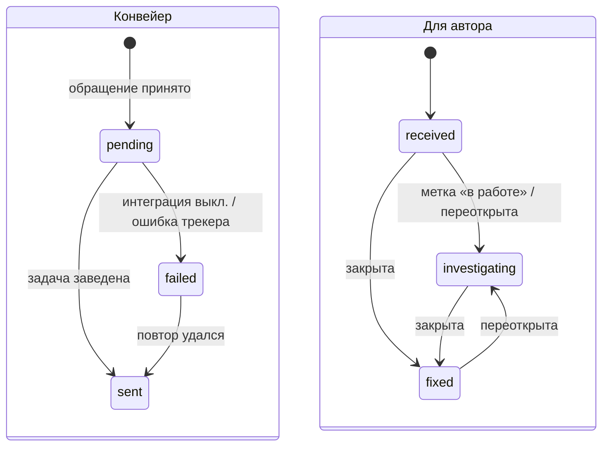

# Домен «Обращения об ошибках» (bug_reports)

Окно «Сообщить о баге» в интерфейсе (пункт меню пользователя в топбаре и кнопка на главной): любой вошедший пользователь описывает проблему, система сама собирает окружение и скриншот, сохраняет обращение и фоновой задачей заводит задачу во **внешнем трекере задач** (например, GitHub Issues); статус задачи возвращается в систему вебхуком трекера, и автор может получить его списком «Мои обращения» (в текущем интерфейсе экрана списка нет — только API, см. §10).

Связанные разделы: API — [../04-api/endpoints-bug-reports.md](../04-api/endpoints-bug-reports.md); вложения — [files.md](files.md); очередь фоновых задач — [../07-architecture/architecture.md](../07-architecture/architecture.md); модель данных — [bug_reports](../05-data-model/tables.md#bug_reports), [background_jobs](../05-data-model/tables.md#background_jobs).

## 1. Назначение и границы домена

Система должна:

1. принимать обращение из любого экрана от любого вошедшего пользователя (сотрудник, пользователь контрагента, лид) с минимумом ввода: только описание; заголовок выводится сервером;
2. прикладывать автоматически собранное окружение (адрес страницы, браузер, ОС, размер окна, версия приложения, время, сквозной id запроса, последние ошибки консоли) и скриншот (до 5 МБ);
3. отвечать сразу (202), а задачу во внешнем трекере заводить фоновым заданием с повторами, идемпотентно (без дублей при повторе);
4. после заведения задачи — отправлять оповещение со ссылкой и скриншотом в технический канал оповещений команды (если настроен);
5. принимать подписанный вебхук трекера и переводить пользовательский статус обращения: «Получено» → «В работе» → «Исправлено»;
6. отдавать автору список его обращений со статусами и ссылкой на задачу (ручка есть; экран списка в исходной системе не сделан).

После отправки окно показывает «Спасибо, мы с вами свяжемся». Поля окна: «Что сломалось» (обязательно), «Скриншот» (снимок экрана или файл; можно убрать).

Система не является собственной тикет-системой: обращение — связка «пользователь → внешняя задача». Переписки, назначения исполнителей и приоритетов внутри системы нет.

## 2. Сущности и ключевые поля

| Сущность | Таблица | Ключевые поля |
|---|---|---|
| Обращение | [bug_reports](../05-data-model/tables.md#bug_reports) | `user_id` (автор), `title` (до 200, выводится сервером), `status` — внутренний конвейер (`pending`, `sent`, `failed`), `user_status` — что видит автор (`received`, `investigating`, `fixed`), `external_provider`, `external_issue_id`, `external_issue_key` (например `#123`), `external_issue_url`, `payload` (описание, адрес страницы, окружение), `screenshot_path` (ключ файла в хранилище), `fail_reason`, `created_at`, `updated_at` |
| Задание отправки | [background_jobs](../05-data-model/tables.md#background_jobs) | `job_type = bug_report_dispatch`, `input_meta.bug_report_id`, попытки (`BUGREPORT_JOB_MAX_ATTEMPTS`), результат |

## 3. Жизненный цикл

Два независимых статуса.

### 3.1. Конвейер отправки (`status`)

| Из | В | Кто | Условие | Побочные эффекты |
|---|---|---|---|---|
| — | `pending` | автор | Описание непустое, лимит частоты не превышен | Скриншот сохранён в хранилище; поставлено задание отправки |
| `pending` | `sent` | фоновое задание | Интеграция с трекером включена, трекер создал задачу | Записаны id, номер и ссылка задачи; оповещение в технический канал (со скриншотом) |
| `pending` | `failed` | фоновое задание | Интеграция выключена или трекер вернул ошибку | `fail_reason`; задание повторяется до исчерпания попыток |
| `failed` | `sent` | фоновое задание (повтор) | Повторная попытка удалась | Как выше |
| `sent` | `sent` | фоновое задание (повтор) | Задача уже заведена | Ничего не делает (идемпотентность) |

### 3.2. Пользовательский статус (`user_status`)

| Из | В | Кто | Событие трекера |
|---|---|---|---|
| — | `received` («Получено») | система | при создании и при заведении задачи |
| `received` | `investigating` («В работе») | вебхук трекера | задача помечена меткой «in progress», «triage» или «investigating» (без учёта регистра) или переоткрыта |
| любой | `fixed` («Исправлено») | вебхук трекера | задача закрыта |
| `fixed` | `investigating` | вебхук трекера | задача переоткрыта |

## 4. Правила и валидации

- Описание обязательно: 400 «Опишите, что сломалось»; описание, адрес страницы и прочие тексты обрезаются до 10 000 символов (адрес — до 2 000).
- **Заголовок** = первая непустая строка описания; если длиннее 120 символов — первые 119 + «…».
- Скриншот — data-URL (`data:image/png;base64,…`, jpeg/jpg, webp) или «голый» base64 (считается PNG); некорректный base64 — 400 «Некорректный screenshot»; больше 5 МБ — 413 «Скриншот больше 5 МБ». Хранится как вложение служебной сущности «обращение» (вне списка сущностей общих ручек файлов).
- Лимит: 5 обращений в час на пользователя (ключ — пользователь, а не IP); превышение — 429 «Слишком много запросов — попробуйте немного позже».
- Ответ на приём — 202 `{id, status: "pending", user_status: "received"}`.
- «Мои обращения» — только свои, новые сверху, `limit` 1–100 (по умолчанию 50), `offset`; в строке: id, заголовок, оба статуса, номер и ссылка задачи, даты.
- **Тело задачи в трекере** (Markdown): раздел «Reporter» (id и email автора), «Environment» (URL, браузер, ОС, viewport, версия приложения, время, correlation id), «Description» (описание), «Console errors» (до 50 строк, если есть), «Screenshot» (картинка-ссылка). Метки задачи — `BUGREPORT_GITHUB_LABELS` (по умолчанию `bug`). Токен трекера используется только сервером.
- **Ссылка на скриншот** в задаче: в режиме S3 — presigned-ссылка на 7 суток (публичный объект не создаётся); в режиме локального диска — только ключ файла с пометкой «local» (картинки в задаче не будет).
- **Вебхук трекера**: проверяется подпись тела HMAC-SHA256 общим секретом (заголовок вида `sha256=<hex>`, сравнение за постоянное время); секрет не задан или подпись неверна — 401 «Неверная подпись webhook»; не-JSON — 400 «Некорректный JSON». Обращение ищется по id задачи, а если в событии только номер — по номеру. Событие не про наше обращение или не меняющее статус — 204 без тела; иначе — `{ok, id, user_status}`; ссылка задачи обновляется, если пришла.

## 5. Расчёты и формулы

| Величина | Правило |
|---|---|
| Заголовок | `первая_непустая_строка(описание)`, если длина > 120 → `[:119].rstrip() + "…"` |
| Новый `user_status` по событию | закрыта (`action = closed` или `state = closed`) → `fixed`; `reopened` → `investigating`; открыта/помечена с меткой «в работе» → `investigating`; `opened` без такой метки → `received`; иначе — без изменений |
| Пауза между попытками отправки | `30 с × 2^(попытка − 1)` |

## 6. Права доступа

| Действие | Админ | Тенд. специалист | СБ | Юрист | Поставщик | Лид | Владелец |
|---|---|---|---|---|---|---|---|
| Отправить обращение | ✅ | ✅ | ✅ | ✅ | ✅ | ✅ | ❌ (путь закрыт владельцу) |
| «Мои обращения» | своё | своё | своё | своё | своё | своё | ❌ |
| Видеть чужие обращения | ❌ (только во внешнем трекере) | ❌ | ❌ | ❌ | ❌ | ❌ | ❌ |
| Вебхук трекера | только внешний трекер с верной подписью | | | | | | |

Права матрицы не участвуют — достаточно действующей сессии.

## 7. События, уведомления, аудит

- Журнал ИБ: событий нет.
- Уведомления в системе: нет. Автор узнаёт о статусе из «Моих обращений».
- Оповещение команды: после заведения задачи — сообщение в технический канал оповещений (тот же, что технические алерты; только если он настроен): «`[<хост площадки>] Bug report <номер>`», заголовок, email автора, ссылка на задачу, скриншот; повторы по одному обращению подавляются дедупликацией алертов.

## 8. Фоновые задачи и периодика

| Задание | Когда | Что делает | Повторы |
|---|---|---|---|
| `bug_report_dispatch` | Сразу после приёма обращения | Если задача уже заведена — пропуск. Иначе: при выключенной интеграции — `failed` («интеграция выключена»); иначе читает скриншот, готовит ссылку, собирает тело, создаёт задачу в трекере (тайм-аут 30 с), сохраняет id/номер/ссылку, `status = sent`, шлёт оповещение | До `BUGREPORT_JOB_MAX_ATTEMPTS` (5) с паузой 30 с × 2^(n−1); после исчерпания — задание `failed`, обращение остаётся `failed` с причиной |

## 9. Настройки и флаги

| Имя | По умолчанию | Назначение |
|---|---|---|
| `BUGREPORT_GITHUB_ENABLED` | false | Включить заведение задач во внешнем трекере |
| `BUGREPORT_GITHUB_OWNER`, `BUGREPORT_GITHUB_REPO` | задаются при установке | Пространство и проект трекера, куда заводятся задачи (значения — у Заказчика) |
| `BUGREPORT_GITHUB_LABELS` | `["bug"]` | Метки задач (только существующие в трекере) |
| `BUGREPORT_JOB_MAX_ATTEMPTS` | 5 | Попыток отправки |
| `GITHUB_BUGREPORT_TOKEN` | секрет | Токен API трекера (только имя) |
| `GITHUB_BUGREPORT_WEBHOOK_SECRET` | секрет | Секрет подписи вебхука (только имя) |
| `ALERTS_ENABLED`, `TELEGRAM_BOT_TOKEN`, `TELEGRAM_CHAT_ID`, `ALERTS_DEDUPE_SECONDS` (300) | выкл | Технический канал оповещений |

Рекомендация для воссоздания: сделать интеграцию с трекером адаптером (GitHub Issues, Jira, GitLab, YouTrack и т. п.), а флаги назвать нейтрально (`BUGREPORT_TRACKER_*`).

## 10. Граничные случаи

1. **Интеграция выключена**: обращение сохраняется, автор видит «Получено», конвейер уходит в `failed` и бессмысленно повторяется до исчерпания попыток. Рекомендуется при выключенной интеграции не ставить задание вовсе и показывать администратору список неотправленных обращений (см. открытые вопросы).
2. **Отказ трекера не по сети** (например, неверная метка или токен) тоже повторяется до исчерпания попыток.
3. **Повтор после успешного создания задачи**, но до сохранения её id (сбой между шагами) может завести в трекере дубль — идемпотентность держится на сохранённом id задачи.
4. **Скриншот в локальном режиме** в задачу не попадает картинкой — команда видит только ключ файла.
5. **Вебхук без настроенного секрета** отвергается всегда (401) — статусы «В работе»/«Исправлено» не появятся.
6. **Задача удалена в трекере** — статус обращения остаётся последним полученным.
7. **Email автора** уходит во внешний трекер (раздел «Reporter») — это передача персональных данных третьей стороне; Заказчику нужно учесть это в политике ПДн (см. [../07-architecture/security.md §12](../07-architecture/security.md#12-соответствие-законодательству-о-персональных-данных-152-фз-обобщённо)).
8. **Экрана «Мои обращения» нет**: статусы «В работе»/«Исправлено» автор в интерфейсе не видит — требуется экран или блок в профиле (см. открытые вопросы).

## 11. Пример

Пользователь контрагента на форме КП пишет: «Не сохраняется черновик\nНажимаю «Сохранить» — крутится и ничего». Ответ 202 `{id: 77, status: "pending", user_status: "received"}`. Задание создаёт задачу «Не сохраняется черновик» (`#412`) с окружением, двумя ошибками консоли и скриншотом; `status = sent`; в технический канал уходит «[<хост>] Bug report #412». Разработчик ставит метку «in progress» — вебхук переводит обращение в «В работе»; закрывает задачу — «Исправлено». Оба изменения доступны автору в списке «Мои обращения».

## 12. Оценка сложности

**S–M.** Приём с выводом заголовка и скриншотом, фоновое задание с повторами и идемпотентностью, интеграция с API внешнего трекера, подписанный вебхук и маппинг событий в статусы, оповещение в технический канал.

## 13. Связанные разделы

- API: [../04-api/endpoints-bug-reports.md](../04-api/endpoints-bug-reports.md).
- Экраны: окно «Сообщить о баге» — [../03-screens/shell.md](../03-screens/shell.md) (меню пользователя), главная.
- Таблицы: [bug_reports](../05-data-model/tables.md#bug_reports), [background_jobs](../05-data-model/tables.md#background_jobs).
- Открытые вопросы — `../_oq/BL-1.md`.
