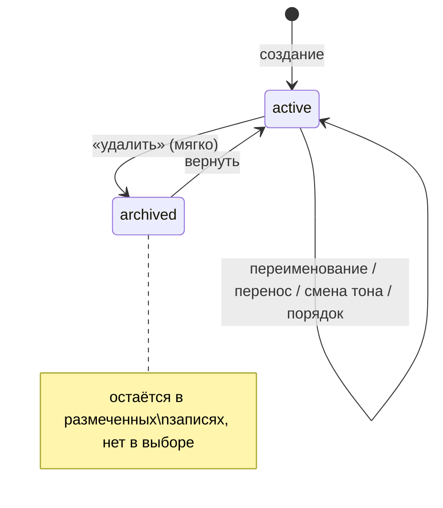

# Домен «Справочники» (catalog)

Справочники, на которые опираются тендеры, контрагенты и бюджет: виды работ (дерево), единицы измерения с запомненными написаниями, пользовательские статусы тендеров и КП. Здесь же — краткое описание справочника бюджетных позиций (подробно — в домене бюджета) и дефолтов вида работ в объекте.

Связанные разделы: API — [../04-api/endpoints-catalog.md](../04-api/endpoints-catalog.md); бюджетные позиции и распределение — [budget.md](budget.md); разбор Excel и сведение единиц — [fkp-import.md](fkp-import.md); пользовательские статусы в карточках — [tenders.md §4.2](tenders.md#42-пользовательский-статус); модель данных — [work_types](../05-data-model/tables.md#work_types), [units](../05-data-model/tables.md#units), [unit_aliases](../05-data-model/tables.md#unit_aliases), [status_definitions](../05-data-model/tables.md#status_definitions), [budget_positions](../05-data-model/tables.md#budget_positions), [project_work_type_configs](../05-data-model/tables.md#project_work_type_configs).

## 1. Назначение и границы домена

Система должна вести:

1. **Виды работ** — иерархический справочник любой глубины (категория → подкатегории). Вид работ выбирается в тендере (один или несколько), в анкете и карточке контрагента (перечень его видов работ) и в дефолтах объекта. С бюджетными позициями виды работ **не связаны** — их связывает тендер (одна бюджетная позиция + один или несколько видов работ).
2. **Единицы измерения** — плоский список канонических написаний (`шт.`, `м²`, `м³`, `м.п.`, `компл.` …) и таблицу запомненных синонимов («м3» → «м³»), по которой единицы из Excel-ведомостей сводятся к справочнику. Позиция тендера может иметь единицу только из справочника.
3. **Пользовательские статусы** тендеров и КП — ярлыки без логики поверх системных статусов: подпись, один из пяти тонов, порядок, архив.
4. (Домен бюджета) **Бюджетные позиции** — дерево статей бюджета до 5 уровней с распределением сумм по годам.
5. (Домен тендеров, экран портфелей) **Дефолты вида работ в объекте** — подсказка мастеру создания тендера: даты сбора КП и шаблон по умолчанию для пары «объект × вид работ».

Вне границ: системные статусы тендера и КП (зашиты в код, [tenders.md](tenders.md)), статусы аккредитации контрагента ([suppliers.md](suppliers.md)), распределение бюджета ([budget.md](budget.md)).

## 2. Сущности и ключевые поля

| Сущность | Таблица | Ключевые поля |
|---|---|---|
| Вид работ | [work_types](../05-data-model/tables.md#work_types) | `name` (до 255, уникально без учёта регистра), `parent_id` (пусто — корневая категория), `is_active` |
| Единица измерения | [units](../05-data-model/tables.md#units) | `name` (до 50, уникально), `is_active` |
| Синоним единицы | [unit_aliases](../05-data-model/tables.md#unit_aliases) | `alias_key` (ключ сопоставления написания, до 50, первичный ключ — одно значение на весь справочник), `unit_id` |
| Пользовательский статус | [status_definitions](../05-data-model/tables.md#status_definitions) | `entity_type` (`tender` \| `quote`), `code` (неизменяемый, латиница/цифры/`_`, до 50), `label` (до 60), `color` (тон: `info`, `success`, `warning`, `danger`, `neutral` или пусто), `is_system`, `is_active`, `order_index` |
| Бюджетная позиция | [budget_positions](../05-data-model/tables.md#budget_positions) | `name` (до 255, уникально в пределах родителя), `code` (до 64, необязателен, уникален среди действующих), `parent_id`, `is_active` |
| Дефолты вида работ в объекте | [project_work_type_configs](../05-data-model/tables.md#project_work_type_configs) | `(project_id, work_type_id)` уникальна; `collect_from`, `collect_to` (даты сбора КП), `template_id` (шаблон тендера) |

## 3. Жизненный цикл

Все справочники используют **мягкое удаление**: запись получает `is_active = false`, остаётся в БД и в уже размеченных объектах (тендерах, КП, контрагентах), но исчезает из выбора в новых формах. Жёсткого удаления нет — на записи ссылаются тендеры, контрагенты, конфиги и история.

| Справочник | Из | В | Кто | Условие | Побочные эффекты |
|---|---|---|---|---|---|
| Вид работ | — | действует | `catalogs.manage` | Имя непустое и свободно (без учёта регистра); родитель существует | Событие `work_type_created` |
| Вид работ | действует | действует | `catalogs.manage` | Новое имя свободно; родитель не он сам и не его потомок | Событие `work_type_changed` (`before`/`after`) |
| Вид работ | действует | архив | `catalogs.manage` | — (повтор идемпотентен) | Событие `work_type_changed` (`via: delete`); выбрать его в новом тендере нельзя («Вид работ не найден или архивный») |
| Вид работ | архив | действует | `catalogs.manage` | правка `is_active = true` | Событие `work_type_changed` |
| Единица | — | действует | любой сотрудник | Имя непустое; если такое имя уже есть (без учёта регистра) — возвращается существующая | Нет |
| Единица | действует ↔ архив | | `catalogs.manage` | — | Нет события журнала |
| Статус | — | действует | `catalogs.manage` | Сущность `tender`/`quote`; подпись 1–60 символов и не совпадает с действующей; тон из списка | Встаёт в конец списка |
| Статус | действует | архив | `catalogs.manage` | Не системный | Размеченные записи сохраняют статус и подпись; выбрать его нельзя |
| Статус | архив | действует | `catalogs.manage` | Нет действующего с той же подписью | Встаёт в **конец** списка |

## 4. Правила и валидации

### 4.1. Виды работ

- «Введите название вида работ»; «Такой вид работ уже есть в справочнике» (409, сравнение без учёта регистра, в том числе с архивными); «Родительская категория не найдена»; «Вид работ не найден».
- Перенос в дереве: явный `parent_id: null` делает категорию корневой; «Категория не может быть родителем самой себя»; «Так нельзя — получится цикл в дереве» (проверка подъёмом от нового родителя к корню).
- Порядок в списке — по id (порядку создания); дерево строит интерфейс.
- В тендере, анкете и карточке контрагента выбираются только действующие виды работ; поиск вида работ по имени (анкета) — без учёта регистра.

### 4.2. Единицы измерения и синонимы

- Добавить единицу может **любой сотрудник** — прямо в мастере создания тендера на шаге проверки структуры (не только администратор в справочнике). Создание идемпотентно по имени без учёта регистра. «Введите название единицы измерения».
- Переименовать и архивировать — только `catalogs.manage`; пустое новое имя игнорируется.
- **Сведение написания из файла к справочнику** (по порядку, первое совпадение):
  1. точный нормализованный ключ: обрезка пробелов → нижний регистр → без хвостовых точек → схлопнутые пробелы;
  2. ключ сопоставления: то же + `²`→`2`, `³`→`3`, удаление пробелов, точек, запятых, скобок, дефисов, подчёркиваний, `^`, затем свёртка «квм», «мкв» → «м2», «кубм», «мкуб» → «м3» (так «м3», «м³», «м^3», «м (куб)», «куб.м» → одна единица; «м» и «м.п.» остаются разными);
  3. запомненный синоним по ключу сопоставления.
  Неизвестное написание единицу **не создаёт**: позиция с ним не может быть сохранена — «Нет в справочнике единиц: «…», «…» и ещё N. Выберите единицу из справочника или добавьте её туда.» (называются первые 5).
- Синоним запоминает **любой сотрудник** выбором в мастере («это «м3» = «м³»»): «Единица измерения не найдена», «Введите написание единицы». Выбор человека перезаписывает прежний синоним (в том числе догадку ИИ). Написание, совпадающее с самим именем единицы, синонимом не сохраняется. Ключ синонима один на весь справочник.
- Учитываются только действующие единицы.

### 4.3. Пользовательские статусы

- Сущность: «Статус бывает у тендера или у КП».
- Подпись: «Введите название статуса», «Название статуса — не длиннее 60 символов», «Статус с таким названием уже есть» (среди действующих той же сущности, без учёта регистра).
- Тон: «Неизвестный цвет статуса», если не из `info`, `success`, `warning`, `danger`, `neutral`; старые значения цвета в БД (не из списка) интерфейс показывает нейтральным тоном.
- Код: необязателен; без него выводится из подписи транслитерацией (латиница, цифры, `_`, до 50 символов; «Ждём документы» → `zhdem_dokumenty`), при совпадении с любым кодом сущности, **включая архивные** (коды не переиспользуются), получает суффикс `_2`, `_3`…; пустой результат — `status`. Явно присланный занятый код — 409 «Такой код уже есть». Код **никогда не меняется** — им помечены тендеры и КП; переименование — это подпись.
- Порядок: новый — в конец (`максимум + 10`); перестановка присылает **полный** список id сущности, номера пересчитываются шагом 10; если список не совпадает с действующими статусами — 409 «Список статусов изменился — обновите страницу»; «Передайте ids — список статусов в нужном порядке», «ids — числа», «order_index должен быть числом».
- Системный статус (`is_system`) можно переименовать и перекрасить, но нельзя удалить — «Системный статус нельзя удалить». Возврат из архива: «Действующий статус с таким названием уже есть — переименуйте один из них».
- Список по умолчанию — только действующие; с флагом «включая архив» — все (нужно для подписей уже размеченных записей и раздела «Архив»). Отдельный запрос отдаёт, сколько тендеров и КП помечено каждым статусом (используется при архивировании).
- Проставление статуса тендеру/КП проверяет, что статус действует: «Неизвестный статус тендера» / «Неизвестный статус КП».

### 4.4. Бюджетные позиции (кратко)

Дерево не глубже 5 уровней («Дерево не глубже 5 уровней»); имя уникально в пределах родителя («Имя уже занято в пределах этого родителя»); код уникален среди действующих («Код уже используется активной позицией»); нельзя перенести в себя или свою ветку. Удаление — архив с возвратом нераспределённой суммы текущего периода родителю. При создании подпозиции можно перенести сумму с родителя (не больше его нераспределённого остатка, не в закрытый период) и отменить перенос. Тендер можно создать только на действующей позиции. Метрики, периоды и распределение — [budget.md](budget.md).

### 4.5. Дефолты вида работ в объекте

Пара «объект × вид работ» хранит даты начала и окончания сбора КП и шаблон тендера по умолчанию; мастер создания тендера подставляет их при выборе объекта и вида работ как подсказку (не навязывает). Запись создаётся при первом сохранении (upsert), меняются только присланные поля; даты — ISO; «Проект не найден», «Шаблон не найден». Читать и писать может любой вошедший пользователь с доступом к объекту по грантам (см. §10).

## 5. Расчёты и формулы

| Величина | Правило |
|---|---|
| Ключ нормализации единицы | `rstrip('.')(lower(trim(s)))` со схлопнутыми пробелами |
| Ключ сопоставления единицы | ключ нормализации → `²→2`, `³→3` → удалить `[\s.,()\-_^]` → свёртка `{квм, мкв → м2; кубм, мкуб → м3}` |
| Код статуса из подписи | транслит (а→a, ж→zh, ц→ts, ч→ch, ш→sh, щ→sch, ю→yu, я→ya, ъ/ь → пусто …) → нижний регистр → не-`[a-z0-9]` в `_` → обрезка `_` по краям → до 50 символов |
| Порядок нового статуса | `max(order_index сущности) + 10` |
| Порядок после перестановки | позиция × 10 (10, 20, 30…) |

## 6. Права доступа

| Действие | Админ | Тенд. специалист | СБ | Юрист | Поставщик | Лид | Владелец |
|---|---|---|---|---|---|---|---|
| Читать виды работ, единицы, статусы (включая архив), бюджетные позиции | ✅ | ✅ | ✅ | ✅ | ❌ | ❌ | ❌ |
| Создать/изменить/архивировать вид работ | ✅ | при `catalogs.manage` | при `catalogs.manage` | при `catalogs.manage` | ❌ | ❌ | ❌ |
| Создать единицу, запомнить синоним | ✅ | ✅ | ✅ | ✅ | ❌ | ❌ | ❌ |
| Переименовать/архивировать единицу | ✅ | при `catalogs.manage` | при `catalogs.manage` | при `catalogs.manage` | ❌ | ❌ | ❌ |
| Создать/изменить/переставить/архивировать статус | ✅ | при `catalogs.manage` | при `catalogs.manage` | при `catalogs.manage` | ❌ | ❌ | ❌ |
| Создать/изменить/архивировать бюджетную позицию, распределить сумму | ✅ | при `budget.manage` | при `budget.manage` | при `budget.manage` | ❌ | ❌ | ❌ |
| Дефолты вида работ в объекте: читать и сохранять | ✅ | при доступе к объекту | при доступе к объекту | при доступе к объекту | ❌ | ❌ | ❌ |

Право `catalogs.manage` и `budget.manage` по умолчанию есть только у администратора. Экраны справочников в интерфейсе видны ролям «Администратор» и «Тендерный специалист»; у специалиста без права кнопки правки получают отказ сервера.

Анкета саморегистрации контрагента получает список видов работ без входа (публичная ручка домена контрагентов).

## 7. События, уведомления, аудит

| Действие | Журнал |
|---|---|
| Создание вида работ | `work_type_created` `{name, parent_id}` |
| Правка / архив / возврат вида работ | `work_type_changed` (`before`, `after` или `{via: "delete", was_active, name}`) |
| Бюджетные позиции | `budget_position_created`, `budget_position_changed`, `budget_transfer_undone`, `budget_allocation_changed` ([budget.md](budget.md)) |
| Единицы, синонимы, статусы, дефолты объекта | **не журналируются** (см. §10) |

Уведомлений и событий живого потока домен не порождает.

## 8. Фоновые задачи и периодика

Нет.

## 9. Настройки и флаги

Нет. Наполнение справочников — данные: на чистой установке единицы, виды работ и статусы заводятся администратором (или стартовым набором демо-данных, см. открытые вопросы).

## 10. Граничные случаи

1. **Архивный вид работ в существующем тендере** остаётся и показывается; новый тендер с ним создать нельзя.
2. **Переименование единицы** не меняет уже сохранённые позиции тендеров (у позиции хранится строка единицы, а не ссылка) — см. открытые вопросы.
3. **Удалённая единица со ссылками-синонимами**: синонимы указывают на архивную единицу и перестают срабатывать (сведение учитывает только действующие).
4. **Одна вкладка переставила статусы, другая добавила новый** — перестановка из первой получит 409 и попросит обновить страницу.
5. **Статус архивирован, а тендеры им помечены** — подпись продолжает показываться (список «включая архив»), выбрать его снова нельзя.
6. **Дефолты объекта без проверки права**: сохранить их может СБ или юрист с грантом на объект, хотя создавать тендеры им нельзя; проверка — только доступ к объекту. Рекомендуется требовать `tenders.manage` или `portfolios.manage` (см. открытые вопросы).
7. **Правки единиц и статусов не попадают в журнал ИБ**, в отличие от видов работ.
8. **Цвет статуса из старых данных** (произвольный код цвета) — допускается в БД, интерфейс показывает нейтральный тон; новые значения — только из пяти тонов.

## 11. Пример

1. Администратор создаёт статус КП «Ждём документы», тон `warning`: код `zhdem_dokumenty`, порядок 120 (последний был 110).
2. Тот же код уже был у архивного статуса → новый получает `zhdem_dokumenty_2`.
3. Специалист загружает ведомость с единицами «м3», «кв.м», «шт», «пог.м»: «м3» и «кв.м» сводятся по ключу сопоставления к «м³» и «м²», «шт» — по ключу нормализации к «шт.»; «пог.м» не найдена — мастер просит выбрать; специалист выбирает «м.п.», система запоминает синоним `погм → м.п.`; следующая ведомость с «пог.м» сводится автоматически.

## 12. Оценка сложности

**M.** Три простых CRUD-справочника с мягким удалением, но с нетривиальными деталями: дерево с защитой от циклов, сведение единиц с трёхступенчатым сопоставлением и запоминанием выбора, неизменяемые коды статусов с транслитерацией и защитой от гонок порядка. Бюджетные позиции оцениваются в [budget.md](budget.md).

## 13. Связанные разделы

- API: [../04-api/endpoints-catalog.md](../04-api/endpoints-catalog.md) (`/work-types`, `/units`, `/statuses`, `/budget-positions`, `/projects/{id}/work-type-configs`), `GET /statuses/usage` — [../04-api/endpoints-tenders.md](../04-api/endpoints-tenders.md).
- Экраны: [../03-screens/catalog-work-types.md](../03-screens/catalog-work-types.md), [../03-screens/catalog-units.md](../03-screens/catalog-units.md), [../03-screens/catalog-statuses.md](../03-screens/catalog-statuses.md), [../03-screens/catalog-budget-positions.md](../03-screens/catalog-budget-positions.md), [../03-screens/portfolios.md](../03-screens/portfolios.md) (панель дефолтов вида работ).
- Таблицы: [work_types](../05-data-model/tables.md#work_types), [units](../05-data-model/tables.md#units), [unit_aliases](../05-data-model/tables.md#unit_aliases), [status_definitions](../05-data-model/tables.md#status_definitions), [budget_positions](../05-data-model/tables.md#budget_positions), [project_work_type_configs](../05-data-model/tables.md#project_work_type_configs).
- Открытые вопросы — `../_oq/BL-1.md`.
