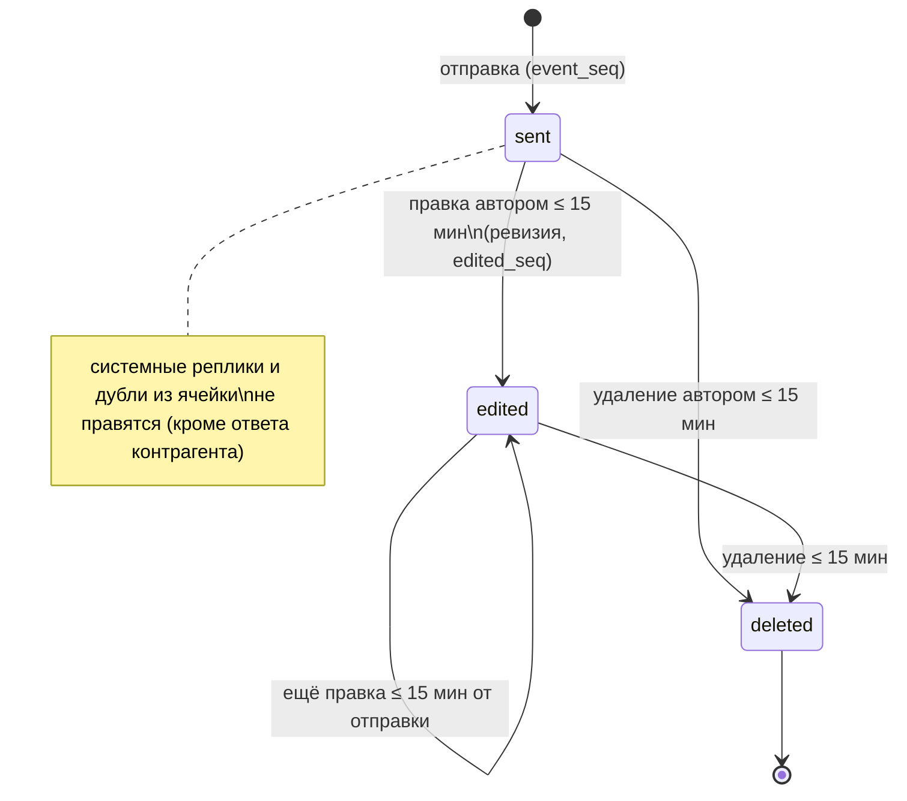
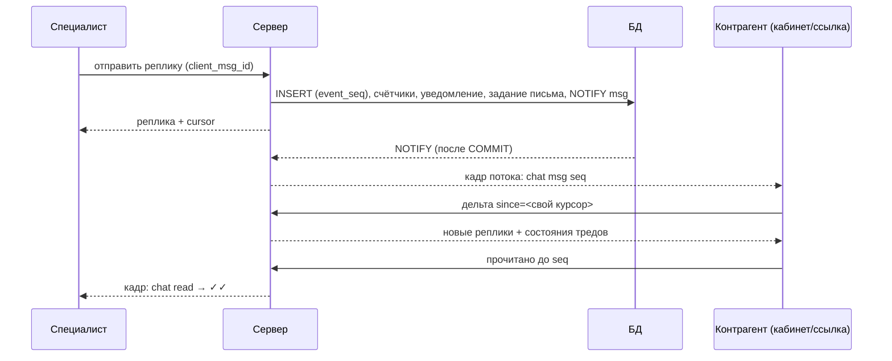

# Домен «Чат с контрагентами» (chat)

Переписка тендерного специалиста с контрагентом по тендеру: один тред на пару «тендер × контрагент», реплики с правкой и мягким удалением (с ревизиями), системные вехи, вложения, прочитанность по курсору событий, поиск и выгрузка, мост «ячейка сравнения ↔ чат», публичный вход контрагента по ссылке-приглашению без учётной записи, доставка в реальном времени через SSE поверх `LISTEN/NOTIFY` и защита от злоупотреблений.

Связанные разделы: API — [../04-api/endpoints-chat.md](../04-api/endpoints-chat.md) (все ручки, поля, коды ответов, схема доставки); общий живой поток — [notifications.md §4.3](notifications.md#43-живой-поток-sse) и [../07-architecture/architecture.md §4](../07-architecture/architecture.md#4-живые-события-realtime); комментарии ячеек — [comments.md](comments.md); хранилище файлов — [files.md](files.md); экраны — [../03-screens/chats.md](../03-screens/chats.md), [../03-screens/tender-card-messages.md](../03-screens/tender-card-messages.md); модель данных — [chat_threads](../05-data-model/tables.md#chat_threads), [chat_messages](../05-data-model/tables.md#chat_messages), [chat_message_revisions](../05-data-model/tables.md#chat_message_revisions), [chat_thread_reads](../05-data-model/tables.md#chat_thread_reads).

## 1. Назначение и границы

Переписка — **единственное место договорённостей** с контрагентом: интерфейс под полем ввода и в пустом состоянии говорит «Договаривайтесь только здесь — за переписку вне чатов тендера ответственности не несём.» Отсюда обязательства: по переписке работает поиск, её можно выгрузить документом, правка не стирает сказанное.

Система должна:

1. держать ровно один тред на пару «тендер × контрагент» (уникальность в БД, устойчиво к гонке); тред заводится **по действию**, а не заранее на каждого приглашённого;
2. позволять сотруднику писать **любому** контрагенту из справочника по доступному ему тендеру (приглашение не требуется — разговор до тендера тоже должен жить на платформе); контрагенту — только по тендерам, куда он приглашён и откуда не отозван, по обоим его входам (личный кабинет и ссылка заполнения КП);
3. разрешать переписку и после завершения или отмены тендера;
4. нумеровать каждое событие переписки (новая реплика, правка, удаление) номером из **одной глобальной последовательности** и синхронизировать клиентов тремя операциями: снимок списка, история вверх по курсору, дельта «всё новее курсора»;
5. вести прочитанность **на человека** (контрагента по ссылке — на приглашение) курсором «прочитано до события N» и агрегат стороны для пометки «прочитано» у отправителя;
6. давать автору 15 минут на правку и мягкое удаление своей реплики, сохраняя прежнюю версию;
7. писать в ленту системные вехи («Диалог открыт.», подача КП, решения по корректировкам) без уведомлений;
8. принимать вложения с проверкой типа по содержимому и лимитами; на публичном контуре — с лимитом частоты по паре «токен + IP» и суточным потолком на тред;
9. доставлять события в реальном времени тонкими сообщениями шины (без текста) и уведомлять адресата записью в центре уведомлений и письмом не чаще одного на разговор за 15 минут;
10. позволять сотруднику явно отправить в диалог запись обсуждения ячейки, комментарий поставщика или пояснение решения по корректировке, а контрагенту — ответить на такой вопрос так, чтобы ответ вернулся в ячейку сравнительной таблицы.

Вне границ: сам SSE-поток топбара и шина событий (notifications, архитектура); хранение файлов (files); счётчики «неотработанного» в ячейках ([comments.md](comments.md)); раунды (формальный запрос КП — не чат, [tenders-rounds.md](tenders-rounds.md)); комментарии поставщика к позициям (история по версиям — [comments.md](comments.md)).

## 2. Сущности и ключевые поля

| Сущность | Таблица | Ключевые поля |
|---|---|---|
| Тред | [chat_threads](../05-data-model/tables.md#chat_threads) | `tender_id`, `supplier_id` (уникальная пара), `updated_at` (последняя активность — сортировка списка), `msgs_from_supplier` / `msgs_from_specialist` (монотонные счётчики реплик сторон, без системных), `specialist_last_read_seq` / `supplier_last_read_seq` (агрегат стороны для «прочитано»), `*_read_base` (откат прочитанного для зрителя без своей записи) |
| Реплика | [chat_messages](../05-data-model/tables.md#chat_messages) | `author_role` (`specialist` \| `supplier` \| `system`), `author_user_id` (пусто у системы и у контрагента по ссылке), `body`, `attachment_id`, `event_seq` (номер события создания, уникален глобально), `edited_seq` (номер последней правки/удаления), `client_msg_id` (ключ идемпотентности, уникален в треде), `reply_to_id` (цитата), `kind` (пусто — обычная; `cell_quote` \| `cell_thread` \| `review` — мост ячейки), `quote_item_id`, `comment_id` (мост, уникален), `edited_at`, `deleted_at` |
| Прежняя версия реплики | [chat_message_revisions](../05-data-model/tables.md#chat_message_revisions) | `message_id`, `action` (`edit` \| `delete`), прежние `body` и `attachment_id`, кто правил (пусто — контрагент по ссылке) |
| «Докуда прочитал» | [chat_thread_reads](../05-data-model/tables.md#chat_thread_reads) | `thread_id` + ровно один субъект: `user_id` **или** `invitation_id`; `last_read_seq`, `read_count` (сколько реплик другой стороны было до курсора) |
| Последовательность событий | `chat_event_seq` | Глобальная, одна на все треды |
| Вложение реплики | [attachments](../05-data-model/tables.md#attachments) | `entity_type = chat_message`, `entity_id = id треда`, `doc_type = chat` |
| Письмо о сообщении | [background_jobs](../05-data-model/tables.md#background_jobs) | `job_type = chat_mail`, `input_meta = {to, subject, body, thread_id}` |

Стороны: **специалист** — любой сотрудник (администратор, тендерный специалист, СБ, юрист); **поставщик** — пользователь кабинета контрагента или контрагент по ссылке; **система**.

## 3. Жизненный цикл

### 3.1. Тред

| Из | В | Кто | Условие | Побочные эффекты |
|---|---|---|---|---|
| — | Открыт | Сотрудник («Написать поставщику», из панели поставщика, «Отправить в чат» из ячейки) | Доступ к тендеру | Системная реплика «Диалог открыт.» (свой номер события, без события шины и уведомлений) |
| — | Открыт | Пользователь кабинета | Своя организация, действующее приглашение | То же |
| — | Открыт | Контрагент по ссылке — первой репликой | Действующее приглашение | То же + реплика контрагента |
| — | Открыт | Система — веха по КП | Подача КП, решение по корректировке | «Диалог открыт.» + системная веха |
| Открыт | Закрыт для контрагента | Сотрудник отзывает приглашение | — | Тред пропадает из списка, поиска и дельты контрагента; чтение и запись — 403 (по ссылке — 410) |
| Закрыт для контрагента | Открыт | Сотрудник восстанавливает доступ участника | — | Тред снова виден контрагенту |

Удаления и архива тредов нет; повторное открытие идемпотентно (возвращается тот же тред, `created: false`).

### 3.2. Реплика

| Из | В | Кто | Условие | Побочные эффекты |
|---|---|---|---|---|
| — | Отправлена | Сторона треда | §4.2; повтор с тем же `client_msg_id` возвращает существующую реплику | Новый `event_seq`; счётчик реплик стороны +1 (кроме системных); курсор прочтения автора и агрегат его стороны = `event_seq`; `updated_at` треда; событие шины `msg`; уведомление адресату (кроме системных и вех); лента активности тендера `chat_message`; журнал `chat_message_created` |
| Отправлена | Изменена | Автор | ≤ 15 мин с отправки, §4.3 | Прежний текст → ревизия `edit`; новый `edited_seq`; `edited_at`; событие `msg` (реплика приезжает дельтой заново); журнал `chat_message_edited` |
| Отправлена / Изменена | Удалена | Автор | ≤ 15 мин с отправки | Текст и вложение → ревизия `delete`; тело очищается, `deleted_at`; место в ленте остаётся («Сообщение удалено»); новый `edited_seq`; журнал `chat_message_deleted`; счётчики непрочитанного **не** уменьшаются |
| Изменена | Изменена | Автор | В том же окне 15 мин от **отправки** | Ещё одна ревизия |

### 3.3. Прочитанность

Курсор `last_read_seq` субъекта только растёт (`max(старый, новый)`): фоновая вкладка на старой позиции не откатывает прочитанное. Агрегат стороны (`*_last_read_seq` треда) тоже только растёт и даёт отправителю пометку «прочитано» (сторона целиком, без имён — имена сотрудников контрагенту не раскрываются).

## 4. Правила и валидации

### 4.1. Доступ

| Зритель | Видит треды | Пишет |
|---|---|---|
| Администратор | Все | Во все |
| Другой сотрудник | Тендеров объектов из своих грантов (с подобъектами); без грантов — ничего | Туда же; приглашение контрагента не требуется |
| Пользователь кабинета | Своей организации по тендерам с **неотозванным** приглашением | Туда же |
| Контрагент по ссылке | Только тред своего приглашения | Только туда; приглашение не отозвано, организация не приостановлена |

- Одни и те же предикаты видимости — у списка, дельты, поиска и выгрузки (иначе поиск находил бы реплику треда, которого нет в списке).
- Роль, организация и доступные объекты зрителя кэшируются в памяти процесса на **30 с**: выданный или отозванный доступ применяется с этой задержкой; поток живых событий считает видимость один раз на подключение.
- Тексты: «Чат не найден» (404), «Нет доступа к чату» (403), «Нельзя открыть чужой чат» (403), «Нет приглашения в этот тендер» (403), «Тендер или контрагент не найден» (404), «Некорректный id чата» / «Некорректный id сообщения» (400 на мусорный id). Ошибки ссылки — «Ссылка недействительна или устарела» (403), «Приглашение отозвано — ссылка больше не действует. Обратитесь к представителю <клиента>.» (410), «Доступ организации приостановлен. Обратитесь к администратору системы.» (403); `<клиента>` — родительный падеж названия компании-клиента из настройки (по умолчанию «клиента»).

### 4.2. Отправка реплики

| Правило | Текст отказа |
|---|---|
| Текст обрезается по краям; ≤ 4000 символов (то же ограничение — у поля ввода) | 400/422 «Сообщение длиннее 4000 символов — отправьте длинный текст файлом» |
| Нужен текст или файл | 400 «Нужен текст или файл» |
| Ранее загруженный файл привязан к **этому** треду (`chat_message` / id треда) | 400 «Файл не привязан к этому чату» |
| Реплика только с файлом получает текст «📎 <имя файла>» | — |
| `client_msg_id` — UUID; повтор с ним возвращает уже созданную реплику (`created: false`), в т.ч. при одновременных повторах | — |
| `reply_to_id` — реплика **этого же** треда | Требование к воссозданию: 400; в исходной системе не проверяется (см. §10) |

Отправка с файлом — **одной транзакцией** (multipart: файл + текст): либо есть и файл, и реплика, либо нет ничего (файл-сирота невозможен). Проверки файла выполняются **после** проверки доступа:

| Правило | Текст отказа |
|---|---|
| Тело читается кусками с остановкой на 25 МБ (файл целиком в память не попадает) | 400 «Файл больше 25 МБ» |
| Пустой файл | 400 «Пустой файл» |
| Тип из списка: PNG, JPEG, GIF, WEBP, PDF, DOC, DOCX, XLS, XLSX, ZIP, TXT, CSV | 400 «Такой тип файла в переписку не принимается» |
| Заявленный тип совпадает с сигнатурой содержимого (кроме TXT, CSV, WEBP — у них устойчивой сигнатуры нет) | 400 «Содержимое файла не совпадает с его типом» |
| Имя файла санируется (общее правило вложений), ≤ 200 символов | — |

Ответ на отправку — созданная реплика и текущий курсор (не весь тред).

### 4.3. Правка и удаление

| Правило | Текст отказа |
|---|---|
| Реплика этого треда | 404 «Сообщение не найдено» |
| Только своя: та же сторона **и** тот же пользователь (реплики контрагента по ссылке — без пользователя; их правит только контур ссылки, реплики пользователя кабинета той же организации оттуда не правятся) | 403 «Изменить можно только своё сообщение» |
| Не удалена | 400 «Сообщение уже удалено» |
| Не системная и не дубль из сравнения (исключение — ответ контрагента на вопрос по ячейке) | 403 «Эта реплика пришла из сравнения — изменить её можно только там» |
| Не позже 15 минут после отправки | 403 «Изменить или удалить сообщение можно в течение 15 минут после отправки» |
| Новый текст ≤ 4000; пустой текст допустим только у реплики с файлом | 400 «Нужен текст» |
| Тот же текст — без ревизии и без события | — |

Правка ответа контрагента на вопрос по ячейке меняет и его зеркало в треде ячейки; удаление — заменяет текст зеркала на «Сообщение удалено контрагентом.»

### 4.4. Системные реплики

| Текст | Когда |
|---|---|
| «Диалог открыт.» | Создание треда |
| «Подана КП» | Контрагент подал КП по ссылке/в кабинете |
| «Корректировка принята» / «Корректировка отклонена» | Решение специалиста по одной корректировке |
| «Корректировки: <сводка решений>» | Пакетное решение по нескольким корректировкам |

Вехи публикуются доменом тендеров событием в той же транзакции, что и сама веха (не подалось — строки нет), без уведомления (оно уже есть у вехи) и без счётчиков непрочитанного. Детали (комментарии к ячейкам, перечень решений) в диалог **не** дублируются — они в КП и в уведомлении. Автор системной реплики — «Система». Расхождение с требованиями о дублировании комментариев поставщика в чат — см. открытые вопросы.

### 4.5. Мост «ячейка → чат»

Сотрудник явным действием отправляет в диалог контрагента:

| Вид (`kind`) | Что | Откуда в интерфейсе |
|---|---|---|
| `cell_thread` | Запись внутреннего обсуждения ячейки (`comment_id`) **или** ответ компании на комментарий поставщика (карточка «Позиция «…» · КП vN от даты / Ваш комментарий: … / Ответ компании: …», `quote_item_id` — самая свежая запись истории) | Панель ячейки: «В чат», «Ответить» |
| `cell_quote` | Копия комментария поставщика к позиции («Позиция «…» · КП vN от даты» + текст) | Панель ячейки |
| `review` | Пояснение решения по корректировке («Позиция «…» — объём принят / корректировка отклонена: <пояснение>») — только если решение объяснено словами; сбой отправки решение не отменяет | Окно решения по корректировке |

Правила: только сотрудник («Отправку в чат делает сотрудник», 403); комментарий другого контрагента — 403 «Комментарий относится к другому контрагенту»; нет комментария — 404 «Комментарий не найден»; нет строки КП — 404 «Позиция не найдена»; нет текста — 400 «Нужен текст»; один комментарий — не более одной реплики-дубля (повтор возвращает существующую). Дубль — **обычная** реплика: свой номер, доставка дельтой, поиск, выгрузка, уведомление контрагенту; отличие — бейдж позиции и переход к ячейке (у контрагента — к его строке формы). Внутреннее обсуждение целиком контрагенту не показывается никогда — только поштучно отправленные записи.

**Ответ контрагента на вопрос по ячейке** («Ответить на вопрос» под репликой с адресом ячейки, только на контуре ссылки): ответ должен ссылаться на реплику этого треда (иначе 403 «Ответ не на реплику этого диалога»), у которой есть адрес ячейки (иначе 403 «Эта реплика не про ячейку»). Начать привязку к ячейке сам контрагент не может. Ответ ложится репликой-ответом `cell_thread` **и** записью треда ячейки (позиция — из строки КП вопроса или из комментария вопроса; якорь — контрагент; без автора-пользователя), реплика связывается с этой записью.

### 4.6. Поиск и выгрузка

- **Поиск** — полнотекстовый с русской морфологией («сроки монтажа» находит «срок монтажа»), запрос 2–200 символов, до 100 результатов (по умолчанию 50), новые сверху, удалённые реплики не ищутся; фильтры — тендер, контрагент, тред. Результат несёт тред, контрагента, тендер и номер события — лента открывается ровно на найденном месте.
- **Выгрузка** — документ Markdown `chat-<id>.md`: заголовок «Переписка по тендеру «<название>»», контрагент, тендер, период (первая — последняя реплика), число реплик, пометка о порядке по номеру события; затем все реплики по возрастанию номера (`### <автор> · <время> · #<номер>`, системные помечены), вложения (имя, тип, размер), отметки «изменено <время>» и «удалено автором <время>», **прежние версии** под каждой изменённой/удалённой репликой, итоговый список вложений. Разметка в тексте экранируется — документ показывает ровно то, что написал человек. Выгрузка — событие журнала `chat_thread_exported`.

### 4.7. «Печатает…»

Сигнал без записи в БД: не чаще раза в 2 с от одного человека в одном треде (лишние вызовы молча игнорируются), доступ к треду перепроверяется раз в 60 с; уходит только противоположной стороне с именем (сотрудник — ФИО; контрагент — короткое название организации), имя ≤ 80 символов. Клиент шлёт сигнал раз в ~3 с, индикатор гаснет сам.

### 4.8. Лимиты

| Что | Значение |
|---|---|
| Длина реплики | 4000 символов |
| Вложение | 25 МБ, 12 типов, сверка с сигнатурой; имя ≤ 200 |
| Отправка, правка, удаление, мост (под сессией) | 30 в минуту на пользователя |
| Открытие треда (под сессией) | 10 в минуту на пользователя |
| Чтение по ссылке (просмотр, дельта, поток, «прочитано», скачивание) | 60 в минуту на пару «токен + IP» |
| Запись по ссылке (отправка, правка, удаление) | 30 в минуту на пару «токен + IP» |
| Суточный потолок анонимной стороны на тред | 200 реплик и 200 МБ вложений за скользящие 24 часа (считаются реплики контрагента без пользователя) |
| Страница списка тредов | 50, не больше 200; ключ страницы `(updated_at, id)` |
| Страница истории | 50, не больше 200 |
| Дельта | не больше 300 событий, иначе `reset` |
| Превью последней реплики | 120 символов |
| Поток по ссылке | живёт не дольше 600 с, пинг каждые 15 с, `retry: 3000` |

Пара «токен + IP», а не что-то одно: только токен глушил бы контрагента на всех его устройствах, только IP — целую организацию за одним NAT. Суточный потолок проверяется **до** чтения тела файла. Превышения: 429 «Слишком часто — подождите минуту и попробуйте снова» (по ссылке) / «Слишком много запросов — попробуйте немного позже» (под сессией); потолок — 429 «Достигнут суточный предел сообщений или вложений в этой переписке. Продолжите завтра или свяжитесь с представителем <клиента>.»

## 5. Расчёты и формулы

| Величина | Формула |
|---|---|
| Курсор | `cursor = max(max event_seq, max edited_seq)` по всем репликам системы (глобальный; клиент сравнивает, а не пересчитывает) |
| Непрочитанное треда для зрителя | `unread = max(0, N_other − R)`, где `N_other` — счётчик реплик **противоположной** стороны в треде (системные не считаются), `R` — `read_count` записи «докуда прочитал» зрителя, а без записи — `*_read_base` его стороны (у новых тредов 0) |
| `read_count` при отметке | число реплик противоположной стороны с `event_seq ≤ up_to_seq`; хранится `max(старое, новое)` |
| Отметка без курсора | `up_to_seq` не задан или ≤ 0 → максимальный номер в треде |
| «Прочитано» у реплики (✓✓) | `peer_last_read_seq ≥ event_seq`, где `peer` — агрегат противоположной стороны |
| Непрочитанное всего (бейдж) | `Σ unread` по всем видимым тредам (тот же предикат, что у списка — бейдж всегда сходится со списком) |
| Дельта | `floor = max(since − 20, 0)`; если `floor ≥ cursor` — пусто; иначе реплики видимых тредов с `event_seq > floor` **или** `edited_seq > floor` по возрастанию `event_seq`; больше 300 — `{reset: true, cursor}` (клиент перечитывает снимок); плюс состояния затронутых тредов `{id, unread, updated_at, peer_read_seq}` |
| «Выше есть ещё» | страница истории заполнилась целиком (`len = limit`) |
| Дебаунс письма | письмо ставится, если в треде нет предыдущей реплики (любой стороны, включая системные) или `created_at(новой) − created_at(предыдущей) ≥ 15 мин` |
| Суточный потолок | `count(реплики контрагента без пользователя за 24 ч) ≥ 200` или `Σ размер их вложений ≥ 200 МБ` (а с новым файлом — `> 200 МБ`) |

Нахлёст 20 событий в дельте нужен потому, что номер выдаётся при вставке, а виден становится при коммите: две параллельные отправки могут закоммититься не по порядку номеров, и клиент, уже увидевший больший номер, иначе навсегда пропустил бы меньший. Повторы клиент отсеивает по `id` реплики; изменённые реплики заменяет по `id`.

Непрочитанное считается **из счётчиков на строке треда**, а не перебором сообщений: каждый кадр живого потока пересчитывает бейдж, и стоимость не должна зависеть от длины переписки.

## 6. Права доступа

| Действие | Админ | Тенд. специалист | СБ | Юрист | Пользователь кабинета | Контрагент по ссылке | Лид / Владелец |
|---|---|---|---|---|---|---|---|
| Список, история, дельта, поиск, выгрузка | ✅ все | объект | объект | объект | своя организация, действующее приглашение | свой тред (без поиска и выгрузки) | ❌ |
| Открыть тред | ✅ | объект, любой контрагент | объект | объект | свой, по приглашению | первой репликой | ❌ |
| Писать, править/удалять свои реплики, «печатает…», «прочитано» | ✅ | объект | объект | объект | ✅ | ✅ | ❌ |
| Мост «ячейка → чат» | ✅ | объект | объект | объект | ❌ | ❌ | ❌ |
| Ответ на вопрос по ячейке | — | — | — | — | ❌ (только на контуре ссылки) | ✅ | ❌ |
| Раздел «Чаты» в интерфейсе | ✅ | ✅ | ❌ | ❌ | ✅ | форма КП | ❌ |

Отдельного права матрицы нет; «объект» — тендер на объекте из грантов. СБ и юрист технически имеют доступ к тредам своих объектов через API, но раздела в интерфейсе у них нет ([../01-product/users-and-roles.md](../01-product/users-and-roles.md#4-матрица-роль--действие)).

## 7. События, уведомления, аудит

### 7.1. События живого потока

События тонкие — вид, тред, тендер, номер, сторона; **без текста** (лимит полезной нагрузки 8000 байт, текст не должен попадать в журналы прокси). Публикуются в транзакции действия и доставляются только при коммите.

| Вид | Когда | Ключи адресатов |
|---|---|---|
| `msg` (`seq`, `cursor`, `side` автора) | Новая, изменённая или удалённая реплика | Организация контрагента (`supplier:<id>`) + сотрудники объекта (`chat:p<id объекта>`) + администраторы (`chat:all`) |
| `read` (`seq`, `side`) | Сторона дочитала | Читал контрагент — его организация и сотрудники объекта; читал сотрудник — его личный ключ `staff:<id>` (другие его вкладки) и организация контрагента (✓✓) |
| `typing` (`side`, `name`) | Набирает текст | Только противоположная сторона |

Поток стороны автора по `side` понимает, что её непрочитанное не изменилось, и не пересчитывает бейдж. Получив событие с номером больше своего курсора, клиент делает **один** запрос дельты на пачку событий. Без потока клиент страхуется опросом: в приложении — раз в 45 с, на форме по ссылке — раз в 30 с у видимой вкладки и сразу при возврате на вкладку.

### 7.2. Уведомления и письма

| Автор | Адресат | Запись в центре уведомлений | Письмо (задание `chat_mail`, дебаунс 15 мин на разговор) |
|---|---|---|---|
| Специалист (в т.ч. дубль из ячейки) | Вся организация контрагента; только если в кабинете не выключена галочка «уведомления чата» | `message`, «Новое сообщение по тендеру», ««<тендер>»: <до 160 символов>», переход в чат тендера | На адрес организации: тема «Новое сообщение по тендеру «<тендер>»», текст и «Открыть переписку: <ссылка>». Галочка выключена → ни записи, ни письма |
| Контрагент | Ответственный за тендер (иначе автор тендера) | `message`, «Сообщение от контрагента», «<контрагент> · «<тендер>»: <до 160 символов>» | На адрес ответственного: «Сообщение от контрагента по тендеру «<тендер>»» |
| Система | — | — | — |

Задание письма ставится в той же транзакции, что и реплика: при откате не уходит; почта выключена или сервер не настроен — задание завершается «пропущено»; SMTP не принял — повтор с паузой. Бейдж непрочитанного у адресата зависит от событий шины, а не от уведомления: выключенная галочка не гасит непрочитанное. Сводная карта — [notifications.md §5](notifications.md#5-каталог-событий).

### 7.3. Лента тендера и журнал ИБ

Каждая несистемная реплика пишет в ленту активности тендера событие `chat_message` (контрагент, первые 80 символов, признак файла).

| Код журнала ИБ | Когда | `details` |
|---|---|---|
| `chat_message_created` | Реплика создана (не повтор) | `{author_role, has_attachment}` |
| `chat_message_edited` | Правка | `{message_id}` (+ `author_role` по ссылке) |
| `chat_message_deleted` | Удаление | то же |
| `chat_thread_exported` | Выгрузка | `{tender_id, supplier_id}` |
| `chat_cell_bridged` | Мост «ячейка → чат» | `{kind, comment_id}` |
| `chat_rate_limited` | Превышен лимит частоты **на контуре ссылки** | `{bucket, хвост токена — последние 6 символов}`, IP |
| `chat_thread_cap_reached` | Суточный потолок треда | `{messages, bytes}` |

Подписи и критичность — [audit.md §7.1](audit.md#71-каталог-событий). Превышение лимитов под сессией в журнал не пишется.

## 8. Фоновые задачи и периодика

| Задача | Когда | Что делает |
|---|---|---|
| Задание `chat_mail` | Ставится при реплике, если прошёл дебаунс | Отправляет письмо; результат (отправлено / пропущено / ошибка) — в строке задания; при отказе SMTP — повтор с паузой |

Периодических задач у домена нет. Счётчики лимитов частоты чистит общая ежечасная уборка платформы.

## 9. Настройки и флаги

| Имя | Влияние |
|---|---|
| `MAIL_ENABLED` | Без почты задания писем завершаются «пропущено» |
| `PUBLIC_APP_URL` | Ссылка «Открыть переписку» в письме |
| `CLIENT_NAME` | Родительный падеж названия компании-клиента в текстах отказов контура ссылки |
| `BRAND_NAME` | Название платформы в шапке выгрузки |

Числовые лимиты (§4.8) — константы кода, общие с клиентом (поле ввода, проверка 25 МБ до отправки).

## 10. Граничные случаи

1. **Повтор отправки после обрыва** с тем же `client_msg_id` возвращает ту же реплику; одновременные повторы (вкладка и очередь повторов) не создают дубль и не дают 500.
2. **Одновременное открытие треда** двумя запросами даёт один тред.
3. **Удалённая реплика** остаётся местом в ленте (на неё могут ссылаться ответы); цитата показывает «Сообщение удалено»; поиск её не находит; выгрузка показывает прежний текст.
4. **Удаление реплики не уменьшает счётчики** — иначе у тех, кто её уже прочитал, «прочитанное» обогнало бы счётчик.
5. **Отозванный контрагент** теряет тред и в списке, и в поиске, и в дельте; при восстановлении доступа переписка возвращается целиком.
6. **Контрагент по ссылке и пользователи кабинета** одной организации видят один и тот же тред; прочитанность у ссылки — своя (по приглашению).
7. **Цитата из чужого треда**: в исходной системе `reply_to_id` не проверяется на принадлежность треду, и ответ показывает до 200 символов чужой реплики. Требование: отклонять (400) цитату не из этого треда.
8. **Мост без проверки принадлежности**: комментарий без якоря-подрядчика (обсуждение тендера, КП) или строка КП другого тендера в исходной системе не сверяются с тендером треда. Требование: отправлять в тред только комментарии и строки КП этого тендера и этого контрагента.
9. **Курсор клиента «из будущего»** (больше текущего) даёт пустую дельту — клиент должен принимать курсор сервера.
10. **Сильно отставший клиент** (больше 300 событий) получает `reset` и перечитывает снимок списка, а не историю по страницам.
11. **Выданный/отозванный доступ сотрудника** применяется к ручкам чата через 30 с, к живому потоку — при переподключении.
12. **Несколько процессов сервера**: лимит «печатает…» считается в памяти каждого процесса — сигнал может проходить чуть чаще; для подсказки это допустимо.
13. **Переписка после завершения тендера** разрешена.
14. **Письмо контрагенту** уходит на адрес организации, а не пользователям кабинета (см. открытые вопросы).
15. **Первая реплика нового треда без письма.** Дебаунс считает и системные реплики: «Диалог открыт.» создаётся в момент открытия треда, поэтому первая человеческая реплика, написанная в течение 15 минут после открытия (а на контуре ссылки — всегда, тред и реплика создаются вместе), письма не порождает. Требование: при расчёте дебаунса системные реплики не учитывать.

## 11. Пример

Демо-стенд, тендер T-2026-100, тред с «Дельта Стекло» (тред создан при первом обращении):

| № события | Автор | Текст | Эффект |
|---|---|---|---|
| 1 | Система | «Диалог открыт.» | Счётчики 0/0 |
| 2 | Поставщик (кабинет) | «Добрый день! Уточните, пожалуйста: стеклопакеты в ФКП даны в м² — считать по площади заполнения?» | `msgs_from_supplier = 1`; ответственному — «Сообщение от контрагента»; письмо **не** ставится — предыдущая реплика (системная «Диалог открыт.») была минутой раньше, сработал дебаунс (см. §10.15); у специалиста `unread = 1 − 0 = 1` |
| 3 | Специалист | «Добрый день! По площади заполнения — как в столбце «всего м²» по каждой позиции.» | `msgs_from_specialist = 1`; курсор специалиста = 3, его `read_count` = 1 (одна реплика поставщика до №3) → `unread = 0`; контрагенту — «Новое сообщение по тендеру» и письмо (прошло 88 мин) |
| — | Поставщик открывает тред, «прочитано до 3» | — | Агрегат стороны поставщика = 3 → у специалиста реплика №3 отмечена ✓✓ |

Длинный тред (другой подрядчик того же тендера): 26 реплик поставщика; у специалиста А `read_count = 25` → `unread = 1`; у администратора `read_count = 26` → `unread = 0` — прочитанность личная.

Дельта: клиент с курсором 71 запрашивает `since=71`; сервер берёт `floor = 51`; реплики с `event_seq` или `edited_seq` > 51 видимых тредов приходят снова (клиент отсеивает уже показанные по `id`), плюс новые; правка реплики №65 автором через 10 минут дала ей `edited_seq = 72` — она тоже в дельте и заменяется у клиента по `id`.

Антифлуд: контрагент по ссылке присылает 31-ю реплику за минуту с одного IP — 429 «Слишком часто…» и `chat_rate_limited`; с другого устройства (другой IP) — проходит. 201-я реплика за сутки в этот тред — 429 с текстом суточного предела и `chat_thread_cap_reached`.

## 12. Оценка сложности

**XL.** Протокол синхронизации на глобальном курсоре (снимок, история, дельта с нахлёстом и сбросом) и realtime поверх транзакционных уведомлений БД — L; личная прочитанность на счётчиках треда и пометка «прочитано» стороны — M; правка/удаление с ревизиями и выгрузка с историей — M; публичный контур без учётной записи с файлами, лимитами «токен + IP», суточным потолком и своим потоком — M; мост «ячейка ↔ чат» с зеркалом ответа в ячейку — M; поиск с русской морфологией — S.

## 13. Связанные разделы

- API: [../04-api/endpoints-chat.md](../04-api/endpoints-chat.md); общий поток — [../04-api/endpoints-notifications.md](../04-api/endpoints-notifications.md).
- Экраны: [../03-screens/chats.md](../03-screens/chats.md), [../03-screens/tender-card-messages.md](../03-screens/tender-card-messages.md), [../03-screens/tender-card-comparison.md](../03-screens/tender-card-comparison.md) (мост из ячейки).
- Бизнес-логика: [comments.md](comments.md), [notifications.md](notifications.md), [tenders-invitations.md](tenders-invitations.md) (приглашение и отзыв доступа), [tenders-quotes.md](tenders-quotes.md) (вехи КП и корректировки), [files.md](files.md), [audit.md](audit.md#71-каталог-событий).
- Архитектура: [../07-architecture/architecture.md §4](../07-architecture/architecture.md#4-живые-события-realtime).
- Таблицы: [chat_threads](../05-data-model/tables.md#chat_threads), [chat_messages](../05-data-model/tables.md#chat_messages), [chat_message_revisions](../05-data-model/tables.md#chat_message_revisions), [chat_thread_reads](../05-data-model/tables.md#chat_thread_reads), [attachments](../05-data-model/tables.md#attachments), [background_jobs](../05-data-model/tables.md#background_jobs).
- Открытые вопросы — `../_oq/BL-4.md`.
