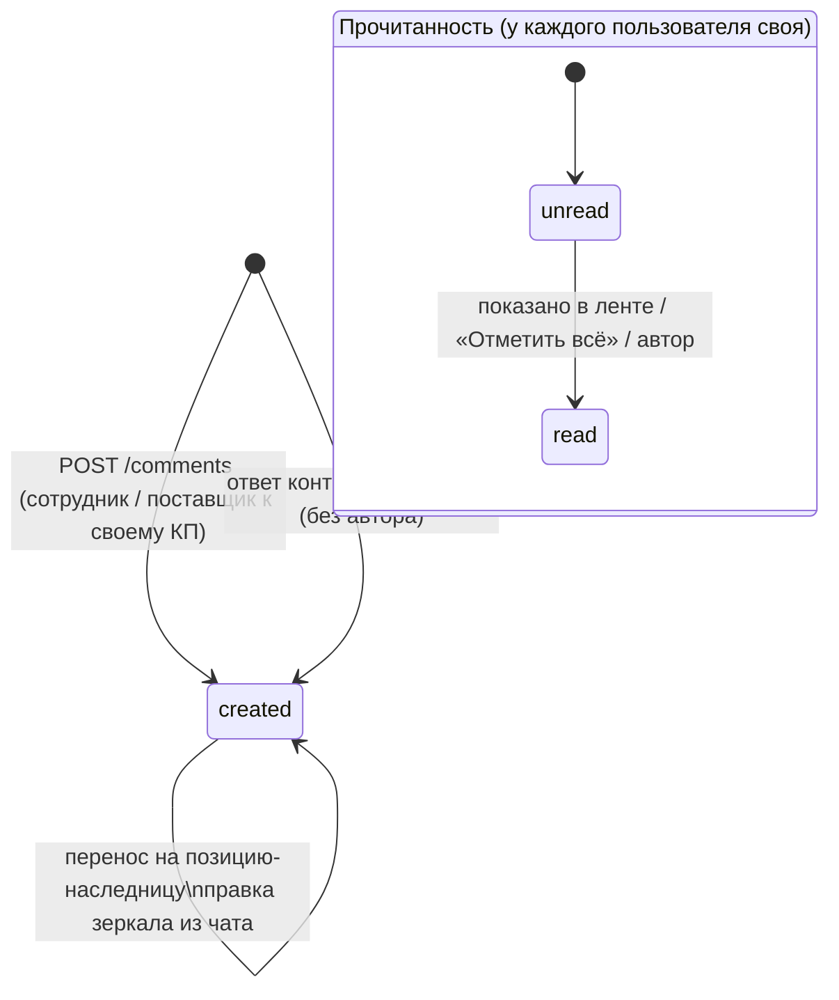
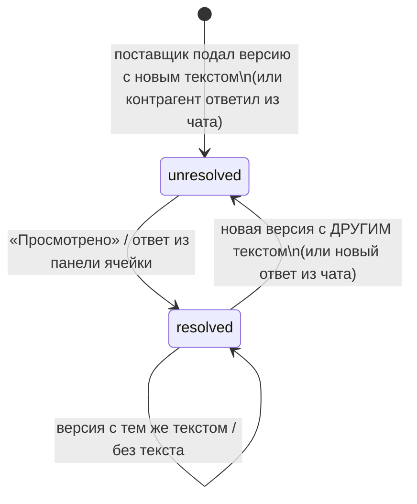

# Домен «Комментарии» (comments)

Внутреннее обсуждение сотрудников (к тендеру, КП, позиции/ячейке сравнительной таблицы, карточке контрагента) с ответами, файлом и адресным «+ Уведомить»; история комментариев поставщика к позициям по версиям КП с персональной отметкой «Просмотрено»; счётчик «неотработанных» комментариев в сравнительной таблице; ответы контрагента из чата, возвращающиеся в ячейку.

Связанные разделы: API — [../04-api/endpoints-comments.md](../04-api/endpoints-comments.md) (`/comments`) и [../04-api/endpoints-tenders-comparison.md](../04-api/endpoints-tenders-comparison.md) (`/tenders/{id}/comments`, `/position-comments`, `/comment-workload`); ввод комментария поставщиком в форме КП — [tenders-quotes.md](tenders-quotes.md); ячейка и фильтр «Есть комментарии» — [tenders-comparison.md §11](tenders-comparison.md#11-комментарии-к-позициям); мост в чат — [chat.md](chat.md); экраны — [../03-screens/tender-card-comparison.md](../03-screens/tender-card-comparison.md), [../03-screens/tender-card-messages.md](../03-screens/tender-card-messages.md); модель данных — [comments](../05-data-model/tables.md#comments), [comment_reads](../05-data-model/tables.md#comment_reads), [position_comment_reads](../05-data-model/tables.md#position_comment_reads).

## 1. Назначение и границы

В системе три **разных** вида текста «по поводу», которые нельзя смешивать в одной ленте:

| | Внутреннее обсуждение | Комментарий поставщика к позиции | Ответ контрагента из чата |
|---|---|---|---|
| Кто пишет | Сотрудники (поставщик — только в обсуждении своего КП) | Поставщик, подавая версию КП | Контрагент кнопкой «Ответить на вопрос» в чате |
| К чему | Тендер, КП, позиция тендера (в т.ч. ячейка «подрядчик × позиция»), карточка контрагента | Одна позиция одной версии КП | Ячейка «подрядчик × позиция», о которой его спросили |
| Форма | Тред: корневой комментарий → ответы (один уровень), файл, адресат «+ Уведомить» | История-проекция версий: одна запись на изменение текста | Запись треда ячейки без автора-пользователя |
| Видит поставщик | Нет (кроме обсуждения своего КП) | Это его собственный текст | Да, это его реплика в чате |
| Прочитанность | Личная; «прочитано = показано» | Личная; только явным «Просмотрено» | Личная; только явным действием |
| Где хранится | `comments` | `quote_items.supplier_comment` (домен тендеров) | `comments` (`author_id` пусто) |

Система должна:

1. хранить внутреннее обсуждение полиморфно (тип и id сущности), с одним уровнем ответов, одним файлом на комментарий и необязательным адресатом «+ Уведомить»;
2. сообщать о новом комментарии адресату «+ Уведомить» (с письмом) и ответственному за тендер (без письма);
3. собирать историю комментария поставщика к позиции по **всем** версиям КП, схлопывая повторы, и вести персональную просмотренность по записям истории;
4. считать для каждой ячейки «подрядчик × позиция» число **неотработанных** записей и для каждого подрядчика — число ячеек с неотработанным (знак в ячейке и чип в шапке колонки);
5. принимать в тред ячейки ответы контрагента из чата и считать их неотработанными до явной отметки;
6. при пересборке разделов тендера (слияние позиций) переносить треды ячеек удалённых позиций на позицию-наследницу.

Вне границ: обязательность и лимит комментария поставщика при подаче КП, отказе, своём объёме и своей позиции ([tenders-quotes.md](tenders-quotes.md)); комментарий специалиста к решению по корректировке и комментарий запроса доработки — поля КП ([tenders-quotes.md](tenders-quotes.md)); заметки сотрудников по тендеру ([tenders-lifecycle.md §12](tenders-lifecycle.md#12-заметки-сотрудников)); отправка записи в чат и ответ контрагента — механика чата ([chat.md](chat.md)). Комментарий к КП целиком у поставщика отсутствует по замыслу: сущность привязана к позиции.

## 2. Сущности и ключевые поля

| Сущность | Таблица | Ключевые поля |
|---|---|---|
| Комментарий обсуждения | [comments](../05-data-model/tables.md#comments) | `entity_type` (`tender` \| `quote` \| `tender_item` \| `supplier`), `entity_id`, `supplier_id` («якорь» треда ячейки — подрядчик колонки; только у `tender_item`), `parent_comment_id` (корень для ответа), `author_id` (пусто — ответ контрагента из чата), `comment_text`, `attachment_id`, `notify_user_id` (адресат «+ Уведомить»), `created_at` |
| Отметка «прочитано» | [comment_reads](../05-data-model/tables.md#comment_reads) | `user_id` + `comment_id` (ключ), `read_at` |
| Отметка «просмотрено» записи истории поставщика | [position_comment_reads](../05-data-model/tables.md#position_comment_reads) | `user_id` + `quote_item_id` (ключ), `read_at` |
| Источник истории поставщика | [quote_items](../05-data-model/tables.md#quote_items) | `supplier_comment` (≤ 1000), позиция тендера, версия КП (номер, время подачи, автор версии) |
| Файл комментария | [attachments](../05-data-model/tables.md#attachments) | Файл грузится **на саму обсуждаемую сущность** (тот же `entity_type`/`entity_id`), отдельного типа «вложение комментария» нет |

**Тред ячейки** = все комментарии `entity_type = tender_item`, `entity_id = <позиция>`, `supplier_id = <подрядчик>`; ключ треда на экране — «подрядчик : позиция». Ответ без указанного якоря наследует якорь родителя.

**Запись истории поставщика** = `{quote_item_id, текст, версия «vN», автор (имя создателя версии, иначе «Поставщик»), время подачи (Москва), unread}`; тред истории — пара «подрядчик × позиция».

## 3. Жизненный цикл

### 3.1. Комментарий обсуждения

| Из | В | Кто | Условие | Побочные эффекты |
|---|---|---|---|---|
| — | Создан | Сотрудник с доступом к сущности; поставщик — к своему КП | Текст или файл; проверки §4.1 | Ревизия тендера +1 (для `tender`, `quote`, `tender_item`); автору — отметка «прочитано»; уведомления (§7); журнал `comment_created` |
| — | Создан (ответ контрагента) | Система по ответу контрагента в чате | Ответ на реплику чата с адресом ячейки | Запись треда ячейки с якорем-подрядчиком и без автора; непрочитана у всех сотрудников |
| Создан | Создан (перенесён) | Система | Пересборка разделов слила позиции | `entity_id` меняется на позицию-наследницу |
| Создан | Создан (текст изменён) | Система | Контрагент поправил/удалил свой ответ в чате в окне 15 мин | Текст зеркала заменяется; при удалении — «Сообщение удалено контрагентом.» |
| Создан | изменён / удалён пользователем | — | Не предусмотрено: правки и удаления комментариев нет | — |

Прочитанность — на пару «пользователь × комментарий»: `непрочитан → прочитан` (отметкой показанных записей, «Отметить всё просмотренным» по треду, у автора — сразу); обратно не возвращается.

### 3.2. Комментарий поставщика к позиции и «неотработанность»

| Из | В | Кто | Условие | Побочные эффекты |
|---|---|---|---|---|
| — | Запись истории, непросмотрена | Поставщик (подача версии КП) | Непустой текст, отличный от предыдущей записи истории этой пары | У каждого сотрудника пара становится «неотработанной» |
| Непросмотрена | Просмотрена | Сотрудник, явным «Просмотрено» в панели ячейки | Отмечаются записи, показанные в панели | Пара «отработана» для этого сотрудника (если нет других непросмотренных записей и ответов) |
| Непросмотрена | Просмотрена | Сотрудник, ответом контрагенту из панели ячейки | Интерфейс отправляет ответ в чат и затем отмечает историю просмотренной | То же |
| Просмотрена | (новая запись) Непросмотрена | Поставщик | Новая версия КП с **другим** непустым текстом | Пара снова «неотработана» |
| Просмотрена | Просмотрена | Поставщик | Новая версия с тем же текстом или пустым | Ничего не меняется |

Состояние «неотработан / отработан» — **персональное**: отметка одного специалиста не меняет счётчики коллег. Это состояние **работы**, а не факт чтения: открытие панели, наведение и прокрутка просмотром не считаются.

## 4. Правила и валидации

### 4.1. Создание комментария обсуждения

| Правило | Текст отказа |
|---|---|
| `entity_type` ∈ {`tender`, `quote`, `tender_item`, `supplier`} и `entity_id` задан | 400 «Недопустимый тип или id сущности» (в ленте — «Недопустимый тип сущности») |
| Нужен текст или файл (текст обрезается по краям) | 400 «Комментарий не может быть пустым» |
| Поставщик пишет только в обсуждение КП | 403 «Комментарии по этой сущности доступны только сотрудникам компании» |
| Доступ к сущности (см. §6) | 403 «Нет доступа к проекту этого тендера» / «Нет доступа к КП» / «Доступно только сотрудникам компании»; 404 «Тендер не найден» / «КП не найдено» / «Позиция не найдена» |
| Файл существует и загружен на **эту же** сущность | 400 «Файл не привязан к этому обсуждению» |
| Комментарий только с файлом получает текст «📎 <имя файла>» | — |
| Адресат «+ Уведомить» — существующий **активный** пользователь | 400 «Недопустимый адресат уведомления» |
| Адресат — не пользователь контрагента | 400 «Адресат уведомления должен быть сотрудником» |
| Якорь-подрядчик существует | 400 «Недопустимый поставщик» |
| Якорь допустим только у `tender_item` | 400 «Поставщик-якорь имеет смысл только у комментария позиции» |

Длина текста не ограничена (в отличие от 1000 символов комментария поставщика и 4000 символов реплики чата) — см. открытые вопросы. Ответ указывает `parent_comment_id` корня; сервер родителя не проверяет (существует ли, та же ли сущность, корень ли — см. открытые вопросы API-3); при воссоздании требуется проверка с отказом 400.

### 4.2. Лента обсуждения сущности

- Порядок — по времени создания, старые сверху (и корни, и ответы).
- Страница считается по **корневым** комментариям (граница страницы не разрывает тред); ответы к корням страницы приходят целиком.
- Автор без учётной записи или удалённый — «Удалённый пользователь»; в треде ячейки запись без автора с якорем подписывается названием контрагента (короткое, иначе юридическое).
- Время — по Москве, `ДД.ММ.ГГГГ ЧЧ:ММ`.

### 4.3. Переписка по ячейкам тендера

- Отдаётся одной плоской выборкой на весь тендер (маркер нужен у каждой ячейки ещё до клика), включая ответы; клиент сам собирает ключ «подрядчик : позиция».
- У каждой записи: `read` = есть моя отметка **или** я автор; `from_supplier` = запись без автора с якорем (ответ контрагента).
- Отметка прочитанного: с перечнем `ids` — именно показанные записи; без перечня — весь тред (для ячейки — тред пары «позиция × подрядчик»). Чужие id игнорируются, нечисловые — 400 «Недопустимый перечень записей». Повтор идемпотентен.
- Записи коллег гаснут при показе («прочитано = показано»); **ответ контрагента** закрывается только явным действием — иначе счётчик неотработанного гас бы сам при прокрутке.

### 4.4. История комментария поставщика

1. Берутся **все** версии КП всех подрядчиков тендера, а не выбранная в колонке.
2. Пустые тексты записью не становятся.
3. Подряд идущие одинаковые тексты (по возрастанию версии) — одна запись: версия без изменений историю не удлиняет и просмотренность не сбрасывает. Пример: версии `A → A → B → (пусто)` дают историю `B, A`.
4. Порядок — от новой записи к первой; в каждой — полный текст, «vN», автор, время подачи.
5. Свои позиции поставщика (сверх ФКП) в историю не попадают — у них нет стабильной позиции тендера (их комментарий виден в блоке новых позиций текущей версии); см. открытые вопросы.
6. Лента истории страничная (режется по истории, а не по строкам КП); только для чтения; только сотрудникам — поставщик видит свой текст в форме КП.
7. «Просмотрено» отмечает перечисленные `quote_item_ids`; строки чужих тендеров отбрасываются; пустой перечень — `{"marked": 0}`.

### 4.5. Карточка ячейки и панель

Карточка ячейки показывает последний непустой комментарий поставщика целиком и счётчик «ещё N в истории», если записей больше одной. Панель ячейки — **два блока**: сверху слова поставщика (история), ниже внутреннее обсуждение. Из панели доступны: «Просмотрено»; «В чат» у записи обсуждения или у записи истории (копия уходит контрагенту репликой, [chat.md §4.5](chat.md#45-мост-ячейка--чат)); «Ответить» — карточка «позиция · КП vN от даты · ваш комментарий · ответ компании» в чат и отметка истории просмотренной.

## 5. Расчёты и формулы

Для текущего пользователя `u`, тендера и пары «подрядчик `s` × позиция `i`»:

| Величина | Формула |
|---|---|
| Записи истории `H(s,i)` | по правилам §4.4 |
| Непросмотренная запись | `quote_item_id` записи нет среди отметок `u` в `position_comment_reads` |
| Неотвеченные ответы из чата `A(s,i)` | комментарии треда ячейки с `author_id` пусто, `supplier_id = s`, без отметки `u` в `comment_reads` |
| Неотработано в ячейке | `unresolved(s,i) = count{h ∈ H(s,i): непросмотрена} + count(A(s,i))` |
| Всего в ячейке (для подсказки) | `total = count(H(s,i))`; если истории нет, а ответы есть — `total = count(A(s,i))` |
| Чип подрядчика | `by_supplier[s] = count{i : unresolved(s,i) > 0}` (число ячеек, а не записей) |
| Непрочитана запись обсуждения | нет отметки `u` в `comment_reads` и `u` не автор |

Оба счётчика экрана (знак в ячейке и чип в шапке колонки) строятся из **одного** ответа — второго способа счёта быть не должно. Внутреннее обсуждение сотрудников в «неотработанное» не входит: отрабатывать там нечего.

## 6. Права доступа

| Действие | Админ | Тенд. специалист | СБ | Юрист | Контрагент | Лид | Владелец |
|---|---|---|---|---|---|---|---|
| Читать/писать/отмечать обсуждение тендера, позиции, ячейки | ✅ | объект | объект | объект | ❌ | ❌ | ❌ |
| Читать/писать обсуждение КП | ✅ | объект | объект | объект | только КП своей организации | ❌ | ❌ |
| Читать/писать обсуждение карточки контрагента | ✅ | ✅ | ✅ | ✅ | ❌ | ❌ | ❌ |
| История комментариев поставщика, счётчики неотработанного, «Просмотрено» | ✅ | объект | объект | объект | ❌ | ❌ | ❌ |
| Назначить адресата «+ Уведомить» | любой активный сотрудник | ← | ← | ← | — | — | — |

«объект» — тендер на объекте из грантов пользователя (с подобъектами). Отдельного права матрицы у комментариев нет. В интерфейсе обсуждение есть у тендера, КП (карточка КП) и ячеек СТ; обсуждение карточки контрагента и комментарии поставщика к своему КП в кабинете доступны только через API (см. открытые вопросы).

## 7. События, уведомления, аудит

| Событие | Адресат | Вид | Заголовок / текст | Письмо |
|---|---|---|---|---|
| Новый комментарий с «+ Уведомить» | Адресат (кроме автора) | `comment` | «Вас упомянули в комментарии»; текст «<автор> · «<название тендера>»: <первые 160 символов>» (вне тендера — «… · карточке: …»), переход — карточка тендера | Да, сразу (лучшее усилие, при включённой почте и наличии адреса): тема «Вас упомянули в комментарии», тот же текст и ссылка |
| Новый комментарий к тендеру / КП / позиции | Ответственный за тендер (иначе автор тендера), кроме автора комментария; без дубля с адресатом | `comment` | «Новый комментарий», тот же текст | Нет |
| Комментарий к карточке контрагента | Только адресат «+ Уведомить» | `comment` | см. выше | Да, адресату |
| Ответ контрагента из чата в ячейку | Отдельного уведомления нет — приходит уведомление о сообщении чата ([chat.md §7](chat.md#7-события-уведомления-аудит)) | — | — | — |

Уведомления доставляются в живой поток адресата (ключ `staff:<id>`) при коммите. Сводная карта — [notifications.md §5](notifications.md#5-каталог-событий).

Журнал ИБ: `comment_created` (`entity_type`/`entity_id` обсуждаемой сущности, `details = {comment_id, supplier_id}`, IP). Отметки «прочитано/просмотрено» не журналируются.

Ревизия тендера увеличивается на каждый комментарий к тендеру, КП или позиции: комментарии — вход ИИ-анализа, кэш сравнения и анализа считаются устаревшими.

## 8. Фоновые задачи и периодика

Нет. Письмо адресату упоминания отправляется в запросе (без очереди); сбой почты не отменяет комментарий. Подписка на событие тендеров «позиции слиты» выполняется синхронно в транзакции пересборки.

## 9. Настройки и флаги

| Имя | Влияние |
|---|---|
| `MAIL_ENABLED` | Без почты письмо упоминания не уходит (запись в центре уведомлений создаётся) |
| `PUBLIC_APP_URL` | База ссылки в письме |

Своих флагов у домена нет.

## 10. Граничные случаи

1. **Ответ на ответ** сохраняется, но лента обсуждения сущности его не показывает (ответы подтягиваются только к корням); в плоской выдаче ячеек он есть. Требование при воссоздании: ответ только на корень (400 иначе) или показ всех уровней.
2. **Комментарий с файлом другой сущности** отклоняется — файл всегда грузится на обсуждаемую сущность и наследует её правила доступа.
3. **Адресат упомянут и ответственный — одно лицо** — одна запись «Вас упомянули в комментарии».
4. **Автор — ответственный** — себе уведомление не создаётся.
5. **Тендер без ответственного** — адресат «Новый комментарий» — автор тендера.
6. **Ответ контрагента из чата** до явной отметки остаётся неотработанным даже после показа в ленте ячейки.
7. **Правка/удаление ответа контрагента в чате** меняет текст зеркала в ячейке; отметка «прочитано» при этом сохраняется (повторно неотработанным не становится).
8. **Слияние позиций** при пересборке разделов переносит треды ячеек удаляемых позиций-заголовков на позицию-наследницу (первую позицию подраздела, заменившего заголовок). История комментариев поставщика привязана к строкам КП и этим механизмом не переносится — судьба строк КП при пересборке определяется доменом тендеров ([tenders-lifecycle.md §10](tenders-lifecycle.md#10-правка-состава-фкп-после-старта)).
9. **«Ответить» из панели** — две операции клиента (отправка в чат, затем «Просмотрено»): при сбое второй ответ уйдёт, а пара останется неотработанной. Рекомендуется выполнять оба шага одной серверной операцией.
10. **Длинный текст** обсуждения ничем не ограничен — рекомендуется предел 4000 символов, как у чата.
11. **Лид** попадает в список коллег для «+ Уведомить» (см. открытые вопросы API-1) — должен быть исключён.

## 11. Пример

Тендер T-2026-100, позиция «Витраж В-3, 2 этаж» (объём ФКП 598 м²), подрядчик «Альфа Фасад», специалисты «Петров» (ответственный) и «Смирнова».

| Шаг | Действие | Результат |
|---|---|---|
| 1 | «Альфа» подаёт v1 без комментария к позиции | Истории нет, счётчики 0 |
| 2 | v2: «Объём по обмерам 681,72 м² — проёмы шире проекта» | История: [v2]. У Петрова и Смирновой `unresolved = 1`, чип «Альфа» = 1 |
| 3 | v3 с тем же текстом | История не меняется ([v2]), счётчики те же |
| 4 | Петров открывает панель, жмёт «Просмотрено» (`quote_item_ids = [v2]`) | У Петрова `unresolved = 0`, у Смирновой по-прежнему 1 |
| 5 | Смирнова пишет в обсуждение ячейки «Проверим обмеры на объекте» с «+ Уведомить: Петров» | Петрову — «Вас упомянули в комментарии» + письмо; дополнительное «Новый комментарий» не создаётся (он же ответственный); ревизия тендера +1; `comment_created` |
| 6 | Смирнова жмёт «Ответить»: «Подтвердите обмер актом» | В чат «Альфе» уходит карточка «Позиция «Витраж В-3, 2 этаж» · КП v3 от 25.09.2026 / Ваш комментарий: … / Ответ компании: Подтвердите обмер актом»; у Смирновой `unresolved = 0` |
| 7 | «Альфа» в чате «Ответить на вопрос»: «Акт приложим завтра» | В тред ячейки ложится запись без автора с якорем «Альфа»; у обоих `unresolved = 1` (ответ из чата) |
| 8 | v4: «Объём по обмерам 650 м² (акт приложен)» | История: [v4, v2]; у Петрова `unresolved = 1 (v4) + 1 (ответ) = 2`, `total = 2` |

## 12. Оценка сложности

**M.** Полиморфное обсуждение с одним уровнем ответов и уведомлениями — S; поверх него: персональная прочитанность, история-проекция по версиям КП с дедупликацией, единый предикат «неотработанного» для двух счётчиков, мост с чатом (зеркало ответа контрагента), перенос тредов при слиянии позиций и согласованность с ревизией тендера.

## 13. Связанные разделы

- API: [../04-api/endpoints-comments.md](../04-api/endpoints-comments.md), [../04-api/endpoints-tenders-comparison.md](../04-api/endpoints-tenders-comparison.md).
- Экраны: [../03-screens/tender-card-comparison.md](../03-screens/tender-card-comparison.md) (ячейка, панель, чип), [../03-screens/tender-card-messages.md](../03-screens/tender-card-messages.md), карточка КП.
- Бизнес-логика: [chat.md](chat.md), [tenders-comparison.md](tenders-comparison.md#11-комментарии-к-позициям), [tenders-quotes.md](tenders-quotes.md), [notifications.md](notifications.md#5-каталог-событий), [audit.md](audit.md#71-каталог-событий).
- Таблицы: [comments](../05-data-model/tables.md#comments), [comment_reads](../05-data-model/tables.md#comment_reads), [position_comment_reads](../05-data-model/tables.md#position_comment_reads), [quote_items](../05-data-model/tables.md#quote_items).
- Открытые вопросы — `../_oq/BL-4.md` (а также `../_oq/API-3.md`, `../_oq/API-1.md`).
