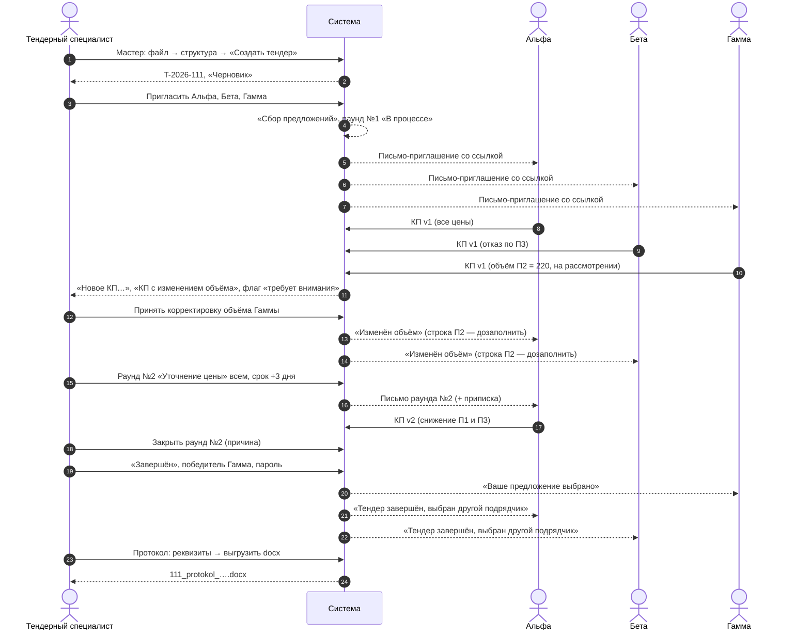
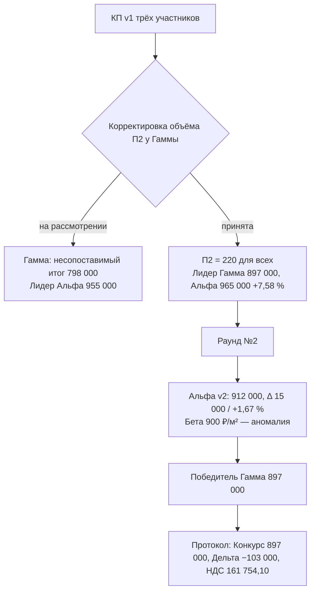
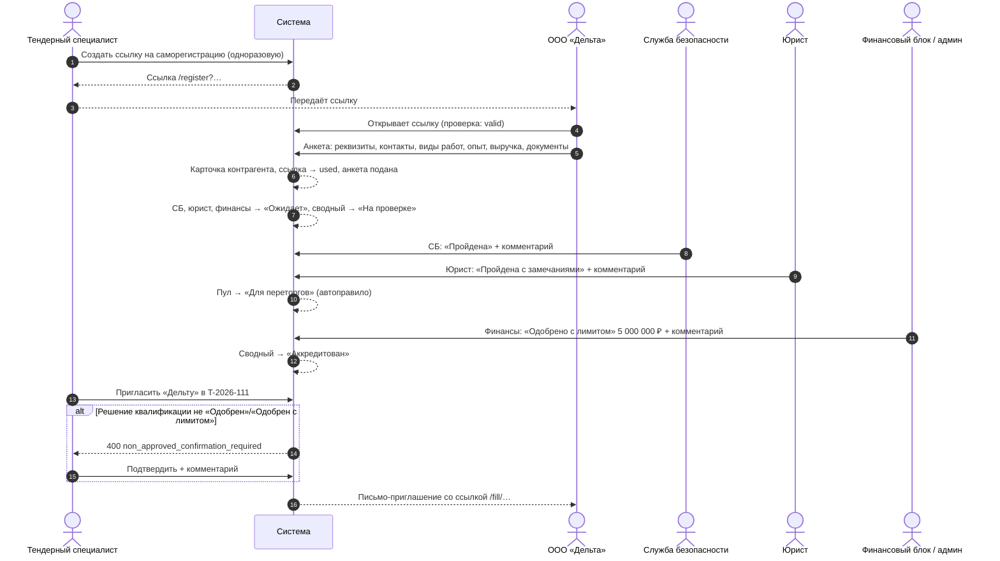
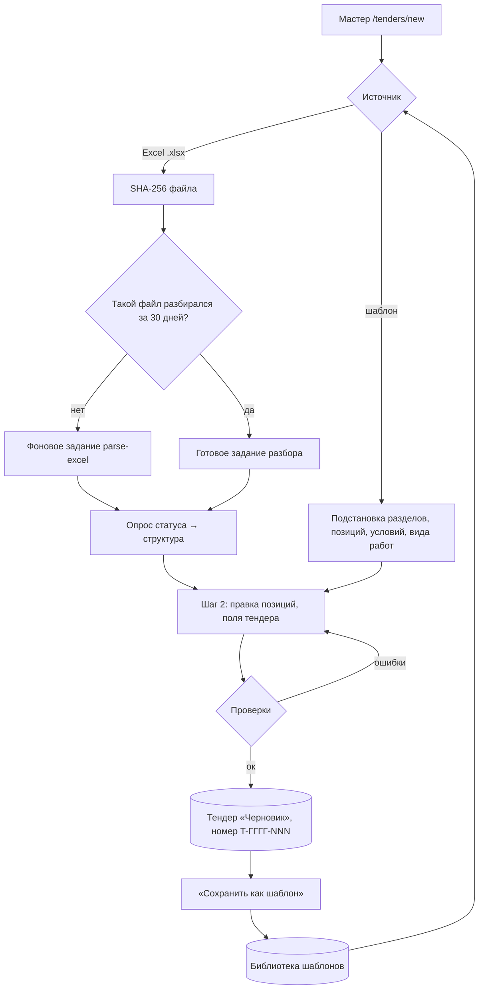
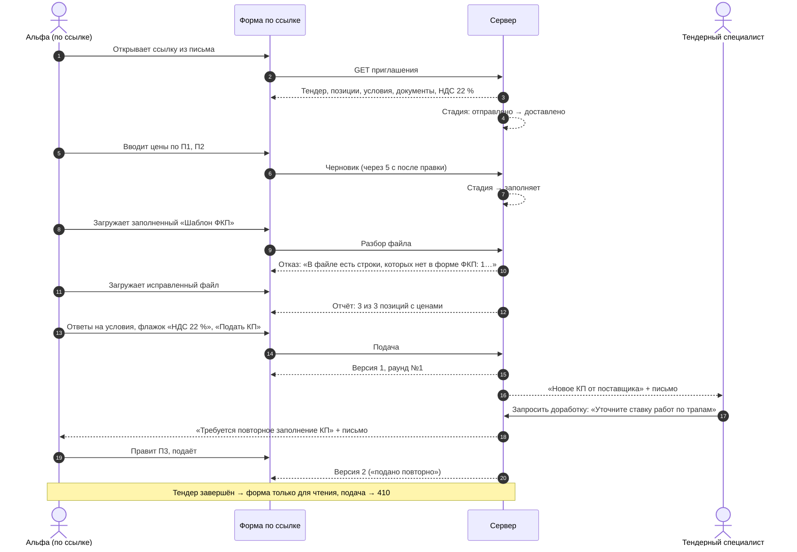

# Сквозные сценарии «от заявки до закупки»

Четыре сквозных сценария с настоящими числами: (1) тендер на 3 позиции в 2 разделах от создания до протокола — КП трёх поставщиков, корректировка и отказ, полный расчёт СТ, раунд переторжки, выбор победителя, протокол; (2) регистрация нового подрядчика по ссылке и квалификация СБ/юристом; (3) создание тендера из Excel-ведомости и запуск следующего из шаблона; (4) работа поставщика по персональной ссылке, включая повторную подачу. Числа сценария 1 получены прогоном формул из [tenders-comparison.md](tenders-comparison.md) и сходятся с ними до копейки.

Связанные разделы: [tenders.md](tenders.md), [tenders-lifecycle.md](tenders-lifecycle.md), [tenders-invitations.md](tenders-invitations.md), [tenders-quotes.md](tenders-quotes.md), [tenders-comparison.md](tenders-comparison.md), [tenders-rounds.md](tenders-rounds.md), [tenders-documents.md](tenders-documents.md), [suppliers.md](suppliers.md); экраны — [../03-screens/tender-create.md](../03-screens/tender-create.md), [../03-screens/tender-card.md](../03-screens/tender-card.md), [../03-screens/fill.md](../03-screens/fill.md), [../03-screens/cabinet.md](../03-screens/cabinet.md), [../03-screens/templates.md](../03-screens/templates.md), [../03-screens/quotes-inbox.md](../03-screens/quotes-inbox.md); API — [../04-api/endpoints-tenders.md](../04-api/endpoints-tenders.md), [../04-api/endpoints-rounds.md](../04-api/endpoints-rounds.md), [../04-api/endpoints-quotes.md](../04-api/endpoints-quotes.md).

Эти сценарии рекомендуется использовать как приёмочные тесты: каждое число в таблицах — ожидаемое значение.

## Сценарий 1. Тендер от создания до протокола

### 1.1. Исходные данные

Тендер «Стяжки полов, корпус 1», объект «ЖК «Северный парк», корпус 1», вид работ «Стяжки», бюджетная позиция «Стяжки и полы», **плановая сумма 1 000 000 ₽**, сбор КП 01.10.2026–15.10.2026, номер `T-2026-111`. Участники: ООО «Альфа» (аккредитован), ООО «Бета» (аккредитован), ООО «Гамма» (аккредитован). Пороги — системные по умолчанию (15 % / 40 % / k = 3 / 80 %), НДС 22 %.

| Раздел | Позиция | Ед. | Объём ФКП |
|---|---|---|---:|
| 1. Стяжки | П1 «Стяжка цементно-песчаная М150, 50 мм» | м² | 1 000 |
| 1. Стяжки | П2 «Гидроизоляция обмазочная в 2 слоя» | м² | 200 |
| 2. Трапы | П3 «Установка трапа» | шт. | 10 |

Доп. условия: «Срок выполнения работ», «Условия оплаты (авансирование)», «Гарантийный срок».

### 1.2. Поданные КП (раунд №1)

Ставки за единицу, ₽ (материалы + работы = ставка):

| Позиция | Альфа | Бета | Гамма |
|---|---|---|---|
| П1 | 450 + 350 = **800** | 500 + 400 = **900** | 420 + 330 = **750** |
| П2 | 300 + 200 = **500** | 280 + 170 = **450** | 260 + 190 = **450**, объём **220** («по замеру площадь 220 м²») — на рассмотрении |
| П3 | 4 000 + 1 500 = **5 500** | **отказ** («трапы не поставляем») | 3 500 + 1 300 = **4 800** |

«Заполнено»: Альфа 3/3 = 100 %; Бета 2/3 = 67 % (отказ не закрывает позицию; при подаче Бета подтвердила «По 1 позиции цены нет — итог будет неполным»); Гамма 3/3 = 100 %.

Стоимости позиций `C = round₂(M·V) + round₂(W·V)`:

| Позиция | Альфа | Бета | Гамма |
|---|---:|---:|---:|
| П1 | 450 000 + 350 000 = 800 000 | 500 000 + 400 000 = 900 000 | 420 000 + 330 000 = 750 000 |
| П2 | 60 000 + 40 000 = 100 000 | 56 000 + 34 000 = 90 000 | 57 200 + 41 800 = 99 000 (по 220 м², **вне сравнения**) |
| П3 | 40 000 + 15 000 = 55 000 | Отказ | 35 000 + 13 000 = 48 000 |

### 1.3. Сравнение после раунда №1 (до решения по корректировке)

| Позиция | Сопоставимые ставки | Медиана | MIN (честный) | MAX | Разброс | Градация | MC = med × V | Вес |
|---|---|---:|---:|---:|---:|---|---:|---:|
| П1 | 800, 900, 750 | 800 | 750 | 900 | (900 − 750) / 800 = 18,75 % | заметный | 800 000 | 84,52 % |
| П2 | 500, 450 | 475 | 450 | 500 | 50 / 475 = 10,53 % | обычный | 95 000 | 10,04 % |
| П3 | 5 500, 4 800 | 5 150 | 4 800 | 5 500 | 700 / 5 150 = 13,59 % | обычный | 51 500 | 5,44 % |

`Σ MC = 946 500`; ключевые позиции: П1 (накопительно 84,52 % ≥ 80 %). Аномалий нет: по П1 у Беты `d = |900/800 − 1| = 0,125`, медиана отклонений остальных `median(0; 0,0625) = 0,03125`, порог `max(3 × 0,03125; 0,15) = 0,15`, `0,125 < 0,15`. По П2 и П3 меньше трёх ставок — аномалия не считается.

Отклонения ячеек П1: Альфа 0 %; Бета `(900/800 − 1) × 100 = +12,5 %` (+100 ₽/м², +100 000 ₽ по позиции); Гамма −6,25 % (−50 ₽/м²). П2: Альфа +5,26 %, Бета −5,26 %. П3: Альфа +6,80 %, Гамма −6,80 %.

| Участник | Итог КП | Подпись | Место | Δ к лидеру | Потенциал `Σ max(0, R − MIN) × V` |
|---|---:|---|---|---|---:|
| Альфа | 800 000 + 100 000 + 55 000 = **955 000** | полный итог | 1 — «Лучшее предложение» | — | 50 000 + 10 000 + 7 000 = **67 000** (полный) |
| Бета | 900 000 + 90 000 = **990 000** | неполный итог · нет ставок: 1 | без места | — | 150 000 (по сопоставимым) |
| Гамма | 750 000 + 48 000 = **798 000** | несопоставимый итог · разные объёмы | без места | — | 0 |

Медиана полных итогов = 955 000 (одно полное КП). Подытоги раздела «Стяжки»: Альфа 900 000, Бета 990 000 (оба полные), Гамма 750 000 (несопоставимый); медиана полных подытогов 945 000; отклонения Альфа −4,76 %, Бета +4,76 %. Раздел «Трапы»: Альфа 55 000, Гамма 48 000 (полные), Бета — неполный; медиана 51 500. НДС в итоге Альфы: `955 000 × 22 / 122 = 172 213,11 ₽`.

Реестр: «Лучшая цена» = 955 000; «Мин. неполного КП» = 798 000 (Гамма, «нет ставок: 1» — несопоставимая позиция считается пропуском).

### 1.4. Решение по корректировке: объём П2 = 220 м² принят

Специалист принимает корректировку Гаммы. Объём П2 становится 220 для всех (исходный 200 сохраняется), строки П2 у Альфы и Беты помечаются «дозаполнить», им уходит «Изменён объём — T-2026-111»; их суммы считаются по прежним ставкам × 220.

| Позиция | Ставки | Медиана | MIN | MAX | Разброс | MC | Вес |
|---|---|---:|---:|---:|---:|---:|---:|
| П1 | 800, 900, 750 | 800 | 750 | 900 | 18,75 % | 800 000 | 84,17 % |
| П2 (220 м²) | 500, 450, 450 | 450 | 450 | 500 | 50 / 450 = 11,11 % | 99 000 | 10,42 % |
| П3 | 5 500, 4 800 | 5 150 | 4 800 | 5 500 | 13,59 % | 51 500 | 5,42 % |

`Σ MC = 950 500`. По П2 у Альфы `d = 0,1111`; медиана отклонений остальных = 0 → порог = `d_min = 0,15` → не аномалия.

| Участник | П1 | П2 | П3 | Итог | Подпись | Место | Δ к лидеру | Отклонение итога | Потенциал |
|---|---:|---:|---:|---:|---|---|---|---:|---:|
| Альфа | 800 000 | 500 × 220 = 110 000 | 55 000 | **965 000** | полный | 2 | 965 000 − 897 000 = **68 000 ₽**, `965 000 / 897 000 − 1` = **+7,58 %** | +3,65 % | 50 000 + 11 000 + 7 000 = 68 000 |
| Бета | 900 000 | 99 000 | Отказ | 999 000 | неполный · нет ставок: 1 | — | — | — | 150 000 |
| Гамма | 750 000 | 99 000 | 48 000 | **897 000** | полный | **1** | — | −3,65 % | 0 |

Медиана полных итогов = (897 000 + 965 000) / 2 = **931 000**. Подытог «Стяжки»: Альфа 910 000, Бета 999 000, Гамма 849 000; медиана 910 000; отклонения 0 %, +9,78 %, −6,70 %.

### 1.5. Раунд переторжки №2

Раунд №2: адресаты — все трое; общий текст «Уточнение цены»; Альфе приписка «Просим пересмотреть цену по стяжке (позиция 1)»; срок +3 дня 18:00 МСК. Отправка закрывает раунд №1. Альфа подаёт версию 2: П1 450 + **300** = 750; П2 без изменений (500, подтверждает «дозаполнить»); П3 4 000 + **1 200** = 5 200. Бета и Гамма не отвечают; после срока раунд «просрочен», специалист закрывает его с причиной «Переторжка завершена».

| Позиция | Ставки | Медиана | MIN | MAX | Разброс | Аномалии | MC |
|---|---|---:|---:|---:|---:|---|---:|
| П1 | 750, 900, 750 | 750 | 750 (совместно Альфа и Гамма) | 900 | 150 / 750 = **20 %** (заметный) | **Бета**: `d = 0,2`, медиана остальных 0 → порог 0,15 → аномалия (завышена) | 750 000 |
| П2 | 500, 450, 450 | 450 | 450 | 500 | 11,11 % | — | 99 000 |
| П3 | 5 200, 4 800 | 5 000 | 4 800 | 5 200 | 400 / 5 000 = 8 % | — | 50 000 |

`Σ MC = 899 000`; вес П1 83,43 % — ключевая.

| Участник | Итог | Место | Δ к лидеру | Отклонение итога | Потенциал | Динамика (к версии 1) |
|---|---:|---|---|---:|---:|---|
| Альфа | 750 000 + 110 000 + 52 000 = **912 000** | 2 | **15 000 ₽ / +1,67 %** | +0,83 % | 0 + 11 000 + 4 000 = 15 000 | П1 `(750 − 800)/800 = −6,25 %`; П2 0 %; П3 `(5 200 − 5 500)/5 500 = −5,45 %`; итог 965 000 → 912 000 (−53 000 ₽, −5,49 %) |
| Бета | 999 000 | — | — | — | 150 000 | нет версии 2 |
| Гамма | **897 000** | 1 | — | −0,83 % | 0 | нет версии 2 |

Медиана полных итогов = (897 000 + 912 000) / 2 = 904 500. Число аномалий в тендере: 1. НДС: Гамма `897 000 × 22 / 122 = 161 754,10 ₽`, Альфа `912 000 × 22 / 122 = 164 459,02 ₽`.

### 1.6. Выбор победителя и закрытие

Специалист переводит тендер в «Завершён», выбирает Гамму, вводит пароль. КП Гаммы → «Принят»; раунды закрыты; Гамме — «Ваше предложение выбрано», Альфе и Бете — «Тендер завершён, выбран другой подрядчик. Благодарим за участие.»; ответственному — «Тендер T-2026-111 «Стяжки полов, корпус 1» завершён, победитель — ООО «Гамма»». Баннер карточки: «Тендер завершён — победил ООО «Гамма».»

Ветка «победитель без аккредитации»: если бы сводный статус Гаммы был «На проверке», сервер ответил бы `non_approved_confirmation_required` («Контрагент не прошёл аккредитацию: На проверке. Подтвердите выбор победителя и укажите комментарий.»); после подтверждения с комментарием в тендере сохраняется пометка «Победитель без аккредитации: На проверке», в ленте и журнале ИБ — `winner_non_accredited_confirmed`.

### 1.7. Протокол

Бюджет 1 000 000,00 руб.; Конкурс 897 000,00 руб.; Дельта = 897 000 − 1 000 000 = −103 000 → «Дельта: 103 000,00 руб.» зелёным (экономия 10,3 % к бюджету). Решение №1: «Утвердить в качестве подрядной организации: ООО «Гамма» ИНН … на сумму договора 897 000,00 руб., в т.ч. НДС 22% в размере 161 754,10 руб.». У Гаммы одна версия КП, поэтому в пункте о СТ сумма пишется: «КП ООО «Гамма» - 897 000,00 руб.». Подробности — [tenders-documents.md §3](tenders-documents.md#3-протокол-тендера-docx).

## Сценарий 2. Регистрация нового подрядчика и квалификация

**Контекст.** Для тендера `T-2026-111` специалист хочет позвать ООО «Дельта», которой нет в реестре (приглашать можно только контрагентов из реестра).

Шаги и правила:

1. Специалист создаёт ссылку на саморегистрацию (режим «одноразовая»). Ссылка хранится хешем и в зашифрованном виде; в журнале ссылок — статус «ожидает».
2. «Дельта» открывает ссылку: форма проверяет её заранее («ссылка недействительна / отозвана / использована» — сразу, без заполнения). Заполняет анкету; при ошибках валидации ссылка не сгорает. После успешной отправки — карточка контрагента, ссылка «использована», связь «карточка ← ссылка».
3. Отправка анкеты запускает три независимые проверки: СБ, юрист, финансовый блок — все «Ожидает»; сводный статус «На проверке».
4. СБ ставит «Пройдена», юрист — «Пройдена с замечаниями» (каждый — с обязательным комментарием, «Комментарий обязателен»; чужую ось — 403 «<ось>: нет права менять этот статус»). «Пройдена с замечаниями» автоматически переводит контрагента в пул «Для переторгов» (если пул не задан вручную).
5. Финансовый блок (право `finance.view`) или администратор ставит «Одобрено с лимитом» с суммой лимита на один договор 5 000 000 ₽ («Укажите сумму лимита на один договор»; лимит > 0). Все три оси положительны → сводный статус **«Аккредитован»**.
6. Специалист приглашает «Дельту». Сервер проверяет решение квалификации тендерного комитета («Одобрен» / «Одобрен с лимитом»): если оно ещё не принято, требуется подтверждение с комментарием (расхождение «аккредитован, но не одобрен» — в открытых вопросах). Если ранее «Дельту» отклоняли с опцией «не приглашать 12 месяцев» до 01.03.2027 — 409 «Контрагент «ООО «Дельта»» отклонён, повторное приглашение заблокировано до 01.03.2027».
7. Далее — как участник сценария 1; в окне выбора победителя рядом с именем «Дельты» ничего не помечается (аккредитован), лимит 5 000 000 ₽ виден в окне приглашения.

## Сценарий 3. Тендер из Excel-ведомости и следующий — из шаблона

1. Специалист открывает мастер, выбирает файл «Ведомость стяжки.xlsx» (лист 1 — позиции, лист 2 — доп. условия). Мастер создаёт черновик мастера, сохраняет исходник во вложение черновика, считает SHA-256 и отправляет файл на разбор; ответ — id фонового задания (`deduped: false`). Мастер опрашивает задание до `done`: 2 раздела, 3 позиции, 3 доп. условия.
2. Специалист закрывает вкладку. На следующий день в реестре тендеров в списке «Незавершённых черновиков» есть строка с кнопкой «Продолжить» (черновик моложе 30 дней); мастер открывается на шаге 2 со всеми данными — повторной загрузки не нужно. Если бы прошло больше `CREATION_DRAFT_TTL_DAYS` (30) дней, черновик пропал бы из списка, но открывался бы по прямой ссылке с пометкой «просрочен».
3. В ведомости у П3 единица «шт», у П1 — «кв.м.». «шт» сопоставляется со справочной единицей «шт.», если такое написание заведено в справочнике синонимом; «кв.м.» в справочнике нет — мастер показывает «Несопоставленные единицы измерения (1) — сопоставьте со справочником»; при попытке обойти интерфейс сервер ответил бы «Нет в справочнике единиц: «кв.м.». Выберите единицу из справочника или добавьте её туда.» Специалист выбирает «м²».
4. Поля: название, объект, вид работ «Стяжки», бюджетная позиция «Стяжки и полы» (период 2026 открыт), плановая сумма 1 000 000, даты 01.10–15.10.2026 (подставлены из дефолтов «объект × вид работ»). «Создать тендер» → `T-2026-111`, «Черновик»; черновик мастера → «converted», исходник стал документом «Шаблон ФКП».
5. Шаг 3 — специалист прикладывает ТЗ и шаблон договора СМР; шаг 4 — приглашает участников (сценарий 1).
6. В карточке — «Сохранить как шаблон»: имя по умолчанию «Стяжки полов, корпус 1», вид работ «Стяжки». Шаблон с таким именем уже есть → «Шаблон с таким названием уже есть»; специалист называет «Стяжки — типовой состав».
7. Через месяц — новый тендер на корпус 2: «Запустить из шаблона» → мастер с подсказкой «Подставлено из шаблона «Стяжки — типовой состав»»; специалист правит объёмы (П1 = 1 200 м²) и создаёт `T-2026-118` с отметкой шаблона-источника. Второй специалист параллельно правит шаблон в другой вкладке → его сохранение получает «Шаблон изменён в другом окне — обновите страницу».

## Сценарий 4. Поставщик: вход по ссылке, заполнение, повторная подача

Участник — ООО «Альфа» в тендере `T-2026-111`; у «Альфы» один пользователь кабинета, поэтому анонимная подача по ссылке присваивается ему как автору.

1. «Альфа» открывает ссылку из письма-приглашения. Стадия «отправлено» → «доставлено». Форма показывает шапку тендера (без бюджета), правило «Цены указаны с НДС 22 %», позиции, доп. условия, пакет документов (ТЗ, шаблон договора СМР, «Шаблон ФКП», ссылку на форму оферты).
2. «Альфа» вводит П1: 450 и 350 — форма сразу показывает ставку 800 ₽/м² и стоимость 800 000 ₽; П2: 300 и 200 (100 000 ₽). Через 5 секунд черновик сохраняется на сервере; стадия → «заполняет»; «Заполнено» 67 % (2 из 3).
3. «Альфа» скачивает «Шаблон ФКП» (защищённая копия: открыты только жёлтые ячейки), но заполняет старую копию, где вставлена лишняя строка, и загружает её. Ответ: «В файле есть строки, которых нет в форме ФКП: 1. Добавлять и менять строки нельзя — заполняйте только жёлтые ячейки скачанного шаблона.» — цены из файла не подставлены. Повторная загрузка правильного файла: 3 из 3 позиций с ценами, подставлены в черновик (П3: 4 000 и 1 500).
4. Ответы на условия: «Срок выполнения работ» — «2 месяца», «Условия оплаты» — «аванс 30 %», «Гарантийный срок» — «24 месяца». Прикладывает подписанный «Шаблон типового договора СМР» (обязательный слот на возврат — без него «Приложите документы: «Шаблон типового договора СМР»»).
5. Нажимает «Подать КП» без флажка НДС → «Подтвердите, что цены указаны с НДС 22%». Ставит флажок, подаёт. Сервер создаёт КП (автор — единственный пользователь «Альфы»), версию 1 (НДС 22 %, версия ФКП текущая), стадия «подано»; специалисту — «Новое КП от поставщика». Форма: «Раунд №1 · версия КП №1 · подано 03.10.2026 11:20», «Ваша подача учтена. Ещё не ответили: 2.»
6. Повторная попытка подать без оснований → 409 «КП уже подано — повторная отправка недоступна»; форма только для просмотра.
7. Специалист запрашивает доработку «Уточните ставку работ по трапам» → КП «На доработке», стадия «заполняет»; «Альфе» — уведомление «Требуется повторное заполнение КП» и письмо со ссылкой. Форма снова открыта целиком, с баннером комментария. «Альфа» оставляет цены и подаёт снова (флажок НДС ставится заново) → версия 2, подпись «подано повторно», КП снова «Подано» и снова «новое» во «Входящих».
8. Если бы с «Альфой» работали два пользователя кабинета и второй попробовал переподать, вошедший в кабинет: 403 «КП подал другой сотрудник вашей организации — править и переподавать может только он.»
9. После принятия корректировки Гаммы строка П2 у «Альфы» помечена «дозаполнить» (плашка «Изменён объём по позициям…»); в раунде №2 «Альфа» подаёт версию 3 со снижением (сценарий 1, §1.5). Дельта к прошлым значениям на форме: работы П1 350 → 300 (−14,3 %), работы П3 1 500 → 1 200 (−20,0 %).
10. После завершения тендера форма открывается только для просмотра; попытка сохранить черновик или подать — 410 «Тендер закрыт или отменён — подача и правки КП недоступны. …». «Альфе» пришло письмо «Тендер завершён: …, выбран другой подрядчик».

(В сценарии 1 версии Альфы нумеруются без учёта доработки: при прохождении шагов 7–9 версия раунда №2 будет третьей; расчёт СТ от этого не меняется, динамика считается к непосредственно предыдущей версии.)
