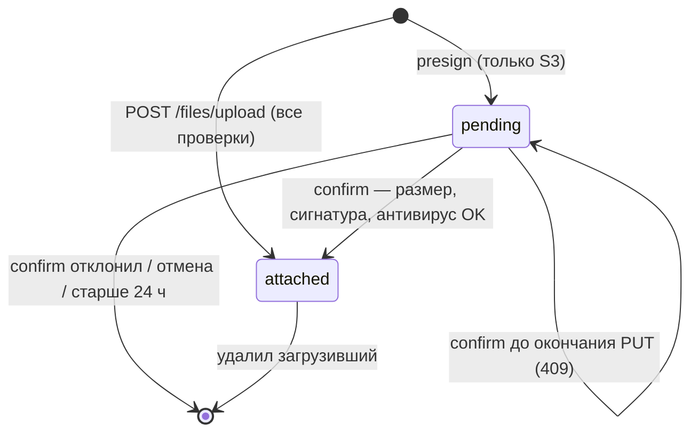

# Домен «Файлы и вложения» (files)

Приём, проверка, хранение, выдача и уборка файлов, прикреплённых к сущностям других доменов (контрагент, тендер, КП, приглашение, сообщение чата, объект): загрузка через API и прямая загрузка браузером в объектное хранилище по presigned-ссылке, незавершённые загрузки, антивирус, лимиты и белый список типов.

Связанные разделы: требования безопасности приёма файлов — [../07-architecture/security.md §8](../07-architecture/security.md#8-загрузка-файлов) (SEC-42…SEC-45, этот файл им не противоречит и детализирует); инфраструктура хранилища — [../08-deploy/environments.md](../08-deploy/environments.md); API — [../04-api/endpoints-files.md](../04-api/endpoints-files.md); модель данных — [attachments](../05-data-model/tables.md#attachments), [pending_uploads](../05-data-model/tables.md#pending_uploads).

## 1. Назначение и границы домена

Система должна:

1. принимать файлы к сущностям других доменов полиморфно (`entity_type`, `entity_id`) и проверять доступ пользователя **к самой сущности**;
2. поддерживать два режима хранения, переключаемых конфигурацией: **локальный диск** и **S3-совместимое объектное хранилище**; каждое вложение помнит, где лежит, поэтому смена режима на живой установке безопасна (старые файлы читаются с диска, новые пишутся в бакет);
3. поддерживать два пути загрузки с одинаковыми проверками: **через API** (multipart, всегда) и **напрямую в бакет** (presign → PUT браузера → confirm, только в режиме S3);
4. проверять каждый файл: имя, расширение из белого списка, соответствие заявленного типа расширению, размер, сигнатуру содержимого, антивирус;
5. отдавать файл через API (потоком) или короткоживущей ссылкой прямо в бакет;
6. удалять своё вложение и убирать брошенные незавершённые загрузки.

Тем же движком пользуются: публичная форма КП по ссылке и анкета саморегистрации контрагента (свои ручки с доступом по токену — [tenders-invitations.md](tenders-invitations.md), [suppliers.md](suppliers.md)), чат (свой список типов — [chat.md](chat.md)), баг-репорты (скриншот), черновики мастера тендера (исходная ведомость), фоновые задания (входной файл разбора).

Вне границ: пакеты документов тендера и их слоты ([tenders-documents.md](tenders-documents.md)), загрузка Excel-ведомости в мастер (свой лимит 50 МБ — [fkp-import.md](fkp-import.md)).

## 2. Сущности и ключевые поля

| Сущность | Таблица | Ключевые поля |
|---|---|---|
| Вложение | [attachments](../05-data-model/tables.md#attachments) | `entity_type` (до 20), `entity_id` (пусто — ещё не привязано, например исходная ведомость черновика мастера), `doc_type` (вид документа, свободный код до 100, задаёт вызывающий экран), `file_name` (очищенное имя), `file_path` (ключ объекта в хранилище), `storage_backend` (`local` \| `s3`), `content_type` (канонический тип расширения), `file_size`, `sha256` (если посчитан), `uploaded_by`, `uploaded_at` |
| Незавершённая прямая загрузка | [pending_uploads](../05-data-model/tables.md#pending_uploads) | `id` (UUID — `upload_id`), `entity_type`, `entity_id`, `doc_type`, `file_name`, `file_path`, `storage_backend`, `content_type`, `file_size` (заявленный), `uploaded_by`, `created_at` |

Незавершённая загрузка — **отдельная** таблица, а не вложение со статусом: вложения читают десятки запросов, и недогруженный файл появился бы везде, где забыли условие на статус. Строка вложения рождается только при подтверждении, когда объект уже в бакете и проверен.

Сущности, к которым общие ручки принимают вложения: `supplier`, `tender`, `quote`, `tender_invite`, `chat_message`, `project`. Ключ объекта: `<entity_type>/<entity_id>/<32 hex случайных>_<безопасное имя>` — одноимённые файлы одной сущности не затирают друг друга.

## 3. Жизненный цикл

| Из | В | Кто | Условие | Побочные эффекты |
|---|---|---|---|---|
| — | вложение | пользователь с доступом к сущности (через API) | Все проверки пройдены, антивирус чист, хранилище приняло | Событие `file_uploaded` (`attachment_id`, имя, размер) |
| — | ожидает загрузки | пользователь с доступом к сущности | Режим S3; имя, тип и заявленный размер прошли проверку; лимит 20 ссылок в минуту на пользователя | Выдана ссылка PUT на `S3_PRESIGN_TTL_SEC` (900 с) с обязательным `Content-Type`; событие `file_presigned` |
| ожидает | вложение | тот же пользователь («confirm») | Объект в бакете, размер = заявленному, сигнатура совпала, антивирус чист | Строка вложения, незавершённая запись удалена; событие `file_uploaded` (`direct: true`) |
| ожидает | ожидает | тот же пользователь | Объекта ещё нет (PUT не дошёл) | 409 «Файл ещё не загружен в хранилище»; можно повторить |
| ожидает | отклонено | система при confirm | Размер не совпал / сигнатура не совпала / вирус | Объект и запись удалены; 400 с причиной; событие `file_upload_rejected` |
| ожидает | отменено | тот же пользователь («Отмена», обрыв PUT) | — | Объект (если успел) и запись удалены |
| ожидает | удалено уборкой | система, раз в час | Старше `UPLOAD_PENDING_TTL_HOURS` (24 ч) | Объект и запись удалены |
| вложение | удалено | только загрузивший | Есть доступ к сущности | Строка удаляется; объект удаляется, если на тот же ключ не ссылается другое вложение |

## 4. Правила и валидации

Проверки выполняются **сервером** в фиксированном порядке (подсказка `accept` в браузере контролем не считается):

| № | Проверка | Когда | Отказ |
|---|---|---|---|
| 1 | Сущность из списка разрешённых | до всего | 400 «Неизвестный entity_type» |
| 2 | Доступ к сущности (§6) | до всего | 403/404 с текстом домена-владельца |
| 3 | Очистка имени: срезается путь (`../`, `C:\`), управляющие символы, ведущие точки; нормализация Unicode (NFC); длина до 200 символов с сохранением расширения (до 16 символов); пустое — `file.bin` | до приёма байт | не отказ |
| 4 | Расширение из белого списка: PDF, PNG, JPG, JPEG, GIF, WEBP, DOC, DOCX, XLS, XLSX, XLSM, ZIP, RAR, 7Z, TXT, CSV | до приёма байт | 400 «Такой тип файла не принимается. Можно: PDF, PNG, …» |
| 5 | Заявленный тип совпадает с расширением (или не заявлен / `application/octet-stream`); допустимые синонимы — `image/pjpeg`, `application/x-zip-compressed`, `application/x-rar-compressed`, `application/x-rar`, для CSV — `application/vnd.ms-excel` и `text/plain` | до приёма байт | 400 «Тип файла не совпадает с его расширением» |
| 6 | Размер: > 0 и ≤ `MAX_UPLOAD_MB` (25) | до приёма байт (у presign — по заявленному) | 400 «Пустой файл»; 413 «Файл больше 25 МБ» |
| 7 | Первые 16 байт совпадают с сигнатурой формата (PDF `%PDF-`, PNG, JPEG, GIF87a/89a, WEBP `RIFF`, DOC/XLS — OLE, DOCX/XLSX/XLSM/ZIP — `PK\x03\x04`, RAR, 7Z; у TXT и CSV сигнатуры нет) | после приёма байт | 400 «Содержимое файла не совпадает с его типом» (+ журнал при прямой загрузке) |
| 8 | Размер в бакете = заявленному (только прямая загрузка) | при confirm | 400 «Размер загруженного файла не совпал с заявленным» (+ журнал) |
| 9 | Антивирус (если включён) — потоком | после приёма байт | 400 «Файл не принят: антивирус нашёл угрозу» (+ журнал с сигнатурой) |
| 10 | Хранилище приняло объект | при сохранении | 503 «Хранилище файлов сейчас недоступно — попробуйте ещё раз через минуту» (+ журнал) |

- Сохраняется **канонический** тип расширения, а не присланный: при выдаче он уходит в `Content-Type`, а имя — в `Content-Disposition`, так что подсунуть `text/html` через имя `x.pdf` нельзя.
- Отказ по имени/типу/размеру **до** приёма байт — обычная ошибка ввода без записи в журнал; отказ **после** приёма байт (размер, сигнатура, вирус, сбой хранилища) — событие `file_upload_rejected` с причиной и счётчик метрики.
- Тело multipart в хранилище уходит **потоком** из временного файла, а не целиком в память.
- Прямая загрузка: браузер обязан прислать ровно тот `Content-Type`, что вернул presign (он входит в подпись, иной тип хранилище отвергнет с 403). Подтвердить или отменить можно только **свою** незавершённую загрузку — чужая выглядит как «Загрузка не найдена или уже подтверждена» (404). В режиме локального диска presign отвечает 409 «Прямая загрузка выключена — используйте /files/upload», и клиент молча переходит на загрузку через API (так же — если бакет без CORS или сеть оборвала PUT).
- Скачивание: через API — потоком (с диска или из бакета, с известной длиной); короткоживущая ссылка в бакет — только в режиме S3, на `S3_PRESIGN_TTL_SEC`, при локальном диске 409 «Прямое скачивание выключено — используйте /download». Объект ещё не загружен — 404 «Файл ещё не загружен в хранилище»; нет вложения — 404 «Файл не найден».
- Удаление: только загрузивший — 403 «Удалить можно только загруженный вами файл»; чужой документ из карточки этой ручкой не снимается.
- Список файлов сущности — постранично; в строке: id, имя, вид документа, размер, дата, признак «файл реально лежит» (ложь для незавершённой загрузки).
- Публичная ручка конфигурации отдаёт фронту (без адресов и ключей): режим хранилища, доступна ли прямая загрузка, `max_upload_mb`, `max_excel_upload_mb`, список разрешённых расширений — фронт лимиты не дублирует.
- Особые лимиты других мест: Excel мастера тендера — до 50 МБ (`MAX_EXCEL_UPLOAD_MB`); скриншот баг-репорта — до 5 МБ ([bug-reports.md](bug-reports.md)); чат — свой список типов ([chat.md](chat.md)).

## 5. Расчёты и формулы

| Величина | Правило |
|---|---|
| Лимит в байтах | `MAX_UPLOAD_MB × 1024 × 1024` |
| Срок ссылки | `сейчас + S3_PRESIGN_TTL_SEC` (60…3600, по умолчанию 900 с) — возвращается клиенту как `expires_at` |
| Брошенная загрузка | `created_at < сейчас − UPLOAD_PENDING_TTL_HOURS` |
| Объём хранилища (метрика) | `Σ file_size` всех вложений |
| Можно удалить объект | нет других вложений с тем же `file_path` (исходные ведомости черновиков делят объект по хешу содержимого) |

## 6. Права доступа

Доступ к файлу = доступ к сущности-владельцу, проверяемый доменом этой сущности:

| Сущность | Админ | Тенд. специалист | СБ / Юрист | Поставщик (пользователь контрагента) | Лид | Владелец |
|---|---|---|---|---|---|---|
| `supplier` (документы контрагента) | ✅ | ✅ | ✅ | только своя организация | ❌ | ❌ |
| `tender` | ✅ | при доступе к объекту тендера | при доступе к объекту | если организация приглашена (приглашение не отозвано) | ❌ | ❌ |
| `quote` | ✅ | при доступе к объекту тендера | при доступе к объекту | только КП своей организации | ❌ | ❌ |
| `tender_invite`, `chat_message`, `project` | ✅ | при доступе хотя бы к одному объекту (см. §10) | то же | ❌ | ❌ | ❌ |
| Удалить вложение | только загрузивший (при доступе к сущности) | ← | ← | ← | ❌ | ❌ |

Через публичные ссылки (форма КП, анкета) файлы загружает контрагент без учётной записи — доступ решает токен ссылки, правила проверки файла те же.

## 7. События, уведомления, аудит

| Событие журнала | Когда | `details` |
|---|---|---|
| `file_uploaded` | Файл принят (через API или confirm) | `attachment_id`, `file_name`, `size`, `direct` |
| `file_presigned` | Выдана ссылка прямой загрузки | `upload_id`, `file_name`, `size` |
| `file_upload_rejected` (отказ) | Размер, сигнатура, вирус, сбой хранилища | `reason` (`size_mismatch` \| `signature` \| `virus` \| `storage_error`), `file_name`, `key`, доп. (`signature` вируса, `declared`/`actual`, класс ошибки) |

Метрика `storage_uploads_total` с меткой статуса (`ok` или причина отказа). Уведомлений и событий живого потока домен не создаёт (уведомления о документах — у доменов-владельцев).

## 8. Фоновые задачи и периодика

| Задача | Когда | Что делает |
|---|---|---|
| `pending-uploads-cleanup` | раз в час | До 200 незавершённых загрузок старше `UPLOAD_PENDING_TTL_HOURS`: удаляет объект и запись; объект не удалился — запись остаётся до следующего прохода |

Служебные команды в контейнере бэкенда: проверка хранилища (бакет отвечает, ключи верны), создание бакета, перенос вложений с диска в бакет (идемпотентно: уже залитый объект того же размера не перезаливается, ключи не меняются, прерванный перенос можно повторить; есть «сухой прогон»), уборка незавершённых загрузок вне расписания. Здоровье хранилища — служебная ручка `/health/storage` ([../04-api/endpoints-system.md](../04-api/endpoints-system.md)).

## 9. Настройки и флаги

| Имя | По умолчанию | Назначение |
|---|---|---|
| `STORAGE_BACKEND` | local | `local` — диск процесса (`UPLOAD_DIR`); `s3` — S3-совместимый бакет |
| `UPLOAD_DIR` | /data/uploads | Каталог файлов локального режима |
| `S3_ENDPOINT`, `S3_BUCKET`, `S3_REGION` | — | Бакет (ключи доступа — секреты `S3_ACCESS_KEY`, `S3_SECRET_KEY`) |
| `S3_PRESIGN_ENDPOINT` | пусто (= `S3_ENDPOINT`) | Адрес, которым подписываются ссылки для браузера (если бэкенд ходит в хранилище по внутреннему адресу) |
| `S3_PRESIGN_TTL_SEC` | 900 | Срок presigned-ссылок (60…3600) |
| `S3_CREATE_BUCKET` | false | Создать бакет при старте (для стенда) |
| `MAX_UPLOAD_MB` | 25 | Лимит одного вложения |
| `MAX_EXCEL_UPLOAD_MB` | 50 | Лимит Excel мастера тендера |
| `UPLOAD_PENDING_TTL_HOURS` | 24 | Через сколько убирать брошенные прямые загрузки |
| `VIRUS_SCANNER` | noop | `noop` — без проверки; `clamav` — антивирус по TCP (`CLAMAV_HOST`, `CLAMAV_PORT` = 3310), тайм-аут 60 с |

Требования к бакету: не публичный; CORS — только источник приложения, методы PUT/GET/HEAD, заголовок `Content-Type`, экспонируемый `ETag`. Без CORS прямая загрузка не работает, фронт грузит через API.

## 10. Граничные случаи

1. **Недоступный антивирус — отказ загрузки**, а не пропуск. В исходной системе это необработанное исключение (500); требование для воссоздания — 503 с текстом «Проверка файлов сейчас недоступна — попробуйте позже» (см. открытые вопросы).
2. **Слабая проверка доступа** для `tender_invite`, `chat_message`, `project`: достаточно доступа хотя бы к одному объекту, без привязки к конкретной сущности. Требование: проверять доступ к объекту именно этой сущности.
3. **Удаление вложения не проверяет состояние сущности** (например, завершённый тендер) — это задача экрана/домена-владельца; общая ручка разрешает загрузившему удалить своё всегда.
4. **Объект не удалился из хранилища** при удалении вложения — строка уже удалена, объект остаётся «сиротой» (удаляется вручную); уборки сирот нет.
5. **Повторный confirm** после успешного — 404 «Загрузка не найдена или уже подтверждена».
6. **Переключение режима** `local → s3` на живой установке: старые вложения отдаются с диска, пока их не перенесут командой переноса.
7. **Имена с кириллицей и пробелами** сохраняются как есть (после очистки); в ключе объекта используется безопасный вариант имени.
8. **Квот на пользователя/сущность нет** — ограничены только размер файла и частота выдачи ссылок.

## 11. Пример

Режим S3. Специалист прикладывает к тендеру `Смета.pdf` (3,2 МБ):

1. `presign-upload {entity_type: tender, entity_id: 108, filename: "Смета.pdf", content_type: "application/pdf", file_size: 3355443}` → проверка доступа к объекту тендера, расширения, типа и размера → `{upload_id, url, method: "PUT", headers: {"Content-Type": "application/pdf"}, expires_at: +15 мин}`; событие `file_presigned`.
2. Браузер делает PUT по ссылке с этим `Content-Type`.
3. `confirm {upload_id}` → размер в бакете 3 355 443 = заявленному, первые байты `%PDF-`, антивирус чист → вложение #5012; событие `file_uploaded {direct: true}`.
4. Если бы пользователь переименовал `setup.exe` в `Смета.pdf`: шаги 1–2 пройдут, на confirm — 400 «Содержимое файла не совпадает с его типом», объект удалён, событие `file_upload_rejected {reason: signature}`.

## 12. Оценка сложности

**M.** Два режима хранения за одним интерфейсом, два пути загрузки с одинаковыми проверками, незавершённые загрузки с уборкой, проверка сигнатур и антивирус потоком, выдача потоком и presigned-ссылками, полиморфная проверка доступа к сущности через домены-владельцы, служебные команды переноса.

## 13. Связанные разделы

- API: [../04-api/endpoints-files.md](../04-api/endpoints-files.md); здоровье хранилища — [../04-api/endpoints-system.md](../04-api/endpoints-system.md).
- Экраны: файлы встречаются на карточке тендера, КП, контрагента и в чате — см. соответствующие экраны в [../03-screens/](../03-screens/).
- Таблицы: [attachments](../05-data-model/tables.md#attachments), [pending_uploads](../05-data-model/tables.md#pending_uploads).
- Открытые вопросы — `../_oq/BL-1.md`.
