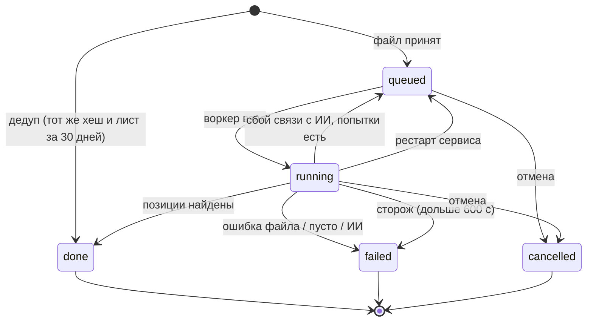
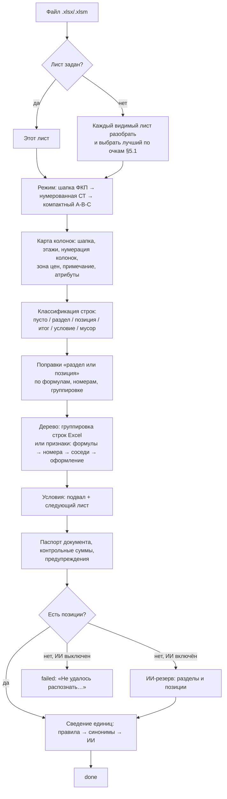
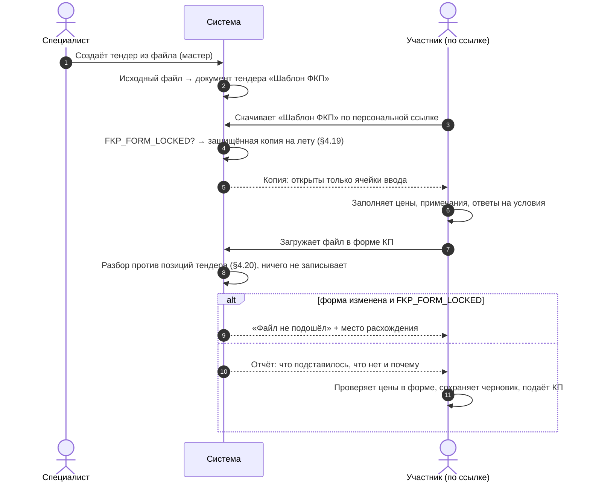

# Распознавание Excel-ведомости в ФКП (fkp_import)

Как система превращает Excel-шаблон сметы/ведомости работ в структуру ФКП (разделы, подразделы со справочными единицей и объёмом, позиции с единицей и объёмом, доп. условия), что делает детерминированный разбор и что — ИИ, как идёт фоновое задание, как сводятся единицы измерения, как бланк ФКП защищается при выдаче участнику и как разбирается заполненный участником файл КП.

Связанные разделы: мастер создания тендера и черновики — [tenders-lifecycle.md §2–3](tenders-lifecycle.md#2-создание-тендера--мастер-из-четырёх-шагов); правка состава и версии ФКП — [tenders-lifecycle.md §10](tenders-lifecycle.md#10-правка-состава-фкп-после-старта); загрузка заполненного файла КП в форме — [tenders-quotes.md §11](tenders-quotes.md#11-загрузка-заполненного-excel-файла-кп); «Шаблон ФКП» в документах тендера и выгрузка СТ — [tenders-documents.md](tenders-documents.md); справочник единиц и синонимов — [catalog.md §4.2](catalog.md#42-единицы-измерения-и-синонимы); ИИ в распознавании — [../06-ai/ai-features.md §3.6](../06-ai/ai-features.md#36-ии-в-распознавании-фкп); данные — [../05-data-model/tables.md](../05-data-model/tables.md#39-домен-fkp_import--импорт-фкп-из-excel); API — [../04-api/endpoints-tenders-import.md](../04-api/endpoints-tenders-import.md), [../04-api/endpoints-tenders-templates.md](../04-api/endpoints-tenders-templates.md), [../04-api/endpoints-tenders-invite.md](../04-api/endpoints-tenders-invite.md#post-invitetokenquote-import); экраны — [../03-screens/tender-create.md](../03-screens/tender-create.md), [../03-screens/fill.md](../03-screens/fill.md), [../03-screens/tender-card-structure.md](../03-screens/tender-card-structure.md).

Оценка: **XL** — один из главных рисков проекта (обоснование — §12). Открытые вопросы — [../_oq/BL-2.md](../_oq/BL-2.md).

## 1. Назначение и границы

ФКП (форма коммерческого предложения) у Заказчика — Excel-ведомость: титул, многоэтажная шапка, иерархия разделов с римской и арабской нумерацией, позиции с единицей и объёмом, пустые «жёлтые» колонки цен для участника, итоги и НДС, подвал с вопросами («Условия оплаты», «Срок выполнения»…). Формат не стандартизован: у разных объектов и видов работ шапки, нумерация и вложенность различаются.

Система должна:

1. по загруженному файлу (`.xlsx`/`.xlsm`) **детерминированно**, без ИИ, распознать структуру ФКП — дерево разделов и позиций, доп. условия, карту колонок, паспорт документа (предмет, объект, адрес, бюджет, НДС), контрольные суммы — и вернуть её мастеру создания тендера на проверку;
2. дать специалисту поправить роли колонок и пересобрать структуру синхронно (без ИИ);
3. сопоставить единицы измерения из файла со справочником (правилами, затем — при включённом ИИ — моделью), не создавая единиц на лету;
4. использовать ИИ только как подстраховку: (а) резервный разбор, когда правила не нашли ни одной позиции; (б) подсказки мастеру (название тендера, вид работ, компания, ИНН); (в) подбор единиц;
5. выполнять разбор фоновым заданием с дедупликацией по хешу файла, повторами, сторожем зависаний и отменой;
6. выдавать участнику «Шаблон ФКП» с защитой формы (заполнять можно только ячейки ввода) и разбирать заполненный участником файл против позиций тендера, отказывая файлу с изменённой формой;
7. размечать бланк ФКП для обратного хода — вписать цены участников в бланк Заказчика в выгрузке СТ.

Вне границ: шаги мастера, черновики, создание тендера и его проверки ([tenders-lifecycle.md](tenders-lifecycle.md)); версии ФКП и правка состава после старта (там же, §10); подстановка отчёта разбора КП в форму, черновик и подача КП ([tenders-quotes.md](tenders-quotes.md)); сборка выгрузки СТ ([tenders-documents.md](tenders-documents.md), [tenders-comparison.md](tenders-comparison.md)); справочник единиц ([catalog.md](catalog.md)); шлюз модели и биллинг ИИ ([../06-ai/ai-features.md](../06-ai/ai-features.md), [billing.md](billing.md)).

## 2. Сущности и ключевые поля

Собственных таблиц у домена нет: разбор — чистая функция над байтами файла.

| Что | Где хранится | Роль |
|---|---|---|
| Задание разбора `parse_excel` | [background_jobs](../05-data-model/tables.md#background_jobs) | статус, попытки, `input_meta` (имя, размер, лист, тип, `file_hash`, версия разбора), результат (JSON §2.1) или ошибка; входной файл — в общем хранилище до завершения |
| Исходный файл | [attachments](../05-data-model/tables.md#attachments) черновика мастера → после создания тендера — документ «Шаблон ФКП» | основа для пересборки, повторного ИИ-анализа, защищённой выдачи участнику, обратного хода в выгрузке СТ |
| Черновик мастера | [tender_creation_drafts](../05-data-model/tables.md#tender_creation_drafts) | хранит `job_id`, структуру шага 2, подсказки ИИ |
| Справочник единиц и синонимы | [units](../05-data-model/tables.md#units), [unit_aliases](../05-data-model/tables.md#unit_aliases) | сведение написаний; ИИ-уверенные соответствия запоминаются синонимами |
| Результат после создания тендера | [tender_sections](../05-data-model/tables.md#tender_sections), [tender_items](../05-data-model/tables.md#tender_items), [tender_condition_fields](../05-data-model/tables.md#tender_condition_fields) | дерево разделов (код, справочные ед./объём, `items_before`), позиции (номер, атрибуты), доп. условия; снимки — [tender_fkp_versions](../05-data-model/tables.md#tender_fkp_versions) |
| Карта колонок шаблона | [tender_templates](../05-data-model/tables.md#tender_templates) | подтверждённая карта колонок запоминается в шаблоне и применяется к файлу с той же шапкой |
| Обращения к модели | [ai_calls](../05-data-model/tables.md#ai_calls) | журнал и учёт стоимости |

### 2.1. Модель результата разбора

| Узел | Поля |
|---|---|
| Раздел | `name` (≤ 500), `code` (номер из файла: «I», «2.3», «IV.II»; ≤ 100), `unit` и `quantity` — справочный объём подраздела, если он записан в строке заголовка, `items_before` — сколько позиций родителя стоит выше подраздела (подразделы и позиции идут вперемешку, как в файле), `source_row`, `children[]`, `items[]` |
| Позиция | `name` (≤ 1000), `unit` (≤ 50), `quantity` (число или пусто), `code` (номер без хвостовой точки, ≤ 100), `source_row`, `attrs` — `budget_code`, `mark`, `equipment_code`, `manufacturer`, `note` (примечание Заказчика) и прочие колонки шапки по их названию |
| Доп. условие | `field_name`, `field_type` (`text` / `number` / `boolean` / `date`), `order_index` |
| Служебное | `column_map` (роли колонок, строка шапки, начало данных, начало зоны цен, колонки для экрана подтверждения), `document` (паспорт), `parse_meta` (`mode`, лист, источник условий `footer`/`sheet`/`mixed`), `skipped_totals_detail` (`{label, kind, row}`), `formula_check`, `parse_warnings[]`, `unknown_units[]`, `unit_review[{from, to}]`, `parsed_by` (`heuristic` / `ai`) |

Ответ отдаёт и дерево (`sections_tree`), и плоский список разделов-листьев с путём «Раздел / Подраздел» в имени (`sections`) — для совместимости; мастер создаёт тендер из дерева. Слишком длинные тексты обрезаются до предела колонки с «…» в конце. Полный контракт — [../04-api/endpoints-tenders-import.md](../04-api/endpoints-tenders-import.md#объект-результата-разбора-parseresult).

## 3. Жизненный цикл

### 3.1. Задание разбора

| Из → в | Кто | Условие | Побочные эффекты |
|---|---|---|---|
| — → `queued` | сотрудник, загрузка файла | файл ≤ лимита; нет готового разбора того же файла и листа за 30 дней (иначе сразу отдаётся готовое `done`-задание с `deduped: true`) | Файл сохраняется вложением черновика (если указан черновик) и входом задания; в метаданные пишется версия разбора |
| `queued` → `running` | воркер | следующее по времени создания, пауза повтора истекла; захват с `FOR UPDATE SKIP LOCKED` | `attempts` +1, время старта |
| `running` → `done` | воркер | правила нашли позиции, либо ИИ-резерв вернул разделы | Результат в задании; единицы сведены; входной файл задания удаляется |
| `running` → `failed` | воркер | файл не читается; ни одной позиции и ИИ выключен; ни одной позиции ни правилами, ни ИИ; баланс ИИ исчерпан; прочая ошибка ИИ | Текст ошибки (§4.22), класс ошибки; оповещение дежурному для сбоев (§7) |
| `running` → `queued` | воркер | сбой связи с моделью в ИИ-резерве и попытки не исчерпаны | Пауза 30 с × 2^(попытка−1) |
| `running` → `failed` | сторож | `running` дольше `PARSE_JOB_HANG_SECONDS` (600 с) | «Разбор занял слишком много времени и был остановлен. Попробуйте ещё раз или упростите файл.» (`HangTimeout`) |
| `running` → `queued` / `failed` | старт сервиса | задание осталось `running` после рестарта | Попытки не исчерпаны и вход на месте — обратно в очередь («Прервано рестартом сервиса — повторная попытка»), иначе `failed` «Разбор прерван рестартом сервиса» |
| `queued`/`running` → `cancelled` | автор задания | не в терминальном статусе | «Отменено пользователем»; воркер, закончив эвристику или ИИ, видит отмену и результат не пишет |



Читать задание может только его автор (чужое — 404 «Задание не найдено»); исключение — завершённое `done`-задание разбора: его результат безличный и отдаётся любому сотруднику (так работает дедуп).

### 3.2. Конвейер разбора



### 3.3. Бланк ФКП у участника



## 4. Правила и валидации

### 4.1. Форматы и лимиты

| Параметр | Значение |
|---|---|
| Форматы | `.xlsx`, `.xlsm` (Office Open XML). Старый `.xls` **не поддерживается** — разбор отвечает «Не удалось прочитать файл: …» (поле выбора файла в мастере сейчас принимает и `.xls` — требование: принимать только `.xlsx`/`.xlsm` и писать понятно «Сохраните файл в формате .xlsx») |
| Размер | `MAX_EXCEL_UPLOAD_MB` = **50 МБ** на все Excel-входы → 413 «Файл слишком большой (максимум 50 МБ). Разбейте таблицу или удалите лишние листы.» |
| Колонки | читаются первые **24** колонки листа |
| Шапка | ищется в первых **80** строках |
| Досчёт формул без сохранённого значения | только для книг ≤ **15 МБ** |
| Файл КП участника | ≤ **20 000** строк, только `.xlsx`/`.xlsm`, не пустой |
| Текст листа для ИИ | ≤ 12 колонок; ≤ 400 строк для файла ≤ 512 КБ, ≤ 800 — до 5 МБ, ≤ 1 200 — больше; дальше — пометка «… (обрезано после N строк для ИИ-слоя)» |
| Скрытые листы | при автовыборе не рассматриваются (если видимых нет — все) |

Тяжёлый разбор книги выполняется вне основного цикла обработки запросов (в отдельном потоке), чтобы не блокировать остальные запросы и живые потоки событий.

### 4.2. Выбор листа

Если лист указан — разбирается он. Иначе каждый видимый лист разбирается целиком, и выбирается лист с наибольшими очками (§5.1): режим «шапка ФКП» с подвалом условий заведомо побеждает «компактный» лист-спецификацию с длинным списком; листы с именами «облож…», «титул…», «cover» без позиций штрафуются. Список листов до разбора отдаётся отдельно (мастер даёт выбрать лист).

### 4.3. Поиск шапки и карта колонок (режим «шапка ФКП»)

В первых 80 строках ищется строка, где есть колонка наименования **и** колонка единицы. Сравнение подписей — после нормализации: нижний регистр, «ё»→«е», без мягких переносов, запятые и точки → пробелы, схлопнутые пробелы; слово, разорванное дефисом переноса («Коли-чество», «Наимено-вание»), тоже узнаётся.

| Роль | Подсказки в подписи (подстрока) |
|---|---|
| Наименование `name` | «наименование работ», «наименование позиции», «наименование», «название работ», «название позиции»; в СТ — ячейка «Бюджет …» над наименованиями |
| Единица `unit` | «ед. измерения», «ед.изм», «ед изм», «единица измерения», «единица», а также подпись, начинающаяся с «ед» |
| Количество `qty` | «количество», «кол-во», «кол во», «кол.», «qty» |
| № п/п `number` | «№ п.п», «№ п п», «№пп», «п/п», «№ п/п», «номер п п», а также «№», «no», «n» |
| Код статьи бюджета | «код статьи бюджета», «статья бюджета», «код статьи» |
| Тип/марка | «тип, марка», «тип марка», «марка», «обозначение» |
| Код оборудования | «код оборудования», «код изделия», «код материала» |
| Завод-изготовитель | «завод-изготовитель», «изготовитель», «производитель» |
| Примечание | «примечание», «прим.» — ищется по всей шапке, в том числе правее цен |

Подписи денег («цена», «стоимость», «сумма», «руб … материал/работ») **никогда** не забирают роли единицы и количества («Цена за ед. изм.» — это цена), но «Кол-во, сумма» остаётся количеством. Из подходящих строк выбирается лучшая по очкам (§5.1). Колонка «ВСЕГО, м2» (объём в единице строки, не деньги) при наличии побеждает «Количество» — так в формах изделий объём берётся в той единице, по которой назначается цена.

### 4.4. Многоэтажная шапка и строка нумерации колонок

- Под строкой шапки до **3** «этажей»: строка из ≥ 2 коротких (≤ 60 символов) нечисловых подписей **вне** колонок номера/наименования/единицы/количества («Материалы | СМР | Всего» под «Стоимость единицы») — часть шапки, а не позиция. Верхняя подпись группы распространяется вправо на подколонки, под которыми есть нижняя подпись.
- Служебная строка нумерации колонок («1 2 3 4 …») пропускается: ≥ 3 непустые ячейки, все — числа 1–2 знака, первая — 1, первый отрезок не убывает (дальше нумерация может начаться заново — в СТ у блока каждого подрядчика; повтор числа объединённой ячейкой допустим).
- Первая строка данных — после этажей и строки нумерации.

### 4.5. Зона цены, примечание, атрибуты

- **Зона цены** начинается с первой денежной колонки правее всех структурных; всё правее — зона участника, в структуру не попадает. Денежная подпись между структурными колонками тоже в атрибуты не уходит. Зона определяется и по нижнему этажу шапки (в СТ над ценами стоит название подрядчика, а «Цена за ед.» — строкой ниже).
- **Примечание** Заказчика из ФКП сохраняется в позиции (`attrs.note`) — по нему разбор файла КП отличает чужой текст от комментария участника.
- **Прочие колонки** между структурными и зоной цены (например, «Помещение», «Ось») становятся атрибутами позиции с ключом = нормализованная подпись (`attrs_json`).
- Атрибуты «код статьи бюджета», «марка», «код оборудования», «изготовитель» сохраняются в отдельные поля позиции.

### 4.6. Классификация строк

Каждая строка ниже шапки классифицируется по правилам в этом порядке (фаза «тело» до общего итога, «подвал» — после):

| № | Правило | Результат |
|---|---|---|
| 1 | Все ячейки пусты | пропуск |
| 2 | Метка (наименование или текст левее него, кроме номера) — итог: начинается с «Итого»/«Всего» → общий итог; «… по (под)разделу» → итог раздела; «в т.ч. НДС», «итого с/без НДС», «итого с ГП», «НДС» → НДС. В подвале — также «… итого …», «стоимость до/после скидки» | итог (в позиции не попадает, пишется в `skipped_totals_detail`). Общий итог и НДС **открывают подвал**, итог раздела — нет |
| 3 | Метка содержит признак условия («авансирован», «условия оплаты», «срок выполнения», «срок работ», «гарантийное удержан», «гарантийный срок», «количество рабочих», «мобилизац», «посещение площадки», «подписать договор», «готовность подписать», «примечание»; метка ≤ 160 символов) **и** строка не имеет одновременно наименования, единицы и объёма | доп. условие; открывает подвал |
| 4 | Подвал: строка без единицы с меткой | доп. условие; иначе — мусор. Блок «Выручка, тыс. руб.» с ≥ 2 годами в подвале заканчивает чтение листа |
| 5 | Строка нумерации колонок; наименование — служебная шапка («Организация», «ИНН», «Эл. почта», «Контактное…», «Тел.», «Бюджет»); наименование «№ п/п» | мусор |
| 6 | Есть наименование и единица | **позиция** (объём — число из колонки количества или пусто) |
| 7 | Есть наименование, нет единицы | **раздел** (объём, если есть, сохраняется — см. §4.9) |
| 8 | Иначе | мусор |

Номер строки: раздел принимает арабские («1», «2.3»), римские («IV», «IV.» → «IV») и смешанные («IV.II») номера; позиция — только арабские, хвостовая точка снимается.

### 4.7. Числа в ячейках

Объём (и цены в файле КП) читается так, как его пишет человек: числа Excel; текст «2 100,50 руб.», «4 800» с неразрывным или узким пробелом, «850 ₽», «1500р.» → число (валюта, разделители разрядов и хвостовая точка снимаются, запятая → точка). Текст, не ставший числом после очистки («договорная»), — **пусто**, а не ноль. Логические значения — пусто.

### 4.8. Формулы без сохранённого значения

Разбор читает значения, сохранённые Excel рядом с формулами. Книги, собранные не Excel (выгрузки учётных систем, генераторы смет), значений не несут — тогда для книг ≤ 15 МБ значения досчитываются встроенным вычислителем ограниченного подмножества: ссылки на ячейки (в том числе на другой лист и с `$`), числа и строки, операции `& + - * /`, скобки, функции `SUM`/`СУММ`, `ROUND`/`ОКРУГЛ`, `CONCATENATE`; глубина цепочки ссылок ≤ 60, диапазон `SUM` ≤ 20 000 ячеек; циклы и всё прочее — «значение неизвестно» (никогда не выдумывать число).

### 4.9. Уточнение «раздел или позиция»

После классификации применяются четыре поправки (они нужны, потому что в реальных ФКП уровень строки выражен не единицей, а формулами и номерами):

1. **Итог подраздела.** Строка с единицей, денежные формулы которой складывают строки сразу под ней (`=SUM(I28:I35)`), — подраздел, а не позиция; её единица и объём остаются справочными у раздела. Если под ней лежат более глубоко сгруппированные позиции — это «изделие с составом».
2. **Позиция с забытой единицей.** Строка без единицы, но с объёмом и суммой «объём × ставка» в своей строке (`=E254*F254`) или за которой сразу идёт позиция следующего номера той же серии («6.4.1» → «6.4.2») — позиция (если только строки ниже не продолжают её номер или не складываются её формулой).
3. **Заголовок с единицей.** Позиция без объёма, под номером которой идут номера глубже («1.6 Лестничная клетка | м2» → «1.6.1 …»), или чья формула складывает строки ниже, — раздел. С объёмом — раздел, если номера ниже её продолжают и у неё нет своих денежных формул.
4. **Изделие с составом.** Позиция, под которой следующая позиция сгруппирована (группировка строк Excel) на уровень глубже, — раздел («Витраж В-1 …, в том числе:» над профилем, стеклопакетом, фурнитурой).

### 4.10. Построение дерева

1. **Группировка строк Excel** (уровни `outlineLevel`) используется как дерево, если заголовки разделов стоят на разных уровнях, группировка не спорит с нумерацией заголовков и не выносит позицию из раздела, названного её номером. Заголовок открывает раздел своего уровня и закрывает открытые на том же уровне и глубже; позиция ложится в ближайший открытый раздел уровнем выше.
2. Иначе дерево строится по признакам от сильного к слабому:
   - **Формула суммы** в строке раздела, перечисляющая строки поштучно (`=K15+K48`), задаёт его прямых детей; формула-диапазон (`=SUM(I8:I11)`) задаёт, где раздел кончается.
   - **Нумерация** (используется, если есть колонка номера и не меньше половины строк — и не менее 3 — с арабскими номерами): «1.2» — под «1», рядом с «1.1»; «II» — сосед «I»; «IV.II» — под «IV»; римская и арабская серии — разные уровни; позиция «2.3» уходит в раздел «2», закрывая вложенные нумерованные разделы.
   - **Взгляд вперёд**: заголовок без номера перед нумерованным заголовком встаёт на место родителя его соседа.
   - **Подгруппа**: заголовок без номера посреди сквозной нумерации позиций («1.3 … | Тип 5: пом. 112 | 1.4 …») — подгруппа внутри того же раздела.
   - **Оформление**: заголовки одного уровня оформлены одинаково (жирность, курсив, кегль, отступ, заливка; цвет шрифта не учитывается); если такое оформление уже встречалось ровно на одной глубине — заголовок встаёт туда же.
   - **Запасное правило**: пустой заголовок открывает подраздел; заголовок после раздела с позициями — его сосед.
3. Позиции до первого заголовка попадают в раздел «Без раздела». Пустые разделы удаляются. Для каждого подраздела вычисляется `items_before` (по номерам строк).

### 4.11. Итоги, подвал и доп. условия

- Итоги и НДС не становятся позициями: итоги считает система по дереву.
- Подвал после общего итога/НДС: строки без единицы с текстом → доп. условия (дубликаты по тексту отбрасываются); позиции после подвала не «воскрешаются».
- Тип ответа условия выводится по формулировке: содержит «дата» → `date`; «посещени…», «готовност…», «соглас…», «наличи…», «возможност…», «да/нет», заканчивается «?» → `boolean`; начинается с «количество/кол-во/число/численность» или указывает единицу счёта («, месяцев», «(дней)», «%», «чел», «шт», «лет»…) → `number`; иначе `text`. Ошибка дешёвая — тип правится на шаге 2 мастера.
- **Лист условий**: лист, следующий за выбранным, если он не похож на смету (нет шапки ФКП, нумерованной иерархии и ≥ 5 строк «имя + короткая единица + число»), читается как список условий: колонка A (или B), начиная со 2-й строки, строки длиннее 120 символов пропускаются, заголовок «Доп. условия» в первой строке пропускается. Условия подвала и листа объединяются (`conditions_source`: `footer` / `sheet` / `mixed`).

### 4.12. Резервные режимы

Если режим «шапка ФКП» не нашёл позиций:

- **Нумерованная СТ** (если в первых 120 строках ≥ 5 строк вида «номер в колонке A + текст длиннее 8 символов в B»): номер — колонка A, наименование — B, количество — колонка с подписью количества (иначе 8-я), единица — колонка с подписью единицы; строка с наименованием без количества — раздел, с количеством — позиция; разбор начинается с первой строки с номером.
- **Компактный A-B-C**: от самой левой непустой колонки — наименование, единица, количество; строка без единицы и количества — раздел.

### 4.13. Паспорт документа

Из титула (строки выше шапки или первые 15) правилами, без модели:

| Поле | Как ищется | Пример |
|---|---|---|
| Предмет (`title`) | «(Форма) коммерческого предложения / ФКП / СТ-N … на выполнение / поставку / оказание …» → «Выполнение …» (≤ 200) | «ФКП на выполнение комплекса отделочных работ» → «Выполнение комплекса отделочных работ» |
| Объект и адрес | «на объекте: <объект>, (расположенный) по адресу: <адрес>»; «Адрес (объекта): …»; титул СТ «<объект>, расположенный по адресу: <адрес>» | объект «Административное здание», адрес «г. Энск, ул. Примерная, д. 1» |
| Бюджет | «Бюджет…: <число> (млн/тыс)»; в СТ — в ячейке над наименованиями («Бюджет 5.4.9 - 45 767 880 руб.» — код статьи пропускается); масштаб «млн»/«тыс» | «Бюджет: 4 800 000 руб.» → 4800000 |
| НДС | ставка «НДС 22 %» в шапке; «без НДС» → цены без НДС; «в т.ч. / включая / с НДС» → с НДС | 22, с НДС |
| Раздельные цены | в зоне цены найдены отдельно «материалы» и «работы» | `["materials", "works"]` |

Паспорт идёт в подсказки мастера (название, подбор объекта по адресу, бюджет). Бюджет и адрес берутся **только** правилами — модели число не доверяется.

### 4.14. Контрольные суммы ФКП

Если в книге есть формулы итогов, система сверяет итоги файла с деревом разбора (каждая позиция должна входить в итог ровно один раз и в свой раздел). Столбец сверки — денежный столбец, где у позиций формула от своей строки и общий итог которого накрывает больше всего позиций; строки, пересчитывающие итог умножением (НДС, «непредвиденные»), итогами не считаются. Находки показываются предупреждениями «Контрольные суммы ФКП: …»:

| Вид | Текст |
|---|---|
| `no_line_formula` | «У позиций сумма строки (столбец K) — не формула, от цен подрядчика она не пересчитается: …» |
| `not_in_total` | «В общий итог ФКП («Итого…», строка N, столбец K) не входят позиции: …. В тендере и СТ они учтены.» |
| `counted_twice` | «В общем итоге ФКП позиции учтены больше одного раза: …. В тендере и СТ — по одному разу.» |
| `section_takes_foreign` | «Итог раздела … (строка N) в ФКП складывает и чужие позиции: ….» |
| `section_misses_own` | «Итог раздела … (строка N) в ФКП не складывает свои позиции: ….» |
| `empty_ref` | «Формула итога … (строка N) ссылается на пустые ячейки: I4751, ….» |

Перечисляется до 8 позиций, остальные — «и ещё N». Книга без формул (значениями) — сверки нет. Ошибка сверки не мешает разбору. Цель — поймать ошибку сметчика до рассылки: участник, считающий в своём экземпляре, иначе получит другую сумму, чем система.

### 4.15. Предупреждения разбора

| Условие | Текст |
|---|---|
| Ни одной позиции | «Не распознано ни одной позиции — проверьте формат или выберите другой лист.» |
| Наименования похожи на номера (≥ 3 и ≥ 20 % позиций) | «N позиций выглядят как номера строк (1, 1.1…), а не наименования — проверьте колонки в файле.» |
| Без единицы ≥ max(5, половина позиций) | «У N из M позиций нет единицы измерения — дополните вручную на шаге 2, если нужно.» |
| Пустой раздел с именем служебной шапки | «В разделы попала служебная шапка файла (Организация, ИНН…) — лишние группы можно удалить на шаге 2.» |
| Иерархия выглядит неверной (§5.3), ИИ включён | «Структура принята без ИИ-доразбора. Проверьте вложенность разделов.» |
| То же, ИИ выключен | «ИИ-доразбор выключен — принята структура как есть. Проверьте разделы.» |
| Расхождения контрольных сумм | «Контрольные суммы ФКП: …» (§4.14) |

### 4.16. Ручная карта колонок (пересборка)

Экран шага 2 показывает колонки файла: подпись (верхний и нижний этаж), пример значения, предложенная роль, зона (`structure`/`price`), «забирать ли». Роли: «№ п.п.», «Код статьи бюджета», «Наименование», «Тип / марка», «Код оборудования», «Завод-изготовитель», «Единица», «Количество», «Доп. информация», «Зона цены (поставщик)», «Не забирать». Пересборка по подтверждённой карте — синхронно, тем же разбором, без ИИ, на указанном (или первом) листе, `parsed_by = heuristic`. Ошибки: «Некорректный JSON карты колонок»; «Карта колонок должна быть объектом»; «Не хватает обязательных колонок: Наименование, Единица, Количество»; «Назначьте колонки: наименование и единица измерения обязательны»; «Назначьте колонку количества». Подтверждённая карта может быть запомнена в шаблоне тендера по «отпечатку шапки» (нормализованные подписи колонок через «|») и молча применяться к файлу с той же шапкой ([../04-api/endpoints-tenders-templates.md](../04-api/endpoints-tenders-templates.md)).

### 4.17. Единицы измерения

После разбора каждое написание единицы сводится к записи справочника (только действующие единицы): (1) точный нормализованный ключ → (2) ключ сопоставления («м3», «м³», «м^3», «м (куб)», «куб.м» → одна единица; «кв.м» → «м²»; «м» и «м.п.» — разные) → (3) запомненный синоним → (4) при включённом ИИ — модель выбирает id из переданного справочника с уверенностью: `high` — подставляется и **запоминается синонимом** (уже существующий синоним не перезаписывается — выбор человека важнее догадки), `medium` — подставляется и попадает в `unit_review` «на проверку», `low` и неизвестные id — отбрасываются. Остальное — `unknown_units`: единиц на лету система не создаёт, тендер с ними не создать, пока специалист не выберет единицу или не добавит её в справочник (правила — [catalog.md §4.2](catalog.md#42-единицы-измерения-и-синонимы)).

### 4.18. Роль ИИ — что делает модель и что без неё

| Функция | Без ИИ | С ИИ (`AI_ENABLED` и ключ модели) |
|---|---|---|
| Структура ФКП | Всегда правилами (§4.2–4.12). Пусто → `failed` «Не удалось распознать ни одного раздела/позиции в файле. Проверьте формат (шапка «Наименование / Ед. / Количество»).» | Если правила нашли позиции — **модель не вызывается вовсе**, даже при подозрительной иерархии (только предупреждение). Если правила пусты — резервный разбор: модели отдаётся текст листа (§4.1), она возвращает только разделы и позиции с единицей и количеством (без цен, итогов, подвала); результат `parsed_by = ai`, плоский (без вложенности и номеров); условия берутся из правил. Тайм-аут 300 с; учёт в биллинге как `file_recognition` (одна операция на все попытки задания); исчерпан баланс — `failed` «Файл не распознан стандартным способом, а баланс токенов для ИИ исчерпан. Обратитесь к администратору.»; сбой связи — повтор задания |
| Подсказки мастеру (название тендера, вид работ, тема пакета, компания, ИНН, контакт, единицы) | Правила: паспорт документа; «Организация:», «ИНН:» (10/12 цифр), «Контакт…:» в первых 40 строках; строка с «ФКП»/«СТ-N»/«сравнительн» как название; вид работ по ключевым словам (перегородки/ГКЛ → «Отделка», подсветка/светильники → «Электромонтаж», кабель/щит/розетки/слаботочка → «Электромонтаж», керамогранит/линолеум/стяжка/штукатурка → «Отделка»); «По файлу распознано N позиций работ.» | Модель дополняет: название (5–12 слов), домен, вид работ, краткое описание, уверенность; при конфликте значение модели приоритетнее, кроме объекта, адреса и бюджета (только правила). Источник подсказки — `rules` / `llm` / `llm+rules`; тайм-аут 90 с; недоступность модели — просто подсказки правил или `available: false`. Подсказки ничего не создают — только предлагаются в мастере |
| Подбор единиц | Только правила и синонимы | §4.17, тайм-аут 60 с; текст написаний передаётся модели как недоверенные данные |

Модель не выдумывает позиции, числа, компанию и ИНН, которых нет в тексте; единицу только выбирает, но не создаёт. Механизм «ИИ-доразбора иерархии поверх эвристики» в коде присутствует, но не подключён — в воссоздании не нужен (см. открытые вопросы). Подробнее о шлюзе модели и безопасности — [../06-ai/ai-features.md](../06-ai/ai-features.md#36-ии-в-распознавании-фкп).

### 4.19. Защита бланка ФКП при выдаче участнику (`FKP_FORM_LOCKED`)

При `FKP_FORM_LOCKED=true` (по умолчанию) документ тендера «Шаблон ФКП», скачиваемый по персональной ссылке участника, отдаётся **защищённой копией**, сделанной на лету (исходник у сотрудников не меняется):

- **Ячейки ввода** — ячейки с заливкой `FFF2CC` («жёлтые ячейки заполняет участник» — соглашение бланков Заказчика). Если жёлтых ячеек нет — открываются колонки цен материалов и работ и примечания в строках позиций (их находит разметка бланка §4.21) и в строках условий подвала — все ячейки, кроме колонки наименования (где стоит сам вопрос).
- Все листы защищены: менять содержимое, вставлять/удалять строки и колонки, сортировать и фильтровать нельзя; ширину колонок и высоту строк менять можно (длинный комментарий должен помещаться). Структура книги закрыта — листы не добавить, не удалить, не переименовать.
- Пароль защиты случайный, нигде не хранится (это защита от случайной правки, а не криптография; настоящий запрет — отказ при загрузке, §4.20).
- Бланк **не** защищается и отдаётся как есть, если: файл не читается; содержит картинки, диаграммы, рисунки, внешние связи или макросы (пересохранение их потеряло бы); не найдено ни одной ячейки ввода. Ссылка «прямо в хранилище» для шаблона не выдаётся — 409 «Шаблон ФКП выдаётся только через API».
- При `FKP_FORM_LOCKED=false` — шаблон отдаётся как есть, а лишние строки и изменённые объёмы в загруженном файле становятся своими позициями и корректировками участника ([tenders-quotes.md §6](tenders-quotes.md#6-корректировки-отклонения-поставщика-от-формы)).

### 4.20. Разбор заполненного файла КП

Тот же разбор, но в режиме «файл против существующих позиций тендера»: колонки ищет то же определение шапки, строки классифицирует та же классификация. **Ничего не записывается** — возвращается отчёт, цены подставляет форма в черновик КП.

1. **Лист**: указанный или видимый лист с наибольшим числом позиций по шапке ФКП. Нет шапки с наименованием — 400 «Лист «…»: не найдена шапка таблицы позиций. Загрузите тот же файл, который скачали в «Документах тендера».»; строк > 20 000 — «В файле N строк — больше допустимых 20000»; нет листов — «В файле нет листов»; у тендера нет позиций — «В тендере пока нет позиций — нечего сопоставлять».
2. **Колонки цен**: в зоне цены по двум этажам шапки опознаются ставки за единицу (материалы, работы, «всего» за единицу) и суммы по строке (материалы, работы, всего). Колонки «справочно …» (цены прошлых тендеров) игнорируются. Без подписей групп — две колонки «за ед.» подряд берутся по порядку (слева материалы, справа работы) с флагом `by_order`. Участник может указать номера колонок вручную (сильнее автоопределения). Не найдено ни одной — блокирующая ошибка «Не найдены колонки цен за единицу («Мат./ед.» и «Раб./ед.»). В шапке видно — <номер: «подпись»…>. Укажите колонки цен вручную или загрузите тот же файл, который скачали в «Документах тендера».»
3. **Сопоставление строки с позицией тендера** (ключ — нормализованный номер без хвостовой точки и нормализованное имя): (а) кандидаты по номеру, чьё имя «согласно» (равно, одно начинается с другого или содержится в другом — с поправкой на обрезку «…», либо похожесть по последовательностям ≥ **0,82**); (б) иначе — единственная позиция с тем же именем; два одинаковых имени — «Название встречается в тендере несколько раз — сопоставьте строку вручную»; (в) иначе единственный кандидат по номеру, но только если в файле нет колонки номера; номер есть, а имя другое — «Код «N» в тендере у позиции «…», а название строки другое — проверьте нумерацию»; несколько кандидатов — «Код «N» в тендере встречается несколько раз, названия не совпали». Уже занятые позиции пропускаются; позиция второй раз — «Позиция «…» встречается в файле дважды.»
4. **Цены**: ставки за единицу; не число — «Мат./ед.: «договорная» — не число»; отрицательная — «Раб./ед.: отрицательная цена»; обе пусты — «Цены за единицу не заполнены». Если ставки пусты, а заполнены суммы по строке, ставка **восстанавливается**: сумма материалов/работ ÷ объём (`from_line_sum`); «всего за единицу» → ставка работ (`unit_total_only`); сумма всего ÷ объём → ставка работ (`from_line_total`); нули (кеш формул пустого бланка) не считаются. Итоги и суммы разделов из файла не читаются.
5. **Примечание** участника берётся из колонки примечания; текст, совпадающий с примечанием Заказчика в ФКП, отбрасывается.
6. **Объём** в файле ≠ объёму тендера → `volume_changes`.
7. **Строки, которых нет в форме**: строка с объёмом или ценой, не сопоставленная ни с одной позицией и не являющаяся заголовком подраздела тендера (тот же номер и согласное имя, или формула суммы строк ниже) → `extra_rows` с разделом по месту в файле; без объёма и цен — мусор.
8. **Доп. условия**: метка строки ищется среди условий тендера (точно или с похожестью ≥ **0,9** для меток от 8 символов) в любом месте листа; ответ — первая непустая ячейка правее зоны цен (или правее метки), как её видит человек: проценты по формату ячейки («30%», а не «0.3»), целые без «.0», даты ISO, логические — «Да»/«Нет»; для типа «да/нет» «да/+/✓/есть/готов…» → «Да», «нет/-/—/отсутствует…» → «Нет»; для числа — число. Неузнанные метки подвала → `unmatched_conditions`.
9. **Мусорные строки** (нет ни номера, ни наименования с единицей) — информационная ошибка «Не удалось разобрать N строк файла (нет ни номера, ни наименования с единицей) — они не попали в КП.» (до 20 номеров строк, «и ещё N»).
10. Ни одной сопоставленной строки — «Ни одна строка файла не совпала с позициями этого тендера ни по номеру, ни по наименованию — похоже, загружен файл другого тендера.»
11. **Блокировка формы** (`FKP_FORM_LOCKED=true`): `extra_rows` → блокирующая ошибка «В файле есть строки, которых нет в форме ФКП: N. Добавлять и менять строки нельзя — заполняйте только жёлтые ячейки скачанного шаблона.» (место — «строки 15, 16 и ещё K»); `volume_changes` → «В файле изменён объём в строках формы. Объёмы менять нельзя — заполняйте только жёлтые ячейки скачанного шаблона.» Любая ошибка структуры без пометки «информационная» блокирует подстановку целиком — форма показывает «Файл не подошёл» с местом расхождения.

### 4.21. Разметка бланка для выгрузки СТ

Для обратного хода (вписать цены участников в бланк Заказчика при Excel-выгрузке СТ) бланк размечается тем же разбором: лист, строка шапки, колонки структуры (номер, код бюджета, наименование, марка, код оборудования, изготовитель, единица, количество), колонки примечания, ставок материалов и работ, начало зоны цен, число блоков цен (больше одного — это не пустой бланк, а СТ), колонки атрибутов, строки позиций (номер строки, код, имя, объём; строки-итоги подразделов исключены), строки условий подвала. Нет таблицы позиций или колонки количества — разметки нет, выгрузка собирается без бланка ([tenders-documents.md §4](tenders-documents.md#4-выгрузки-по-тендеру-и-штампы)).

### 4.22. Ошибки и что видит пользователь

Мастер показывает статус задания: `queued` — «Файл принят, ждём очередь…», `running` — «Файл принят, распознаём…», готово — «Готово!», ошибка — «Не удалось распознать» + текст, отмена — «Отменено». Клиент опрашивает задание каждые **1,5 с**; через **6 минут** перестаёт ждать: «Разбор занимает слишком много времени. Обновите страницу — задание продолжится, или загрузите файл ещё раз.»

| Ситуация | Где | Текст |
|---|---|---|
| Файл больше 50 МБ | загрузка | 413 «Файл слишком большой (максимум 50 МБ). Разбейте таблицу или удалите лишние листы.» |
| Книга не читается (в т.ч. `.xls`, повреждённый zip) | листы, разбор, пересборка | 400 / `failed` «Не удалось прочитать файл: <причина>» |
| Не читается лист условий | разбор | «Не удалось прочитать лист условий: <причина>» |
| Непредвиденная ошибка чтения | задание | «Не удалось прочитать файл. Проверьте формат Excel.» |
| Входной файл задания пропал | задание | «Входной файл задания не найден (возможно, удалён после рестарта).» |
| Ни одной позиции, ИИ выключен | задание | «Не удалось распознать ни одного раздела/позиции в файле. Проверьте формат (шапка «Наименование / Ед. / Количество»).» |
| Ни одной позиции ни правилами, ни ИИ | задание | «Не удалось распознать ни одного раздела/позиции — ни стандартным способом, ни через ИИ. Проверьте формат файла (см. подсказку на форме).» |
| ИИ недоступен (после всех попыток) | задание | «Не удалось распознать файл стандартным способом, а сервис ИИ недоступен. Проверьте формат Excel или повторите позже.» |
| Баланс ИИ исчерпан | задание | «Файл не распознан стандартным способом, а баланс токенов для ИИ исчерпан. Обратитесь к администратору.» |
| Иная ошибка ИИ | задание | «Не удалось распознать файл. Проверьте формат или попробуйте позже.» |
| Зависание | сторож | «Разбор занял слишком много времени и был остановлен. Попробуйте ещё раз или упростите файл.» |
| Рестарт | задание | «Прервано рестартом сервиса — повторная попытка» / «Разбор прерван рестартом сервиса» |
| Чужое задание | опрос, отмена | 404 «Задание не найдено» |
| Неизвестные единицы | шаг 2 | список `unknown_units` — выбрать из справочника или добавить; без этого «Несопоставленные единицы измерения (N) — сопоставьте со справочником» |

## 5. Расчёты и формулы

### 5.1. Очки

- **Строка шапки**: 5 (есть наименование и единица) + 1 (количество) + min(число доп. ролей из «номер, код бюджета, марка, код оборудования, изготовитель», 3) + ⌊min(число непустых подписей, 12) / 4⌋; побеждает максимум, при равенстве — верхняя.
- **Лист**: позиций нет → −100; режим «шапка ФКП» → 500 + 3 × позиции + 40 (есть карта колонок) + 10 (есть количество) + 15 × min(условий в подвале, 20); «нумерованная СТ» → 200 + 4 × позиции; «компактный» → 50 + 2 × min(позиции, 40); «облож…/титул…/cover» без позиций — ещё −200.

### 5.2. Нумерация «плотная»

Нумерация используется для дерева, если в файле есть колонка номера, разделов и позиций ≥ 4 и строк с арабским номером ≥ max(3, ⌈половины⌉).

### 5.3. «Иерархия выглядит неверной» (только для предупреждения)

Любое из: глубина пути раздела ≥ 5; средняя глубина ≥ 3,5 при максимуме ≥ 4; раздел «Раздел N» содержит позиции, номера которых начинаются с другого числа; остался пустой раздел-лист; ≥ 3 промежуточных пустых раздела и их не меньше, чем разделов с позициями; глубина ≥ 4 при ≤ max(6, 2 × глубина) позиций; глубина ≥ 5 при < 15 позициях; служебная шапка в разделах при ≥ 2 промежуточных пустых.

### 5.4. Прочее

- Ставка из суммы строки: `ставка = round(сумма / объём, 2)`, только при объёме > 0 и сумме > 0.
- Похожесть имён: отношение совпадающих подпоследовательностей (как `difflib.SequenceMatcher`) ≥ 0,82 для позиций, ≥ 0,9 для условий.
- Дедупликация: ключ — SHA-256 файла (передаёт клиент), лист и версия разбора (`PARSER_VERSION` — строка кода; меняется при любой правке разбора, чтобы кеш не отдавал старый результат); окно — 30 дней.
- Повторы задания: пауза = 30 с × 2^(попытка − 1); не более `PARSE_JOB_MAX_ATTEMPTS`.

## 6. Права доступа

| Действие | Админ | Тенд. специалист | СБ | Юрист | Участник по ссылке |
|---|---|---|---|---|---|
| Список листов, поставить разбор, опрос/отмена своего задания, пересборка по карте колонок, ИИ-подсказки | да | да | да ¹ | да ¹ | — |
| Прочитать чужое завершённое задание (дедуп) | да | да | да | да | — |
| Создать тендер из результата | `tenders.manage` | `tenders.manage` | — | — | — |
| Скачать «Шаблон ФКП» (защищённая копия) | — | — | — | — | по токену |
| Разобрать заполненный файл КП | — | — | — | — | по токену, 30 запросов/мин с IP |

¹ Доступ «любой сотрудник» (в интерфейсе мастер доступен только администратору и специалисту). ИИ-операции проходят через биллинг: при исчерпанном балансе с блокировкой — 402 `tokens_exhausted` ([../04-api/endpoints-billing.md](../04-api/endpoints-billing.md)).

## 7. События, уведомления, аудит

- Событий журнала ИБ и уведомлений пользователям у домена нет; результат и ошибка — в строке задания (её видит мастер).
- Оповещения дежурному (при `ALERTS_ENABLED`, с подавлением повторов): нет входного файла; ошибка чтения файла (по классу исключения); модель недоступна после исчерпания попыток; необработанная ошибка ИИ-резерва; зависание, снятое сторожем ([../07-architecture/architecture.md §10](../07-architecture/architecture.md#10-логи-и-наблюдаемость)).
- Технический лог на каждое задание: старт (id, размер, лист), длительность эвристики, число разделов, нужен ли был ИИ, итог.
- Обращения к модели пишутся в журнал обращений ИИ с учётом стоимости; резервный разбор и подсказки — операция `file_recognition`.

## 8. Фоновые задачи

| Задание | Параметры | Поведение |
|---|---|---|
| `parse_excel` | воркер опрашивает очередь каждые `PARSE_JOB_POLL_INTERVAL` (1 с); захват по одному заданию с `SKIP LOCKED`; задание может выполнить любая реплика (вход — в общем хранилище) | §3.1; повторяется **только** сбой связи с моделью (ошибки формата повторять бессмысленно); баланс проверяется только на первой попытке, все попытки — одна операция биллинга |
| Сторож зависаний | на каждом такте лидера очереди | `running` дольше `PARSE_JOB_HANG_SECONDS` (600 с) → `failed` + оповещение |
| Восстановление после рестарта | при старте | §3.1 |

Расхождение: клиент перестаёт ждать через 6 минут (360 с), а сторож снимает задание только через 600 с; ИИ-резерв с тайм-аутом 300 с и повторами может не уложиться в окно клиента. Требование: согласовать окно ожидания клиента со сторожем и суммарным временем попыток (см. открытые вопросы). Общая очередь — [../07-architecture/architecture.md §3](../07-architecture/architecture.md#3-фоновые-задания).

## 9. Настройки и флаги

| Имя | По умолчанию | Влияние |
|---|---|---|
| `MAX_EXCEL_UPLOAD_MB` | 50 | Лимит любого Excel-входа (ведомость, карта колонок, ИИ-подсказки, файл КП) |
| `PARSE_JOB_HANG_SECONDS` | 600 | Порог сторожа зависаний |
| `PARSE_JOB_MAX_ATTEMPTS` | 3 | Попыток задания (повторяются только сбои связи с моделью) |
| `PARSE_JOB_POLL_INTERVAL` | 1.0 с | Как часто воркер смотрит очередь |
| `FKP_FORM_LOCKED` | `true` | Защита бланка у участника и отказ файлу КП с изменённой формой (§4.19–4.20) |
| `AI_ENABLED`, `AI_API_KEY`, `AI_BASE_URL`, `AI_HTTP_PROXY` | ИИ выключен без ключа | Резервный разбор, подсказки, подбор единиц; без ИИ — только правила |
| `BILLING_ENABLED` | — | Учёт и блокировка ИИ-операций по балансу |
| `ALERTS_ENABLED` | `false` | Оповещения дежурному |
| `CREATION_DRAFT_TTL_DAYS` | 30 | Черновики мастера (с исходным файлом) старше срока скрываются из списка и баннера; по прямой ссылке открываются с пометкой «просрочен» |
| Константы кода | — | окно дедупа 30 дней; версия разбора; пределы 24 колонки / 80 строк шапки / 15 МБ для досчёта формул / 20 000 строк файла КП; пороги похожести 0,82 и 0,9; цвет ячеек ввода `FFF2CC` |

## 10. Граничные случаи

- **Хеш от клиента**: сервер доверяет присланному SHA-256 и не пересчитывает его — неверный хеш вернёт чужой разбор из кеша. Требование: считать хеш на сервере (см. открытые вопросы).
- **`.xls`** выбирается в мастере, но не читается — пользователь видит техническую причину; нужно явное сообщение и запрет выбора.
- **Книга без сохранённых значений формул** (выгрузка учётной системы) больше 15 МБ — объёмы и имена, собранные формулами, придут пустыми; позиции без объёма видны предупреждением.
- **Слово условия в наименовании позиции** («Гарантийный срок обслуживания щита | шт | 1») — позиция, а не подвал (у неё есть единица и объём).
- **Итог раздела** («Итого по разделу 2») не закрывает тело таблицы; «Итого»/«в т.ч. НДС» закрывают.
- **Повтор номеров** в форме (два блока с номерами 4.1–4.5) — дерево по нумерации может склеить блоки; при загрузке КП повтор номера разрешается именем.
- **Скрытый лист-шаблон** в книге не выбирается автоматически.
- **Лист условий справа** от сметы, похожий на смету (спецификация), условиями не считается.
- **Объединённые ячейки** в теле не тиражируются (иначе заголовок раздела стал бы позицией) — только в шапке.
- **Участник вставил строку** — сдвинувшиеся номера не уводят цену соседней позиции: номер без согласного имени отклоняется с причиной.
- **Шаблон с картинками/макросами** выдаётся без защиты; отказ по структуре при загрузке всё равно работает.
- **Отмена во время ИИ-резерва**: ответ модели отбрасывается, но обращение уже учтено в биллинге.
- **Пересборка разделов по файлу** после создания тендера использует тот же разбор исходного файла ([tenders-lifecycle.md §10](tenders-lifecycle.md#10-правка-состава-фкп-после-старта)); после изменения версии разбора результат может отличаться от исходного.

## 11. Конкретные примеры с данными

**Пример 1. Ведомость → структура ФКП** (обезличенный файл; лист «ФКП», показаны колонки A–K, пустые строки опущены):

| Стр. | A | B | C | D | E | F | G | H | I | J | K |
|---|---|---|---|---|---|---|---|---|---|---|---|
| 1 | Организация: | | | | | | | | | | |
| 2 | ИНН: | | | | | | | | | | |
| 4 | ФКП на выполнение комплекса отделочных работ | | | | | | | | | | |
| 5 | на объекте: Административное здание, расположенное по адресу: г. Энск, ул. Примерная, д. 1 | | | | | | | | | | |
| 6 | Бюджет: 4 800 000 руб. | | | | | | | | | | |
| 8 | № пп | Наименование работ | Ед. изм. | Кол-во | Стоимость единицы, руб., в т.ч. НДС 22% | | | Стоимость всего, руб., в т.ч. НДС 22% | | | Примечание |
| 9 | | | | | Материалы | СМР | Всего | Материалы | СМР | Всего | |
| 10 | 1 | 2 | 3 | 4 | 5 | 6 | 7 | 8 | 9 | 10 | 11 |
| 11 | I | Отделка помещений 1 этажа | | | | | | | | | |
| 12 | 1 | Тип 1: пом. 101, 102 | м2 | 120 | | | | | | | |
| 13 | 1.1 | Укладка керамогранита 600х600 мм | м2 | 120 | *жёлт.* | *жёлт.* | =E13+F13 | =E13*D13 | =F13*D13 | =H13+I13 | |
| 14 | 1.2 | Устройство стяжки пола толщ. 50 мм | м2 | 120 | … | | | | | | |
| 15 | 1.3 | Устройство плинтуса из керамогранита | м.п. | 64,5 | … | | | | | | |
| 16 | 2 | Тип 2: коридор | | | | | | | | | |
| 17 | 2.1 | Окраска стен акриловой краской | кв.м | 310 | … | | | | | | |
| 18 | 2.2 | Люк ревизионный 600х600 мм | шт. | 4 | … | | | | | | ЭОМ |
| 19 | II | Электромонтажные работы | | | | | | | | | |
| 20 | 1 | Монтаж розетки двухместной | шт | 24 | … | | | | | | |
| 21 | 2 | Прокладка кабеля ВВГнг 3х2,5 | м | 410 | … | | | | | | |
| 22 | | Итого по комплексу работ: | | | | | | | | | |
| 23 | | в т.ч. НДС 22% | | | | | | | | | |
| 25 | Условия оплаты (авансирование) | | | | | | | | | | |
| 26 | Срок выполнения работ, месяцев | | | | | | | | | | |
| 27 | Гарантийный срок | | | | | | | | | | |
| 28 | Предварительное посещение площадки | | | | | | | | | | |

Как читает разбор: шапка — строка 8 (наименование, единица, количество, номер; очки 5 + 1 + 1 + ⌊7/4⌋ = 8), этаж шапки — строка 9 («Материалы | СМР | Всего» вне структурных колонок), строка 10 — нумерация колонок (пропуск), зона цены — с колонки E, примечание — K. Строка 12 «Тип 1 | м2 | 120» — позиция по классификации, но номера ниже продолжают «1» и денежных формул у неё нет → подраздел со справочным объёмом 120 м² (поправка 3). Строки 22–23 — итог и НДС (подвал), 25–28 — доп. условия. Режим `HeaderFKP`. Результат (сокращённо):

```json
{
  "sections_tree": [
    {"code": "I", "name": "Отделка помещений 1 этажа", "items": [], "children": [
      {"code": "1", "name": "Тип 1: пом. 101, 102", "unit": "м2", "quantity": 120, "items_before": 0, "items": [
        {"code": "1.1", "name": "Укладка керамогранита 600х600 мм", "unit": "м²", "quantity": 120, "source_row": 13},
        {"code": "1.2", "name": "Устройство стяжки пола толщ. 50 мм", "unit": "м²", "quantity": 120, "source_row": 14},
        {"code": "1.3", "name": "Устройство плинтуса из керамогранита", "unit": "м.п.", "quantity": 64.5, "source_row": 15}
      ]},
      {"code": "2", "name": "Тип 2: коридор", "items_before": 0, "items": [
        {"code": "2.1", "name": "Окраска стен акриловой краской", "unit": "м²", "quantity": 310, "source_row": 17},
        {"code": "2.2", "name": "Люк ревизионный 600х600 мм", "unit": "шт.", "quantity": 4, "source_row": 18, "attrs": {"note": "ЭОМ"}}
      ]}
    ]},
    {"code": "II", "name": "Электромонтажные работы", "children": [], "items": [
      {"code": "1", "name": "Монтаж розетки двухместной", "unit": "шт.", "quantity": 24, "source_row": 20},
      {"code": "2", "name": "Прокладка кабеля ВВГнг 3х2,5", "unit": "м", "quantity": 410, "source_row": 21}
    ]}
  ],
  "condition_fields": [
    {"field_name": "Условия оплаты (авансирование)", "field_type": "text", "order_index": 0},
    {"field_name": "Срок выполнения работ, месяцев", "field_type": "number", "order_index": 1},
    {"field_name": "Гарантийный срок", "field_type": "text", "order_index": 2},
    {"field_name": "Предварительное посещение площадки", "field_type": "boolean", "order_index": 3}
  ],
  "skipped_totals_detail": [
    {"label": "Итого по комплексу работ:", "kind": "grand_total", "row": 22},
    {"label": "в т.ч. НДС 22%", "kind": "vat", "row": 23}
  ],
  "document": {"title": "Выполнение комплекса отделочных работ", "object_name": "Административное здание",
               "object_address": "г. Энск, ул. Примерная, д. 1", "budget_amount": 4800000,
               "vat_rate": 22, "prices_include_vat": true, "price_split": ["materials", "works"]},
  "parse_meta": {"mode": "HeaderFKP", "sheet_name": "ФКП", "conditions_source": "footer"},
  "parsed_by": "heuristic", "unknown_units": [], "unit_review": []
}
```

Единицы сведены со справочником («м2» и «кв.м» → «м²», «шт» → «шт.»), справочная единица подраздела хранится как в файле. Плоский список для совместимости: «Отделка помещений 1 этажа / Тип 1: пом. 101, 102» (3 позиции), «Отделка помещений 1 этажа / Тип 2: коридор» (2), «Электромонтажные работы» (2).

**Пример 2. Заполненный участником файл КП.** Участник заполнил жёлтые ячейки, у люка (стр. 18) вписал не ставки, а суммы по строке (26 000 и 6 000), у кабеля в «СМР» написал «договорная», изменил объём стяжки на 115 и вставил строку «2.3 Демонтаж старого покрытия | м2 | 120 | 90 | 140»; в подвале ответил «30% аванс», «4», «да».

| Строка | Итог разбора |
|---|---|
| 13–15, 17 | сопоставлены по номеру и имени; ставки 1 450/600, 380/420, 520/310 («520,00 руб.» → 520), 95/160 |
| 18 | ставки восстановлены из сумм: 26 000 / 4 = 6 500 и 6 000 / 4 = 1 500 (`derived = from_line_sum`); «ЭОМ» — примечание Заказчика, не участника |
| 21 (розетка) | 410/250 (строки раздела «II» сдвинулись на одну вниз из-за вставки — сопоставление по номеру и имени это переживает) |
| 22 (кабель) | материалы 118; `unparsed`: «Раб./ед.: «договорная» — не число» |
| 14 | `volume_changes`: 115 в файле против 120 в тендере |
| 19 (вставленная) | `extra_rows`: «Демонтаж старого покрытия», раздел «Тип 2: коридор» |
| подвал | условия: «30% аванс», «4», «Да»; «Гарантийный срок» не заполнен |

При `FKP_FORM_LOCKED=true` в `structure_errors` добавляются две блокирующие ошибки (лишняя строка 19 и изменённый объём) — форма показывает «Файл не подошёл», цены не подставляются; участник должен заполнить скачанный защищённый шаблон без правки строк и объёмов. При `false` — цены подставляются, строка 19 становится своей позицией участника, объём 115 — корректировкой с обязательным комментарием.

## 12. Оценка сложности

**XL** — один из главных рисков проекта:

| Блок | Оценка | Почему |
|---|---|---|
| Детерминированный разбор ведомости (карта колонок, многоэтажные шапки, классификация, 4 поправки «раздел/позиция», дерево по группировке/формулам/нумерации/оформлению, подвал и лист условий, паспорт, резервные режимы) | XL | Нет стандарта формата: каждый новый объект или сметчик приносит новый вариант шапки, нумерации, вложенности, формул. Правила сформированы на корпусе реальных файлов Заказчика и закреплены ~180 автотестами; воссоздание «по описанию» без такого корпуса почти наверняка даст регрессии на реальных файлах. Ошибка разбора не видна сразу: она всплывает в СТ (неправильные итоги, позиции «без цены у всех») уже после рассылки |
| Контрольные суммы по формулам (граф ссылок, диапазоны) и вычислитель формул без кеша | L | Разбор формул Excel, граф ссылок, ограниченный интерпретатор |
| Разбор заполненного файла КП (цены по двухэтажной шапке, сопоставление по номеру+имени с похожестью, восстановление ставок из сумм, ответы на условия, отчёт с причинами) + разметка бланка | L | Участники ломают форму непредсказуемо; ложное сопоставление молча уводит цену в чужую позицию |
| Защита бланка (ячейки ввода, защита листов и книги, условия отказа) | S–M | Ограничения библиотеки работы с Excel (потеря картинок/макросов при пересохранении) |
| Фоновое задание (очередь, дедуп, повторы, сторож, восстановление, отмена) | M | Поверх общей очереди |
| ИИ: резервный разбор, подсказки, подбор единиц | M | Промпты, валидация ответа, деградация, биллинг |
| Сведение единиц | S | Правила + синонимы |

Снижение риска (рекомендации): Заказчик передаёт исполнителю обезличенный корпус реальных ФКП и заполненных КП (не менее 10–20 файлов разных видов работ) с эталонными результатами разбора — это критерий приёмки; разбор пишется как чистая функция «байты → структура» с регрессионными тестами на корпусе; оценку блока делать после анализа корпуса.

## 13. Связанные разделы

- Мастер создания тендера, черновики, шаблоны — [tenders-lifecycle.md](tenders-lifecycle.md); правка состава и версии ФКП — там же, §10
- Загрузка заполненного файла КП в форме, корректировки — [tenders-quotes.md](tenders-quotes.md); персональная ссылка участника — [tenders-invitations.md](tenders-invitations.md)
- Документ «Шаблон ФКП», выгрузка СТ — [tenders-documents.md](tenders-documents.md), [tenders-comparison.md](tenders-comparison.md)
- Единицы и синонимы — [catalog.md](catalog.md); ИИ — [../06-ai/ai-features.md](../06-ai/ai-features.md); биллинг ИИ — [billing.md](billing.md)
- Фоновые задания, оповещения — [../07-architecture/architecture.md](../07-architecture/architecture.md)
- API — [../04-api/endpoints-tenders-import.md](../04-api/endpoints-tenders-import.md), [../04-api/endpoints-tenders-templates.md](../04-api/endpoints-tenders-templates.md), [../04-api/endpoints-tenders-invite.md](../04-api/endpoints-tenders-invite.md)
- Экраны — [../03-screens/tender-create.md](../03-screens/tender-create.md), [../03-screens/fill.md](../03-screens/fill.md), [../03-screens/tender-card-structure.md](../03-screens/tender-card-structure.md)
