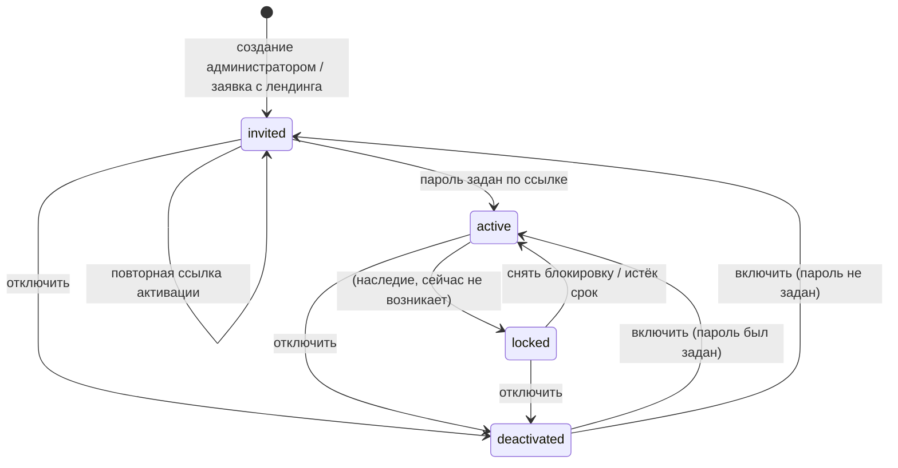
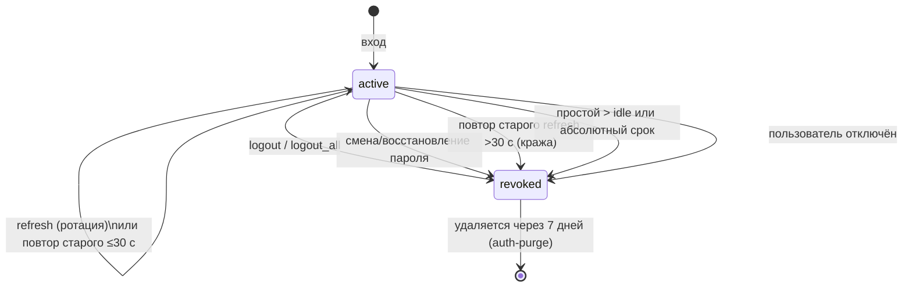
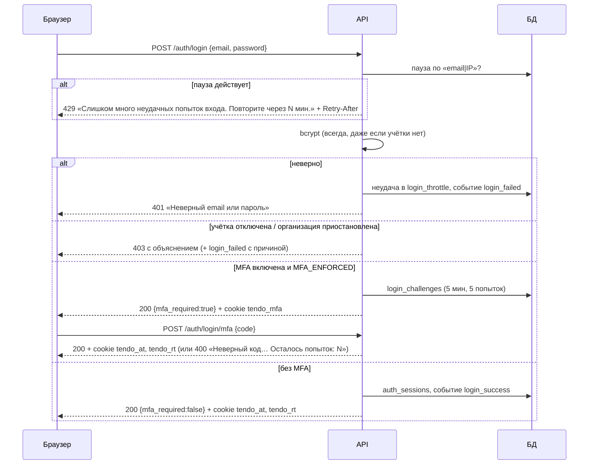

# Домен «Учётные записи, вход и права» (identity)

Кто пользователь и что ему можно: учётные записи и роли, матрица «роль × действие», вход по паролю и второму фактору, сессии на HttpOnly-cookie с ротацией refresh-токена, пароли и одноразовые ссылки, приглашение и блокировка пользователей, связь пользователя с контрагентом, заявки-лиды с лендинга и учётная запись владельца площадки.

Связанные разделы: требования безопасности — [../07-architecture/security.md](../07-architecture/security.md) §1–2 (SEC-01…SEC-23, этот файл им не противоречит и детализирует их); роли и матрица по всем доменам — [../01-product/users-and-roles.md](../01-product/users-and-roles.md); API — [../04-api/endpoints-identity.md](../04-api/endpoints-identity.md); гранты на портфели и объекты — [portfolios.md](portfolios.md); журнал — [audit.md](audit.md); модель данных — [users](../05-data-model/tables.md#users), [roles](../05-data-model/tables.md#roles), [role_permissions](../05-data-model/tables.md#role_permissions), [auth_sessions](../05-data-model/tables.md#auth_sessions), [login_challenges](../05-data-model/tables.md#login_challenges), [login_throttle](../05-data-model/tables.md#login_throttle), [password_reset_tokens](../05-data-model/tables.md#password_reset_tokens), [supplier_users](../05-data-model/tables.md#supplier_users).

## 1. Назначение и границы домена

Система должна:

1. хранить учётные записи сотрудников Заказчика, пользователей контрагентов, лидов и владельца площадки; одна учётная запись — одна роль;
2. аутентифицировать браузер только через HttpOnly-cookie (без заголовка `Authorization`), выдавая короткий токен доступа и вращаемый refresh-токен, с мгновенным отзывом сессии;
3. защищать вход от перебора (нарастающая пауза по паре «учётка + IP»), поддерживать второй фактор TOTP, обязательный для администратора и владельца площадки;
4. проводить политику паролей, запрет повторного использования, восстановление пароля и первый вход по одноразовой ссылке;
5. дать администратору реестр пользователей: приглашение, смена роли, отключение, повторная ссылка активации, сброс MFA, право «видит финансы», история событий;
6. хранить настраиваемую матрицу «роль × действие» и отвечать всем остальным доменам на вопрос «можно ли этому пользователю это действие» (гейты «вошедший», «сотрудник», «по праву X», «видит финансы», «владелец площадки», «повторный ввод пароля»);
7. принимать заявки с маркетингового лендинга как учётные записи с ролью «Лид» (если включено);
8. связывать пользователя с организацией-контрагентом (личный кабинет поставщика).

Вне границ: гранты пользователя на портфели и объекты ([portfolios.md](portfolios.md)), анкета и кабинет контрагента, приостановка организации ([suppliers.md](suppliers.md)), галочки уведомлений профиля ([notifications.md](notifications.md)), журнал и инциденты ([audit.md](audit.md)).

## 2. Сущности и ключевые поля

| Сущность | Таблица | Ключевые поля и смысл |
|---|---|---|
| Пользователь | [users](../05-data-model/tables.md#users) | `full_name`, `email` (уникален, без учёта регистра при поиске), `phone`, `password_hash` (bcrypt; особое значение-заглушка «пароль не задан» у приглашённого), `password_history` (до 5 прошлых хешей), `role_id`, `source` (`landing` — пришёл с лендинга, иначе пусто), `is_active`, `can_view_finance` (персональный флаг «видит цены»), `is_superadmin` (владелец площадки), `mfa_enabled`, `mfa_secret` (зашифрован), `mfa_last_counter` (номер последнего принятого 30-секундного шага TOTP), `failed_login_attempts`, `locked_until` (наследие, см. §10), `last_login_at`, `last_activity`, `notification_prefs` (JSON галочек) |
| Роль | [roles](../05-data-model/tables.md#roles) | `code`, `name`. Коды: `admin`, `tender_specialist`, `security`, `lawyer`, `supplier`, `lead`, `owner` |
| Отметка матрицы | [role_permissions](../05-data-model/tables.md#role_permissions) | `(role_id, code)`, `granted_at` — хранятся только выданные права |
| Связь с контрагентом | [supplier_users](../05-data-model/tables.md#supplier_users) | `user_id` (уникален — пользователь принадлежит одной организации), `supplier_id`, `is_active` |
| Сессия устройства | [auth_sessions](../05-data-model/tables.md#auth_sessions) | `id` (UUID, он же `sid` в токене доступа), `refresh_hash`, `prev_refresh_hash`, `rotated_at`, `last_used_at`, `idle_expires_at` (скользящий срок), `expires_at` (абсолютный потолок), `revoked_at`, `revoked_reason`, `ip`, `user_agent` |
| Шаг второго фактора | [login_challenges](../05-data-model/tables.md#login_challenges) | `token_hash`, `attempts`, `expires_at`, `consumed_at`, `ip` |
| Пауза входа | [login_throttle](../05-data-model/tables.md#login_throttle) | `key` = «email в нижнем регистре \| IP», `failures`, `blocked_until`, `expires_at` |
| Одноразовая ссылка | [password_reset_tokens](../05-data-model/tables.md#password_reset_tokens) | `token_hash` (в БД только SHA-256 токена), `expires_at`, `used_at`. Одна таблица для ссылок восстановления (2 ч) и активации (72 ч) |

Список действий матрицы (14 кодов) — **константа кода**, а не таблица: право без парной проверки в обработчике ничего не разрешает, поэтому новое право появляется только вместе с местом проверки.

| Код права | Название в матрице | Группа |
|---|---|---|
| `portfolios.manage` | Создавать и изменять портфели и объекты | Портфели и объекты |
| `tenders.manage` | Создавать тендеры и приглашать контрагентов | Тендеры и предложения |
| `quotes.manage` | Обрабатывать коммерческие предложения | Тендеры и предложения |
| `suppliers.manage` | Удалять и восстанавливать контрагентов, выдавать доступ в ЛК | Контрагенты |
| `suppliers.contacts.view` | Видеть полные контакты контрагента: ИНН, почту, телефон (иначе — маска) | Контрагенты |
| `reports.view` | Смотреть отчёты и выгружать их | Отчёты |
| `finance.view` | Видеть цены и финансовые данные | Бюджет и финансы |
| `budget.view` | Смотреть бюджет и распределение по периодам | Бюджет и финансы |
| `budget.manage` | Распределять бюджет и проводить корректировки | Бюджет и финансы |
| `catalogs.manage` | Править справочники: единицы, статусы, виды работ | Администрирование |
| `users.manage` | Управлять пользователями и их доступом к объектам | Администрирование |
| `security.manage` | Журнал безопасности, инциденты, выгрузки РКН | Администрирование |
| `settings.manage` | Настройки системы: почта и уведомления | Администрирование |
| `billing.view` | Расходы на ИИ: баланс, история, заявки на пополнение | Администрирование |

Права по умолчанию (сид при создании роли): тендерный специалист — `portfolios.manage`, `tenders.manage`, `quotes.manage`, `reports.view`, `budget.view`, `suppliers.contacts.view`; СБ — `security.manage`, `suppliers.contacts.view`; юрист — `suppliers.contacts.view`; поставщик и лид — пусто; администратор — все всегда (матрица его не ограничивает).

## 3. Жизненный цикл

### 3.1. Учётная запись

Статус учётной записи **вычисляется**, а не хранится; значения взаимоисключающие, по старшинству: отключена → заблокирована → приглашена → активна.

| Статус | Условие |
|---|---|
| `deactivated` (Отключена) | `is_active = false` |
| `locked` (Заблокирована) | активна и `locked_until > сейчас` |
| `invited` (Приглашена) | активна, не заблокирована, пароль ещё не задан |
| `active` (Активна) | активна, не заблокирована, пароль задан |

| Из | В | Кто | Условие | Побочные эффекты |
|---|---|---|---|---|
| — | `invited` | администратор (`users.manage`) | ФИО, корректный email, свободный email, существующая роль; для роли «контрагент» — указан контрагент | Событие `user_created`; одноразовая ссылка активации (72 ч) — письмом пользователю и в ответе API администратору |
| — | `invited` (роль «Лид») | посетитель лендинга | `LEADS_ENABLED=true`, новый email | См. §3.4 |
| — (владелец) | `active` | оператор установки (CLI в контейнере) | — | Учётка создаётся с одноразовым паролем, выводится в консоль один раз |
| `invited` | `invited` | администратор | Учётка включена | Прежние ссылки гасятся, новая — письмом и в ответе; событие `user_activation_reissued` |
| `invited` | `active` | пользователь | Действующая ссылка, пароль по политике | Пароль задан, история = [новый хеш], все сессии закрыты; событие `initial_password_set` |
| `active`/`invited`/`locked` | `deactivated` | администратор | Не сам себя | Каждый следующий запрос пользователя — 403 «Учётная запись отключена…», refresh закрывает сессию; событие `user_deactivated` |
| `deactivated` | прежний | администратор | — | Событие `user_reactivated` |
| `locked` | `active` | администратор («Снять блокировку») | Есть блокировка или счётчик неудач > 0 | Счётчик неудач обнулён; событие `account_unlocked` |
| любой | тот же (новая роль) | администратор | Не своя роль | Права меняются со следующего запроса без перевыпуска токенов; связка с контрагентом приводится к новой роли; событие `role_changed` |

### 3.2. Сессия устройства

| Из | В | Кто / когда | Побочные эффекты |
|---|---|---|---|
| — | активна | Успешный вход (пароль, или пароль + код TOTP) | Новая строка сессии: refresh-хеш, `idle_expires_at = min(сейчас + SESSION_IDLE_DAYS, expires_at)`, `expires_at = сейчас + SESSION_ABSOLUTE_DAYS`, IP, User-Agent; cookie `tendo_at` и `tendo_rt` |
| активна | активна (ротация) | `POST /auth/refresh` с текущим refresh | Новый refresh, прежний хеш хранится как «предыдущий», скользящий срок сдвигается, новый токен доступа |
| активна | активна | Повтор **предыдущего** refresh не позже 30 с после ротации (две вкладки) | Выдаётся только новый токен доступа, refresh не меняется |
| активна | отозвана (`reuse`) | Повтор предыдущего refresh позже 30 с | Сессия закрыта (вор и владелец оба выходят); событие `session_reuse_detected` |
| активна | отозвана (`expired`) | Refresh после `idle_expires_at` или `expires_at` | 401 «Сессия завершена из-за неактивности. Войдите снова.»; событие `session_idle_timeout` |
| активна | отозвана (`logout`) | «Выйти» | Событие `logout`; cookie сняты |
| активна | отозвана (`logout_all`) | «Выйти на всех устройствах» | Все сессии пользователя, включая текущую; событие `sessions_revoked_all` |
| активна | отозвана (`password_changed`) | Смена своего пароля | Закрываются все сессии **кроме текущей**; текущей выдаётся новый токен доступа |
| активна | отозвана (`password_reset` / `password_changed`) | Восстановление пароля / установка первого пароля | Все сессии пользователя |
| активна | отозвана (`user_inactive`) | Refresh отключённого пользователя | 403 «Учётная запись отключена…» |

### 3.3. Вход

Первый шаг формы «только email» (`/auth/login/check-email`) всегда отвечает «введите пароль» — по нему нельзя узнать, есть ли учётка и активирована ли она. Первый вход приглашённого идёт только по ссылке активации из письма.

### 3.4. Заявка-лид

| Из | В | Кто | Условие | Побочные эффекты |
|---|---|---|---|---|
| — | лид, приглашён | посетитель лендинга | `LEADS_ENABLED=true`, имя и email заданы, ханипот пуст, email новый | Учётка с ролью `lead`, `source=landing`; событие `lead_submitted`; письмо со ссылкой активации; письмо команде (держателям `users.manage` и администраторам) со ссылкой на карточку |
| лид, приглашён | лид, активен | лид | Задал пароль по ссылке | Входит, видит только экран «Заявка принята» |
| лид | сотрудник/поставщик | администратор | Назначает настоящую роль в реестре пользователей | Событие `role_changed`; дальше — права новой роли |
| — | — | посетитель | email уже есть | Учётка не создаётся, письма не уходят; событие `lead_submitted` с `duplicate=true`; ответ тот же, что при успехе |

## 4. Правила и валидации

### 4.1. Сессия и cookie

- Токен доступа — JWT (`HS256`) на `ACCESS_TOKEN_MINUTES` (15) минут; claims: `sub` (id пользователя), `exp`, `sid` (сессия), `pv` (отпечаток хеша пароля — первые 16 символов SHA-256 от хеша). Cookie `tendo_at` живёт на 60 с дольше самого JWT, чтобы просроченный токен давал понятный 401.
- Refresh — случайный секрет (32 байта, URL-safe); в БД — только SHA-256. Cookie `tendo_rt` только на путь `<префикс API>/auth`, срок = остаток скользящего срока. Cookie шага MFA `tendo_mfa` — только на путь `<префикс API>/auth/login/mfa`, 5 мин. Все — `HttpOnly`, `SameSite=Lax`, `Secure` (`COOKIE_SECURE`). Подробно — [security.md §1.1](../07-architecture/security.md#11-транспорт-сессии--только-httponly-cookie).
- На **каждом** запросе система проверяет: подпись и срок JWT → сессия `sid` существует и не отозвана → пользователь есть и активен → отпечаток пароля в токене совпадает с текущим → (для пользователя контрагента) организация не приостановлена → (для администратора и владельца при `MFA_ENFORCED`) MFA настроена либо запрошен путь настройки → (для владельца) путь в разделе владельца или `/auth/*`.
- Ошибка refresh (401/403) снимает все три cookie; сбой инфраструктуры (5xx) — не снимает.
- Небезопасные методы с чужим заголовком `Origin` — 403 «Запрос с чужого источника отклонён» (SEC-25).
- Клиент обновляет сессию одним запросом на браузер (очередь между вкладками) и повторяет исходный запрос (SEC-06).

### 4.2. Вход и пауза

- Ключ паузы — `email` (обрезан, нижний регистр, до 254 символов) + `|` + IP клиента. Учётная запись целиком **не блокируется**: чужой IP не может запереть владельца учётки.
- С `MAX_FAILED_LOGIN_ATTEMPTS`-й (5) неудачи подряд — пауза (формула в §5). Запись живёт 24 ч с последней неудачи, потом счёт начинается заново. Успешный вход удаляет запись.
- Пока пауза действует, пароль даже не проверяется: 429 «Слишком много неудачных попыток входа. Повторите через N мин.» и заголовок `Retry-After` (секунды).
- Неверный пароль и несуществующий email — один ответ и одинаковое время (сверка с фиктивным bcrypt-хешем).
- Отключённая учётка с **верным** паролем — 403 «Учётная запись отключена. Обратитесь к администратору системы.» (знающий пароль и так знает, что учётка есть).
- Пользователь контрагента, чья организация приостановлена, — 403 «Доступ организации приостановлен. Обратитесь к администратору системы.».
- Лимиты частоты по IP (поверх паузы): вход 20/мин, шаг MFA 10/мин, refresh 120/мин, запрос восстановления 5/ч, подтверждение восстановления и установка первого пароля 20/ч, проверка email 30/мин; вход, MFA и восстановление — fail-closed (при недоступном хранилище счётчиков 503). Значения — [scalability.md §6.2](../07-architecture/scalability.md#62-лимиты-частоты).

### 4.3. Второй фактор (TOTP)

- RFC 6238, 6 цифр, шаг 30 с, допуск ±1 шаг на рассинхрон часов; код из шага, не более позднего, чем последний принятый (`mfa_last_counter`), отклоняется (защита от повтора). QR-код строится на сервере (data-URI SVG) — секрет не уходит во внешние сервисы. Издатель в приложении-аутентификаторе — `TOTP_ISSUER`, иначе `BRAND_NAME`.
- Настройка: `setup` выдаёт секрет, otpauth-URI и QR; при уже включённой MFA требуется текущий код («Чтобы перепривязать MFA, введите текущий код из приложения-аутентификатора»). `verify` включает MFA, неверный код — «Неверный код — проверьте время на устройстве и попробуйте ещё раз».
- Шаг входа: челлендж одноразовый, живёт `MFA_CHALLENGE_MINUTES` (5) мин, допускает `MFA_CHALLENGE_MAX_ATTEMPTS` (5) неверных кодов. Неверный код — 400 «Неверный код подтверждения. Осталось попыток: N»; исчерпано — 401 «Слишком много неверных кодов — войдите заново»; челлендж мёртв/истёк — 401 «Время на ввод кода вышло — войдите заново».
- MFA запрашивается при входе у **любого** пользователя с включённым фактором, если `MFA_ENFORCED=true`. При `MFA_ENFORCED=false` второй фактор не запрашивается вовсе и не обязателен никому (режим демо-стенда).
- Администратор и владелец площадки при `MFA_ENFORCED=true` обязаны настроить MFA: до этого любой запрос, кроме `/auth/me`, `/auth/mfa/setup`, `/auth/mfa/verify`, — 403 «Для продолжения работы настройте двухфакторную аутентификацию»; `/auth/me` отдаёт `mfa_setup_required=true`, интерфейс ведёт на экран настройки (у администратора — «Настройки», у владельца — «Настройки владельца»).
- Отключить свою MFA может только не-администратор и не-владелец, с верным кодом: «MFA не включена», «Для администраторов MFA обязательна — отключить нельзя», «Неверный код».
- Сброс чужой MFA — администратор с `users.manage`, только **другому** пользователю, с повторным вводом своего пароля (заголовок `X-Reauth-Password`): «Сбросить свою MFA нельзя — попросите другого администратора», «У пользователя не настроена MFA»; без заголовка — 403 «Подтвердите действие паролем», неверный — 403 «Пароль не подошёл — действие не выполнено». Тот же механизм подтверждения паролем используют закрытие тендера и перевыпуск/отзыв ссылки участника.

### 4.4. Пароли

- Политика — [SEC-15](../07-architecture/security.md#15-политика-паролей); проверка по порядку, первая ошибка возвращается текстом:

| Правило | Текст ошибки |
|---|---|
| Пробел в начале/конце | «Пароль не должен начинаться или заканчиваться пробелом» |
| Длина < 8 | «Пароль должен быть не короче 8 символов» |
| Длина > 64 | «Пароль должен быть не длиннее 64 символов» |
| > 72 байт в UTF-8 | «Пароль слишком длинный: кириллица считается за два символа, сократите его» |
| < 3 категорий из 4 (строчные, прописные — включая кириллицу, цифры, спецсимволы) | «Пароль должен содержать символы минимум трёх категорий: строчные, прописные, цифры, спецсимволы» |
| Из списка распространённых (~25 значений, без учёта регистра) | «Этот пароль слишком распространён — придумайте другой» |
| < 4 разных символов | «Пароль состоит из повторяющихся символов — придумайте другой» |
| Содержит локальную часть email (от 3 символов) | «Пароль не должен повторять email» |
| Содержит слово ФИО (от 4 символов) | «Пароль не должен повторять имя пользователя» |

- Хеш — bcrypt; проверка и хеширование выполняются вне основного потока обработки запросов (≈250 мс CPU).
- Повтор: новый пароль не должен совпадать с текущим и с хешами в истории (до 5 последних) — «Нельзя повторно использовать недавний пароль». После смены история = [прежний текущий, …прежняя история], обрезанная до 5.
- Смена своего пароля: «Текущий пароль указан неверно» при ошибке; остальные сессии закрываются, текущая продолжает работать с новым токеном.
- Восстановление: форма всегда отвечает «Если учётная запись существует, мы отправили письмо со ссылкой.» (и для несуществующей, и для отключённой учётки, и при превышении лимита). Не больше 3 писем на один адрес в час, с любых IP. Ссылка `<PUBLIC_APP_URL>/reset-password?token=…`, одноразовая, 2 ч. Подтверждение: «Ссылка недействительна или истекла. Запросите восстановление пароля заново.»; отключённая учётка — 403. После восстановления: счётчик неудач обнулён, все сессии закрыты, **MFA сохраняется**.
- Первый пароль: ссылка `<PUBLIC_APP_URL>/login?activation_token=…&email=…`, 72 ч; ошибка «Ссылка недействительна или истекла. Запросите новую ссылку активации от администратора.».

### 4.5. Реестр пользователей

- Создание: «Укажите ФИО»; email и телефон проверяются общими правилами валидации (ошибки по полям); роль по умолчанию — тендерный специалист; «Пользователь с таким email уже есть» (409); «Неизвестная роль»; для роли «контрагент» без организации — «Для роли «контрагент» укажите контрагента (supplier_id)»; организация должна допускать привязку (проверяет домен контрагентов); нечисловой `supplier_id` — ошибка поля «Ожидается число». Администратору флаг «видит финансы» ставится автоматически.
- Правка: ФИО (пустое игнорируется), телефон, роль, включение/отключение, флаг «видит финансы», организация. Запреты: «Свою роль изменить нельзя — попросите другого администратора», «Нельзя деактивировать самого себя». Смена email не предусмотрена (см. §10).
- Связка с контрагентом приводится к **итоговой** роли: стала «контрагент» — связка создаётся/переносится/включается (организация — указанная, иначе прежняя; иначе отказ); ушла с роли — связка гасится (строка остаётся для возврата). Один пользователь — одна организация; у организации — сколько угодно пользователей.
- Повторная ссылка активации: «Пользователь уже активирован — пароль меняется восстановлением, а не ссылкой активации», «Учётная запись отключена — сначала включите её».
- Снять блокировку: «Учётная запись не заблокирована», если нет ни блокировки, ни неудач.
- Список: поиск по подстроке ФИО или email; фильтры — роли (несколько), статусы (несколько из `active`, `invited`, `locked`, `deactivated`), MFA вкл/выкл, контрагент, «не входил дольше N дней или ни разу» (N ≥ 1), источник `landing`; сортировка по ФИО (по умолчанию), email, роли, последнему входу, дате создания, по возрастанию/убыванию; пустой «последний вход» — всегда в конце; незнакомые значения фильтров и сортировки отбрасываются (ссылка со старыми параметрами открывается). Страница — до 200 строк. Владелец площадки в реестре не показывается.
- История пользователя: последние события журнала про пользователя (по умолчанию 30, не больше 100): подпись, результат, автор, «своё действие / над ним», IP, подробности.
- Список коллег для «+ Уведомить» в комментариях: только id и ФИО активных сотрудников — доступен любому сотруднику.

### 4.6. Матрица «роль × действие»

- Чтение отдаёт список действий (код, название, группа) и строки ролей: код, название, причина блокировки строки, выданные права. Строка «Лид» скрыта при `LEADS_ENABLED=false`.
- Строки `admin` («Администратор всегда имеет полный доступ»), `supplier` («Контрагент работает только в личном кабинете»), `owner` («Владелец площадки — вне ролей клиента») не редактируются — 400 с этим текстом.
- Сохранение нескольких строк — **всё или ничего**: сначала проверяются все роли (заблокированная — 400, несуществующая — 404 «Роль 'x' не найдена»), потом пишутся. Незнакомые коды прав молча отбрасываются. На каждую реально изменившуюся роль — событие `role_permissions_changed` с `{role, added, removed}`. Формат: `{"roles": {"tender_specialist": ["reports.view", …]}}`; одна строка — `{"granted": […]}`, не список — 400 «Ожидается список действий в поле granted».
- Изменение действует **со следующего запроса** всех носителей роли без перевыпуска токенов (права читаются из БД на каждом запросе; в пределах запроса — кэш).
- Блок «Последние изменения прав» — из журнала: дата и время (МСК, `ДД.ММ.ГГГГ ЧЧ:ММ`), автор, роль, выданные и снятые права подписями (по умолчанию 10, не больше 50).

### 4.7. Гейты для других доменов

| Гейт | Правило | Отказ |
|---|---|---|
| Вошедший | Действующий токен и сессия | 401 «Не авторизован» / «Токен недействителен или истёк» / «Сессия завершена. Войдите заново.» / «Сессия завершена: пароль был изменён. Войдите заново.» |
| Сотрудник | Роль ∈ {admin, tender_specialist, security, lawyer} | 403 «Доступно только сотрудникам компании» |
| По праву X | Сотрудник и (администратор или X выдано роли) | 403 «Недостаточно прав для этого действия — обратитесь к администратору системы» + событие `permission_denied` (`details.required = X`) |
| Только администратор | Роль admin | 403 «Доступно только администратору» + `permission_denied` |
| Видит финансы | Флаг пользователя, или роль admin, или право `finance.view` у роли (складываются по ИЛИ) | 403 «Нет прав на финансовые данные — обратитесь к администратору системы» (там, где цены нельзя замаскировать) |
| Владелец площадки | `is_superadmin` | 403 «Раздел доступен только владельцу площадки» |
| Повторный пароль | Заголовок `X-Reauth-Password` с верным паролем | 403 «Подтвердите действие паролем» / «Пароль не подошёл — действие не выполнено» |

Доступ к данным конкретного объекта (тендеры, КП, бюджет, чаты) дополнительно ограничен грантами на дерево портфелей — [portfolios.md](portfolios.md#4-правила-и-валидации).

### 4.8. Заявка с лендинга

- Ручка публичная (без входа), при `LEADS_ENABLED=false` отвечает 404 «Not Found», как несуществующий путь, ещё до лимита частоты. Лимит — 20 заявок в час с одного IP.
- Поля: `name` (обязательно, «Укажите, как к вам обращаться», до 255), `email` (обязательно, проверка формата), `company` (до 255), `volume` — объём закупок в год (до 64), `utm_source`, `utm_medium`, `utm_campaign`, `utm_term`, `utm_content` (до 255). Длинные значения обрезаются, а не отвергаются. Тело не-JSON трактуется как пустое.
- Ханипот: скрытое поле `hp_website` заполнено → ответ «успех», ничего не создаётся.
- Ответ всегда `{"ok": true, "created": <bool>}` — по нему нельзя проверить наличие адреса (кроме самого флага `created`, см. §10).
- Если роль `lead` в установке не заведена — 400 «Роль лида не заведена — обратитесь к администратору системы» (заводить лида другой ролью нельзя).

### 4.9. Владелец площадки

- Признак выдаётся только командой в контейнере бэкенда (`superadmin_cli <email>`): нет учётки — создаётся с ролью `owner`, ФИО «Владелец площадки» и одноразовым паролем (выводится один раз); есть — получает признак и роль `owner`. Из интерфейса выдать или снять признак нельзя.
- Владелец видит только `/auth/*` и раздел владельца; любой другой путь — 403 «Раздел недоступен учётной записи владельца площадки». В реестре пользователей, списке коллег и счётчиках клиента не участвует; в истории биллинга подписан «Владелец площадки».
- Рекомендация для воссоздания: тем же механизмом (CLI, одноразовый пароль, обязательная смена) заводить первого администратора Заказчика (SEC-18).

## 5. Расчёты и формулы

| Величина | Формула |
|---|---|
| Пауза входа после n-й неудачи подряд | `n < 5`: нет; `n ≥ 5`: `min(LOGIN_THROTTLE_MAX_MINUTES, 2^(n − 5))` минут → 1, 2, 4, 8, 16, 32, 60, 60… |
| Минуты в тексте паузы | `⌈оставшиеся секунды / 60⌉`, не меньше 1 |
| Скользящий срок сессии | `idle_expires_at = min(сейчас + SESSION_IDLE_DAYS, expires_at)` — пересчитывается при каждом refresh |
| Срок cookie refresh | `idle_expires_at − сейчас` (секунды) |
| Срок cookie доступа | `ACCESS_TOKEN_MINUTES × 60 + 60` секунд |
| Шаг TOTP | `⌊unix_time / 30⌋`; принимается код шагов `t, t−1, t+1`, если шаг > `mfa_last_counter` |
| Отпечаток пароля в токене | первые 16 hex-символов SHA-256 от строки хеша пароля |
| «Видит финансы» | `users.can_view_finance ∨ role = admin ∨ finance.view ∈ права роли` |
| «Есть право X» | `роль ∈ сотрудники ∧ (role = admin ∨ X ∈ role_permissions(role) ∩ каталог прав)` |
| «Не входил N дней» | `last_login_at IS NULL ∨ last_login_at < сейчас − N дней` |

## 6. Права доступа

| Действие | Админ | Тенд. специалист | СБ | Юрист | Поставщик | Лид | Владелец |
|---|---|---|---|---|---|---|---|
| Войти, выйти, «выйти везде», сменить свой пароль, восстановить пароль | ✅ | ✅ | ✅ | ✅ | ✅ | ✅ | ✅ |
| Настроить свою MFA | ✅ (обязательно*) | ✅ | ✅ | ✅ | ✅ | ✅ | ✅ (обязательно*) |
| Отключить свою MFA | ❌ | ✅ | ✅ | ✅ | ✅ | ✅ | ❌ |
| Реестр, карточка, история пользователя; создать, править, отключить, повторная ссылка, снять блокировку | ✅ | при `users.manage` | при `users.manage` | при `users.manage` | ❌ | ❌ | ❌ |
| Сбросить чужую MFA (с паролем) | ✅ | при `users.manage` | при `users.manage` | при `users.manage` | ❌ | ❌ | ❌ |
| Матрица прав: смотреть, править, последние изменения | ✅ | при `users.manage` | при `users.manage` | при `users.manage` | ❌ | ❌ | ❌ |
| Список коллег (id, ФИО) | ✅ | ✅ | ✅ | ✅ | ❌ | ❌ | ❌ |
| Оставить заявку с лендинга | аноним, при `LEADS_ENABLED` | | | | | | |
| Выдать признак владельца | только CLI в контейнере | | | | | | |

\* при `MFA_ENFORCED=true`. Право `users.manage` по умолчанию есть только у администратора. Полная матрица по всем доменам — [../01-product/users-and-roles.md](../01-product/users-and-roles.md).

## 7. События, уведомления, аудит

### 7.1. Журнал

`login_success`, `login_failed` (с `details.reason`: `account_disabled`, `org_suspended`, `mfa_invalid`; по несуществующему email — `details.email`), `logout`, `sessions_revoked_all`, `session_idle_timeout`, `session_reuse_detected`, `mfa_enabled`, `mfa_disabled`, `mfa_reset` (`details.target_email`), `password_changed`, `password_reset_requested` (`details.email`), `password_reset_completed`, `initial_password_set`, `user_created` (`details.role`, `supplier_link`), `user_activation_reissued`, `role_changed` (`old_role`, `new_role`, `supplier_link`: `created`/`activated`/`moved`/`deactivated`), `user_deactivated`, `user_reactivated`, `finance_access_changed` (не пишется, когда флаг ставится администратору автоматически), `account_unlocked` (`failed_attempts`, `was_locked`), `role_permissions_changed`, `permission_denied`, `lead_submitted` (`duplicate`, `company`, `volume`, UTM-метки). Каталог — [audit.md](audit.md#71-каталог-событий).

### 7.2. Письма

Все письма — простым текстом (восстановление — ещё и HTML), «лучшее усилие»: сбой почты не ломает действие.

| Письмо | Кому | Тема | Содержание |
|---|---|---|---|
| Восстановление пароля | пользователь | «Восстановление пароля — тендерная площадка» | Ссылка, срок 2 ч, одноразовая; «Если вы не запрашивали сброс — просто проигнорируйте это письмо.» |
| Активация (приглашение) | новый пользователь | «Активация учётной записи — `<BRAND_NAME>`» | «Здравствуйте, `<ФИО>`! Для вас создана учётная запись в системе `<BRAND_NAME>`.», ссылка, срок 72 ч |
| Активация повторно | приглашённый | та же | «Ссылка активации выдана заново…», «Прежние ссылки больше не работают.» |
| Активация лида | лид | та же | «Вы оставили заявку на демо `<BRAND_NAME>`… Продуктом можно будет пользоваться, когда мы подтвердим заявку…», ссылка |
| Заявка с лендинга | держатели `users.manage` и администраторы | «Заявка с лендинга — `<ФИО>`» | Имя, email, компания, объём закупок; «назначьте ему роль в разделе «Пользователи»»; ссылка `/users?user=<id>` |

Записей в центре уведомлений и событий живого потока домен не создаёт.

## 8. Фоновые задачи и периодика

| Задача | Когда | Что делает | Повторы |
|---|---|---|---|
| `auth-purge` | раз в час (воркер в процессе API) | Удаляет сессии, у которых абсолютный или скользящий срок истёк либо отзыв был более 7 дней назад; челленджи MFA, истёкшие более часа назад; записи паузы входа с истёкшим сроком | Нет; сбой тика логируется, следующий тик повторит |

## 9. Настройки и флаги

| Имя | По умолчанию | Назначение |
|---|---|---|
| `ACCESS_TOKEN_MINUTES` | 15 | Срок токена доступа |
| `SESSION_IDLE_DAYS` | 14 | Скользящий срок сессии |
| `SESSION_ABSOLUTE_DAYS` | 30 | Абсолютный потолок сессии |
| `JWT_ALGORITHM` | HS256 | Алгоритм подписи (ключ — секрет `JWT_SECRET`, только из окружения) |
| `COOKIE_SECURE` | true | Флаг `Secure` у cookie (выключается только для http на loopback) |
| `MFA_ENFORCED` | true | Обязательная MFA для администратора и владельца; при `false` код не спрашивается ни у кого |
| `MFA_CHALLENGE_MINUTES` | 5 | Время на ввод кода |
| `MFA_CHALLENGE_MAX_ATTEMPTS` | 5 | Неверных кодов на один шаг |
| `MAX_FAILED_LOGIN_ATTEMPTS` | 5 | С какой неудачи начинается пауза |
| `LOGIN_THROTTLE_MAX_MINUTES` | 60 | Потолок паузы |
| `TOTP_ISSUER` | пусто | Издатель в приложении-аутентификаторе (иначе `BRAND_NAME`) |
| `BRAND_NAME` | TENDO | Название системы в письмах и QR |
| `PUBLIC_APP_URL` | — (обязателен) | База ссылок в письмах |
| `CORS_ORIGINS` | — (обязателен) | Разрешённые источники (CSRF-проверка `Origin`) |
| `LEADS_ENABLED` | false | Публичная заявка с лендинга, роль «Лид» в матрице и событие в журнале |
| `FIELD_ENCRYPTION_KEY` | секрет | Шифрование `mfa_secret` (только имя; значение — в окружении) |

## 10. Граничные случаи

1. **«Блокировка учётки» и «Снять блокировку» не работают.** Вход больше не пишет счётчик неудач и `locked_until` в учётку (только паузу по паре «учётка + IP» в отдельной таблице), поэтому статус `locked` на практике не возникает, а «Снять блокировку» отвечает «Учётная запись не заблокирована» и **не снимает** действующую паузу входа. Требование для воссоздания: снятие блокировки администратором должно удалять записи паузы всех IP для email пользователя (SEC-08 «администратор может снять паузу»); статус «Заблокирована» в реестре — показывать по наличию действующей паузы (см. открытые вопросы).
2. **Перепривязка MFA ломает вход при брошенной настройке.** `setup` при уже включённой MFA сразу заменяет секрет, а включение подтверждается отдельным `verify`; если пользователь не завершит `verify`, старое приложение больше не подходит. Требование: хранить новый секрет как «ожидающий» и заменять действующий только после `verify`.
3. **Ссылки активации и восстановления взаимозаменяемы.** Обе живут в одной таблице, и `set-initial-password` принимает токен восстановления (минуя проверку истории паролей), а `password-reset/confirm` — токен активации. Поле `email` в запросе установки первого пароля не сверяется с владельцем токена. Рекомендуется различать тип токена.
4. **Владелец площадки доступен правке по id.** Реестр и карточка его скрывают, но правка, сброс MFA и повторная ссылка ищут пользователя по id без этого фильтра — администратор Заказчика, зная id, может отключить владельца или сменить ему роль. Требование: все ручки `/users/*` должны отвечать 404 для владельца.
5. **Роль `owner` и `lead` назначаемы вручную.** Создание и правка пользователя принимают любой код роли из БД, включая `owner` (без признака владельца) — такая учётка не попадёт ни в один раздел (интерфейс покажет «Для вашей роли здесь нет рабочего места»). Требование: допускать в реестре только роли Заказчика (`admin`, `tender_specialist`, `security`, `lawyer`, `supplier`, `lead`).
6. **Лид в списке коллег.** Список «+ Уведомить» берёт всех активных, кроме контрагентов и владельца, — лиды туда попадают. Лиду также доступна лента общих (широковещательных) уведомлений сотрудников через API ([notifications.md §10](notifications.md#10-граничные-случаи)). Требование: исключить роль `lead` из обоих.
7. **Флаг `created` в ответе заявки** формально раскрывает, был ли адрес в системе; интерфейс лендинга его не показывает. Рекомендуется не отдавать флаг наружу.
8. **Смена email** пользователя не предусмотрена ни в API, ни в интерфейсе (только завести нового). См. открытые вопросы.
9. **Отключение не закрывает сессии явно**, но каждый запрос и refresh отключённого пользователя отклоняются (403), так что эффект мгновенный. Смена роли сессии не закрывает — права меняются со следующего запроса.
10. **Отключённой учётке письмо восстановления не уходит**, ответ формы тот же; включённой без пароля (приглашённой) — уходит, и восстановление фактически активирует её.
11. **`MFA_ENFORCED=false`** выключает не только обязательность, но и сам запрос кода у пользователей с включённой MFA — второй фактор на стенде с этим флагом игнорируется.
12. **Две вкладки обновляют сессию одновременно** — строка сессии блокируется на время ротации; второй запрос получает новый токен доступа по «предыдущему» refresh в окне 30 с.
13. **Удаление пользователя** не предусмотрено — только отключение (на пользователя ссылаются журнал, тендеры, КП).
14. **Кнопки «Выйти на всех устройствах»** в интерфейсе нет, хотя ручка есть (см. открытые вопросы).

## 11. Пример

1. Администратор создаёт «Петрова Анна», `anna@example.com`, роль «Тендерный специалист». Ответ: строка реестра со статусом `invited` и ссылкой `https://<домен>/login?activation_token=…&email=anna@example.com`; письмо «Активация учётной записи — TENDO»; событие `user_created {role: tender_specialist}`.
2. Через 2 дня Анна задаёт пароль из 11 символов четырёх категорий, не содержащий «anna», «анна» и «петрова», — принят. Статус `active`, событие `initial_password_set`.
3. Анна ошибается паролем 7 раз подряд с одного IP: 5-я неудача — пауза 1 мин, 6-я (после паузы) — 2 мин, 7-я — 4 мин; на 8-й попытке во время паузы — 429 «…Повторите через 4 мин.». С другого IP вход проходит сразу.
4. Администратор в матрице снимает у роли «Тендерный специалист» право `reports.view`: строка журнала `role_permissions_changed {role: tender_specialist, added: [], removed: ["reports.view"]}`; следующий запрос Анны к реестру тендеров — 403 «Недостаточно прав…» и событие `permission_denied {required: "reports.view"}`.
5. Через 15 мин токен доступа истекает, клиент делает `POST /auth/refresh` — новая пара cookie; через 14 дней без единого запроса refresh отвечает 401 «Сессия завершена из-за неактивности. Войдите снова.».

## 12. Оценка сложности

**L.** Объём кода средний, но много точных требований безопасности: ротация refresh с окном гонки и детектом кражи, мгновенный отзыв через проверку сессии на каждом запросе, TOTP с защитой от повтора и обязательностью по ролям, пауза входа по паре «учётка + IP» в БД, политика и история паролей, общие одноразовые ссылки, CSRF через `Origin`, повторный ввод пароля, настраиваемая матрица с гейтами для всех доменов, реестр с серверными фильтрами, лиды, учётка владельца. Каждый пункт требует отдельных тестов матрицы доступа (SEC-23).

## 13. Связанные разделы

- API: [../04-api/endpoints-identity.md](../04-api/endpoints-identity.md) (auth, users, permissions, leads), [../04-api/endpoints-portfolios.md](../04-api/endpoints-portfolios.md) (`/users/{id}/access`).
- Экраны: [../03-screens/login.md](../03-screens/login.md), [../03-screens/reset-password.md](../03-screens/reset-password.md), [../03-screens/welcome.md](../03-screens/welcome.md), [../03-screens/profile.md](../03-screens/profile.md), [../03-screens/users.md](../03-screens/users.md), [../03-screens/settings.md](../03-screens/settings.md) (матрица прав, MFA), [../03-screens/owner-settings.md](../03-screens/owner-settings.md) (MFA владельца), [../03-screens/shell.md](../03-screens/shell.md) (гейт входа и маршрутов).
- Таблицы: [users](../05-data-model/tables.md#users), [roles](../05-data-model/tables.md#roles), [role_permissions](../05-data-model/tables.md#role_permissions), [supplier_users](../05-data-model/tables.md#supplier_users), [auth_sessions](../05-data-model/tables.md#auth_sessions), [login_challenges](../05-data-model/tables.md#login_challenges), [login_throttle](../05-data-model/tables.md#login_throttle), [password_reset_tokens](../05-data-model/tables.md#password_reset_tokens).
- Открытые вопросы — `../_oq/BL-1.md`.
