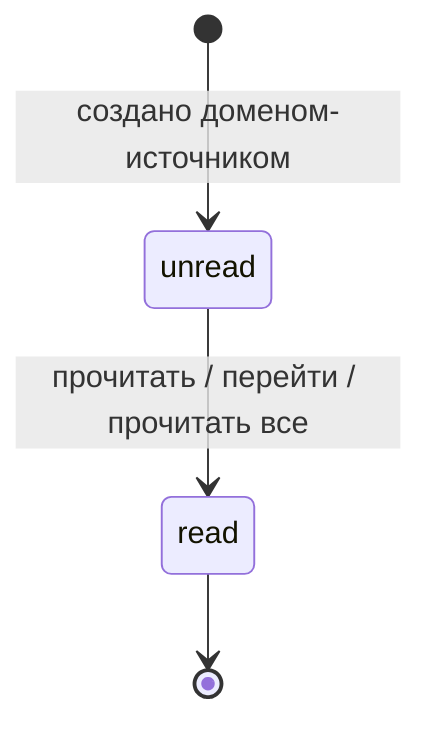

# Домен «Уведомления» (notifications)

Центр уведомлений («колокольчик») сотрудника и пользователя контрагента, живой поток состояния топбара (SSE), каталог событий «событие → роли → галочка» с дублированием на email по галочке, галочки уведомлений в профиле, доставка писем через очередь и сводная карта: какие действия во всех доменах порождают какие уведомления и письма.

Связанные разделы: API — [../04-api/endpoints-notifications.md](../04-api/endpoints-notifications.md), галочки профиля — [../04-api/endpoints-identity.md](../04-api/endpoints-identity.md); почтовый транспорт, выключатель и шаблоны писем — [settings.md](settings.md); живой поток и шина событий — [../07-architecture/architecture.md](../07-architecture/architecture.md); модель данных — [app_notifications](../05-data-model/tables.md#app_notifications), [background_jobs](../05-data-model/tables.md#background_jobs), [users](../05-data-model/tables.md#users) (`notification_prefs`).

## 1. Назначение и границы домена

Система должна:

1. хранить уведомления двух аудиторий: **сотрудники** (лично адресованные или общие для всех сотрудников) и **контрагент** (вся организация или лично пользователь кабинета);
2. показывать в топбаре колокольчик (счётчик непрочитанных и 8 последних), страницу «Все уведомления» постранично, отметку «прочитано» по одному и «прочитать всё»;
3. держать **живой поток** (Server-Sent Events): каждый кадр — полный снимок состояния топбара (колокольчик + бейдж чатов), пересчитываемый по событию шины, а не по таймеру;
4. вести системный **каталог событий** с адресатами-ролями: запись в центре уведомлений — всегда и каждому носителю роли (и администраторам), письмо — только тем, у кого включена галочка этого типа;
5. давать сотруднику в профиле галочки email-дублирования, собранные по его роли;
6. отправлять письма по событиям каталога **фоновыми заданиями** после коммита действия, с повтором недошедшим адресатам.

Решения «кому и о чём сообщать» принимают домены-источники (тендеры, КП, чат, комментарии, контрагенты, ИБ) — сводная карта в §7. Галочки уведомлений **кабинета контрагента** (`notify_chat`, `notify_revision`, `notify_tender`) хранит домен контрагентов, здесь они только учитываются.

Вне границ: SMTP-транспорт, выключатель почты и редактируемые шаблоны писем ([settings.md](settings.md)); счётчик и события чатов ([chat.md](chat.md)); уведомления владельцу площадки о биллинге ([billing.md §7](billing.md#7-события-уведомления-аудит)).

## 2. Сущности и ключевые поля

| Сущность | Таблица | Ключевые поля |
|---|---|---|
| Уведомление | [app_notifications](../05-data-model/tables.md#app_notifications) | `audience` (`staff` \| `supplier`), `user_id` (личный адресат; у `staff` пусто — **всем сотрудникам**), `supplier_id` (у `supplier` — вся организация), `kind`, `title` (до 500), `body`, `href` (внутренняя ссылка-переход), `is_read`, `created_at` |
| Галочки сотрудника | [users](../05-data-model/tables.md#users).`notification_prefs` | JSON `{код типа: true/false}`; нет ключа — галочка **включена** |
| Задание на письмо | [background_jobs](../05-data-model/tables.md#background_jobs) | `job_type = notification_mail` и др. (§8), `input_meta` (адресаты, тема, текст), попытки, результат-след доставки |

Виды уведомлений (`kind`) и подписи в интерфейсе: `tender` — «Тендер», `quote` — «КП», `message` — «Сообщение», `revision` — «Корректировка», `system` — «Система»; виды `comment` и `security` интерфейс показывает как «Система» (см. §10).

Каталог типов с галочками (системный, в интерфейсе не редактируется):

| Код | Секция профиля | Подпись галочки | Роли-адресаты (+ администратор всегда) |
|---|---|---|---|
| `questionnaire_submitted_security` | Анкеты на проверку | Новые анкеты, требующие проверки безопасности | СБ |
| `questionnaire_submitted_lawyer` | Анкеты на проверку | Новые анкеты, требующие юридической проверки | Юрист |
| `questionnaire_submitted_specialist` | Анкеты | Новые анкеты | Тендерный специалист |
| `sb_check_closed` | Результаты проверок | Проверка службы безопасности закрыта | Тендерный специалист |
| `legal_check_closed` | Результаты проверок | Юридическая проверка закрыта | Тендерный специалист |
| `supplier_checks_completed` | Результаты проверок | Контрагент проверен СБ и юристом — можно принимать решение | Тендерный специалист |
| `security_incident_created` | Информационная безопасность | Инциденты информационной безопасности | СБ |

Порядок секций: «Анкеты на проверку», «Анкеты», «Результаты проверок», «Информационная безопасность».

## 3. Жизненный цикл

| Из | В | Кто | Условие | Побочные эффекты |
|---|---|---|---|---|
| — | непрочитано | система (домен-источник) | Для аудитории `supplier` — галочка кабинета контрагента для этого вида не выключена (иначе запись не создаётся) | Событие шины адресатам (§4.4) — доставляется **при коммите** транзакции действия, при откате не доставляется |
| непрочитано | прочитано | адресат («прочитать» или переход по уведомлению) | Уведомление адресовано зрителю | Событие шины «счётчик изменился» всем, чью выдачу затронула строка |
| непрочитано (все) | прочитано | адресат («Прочитать все») | — | Одно обновление всей ленты зрителя |
| прочитано | — | — | Обратно в «непрочитано» не возвращается; удаления нет | — |

Задание на письмо: `queued → running → done`; при отказе части адресатов — `failed` с повтором (с паузой) **только для недошедших**; после исчерпания попыток остаётся `failed` со списком недоставленных адресатов (§8).

## 4. Правила и валидации

### 4.1. Адресация и видимость

- Лента сотрудника: `audience = staff` и (`user_id` пусто — общие **или** `user_id` = зритель).
- Лента пользователя контрагента: `audience = supplier` и (`supplier_id` = его организация **или** `user_id` = он сам). Пользователь без действующей связи с организацией видит пустую ленту.
- Единственный предикат «адресовано зрителю» используется и лентой, и счётчиком, и потоком — бейдж всегда сходится с содержимым ленты.
- Признак «прочитано» хранится **на строке**, а не на паре «строка × зритель»: общее уведомление сотрудников, прочитанное одним, гаснет у всех; уведомление организации, прочитанное одним пользователем кабинета, — у всей организации. Рассылки по каталогу (§2) создают **отдельную строку на каждого** адресата, поэтому у них «прочитано» личное.
- Отметить прочитанным чужое — 403 «Нет доступа»; нет уведомления — 404 «Уведомление не найдено».

### 4.2. Лента и колокольчик

- Колокольчик — 8 последних строк + число непрочитанных по **всей** ленте + id последнего уведомления.
- Страница «Все» — постранично (`limit`/`offset`, до 200 на страницу), новые сверху, `unread` — по всей ленте.
- Ответ ленты несёт слабый `ETag` вида `W/"<id последнего>-<непрочитанных>"`; при совпадении `If-None-Match` — 304 без тела.
- Отдельный счётчик непрочитанных — устаревшая ручка (оставлена для кабинета контрагента и запасного режима без потока), отвечает с заголовком `Deprecation: true`.

### 4.3. Живой поток (SSE)

- Первая строка потока — `retry: 3000` (подсказка переподключения через 3 с).
- Первый кадр — снимок: `{type: "snapshot", unread, items (8), last_id, chats_unread, chats_cursor}`; строка `id:` = `last_id`.
- Далее поток ждёт события шины по ключам зрителя; при простое 15 с шлёт комментарий-пинг `: ping` (держит соединение через прокси и даёт клиенту заметить обрыв).
- Накопившиеся события забираются пачкой — **один кадр на пачку**; пересчитывается только то, что событие могло изменить: колокольчик — по событиям уведомлений; бейдж чатов — если событие чата меняет непрочитанное **этого** зрителя (реплика другой стороны, «прочитано» своей стороны); иначе только курсор чата. В кадре дополнительно: `events` — тонкие события чата пачки (вид, тред, номер), `supplier_events` — id контрагентов, у которых сменился статус карточки.
- Каждый кадр — полный снимок: переподключение не требует курсора и `Last-Event-ID`; отличать новое от показанного — задача клиента (множество показанных id переживает обрыв).
- Соединение с БД возвращается в пул сразу после каждого пересчёта — поток живёт часами и не держит соединение.
- Ответ — `text/event-stream`, `Cache-Control: no-cache`, отключённая буферизация прокси.
- Ключи шины зрителя: сотрудник — `staff` и `staff:<id>`; пользователь контрагента — `supplier:<id организации>` и `supplier:u<id пользователя>`; плюс ключи чатов по объектам, к которым у зрителя есть доступ.

### 4.4. Публикация событий шины

- Событие публикуется в той же транзакции, что и запись уведомления, и доезжает до подписчиков только после коммита (механизм LISTEN/NOTIFY БД; полезная нагрузка — только тип и скалярные поля, лимит 8000 байт).
- Личное уведомление сотруднику — ключ `staff:<id>`; общее — `staff`; рассылка по каталогу более чем 200 адресатам — один общий ключ `staff` вместо персональных (лимит размера уведомления).
- Отметка «прочитано»: у контрагента — ключи организации и пользователя; у сотрудника — `staff`, если строка общая или это «прочитать все», иначе `staff:<id>`.

### 4.5. Рассылка по каталогу

- Адресаты — **активные** пользователи с ролью из типа и все активные администраторы; ни один не пропускается в центре уведомлений.
- Письмо — тем из них, у кого галочка типа включена (нет ключа = включена) и есть адрес; исключаются адреса, которым письмо по этому событию уже уходит другим путём (у инцидента — адреса из правила). Галочка управляет **только** письмом: отключить запись в центре нельзя («Уведомления всегда приходят в центр уведомлений. Галочка включает дублирование на email.»).
- Письма ставятся заданиями пачками по 50 адресатов, только если почта включена окружением (`MAIL_ENABLED`); SMTP в запросе не используется — отказ почты не откатывает действие пользователя.
- В момент отправки адрес и галочка перечитываются: сменил почту — уйдёт на новую; снял галочку или отключён — не уйдёт.
- Рассылка стоит три запроса к БД независимо от числа адресатов (выборка, одна пачка записей, одна пачка заданий).

### 4.6. Галочки профиля

- Набор галочек собирается из роли пользователя (администратор видит все 7), секциями с заголовками; секция без доступных галочек не показывается. У пользователя контрагента, лида и владельца — пустой набор (у кабинета контрагента свои галочки).
- Сохранение принимает `{"prefs": {код: bool}}` (или плоский объект); коды, недоступные роли, молча игнорируются; «Ожидается объект prefs» при неверном теле.
- Изменения в журнал ИБ не пишутся.

### 4.7. Статус доставки письма

Отправка письма возвращает итог: «принято почтовым сервером» или причину. Прочитано ли письмо и дошло ли до ящика — система не знает. Причины (показываются сотруднику человеческим языком, например у адресата раунда «Не удалось отправить: …»):

| Причина | Когда |
|---|---|
| «Почта выключена» | `MAIL_ENABLED=false` |
| «Почта выключена в настройках» | Администратор поставил почту на паузу |
| «Почтовый сервер не настроен» | Нет адреса сервера или адреса отправителя |
| «Нет адреса» | Пустой адрес |
| «Адрес не расшифрован» | Значение зашифрованного поля не читается или выглядит как шифротекст |
| «Адрес не принимается» | Зарезервированные зоны `.test`, `.invalid`, `.example` без `ALLOW_LOCAL_EMAIL_DOMAINS` |
| «Адрес отклонён почтовым сервером» | Сервер отверг получателя |
| «Письмо отклонено почтовым сервером» | Сервер отверг письмо или отправителя |
| «Почтовый сервер недоступен» | Любая другая ошибка соединения |

Где хранится итог: у адресатов раунда — время доставки и ошибка ([tenders-rounds.md](tenders-rounds.md)); у приглашений — в ответе на приглашение ([tenders-invitations.md](tenders-invitations.md)); у писем-заданий (каталог, чат, новый контрагент, инцидент) — в строке задания (`result`, попытки, ошибка); у тестового письма — в ответе экрана настроек.

## 5. Каталог событий

Сводная карта: какие действия порождают записи в центре уведомлений, письма и события потока. «Сразу» — письмо отправляется в запросе (лучшее усилие); «заданием» — через очередь с повторами.

### 5.1. Сотрудникам (центр уведомлений)

| # | Событие (домен) | Адресат | Вид | Заголовок | Переход | Письмо |
|---|---|---|---|---|---|---|
| 1 | Контрагент подал КП ([tenders-quotes.md](tenders-quotes.md)) | Ответственный за тендер, иначе автор тендера | `quote` | «Новое КП от поставщика» / «КП с изменением объёма» (тело перечисляет до 5 изменённых объёмов) | `/tenders/<id>` | Сразу: «Новое КП по тендеру «…»» / «КП с изменением объёма по тендеру «…»» со ссылкой на СТ |
| 2 | Тендер завершён ([tenders-lifecycle.md](tenders-lifecycle.md)) | Ответственный, иначе автор | `tender` | «Тендер завершён» («Тендер `<номер> «<название>»` завершён, победитель — `<контрагент>`.») | `/tenders/<id>` | Сразу: «Тендер завершён: `<номер> «<название>»`» |
| 3 | Сообщение контрагента в чате ([chat.md](chat.md)) | Ответственный, иначе автор | `message` | «Сообщение от контрагента» (`<контрагент> · «<тендер>»: <до 160 символов>`) | `/chats?tender_id=…&supplier_id=…` | Заданием `chat_mail`, не чаще одного письма на разговор за 15 мин |
| 4 | Комментарий ([comments.md](comments.md)) | Адресат «+ Уведомить» и ответственный за тендер (без автора и без дублей) | `comment` | «Вас упомянули в комментарии» / «Новый комментарий» | `/tenders/<id>` | Сразу, только адресату упоминания |
| 5 | Правка ФКП без рассылки участникам ([tenders-lifecycle.md](tenders-lifecycle.md)) | Автор правки | `revision` | «Версия ФКП создана — рассылка отложена» / «Корректировки ФКП применены» | `/tenders/<id>` | Нет |
| 6 | Контрагент заведён вручную ([suppliers.md](suppliers.md)) | **Все сотрудники** (общее) | `tender` | «Новый контрагент добавлен вручную» («`<название>` (ИНН …) — добавлен оператором») | `/suppliers/<id>` | Заданием `supplier_notification` — держателям `suppliers.manage` и администраторам |
| 7 | Анкета подана через форму ([suppliers.md](suppliers.md)) | **Все сотрудники** (общее) | `tender` | «Новая анкета контрагента» | `/suppliers/<id>` | То же задание |
| 8 | Анкета отправлена на проверку (каталог) | СБ / юрист / специалист — три отдельных типа | `tender` | «Новая анкета: требуется проверка СБ» / «Новая анкета: требуется юридическая проверка» / «Новая анкета на аккредитацию» | `/suppliers/<id>` | Заданием `notification_mail`, по галочке |
| 9 | Закрыта проверка СБ / юриста (каталог) | Специалисты | `tender` | «Проверка СБ закрыта» / «Юридическая проверка закрыта» (`<название>: <статус>. <комментарий>`) | `/suppliers/<id>` | По галочке |
| 10 | Закрыты все три проверки — один раз на анкету (каталог) | Специалисты | `tender` | «Контрагент проверен: СБ, юрист и финансы» | `/suppliers/<id>` | По галочке |
| 11 | Инцидент ИБ заведён правилом ([audit.md](audit.md)) | СБ (каталог) | `security` | «Инцидент ИБ (`<критичность>`): `<название>`» | `/security-log` | По галочке + заданием `security_incident_email` на адреса из правила (без повторов одному адресу) |

Администраторы получают типы 8–11 всегда (они — адресаты любого типа каталога).

### 5.2. Контрагенту (кабинет, вся организация)

Перед созданием проверяется галочка кабинета: `message` → «уведомления чата», `revision` → «доработки», `tender` → «тендеры». Выключена — нет ни записи, ни (для чата) письма.

| # | Событие | Вид | Заголовок | Переход | Письмо |
|---|---|---|---|---|---|
| 12 | Сообщение специалиста в чате | `message` | «Новое сообщение по тендеру» | чат тендера | Заданием, дебаунс 15 мин на разговор; только если запись создана |
| 13 | Запрошена доработка КП | `revision` | «Требуется повторное заполнение КП» | кабинет, вкладка тендеров | Сразу: «Запрошена доработка КП — `<номер>`» со ссылкой на форму |
| 14 | Отправлен раунд | `revision` | заголовок и текст из письма раунда | кабинет | Сразу, по шаблону «Новый раунд»; итог доставки — у адресата раунда |
| 15 | Продлён срок раунда | `revision` | «Раунд №N: срок подачи КП продлён» («…подать КП можно до ДД.ММ.ГГГГ») | кабинет | Сразу: «Срок продлён — раунд №N, `<номер>`» |
| 16 | Решение по корректировке (одно / несколько) | `revision` | «Корректировка принята» / «Корректировка отклонена» / «Решения по корректировкам» | форма КП на позиции (первая отклонённая, иначе первая изменённая) | Сразу |
| 17 | Разослана новая версия ФКП | `revision` | из шаблона «Новая версия ФКП» | кабинет | Сразу, по шаблону |
| 18 | Заменён документ тендера | `tender` | «Обновлён документ тендера» | кабинет | Сразу: «Обновлён документ — `<номер>`» |
| 19 | Тендер завершён | `tender` | Победителю «Ваше предложение выбрано», остальным «Тендер завершён» («…выбран другой подрядчик. Благодарим за участие.») | кабинет | Сразу, каждому участнику |

### 5.3. Только письмо (без записи в центре)

| Письмо | Кому | Источник |
|---|---|---|
| Приглашение к тендеру (шаблон «Приглашение к тендеру») | Контрагент | [tenders-invitations.md](tenders-invitations.md) |
| Обновлённая ссылка на форму («Обновлённая ссылка — тендер `<номер>`», «Старая ссылка больше не действует») | Контрагент | то же |
| Доступ в личный кабинет после анкеты | Контактный email анкеты | [suppliers.md](suppliers.md) (см. §10 — письмо содержит пароль) |
| Восстановление пароля, активация, повторная активация, активация лида, заявка с лендинга команде | Пользователь / держатели `users.manage` | [identity.md §7.2](identity.md#72-письма) |
| Тестовое письмо | Сам администратор | [settings.md](settings.md) |
| Заявка на пополнение, баланс ниже порога | Владелец площадки (Telegram или почта) | [billing.md](billing.md) |

Владелец площадки центра уведомлений и живого потока не имеет (раздел ему закрыт).

## 6. Права доступа

| Действие | Админ | Тенд. специалист | СБ | Юрист | Поставщик | Лид | Владелец |
|---|---|---|---|---|---|---|---|
| Лента, колокольчик, «прочитать», «прочитать все», живой поток | ✅ своё | ✅ своё | ✅ своё | ✅ своё | ✅ своё (организация) | API доступен (см. §10), интерфейса нет | ❌ |
| Галочки email в профиле | ✅ все 7 | ✅ 4 галочки | ✅ 2 галочки | ✅ 1 галочка | — (свои галочки в кабинете) | — | — |
| Получать рассылки каталога | ✅ все типы | по своим типам | по своим типам | по своим типам | ❌ | ❌ | ❌ |

## 7. События, уведомления, аудит

Домен не пишет событий в журнал ИБ (смена галочек, прочтение — без следа). События живого потока — §4.3–4.4. Сама карта уведомлений — §5.

## 8. Фоновые задачи и периодика

| Задание | Кто ставит | Что делает | Повторы |
|---|---|---|---|
| `notification_mail` | Рассылка по каталогу | Пачка до 50 писем через одно SMTP-подключение (при обрыве — одно переподключение); адрес и галочка перечитываются в момент отправки; почта выключена или сервер не настроен — задание завершается с пометкой «пропущено» | Не ушло части — повтор только с недошедшими адресатами; пауза 30 с × 2^(попытка−1); попыток — общий лимит очереди (`PARSE_JOB_MAX_ATTEMPTS`, 3); исчерпано — `failed` со списком недоставленных |
| `chat_mail` | Сообщение в чате | Одно письмо; не принято сервером — исключение и повтор | Как выше |
| `supplier_notification` | Новый контрагент | Письмо каждому держателю `suppliers.manage`; не ушло никому — повтор | Как выше |
| `security_incident_email` | Инцидент по правилу | Письма адресам из правила | Как выше |

Очистки старых уведомлений нет — таблица растёт бессрочно (см. открытые вопросы).

## 9. Настройки и флаги

| Имя | По умолчанию | Влияние |
|---|---|---|
| `MAIL_ENABLED` | true | `false` — задания на письма не ставятся, никакие письма не уходят |
| Пауза почты в настройках | выкл | Задания ставятся, но завершаются без отправки (пропуск) |
| `SMTP_SETTINGS_IN_UI`, `SMTP_*` | — | Откуда брать почтовый сервер ([settings.md](settings.md)) |
| `ALLOW_LOCAL_EMAIL_DOMAINS` | false | Разрешить письма на служебные домены (`.test` и т. п.) — для стендов |
| `PUBLIC_APP_URL` | — | База ссылок в письмах |

## 10. Граничные случаи

1. **Общие уведомления видны лиду.** Лента «сотрудника» строится по аудитории `staff` для любой не-контрагентской роли, поэтому лид через API видит общие уведомления сотрудников (новые контрагенты с ИНН). Требование: лиду (и любой роли вне сотрудников) лента сотрудников недоступна.
2. **Общее «прочитано»**: общее уведомление сотрудников (#6, #7), прочитанное одним, гаснет у всех. Требование для воссоздания — оставить как есть или хранить прочтение по зрителю (см. открытые вопросы).
3. **Галочка кабинета выключена** — уведомление контрагенту не создаётся, и письмо о сообщении чата тоже не уходит (отказ относится к событию, а не к каналу); письма о раунде, доработке, документах при этом уходят — они от галочки не зависят.
4. **Ответственный не назначен** — адресатом становится автор тендера; нет и автора — уведомление не создаётся.
5. **Адресат-сотрудник отключён** между постановкой и отправкой письма — письмо не уходит.
6. **Больше 200 адресатов** рассылки — поток будится общим ключом, остальные сотрудники просто пересчитают свой колокольчик.
7. **Виды `comment` и `security`** интерфейс подписывает как «Система» — рекомендуется добавить подписи «Комментарий» и «ИБ».
8. **Письмо о доступе в кабинет** после анкеты содержит сгенерированный пароль открытым текстом — требование для воссоздания: вместо пароля отправлять одноразовую ссылку активации (как у сотрудников), см. открытые вопросы.
9. **Пауза почты** проверяется при отправке, а `MAIL_ENABLED` — и при постановке: на паузе задания копятся и завершаются «пропущено», после снятия паузы **не** переотправляются.

## 11. Пример

Контрагент «Альфа Фасад» отправляет анкету на проверку. В системе: 1 администратор, 3 специалиста, 1 СБ, 1 юрист; у СБ галочка «Новые анкеты, требующие проверки безопасности» снята.

1. Тип СБ: записи в центре — СБ и администратору; письма — только администратору (у СБ галочка снята).
2. Тип юриста: записи — юристу и администратору; письма — обоим.
3. Тип специалиста: записи — трём специалистам и администратору; письма — всем четырём.
4. Итого 9 записей (администратор получил три разных уведомления), задания `notification_mail` по каждому типу; живой поток каждого адресата пересчитывает колокольчик сразу после коммита; через секунду у всех девятерых бейдж +1.

## 12. Оценка сложности

**L.** Сам центр уведомлений прост, но вместе с ним требуются: живой поток на SSE поверх транзакционной шины БД с пересчётом по событиям и полными снимками, единый предикат адресата для ленты/счётчика/потока, ETag, каталог «событие → роли → галочка», очередь писем с частичными повторами, перечитывание адресов в момент отправки, человекочитаемые статусы доставки и интеграция ~19 источников событий из шести доменов.

## 13. Связанные разделы

- API: [../04-api/endpoints-notifications.md](../04-api/endpoints-notifications.md), галочки — [../04-api/endpoints-identity.md](../04-api/endpoints-identity.md).
- Экраны: [../03-screens/notifications.md](../03-screens/notifications.md), колокольчик и бейджи топбара — [../03-screens/shell.md](../03-screens/shell.md), галочки — [../03-screens/profile.md](../03-screens/profile.md).
- Таблицы: [app_notifications](../05-data-model/tables.md#app_notifications), [background_jobs](../05-data-model/tables.md#background_jobs), [users](../05-data-model/tables.md#users).
- Открытые вопросы — `../_oq/BL-1.md`.
