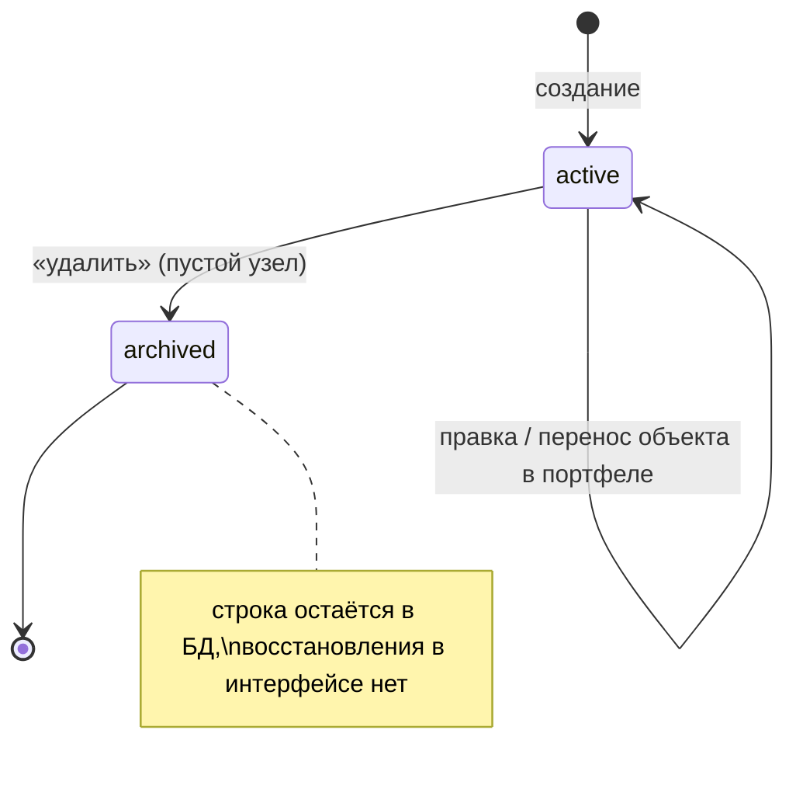

# Домен «Портфели и объекты» (portfolios)

Дерево «портфель → проект (объект) → подпроекты любой глубины», под узлами которого живут тендеры, и гранты пользователей на это дерево — кто какой объект видит. Через проверку доступа к объекту закрыты тендеры, КП, бюджет, чаты и выгрузки.

Связанные разделы: API — [../04-api/endpoints-portfolios.md](../04-api/endpoints-portfolios.md); роли и права — [identity.md](identity.md), [../01-product/users-and-roles.md](../01-product/users-and-roles.md); тендеры под узлами — [tenders.md](tenders.md); дефолты вида работ объекта — [catalog.md §4.5](catalog.md#45-дефолты-вида-работ-в-объекте); модель данных — [portfolios](../05-data-model/tables.md#portfolios), [projects](../05-data-model/tables.md#projects), [user_portfolio_access](../05-data-model/tables.md#user_portfolio_access), [user_project_access](../05-data-model/tables.md#user_project_access), [project_work_type_configs](../05-data-model/tables.md#project_work_type_configs).

## 1. Назначение и границы домена

Система должна:

1. вести портфели (верхний уровень группировки — например, жилой комплекс или программа строительства) и проекты-объекты внутри них с подпроектами любой глубины; у объекта — название, описание, адрес стройплощадки, фото;
2. показывать страницу «Портфели и объекты»: дерево с тендерами под узлами, поиском по портфелю, объекту и тендеру, фильтром по статусу тендера, «только с тендерами», сортировкой портфелей;
3. показывать карточку объекта: сам объект, его подпроекты и их тендеры, портфель-хозяин;
4. хранить гранты: пользователю выдаётся доступ на портфель целиком и/или на отдельные объекты; администратор видит всё;
5. давать всем доменам единственный ответ на вопрос «доступен ли пользователю объект X» и «какие объекты ему доступны»;
6. удалять портфели и объекты мягко (архивирование), запрещая удаление непустых узлов.

Вне границ: сами тендеры и их статусы ([tenders.md](tenders.md)), роли и матрица прав ([identity.md](identity.md)), дефолты вида работ объекта ([catalog.md](catalog.md#45-дефолты-вида-работ-в-объекте)).

## 2. Сущности и ключевые поля

| Сущность | Таблица | Ключевые поля |
|---|---|---|
| Портфель | [portfolios](../05-data-model/tables.md#portfolios) | `name` (до 255), `description`, `created_by`, `is_archived`, `created_at` |
| Проект (объект) / подпроект | [projects](../05-data-model/tables.md#projects) | `portfolio_id`, `parent_project_id` (пусто — объект верхнего уровня портфеля), `name` (до 255), `description`, `address` (до 500), `photo_path` (до 500), `created_by`, `is_archived` |
| Грант на портфель | [user_portfolio_access](../05-data-model/tables.md#user_portfolio_access) | `(user_id, portfolio_id)`, `granted_at` |
| Грант на объект | [user_project_access](../05-data-model/tables.md#user_project_access) | `(user_id, project_id)`, `granted_at` |

Тендеры под узлами дерева принадлежат домену тендеров; в дерево они приходят в форме строки реестра (номер, название, статус, даты, лучшая цена — только при праве на финансы).

## 3. Жизненный цикл

| Сущность | Из | В | Кто | Условие | Побочные эффекты |
|---|---|---|---|---|---|
| Портфель | — | действует | `portfolios.manage` | Название непустое | Не-администратору автоматически выдаётся грант на созданный портфель; событие `portfolio_created` |
| Портфель | действует | действует | `portfolios.manage` + грант на портфель | Название непустое | Событие `portfolio_changed` (`fields`) |
| Портфель | действует | архив | `portfolios.manage` + грант на портфель | В портфеле нет действующих объектов | Пропадает из всех выдач; событие `portfolio_archived` |
| Объект | — | действует | `portfolios.manage` + грант на **портфель** | Название и портфель заданы; родитель (если указан) действует и в том же портфеле | Событие `project_created` |
| Объект | действует | действует | `portfolios.manage` + доступ к объекту | Перенос — только внутри портфеля, не внутрь себя | Событие `project_changed` (`fields`) |
| Объект | действует | архив | `portfolios.manage` + доступ к объекту | Нет действующих подобъектов и нет тендеров | Пропадает из выдач; событие `project_archived` |
| Портфель / объект | архив | действует | — | **Механизма восстановления нет** (только вручную в БД, см. §10) | — |

Гранты пользователя переписываются целиком одной операцией (§4.3); своего жизненного цикла у них нет.

## 4. Правила и валидации

### 4.1. Дерево

- «Укажите название портфеля», «Укажите название проекта», «Укажите портфель», «Портфель не найден», «Проект не найден», «Объект не найден», «Родительский объект не найден» (нет или в архиве), «Родитель должен быть в том же портфеле», «Объект нельзя перенести внутрь самого себя» (проверка подъёмом от нового родителя к корню).
- Смена портфеля у объекта не предусмотрена (объект с подобъектами уехал бы в чужой портфель целой веткой).
- Пустое описание и адрес сохраняются как «нет значения».
- Удаление: «Сначала удалите или перенесите объекты портфеля», «Сначала удалите подобъекты», «Нельзя удалить объект с тендерами»; удаление уже архивного — 404.
- Если родитель узла недоступен пользователю или отсеян поиском, узел показывается верхним уровнем своего портфеля (чтобы ветка не потерялась).

### 4.2. Страница «Портфели и объекты»

| Параметр | Смысл |
|---|---|
| `q` | Подстрока названия портфеля (без учёта регистра) |
| `object_q` | Подстрока названия **или адреса** объекта; к найденным добавляется путь до корня |
| `tender_q` | Подстрока номера или названия тендера |
| `status` | Статус тендера: `draft`, `open`, `closed`, `cancelled` (иное игнорируется) |
| `has_tenders` | Только объекты (и портфели) с тендерами; узел остаётся, если тендеры есть у подпроекта |
| `sort` | Порядок портфелей: `name` (по умолчанию, по алфавиту), `date` (новые сверху), `tenders` (по числу тендеров с подпроектами, убывание; при равенстве — по названию) |

- Объекты внутри портфеля и подпроекты — по названию.
- Число тендеров узла включает тендеры всех подпроектов.
- Пользователю с ограниченным доступом портфели без единого доступного объекта не показываются (для администратора пустой портфель — это действительно пустой, только что созданный портфель, и он показывается).
- Лучшая цена тендера в строке передаётся только при праве «видит финансы» ([identity.md §4.7](identity.md#47-гейты-для-других-доменов)), иначе пусто.

### 4.3. Гранты и доступ

- Администратор — без ограничений (доступны все объекты, проверка грантов не выполняется).
- Остальным доступное множество объектов = явные гранты на объекты ∪ все объекты портфелей с грантом ∪ **все подобъекты** (рекурсивно) уже включённых ∪ **все предки** (путь вверх до корня) включённых. Без грантов — пусто.
- Распоряжаться **портфелем** (переименовать, удалить, создать в нём объект) можно только при гранте на сам портфель — доступа к одному из его объектов мало (иначе специалист с одним объектом мог бы удалить портфель с чужими объектами).
- Нет доступа к объекту — 403 «Нет доступа к этому объекту» (карточка) / «Нет доступа к этому проекту» (правка, дефолты); другие домены используют свои тексты, например «Нет доступа к тендерам этого проекта».
- Выдача грантов (`users.manage`): `{"portfolio_ids": […], "project_ids": […]}` полностью заменяет прежние гранты пользователя; «Пользователь не найден». Событие `project_access_changed` с итоговыми списками.
- Матрица ролей тут не участвует: гранты действуют для любой роли-сотрудника (специалист, СБ, юрист); у СБ и юриста по умолчанию грантов нет — дерево для них пустое.

### 4.4. Фото объекта

Поле `photo_path` хранит ключ файла в хранилище; оно меняется правкой объекта, а файл загружается общим механизмом вложений с сущностью `project` ([files.md](files.md)). В текущем интерфейсе загрузки фото нет, на стенде фото не заданы — см. открытые вопросы.

## 5. Расчёты и формулы

| Величина | Правило |
|---|---|
| Доступные объекты | `G = гранты_объектов ∪ {p : p.portfolio ∈ гранты_портфелей}`; `G ← G ∪ потомки(G)` (замыкание вниз); `G ← G ∪ предки(G)` (замыкание вверх) |
| Видимые портфели (не-администратор) | портфели, у которых после фильтров остался хотя бы один объект |
| Тендеров у узла | `len(тендеры узла) + Σ тендеров детей` |
| Порядок «по тендерам» | по убыванию `Σ тендеров всех объектов портфеля`, затем по названию |

## 6. Права доступа

| Действие | Админ | Тенд. специалист | СБ | Юрист | Поставщик | Лид | Владелец |
|---|---|---|---|---|---|---|---|
| Дерево «Портфели и объекты», карточка объекта | ✅ все | только доступные объекты | только доступные (по умолчанию нет) | только доступные (по умолчанию нет) | ❌ | ❌ | ❌ |
| Создать портфель | ✅ | при `portfolios.manage` (по умолчанию есть) | при `portfolios.manage` | при `portfolios.manage` | ❌ | ❌ | ❌ |
| Переименовать / удалить портфель, создать в нём объект | ✅ | `portfolios.manage` + грант на портфель | то же | то же | ❌ | ❌ | ❌ |
| Править / переносить / удалить объект | ✅ | `portfolios.manage` + доступ к объекту | то же | то же | ❌ | ❌ | ❌ |
| Выдать пользователю гранты | ✅ | при `users.manage` | при `users.manage` | при `users.manage` | ❌ | ❌ | ❌ |

## 7. События, уведомления, аудит

| Действие | Журнал |
|---|---|
| Портфель создан / изменён / в архиве | `portfolio_created` `{name}`, `portfolio_changed` `{fields}`, `portfolio_archived` `{name}` |
| Объект создан / изменён / в архиве | `project_created` `{name, portfolio_id}`, `project_changed` `{fields}`, `project_archived` `{name}` |
| Гранты пользователя | `project_access_changed` `{portfolio_ids, project_ids}` |

Уведомлений, писем и событий живого потока домен не порождает. Изменение грантов действует со следующего запроса пользователя (доступ вычисляется на каждом запросе).

## 8. Фоновые задачи и периодика

Нет.

## 9. Настройки и флаги

Нет.

## 10. Граничные случаи

1. **Грант на подпроект открывает предков целиком.** Замыкание вверх нужно, чтобы путь до подпроекта был виден в дереве, но в исходной системе оно даёт и полный доступ к родительскому объекту (его карточке и тендерам). Требование для воссоздания: предки должны быть видимы только как узлы пути, без доступа к их тендерам (см. открытые вопросы — нужно решение Заказчика).
2. **Восстановления из архива нет**: ни API, ни экрана; архивный узел восстанавливается только правкой БД. Создать узел с тем же названием можно.
3. **Специалист создал портфель** — получает на него грант автоматически; объект в чужом портфеле без гранта на портфель создать нельзя, даже имея доступ к соседнему объекту.
4. **Создатель объекта** гранта на объект не получает: он у него есть через грант на портфель; если грант на портфель потом снять — доступ к созданному объекту пропадёт.
5. **Гранты на несуществующие id** при выдаче не проверяются и просто не дают доступа; нечисловой id — ошибка сервера (рекомендуется 400 по полю).
6. **Тендеры под архивным объектом** невозможны (объект с тендерами удалить нельзя).
7. **Поиск по объекту** учитывает только действующие объекты; архивные не находятся и не показываются никогда.
8. **Фото объекта**: проверка доступа к вложению сущности `project` в исходной системе не привязана к конкретному объекту (достаточно доступа хотя бы к одному объекту) — требуется проверять доступ именно к этому объекту ([files.md §10](files.md#10-граничные-случаи)).

## 11. Пример

Портфели: «ЖК «Северный парк»» (объекты «Жилые корпуса МКД-1, МКД-3» с подпроектами «МКД-1», «МКД-3»; «Корпус ОКН»), «Школа №1» («Здание школы»), «ЖК «Лесной»».

- Специалисту выдан грант на объект «МКД-1». Доступно: «МКД-1» и его предок «Жилые корпуса МКД-1, МКД-3» (замыкание вверх). Дерево специалиста: один портфель «ЖК «Северный парк»» с веткой до «МКД-1»; «Корпус ОКН», «МКД-3», «Школа №1», «ЖК «Лесной»» не видны.
- Специалист пытается переименовать портфель «ЖК «Северный парк»» — 403 «Нет доступа к этому портфелю» (гранта на портфель нет).
- Администратор выдаёт ему грант на портфель «Школа №1» — `project_access_changed {portfolio_ids: [14], project_ids: [24]}`; со следующего запроса в дереве появляется «Школа №1» со «Зданием школы».
- Удаление «Здания школы», где есть тендер, — 400 «Нельзя удалить объект с тендерами».

## 12. Оценка сложности

**M.** CRUD дерева невелик, но требуются: замыкание грантов вниз и вверх, применяемое во всех доменах при каждом чтении и записи, страница дерева с тремя независимыми поисками, фильтрами и сортировкой по вычисляемому числу тендеров, сохранение пути к найденным узлам, защита от циклов и мягкое удаление с проверками.

## 13. Связанные разделы

- API: [../04-api/endpoints-portfolios.md](../04-api/endpoints-portfolios.md) (`/portfolios`, `/projects`, `/users/{id}/access`), дефолты вида работ — [../04-api/endpoints-catalog.md](../04-api/endpoints-catalog.md).
- Экраны: [../03-screens/portfolios.md](../03-screens/portfolios.md), [../03-screens/object-card.md](../03-screens/object-card.md), выдача грантов — [../03-screens/users.md](../03-screens/users.md).
- Таблицы: [portfolios](../05-data-model/tables.md#portfolios), [projects](../05-data-model/tables.md#projects), [user_portfolio_access](../05-data-model/tables.md#user_portfolio_access), [user_project_access](../05-data-model/tables.md#user_project_access).
- Открытые вопросы — `../_oq/BL-1.md`.
