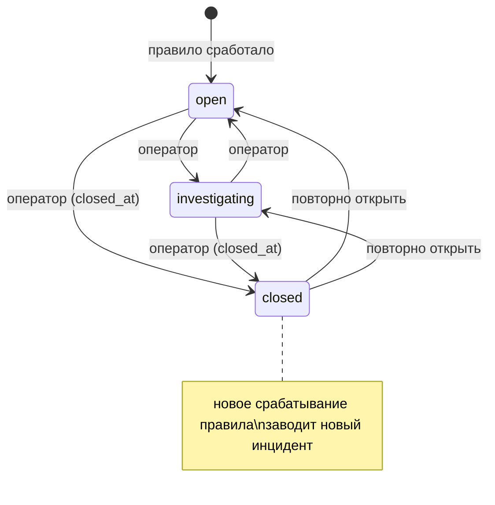

# Домен «Информационная безопасность» (security)

Рабочее место службы безопасности: журнал событий ИБ с фильтрами и выгрузками, инциденты и их расследование (статусы, ответственный, таймлайн), правила автоинцидентов, уведомление об инцидентах, пакеты сведений для уведомления регулятора по персональным данным, статус шифрования полей, необязательная передача журнала во внешний SIEM, а также техническая наблюдаемость: пересылка технических логов во внешний приёмник, правила-паттерны логов и служебные оповещения в мессенджер.

Связанные разделы: запись событий, **каталог кодов, категории и критичность** — [audit.md](audit.md) (§7.1 — полный каталог, здесь не повторяется), движок автоинцидентов — [audit.md §3.2, §4](audit.md#4-правила-и-валидации); API — [../04-api/endpoints-security.md](../04-api/endpoints-security.md); требования ИБ (журнал, шифрование, секреты, 152-ФЗ) — [../07-architecture/security.md](../07-architecture/security.md#5-аудит-и-журнал-иб); экран — [../03-screens/security-log.md](../03-screens/security-log.md); модель данных — [security_audit_log](../05-data-model/tables.md#security_audit_log), [security_incidents](../05-data-model/tables.md#security_incidents), [security_incident_rules](../05-data-model/tables.md#security_incident_rules), [security_incident_timeline](../05-data-model/tables.md#security_incident_timeline), [rkn_packages](../05-data-model/tables.md#rkn_packages), [siem_settings](../05-data-model/tables.md#siem_settings), [log_pattern_rules](../05-data-model/tables.md#log_pattern_rules), [log_forward_state](../05-data-model/tables.md#log_forward_state).

## 1. Назначение и границы

Система должна:

1. показывать журнал ИБ с фильтрами, сортировкой и тремя форматами выгрузки (CSV, NDJSON, текст) — выгрузка уносит **ровно тот срез**, что на экране, с грифом конфиденциальности;
2. вести реестр инцидентов (очередь со счётчиком открытых), карточку с контекстом срабатывания (правило и события), переходы статусов, смену критичности, назначение ответственного, затронутые ресурсы и **таймлайн** расследования, в котором видно каждое изменение и комментарий;
3. давать оператору конструктор правил автоинцидентов с проверкой «что поймало бы правило» до включения;
4. уведомлять об инциденте носителей роли «Служба безопасности» и администраторов (центр уведомлений + письмо по галочке) и внешние адреса из правила (письмом через очередь);
5. формировать по инциденту **версионируемый пакет сведений** для уведомления регулятора по 152-ФЗ (черновик для оператора ПДн; сама подача — вручную вне системы);
6. показывать статус шифрования полей и выполнять самопроверку с записью в журнал;
7. по желанию Заказчика передавать журнал во внешний SIEM пачками по курсору без потерь (в интерфейсе — скрыто флагом сборки);
8. по настройке окружения пересылать технические логи во внешний приёмник и оповещать технический канал мессенджера о сбоях и о совпадениях паттернов в логах.

Вне границ: функция записи события, закрытый каталог (~80 кодов, 11 категорий, 4 уровня критичности), правило «успех/отказ», механика окна и порога правил, append-only на уровне БД — [audit.md](audit.md); шифрование полей, ключи, секреты — [../07-architecture/security.md §6–7](../07-architecture/security.md#6-шифрование-персональных-данных-в-бд); галочки email-уведомлений и тип `security_incident_created` — [notifications.md](notifications.md); история событий конкретного пользователя и последние изменения прав — [identity.md](identity.md).

## 2. Сущности и ключевые поля

| Сущность | Таблица | Ключевые поля |
|---|---|---|
| Событие журнала (только чтение здесь) | [security_audit_log](../05-data-model/tables.md#security_audit_log) | `id` (он же курсор SIEM), `created_at`, `action`, `user_id`, `entity_type`, `entity_id`, `ip_address`, `details`, `correlation_id`; категория, критичность и исход — вычисляются по каталогу |
| Инцидент | [security_incidents](../05-data-model/tables.md#security_incidents) | `title`, `severity` (`low`/`medium`/`high`/`critical`), `status` (`open`/`investigating`/`closed`), `description`, `related_event_ids`, `source_rule_id` (пусто — заведён не правилом), `assignee_id`, `affected_resources` (список объектов), `created_by`, `created_at`, `closed_at` |
| Правило автоинцидента | [security_incident_rules](../05-data-model/tables.md#security_incident_rules) | `action`, `title`, `severity`, `enabled`, `conditions`, `window_minutes`, `threshold`, `recipients` (внешние адреса) |
| Запись таймлайна | [security_incident_timeline](../05-data-model/tables.md#security_incident_timeline) | `incident_id`, `kind` (`status_changed`, `severity_changed`, `assigned`, `resources_changed`, `comment`, `rkn_package`, `email`), `author_id`, `text`, `payload` |
| Пакет для регулятора | [rkn_packages](../05-data-model/tables.md#rkn_packages) | `incident_id`, `version` (1, 2, …), `payload` (снимок JSON), `generated_by`, `generated_at` |
| Настройка SIEM (одна строка) | [siem_settings](../05-data-model/tables.md#siem_settings) | `enabled`, `url`, `auth_header` (зашифрован, наружу — только «задан»), `batch_size`, `last_sent_event_id`, `last_sent_at`, `last_error` |
| Правило-паттерн логов | [log_pattern_rules](../05-data-model/tables.md#log_pattern_rules) | `name`, `level` (минимальный), `match`, `is_regex`, `window_minutes`, `threshold`, `dedupe_key`, `enabled` |
| Состояние пересылки логов (одна строка) | [log_forward_state](../05-data-model/tables.md#log_forward_state) | `last_sent_seq`, `last_sent_at`, `last_error`, `dropped_count` |
| Письмо об инциденте | [background_jobs](../05-data-model/tables.md#background_jobs) | `job_type = security_incident_email`, `input_meta = {incident_id, recipients}` |

**Пакет для регулятора** (в коде `rkn_packages`) — это не отчёт «для РКН вообще», а снимок по **одному** инциденту: черновик уведомления об инциденте с персональными данными. Состав `payload`:

| Поле | Значение |
|---|---|
| `document_type` | `pdn_incident_notification_draft` |
| `law_basis` | «ФЗ-152 «О персональных данных»» |
| `generated_at`, `generated_by_user_id` | когда и кем сформирован |
| `disclaimer` | «Черновик для оператора ПДн. Не является автоматической отправкой в Роскомнадзор. Сроки и состав уведомления уточняются по актуальной редакции 152-ФЗ.» |
| `data_categories` | «Персональные данные представителей поставщиков (ФИО, телефон, email)», «События безопасности (журнал)» |
| `incident` | карточка инцидента на момент формирования |
| `related_security_events` | связанные события журнала (по возрастанию) |
| `operator_checklist` | «Описать факт и предполагаемые причины инцидента»; «Указать категории и ориентировочный объём ПДн»; «Указать принятые меры и уведомление субъектов (при необходимости)»; «Подать уведомление в сроки, установленные 152-ФЗ» |

## 3. Жизненный цикл

### 3.1. Инцидент

Заводит инцидент правило (см. [audit.md §3.2](audit.md#32-инцидент-глазами-журнала)); ручной регистрации инцидента в исходной системе нет (см. открытые вопросы).

| Из | В | Кто | Условие | Побочные эффекты |
|---|---|---|---|---|
| — | `open` | система (правило) | см. audit.md | Уведомления (§7.2); событие `incident_created` (`auto: true`) |
| `open` | `investigating` | `security.manage` | — | Таймлайн «Статус: open → investigating» |
| `open` / `investigating` | `closed` | `security.manage` | — | `closed_at` = сейчас; таймлайн; следующее срабатывание правила заведёт **новый** инцидент |
| `closed` | `open` / `investigating` | `security.manage` | Повторное открытие разрешено | `closed_at` очищается; таймлайн; правило снова дописывает события в этот инцидент |
| `investigating` | `open` | `security.manage` | Разрешено | Таймлайн |
| любой | тот же | `security.manage` | Смена критичности, ответственного, затронутых ресурсов, комментарий | Таймлайн: «Критичность: X → Y», «Ответственный: <ФИО>» / «Ответственный снят», «Изменён состав затронутых ресурсов», текст комментария |
| любой | тот же | `security.manage` | Сформирован пакет для регулятора | Новая версия пакета, таймлайн «Сформирован пакет для РКН, версия N» |
| любой | тот же | система | Обработано задание письма | Таймлайн «Уведомление отправлено: <адреса>» или «Уведомление отправить не удалось» |

Каждое изменение через карточку (статус, критичность, ответственный, ресурсы) дополнительно пишет в журнал событие `incident_created` с `details = {changed: [...], status}` и **без** применения правил (кода «инцидент изменён» нет — см. §10).

### 3.2. Пакет для регулятора

| Из | В | Кто | Условие | Побочные эффекты |
|---|---|---|---|---|
| — | Версия 1 | `security.manage` | Инцидент существует | Снимок карточки и связанных событий на этот момент; таймлайн; журнал `rkn_draft_exported` `{incident_id, version}` |
| Версия N | Версия N+1 | `security.manage` | Повторное формирование (например, после дополнения расследования) | Новая запись; прежние версии остаются и не редактируются |

Скачивание версии — JSON-файл `rkn_incident_<инцидент>_v<версия>.json`. Устаревший адрес «черновик по инциденту» отдаёт последнюю версию, а если версий нет — 404 «По инциденту нет ни одной версии пакета — сформируйте её (POST .../rkn-package)».

### 3.3. Правила и настройки

- **Правило автоинцидента:** создано (включено/выключено) ↔ выключено/включено; удаление — физическое (инциденты сохраняют ссылку, контекст тогда показывает «правило не найдено»).
- **Правило-паттерн логов:** то же; создание, правка и удаление пишутся в журнал (`log_pattern_rule_changed`).
- **Передача в SIEM:** выключена (по умолчанию) ↔ включена; курсор двигается только вперёд при успешной отправке, вручную может быть перемотан.

## 4. Правила и валидации

### 4.1. Журнал: экран и выгрузки

- Фильтры (один набор на экран и три выгрузки): код события или несколько кодов (выбор категории = все её коды), исход (успех/отказ), период по московским суткам включительно, IP по префиксу, точный пользователь или подстрока ФИО/e-mail, тип ресурса, подстрока в деталях (без учёта регистра), «события инцидента», сортировка по времени, коду, автору, исходу, типу ресурса, IP (`-` — по убыванию; по умолчанию и при неизвестном поле — новые сверху; вторичный ключ — id). Полный перечень параметров — [API](../04-api/endpoints-security.md#фильтры-журнала-общие-для-get-securityevents-и-трёх-выгрузок).
- Страница — до 500 событий (по умолчанию 100). У каждого события — подпись, исход и список инцидентов, в которые оно входит.
- Каталог для фильтров отдаёт коды с подписями, категориями и критичностью; без `LEADS_ENABLED` событие заявки с лендинга из каталога скрыто.
- Выгрузки: **не более 500** первых событий среза по выбранной сортировке (пагинации нет).

| Формат | Файл | Содержимое |
|---|---|---|
| CSV | `security_events.csv` | BOM, разделитель «;», первая строка — гриф «ГРИФ: КОНФИДЕНЦИАЛЬНО (ПДн). Выгрузка содержит персональные данные / события безопасности. Обработка только уполномоченными лицами оператора.», пустая строка, заголовки «Дата/время; Событие; Пользователь; Тип ресурса; ID ресурса; IP; Детали», время по Москве `ДД.ММ.ГГГГ ЧЧ:ММ:СС` |
| NDJSON | `security_events.jsonl` | Первая строка — служебная `_meta` `{stamp, exported_at, exported_by_user_id, filters, count}`; далее объект на событие в машинном виде ([audit.md §5](audit.md#5-расчёты-и-формулы)) — тот же формат, что уходит в SIEM |
| Текст | `security_events.txt` | Гриф, строка «Журнал событий безопасности. Выгружено: <время> МСК, событий: N.», затем строка на событие: `время \| код \| исход \| автор \| IP \| тип#id \| детали JSON` |

### 4.2. Реестр и карточка инцидента

- Реестр страницами; фильтры: поиск по названию и описанию (подстрока) или по номеру («№12», «#12»), критичность, статус, ответственный, «без ответственного»; счётчик открытых (`status ≠ closed`) — по всей таблице, а не по странице.
- Правка: статус — `open|investigating|closed` (иначе 400 «status: open|investigating|closed»); критичность — `low|medium|high|critical` (400 «severity: low|medium|high|critical»); ответственный — существующий пользователь (404 «Пользователь не найден») или пусто; затронутые ресурсы — список объектов. Нет инцидента — 404 «Инцидент не найден».
- Комментарий в таймлайн — 1–4000 символов.
- Контекст инцидента — правило (или пусто) и связанные события, новые сверху.

### 4.3. Правила автоинцидентов

| Правило | Текст отказа |
|---|---|
| Код события — из каталога | 400 «Неизвестный тип события: <код>» |
| Критичность — из шкалы | 400 «severity: low\|medium\|high\|critical» |
| Название 3–500 символов (при правке короче 3 — отказ) | 422 / 400 «title слишком короткий» |
| Поле условия — `action`, `entity_type`, `entity_id`, `ip_address`, `user_id` | 400 «Условие по полю <поле> не поддерживается» |
| Операция — `eq`, `ne`, `in` | 400 «Операция <op>: допустимы eq\|ne\|in» |
| `in` — со списком значений | 400 «Операция in ждёт список значений» |
| Окно 1–1440 мин, порог 1–1000 (при правке 0 — сброс: правило срабатывает на каждое событие) | 422 |
| Адреса получателей — непустые строки, похожие на e-mail (содержат «@») | 400 «Не похоже на адрес: <строка>» |
| Нет правила | 404 «Правило не найдено» |

**Проверка правила** до включения: берутся до 500 последних событий с кодом правила (в окне, если оно задано), к ним применяются условия; ответ — число совпадений, порог, окно, «сработало бы» (`совпадений ≥ порога` при пороге > 1 и заданном окне, иначе «есть хотя бы одно»), адресаты и до 20 примеров. Ничего не создаётся.

### 4.4. Уведомление об инциденте

Два канала, без дублей:

1. **Роль** — через каталог уведомлений тип `security_incident_created`: запись в центре уведомлений **всегда** каждому активному носителю роли «Служба безопасности» и каждому администратору (вид `security`, переход в раздел журнала безопасности), письмо — по личной галочке. Галочка дублируется переключателем «Получать уведомления» на вкладке инцидентов — это та же настройка профиля, а не вторая.
2. **Внешние адреса правила** — для тех, кто пользователем системы не является (дежурная почта, внешний центр мониторинга): письмо заданием `security_incident_email`. Адрес, попавший в оба канала, получает письмо один раз.

Письмо: тема «Инцидент ИБ (<критичность по-русски>): <название>», текст «Зарегистрирован инцидент информационной безопасности.», номер и название, критичность, статус, описание, ссылка на журнал безопасности. Подписи критичности: низкая, средняя, высокая, критическая.

### 4.5. Передача журнала в SIEM (опционально)

- Включить можно только с адресом коллектора: 400 «Укажите URL коллектора перед включением».
- Размер пачки 1–1000 (по умолчанию 200); заголовок авторизации хранится зашифрованным и наружу не отдаётся («задан / не задан»).
- Отправка: события с `id > курсора` по возрастанию, не больше пачки, одним HTTP POST, тело — NDJSON (строки как в выгрузке JSONL, без `_meta`), `Content-Type: application/x-ndjson`, заголовок `Authorization` (если задан), тайм-аут 15 с. Курсор сдвигается **только** после ответа 2xx; при ошибке курсор стоит, ошибка (до 500 символов) — в `last_error`, следующая попытка заберёт тот же хвост. Маппинг в чужие схемы (ECS/CEF) не делается — нормализует сам SIEM.
- Кнопка «Проверить соединение» отправляет следующую пачку немедленно тем же путём.
- Перемотка курсора («отправить заново начиная с события N+1») — правкой `last_sent_event_id`.
- В интерфейсе блок передачи скрыт; показывается при сборке фронтенда с `VITE_ENABLE_SIEM_TRANSFER=1`. Серверная часть работает независимо от флага.

### 4.6. Статус шифрования

Экран показывает провайдера шифрования полей, алгоритм, признак «сертифицированное СКЗИ» (в исходной системе — **нет**: провайдер общего назначения), формат шифротекста, результат самопроверки «зашифровать → расшифровать» и перечни шифруемых и намеренно открытых полей. Просмотр статуса выполняет самопроверку в памяти без записи в журнал; кнопка «Самопроверка» — с событием `crypto_selftest` `{ok, provider}`. Требования к шифрованию и замене провайдера на сертифицированный — [../07-architecture/security.md §6](../07-architecture/security.md#6-шифрование-персональных-данных-в-бд).

### 4.7. Пересылка технических логов (опционально)

- Включается только окружением: `LOG_FORWARD_ENABLED`, адрес `LOG_FORWARD_URL` и токен `LOG_FORWARD_TOKEN`; без любого из трёх — ничего не делается (при включённом флаге без адреса/токена — одно предупреждение в лог).
- Требует **одного процесса** сервера: при `WEB_CONCURRENCY ≠ 1` и включённой пересылке сервер не стартует («LOG_FORWARD_ENABLED несовместим с WEB_CONCURRENCY=N: нужен один процесс») — буфер в памяти процесса и курсор в БД не делятся между процессами.
- Каждая строка лога в выбранном формате (`LOG_FORMAT`: текст или JSON-строка) кладётся в буфер в памяти без ввода-вывода; буфер ограничен `LOG_FORWARD_BUFFER_SIZE` (5000, не меньше 100): при переполнении отбрасываются **самые старые** строки и считаются в `dropped_count` — пересылка не может тормозить или ронять приложение.
- Каждые `LOG_FORWARD_INTERVAL` секунд (10) пачка до `LOG_FORWARD_BATCH_SIZE` строк (200, не больше 1000) уходит одним POST: `text/plain`, строки через перевод строки, авторизация Bearer, тайм-аут 15 с. Курсор (номер строки) сохраняется в БД и двигается только после успеха; после перезапуска нумерация продолжается с сохранённого курсора.
- Состояние (курсор, время, ошибка, потери, размер буфера) доступно оператору ИБ; токен наружу не отдаётся.

### 4.8. Паттерны технических логов → мессенджер

- Правило: название (1–200), минимальный уровень (`DEBUG`…`CRITICAL`, «WARNING» = WARNING и выше; иначе 400 «Неизвестный уровень: <уровень>»), образец — подстрока или регулярное выражение (1–2000; битая регулярка — 400 «Некорректное регулярное выражение: …»), окно 1–1440 мин, порог 1–1000, ключ антиспама (пусто → `pattern:<id>`), включено.
- Не больше **50** правил: «Больше 50 правил не поддерживается — отключите ненужные» (проверка идёт на каждую строку лога).
- Проверка — в обработчике логов, синхронно, без ввода-вывода: по снимку включённых правил (обновляется каждые `LOG_PATTERNS_REFRESH_INTERVAL` = 30 с; правило с битой регуляркой пропускается). Совпадение учитывается в окне правила (в памяти процесса, до 1000 отметок); когда совпадений в окне ≥ порога — правило срабатывает, счётчик окна обнуляется.
- Сработка кладётся в очередь (до 200, переполнение режет старые) и отправляется тиком фоновых задач в **каждом** процессе: «Паттерн в логах: <название>» + строка лога (до 1000 символов) через служебный канал (§4.9) с его антиспамом по ключу.
- Обработчик сам ничего не пишет в лог (защита от петли «паттерн ловит своё сообщение»).
- Проверка правила «сработало бы» — по строкам, которые присылает оператор (технические логи в БД не хранятся): число совпадений, «сработало бы» (`совпадений ≥ порога`), «слишком широкое» (совпали все строки — предупреждение, не запрет), ключ антиспама, до 20 примеров.
- Выключатель всей механики — `LOG_PATTERNS_ENABLED` (по умолчанию включено; без настроенного канала оповещений сработки никуда не уходят).

### 4.9. Служебные оповещения в мессенджер

- Работают при `ALERTS_ENABLED=true` и заданных `TELEGRAM_BOT_TOKEN`, `TELEGRAM_CHAT_ID`; исходящий прокси только для мессенджера — `TELEGRAM_HTTP_PROXY`. Без настройки — тихо ничего не делают.
- Антиспам: по ключу ошибки не чаще одного сообщения за `ALERTS_DEDUPE_SECONDS` (300 с, не меньше 30); подавленные повторы считаются и сообщаются строкой «(ещё N раз(а) за окно дедупликации)» в следующем сообщении. Учёт — в памяти процесса.
- Формат: «[<хост площадки>] <заголовок>», подробность, при наличии — `job_id`, `request_id`, класс ошибки; текст ≤ 3500 символов (с картинкой — подпись ≤ 1024).
- Источники: необработанная ошибка запроса (ключ — метод, маршрут и класс ошибки), падение фонового задания, снятое сторожем зависание разбора Excel, сбои разбора Excel и ИИ-разбора, новое обращение о баге, сработавший паттерн логов.
- Сбой отправки никогда не ломает вызывающую операцию — только предупреждение в лог (без адреса, содержащего токен бота).

## 5. Расчёты и формулы

| Величина | Правило |
|---|---|
| Исход события, категория, критичность | по каталогу — [audit.md §5](audit.md#5-расчёты-и-формулы) |
| Срабатывание правила автоинцидента | [audit.md §5](audit.md#5-расчёты-и-формулы) |
| «Сработало бы» (проверка правила) | `C = {e ∈ последние 500 событий кода (в окне) : условия(e)}`; при `threshold > 1` и окне — `count(C) ≥ threshold`, иначе `count(C) > 0` |
| Открытых инцидентов | `count(status ≠ closed)` |
| `closed_at` | при переходе в `closed` — сейчас; при выходе из `closed` — пусто |
| Версия пакета | `max(версия по инциденту) + 1`, первая — 1 |
| Пачка SIEM | `min(max(1, batch_size), 1000)` событий с `id > last_sent_event_id`; после успеха `last_sent_event_id = id последнего` |
| Пачка логов | строки буфера с номером `> last_sent_seq`, не больше `min(max(1, LOG_FORWARD_BATCH_SIZE), 1000)` |
| Сработка паттерна | `hits = {t ∈ окно (now − window_minutes·60, now]} ∪ {now}`; если `count(hits) ≥ threshold` — сработка и `hits = ∅` |
| Антиспам оповещений | отправить, если по ключу не было отправки за `max(30, ALERTS_DEDUPE_SECONDS)` с; иначе `подавлено += 1` |

## 6. Права доступа

| Действие | Админ | Тенд. специалист | СБ | Юрист | Контрагент / Лид / Владелец |
|---|---|---|---|---|---|
| Журнал, каталог, выгрузки, инциденты, таймлайн, правила, проверка правил, паттерны логов, SIEM, шифрование, пакеты для регулятора (`security.manage`) | ✅ | ⚙ | ⚙✅ | ⚙ | ❌ |
| Получать уведомления об инцидентах (центр уведомлений) | ✅ всегда | — | ✅ (роль) | — | ❌ |
| Письмо об инциденте | по своей галочке | — | по своей галочке | — | внешние адреса правила — без учётной записи |
| Раздел «Журнал безопасности» в интерфейсе | ✅ | ❌ | ✅ | ❌ | ❌ |
| Настройка пересылки логов и служебных оповещений | только окружение (администратор сервера), не интерфейс | | | | |

Отказ — 403 «Недостаточно прав для этого действия — обратитесь к администратору системы» и `permission_denied`. Изменить или удалить событие журнала не может никто ([audit.md §6](audit.md#6-права-доступа)). Уведомления об инциденте адресуются по **роли** «Служба безопасности», а не по праву `security.manage` — выданное специалисту право не делает его адресатом.

## 7. События, уведомления, аудит

### 7.1. Журнал ИБ (коды — [audit.md §7.1](audit.md#71-каталог-событий))

| Действие | Код | `details` |
|---|---|---|
| Выгрузка журнала CSV / JSONL / TXT | `report_export` (`entity_type = report`) | `{report: "security_events" \| "security_events.jsonl" \| "security_events.txt", stamp: "pdn_confidential"}` + `rows` для JSONL и TXT |
| Самопроверка шифрования | `crypto_selftest` | `{ok, provider}` |
| Изменение инцидента через карточку | `incident_created` (без правил) | `{changed: [...], status}` |
| Пакет для регулятора | `rkn_draft_exported` (`entity_id` = инцидент) | `{incident_id, version}` |
| Создание / правка / удаление паттерна логов | `log_pattern_rule_changed` | `{change: created \| updated \| deleted}` |
| Правка настроек SIEM, CRUD правил автоинцидентов, комментарий в таймлайн | **не пишутся** | см. открытые вопросы API-3 |

### 7.2. Уведомления

| Событие | Адресат | Канал |
|---|---|---|
| Инцидент заведён правилом | Носители роли СБ и администраторы | Центр уведомлений (вид `security`, заголовок = тема письма), письмо по галочке `security_incident_created` |
| То же | Внешние адреса правила | Письмо заданием `security_incident_email`; итог — запись таймлайна `email` с доставленными и недоставленными адресами |

Сводная карта — [notifications.md §5](notifications.md#5-каталог-событий).

## 8. Фоновые задачи и периодика

| Задача | Период | Где выполняется | Что делает |
|---|---|---|---|
| `siem-drain` | `SIEM_DRAIN_INTERVAL` (15 с) | лидер фоновых задач | Одна пачка в SIEM, если включено; ошибки не роняют воркер |
| `log-forward` | `LOG_FORWARD_INTERVAL` (10 с) | лидер (при одном процессе — он же единственный) | Одна пачка технических логов |
| `log-patterns` | каждый тик | **каждый** процесс | Отправка накопившихся сработок паттернов; раз в `LOG_PATTERNS_REFRESH_INTERVAL` — обновление снимка правил |
| Задание `security_incident_email` | по событию | очередь заданий | Письма внешним адресам; если не доставлено **ни одно** — ошибка и повтор с паузой; часть доставлена — успех с перечнем недоставленных |

Журнал ИБ по сроку не чистится (см. [audit.md §8](audit.md#8-фоновые-задачи-и-периодика)).

## 9. Настройки и флаги

| Имя | По умолчанию | Влияние |
|---|---|---|
| `VITE_ENABLE_SIEM_TRANSFER` (сборка фронтенда) | выкл. | Показывать блок «Передача журнала в SIEM» |
| `SIEM_DRAIN_INTERVAL` | 15 с | Период передачи в SIEM |
| `LOG_FORWARD_ENABLED`, `LOG_FORWARD_URL`, `LOG_FORWARD_TOKEN` | выкл., пусто, пусто | Пересылка технических логов (токен — секрет) |
| `LOG_FORWARD_BATCH_SIZE`, `LOG_FORWARD_INTERVAL`, `LOG_FORWARD_BUFFER_SIZE` | 200, 10 с, 5000 | Пачка, период, буфер |
| `LOG_FORMAT` | текст | Формат строк лога (текст / JSON-строка) — то, что уходит приёмнику |
| `WEB_CONCURRENCY` | 1 | Число процессов; с пересылкой логов — только 1 |
| `LOG_PATTERNS_ENABLED`, `LOG_PATTERNS_REFRESH_INTERVAL` | вкл., 30 с | Паттерны логов |
| `ALERTS_ENABLED`, `ALERTS_DEDUPE_SECONDS` | выкл., 300 с | Служебные оповещения, окно антиспама |
| `TELEGRAM_BOT_TOKEN`, `TELEGRAM_CHAT_ID` | пусто | Бот и чат оповещений (секреты) |
| `TELEGRAM_HTTP_PROXY` | пусто | Прокси только для мессенджера |
| `FIELD_ENCRYPTION_KEY` | — | Ключ шифрования полей (секрет) |
| `LEADS_ENABLED` | выкл. | Скрывать ли событие заявки с лендинга в каталоге журнала |
| `MAIL_ENABLED`, `PUBLIC_APP_URL` | — | Письма об инцидентах и ссылка в них |

## 10. Граничные случаи

1. **Изменение инцидента пишется кодом `incident_created`** — в журнале и фильтрах «создание» и «изменение» неотличимы, исход у них «отказ». Рекомендуется отдельный код «Инцидент изменён» (см. открытые вопросы API-3).
2. **Выгрузка обрезается до 500 событий** без предупреждения в файле (в NDJSON `count` = выгруженному числу). Для разбора за длинный период нужна полная выгрузка (см. открытые вопросы).
3. **Удалённое правило**: инциденты сохраняют `source_rule_id`, контекст показывает отсутствие правила; следующего «открытого инцидента правила» больше не будет.
4. **Повторно открытый инцидент** снова принимает события своего правила (правило ищет незакрытый инцидент).
5. **SIEM недоступен** — события копятся в журнале, курсор стоит; после восстановления пачки уходят подряд (по одной за период, кнопка ускоряет). Перемотка курсора назад отправляет события повторно — дедупликация на стороне SIEM.
6. **Переполнение буфера логов** при всплеске — старые строки теряются, `dropped_count` растёт; приложение не замедляется.
7. **Окно паттерна и антиспам — в памяти каждого процесса**: при нескольких процессах порог считается в каждом отдельно и одно и то же сообщение может прийти из разных процессов; перезапуск обнуляет окна.
8. **Без настроенного канала оповещений** паттерны вычисляются, но сработки молча теряются.
9. **Письмо об инциденте ни одному адресату** — задание повторяется с паузой до исчерпания попыток; таймлайн получает запись на каждую попытку.
10. **Пакет для регулятора** — снимок: изменения инцидента после формирования в нём не отражаются; нужна новая версия.
11. **Ручной регистрации инцидента нет**, хотя справочная вкладка «Основания» говорит, что критичность задаётся «вручную при регистрации» (см. открытые вопросы).
12. **Паттерны логов** управляются только через API — экрана нет (см. открытые вопросы).
13. **Шифрование не сертифицировано** — признак показывается честно, при старте сервер пишет предупреждение.

## 11. Пример

Продолжение примера из [audit.md §11](audit.md#11-пример): правило «Подбор пароля с одного адреса» (`login_failed`, порог 5 за 10 мин, `high`, внешний адрес `soc@example.com`) завело инцидент #41.

| Время | Действие | Результат |
|---|---|---|
| 10:04 | Правило сработало | Инцидент #41 `open`; СБ «Смирнова» и администраторы — запись «Инцидент ИБ (высокая): Подбор пароля с одного адреса» в центре уведомлений, письма — тем, у кого галочка включена; задание письма на внешний адрес |
| 10:05 | Задание письма | Таймлайн: «Уведомление отправлено: soc@example.com» |
| 10:20 | Смирнова: статус → `investigating`, ответственный — она | Таймлайн: «Статус: open → investigating», «Ответственный: Смирнова …»; журнал `incident_created {changed: [assignee_id, status], status: investigating}` |
| 10:40 | Комментарий «IP заблокирован на периметре, учётка цела» | Таймлайн `comment` |
| 11:00 | «Сформировать пакет для РКН» | Пакет v1 (карточка + события #9005, #9007), файл `rkn_incident_41_v1.json`; таймлайн «Сформирован пакет для РКН, версия 1»; `rkn_draft_exported {incident_id: 41, version: 1}` |
| 11:30 | Статус → `closed` | `closed_at` = 11:30; следующее срабатывание правила заведёт новый инцидент |

Выгрузка: оператор фильтрует журнал по категории «Аутентификация и доступ», исходу «отказ», дате 15.10.2026 и выгружает TXT — файл с грифом, «событий: 7» и строками вида `15.10.2026 10:04:02 | login_failed | failure | — | 203.0.113.7 | — | {"email": "user@example.com"}`; в журнал — `report_export {report: "security_events.txt", stamp: "pdn_confidential", rows: 7}`.

SIEM: курсор 10118, пачка 200, в журнале 10 400 событий → тик отправляет #10119–#10318 одним POST, курсор = 10318; коллектор ответил 503 на следующей пачке → курсор остаётся 10318, `last_error = "HTTPStatusError: …"`, через 15 с повтор той же пачки.

Паттерн «Ошибки и трейсбэки» (`ERROR`, регулярка `ERROR|Traceback`, порог 1, окно 5 мин): необработанная ошибка запроса даёт строку лога уровня ERROR → сработка → «[<хост>] Паттерн в логах: Ошибки и трейсбэки» + строка; повтор той же ошибки в течение 300 с подавляется, следующее сообщение после окна несёт «(ещё N раз(а) за окно дедупликации)».

## 12. Оценка сложности

**L.** Экран журнала с общим набором фильтров и тремя форматами выгрузки с грифами — M; инциденты с таймлайном, переоткрытием и контекстом, правила с проверкой «сработало бы», двухканальное уведомление без дублей — M; версионируемые пакеты для регулятора — S; передача в SIEM по курсору без потерь — S–M; пересылка техлогов с буфером и курсором, паттерны логов в обработчике логирования с окнами и антиспамом, служебные оповещения — M. Подключение сертифицированного средства шифрования, если потребуется Заказчику, оценивается отдельно (L–XL, см. [../07-architecture/security.md](../07-architecture/security.md)).

## 13. Связанные разделы

- API: [../04-api/endpoints-security.md](../04-api/endpoints-security.md).
- Экран: [../03-screens/security-log.md](../03-screens/security-log.md) (вкладки «Журнал безопасности» — инциденты, «Лог событий», «Настройки» — правила, шифрование, SIEM, «Основания» — шкала критичности и каталог событий).
- Бизнес-логика: [audit.md](audit.md), [notifications.md](notifications.md), [identity.md](identity.md), [bug-reports.md](bug-reports.md) (оповещение о новом обращении).
- Архитектура и эксплуатация: [../07-architecture/security.md](../07-architecture/security.md), [../08-deploy/demo-deploy.md](../08-deploy/demo-deploy.md) (переменные окружения).
- Таблицы: [security_audit_log](../05-data-model/tables.md#security_audit_log), [security_incidents](../05-data-model/tables.md#security_incidents), [security_incident_rules](../05-data-model/tables.md#security_incident_rules), [security_incident_timeline](../05-data-model/tables.md#security_incident_timeline), [rkn_packages](../05-data-model/tables.md#rkn_packages), [siem_settings](../05-data-model/tables.md#siem_settings), [log_pattern_rules](../05-data-model/tables.md#log_pattern_rules), [log_forward_state](../05-data-model/tables.md#log_forward_state), [background_jobs](../05-data-model/tables.md#background_jobs).
- Открытые вопросы — `../_oq/BL-4.md` (а также `../_oq/API-3.md`, `../_oq/INFRA.md`).
