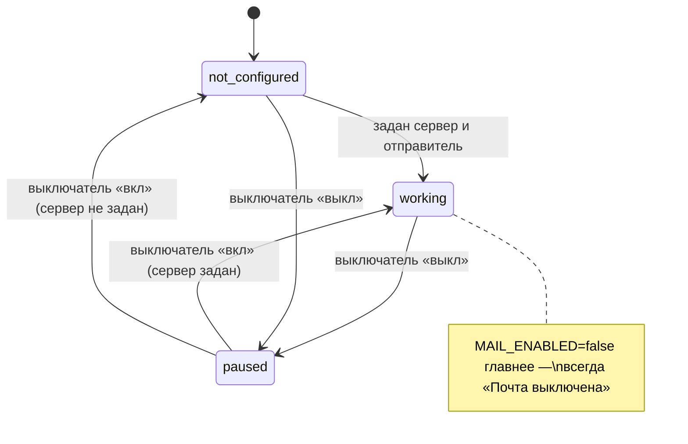

# Домен «Настройки системы» (settings)

Настройки площадки, которые администратор меняет из интерфейса: работает ли почта и выключатель почты, тестовое письмо, SMTP-сервер (если разрешено установкой), редактируемые шаблоны писем контрагентам, требования к анкете контрагента и пороги аномалий сравнительной таблицы.

Связанные разделы: API — [../04-api/endpoints-settings.md](../04-api/endpoints-settings.md); экран — [../03-screens/settings.md](../03-screens/settings.md); доставка писем и статусы — [notifications.md §4.7](notifications.md#47-статус-доставки-письма); где используются пороги — [tenders-comparison.md](tenders-comparison.md); письма тендера — [tenders-invitations.md](tenders-invitations.md), [tenders-rounds.md](tenders-rounds.md); модель данных — [app_settings](../05-data-model/tables.md#app_settings), [smtp_settings](../05-data-model/tables.md#smtp_settings), [mail_templates](../05-data-model/tables.md#mail_templates).

## 1. Назначение и границы домена

Система должна позволять носителю права `settings.manage`:

1. видеть **честное состояние почты** («письма уходят» или причину, почему нет) и ставить всю исходящую почту на паузу выключателем;
2. отправить **тестовое письмо себе** — единственное доказательство, что цепочка «сервер → ящик» работает;
3. при `SMTP_SETTINGS_IN_UI=true` — задать SMTP-сервер в интерфейсе и проверить соединение; иначе сервер один на установку из окружения, а экрана SMTP нет;
4. править тексты трёх писем контрагентам (приглашение к тендеру, новый раунд, новая версия ФКП) с переменными, предпросмотром на примерных данных и сбросом к стандартному тексту;
5. включать требование «опыт работ обязателен» в анкете контрагента;
6. менять общие для всех тендеров пороги аналитики сравнения: разброс «внимание» и «высокий», коэффициент аномалии, доля ключевых работ.

Своих таблиц у домена нет: строки настроек принадлежат платформе (`smtp_settings`, `mail_templates`) и контрагентам (`app_settings`), здесь — только их правка. Реестр шаблонов писем (какие письма есть, переменные, стандартные тексты) принадлежит домену тендеров.

Вне границ: матрица прав и пользователи (тот же экран «Настройки», но домен [identity.md](identity.md)); состояние шифрования и самопроверка (домен ИБ); оформление рабочей области (личная настройка браузера, на сервере не хранится); настройки установки из окружения (`MAIL_ENABLED`, `SMTP_*`, флаги) — меняются только развёртыванием.

## 2. Сущности и ключевые поля

| Сущность | Таблица | Ключевые поля |
|---|---|---|
| Почтовые настройки | [smtp_settings](../05-data-model/tables.md#smtp_settings) | Одна строка (`id = 1`): `host`, `port` (по умолчанию 587), `username`, `password` (зашифрован, наружу не отдаётся), `use_tls` (по умолчанию да), `from_email`, `mail_paused` (выключатель «Почта включена»); устаревшее поле общей почты уведомлений не используется |
| Свой текст письма | [mail_templates](../05-data-model/tables.md#mail_templates) | `code` (`invitation`, `round`, `fkp_notice`), `subject`, `body`, `updated_by`, `updated_at`. Нет строки — письмо уходит со стандартным текстом |
| Системные настройки | [app_settings](../05-data-model/tables.md#app_settings) | Одна строка (`id = 1`): `require_questionnaire_work_experience` (по умолчанию нет), `anomaly_spread_notice` (15), `anomaly_spread_high` (40), `anomaly_k` (3), `anomaly_key_share` (80 — проценты) |

Строки с `id = 1` создаются при первом обращении со значениями по умолчанию.

Реестр шаблонов писем:

| Код | Название | Когда уходит | Переменные | Обязательные |
|---|---|---|---|---|
| `invitation` | Приглашение к тендеру | Контрагент приглашён в тендер | `{номер}`, `{название}`, `{объект}`, `{вид_работ}`, `{срок}` (срок подачи КП), `{ндс}` (ставка НДС, % из настроек), `{приглашающий}`, `{ссылка}` (форма подачи КП), `{бренд}` | `{ссылка}` |
| `round` | Новый раунд | Открыт раунд: контрагентам уходит запрос уточнённого КП | `{номер}`, `{название}`, `{раунд}`, `{срок}` (срок ответа, если задан), `{сообщение}` (сообщение специалиста, если есть), `{ссылка}`, `{бренд}` | `{ссылка}` |
| `fkp_notice` | Новая версия ФКП | Изменилась структура ФКП: участникам уходит уведомление | `{номер}`, `{название}`, `{версия}`, `{изменения}`, `{ссылка}`, `{бренд}` | `{ссылка}` |

Стандартные тексты (переносятся в воссоздаваемую систему как есть):

- **Приглашение** — тема «Приглашение к тендеру {номер}»; текст: «Здравствуйте! Вас пригласили подать коммерческое предложение по тендеру. Номер тендера: {номер} / Название: {название} / Объект: {объект} / Вид работ: {вид_работ} / Срок подачи: {срок} / Цены в КП указываются с НДС {ндс}%. / Приглашает: {приглашающий} / Ссылка на форму: {ссылка} / С уважением, {бренд}» (каждый пункт — отдельной строкой).
- **Новый раунд** — тема «Раунд №{раунд} — {номер}»; текст: «Здравствуйте! По тендеру «{название}» открыт раунд №{раунд}. Срок ответа: {срок}. {сообщение} Открыть форму: {ссылка}».
- **Новая версия ФКП** — тема «Обновлён шаблон ФКП (v{версия}) — {номер}»; текст: «Здравствуйте! В тендере «{название}» вышла версия ФКП №{версия}. Изменения: {изменения} Проверьте и при необходимости обновите КП: {ссылка}».

Уведомления в кабинете контрагента и прочие письма системы (активация, восстановление, сводки) не шаблонизируются — правится только текст этих трёх писем.

## 3. Жизненный цикл

### 3.1. Почта

Состояние почты — вычисляемое, по старшинству:

| Состояние | Условие | Причина на экране |
|---|---|---|
| Выключена установкой | `MAIL_ENABLED=false` | «Почта выключена» (выключатель её не включит) |
| На паузе | `mail_paused = true` | «Почта выключена в настройках» |
| Не настроена | Нет адреса сервера или адреса отправителя (из окружения или из интерфейса — по `SMTP_SETTINGS_IN_UI`) | «Почтовый сервер не настроен» |
| Работает | иначе | — |

| Из | В | Кто | Побочные эффекты |
|---|---|---|---|
| работает / не настроена | на паузе | `settings.manage` | Событие `mail_switch_changed {paused: true}`; ни одно письмо не уходит, задания на письма завершаются «пропущено» и **не** переотправляются после снятия паузы |
| на паузе | прежнее | `settings.manage` | Событие `mail_switch_changed {paused: false}` |

Событие пишется только при реальной смене положения выключателя.

### 3.2. Шаблон письма

| Из | В | Кто | Условие | Побочные эффекты |
|---|---|---|---|---|
| стандартный | свой | `settings.manage` | Текст прошёл проверку (§4.2) | Строка `mail_templates`; событие `mail_template_changed {code, action: saved}`; новые письма уходят со своим текстом |
| свой | свой | `settings.manage` | То же | То же |
| свой | стандартный | `settings.manage` («Вернуть стандартный») | — | Строка удалена; событие `mail_template_changed {code, action: reset}` |

## 4. Правила и валидации

### 4.1. Почта

- Тестовое письмо уходит на адрес самого администратора, тема «`<BRAND_NAME>`: проверка почты», текст «Это тестовое письмо из настроек системы. Если вы его читаете, письма системы доходят до адресатов.». Ответ: `{sent, to, error}` с человекочитаемой причиной ([notifications.md §4.7](notifications.md#47-статус-доставки-письма)). Нет адреса у учётной записи — «У вашей учётной записи нет адреса почты».
- SMTP из интерфейса доступен **только** при `SMTP_SETTINGS_IN_UI=true`; иначе все ручки SMTP отвечают 404 «Not Found» раньше проверки прав, а экран показывает «Почтовый сервер задан при установке системы и из интерфейса не меняется…». На многоклиентском демо-стенде флаг выключен: общий экран SMTP позволил бы одной компании перенаправить почту всем.
- Поля SMTP: сервер (до 255), порт 1–65535 (по умолчанию 587), логин (до 255), пароль, TLS (да/нет), адрес отправителя (до 255). Пустой пароль в запросе — «не менять» (действующий пароль наружу не отдаётся, вместо него признак «задан»). «Настроено» = задан сервер и адрес отправителя.
- Порт 465 — SMTPS (TLS сразу); остальные порты — обычный SMTP с STARTTLS по флагу TLS.
- Проверка соединения — подключение и вход с **сохранёнными** настройками, письмо не отправляется, тайм-аут 8 с; ответ — пройденные шаги `connected`, `tls`, `auth`. Ошибки: «Сначала укажите и сохраните адрес SMTP-сервера», «Ошибка авторизации: …», «Не удалось подключиться: …».
- При отправке писем действует общий тайм-аут подключения 15 с.

### 4.2. Шаблоны писем

- Тема — до 300 символов, текст — до 20 000.
- Ошибки — по полям: «Укажите тему письма», «Напишите текст письма», «Неизвестные переменные: {x}, {y}» (в теме или тексте), «В тексте должно быть {ссылка}» (обязательная переменная отсутствует в тексте). Неизвестный код письма — 404 «Такого письма нет».
- Переменная — `{имя}` (кириллица, подчёркивания); подстановка выполняется при отправке; неизвестное `{имя}` в уже сохранённом тексте остаётся как есть (проверка — до сохранения).
- **Правило пустых строк**: строка шаблона, все переменные которой оказались пустыми, выпадает целиком, а подряд идущие пустые строки схлопываются — необязательные «Срок ответа», «Сообщение» не оставляют «Срок ответа: .» и дыр.
- Сохранённый текст: тема обрезается по краям, у текста убираются пустые строки по краям и добавляется один перевод строки в конце.
- Предпросмотр рендерит **черновик** из редактора на примерных данных (номер «Т-2026-014», объект «Жилой комплекс «Северный»», ставка НДС 22, бренд «TENDO» и т. п.) без сохранения.
- Одна функция сборки используется и для предпросмотра, и для отправки — они не могут разойтись.

### 4.3. Анкета контрагента

Флаг «Опыт работ обязателен»: при включении анкета саморегистрации требует заполнить опыт работ по видам деятельности; публичная форма получает флаг вместе со списком видов работ. Действует на новые анкеты ([suppliers.md](suppliers.md)).

### 4.4. Пороги аномалий сравнения

| Параметр (API) | Колонка | По умолчанию | Ограничения | Смысл (подробно — [tenders-comparison.md](tenders-comparison.md)) |
|---|---|---|---|---|
| `spread_notice` | `anomaly_spread_notice` | 15 | > 0, ≤ 10 000 | Разброс цен позиции между КП (%), с которого строка помечается «внимание» |
| `spread_high` | `anomaly_spread_high` | 40 | > 0, ≤ 10 000, строго больше `spread_notice` | Разброс (%), с которого — «высокий» |
| `anomaly_k` | `anomaly_k` | 3 | > 0, ≤ 100 | Коэффициент правила аномальной цены |
| `key_share` | `anomaly_key_share` | 80 | > 0, ≤ 100 | Доля суммы (%), покрываемая «ключевыми работами» |

- Проверяется **итоговая** комбинация (присланные значения поверх текущих): «Порог разброса должен быть больше нуля», «Высокий порог разброса должен быть больше порога внимания», «Коэффициент аномалии должен быть больше нуля», «Доля ключевых работ — от 0 до 100 %».
- Можно присылать любой поднабор; системные значения по умолчанию отдаются вместе с текущими — для кнопки «Вернуть системные значения».
- Пороги общие для всех тендеров и пользователей; разметка сравнения меняется после обновления страницы.

## 5. Расчёты и формулы

| Величина | Правило |
|---|---|
| Состояние почты | `MAIL_ENABLED=false → «Почта выключена»`; иначе `mail_paused → «…в настройках»`; иначе `¬(host ∧ from_email) → «не настроен»`; иначе работает |
| Действующий текст письма | свой (если есть строка) иначе стандартный; затем подстановка переменных и правило пустых строк |
| Пороги для расчёта СТ | `key_share / 100` как доля; остальные — как есть ([tenders-comparison.md](tenders-comparison.md)) |

## 6. Права доступа

| Действие | Админ | Тенд. специалист | СБ | Юрист | Поставщик | Лид | Владелец |
|---|---|---|---|---|---|---|---|
| Состояние почты, выключатель, тестовое письмо | ✅ | при `settings.manage` | при `settings.manage` | при `settings.manage` | ❌ | ❌ | ❌ |
| SMTP-сервер и проверка соединения (если `SMTP_SETTINGS_IN_UI`) | ✅ | при `settings.manage` | при `settings.manage` | при `settings.manage` | ❌ | ❌ | ❌ |
| Шаблоны писем: смотреть, сохранять, сбрасывать, предпросмотр | ✅ | при `settings.manage` | при `settings.manage` | при `settings.manage` | ❌ | ❌ | ❌ |
| Требования к анкете, пороги аномалий | ✅ | при `settings.manage` | при `settings.manage` | при `settings.manage` | ❌ | ❌ | ❌ |

`settings.manage` по умолчанию есть только у администратора. Экран «Настройки» в интерфейсе: специалист и пользователь контрагента видят только личные настройки; СБ и юрист видят административные разделы, но без права получают отказ сервера (см. [../01-product/users-and-roles.md](../01-product/users-and-roles.md)).

## 7. События, уведомления, аудит

| Действие | Журнал |
|---|---|
| Выключатель почты | `mail_switch_changed` `{paused}` (категория «Шифрование и ИБ-операции») |
| Сохранение / сброс шаблона | `mail_template_changed` `{code, action: saved \| reset}` |
| Изменение порогов аномалий | `anomaly_thresholds_changed` `{поле: {from, to}}` — только реально изменённые |
| Правка SMTP-сервера, флага анкеты, тестовое письмо | **не журналируются** (см. §10) |

Уведомлений и событий живого потока домен не порождает.

## 8. Фоновые задачи и периодика

Нет. Письма отправляют домены-источники и очередь ([notifications.md §8](notifications.md#8-фоновые-задачи-и-периодика)).

## 9. Настройки и флаги

| Имя | По умолчанию | Назначение |
|---|---|---|
| `MAIL_ENABLED` | true | Рубильник всей исходящей почты; из интерфейса не включается |
| `SMTP_SETTINGS_IN_UI` | false | `true` — SMTP-сервер из интерфейса (строка `smtp_settings`), переменные `SMTP_*` не читаются; `false` — сервер из окружения, экрана нет |
| `SMTP_HOST`, `SMTP_PORT` (587), `SMTP_USE_TLS` (true), `SMTP_FROM_EMAIL` | пусто | Сервер из окружения (логин и пароль — секреты `SMTP_USERNAME`, `SMTP_PASSWORD`) |
| `ALLOW_LOCAL_EMAIL_DOMAINS` | false | Разрешить письма на служебные зоны (стенды) |
| `BRAND_NAME` | TENDO | Подпись `{бренд}` и тема тестового письма |
| `VAT_RATE_PCT` | 22 | Значение `{ндс}` в приглашении |

## 10. Граничные случаи

1. **Пароль SMTP никогда не отдаётся** наружу; при сохранении без пароля действующий сохраняется. Очистить пароль из интерфейса нельзя (пустое значение = «не менять») — см. открытые вопросы.
2. **Правка SMTP-сервера не попадает в журнал ИБ**, хотя перенаправляет всю почту системы. Требование для воссоздания — журналировать (событие с полями без пароля).
3. **Пауза почты не копит письма**: всё, что ушло бы во время паузы, теряется (в заданиях — «пропущено»); приглашения и раунды при этом показывают у адресата причину «Почта выключена в настройках».
4. **Шаблон со ссылкой только в теме** не сохранится: обязательная `{ссылка}` проверяется в тексте письма.
5. **Свой шаблон сохранён, потом в реестр добавилась новая переменная** — старый текст продолжает работать; новая переменная в нём просто не используется.
6. **Тестовое письмо при выключенной почте** — ответ `sent: false` с причиной; ошибки HTTP нет.
7. **Пороги, присланные частично** проверяются вместе с текущими: прислать только `spread_high` меньше текущего `spread_notice` — отказ.

## 11. Пример

Администратор правит приглашение: тема «Приглашение к тендеру {номер} — {объект}», текст без строки «Приглашает: {приглашающий}». Предпросмотр: «Приглашение к тендеру Т-2026-014 — Жилой комплекс «Северный»». Сохранение — событие `mail_template_changed {code: invitation, action: saved}`. Если бы он удалил `{ссылка}` из текста — ошибка у поля текста «В тексте должно быть {ссылка}». Затем меняет `spread_high` с 40 на 35: событие `anomaly_thresholds_changed {anomaly_spread_high: {from: 40, to: 35}}`; позиции с разбросом 35–40 % во всех тендерах после обновления страницы помечаются «высокий».

## 12. Оценка сложности

**M.** Несколько небольших форм, но с точными правилами: вычисляемое состояние почты из трёх источников, SMTP с проверкой соединения (SMTPS/STARTTLS) и скрытием пароля, мини-шаблонизатор с проверкой переменных, правилом пустых строк и предпросмотром, согласованная проверка порогов, флаги установки, скрывающие экраны.

## 13. Связанные разделы

- API: [../04-api/endpoints-settings.md](../04-api/endpoints-settings.md).
- Экран: [../03-screens/settings.md](../03-screens/settings.md).
- Таблицы: [smtp_settings](../05-data-model/tables.md#smtp_settings), [mail_templates](../05-data-model/tables.md#mail_templates), [app_settings](../05-data-model/tables.md#app_settings).
- Открытые вопросы — `../_oq/BL-1.md`.
