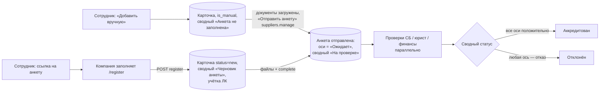
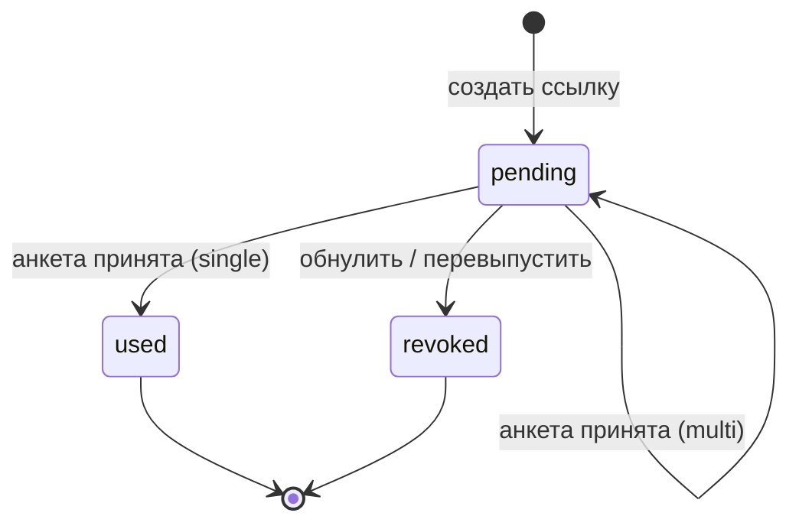
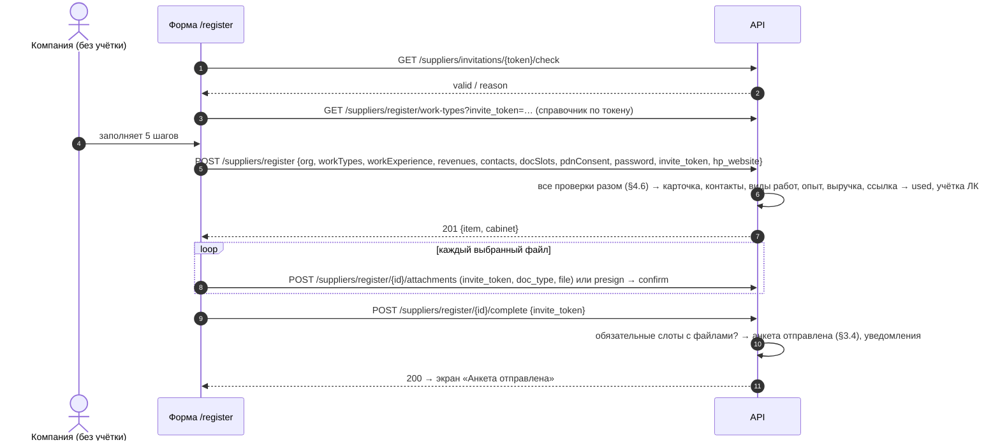
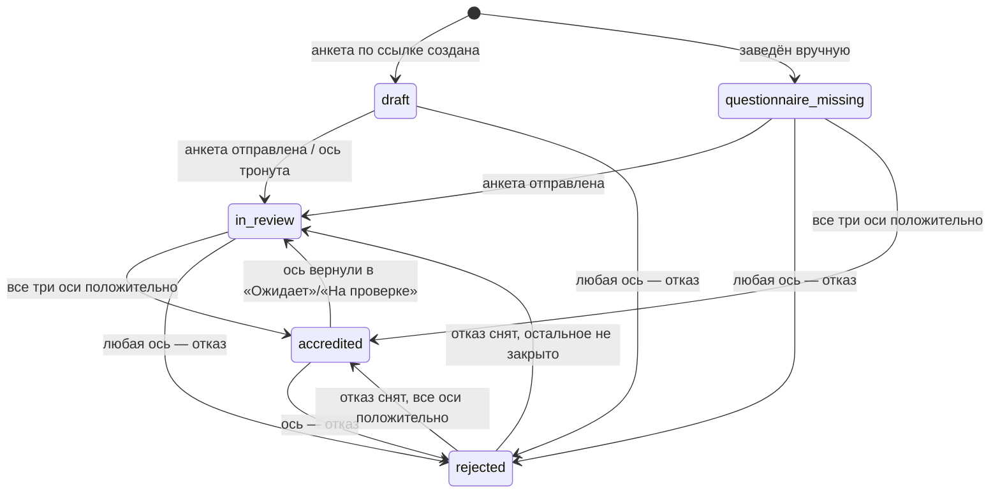
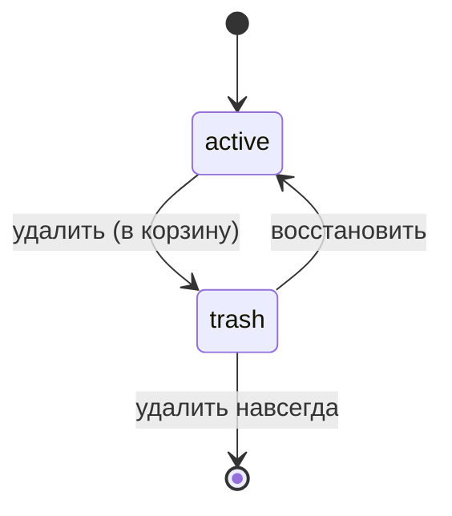

# Контрагенты: реестр, анкета, аккредитация, контакты и кабинет

Как контрагент попадает в реестр (вручную или самостоятельно по ссылке-приглашению на анкету), из чего состоит его карточка, как три независимые проверки (СБ, юрист, финансы) складываются в сводный статус аккредитации, как ведутся пул, решение по квалификации, контакты (ПДн), пользователи личного кабинета (ЛК), проверки по открытым реестрам, корзина и валидации реквизитов.

Связанные разделы: приглашение в тендер и «не приглашать до» — [tenders-invitations.md](tenders-invitations.md); роли и сводная матрица прав — [../01-product/users-and-roles.md §4.6](../01-product/users-and-roles.md#46-контрагенты-и-аккредитация-подробно--02-business-logicsuppliersmd); учётные записи, пароли, приостановка при входе — [identity.md](identity.md); файлы — [files.md](files.md); каталог уведомлений — [notifications.md](notifications.md); настройки анкеты — [settings.md](settings.md); маска контактов в СТ — [tenders-comparison.md](tenders-comparison.md); сквозной сценарий регистрации — [end-to-end-scenarios.md](end-to-end-scenarios.md#сценарий-2-регистрация-нового-подрядчика-и-квалификация); данные — [suppliers](../05-data-model/tables.md#suppliers) и соседние таблицы (§2); API — [../04-api/endpoints-suppliers.md](../04-api/endpoints-suppliers.md), [../04-api/endpoints-suppliers-registration.md](../04-api/endpoints-suppliers-registration.md); экраны — [../03-screens/suppliers.md](../03-screens/suppliers.md), [../03-screens/supplier-card.md](../03-screens/supplier-card.md), [../03-screens/register.md](../03-screens/register.md), [../03-screens/questionnaires.md](../03-screens/questionnaires.md), [../03-screens/cabinet.md](../03-screens/cabinet.md).

Оценка домена: **L** (обоснование — §12). Открытые вопросы — [../_oq/BL-2.md](../_oq/BL-2.md).

## 1. Назначение и границы

Система должна:

1. вести реестр контрагентов (подрядчиков/поставщиков) Заказчика с уникальным ИНН, поиском, фильтрами по статусам, виду работ, региону, выручке и сроку работы компании;
2. позволять сотруднику завести контрагента вручную (с подсказкой реквизитов из ЕГРЮЛ по ИНН и предупреждением о дубле по ИНН, в том числе в корзине);
3. выдавать одноразовые и многоразовые ссылки на публичную анкету саморегистрации и принимать анкету с реквизитами, видами работ, опытом, выручкой, контактами, документами, паролем ЛК и согласием на обработку ПДн;
4. вести аккредитацию: три независимые оси проверки (СБ, юрист, финансы) с обязательным комментарием, вычисляемый сводный статус, рабочий пул, дату и период аккредитации, append-only историю решений;
5. вести карточку: реквизиты, контакты организации, виды работ, опыт работ, выручку по годам, допуски/лицензии, налоговый режим, документы, участие в тендерах, ленту активности;
6. вести контакты контрагента (ПДн, полевое шифрование) и пользователей ЛК (сколько угодно на организацию, один пользователь — одна организация);
7. давать пользователю контрагента профиль организации в кабинете (контакты организации, галочки уведомлений);
8. запускать проверки по открытым реестрам (ЕГРЮЛ, РНП — живые запросы; СРО, арбитраж, банкротство — справочные ссылки, см. §4.15);
9. мягко удалять контрагентов в корзину, восстанавливать и удалять насовсем.

Вне границ домена: приглашение в тендер, персональная ссылка на форму КП и стадии участника ([tenders-invitations.md](tenders-invitations.md)); вход, пароли, MFA, активация учётных записей ([identity.md](identity.md)); хранение и скачивание файлов ([files.md](files.md)); доставка писем и центр уведомлений ([notifications.md](notifications.md)); отчёт «Контрагенты» и его выгрузка в Excel ([../04-api/endpoints-reports.md](../04-api/endpoints-reports.md)); маскирование контактов в СТ и её выгрузке ([tenders-comparison.md](tenders-comparison.md)); справочник видов работ ([catalog.md](catalog.md)).

## 2. Сущности и ключевые поля

| Сущность | Таблица | Ключевые поля |
|---|---|---|
| Контрагент (карточка) | [suppliers](../05-data-model/tables.md#suppliers) | реквизиты, контакты организации (шифруются), анкетные поля, решение по квалификации `status`, оси `sb_status` / `legal_status` / `finance_status` (+ комментарий, автор, время у каждой), вычисляемый `overall_status`, `pool`, лимит на договор, «не приглашать до», период аккредитации, `is_active`, `is_deleted` |
| Контакт контрагента | [supplier_contacts](../05-data-model/tables.md#supplier_contacts) | ФИО, телефон, email (шифруются), должность, признак «основной», согласие на ПДн (флаг, время, редакция текста) |
| Пользователь ЛК (связка) | [supplier_users](../05-data-model/tables.md#supplier_users) | пользователь (уникален), контрагент, `is_active`; домен identity |
| Вид работ контрагента | [supplier_work_types](../05-data-model/tables.md#supplier_work_types) | связь «многие-ко-многим» со справочником видов работ |
| Опыт работ (договор) | [supplier_work_experience](../05-data-model/tables.md#supplier_work_experience) | вид работ, заказчик, вид объекта, адрес, работы, роль, начало/окончание (ММ.ГГГГ), стоимость (тыс. ₽) |
| Выручка за год | [supplier_revenues](../05-data-model/tables.md#supplier_revenues) | год (уникален в паре с контрагентом), сумма (тыс. ₽) |
| История решений | [supplier_qualification_history](../05-data-model/tables.md#supplier_qualification_history) | прежнее/новое значение, лимит, комментарий, «не приглашать до», кто, серверное время; **append-only на уровне БД** |
| Событие статусной модели | [supplier_status_events](../05-data-model/tables.md#supplier_status_events) | вид, старое/новое значение, комментарий, автор, время |
| Результат проверки по реестру | [supplier_checks](../05-data-model/tables.md#supplier_checks) | тип, результат, детали (JSON), кто запустил, когда; история не перетирается |
| Ссылка на анкету | [supplier_registration_invitations](../05-data-model/tables.md#supplier_registration_invitations) | хеш токена (SHA-256, уникален), сам токен (зашифрован), режим `single`/`multi`, статус, число использований, последний зарегистрированный |
| Документ анкеты/карточки | [attachments](../05-data-model/tables.md#attachments) | `entity_type = supplier`, `doc_type` — слот (§2.2) |
| Настройка анкеты | [app_settings](../05-data-model/tables.md#app_settings) | `require_questionnaire_work_experience` — требовать опыт по каждому виду работ |

### 2.1. Поля карточки

| Группа | Поля | Откуда | Правило |
|---|---|---|---|
| Реквизиты | полное и краткое наименование, ИНН, КПП, ОГРН/ОГРНИП, дата создания организации, юридический и фактический адрес, регион | анкета / ручное заведение / правка | ИНН обязателен и уникален в реестре (включая корзину); краткое наименование по умолчанию = полному; фактический адрес по умолчанию = юридическому; регион — свободная строка (в анкете не спрашивается) |
| Контакты организации | ФИО руководителя, телефон, email, сайт | анкета / правка / кабинет | ФИО, телефон, email шифруются; email организации — адрес для писем по тендерам |
| Квалификационные | виды работ, опыт работ, выручка за годы, численность персонала, опыт (свободный текст), допуск СРО, лицензии МЧС и Минкультуры (строки), налоговый режим (строка, например «ОСН (НДС 20 %)»), комментарий сотрудника, пользовательские метки | анкета / правка | Поле «ISO» снято с карточки (колонка сохранена); поле «категория» устарело — виды работ только через справочник |
| Статусы | решение по квалификации, три оси, сводный статус, пул, лимит на договор, «не приглашать до», даты аккредитации и её снятия, дата отправки анкеты | только специальными действиями (§3) | Общий PATCH карточки эти поля не принимает (§4.7) |
| Служебные | заведён вручную, `is_active` (организация не приостановлена), `is_deleted` + дата, ссылка-источник анкеты, галочки уведомлений ЛК, `rating` | система | `rating` в схеме есть, но нигде не вычисляется и не показывается — в воссоздании не нужен (см. открытые вопросы) |

Номер анкеты в интерфейсе — «АНК-» + id контрагента, дополненный нулями до 5 знаков (`АНК-00042`); отдельно не хранится.

### 2.2. Документы анкеты (слоты `doc_type`)

| Слот | Название | Обязателен для отправки анкеты |
|---|---|---|
| `charter` | Устав | да |
| `inn_extract` | Выписка ЕГРЮЛ / свидетельство ИНН | да |
| `authority` | Документ, подтверждающий полномочия подписанта | да |
| `sro` | Допуск СРО | нет |
| `license_mchs` | Лицензия МЧС | нет |
| `license_minculture` | Лицензия Минкультуры | нет |
| `iso` | Сертификат ISO | нет (в анкете не запрашивается, но принимается) |
| `other` | Прочее | нет, сколько угодно файлов |

Обязательный слот считается заполненным только при наличии реального файла (не «заглушки» без тела). Перечень обязательных документов провизорный (см. открытые вопросы). Допустимы также устаревшие слоты пакета тендера (`rd_url`, `tz_file`, `smr_contract_file`, `surety_file`) — для совместимости со старыми загрузками; в новой системе их можно не поддерживать. Иной `doc_type` — 400 «Неизвестный тип документа».

### 2.3. Шифрование и чтение ПДн

- Шифруются полевым шифрованием (ключ `FIELD_ENCRYPTION_KEY`, схема — [../07-architecture/security.md](../07-architecture/security.md)): ФИО руководителя, телефон и email организации; ФИО, телефон и email контакта; токен ссылки на анкету. ИНН и ОГРН **не** шифруются — по ним идут поиск, уникальность и проверки.
- Шифрование недетерминированное: поиск и сравнение по этим полям выполняются после расшифровки в приложении (поиск по ФИО руководителя, поиск дублей email).
- Значение, которое не расшифровывается текущим ключом, отдаётся пустым, а имя поля попадает в список `undecryptable`; интерфейс просит ввести значение заново. Пустое значение, пришедшее в правке поверх нерасшифровываемого, **не** затирает его. Ввод, похожий на шифротекст, отклоняется: «Значение похоже на зашифрованную строку, а не на данные — введите его заново».
- Для администратора системы предусмотрены два отчёта командной строки (только чтение): «нерасшифровываемые ПДн контрагентов» (контрагент, поле, причина) и «реквизиты, не проходящие проверку» (контрагент, в корзине ли, поле, значение, что не так; есть вывод в CSV).

## 3. Жизненный цикл

### 3.1. Как контрагент появляется в реестре



### 3.2. Ссылка на анкету саморегистрации

| Из → в | Кто | Условие | Побочные эффекты |
|---|---|---|---|
| — → `pending` | любой сотрудник | режим `single` (по умолчанию) или `multi`; иной — 400 «mode должен быть single или multi» | Новый случайный токен (32 байта, URL-safe); в БД — SHA-256 и зашифрованный токен (чтобы оператор мог скопировать живую ссылку повторно). Ссылка: `<PUBLIC_APP_URL>/register?token=<токен>` |
| `pending` → `used` | система | одноразовая ссылка, анкета успешно принята | `use_count` +1, время и id зарегистрированного, у карточки запоминается ссылка-источник |
| `pending` → `pending` | система | многоразовая ссылка, анкета принята | `use_count` +1, «последний зарегистрированный» перезаписывается |
| `pending` → `revoked` | любой сотрудник, «Обнулить» | только из `pending`, иначе 409 «Это приглашение уже использовано или отозвано» | Новой ссылки нет |
| `pending` → `revoked` + новая `pending` | любой сотрудник, «Перевыпустить» | только из `pending`, иначе 409 «Это приглашение уже использовано или отозвано — создайте новое» | Создаётся новая запись с тем же режимом и новым токеном |



- Журнал ссылок (последние **200**): статус («Ожидает заполнения» / «Анкета заполнена» / «Обнулена»), режим, число использований, кто и когда выдал, когда использована, кто зарегистрировался (название, ИНН). Токен отдаётся только для `pending`.
- Публичная проверка ссылки при открытии `/register` отвечает `{valid, reason}`: `not_found`, `revoked`, `used` (одноразовая уже использована).
- Срока действия у ссылки нет (см. открытые вопросы).
- Если анкета подана по ссылке, которую затем перевыпустили или обнулили, карточка получает пометку «заполнена по старой ссылке» (`registeredViaStaleLink`).

### 3.3. Анкета саморегистрации (публичная, без входа)

Шаги формы: **«Организация» → «Категории» (виды работ и опыт) → «Контакты» → «Документы» → «Доступ» (пароль ЛК и согласие)**. Черновик формы хранится только в браузере (без файлов и пароля). Отправка — три шага на сервере:



- Шаг 1 создаёт карточку со статусом квалификации `new`, сводным «Черновик анкеты» и гасит одноразовую ссылку. Файлы привязываются уже к созданной карточке **тем же токеном** (проверяется: токен существует и указывает на эту карточку — «Ссылка недействительна для этой анкеты», 403). Шаг 3 (`complete`) проверяет обязательные слоты; не хватает — 400 «Не хватает обязательных документов» со списком `missing_required_docs` `[{key, label}]`.
- Учётная запись ЛК создаётся на шаге 1 (§4.12). Если пароль в анкете не задан, генерируется случайный, возвращается в ответе один раз («Сгенерированный пароль показывается один раз — сохраните его.») и отправляется письмом «Доступ в личный кабинет <CLIENT_NAME или BRAND_NAME>» (адрес входа, логин, пароль, просьба сменить пароль). Текущая форма пароль требует, поэтому письмо с паролем на практике не уходит; для воссоздания рекомендуется вместо пароля в письме использовать одноразовую ссылку активации (см. открытые вопросы).
- Если email уже занят другой учётной записью, анкета всё равно принимается, а в ответе `cabinet: {created: false, error: "Email уже занят другой учётной записью"}`.

### 3.4. Отправка анкеты на аккредитацию

Анкета считается отправленной (`questionnaire_submitted_at`) одним из путей:

| Путь | Кто | Условие |
|---|---|---|
| `complete` после саморегистрации | компания по токену | три обязательных документа с файлами |
| «Отправить анкету» у ручного контрагента | сотрудник с `suppliers.manage` | те же три документа (загружаются сотрудником в карточку); повторный вызов ничего не меняет и уведомлений не шлёт |

При отправке система должна: поставить дату (только первый раз); оси, которые ещё ни разу не меняли, перевести в «Ожидает» (параллельный старт проверок); пересчитать сводный статус; записать событие `questionnaire_submitted` («Анкета отправлена на аккредитацию»); разослать три уведомления (§7); статус квалификации `new` перевести в `review` («На согласовании»).

### 3.5. Оси проверки и сводный статус

Три частные оси независимы: переход одной не проверяет и не блокирует другие.

| Ось | Владелец | Значения |
|---|---|---|
| Проверка СБ `sb_status` | роль «Служба безопасности» и администратор | `not_required` Не требуется · `pending` Ожидает · `in_review` На проверке · `passed` Пройдена · `passed_with_remarks` Пройдена с замечаниями · `failed` Не пройдена |
| Юридическая проверка `legal_status` | роль «Юрист» и администратор | та же шкала |
| Финансовый блок `finance_status` | любой с правом видеть финансы (флаг пользователя или `finance.view`) и администратор | `pending` Ожидает · `approved` Одобрено · `approved_with_limit` Одобрено с лимитом · `rejected` Отказ |

Сводный статус `overall_status` — `questionnaire_missing` «Анкета не заполнена», `draft` «Черновик анкеты», `in_review` «На проверке», `accredited` «Аккредитован», `rejected` «Отклонён» — **вычисляется** (формула — §5.1) на каждое изменение оси и при отправке анкеты; руками не правится ни в интерфейсе, ни через API.

Переходы оси (одинаково для всех трёх):

| Из → в | Кто | Условие | Побочные эффекты |
|---|---|---|---|
| любое → любое значение шкалы (в т.ч. то же) | владелец оси | обязательный комментарий; для «Одобрено с лимитом» — лимит > 0 | Запись оси, комментария, автора, времени; событие `sb_status` / `legal_status` / `finance_status`; строка в истории решений (`<ось>:<старое>` → `<ось>:<новое>`, лимит); пересчёт сводного статуса; синхронизация периода аккредитации (§5.3, события `accreditation_granted` / `accreditation_revoked`); автоправило пула (§5.2); живое событие «карточка изменилась» сотрудникам; после фиксации — уведомления о закрытии проверки (§7) |
| финансы → не «с лимитом» | владелец | — | Лимит на договор очищается (в историю пишется прежний лимит) |



### 3.6. Пул компании

Решение уровня компании, независимое от проверок: `main` «Основной пул», `negotiation` «Для переторгов», `none` «Вне пулов» (по умолчанию). Контрагент из любого пула остаётся приглашаемым и участвует в СТ.

| Из → в | Кто | Условие | Побочные эффекты |
|---|---|---|---|
| любой → любой | тендерный специалист, администратор | обязательный комментарий | Пул, комментарий, автор, время; признак «ручное решение» (`pool_is_manual = true`); событие `pool` |
| любой → `negotiation` | система (автоправило) | ось СБ или юриста стала «Пройдена с замечаниями», ручного решения по пулу ещё не было | Событие `pool` без автора с комментарием «Автоматически: проверка пройдена с замечаниями» |

### 3.7. Решение по квалификации (`status`)

Отдельно от трёх осей в карточке живёт единый статус квалификации — рабочий конвейер анкеты и решение тендерного комитета:

| Код | Подпись | Как ставится |
|---|---|---|
| `new` | Новая анкета | анкета по ссылке создана (на него считается счётчик «новых» в меню) |
| `questionnaire_pending` | Анкета не заполнена | ручное заведение по умолчанию |
| `review` | На согласовании | при отправке анкеты из `new` |
| `check` | Проверяется | только правкой карточки (любой сотрудник) |
| `revision` | На доработке | только правкой карточки (любой сотрудник) |
| `approved` | Одобрен | решение — **только администратор** (по замыслу — и руководитель тендерного отдела, отдельной роли нет); также «Сразу одобрен» при ручном заведении |
| `approved_with_limit` | Одобрен с лимитом | решение администратора; обязательна сумма лимита на **один договор** (≥ 0) |
| `rejected` | Отклонён | решение администратора; обязательна причина; опция «не приглашать 12 месяцев» ставит «не приглашать до» = сегодня + 365 дней |

Правила: не администратор, выставляющий одно из трёх решений, — 403 «Решение по квалификации выставляют администратор и руководитель тендерного отдела»; неизвестный код — 400 «Некорректный статус квалификации»; отказ без причины — 400 «Укажите причину отказа — она уходит в историю решений»; «с лимитом» без суммы — «Укажите сумму лимита на один договор», нечисло — «Некорректная сумма лимита», < 0 — «Лимит не может быть отрицательным». Переход в любой статус, кроме `rejected`, снимает «не приглашать до». Каждое изменение пишется в историю решений и в журнал ИБ (`supplier_qualification_decided`); полностью неизменный запрос ничего не пишет.

Именно этот статус проверяет сервер при приглашении в тендер («одобрен» = `approved` / `approved_with_limit`) и «не приглашать до» — жёсткий запрет приглашения ([tenders-invitations.md §3](tenders-invitations.md#3-создание-приглашений--правила-сервера)). Сводный статус аккредитации на `status` не влияет и наоборот. **В текущем интерфейсе блока решения по квалификации нет** (только отображение «не приглашать до» и выбор «Сразу одобрен» администратором при ручном заведении) — решение доступно через API. Рекомендация для воссоздания и вопрос к Заказчику — свести две модели в одну (см. открытые вопросы).

### 3.8. Дата и период аккредитации

- Дата выдачи (`accredited_at`) ставится автоматически, когда сводный статус становится «Аккредитован»; при уходе из «Аккредитован» ставится дата снятия, дата выдачи не затирается (в шапке — период «аккредитован с — по»); повторная аккредитация начинает новый период (§5.3).
- Тендерный специалист и администратор могут выставить или изменить дату вручную: формат ДД.ММ.ГГГГ или ГГГГ-ММ-ДД («Неверный формат даты. Используйте ДД.ММ.ГГГГ или ГГГГ-ММ-ДД», «Некорректная дата: …»), не в будущем («Дата аккредитации не может быть в будущем»), очистить у аккредитованного нельзя («Нельзя удалить дату аккредитации у аккредитованного контрагента»); иным ролям — 403 «Нет права редактировать карточку контрагента». Изменение пишет событие `accreditation_date` (старая → новая дата). Сводный статус от даты не меняется. Срока действия аккредитации нет.

### 3.9. Корзина и удаление

| Из → в | Кто | Условие | Побочные эффекты |
|---|---|---|---|
| активен → в корзине | `suppliers.manage` | не удалён | `is_deleted`, дата; пропадает из реестра, очередей, подбора в тендер, фасетов; карточка и все её ручки отвечают 404 «Контрагент не найден»; **ИНН остаётся занятым** |
| в корзине → активен | `suppliers.manage` | в корзине, иначе 404 «Контрагент не найден в корзине» | Данные возвращаются как были |
| в корзине → удалён насовсем | `suppliers.manage` | только из корзины, иначе 404 «Сначала переместите в корзину» | Удаляются виды работ, контакты, записи документов анкеты (файлы в хранилище сейчас остаются — требуется удалять и их), затем карточка; опыт, выручка, лента статусов — каскадом |



Список корзины — по дате удаления, новые сверху, постранично. Удаление насовсем контрагента, у которого есть приглашения в тендеры, история решений, проверки по реестрам, пользователи ЛК, чаты, уведомления или ссылка-источник, в текущей реализации падает на ограничениях БД (ответ 500; история решений защищена триггером). Требование для воссоздания: заранее проверять связи и отвечать 409 с понятной причиной (например, «У контрагента есть участие в тендерах — удалить насовсем нельзя, оставьте в корзине») — см. открытые вопросы.

### 3.10. Приостановка организации

Признак `is_active = false` означает «организация приостановлена»: её пользователи не могут войти (403 «Доступ организации приостановлен. Обратитесь к администратору системы.», событие `login_failed` с причиной `org_suspended` — [identity.md](identity.md)), персональные ссылки её приглашений отвечают тем же 403, в СТ она помечается «доступ закрыт» и исключается из расчётов ([tenders-invitations.md §4](tenders-invitations.md#4-персональная-ссылка-magic-link)). **Действия «приостановить / возобновить» в API и интерфейсе нет** — признак меняется только в БД. Требование и права уточнить (см. открытые вопросы); предварительно — действие администратора с обязательной причиной и событием журнала.

## 4. Правила и валидации

### 4.1. Реквизиты организации

Ввод очищается от пробелов и дефисов («99 0900-0004» → «9909000004»); остальные нецифровые символы — ошибка.

| Поле | Правило | Тексты ошибок |
|---|---|---|
| ИНН | 10 цифр (организация) или 12 (ИП); первые две цифры ≠ «00»; контрольные цифры по алгоритму ФНС: для 10 знаков веса `2,4,10,3,5,9,4,6,8`, для 12 — `7,2,4,10,3,5,9,4,6,8` (11-я цифра) и `3,7,2,4,10,3,5,9,4,6,8` (12-я); контрольная = (Σ цифра×вес) mod 11 mod 10 | «Укажите ИНН»; «ИНН состоит только из цифр»; «ИНН должен содержать 10 цифр у организации или 12 у индивидуального предпринимателя»; «Проверьте ИНН: первые две цифры — код региона, 00 не бывает»; «Проверьте ИНН: контрольная цифра не сходится, скорее всего опечатка» (10 знаков) / «…контрольные цифры не сходятся…» (12 знаков) |
| КПП | необязателен; 9 знаков; позиции 1–4 и 7–9 — цифры, 5–6 — цифры или латинские A–Z (приводятся к верхнему регистру); первые две ≠ «00» | «КПП состоит из 9 знаков»; «Проверьте КПП: цифры, кроме 5-й и 6-й позиции»; «Проверьте КПП: 5-я и 6-я позиции — цифры или латинские буквы A-Z»; «Проверьте КПП: первые две цифры — код региона, 00 не бывает» |
| ОГРН / ОГРНИП | необязателен; 13 цифр (ОГРН) или 15 (ОГРНИП); первая ≠ 0; 4–5-я ≠ «00»; контрольная = (первые 12 цифр как число mod 11) mod 10 для ОГРН и (первые 14 mod 13) mod 10 для ОГРНИП | «ОГРН состоит только из цифр»; «ОГРН содержит 13 цифр, ОГРНИП — 15»; «Проверьте ОГРН: первая цифра — признак регистрации, нулём она не бывает»; «Проверьте ОГРН: 4-я и 5-я цифры — код региона, 00 не бывает»; «Проверьте ОГРН: контрольная цифра не сходится, скорее всего опечатка» (для 15 знаков — «Проверьте ОГРНИП: …») |
| Пара ИНН–ОГРН | 10 + 13 или 12 + 15; проверяется, если заполнены оба | «У организации (ИНН из 10 цифр) ОГРН содержит 13 цифр — здесь указан ОГРНИП»; «У предпринимателя (ИНН из 12 цифр) номер называется ОГРНИП и содержит 15 цифр» (ошибка поля `ogrn`) |
| Дата создания организации | ДД.ММ.ГГГГ или ГГГГ-ММ-ДД; год ≥ 1900; не в будущем; в анкете обязательна | «Укажите дату создания организации»; «Формат даты: ДД.ММ.ГГГГ»; «Укажите корректный год (не ранее 1900)»; «Дата создания не может быть в будущем» |
| Юридический / фактический адрес | пробелы схлопываются, по краям снимаются «,;»; без управляющих символов; длина 10–500; есть буква и цифра (номер дома); не меньше трёх слов. Юридический обязателен в анкете, фактический — нет | «Укажите юридический адрес»; «Уберите служебные символы из поля «юридический адрес»»; «Слишком длинный юридический адрес: не больше 500 символов»; «Слишком короткий юридический адрес — укажите город, улицу и номер дома»; «Укажите юридический адрес словами, а не одними цифрами»; «В поле «юридический адрес» не хватает номера дома»; «Укажите юридический адрес полностью: город, улица, дом» (для фактического — «фактический адрес») |
| Наименование | непустое, ≤ 500 | ручное заведение: «Укажите название компании»; анкета: «Укажите полное наименование организации» |

Синтетические контрольные значения (для тестов): ИНН 10 знаков `9909000004` — верен, `9909000005` — «контрольная цифра не сходится»; ИНН 12 знаков `990900000069` — верен; ОГРН `1029900000008` — верен; ОГРНИП `304990900000001` — верен; пара `9909000004` + `304990900000001` — ошибка пары; КПП `990901001` — верен.

Существование организации контрольная сумма не подтверждает — для этого «Заполнить по ИНН» и проверка ЕГРЮЛ (§4.5, §4.15).

### 4.2. Контактные данные

| Поле | Правило и нормализация | Тексты ошибок |
|---|---|---|
| Телефон | Только цифры, пробелы, `+ ( ) - .`; без добавочного; хранится в формате E.164. Российские записи «8 900…», «7 900…», «900…» (10 цифр) → `+7…`; российский номер — ровно 10 цифр после +7, код не начинается с 0/1/2, не из одинаковых цифр; «+8 …» с 11 цифрами — ошибка кода страны; иностранный — 8–15 цифр. Показ: «+7 900 111-22-33» | «Укажите телефон»; «Укажите телефон без добавочного номера»; «Телефон может содержать только цифры, пробелы и знаки + ( ) -»; «Код страны +8 не существует: для России укажите +7»; «Российский телефон — это 10 цифр после +7, например +7 900 111-22-33»; «Проверьте код города или оператора: он не может начинаться с 0, 1 или 2»; «Проверьте телефон: одинаковые цифры — это не номер»; «Телефон должен содержать от 8 до 15 цифр вместе с кодом страны» |
| Email | ≤ 254 символа; синтаксис по RFC (поддержка IDN-доменов, например `почта.рф`); домен с точкой; зона — от двух букв; хранится в нижнем регистре. Служебные домены (`.local`, `.localhost`, `.test`, `.invalid`, `.example`) допускаются только при `ALLOW_LOCAL_EMAIL_DOMAINS=true` (стенды) | «Укажите email»; «Email длиннее 254 символов»; «Укажите корректный email» |
| Сайт | ≤ 255; без пробелов; без протокола дополняется `https://`; только http/https; без логина/пароля в адресе; домен из ≥ 2 меток, зона ≥ 2 букв (кириллица допустима); хвостовой «/» снимается | «Адрес сайта длиннее 255 символов»; «Адрес сайта пишется без пробелов»; «Адрес сайта начинается с http:// или https://»; «Укажите адрес сайта без логина и пароля»; «Укажите адрес сайта, например stroyprof.ru»; «Проверьте порт в адресе сайта» |
| ФИО (руководитель, контакт в ручном заведении) | пробелы схлопываются; ≤ 255; буквы (лат./кир.), пробел, дефис, точка, апостроф; минимум два слова | «Укажите ФИО»; «ФИО длиннее 255 символов»; «ФИО может содержать только буквы, пробелы, дефис и точку»; «Укажите ФИО полностью — минимум фамилию и имя» |

### 4.3. Одни и те же правила на форме и на сервере

Правила §4.1–4.2 реализуются дважды — на клиенте (мгновенная подсказка) и на сервере (решающая проверка) — с **одинаковыми текстами и порогами**. Требование: общий набор контрольных значений «вход → ожидаемый результат или текст ошибки» (в текущей системе — 51 случай по правилам ИНН, КПП, ОГРН, телефон, email, сайт, ФИО, юридический адрес) хранится копией в обоих репозиториях и прогоняется тестами каждой стороны; отдельная проверка следит, что копии совпадают. Изменение правила — изменение обеих копий.

Записи, заведённые до введения правил (импорт, демо-данные), не блокируются: карточка на **каждом чтении** перепроверяет ИНН, КПП, ОГРН и пару ИНН–ОГРН и отдаёт список `requisiteIssues` `[{field, message}]` — интерфейс показывает предупреждение «Реквизиты не проходят проверку» с кнопкой «Исправить».

### 4.4. Ручное заведение

Действие любого сотрудника («Добавить вручную»). Поля: наименование (обяз.), краткое, ИНН (обяз.), КПП, ОГРН, юридический адрес, виды работ из справочника, статус в реестре, необязательный контакт (ФИО, телефон, email).

- Все ошибки полей собираются и возвращаются одним ответом 400 `{error, fieldErrors}`.
- Контакт необязателен, но если начат — ФИО по правилу §4.2 и хотя бы один канал связи: «Укажите телефон или email контакта» (ключи ошибок `contact.<поле>`). Контакт становится основным; согласия на ПДн у ручного контакта нет (его собирает анкета).
- Вид работ, которого нет в справочнике, — 400 «Вид работ не найден в справочнике: <значение>» (принимаются id или точное имя без учёта регистра; на лету не создаются).
- Статус по умолчанию — «Анкета не заполнена» (`questionnaire_pending`), оси СБ и юриста — «Ожидает», финансы — «Ожидает»; сводный — «Анкета не заполнена». Администратору доступен «Сразу одобрен (проверенный офлайн подрядчик)»: статус `approved`, оси СБ и юриста — «Не требуется», в историю решений пишется «Заведён вручную» (или комментарий). Остальным ролям решение недоступно (403, §3.7).
- **Дубль по ИНН** проверяется до записи — по всему реестру, **включая корзину**: 409 `{error, fieldErrors.inn, duplicate: {id, name, deleted}}` с текстом «Контрагент с таким ИНН уже есть: <название>» или «Контрагент с таким ИНН уже есть: <название> (в корзине)». Форма показывает «Открыть» (или «Восстановите его вместо новой карточки» для корзины) и блокирует сохранение. Форма проверяет дубль сразу при уходе из поля ИНН (без обращения к ЕГРЮЛ). Гонка параллельных созданий ловится уникальным индексом: 409 «Контрагент с таким ИНН уже есть в реестре».
- После создания: строки выручки за три последних завершённых года (пустые), событие журнала `supplier_registered`, уведомление сотрудникам «Новый контрагент добавлен вручную» («<название> (ИНН …) — добавлен оператором»), письмо держателям `suppliers.manage` (§8).

### 4.5. «Заполнить по ИНН»

Кнопка формы ручного заведения. Сервер проверяет ИНН (§4.1, ошибка — 400 поля `inn`), ищет дубль и **реально** запрашивает публичный сервис поиска ЕГРЮЛ/ЕГРИП ФНС (тот же провайдер, что проверка `inn`, §4.15). Ответ: `duplicate` и `registry {found, summary, liquidated, name, short_name, ogrn, kpp, address, source_url}`. Ничего не записывается.

- Найдено — форма показывает подтверждение «Подставить сведения ЕГРЮЛ?» со списком (название, краткое название, ОГРН, КПП, адрес; при признаках ликвидации — «Внимание: организация, похоже, недействующая.») и «Заполненные поля будут заменены.»; после подтверждения поля заменяются.
- Не найдено / сервис недоступен (таймаут, CAPTCHA, ошибка) — `found: false` и пояснение (например, «Таймаут ЕГРЮЛ; контрольная сумма ИНН верна»); форма пишет «<пояснение>. Заполните поля вручную.» и остаётся ручной. Недоступность реестра никогда не блокирует заведение.
- Реквизиты из реестра повторно проверяются при сохранении (ОГРН/КПП с ошибкой не пройдут).

### 4.6. Анкета саморегистрации

Все ошибки собираются разом и возвращаются одним ответом 400 с `fieldErrors` (ключи совпадают с полями формы, у контактов и опыта — с индексом: `contacts.0.email`, `workExperience.1.end_date`).

| Блок | Правила |
|---|---|
| Защита | Скрытое поле-ловушка `hp_website` непустое → 400 «Не удалось обработать форму». Лимит частоты на отправку анкеты, загрузку/подтверждение/отмену файлов и завершение — **20 запросов в минуту с IP** (429 «Слишком много запросов — попробуйте немного позже»); проверка ссылки и справочник видов работ лимита не имеют (рекомендуется добавить). Ссылка: нет токена — «Ссылка недействительна — не найден токен приглашения»; неизвестна — 404 «Ссылка недействительна или устарела»; отозвана — 409 «Эта ссылка отозвана»; одноразовая использована — 409 «Эта ссылка уже была использована для регистрации». Ссылка гасится только после успешной записи — анкету с ошибками можно поправить и отправить той же ссылкой |
| Организация | полное наименование, ИНН, ФИО руководителя («Укажите ФИО руководителя»), юридический адрес, email организации (обяз.), дата создания (обяз.); КПП, ОГРН, фактический адрес, телефон — по правилам §4.1–4.2, если заполнены; пара ИНН–ОГРН |
| Выручка | Ровно за три последних завершённых года (в 2026 г. — 2025, 2024, 2023), тыс. ₽, каждый год обязателен: «Укажите выручку за <год> год»; число («Укажите числовое значение»; пробелы и запятая допускаются), ≥ 0 («Выручка не может быть отрицательной»), не более 2 знаков после запятой («Не более двух знаков после запятой»). Если прислан более старый год, а самого свежего нет — «Наступил новый год — внесите выручку за <год>» |
| Виды работ | хотя бы один из справочника: «Отметьте хотя бы одну категорию»; незнакомый — «Вид работ не найден в справочнике: …» |
| Опыт работ | по правилам §4.9; вид работ строки должен быть среди отмеченных («Вид работ не привязан к контрагенту»). При настройке «требовать опыт» — хотя бы один договор на каждый отмеченный вид: «Укажите опыт работы хотя бы по одному договору для каждого заявленного вида деятельности: <виды>» |
| Контакты | учитываются строки с ФИО; у каждой — email обязателен, телефон по правилу; нет ни одной — «Заполните ФИО и email хотя бы одного контактного лица». Признак «основной» — из формы |
| Документы | имена файлов трёх обязательных слотов должны быть указаны — иначе 400 «Не хватает обязательных документов» + `missing_required_docs`; сами файлы проверяются на шаге `complete` |
| Пароль ЛК | если задан — по политике паролей с учётом email и ФИО руководителя ([../07-architecture/security.md §1.5](../07-architecture/security.md#15-политика-паролей)); проверяется до создания карточки |
| Согласие на ПДн | обязательно: «Без согласия на обработку ПДн анкету принять нельзя». Текст на форме: «Подтверждаю достоверность указанных данных и даю согласие на обработку персональных данных контактных лиц по ФЗ №152-ФЗ «О персональных данных»». Каждому контакту анкеты записываются флаг, серверное время и **редакция текста согласия** (константа версии, например `pdn-consent-v1.0-2026-08-01`); новая редакция текста = новая константа, старые записи сохраняют свою |

### 4.7. Правка карточки сотрудником

Общий PATCH карточки (любой сотрудник) принимает: наименования, ИНН, КПП, ОГРН, регион, ФИО руководителя, телефон, email, сайт, налоговый режим, численность, опыт (текст), СРО, лицензии, комментарий, дату создания, виды работ, метки, а также `status`/лимит (по правилам §3.7) и дату аккредитации (§3.8).

- Проверяются **только изменившиеся** поля (форма шлёт карточку целиком; значение, совпадающее с сохранённым, пропускается как есть — чтобы старые записи с «битым» ИНН можно было править в других полях). ИНН при изменении обязателен и проверяется на дубль (§4.4, исключая саму карточку). Пара ИНН–ОГРН проверяется, только если одно из них меняется.
- Запрещённые поля — 400, а не молчаливое игнорирование: `overall_status` — «Общий статус вычисляется по частным проверкам и вручную не редактируется»; `sb_status`, `legal_status`, `finance_status`, `pool` — «Поле <поле> меняется через PATCH /suppliers/{id}/<ось> — с комментарием и историей».
- Изменение ИНН, КПП, ОГРН пишет событие журнала `supplier_requisites_changed` с парами «было → стало»; изменение видов работ — `supplier_work_types_changed` (добавлены / убраны).
- Документы правкой карточки не заводятся — только реальной загрузкой файла (`entity_type = supplier`, слот `doc_type`).
- Устаревший массив выручки в правке — только с правом видеть финансы, иначе 403 «Нет права редактировать финансовый блок».

### 4.8. Контакты контрагента

Контакт — справочное лицо организации (ФИО, должность, телефон, email), **не** учётная запись: вход в кабинет даёт только пользователь ЛК (§4.12). Контакты заводятся анкетой; сотрудник может добавлять, править и удалять контакты в карточке.

- ФИО обязательно («Укажите ФИО контакта»), не шифротекст; телефон и email необязательны, по правилам §4.2.
- Первый контакт становится основным автоматически; отметка «основной» снимает её с остальных; при удалении основного основным становится первый оставшийся; снять отметку с единственного основного нельзя (она возвращается). Сортировка: основной, затем по порядку создания.
- Согласие на ПДн у контакта можно отметить вручную (с временем и ссылкой на документ-основание, свободная строка до 500); снятие отметки очищает время.
- `receives_mailings` — получает ли контакт письма по тендерам: да, только если его email совпадает с email организации (письма уходят на адрес организации).
- Предупреждение о дубле email: если email контакта встречается у другого живого контрагента (в контактах или как email организации), сотруднику показывается список таких контрагентов; пользователю контрагента чужие названия не показываются.
- Чтение: сотрудник — любой контрагент; пользователь контрагента — только своя организация, иначе 403 «Нет доступа к карточке контрагента». Контакт чужого контрагента — 404 «Контакт не найден».
- Краткая карточка для соседних экранов (шапка карточки КП): реквизиты, сводный статус, пул, основной контакт (или «Контакт не указан»), финансовый статус и лимит — только при праве на финансы.

**Маска контактов.** При `CONTACTS_MASK_ENABLED=true` пользователи **без** права `suppliers.contacts.view` видят в сравнительной таблице и её Excel-выгрузке маскированные ИНН, email и телефон участников: ИНН — первые 2 и последние 3 цифры (`99•••••004`; короче 8 знаков — скрыт целиком), email — первая буква и домен с фиксированными 5 точками (`i•••••@example.com`), российский телефон — код и 2 последние цифры (`+7 900 ••• •• 33`), иностранный — скрыты все цифры, кроме двух последних. Протокол тендера всегда содержит полные значения. По умолчанию флаг выключен — полные значения видят все. **В карточке и реестре контрагентов маска сейчас не применяется** (любой сотрудник видит полные ИНН, email и телефоны); нужно ли распространить — см. открытые вопросы. Подробно — [tenders-comparison.md](tenders-comparison.md).

### 4.9. Опыт работ

Ведут тендерный специалист и администратор (иным — 403 «Правка карточки контрагента недоступна для вашей роли»); читают все сотрудники. В анкете — сама компания.

| Поле | Правило | Текст ошибки |
|---|---|---|
| Вид работ | из справочника и привязан к контрагенту | «Выберите вид работ»; «Некорректный идентификатор вида работ»; «Вид работ не найден в справочнике»; «Вид работ не привязан к контрагенту» |
| Заказчик | обяз., ≤ 500 | «Укажите наименование организации — заказчика»; «Длина наименования заказчика не должна превышать 500 символов» |
| Вид объекта | обяз., ≤ 255 | «Укажите вид объекта строительства»; «Длина вида объекта не должна превышать 255 символов» |
| Адрес объекта | обяз., ≤ 500 | «Укажите адрес объекта»; «Длина адреса не должна превышать 500 символов» |
| Работы по договору | обяз. | «Укажите наименование работ/услуг/поставок по договору» |
| Роль | «генподрядчик» или «подрядчик» | «Роль должна быть «генподрядчик» или «подрядчик»» |
| Начало | ММ.ГГГГ, месяц 01–12, год 1900–2100 | «Укажите дату начала в формате ММ.ГГГГ»; «Формат даты должен быть ММ.ГГГГ»; «Месяц должен быть от 01 до 12»; «Некорректный год» |
| Окончание | необязательно, тот же формат, не раньше начала | «Дата окончания не может быть раньше даты начала» |
| Стоимость, тыс. ₽ | обяз., > 0 | «Укажите стоимость по договору»; «Некорректное значение стоимости»; «Стоимость должна быть больше нуля» |

Общий текст ошибки строки — «Проверьте заполнение данных о договоре». Договор «завершён», если окончание указано и не позже текущего месяца. Чужая или несуществующая строка — 404 «Договор опыта не найден». Поиск по реестру находит контрагента по заказчику, адресу, виду объекта и работам из опыта.

### 4.10. Выручка

- Выручка — финансовый блок: в реестре не отдаётся никогда; в карточке — только при праве видеть финансы (иначе пустые массивы и признак `finance_masked`); отдельное чтение — 403 «Нет права видеть финансовый блок».
- Единица — **тыс. ₽** (подпись в интерфейсе; сервер хранит число).
- При открытии карточки пользователем с правом на финансы система досоздаёт пустые строки за три последних завершённых года, а если есть более старые годы — все пропущенные годы до прошлого включительно (идемпотентно, без планировщика). Пустая строка текущего незавершённого года не показывается.
- Сохранение списка `[{year, amount}]`: год дважды — «Год <год> указан дважды»; нечисловой год — «Некорректный год выручки»; не список — «Ожидается список {year, amount}»; пустая сумма — `null`. Отрицательная сумма здесь сейчас не запрещена (в анкете запрещена) — требование: применять правила анкеты.

### 4.11. Оси, пул, дата — ошибки

| Ситуация | Код и текст |
|---|---|
| Неизвестная ось | 400 «Неизвестный вид статуса» |
| Значение не из шкалы оси | 400 «Некорректный статус проверки» |
| Пустой комментарий (оси и пул) | 400 «Комментарий обязателен» |
| Ось СБ / юриста не своей ролью | 403 «Проверка СБ: нет права менять этот статус» / «Юридическая проверка: нет права менять этот статус» |
| Финансы без права на финансы | 403 «Финансовый статус меняет финансовый блок и администратор» |
| «Одобрено с лимитом» без суммы / нечисло / ≤ 0 | 400 «Укажите сумму лимита на один договор» / «Некорректная сумма лимита» / «Лимит не может быть отрицательным или нулевым» |
| Неизвестный пул | 400 «Некорректный пул» |
| Пул не специалистом/админом | 403 «Пул меняют тендерный специалист и администратор» |

### 4.12. Пользователи личного кабинета

- У организации — сколько угодно пользователей ЛК; пользователь принадлежит одной организации (уникальность связки). Контакт и пользователь не связаны.
- Вкладка «Пользователи» карточки (право `suppliers.manage`): список (ФИО, email, активна ли учётка, включена ли MFA, когда привязан).
- **Выдать вход** («cabinet-login»): email (по умолчанию — email организации) и пароль (если не задан — генерируется случайный по политике паролей и показывается **один раз** в отдельном окне «Показывается один раз — сохраните его сейчас»). Email должен быть свободен — «Email уже занят другой учётной записью» (400). Создаётся пользователь с ролью «Контрагент», без права на финансы, и активная связка. **Письмо о доступе при выдаче входа не отправляется** — передать логин и пароль администратор должен сам (см. открытые вопросы; альтернатива — приглашение пользователя с одноразовой ссылкой активации из реестра пользователей, [identity.md](identity.md)).
- **Привязать существующего пользователя**: пользователь должен существовать («Пользователь не найден», «Укажите пользователя»); если он привязан к **другому** контрагенту — 400 «Пользователь уже привязан к контрагенту «<название>» — сначала отвяжите его там» (переезд между организациями делается из реестра пользователей, где контрагента выбирают явно). Роль пользователя принудительно становится «Контрагент»; событие журнала `role_changed`.
- **Отвязать**: связка гасится (не удаляется), учётная запись и роль не меняются; событие `role_changed` (`supplier_link: deactivated`); не привязан — 404 «Пользователь не привязан к этому контрагенту».

### 4.13. Профиль организации в кабинете поставщика

Пользователь контрагента (`/me/supplier`) видит свою организацию: наименование, ИНН, email, телефон, ФИО руководителя, юридический адрес, сайт, статус квалификации, список нерасшифрованных полей, галочки уведомлений ЛК. Может менять: email, телефон, сайт организации (по правилам §4.2, проверяется только изменённое) и галочки `notify_chat` (сообщения чата), `notify_revision` (запрос доработки КП), `notify_tender` (события тендеров) — по умолчанию все включены; отсутствующая галочка = включена. Реквизиты (ИНН, наименование) меняет только сотрудник. Пользователь без привязки — 403 «Доступно только контрагенту с привязанным ЛК».

### 4.14. Реестр: поиск и фильтры

| Параметр | Правило |
|---|---|
| Поиск `q` | подстрока без учёта регистра по полному и краткому наименованию, ИНН, ОГРН, региону, ФИО руководителя (после расшифровки), а также по заказчику, адресу, виду объекта и работам из опыта. Email в поиске не участвует |
| Сводный статус, СБ, юрист, финансы, пул, статус квалификации | несколько значений через запятую; пустое значение в БД трактуется как значение по умолчанию (`draft`, `pending`, `none`) |
| Вид работ | один, по связи «многие-ко-многим» |
| Регион | несколько, подстрока |
| Срок работы компании | `lt_1` «Меньше 1 года», `1_to_3`, `3_to_5`, `5_to_10`, `gte_10` «Больше 10 лет», `empty` «Дата не указана» — по полным годам от даты создания |
| Выручка | «от»/«до» (тыс. ₽) за выбранный год, по умолчанию — опорный (прошлый) год; контрагент без строки за этот год в выдачу не попадает |
| Порядок, страницы | по id; постранично; `total` считается после всех фильтров |

Фасеты фильтров отдают **все** значения словарей со счётчиками по живому реестру (в том числе нулевые — чтобы фильтр «Отклонён» не исчезал), незнакомые словарю значения из БД — как есть; регион — различные значения живого реестра. Счётчик «новых» для меню — число живых карточек со статусом `new`. Очереди проверок: «очередь СБ» — живые с осью СБ «Ожидает», «очередь юриста» — с юридической «Ожидает»; порядок — по дате отправки анкеты (без даты — в конце); у строки — сколько дней ждёт. Очередь СБ закрыта юристу (403 «Очередь СБ доступна службе безопасности»), очередь юриста — СБ (403 «Очередь юриста доступна юристу»).

Выгрузки реестра в Excel в домене нет; выгрузка списка контрагентов — отчёт «Контрагенты» (id, название, ИНН, вид работ, статус, дата регистрации, число тендеров; право `reports.view`; при ограниченных грантах — только контрагенты, приглашавшиеся в доступные объекты) — [../04-api/endpoints-reports.md](../04-api/endpoints-reports.md).

### 4.15. Проверки по открытым реестрам — что реально работает

Запуск — вручную (`POST /suppliers/{id}/checks/run`, любой сотрудник); без ИНН — 400 «У контрагента не указан ИНН». Пять проверок идут параллельно, таймаут каждой **8 с** (соединение 4 с); результат каждой пишется новой строкой (история не перетирается), показывается последний по каждому типу; запуск пишет событие журнала `supplier_checks_run` с результатами. Результаты: `ok` Пройдено, `warn` Требует внимания, `fail` Не пройдено, `pend` Ожидает (не запускалась), `unavailable` Источник недоступен (со ссылкой на ручную проверку). Недоступность источника никогда не роняет запрос.

| Тип | Источник | Как работает на самом деле |
|---|---|---|
| `inn` ИНН / ЕГРЮЛ | публичный поиск ЕГРЮЛ/ЕГРИП ФНС | **Реальная интеграция** (неофициальный публичный веб-интерфейс, без API-ключа). Сначала локальная контрольная сумма ИНН (не сходится → `fail` без запроса). Затем запрос поиска → токен → результат. Запись с наименованием, без признаков прекращения → `ok` «Найдено в ЕГРЮЛ/ЕГРИП: <название>»; с признаками прекращения → `fail` «Найдено, но организация, похоже, недействующая»; записей нет или запись без наименования → `warn`; HTTP ≠ 200, CAPTCHA, таймаут, ошибка → `unavailable` («…; контрольная сумма ИНН верна»). Детали: название, краткое, ОГРН, КПП, адрес |
| `sro` Допуск СРО | реестр членов СРО (НОСТРОЙ) | **Заглушка**: в сеть не ходит; всегда `warn` — «Допуск СРО в карточке не указан — проверьте вручную при необходимости» или «Указано: «…». Автоматическая сверка с реестром СРО недоступна без API — проверьте по ссылке» |
| `arbitrage` Арбитражные дела | картотека арбитражных дел | **Заглушка**: пробное обращение к сайту, разбора нет; всегда `unavailable` + ссылка для ручной проверки по ИНН |
| `bankruptcy` Банкротство | ЕФРСБ | **Заглушка**: то же, всегда `unavailable` + ссылка |
| `blacklist` РНП | единая информационная система в сфере закупок, реестр недобросовестных поставщиков | **Частичная интеграция**: GET страницы поиска по ИНН и эвристика по тексту HTML: маркеры «ничего не найдено» → `ok` «В выдаче РНП явных совпадений не видно»; признаки карточек → `fail` «Возможны записи в РНП — проверьте выдачу на сайте закупок»; иначе `warn`; сбой → `unavailable`. Вывод сигнальный, требует ручного подтверждения |

Ограничения: фонового запуска, расписания, автозапуска при регистрации и кеша «последнего удачного результата» нет; результаты проверок на статусы и аккредитацию **не влияют** (квалификация — решение людей). **В текущем интерфейсе блока проверок по реестрам нет** — используются только «Заполнить по ИНН» и API; в демо-данных стенда у части контрагентов есть результаты `ok` по арбитражу и банкротству, которые реальный код дать не может (засеяны). Для воссоздания: реализовать `inn` и `blacklist` как есть (или через платный официальный API, по решению Заказчика), остальные — ссылками; вывести блок в карточку — см. открытые вопросы.

## 5. Расчёты и формулы

### 5.1. Сводный статус

Исход оси: СБ/юрист — `failed` → «отказ»; `passed`, `passed_with_remarks`, `not_required` → «положительно»; `pending`, `in_review` (и пусто) → «ждёт». Финансы — `rejected` → «отказ»; `approved`, `approved_with_limit` → «положительно»; `pending` → «ждёт».

Правила по порядку (первое сработавшее):

1. любая ось — «отказ» → `rejected`;
2. все три — «положительно» → `accredited`;
3. заведён вручную и анкета не отправлена → `questionnaire_missing`;
4. анкета не отправлена и все три оси в `pending` → `draft`;
5. иначе → `in_review`.

«Пройдена с замечаниями» аккредитации не мешает — она уводит в пул для переторгов (§5.2). Отказ перебивает всё, включая неотправленную анкету.

### 5.2. Автоправило пула

Если пул не менялся вручную (`pool_is_manual = false`) и ось СБ или юриста равна `passed_with_remarks`, а пул не `negotiation` → пул = `negotiation` (событие без автора). После любой ручной смены пула правило для этого контрагента больше не срабатывает.

### 5.3. Период аккредитации

После каждого пересчёта сводного статуса: стал `accredited`, а даты выдачи нет или есть дата снятия → дата выдачи = сейчас, дата снятия = пусто, событие `accreditation_granted` («Аккредитация выдана ДД.ММ.ГГГГ»). Был `accredited`, стал другим → дата снятия = сейчас, событие `accreditation_revoked` (с комментарием перехода). Предыдущие периоды восстанавливаются из ленты событий.

### 5.4. Прочее

- **Годы выручки**: опорный год = текущий − 1; «три последних завершённых» = текущий − 1, − 2, − 3.
- **Срок работы компании**: полные годы между датой создания и сегодня (с учётом месяца и дня).
- **Ожидание в очереди**: целые сутки от отправки анкеты до сейчас, не меньше 0.
- **«Все проверки закрыты»**: оси СБ и юриста в одном из `passed`, `passed_with_remarks`, `failed`, `not_required`; финансы в `approved`, `approved_with_limit`, `rejected`.
- Все даты в интерфейсе — по московскому времени, ДД.ММ.ГГГГ.

## 6. Права доступа

Сводная матрица — [../01-product/users-and-roles.md §4.6](../01-product/users-and-roles.md#46-контрагенты-и-аккредитация-подробно--02-business-logicsuppliersmd). Детально:

| Действие | Админ | Тенд. специалист | СБ | Юрист | Пользователь контрагента | Без входа |
|---|---|---|---|---|---|---|
| Реестр, фасеты, карточка, контакты, опыт, участие, лента, история, результаты проверок | да | да | да | да | — (свой профиль и контакты своей организации) | — |
| Завести вручную, «Заполнить по ИНН», правка реквизитов и карточки, контакты (добавить/изменить/удалить), запуск проверок по реестрам, ссылки на анкету | да | да | да ¹ | да ¹ | — | — |
| «Сразу одобрен» при заведении, решение по квалификации (`approved`/`с лимитом`/`rejected`) | да | — | — | — | — | — |
| Опыт работ: добавить/изменить/удалить; дата аккредитации; пул | да | да | — | — | — | — |
| Ось «Проверка СБ» | да | — | да | — | — | — |
| Ось «Юридическая проверка» | да | — | — | да | — | — |
| Ось «Финансы»; выручка и лимит (видеть и менять) | да | при праве на финансы | при праве на финансы | при праве на финансы | — | — |
| Очередь СБ / очередь юриста | да / да | да / да | да / — | — / да | — | — |
| Удалить в корзину, корзина, восстановить, удалить насовсем; «Отправить анкету» за ручного контрагента; пользователи ЛК (список, выдать вход, привязать, отвязать) | да | `suppliers.manage` (по умолчанию нет) | `suppliers.manage` | `suppliers.manage` | — | — |
| Полные контакты в СТ при `CONTACTS_MASK_ENABLED` | да | `suppliers.contacts.view` (по умолчанию да) | то же | то же | — | — |
| Профиль организации в кабинете (контакты организации, галочки) | — | — | — | — | своё | — |
| Публичная анкета: проверка ссылки, справочник видов работ, регистрация, файлы, завершение | — | — | — | — | — | по токену ссылки |

¹ Проверки роли нет — СБ и юрист технически могут править карточку; нужно решение Заказчика ([users-and-roles.md §7](../01-product/users-and-roles.md#7-расхождения-и-рекомендации-для-воссоздания)). Финансовый блок проверяет право на финансы, а не роль.

## 7. События, уведомления, аудит

### 7.1. Лента статусной модели (`supplier_status_events`, append-only правилом приложения)

| `kind` | Когда | Автор |
|---|---|---|
| `questionnaire_submitted` | анкета отправлена | сотрудник (ручной путь) или пусто |
| `sb_status`, `legal_status`, `finance_status` | смена оси (старое → новое, комментарий; у финансов в ленте показывается лимит) | владелец оси |
| `pool` | ручная смена пула или автоправило | сотрудник / пусто |
| `accreditation_granted`, `accreditation_revoked` | начало/конец периода аккредитации | автор перехода |
| `accreditation_date` | ручная правка даты (старая → новая) | сотрудник |
| `checks_completed` | все три оси закрыты — **один раз за жизнь карточки** | пусто |

История решений (`supplier_qualification_history`) дублирует каждую смену оси (с префиксом оси) и хранит решения по квалификации; правка и удаление строк запрещены триггером БД («supplier_qualification_history is append-only: UPDATE/DELETE запрещены»).

**Лента активности карточки** объединяет: события тендеров, в которые приглашён контрагент (группы `quote`, `round`, `message`, `tender`, `participant`; режим «только этот контрагент» по умолчанию или «всё в его тендерах»; фильтры — тендер, группы, текст до 100 символов, период по МСК; курсор `before_id`, страница 1–200, по умолчанию 50), события статусной модели и историю решений; плюс список тендеров для фильтра. Блок «Участие в тендерах» — строка на тендер (тендер, дата, роль, сумма заявки, итог участия) и сводка «N тендеров, M побед» ([tenders-invitations.md §5](tenders-invitations.md#5-стадии-участника)).

### 7.2. Журнал ИБ

`supplier_registered` (ручное заведение — с автором; анкета — без), `supplier_requisites_changed` (ИНН/КПП/ОГРН «было → стало»; отдельной вкладки «история реквизитов» в карточке нет — история изменений реквизитов читается в журнале ИБ по объекту «контрагент» и его id; изменения прочих полей карточки — наименования, контактов организации, налогового режима — сейчас не журналируются, см. открытые вопросы), `supplier_work_types_changed`, `supplier_qualification_decided`, `supplier_checks_run` (с IP), `finance_viewed` (открытие карточки пользователем с правом на финансы, с IP), `role_changed` (привязка/отвязка пользователя ЛК). Каталог — [audit.md](audit.md#71-каталог-событий).

### 7.3. Уведомления и письма

| Событие | Кому | Канал и текст |
|---|---|---|
| Ручное заведение | все сотрудники | центр уведомлений: «Новый контрагент добавлен вручную» — «<название> (ИНН …) — добавлен оператором» |
| Анкета принята (шаг 1) | все сотрудники | центр уведомлений: «Новая анкета контрагента» — «<название> (ИНН …) — подал анкету через форму» |
| Новый контрагент (оба пути) | держатели `suppliers.manage` | письмо фоновым заданием (§8): тема «Новый контрагент: <название>», текст: как появился («заполнил анкету по ссылке» / «заведён оператором вручную»), название, ИНН, контактный email, ссылка на карточку |
| Анкета отправлена | СБ / юрист / тендерный специалист — три независимых типа | «Новая анкета: требуется проверка СБ» / «Новая анкета: требуется юридическая проверка» / «Новая анкета на аккредитацию» — «<название> (ИНН …) — анкета отправлена» |
| Ось СБ / юриста закрыта (терминальное значение) | тендерный специалист | «Проверка СБ закрыта» / «Юридическая проверка закрыта» — «<название>: <статус>. <комментарий>» |
| Все три оси закрыты (один раз) | тендерный специалист | «Контрагент проверен: СБ, юрист и финансы» — «<название>: все три проверки закрыты — можно принимать решение по анкете.» (+ «Дата аккредитации: …», если аккредитован) |
| Анкета без пароля | компания | письмо с доступом в ЛК (§3.3) |

Каталог типов, галочки профиля и доставка — [notifications.md](notifications.md#5-каталог-событий). Закрытие финансовой оси отдельного уведомления не даёт. Уведомления о закрытии отправляются **после** фиксации перехода в БД. Смена оси и даты аккредитации публикует живое событие «карточка контрагента изменилась» всем сотрудникам — открытые карточки перечитываются.

## 8. Фоновые задачи

| Задание | Когда ставится | Что делает | Повторы |
|---|---|---|---|
| `supplier_notification` | ручное заведение, приём анкеты (если есть держатели `suppliers.manage`; иначе — запись в лог, письма нет) | письмо «Новый контрагент: …» каждому адресату; результат (доставлено/не доставлено по адресам) пишется в строку задания — по ней видно, где оборвалась цепочка «событие → письмо»; удалённый контрагент — задание пропускается | ошибка, если не ушло ни одно письмо → повтор до `PARSE_JOB_MAX_ATTEMPTS` (3) с паузой 30 с × 2^(n−1) |
| `notification_mail` | рассылки по каталогу уведомлений (§7.3) | см. [notifications.md §8](notifications.md#8-фоновые-задачи-и-периодика) | там же |

Периодических задач у домена нет: строки выручки досоздаются при открытии карточки, проверки по реестрам — только вручную, срока аккредитации нет. Очередь заданий — [../07-architecture/architecture.md §3](../07-architecture/architecture.md#3-фоновые-задания).

## 9. Настройки и флаги

| Имя | По умолчанию | Влияние |
|---|---|---|
| `CONTACTS_MASK_ENABLED` | `false` | Маска ИНН/email/телефона в СТ и её выгрузке для пользователей без `suppliers.contacts.view` (§4.8) |
| `FIELD_ENCRYPTION_KEY` | — (задаётся при развёртывании) | Ключ полевого шифрования ПДн и токенов ссылок |
| `PUBLIC_APP_URL` | — | Адрес в ссылках на анкету, карточку, ЛК |
| `CLIENT_NAME`, `BRAND_NAME` | обезличенные | Тема письма о доступе в ЛК, текст согласия на ПДн («письмом представителю <клиента>») |
| `MAIL_ENABLED` | `true` | Общий выключатель почты (письма о новом контрагенте и доступе) |
| `ALLOW_LOCAL_EMAIL_DOMAINS` | `false` | Разрешить служебные домены в email (стенды) |
| `PARSE_JOB_MAX_ATTEMPTS` | 3 | Используется как число попыток фоновых заданий по умолчанию |
| `app_settings.require_questionnaire_work_experience` | `false` | Требовать в анкете опыт по каждому виду работ; правит администратор в «Настройках» ([settings.md](settings.md)) |
| Версия текста согласия на ПДн | константа кода | Записывается в контакт при приёме анкеты |

## 10. Граничные случаи

- **Дубль в корзине.** ИНН контрагента в корзине занят: завести второго нельзя — форма предлагает восстановить. Правка ИНН на ИНН из корзины — тот же 409.
- **Сбой загрузки обязательного файла анкеты.** Карточка уже создана, одноразовая ссылка погашена, `complete` не вызван: форма показывает «Не загрузились обязательные файлы: …. Без них анкету нельзя отправить на аккредитацию.», повторная отправка той же ссылкой даст 409 (ссылка использована), заново — дубль ИНН. Выход: сотрудник догружает документы в карточку и нажимает «Отправить анкету» (`suppliers.manage`). Необязательные файлы, не загрузившиеся, — предупреждение «Пришлите их менеджеру».
- **«Сразу одобрен» и сводный статус.** У такого контрагента статус квалификации «Одобрен», оси СБ и юриста «Не требуется», а финансы «Ожидает» — сводный статус остаётся «Анкета не заполнена», пока финансы не закроют ось. Сервер приглашения при этом считает его одобренным (по `status`).
- **Анкета по ссылке, все оси пройдены.** Сводный «Аккредитован», но `status` остаётся `review` (решения в интерфейсе нет) — сервер приглашения требует подтверждения «неодобренного»; интерфейс приглашения считает «Аккредитован» одобренным. Расхождение — в открытых вопросах.
- **Ручной контрагент после «Отправить анкету»** остаётся со статусом квалификации `questionnaire_pending` (в `review` переводится только `new`).
- **Решение и финансы пишут одно поле лимита.** Решение «Одобрен с лимитом» допускает лимит 0, финансовая ось — только > 0; смена оси финансов на не-«с лимитом» стирает лимит, выставленный решением.
- **«Все проверки закрыты»** приходит один раз: повторное закрытие после переоткрытия оси уведомления не даёт.
- **Нерасшифровываемые ПДн** (сменили ключ): поля пустые, карточка помечает их; сохранение пустого значения не затирает шифротекст — нужно ввести новое значение.
- **Многоразовая ссылка**: в журнале виден только последний зарегистрировавшийся; число использований — счётчик.
- **Реестр недоступен** при «Заполнить по ИНН»: заведение продолжается вручную.
- **Карточка удалена** во время работы: все действия — 404 «Контрагент не найден».
- **Удаление насовсем** контрагента со связями — сейчас 500, требуется 409 (§3.9).
- **Организация приостановлена** — пользователи не входят, ссылки на КП не работают; включить/выключить нечем (§3.10).
- **Почта не настроена** — карточка и анкета создаются; письмо о новом контрагенте копит попытки и падает; в центре уведомлений запись есть.

## 11. Конкретные примеры с данными

**Пример 1. Ручное заведение с дублем.** Специалист вводит ИНН `9909000005` — при уходе из поля ошибка «Проверьте ИНН: контрольная цифра не сходится, скорее всего опечатка». Исправляет на `9909000004` — сервер находит карточку в корзине: «Контрагент с таким ИНН уже есть: ООО «Тест Монтаж» (в корзине)», кнопка «Создать» неактивна. Специалист с `suppliers.manage` открывает корзину и восстанавливает карточку.

**Пример 2. «Заполнить по ИНН».** Для ИНН `9909000011` реестр ответил записью: ответ `registry = {found: true, name: "ОБЩЕСТВО С ОГРАНИЧЕННОЙ ОТВЕТСТВЕННОСТЬЮ «ПРИМЕР СТРОЙ»", short_name: "ООО «ПРИМЕР СТРОЙ»", ogrn: "1029900000008", kpp: "990901001", address: "г. Энск, ул. Примерная, д. 1", liquidated: false}`; после подтверждения поля формы заменены. Если реестр запросил CAPTCHA — «ЕГРЮЛ запросил CAPTCHA; ИНН по контрольной сумме корректен. Заполните поля вручную.»

**Пример 3. Аккредитация по осям.** Анкета ООО «Пример Строй» отправлена 01.10 → оси «Ожидает», сводный «На проверке», СБ, юрист и специалист получили уведомления.

| Шаг | Действие | sb / legal / finance | Сводный | Пул | Побочное |
|---|---|---|---|---|---|
| 1 | СБ: «Пройдена с замечаниями», «Есть судебный спор 2024 г.» | passed_with_remarks / pending / pending | На проверке | Для переторгов (авто) | уведомление «Проверка СБ закрыта» |
| 2 | Юрист: «Пройдена», «Документы в порядке» | passed_with_remarks / passed / pending | На проверке | Для переторгов | «Юридическая проверка закрыта» |
| 3 | Финансы: «Одобрено с лимитом», лимит 15 000 000, «По выручке 2025 г.» | … / … / approved_with_limit | **Аккредитован** | Для переторгов | `accreditation_granted`, дата 03.10; `checks_completed`; «Контрагент проверен: СБ, юрист и финансы … Дата аккредитации: 03.10.2026.» |
| 4 | Специалист: пул «Основной», «Хорошо показал себя в тендере T-2026-015» | — | Аккредитован | Основной (ручной) | автоправило отключено |
| 5 | СБ: «Не пройдена», «Найдена запись в РНП» | failed / … / … | **Отклонён** | Основной | `accreditation_revoked`, дата снятия 20.11; период «с 03.10.2026 по 20.11.2026» |

**Пример 4. Ответ ошибки анкеты (400).**

```json
{
  "detail": {
    "error": "Проверьте заполнение формы",
    "fieldErrors": {
      "inn": "Проверьте ИНН: контрольная цифра не сходится, скорее всего опечатка",
      "legal_address": "В поле «юридический адрес» не хватает номера дома",
      "revenue_2024": "Укажите выручку за 2024 год",
      "revenues.2024": "Укажите выручку за 2024 год",
      "contacts.0.email": "Укажите корректный email",
      "pdnConsent": "Без согласия на обработку ПДн анкету принять нельзя"
    }
  }
}
```

Общий текст формы — «Проверьте заполнение формы»; на поле остаётся первая найденная ошибка. Ошибки выручки дублируются под двумя ключами (`revenue_<год>` и `revenues.<год>`) — для совместимости формы; в новой системе достаточно одного. Формат ошибок — [../04-api/overview.md](../04-api/overview.md).

## 12. Оценка сложности

**L** в целом:

| Блок | Оценка | Почему |
|---|---|---|
| Реестр, фильтры, фасеты, поиск по зашифрованным полям, корзина | M | Серверные фильтры с мультивыбором, поиск после расшифровки, фасеты по словарям, мягкое удаление с занятым ИНН |
| Валидации реквизитов и контактов + зеркальный набор тестов фронт↔бэк | M | Алгоритмы ФНС, E.164, IDN-email, адрес; одинаковые тексты на двух сторонах |
| Публичная анкета (5 шагов, файлы после карточки, ссылки single/multi, согласие на ПДн, учётка ЛК) | M–L | Многошаговая форма без входа, загрузка по токену, защита (ловушка, лимит), сбор ошибок разом |
| Статусная модель (3 оси, вычисляемый статус, пул с автоправилом, период аккредитации, история append-only, уведомления) | M | Немного кода, но много правил и тестов на ветки |
| Контакты, ПДн, шифрование, нерасшифровываемые значения | S–M | Зависит от готового слоя шифрования |
| Пользователи ЛК и профиль в кабинете | S | |
| Опыт работ, выручка | S | |
| Проверки по реестрам (ЕГРЮЛ + РНП живые, 3 ссылки) | S–M | Нестабильные внешние источники без API; хрупкий разбор; при переходе на платный API — отдельная оценка |
| «Заполнить по ИНН» | S | Поверх проверки ЕГРЮЛ |

Риски: неофициальные источники ЕГРЮЛ и РНП могут менять формат или включать CAPTCHA; две параллельные модели статуса (решение по квалификации и сводный статус) требуют решения Заказчика до разработки.

## 13. Связанные разделы

- Приглашения, «не приглашать до», регистрация нового контрагента в контексте тендера — [tenders-invitations.md](tenders-invitations.md)
- Учётные записи, пароли, приостановка при входе — [identity.md](identity.md); роли — [../01-product/users-and-roles.md](../01-product/users-and-roles.md)
- Файлы и лимиты загрузки — [files.md](files.md); уведомления — [notifications.md](notifications.md); журнал ИБ — [audit.md](audit.md); настройки анкеты — [settings.md](settings.md); справочник видов работ — [catalog.md](catalog.md)
- Маска контактов в СТ — [tenders-comparison.md](tenders-comparison.md); сквозной сценарий — [end-to-end-scenarios.md](end-to-end-scenarios.md)
- Данные — [../05-data-model/tables.md](../05-data-model/tables.md#38-домен-suppliers--контрагенты-и-аккредитация); API — [../04-api/endpoints-suppliers.md](../04-api/endpoints-suppliers.md), [../04-api/endpoints-suppliers-registration.md](../04-api/endpoints-suppliers-registration.md)
- Экраны — [../03-screens/suppliers.md](../03-screens/suppliers.md), [../03-screens/supplier-card.md](../03-screens/supplier-card.md), [../03-screens/register.md](../03-screens/register.md), [../03-screens/questionnaires.md](../03-screens/questionnaires.md), [../03-screens/cabinet.md](../03-screens/cabinet.md)
- Безопасность и шифрование — [../07-architecture/security.md](../07-architecture/security.md); фоновые задания — [../07-architecture/architecture.md §3](../07-architecture/architecture.md#3-фоновые-задания)
