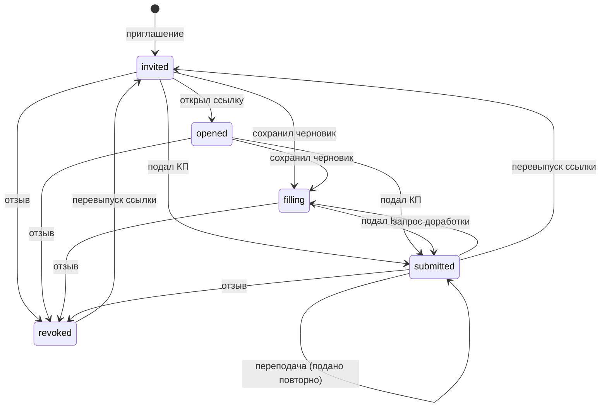

# Приглашения участников и персональная ссылка поставщика

Как специалист подбирает и приглашает контрагентов в тендер, как работает персональная ссылка на форму КП без логина (magic-link), какие стадии проходит участник, какие письма уходят, как хранится черновик КП по ссылке и как в тендер попадает контрагент, которого ещё нет в реестре.

Связанные разделы: индекс — [tenders.md](tenders.md); подача КП — [tenders-quotes.md](tenders-quotes.md); раунды — [tenders-rounds.md](tenders-rounds.md); контрагенты и анкета — [suppliers.md](suppliers.md); данные — [../05-data-model/tables.md](../05-data-model/tables.md#tender_invitations); API — [../04-api/endpoints-tenders.md](../04-api/endpoints-tenders.md), [../04-api/endpoints-quotes.md](../04-api/endpoints-quotes.md); экраны — [../03-screens/tender-card.md](../03-screens/tender-card.md), [../03-screens/tender-create.md](../03-screens/tender-create.md), [../03-screens/fill.md](../03-screens/fill.md), [../03-screens/cabinet.md](../03-screens/cabinet.md).

Оценка: **M** (окно подбора — S–M, magic-link и стадии — S, письма и шаблоны — S, черновик формы — S).

## 1. Сущности

| Сущность | Таблица | Ключевые поля |
|---|---|---|
| Приглашение | [tender_invitations](../05-data-model/tables.md#tender_invitations) | тендер, контрагент, персональный токен (UUID, уникален), стадия `status`, кто и когда пригласил, отметка «ознакомлен с изменениями ФКП» |
| Черновик КП по ссылке | [invite_quote_drafts](../05-data-model/tables.md#invite_quote_drafts) | приглашение (PK), JSON-состояние формы, время сохранения |
| Адресат раунда | [tender_round_recipients](../05-data-model/tables.md#tender_round_recipients) | приглашённый попадает в раунд №1 и в идущий раунд; здесь же факт доставки письма |
| Ссылка на саморегистрацию | [supplier_registration_invitations](../05-data-model/tables.md#supplier_registration_invitations) | для компаний, которых нет в реестре (домен контрагентов) |
| Шаблон письма | [mail_templates](../05-data-model/tables.md#mail_templates) | свой текст письма-приглашения, если администратор его задал |

Связь «тендер × контрагент» уникальна по смыслу: повторное приглашение того же контрагента не создаёт вторую запись.

## 2. Подбор участников

Окно «Пригласить в тендер» открывается из карточки тендера (вкладка «Контрагенты», кнопка в шапке) и из шага 4 мастера. Право — `tenders.manage`.

Окно показывает реестр контрагентов и должно поддерживать:

| Возможность | Правило |
|---|---|
| Поиск | По названию, короткому названию, ИНН, виду работ (подстрока, без регистра) |
| «По видам работ тендера» | Переключатель: только контрагенты, у которых хотя бы один вид работ совпадает (по названию, без учёта регистра и пробелов) с видами работ тендера; рядом — число подходящих. Если у тендера нет видов работ, переключатель не показывается |
| Фильтр квалификации | По сводному статусу контрагента |
| Фильтр «срок работы компании» | Набор диапазонов по дате основания, «не указано» |
| Сортировка | По названию, ИНН, виду работ, квалификации; квалификация сортируется по готовности: аккредитован → с лимитом → на проверке → … → отклонён |
| Отметка уже приглашённых | Нельзя пригласить повторно |
| Лимит договора | У «Одобрен с лимитом» видна сумма лимита на один договор |
| Объём списка | В таблице одновременно не более 80 строк (после фильтров и сортировки) |

Шаги окна: **выбор → проверка неодобренных → подтверждение**. Если среди выбранных есть неодобренные, окно показывает их отдельным списком и требует комментарий.

## 3. Создание приглашений — правила сервера

1. Тендер в «Завершён»/«Отменён» → 400 «Нельзя приглашать участников в закрытый или отменённый тендер».
2. Пустой список → 400 «Выберите хотя бы одного поставщика».
3. **«Не приглашать до».** Если у контрагента установлен запрет повторного приглашения (ставится при отклонении квалификации с опцией «не приглашать 12 месяцев» — дата = день решения + 365 дней) и дата запрета не прошла → 409 «Контрагент «<название>» отклонён, повторное приглашение заблокировано до ДД.ММ.ГГГГ». Это жёсткий запрет, а не предупреждение; весь запрос отклоняется.
4. **Неодобренные.** Контрагент считается одобренным, если его решение квалификации — «Одобрен» или «Одобрен с лимитом». Среди выбранных есть неодобренные и нет флага подтверждения → 400 с кодом `non_approved_confirmation_required`, текстом «Среди выбранных есть неодобренные контрагенты. Подтвердите приглашение явно и укажите комментарий.» и списком (id, название, статус). Подтверждение без комментария → 400 «Укажите комментарий к приглашению неодобренных контрагентов». (Интерфейс считает одобренным также сводный статус «Аккредитован» — расхождение в открытых вопросах.)
5. Уже приглашённые пропускаются и возвращаются отдельным списком; если новых нет → 400 «Все выбранные контрагенты уже приглашены в этот тендер».
6. Для каждого нового: приглашение со статусом «отправлено» (`invited`), новый случайный токен (UUID v4), автор и время приглашения.
7. Если тендер был «Черновиком» — он переходит в «Сбор предложений».
8. Если раундов ещё нет — заводится **раунд №1** в статусе «В процессе» со всеми живыми приглашёнными (см. [tenders-rounds.md](tenders-rounds.md)). Если идёт отправленный раунд — новые участники добавляются в него адресатами (без личной приписки); если есть черновик следующего раунда — и в него.
9. После сохранения (вне транзакции, по принципу «лучшее усилие») каждому новому участнику: событие ленты `invitation_created` (с отметкой о неодобренном и комментарием) и письмо-приглашение (§6). Результат отправки письма записывается в строку адресата раунда (доставлено / причина сбоя). При неодобренных — дополнительно сводное событие `invitation_non_approved_confirmed` (комментарий, список, кто подтвердил).
10. Ответ содержит созданные приглашения с токенами — интерфейс показывает персональные ссылки для копирования.

## 4. Персональная ссылка (magic-link)

Ссылка вида `<PUBLIC_APP_URL>/fill/<токен>` открывает форму КП без учётной записи. Токен — случайный UUID v4 (122 бита энтропии), уникальный в системе.

| Свойство | Правило |
|---|---|
| Срок действия | Не ограничен. Ссылка действует, пока приглашение не отозвано и организация контрагента не приостановлена |
| Тендер завершён/отменён | Форма открывается только для просмотра; сохранение черновика и подача → 410 «Тендер закрыт или отменён — подача и правки КП недоступны. Обратитесь к представителю <клиента>.» |
| Неизвестный/битый токен | 403 «Ссылка недействительна или устарела» (без раскрытия, существует ли тендер) |
| Отозванное приглашение | 410 «Приглашение отозвано — ссылка больше не действует. Обратитесь к представителю <клиента>.» (подставляется `CLIENT_NAME` в родительном падеже, иначе «клиента») |
| Организация приостановлена | 403 «Доступ организации приостановлен. Обратитесь к администратору системы.» |
| Частота запросов | С одного IP: 30 запросов в минуту на чтение/черновик/файлы, 10 в минуту на подачу КП, 20 в минуту на получение ссылок прямой загрузки |
| Что открывает | Только форму этого приглашения: тендер без цен других, свои версии КП, документы тендера, свои файлы, свою ленту событий, переписку по этому тендеру |
| Связь с кабинетом | Пользователь контрагента, вошедший в кабинет, видит список своих тендеров со ссылками на те же формы; при подаче с открытой сессией он фиксируется автором КП ([tenders-quotes.md §9](tenders-quotes.md#9-авторство-кп)) |

### 4.1. Перевыпуск ссылки

Действие специалиста (`tenders.manage` + повторный ввод пароля). Система должна:

- записать в то же приглашение новый токен — старая ссылка перестаёт работать;
- сбросить стадию в «отправлено», обновить «кто и когда пригласил»;
- записать событие ленты `participant_access_restored` и событие журнала ИБ с IP;
- отправить письмо «Обновлённая ссылка — тендер <номер>»: «Ссылка для подачи КП по тендеру «…» обновлена. Новая ссылка: … Старая ссылка больше не действует.»

Перевыпуск — также способ **вернуть доступ** отозванному участнику.

### 4.2. Отзыв ссылки (отключение участника)

Действие специалиста (`tenders.manage` + пароль). Повторный отзыв → 409 «Ссылка уже обнулена». Система должна:

- перевести приглашение в `revoked` и заменить токен на новый «мёртвый» (новой ссылки оператору не выдаётся);
- удалить контрагента из черновиков раундов (отправленные раунды — история, не меняются);
- записать `participant_revoked` в ленту и `participant_access_revoked` в журнал ИБ;
- писем не отправлять.

Отозванный участник остаётся колонкой в СТ с маркером «Доступ закрыт — <кто>, <когда>» (берётся из последнего события ленты по участнику), но **исключается из всех расчётов** и не может быть выбран победителем. То же действует для контрагента, чья организация приостановлена глобально (маркер без автора).

## 5. Стадии участника

Стадия ставится событием, идёт только вперёд; отказ и отзыв — исходы, а не шаги.

| Подпись | Код приглашения | Когда ставится |
|---|---|---|
| отправлено | `invited` | Специалист пригласил (и после перевыпуска ссылки) |
| доставлено | `opened` | Первое открытие формы по ссылке |
| заполняет | `filling` | Первое сохранение непустого черновика формы; также возврат КП на доработку |
| подано | `submitted` | Подача КП (версия 1) |
| подано повторно | `submitted` | Подача версии 2 и далее (подпись выводится из номера версии КП) |
| отказ | `declined` | Значение предусмотрено моделью, но действия «отказаться от участия» в системе нет (см. открытые вопросы) |
| доступ закрыт | `revoked` | Отзыв ссылки |



Правила вывода подписи (одна функция для СТ, «Контрагентов», «Обзора», раундов и кабинета): если у КП статус «подано / на доработке / принято» — «подано» или «подано повторно» (по номеру версии > 1); иначе если идёт заполнение — «заполняет»; если ссылку открыли — «доставлено»; иначе — «отправлено». Доставка письма — отдельная ось («Отправлено» / «Не удалось отправить» / «Нет данных» в строке адресата раунда) и словом «доставлено» не называется.

Решение по корректировке объёма (построчное дозаполнение) стадию **не** откатывает: участник остаётся «подано».

**Итог участия** (для карточки контрагента): отменён (тендер отменён) → отказался (`declined`) → победа / проигрыш / не подал (тендер завершён) → в процессе.

## 6. Письма участникам

Все письма уходят через общий почтовый модуль; при недоступной почте приглашение всё равно создаётся, причина пишется в строку адресата раунда. Причины: «Почта выключена», «Почта выключена в настройках», «Почтовый сервер не настроен», «Нет адреса», «Адрес не расшифрован», «Адрес не принимается» (зарезервированные домены `.test`, `.invalid`, `.example`), «Адрес отклонён почтовым сервером», «Письмо отклонено почтовым сервером», «Почтовый сервер недоступен». Письмо уходит на e-mail организации контрагента.

### 6.1. Письмо-приглашение (шаблон `invitation`, правится администратором)

Тема по умолчанию: «Приглашение к тендеру {номер}». Текст по умолчанию:

```text
Здравствуйте!

Вас пригласили подать коммерческое предложение по тендеру.

Номер тендера: {номер}
Название: {название}
Объект: {объект}
Вид работ: {вид_работ}
Срок подачи: {срок}
Цены в КП указываются с НДС {ндс}%.
Приглашает: {приглашающий}

Ссылка на форму: {ссылка}

С уважением,
{бренд}
```

Переменные: `{номер}`, `{название}`, `{объект}` (портфель + проект), `{вид_работ}` (первый вид работ), `{срок}` (дата окончания сбора КП ДД.ММ.ГГГГ или «не указан»), `{ндс}` (из `VAT_RATE_PCT`), `{приглашающий}` (ФИО), `{ссылка}`, `{бренд}` (`BRAND_NAME`). Обязательная переменная — `{ссылка}`. Пустые значения подставляются прочерком. Правила редактирования шаблона: тема и текст не пустые («Укажите тему письма», «Напишите текст письма»), неизвестные переменные запрещены («Неизвестные переменные: {…}»), в тексте должна быть `{ссылка}` («В тексте должно быть {ссылка}»). Предпросмотр и отправка собираются одной функцией. Подробнее — [settings.md](settings.md).

### 6.2. Прочие письма и уведомления по приглашению

| Событие | Тема письма | Уведомление в кабинете |
|---|---|---|
| Перевыпуск ссылки | «Обновлённая ссылка — тендер <номер>» | — |
| Запрос доработки КП | «Запрошена доработка КП — <номер>» | «Требуется повторное заполнение КП» |
| Решения по корректировкам | «Решения по корректировкам — <номер>» | «Корректировка принята / отклонена», «Решения по корректировкам» |
| Новая версия ФКП | по шаблону `fkp_notice` | «Обновлён шаблон ФКП (vN)» |
| Замена документа тендера | «Обновлён документ — <номер>» | «Обновлён документ тендера» |
| Раунд | по шаблону `round` | «Раунд №N: запрошено уточнение КП» |
| Продление срока раунда | «Срок продлён — раунд №N, <номер>» | «Раунд №N: срок подачи КП продлён» |
| Тендер завершён | «Ваше предложение выбрано: …» / «Тендер завершён: …» | то же |

## 7. Черновик КП по ссылке

Форма поставщика сохраняет состояние, чтобы заполнять КП в несколько заходов.

- Одна запись на приглашение; содержимое — JSON: строки по позициям (ставки материалов и работ как введённые строки, отказ, комментарий, свой объём), свои позиции, ответы на доп. условия. Последнее сохранение перезаписывает предыдущее; версий КП черновик не создаёт.
- Клиент пишет черновик локально сразу, на сервер — через **5 секунд** после последней правки, а также при скрытии вкладки и уходе со страницы.
- Первое сохранение непустого черновика переводит участника в «заполняет».
- Сохранение запрещено: при отозванной ссылке (410), при завершённом/отменённом тендере (410), при поданном КП без открытой доработки, без открытого построчного дозаполнения и без ожидающего ответа раунда — 409 «КП уже подано — повторная отправка недоступна» (кроме очистки черновика пустым содержимым). Править черновик поданного КП может только его автор ([tenders-quotes.md §9](tenders-quotes.md#9-авторство-кп)).
- Черновик учитывается в проценте «заполнено» в кабинете (поверх текущей версии КП).
- После успешной подачи клиент очищает черновик локально и на сервере.

## 8. Ознакомление с изменениями ФКП

Если в тендере есть снятые или скорректированные позиции, а участник ещё не подтвердил ознакомление, форма показывает плашку с изменениями (дельта к предыдущей версии ФКП: добавлено / снято / изменено с прежним и новым объёмом). Кнопка «Ознакомлен» фиксирует время подтверждения. Каждая следующая правка позиций и принятие корректировки объёма сбрасывают отметку у всех участников. Плашка не показывается, пока открыта доработка КП или построчное дозаполнение (там свой баннер).

## 9. Контрагент, которого нет в реестре

Приглашать в тендер можно только контрагентов из реестра (у контрагента обязателен уникальный ИНН). Новую компанию заводят одним из способов (подробно — [suppliers.md](suppliers.md)):

1. **Ссылка на саморегистрацию.** Специалист создаёт ссылку (одноразовую или многоразовую) и отправляет её компании. Компания заполняет публичную анкету (реквизиты, контакты, виды работ, опыт, выручка, документы). Одноразовая ссылка гаснет после первой успешной регистрации, многоразовая — только отзывом; перевыпуск гасит старую и выдаёт новую. Токен хранится в БД хешем (для проверки) и зашифрованным (чтобы оператор мог скопировать живую ссылку повторно). Статусы ссылки: `pending` → `used` / `revoked`.
2. **Ручное заведение** оператором (сводный статус «Анкета не заполнена» до отправки анкеты).

После отправки анкеты запускаются независимые проверки СБ, юриста и финансового блока; сводный статус пересчитывается автоматически («На проверке» → «Аккредитован» / «Отклонён»). Квалификационное решение («Одобрен», «Одобрен с лимитом», «Отклонён» с опцией «не приглашать 12 месяцев») влияет на приглашение (§3). Сквозной пример — [end-to-end-scenarios.md](end-to-end-scenarios.md#сценарий-2-регистрация-нового-подрядчика-и-квалификация).

## 10. Кабинет поставщика

Пользователь контрагента (учётная запись, привязанная к организации; у организации их может быть несколько, у пользователя — одна организация) видит в кабинете:

- «Мои тендеры»: номер, название, объект, статус тендера, стадия участия, процент «заполнено», ссылка на форму (у отозванных ссылки нет);
- «Мои КП»: номер `Q-<id>`, статус, номер версии, дата подачи, комментарий доработки, ссылка на форму;
- ленту событий по своим тендерам — только события, касающиеся его организации, и общие события тендера (правка состава ФКП, замена документов); служебные поля событий (счётчики рассылки, чужие адресаты) отфильтрованы белым списком.

## 11. Права

| Действие | Тендерный специалист / админ | СБ / юрист | Поставщик |
|---|---|---|---|
| Пригласить, перевыпустить, отозвать ссылку | да (`tenders.manage`; перевыпуск и отзыв — с паролем) | нет | нет |
| Видеть приглашения и токены в карточке тендера | да (при доступе к объекту) | при доступе к объекту | — |
| Открыть форму по ссылке, сохранить черновик, подтвердить ознакомление | — | — | да, любой обладатель ссылки |
| Кабинет «Мои тендеры / КП» | — | — | пользователь контрагента |

## 12. Граничные случаи

- Почта не настроена: приглашения создаются, в строке адресата раунда — «Почтовый сервер не настроен»; ссылку специалист передаёт вручную (копирование из карточки).
- Перевыпуск ссылки у подавшего участника сбрасывает стадию в «отправлено», хотя КП остаётся поданным; подпись в СТ при этом всё равно «подано» (подпись берётся из статуса КП).
- Контрагент приостановлен глобально после приглашения: форма отвечает 403, в СТ — маркер «доступ закрыт», в расчёты не входит.
- Отозванного участника нельзя пригласить заново (запись приглашения уже есть) — доступ возвращается только перевыпуском.
- Приглашение в завершённый тендер невозможно; письма о закрытии уходят только участникам в стадиях «отправлено/доставлено/заполняет/подано».

## 13. Пример

В тендер `T-2026-111` специалист выбирает «Альфа», «Бета», «Гамма» (фильтр «По видам работ тендера» показал 5 подходящих из 40). «Гамма» — «На проверке» → окно просит подтверждение и комментарий «Проверка СБ завершится до подачи КП». Сервер создаёт 3 приглашения, тендер переходит в «Сбор предложений», заводится раунд №1 с тремя адресатами, три письма-приглашения уходят; в ленте — три `invitation_created` и одно `invitation_non_approved_confirmed`. «Альфа» открывает ссылку → «доставлено»; через час сохраняет первые цены → «заполняет»; подаёт → «подано».
