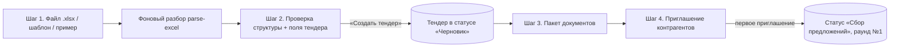

# Жизненный цикл тендера

Как тендер создаётся (мастер, черновики мастера, шаблоны), какие у него поля и проверки, как назначается номер, как задаются и меняются сроки, кто и как меняет статус, закрывает тендер с победителем или отменяет его, как правится состав ФКП после старта и как выставляется флаг «требует внимания».

Связанные разделы: индекс домена — [tenders.md](tenders.md); разбор Excel — [fkp-import.md](fkp-import.md); приглашения — [tenders-invitations.md](tenders-invitations.md); документы и протокол — [tenders-documents.md](tenders-documents.md); данные — [../05-data-model/tables.md](../05-data-model/tables.md#tenders); API — [../04-api/endpoints-tenders.md](../04-api/endpoints-tenders.md); экраны — [../03-screens/tender-create.md](../03-screens/tender-create.md), [../03-screens/tender-card.md](../03-screens/tender-card.md), [../03-screens/templates.md](../03-screens/templates.md), [../03-screens/tenders-registry.md](../03-screens/tenders-registry.md).

Оценка: **L** (мастер создания с черновиками и шаблонами — M; правка ФКП с версиями и рассылкой — M; закрытие с победителем и каскад сроков — S–M).

## 1. Сущности

| Сущность | Таблица | Роль в жизненном цикле |
|---|---|---|
| Тендер | [tenders](../05-data-model/tables.md#tenders) | Основная запись |
| Виды работ тендера | [tender_work_types](../05-data-model/tables.md#tender_work_types) | 1…N видов работ; колонка `tenders.work_type_id` хранит первый (наследие) |
| Разделы и позиции | [tender_sections](../05-data-model/tables.md#tender_sections), [tender_items](../05-data-model/tables.md#tender_items) | Состав ФКП |
| Доп. условия | [tender_condition_fields](../05-data-model/tables.md#tender_condition_fields) | Вопросы поставщику |
| Версии ФКП | [tender_fkp_versions](../05-data-model/tables.md#tender_fkp_versions) | История состава и рассылок |
| Черновик мастера | [tender_creation_drafts](../05-data-model/tables.md#tender_creation_drafts) | Незавершённое создание |
| Шаблон | [tender_templates](../05-data-model/tables.md#tender_templates) | Библиотека составов |
| Дефолты вида работ | [project_work_type_configs](../05-data-model/tables.md#project_work_type_configs) | Даты и шаблон по умолчанию для пары «объект × вид работ» |
| Лента | [activity_log](../05-data-model/tables.md#activity_log) | Аудит действий по тендеру |

## 2. Создание тендера — мастер из четырёх шагов

Мастер — страница `/tenders/new`. Шаги: **1 «Загрузка файла» → 2 «Проверка структуры» → 3 «Загрузка документов» → 4 «Контрагенты и ссылки»**. Запись тендера появляется только в конце шага 2; до этого всё живёт в черновике мастера (§3).

### 2.1. Шаг 1 — источник состава

Система должна поддерживать три источника:

1. **Excel-ведомость** (`.xlsx`): пользователь выбирает файл и лист; клиент считает SHA-256 файла и отправляет его на разбор. Сервер сохраняет исходник во вложение черновика (если черновик есть) и ставит фоновое задание разбора; если такой же файл (тот же хеш и лист) уже разбирался за последние **30 дней**, возвращается готовое задание без новой очереди. Клиент опрашивает задание до `done`/`failed`, может отменить. Доступны: выбор листа, ручное сопоставление колонок (перестроение структуры по карте колонок), необязательный ИИ-анализ файла (подсказки по названию, виду работ, единицам; тарифицируется в биллинге ИИ). Правила разбора — [fkp-import.md](fkp-import.md).
2. **Шаблон тендера** (`/tenders/new?fromTemplate=<id>`): разделы, позиции, доп. условия и вид работ подставляются из шаблона (§4), на экране — подсказка «Подставлено из шаблона «…»». Пустой шаблон — ошибка «В шаблоне нет позиций КП».
3. **Пример файла** — встроенная демонстрационная ведомость для знакомства.

### 2.2. Шаг 2 — проверка структуры и поля тендера

Пользователь видит дерево разделов и позиций, может править наименование, единицу и количество позиции в строке, добавлять позиции в раздел, править список доп. условий (название и тип: текст / число / дата / да-нет). Справа — поля тендера (§5). При выборе объекта и вида работ мастер подставляет даты сбора КП и шаблон по умолчанию из дефолтов «объект × вид работ», если они заданы (это подсказка, не требование).

Перед отправкой интерфейс проверяет и показывает список недостающего (с переходом к полю):

| Проверка | Текст |
|---|---|
| Нет названия | «Укажите название тендера» |
| Не выбран объект | «Укажите объект» |
| Нет видов работ | «Укажите хотя бы один вид работ» |
| Нет бюджетной позиции | «Укажите бюджетную позицию» |
| Нет дат | «Укажите даты начала и окончания сбора КП» |
| Окончание не позже начала | «Дата окончания сбора КП должна быть позже даты начала» |
| Нет позиций с названием | «Добавьте хотя бы одну позицию с названием — пустой тендер не создаётся» |
| Единицы не сопоставлены со справочником | «Несопоставленные единицы измерения (N) — сопоставьте со справочником» |
| Нет единицы / количества у позиций | «Единицы измерения — не указаны у N позиций», «Количество — не указано у N позиций» |
| Общая плашка | «Заполните обязательные поля и позиции перед отправкой тендера» |

Кнопка «Создать тендер» отправляет `POST /tenders` (право `tenders.manage`). Сервер повторяет проверки (§5) и создаёт тендер в статусе `draft`, ответственным ставит создателя. Если передан `draft_id` — черновик мастера переходит в `converted`, исходный файл перевешивается на тендер (становится документом «Шаблон ФКП», см. [tenders-documents.md](tenders-documents.md)). Если передан `template_id` — в тендере запоминается шаблон-источник.

### 2.3. Шаги 3–4

Шаг 3 — пакет документов тендера ([tenders-documents.md](tenders-documents.md)). Шаг 4 — приглашение контрагентов и выдача персональных ссылок ([tenders-invitations.md](tenders-invitations.md)). Оба шага можно пропустить и выполнить позже из карточки тендера.

## 3. Черновики мастера создания

Черновик сохраняет прогресс мастера до создания тендера, чтобы вернуться к нему после закрытия вкладки.

| Поле | Смысл |
|---|---|
| `status` | `draft` → `converted` (тендер создан) / `discarded` (удалён пользователем) |
| `current_step` | Шаг мастера 1–4 |
| `header` | Поля тендера, введённые на шаге 2 (JSON) |
| `structure` | Разобранная структура и выбранный лист (JSON) |
| `enrich` | Результат ИИ-анализа файла и применённые/отклонённые подсказки (JSON) |
| `file_hash`, `file_name`, `file_size`, `job_id` | Исходный файл и задание разбора |
| `source_attachment_id` | Сам файл во вложениях: можно пересобрать состав и перезапустить ИИ-анализ без повторной загрузки |
| `result_tender_id` | Тендер, в который черновик превратился |

Правила:

- Видит и правит черновик только автор или администратор; чужой id — 404 «Черновик не найден» (существование не раскрывается). Удалённый — 404 «Черновик удалён»; превращённый — при открытии отдаёт `redirect_tender_id`, и интерфейс уводит в карточку тендера.
- Правка — частичная: присланные поля `header`/`structure`/`enrich` сливаются с сохранёнными (глубокое слияние JSON), `updated_at` обновляется. Разрешённые к правке поля: `file_hash`, `file_name`, `file_size`, `job_id`, `current_step`, `header`, `structure`, `enrich`.
- **TTL.** Черновик со статусом `draft`, не менявшийся дольше `CREATION_DRAFT_TTL_DAYS` (по умолчанию **30** дней), считается просроченным: он не показывается в списке «Незавершённых черновиков» (с кнопками «Продолжить» и удалением), но по прямой ссылке открывается с пометкой «просрочен». Физического удаления по TTL нет.
- Список черновиков: фильтр по статусу (`draft` по умолчанию), пагинация, флаг «включая просроченные»; администратор видит черновики всех.
- Перестроение структуры по карте колонок и ИИ-анализ работают по сохранённому файлу; нет файла — 409 «Исходный файл черновика не сохранён — загрузите файл заново». ИИ-анализ без флага «перезапустить» сначала ищет готовый результат по хешу файла и листу.

## 4. Шаблоны тендеров

Библиотека шаблонов (`/templates`) хранит составы, по которым регулярно запускаются однотипные тендеры.

**Слепок шаблона** хранится в том же виде, в каком его принимает создание тендера: `{work_type, sections: [{name, code?, items: [{name, unit, quantity, …}], children: [...]}], condition_fields: [{field_name, field_type}], column_map?}`. Поэтому «сохранить из тендера» и «запустить из шаблона» — копирование без конвертации. Старый плоский формат (`positions[]`, `conditions` строкой через «; ») читается и при первом сохранении переписывается в новый (плоский список становится разделом «Позиции шаблона»).

| Действие | Кто | Правила и тексты |
|---|---|---|
| Создать шаблон вручную | сотрудник | Обязательны: название («Название шаблона обязательно»), вид работ («Вид работ обязателен»), хотя бы одна позиция («Добавьте хотя бы одну позицию»). Название уникально без учёта регистра: 409 «Шаблон с таким названием уже есть» |
| «Сохранить как шаблон» из карточки тендера | сотрудник | Слепок берётся из БД тендера (не из того, что нарисовал клиент). Имя по умолчанию — название тендера; вид работ — первый вид работ тендера (один шаблон = один вид работ) |
| Изменить шаблон | сотрудник | Оптимистическая блокировка: клиент присылает `version`; не совпала — 409 «Шаблон изменён в другом окне — обновите страницу» (проверяется раньше валидации). Каждое сохранение увеличивает `version` |
| Сохранить карту колонок | сотрудник | Подтверждённое сопоставление колонок Excel запоминается в шаблоне; при следующей загрузке файла с той же шапкой применяется молча |
| Удалить шаблон | сотрудник | Физическое удаление |
| Запустить тендер из шаблона | сотрудник с `tenders.manage` | Мастер открывается с подставленным составом; у созданного тендера запоминается `template_source_id` |
| Шаблон по умолчанию для «объект × вид работ» | сотрудник с доступом к объекту | Хранится в дефолтах вида работ вместе с датами сбора КП; мастер предлагает его подсказкой «Есть шаблон по умолчанию «…»» |

Аудит (журнал ИБ): `template_created`, `template_changed`, `template_deleted` с названием.

## 5. Поля тендера и проверки

| Поле | Обязательно | Правила | Текст ошибки (сервер) |
|---|---|---|---|
| Объект (проект) | да | Пользователь должен иметь доступ к объекту | «Укажите проект (объект) и название тендера»; «Нет доступа к тендерам этого проекта» |
| Название | да | Обрезка пробелов; ≤ 500 символов | «Укажите проект (объект) и название тендера»; при правке — «Название тендера не может быть пустым», «Название длиннее 500 символов» |
| Виды работ | да, ≥ 1 | Существующие и не архивные; дубликаты схлопываются | «Выберите хотя бы один вид работ»; «Вид работ не найден или архивный» |
| Бюджетная позиция | да | Существует, не в архиве, период (год даты начала сбора, иначе текущий) не закрыт | «Укажите бюджетную позицию»; «Бюджетная позиция не найдена»; «Нельзя привязать архивную бюджетную позицию»; «Период ГГГГ по этой позиции закрыт — новые тендеры нельзя привязывать»; при правке на пустое — «Бюджетная позиция обязательна» |
| Плановая сумма (бюджет тендера) | нет | Число ≥ 0, пробелы и запятая допустимы, ≤ 9 999 999 999 999,99 | «Некорректная плановая сумма»; «Плановая сумма не может быть отрицательной»; «Плановая сумма слишком большая — не больше 9 999 999 999 999,99 ₽» |
| Начало и окончание сбора КП | да | Даты ISO; окончание строго позже начала | «Укажите даты начала и окончания сбора КП»; «Дата окончания сбора КП должна быть позже даты начала» |
| Разделы и позиции | да, ≥ 1 позиция с названием | Пустые позиции и пустые узлы отбрасываются; имя раздела ≤ 500, позиции ≤ 1000 символов; единицы — только из справочника единиц (написание сопоставляется с синонимами) | «Нельзя создать тендер без позиций — загрузите файл и дождитесь разбора»; «Имя раздела длиннее 500 символов — сократите его: «…»»; «Имя позиции длиннее 1000 символов — сократите его: «…»»; «Нет в справочнике единиц: «…», «…» и ещё N. Выберите единицу из справочника или добавьте её туда.» (называются первые 5) |
| Доп. условия | нет | Пустые названия отбрасываются; тип `text` (по умолчанию), `number`, `date`, `boolean`; ответ поставщика хранится текстом, тип сервером не проверяется | — |
| Ответственный | авто | При создании — создатель. Меняется на действующего сотрудника | «Ответственным можно назначить только действующего сотрудника» |
| Пользовательский статус | нет | Код из справочника статусов тендера | «Неизвестный статус тендера» |

Атрибуты позиции из ведомости сохраняются как есть: номер по ФКП, код статьи бюджета, тип/марка, код оборудования, завод-изготовитель и прочие колонки бланка (произвольные пары «колонка → значение»). У раздела сохраняются номер («1.2», без хвостовой точки, ≤ 100 символов), справочная единица и объём подраздела (в итоги не входят) и место подраздела среди позиций родителя (позиции и подразделы в ФКП могут идти вперемешку).

## 6. Номер тендера

Система должна присваивать номер при создании по формату **`T-ГГГГ-NNN`**: латинская «T», год создания (UTC), внутренний сквозной идентификатор тендера, дополненный нулями до трёх знаков (`T-2026-007`, `T-2026-100`, `T-2026-1234`). Номер уникален; счётчик не сбрасывается по годам и не зависит от проекта. Номер не редактируется. В образце письма в настройках используется кириллическое «Т-…» — расхождение отмечено в открытых вопросах.

## 7. Сроки сбора КП

- Срок задаётся датами начала и окончания (без времени). Окончание — **мягкий ориентир**: подачу КП закрывает статус тендера, а не календарь. После даты окончания форма поставщика остаётся открытой и показывает признак «срок сбора истёк» (`collection_expired`).
- Реестр показывает «Соблюдение сроков» (В срок / С опозданием / Просрочен) — см. [tenders.md §4.4](tenders.md#44-соблюдение-сроков-вычисляемо).
- Новый раунд по умолчанию получает срок «конец дня окончания сбора КП, 23:59 МСК», если эта дата не в прошлом.

### 7.1. Правка сроков после создания (с каскадом на раунды)

Править название, сроки и виды работ может администратор, создатель или ответственный (у старых тендеров без обоих — любой с доступом): иначе 403 «Название, сроки и виды работ может менять создатель, ответственный или администратор». В статусах «Завершён»/«Отменён» — 400 «Тендер в статусе «…» — название, сроки и виды работ не меняются».

После того как приглашён хотя бы один участник:

| Правка | Требование | Текст без подтверждения |
|---|---|---|
| Дата начала сбора | флаг подтверждения `confirm_details_change` | «После приглашения участников смена начала сбора требует подтверждения (confirm_details_change)» |
| Виды работ | `confirm_details_change` | «После приглашения участников смена видов работ требует подтверждения (confirm_details_change)» |
| Объект | `confirm_project_change` и доступ к новому объекту | «После приглашения участников смена объекта требует подтверждения (confirm_project_change)»; пустой объект — «Укажите объект (проект)» |

**Каскад даты окончания на раунды.** Раунд «следует» за тендером, если его срок (по московской дате) совпадал с прежней датой окончания — то есть менеджер не задавал раунду отдельный срок. При смене даты окончания система должна:

| Раунд | Действие |
|---|---|
| Черновик, следует за тендером | Срок переносится на новую дату 23:59 МСК |
| Отправленный, следует, продление (новый срок позже текущего и в будущем) | Срок переносится; адресатам (включённым, с живым приглашением, кроме отказавшихся) — уведомление в кабинете и письмо «Срок продлён — раунд №N, <номер>»; событие `round_deadline_extended` |
| Отправленный, следует, сокращение срока, ещё не истёкшего | **Сохранение тендера блокируется целиком**: «Срок отправленного раунда №N сократить нельзя. Закройте раунд и создайте новый» |
| Раунд со своим сроком (не следует) | Не меняется (в предпросмотре — «отвязанные») |
| Закрытый раунд | Не меняется |

Перед сохранением интерфейс вызывает предпросмотр правки (ничего не пишет): какие раунды сдвинутся (с/на, сколько адресатов получат письмо), какие отвязаны, какие заблокированы, нужно ли подтверждение. Каждая изменённая деталь пишется в ленту (`tender_details_changed`: поле, было, стало).

## 8. Закрытие тендера и выбор победителя

Закрытие — перевод в «Завершён» с обязательным победителем (право `tenders.manage`). Необратимые переходы (в «Завершён» и «Отменён») требуют **повторного ввода пароля** пользователя в заголовке запроса: без него — 403 «Подтвердите действие паролем», с неверным — 403 «Пароль не подошёл — действие не выполнено».

Алгоритм:

1. Победитель не передан и не задан ранее — 400 «Для статуса «Завершён» укажите победителя (winner_supplier_id)».
2. Победитель должен иметь неотозванное приглашение в этот тендер — иначе 400 «Победитель должен быть участником этого тендера»; нет контрагента — «Контрагент не найден».
3. **Победитель без аккредитации.** Если сводный статус контрагента не «Аккредитован» (на проверке, отклонён, анкета не заполнена, черновик анкеты), выбор проходит только с явным подтверждением и комментарием: без подтверждения — 400 с кодом `non_approved_confirmation_required`, текстом «Контрагент не прошёл аккредитацию: <статус>. Подтвердите выбор победителя и укажите комментарий.» и статусом контрагента; без комментария — «Укажите комментарий к выбору победителя без аккредитации». Статус контрагента на момент выбора сохраняется в тендере (`winner_accreditation_status`) и показывается пометкой «Победитель без аккредитации: <статус>» — пометка не пропадает, если статус контрагента потом изменится.
4. КП победителя получает статус `accepted` («Принят»); статусы остальных КП не меняются.
5. Тендер → `closed`, `closed_at` = сейчас (если тендер не был закрыт), победитель записывается; все идущие раунды закрываются.
6. Лента: `tender_status_changed` (с/на, победитель, комментарий); при неаккредитованном победителе — отдельное событие `winner_non_accredited_confirmed` в ленте и в журнале ИБ.
7. Уведомления (кроме повторного закрытия с тем же победителем):
   - ответственному (иначе создателю) — уведомление «Тендер завершён» и письмо «Тендер завершён: <номер> «<название>»» с именем победителя и ссылкой;
   - победителю — уведомление в кабинете «Ваше предложение выбрано» и письмо «По тендеру … выбрано ваше предложение.»;
   - остальным участникам со статусами «отправлено/доставлено/заполняет/подано» — «Тендер завершён» и письмо «Тендер … завершён, выбран другой подрядчик. Благодарим за участие.» Имя победителя проигравшим не сообщается.

Повторный запрос «Завершён» с тем же победителем решения заново не принимает (без уведомлений). Запрос с другим победителем на уже закрытом тендере сервером не запрещён: победитель меняется, КП нового победителя → `accepted` (прежнее КП статус не теряет) — граничный случай вынесен в открытые вопросы. Передать победителя без смены статуса нельзя: «Победитель задаётся при переводе в «Завершён»».

Интерфейс: пункт меню статуса «Завершён» с подсказкой «выбор победителя и пароль» открывает окно выбора победителя из участников (кроме отозванных); у неаккредитованного рядом с именем — подпись статуса; пустой список — отдельное состояние «выбирать не из чего». После закрытия в карточке — баннер «Тендер завершён — победил <имя>.» (с пометкой о неаккредитованном победителе, если есть).

## 9. Отмена тендера

Перевод в «Отменён» из «Черновика» или «Сбора предложений» (право `tenders.manage` + пароль; подсказка в меню «пароль, отменить нельзя»). Записывается `closed_at`, идущие раунды закрываются, событие в ленту с необязательным комментарием. Писем участникам при отмене система не шлёт (см. открытые вопросы). Отмена необратима: из терминальных статусов выхода нет.

## 10. Правка состава ФКП после старта

Состав правится только в статусах «Черновик» и «Сбор предложений»; в терминальных — 400 «Тендер в статусе «…» — состав заморожен. Правки возможны только после административного восстановления статуса.»

| Операция | Что делает | Версия ФКП / рассылка |
|---|---|---|
| Дополнение ФКП | Добавляет разделы с позициями и доп. условия в конец (пустые имена пропускаются; неизвестная единица отменяет всё дополнение) | Новая версия «разделов +N; позиций +M» |
| Правка позиций | По каждой позиции: новый объём (запоминается исходный объём), снятие позиции (мягкое, `is_removed`), восстановление, новая единица, новое наименование | Новая версия «изменён объём: N; снято позиций: M» (если менялись объём или снятие) |
| Вставка позиции | После указанной позиции (или в конец раздела); хвост раздела и подразделы сдвигаются. «Укажите наименование»; «Нужен section_id или after_item_id»; «Позиция after_item_id не найдена»; «Раздел не найден» | Новая версия «Добавлена позиция: <имя>» |
| Пересборка разделов по файлу ФКП | Перекладывает позиции в дерево свежего разбора исходного файла (по умолчанию только план); строки-заголовки, ошибочно ставшие позициями, становятся подразделами; цены/корректировки/решения в текущих КП по таким строкам блокируют запись | «Тихая» версия «Разделы пересобраны по файлу ФКП» — не рассылается и не делает КП устаревшими |

Общие правила для правок (кроме пересборки):

- Каждая правка, менявшая позиции, создаёт **версию ФКП** — снимок разделов, всех позиций (включая снятые) и доп. условий — и увеличивает ревизию тендера.
- Рассылка участникам по умолчанию включена (`notify=true`): всем приглашённым в статусах «отправлено/доставлено/заполняет/подано» — уведомление «Обновлён шаблон ФКП (vN)» в кабинете и письмо по шаблону «Новая версия ФКП» со ссылкой на форму. При `notify=false` версия остаётся неразосланной, автору — уведомление «Версия ФКП создана — рассылка отложена»; карточка показывает баннер «Есть неразосланная версия ФКП» с готовым текстом. «Разослать» отправляет одним письмом все неразосланные версии до выбранной (изменения перечисляются без повторов).
- Перед применением интерфейс показывает предпросмотр письма и список тех, кому письмо не уйдёт (с причиной).
- После правки позиций у всех участников сбрасывается отметка «ознакомлен с изменениями» — поставщик снова увидит плашку об изменённых/снятых позициях и подтвердит ознакомление.
- КП, поданное по версии ФКП старше последней содержательной, помечается «подано по ФКП vN (актуальна vM)» в СТ, «Контрагентах» и «Обзоре».
- Лента: `structure_updated` (видно и поставщикам), `structure_rebuilt`, `fkp_version_notified`.
- Флаг «требует внимания» выставляется (кроме пересборки).

## 11. Виды работ, бюджетная позиция, плановая сумма

- **Вид работ** — операционный классификатор (по нему подбирают подрядчиков при приглашении). У тендера один или несколько; первый попадает в шаблон при «Сохранить как шаблон» и в письмо-приглашение.
- **Бюджетная позиция** — ровно одна статья бюджета, из которой оплачивается тендер; в карточке показывается полный путь по дереву бюджета («Раздел › Подраздел › Статья») и код. Фактические суммы бюджета считаются из КП в домене «Бюджет».
- **Плановая сумма** — оценка закупки; видна только при праве на финансы (иначе `null` и признак `finance_masked`), используется в протоколе («Бюджет», «Дельта»).

## 12. Заметки сотрудников

У тендера одно рабочее поле «Заметки» (автосохранение): текст до **20 000** символов (длиннее обрезается), автор и время последней правки. Видят и правят сотрудники с доступом к объекту; контрагентам заметка не отдаётся ни в форме, ни в кабинете.

## 13. Ответственный и пользовательский статус

- Ответственный — действующий сотрудник (или пусто). Смена пишется в ленту `tender_responsible_changed` («кто кого назначил»). Ответственный — адресат уведомлений о новых КП и о завершении (если пусто — создатель).
- Пользовательский статус — см. [tenders.md §4.2](tenders.md#42-пользовательский-статус).

## 14. «Требует внимания»

Условия выставления и показ — [tenders.md §4.3](tenders.md#43-флаг-требует-внимания). Автоматического сброса нет (см. открытые вопросы).

## 15. События, уведомления, аудит

| Событие ленты | Когда | Видно поставщику |
|---|---|---|
| `tender_status_changed` | Смена системного статуса | нет |
| `winner_non_accredited_confirmed` | Победитель без аккредитации (также журнал ИБ) | нет |
| `tender_custom_status_changed` | Пользовательский статус | нет |
| `tender_responsible_changed` | Смена ответственного | нет |
| `tender_details_changed` | Название, даты, виды работ | нет |
| `structure_updated` | Правка состава ФКП | да |
| `structure_rebuilt` | Пересборка разделов | нет |
| `fkp_version_notified` | Рассылка версии ФКП | нет |
| `round_deadline_extended` | Каскад/продление срока раунда | нет (адресат получает уведомление) |

Лента тендера: обратная хронология, курсорная пагинация (по 50, максимум 200), фильтры по группам (`quote`, `round`, `message`, `tender`, `participant`), автору, контрагенту, тексту (до 100 символов) и периоду (даты МСК включительно).

## 16. Граничные случаи

- Ошибка разбора файла не создаёт тендер-сироту: запись тендера появляется только из уже разобранной структуры.
- Две вкладки мастера с одним черновиком: последняя запись побеждает (слияние JSON), конфликт не детектируется.
- Повторный клик «Создать тендер» создаёт второй тендер (защиты от дубля нет) — см. открытые вопросы.
- Тендер без даты окончания (старые данные): «Соблюдение сроков» пусто, продлить раунд «до срока тендера» нельзя — «У тендера не задан срок сбора КП».
- Снятая позиция остаётся в СТ (зачёркнутой) и в версиях ФКП, но не участвует в итогах, «заполнено» и обязательных ответах при подаче.

## 17. Пример

Специалист создаёт тендер «Стяжки полов, корпус 1» на объекте «ЖК «Северный парк», корпус 1», вид работ «Стяжки», бюджетная позиция «Стяжки и полы», плановая сумма 1 000 000 ₽, сбор КП 01.10.2026–15.10.2026. Ведомость разобрана в 2 раздела и 3 позиции. Сервер присваивает номер `T-2026-111` (если внутренний id = 111) и статус «Черновик». Через неделю специалист меняет дату окончания на 20.10.2026: раунд №1 (срок 15.10 23:59 МСК, следовал за тендером) продлевается до 20.10 23:59, трём адресатам уходит «Срок продлён — раунд №1, T-2026-111». Полный путь с числами — [end-to-end-scenarios.md](end-to-end-scenarios.md).

## 18. Ошибки и тексты отказов

Сводка текстов, не упомянутых выше:

| Ситуация | Код | Текст |
|---|---|---|
| Недопустимый код статуса | 400 | «Недопустимый статус тендера» |
| Выход из терминального статуса | 400 | «Переход из «Завершён»/«Отменён» запрещён без административного восстановления с причиной» |
| Закрытие отменённого | 400 | «Переход из «cancelled» в «closed» запрещён без административного восстановления» |
| Правка состава в терминальном статусе | 400 | «Тендер в статусе «<статус>» — состав заморожен. Правки возможны только после административного восстановления статуса.» |
| Нет доступа к объекту | 403 | «Нет доступа к тендерам этого проекта» |
| Тендер не найден | 404 | «Тендер не найден» |
| Нет права | 403 | «Недостаточно прав для этого действия — обратитесь к администратору системы» |
