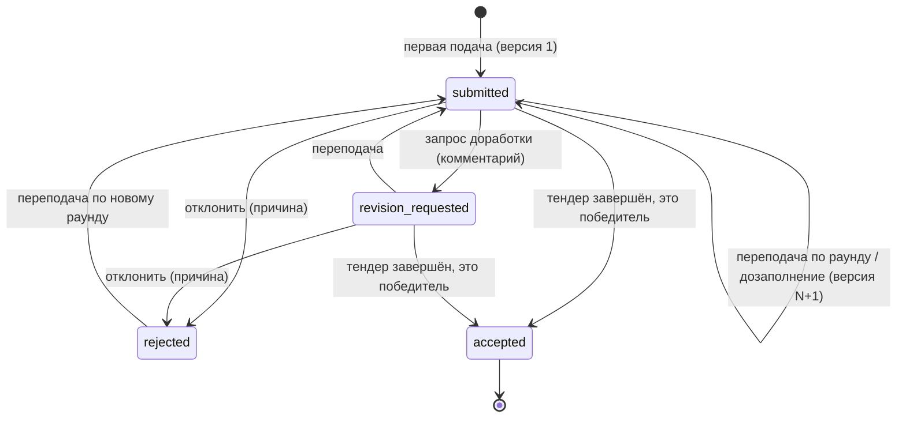

# Коммерческие предложения (КП) и версии КП

Как поставщик заполняет форму КП (ставки материалов и работ, объём, стоимость), какие корректировки он может предложить, как подтверждается НДС, как считается «заполнено», что проверяется при подаче и повторной подаче, как работает загрузка заполненного Excel-файла КП, и что делает с КП тендерный специалист: входящие, карточка, решения.

Связанные разделы: индекс — [tenders.md](tenders.md); приглашения и черновик формы — [tenders-invitations.md](tenders-invitations.md); как КП попадают в сравнение — [tenders-comparison.md](tenders-comparison.md); раунды — [tenders-rounds.md](tenders-rounds.md); комментарии к позициям — [comments.md](comments.md); данные — [../05-data-model/tables.md](../05-data-model/tables.md#quotes); API — [../04-api/endpoints-quotes.md](../04-api/endpoints-quotes.md), [../04-api/endpoints-tenders-invite.md](../04-api/endpoints-tenders-invite.md) (заполнение и подача по ссылке), [../04-api/endpoints-tenders-comparison.md](../04-api/endpoints-tenders-comparison.md) (корректировки, версии, доработка); экраны — [../03-screens/fill.md](../03-screens/fill.md), [../03-screens/quotes-inbox.md](../03-screens/quotes-inbox.md), [../03-screens/quote-card.md](../03-screens/quote-card.md), [../03-screens/cabinet.md](../03-screens/cabinet.md), [../03-screens/tender-card.md](../03-screens/tender-card.md).

Оценка: **L** (форма поставщика с автосохранением и проверками — M; корректировки и решения с построчным дозаполнением — M; импорт Excel-файла КП — M, опирается на разборщик ФКП; входящие и карточка КП — S–M).

## 1. Сущности

| Сущность | Таблица | Ключевые поля |
|---|---|---|
| КП | [quotes](../05-data-model/tables.md#quotes) | приглашение (одно КП на приглашение), `status`, пользовательский статус, комментарий доработки (кто/когда запросил), автор (`created_by`, неизменяем), время просмотра во «Входящих» |
| Версия КП | [quote_versions](../05-data-model/tables.md#quote_versions) | номер (1, 2, …), «текущая» (ровно одна), дата подачи, версия ФКП, по которой подано, подтверждение НДС (время и ставка), кто подал эту версию |
| Строка КП | [quote_items](../05-data-model/tables.md#quote_items) | позиция тендера или своя позиция (`is_new_position`, `custom_name`), ставки `materials_price` и `works_price` **за единицу** (2 знака), вычисляемая в БД сумма ставок, отказ, предложенный объём, решение специалиста и его комментарий, комментарий поставщика, основа цены (`unit` / `legacy_line`), «ждём ответ», заявленный запас торга, признак «дозаполнить» |
| Ответ на доп. условие | [quote_condition_values](../05-data-model/tables.md#quote_condition_values) | версия КП, доп. условие, текст ответа |
| Файлы к КП | [attachments](../05-data-model/tables.md#attachments) | привязаны к приглашению (`entity_type = tender_invite`), слот `doc_type` |
| Черновик формы | [invite_quote_drafts](../05-data-model/tables.md#invite_quote_drafts) | см. [tenders-invitations.md §7](tenders-invitations.md#7-черновик-кп-по-ссылке) |

Ограничение БД: решение специалиста (`review_status`) бывает только у своей позиции или у строки с предложенным объёмом.

## 2. Статусы КП

| Код | Подпись | Кто ставит | Смысл | В сравнении |
|---|---|---|---|---|
| `submitted` | Подано | поставщик (подача) | КП подано, ждёт рассмотрения | да |
| `revision_requested` | На доработке | специалист | Весь КП возвращён на доработку с комментарием; прежние цифры остаются в расчёте до переподачи | да |
| `accepted` | Принят | система при закрытии тендера | КП победителя | да |
| `rejected` | Отклонено | специалист | КП отклонено целиком с причиной | нет |
| `draft` | Черновик | — | Наследие: новые КП создаются сразу поданными (черновик живёт в черновике формы) | нет |
| `withdrawn` | Отозвано | — | Подпись есть, действия «отозвать КП» в системе нет | нет |



Пользовательский статус КП (ярлык из справочника) ставится в карточке КП независимо от системного; смена — событие `quote_status_changed` в ленте (без раскрытия поставщику) и в журнале ИБ.

Решения по строкам (`review_status`): `pending` (на рассмотрении) → `accepted` (принято) / `rejected` (отклонено). Признак «дозаполнить» (`refill_required`) открывает поставщику отдельные строки, не меняя статус всего КП.

## 3. Ценовая модель

Обозначения для одной строки: `M` — ставка материалов, ₽/ед.; `W` — ставка работ, ₽/ед.; `V` — применённый объём; `round₂` — округление до копейки, половина вверх.

```text
Ставка за единицу       R = M + W                         (вычисляется, не вводится)
Стоимость материалов    Cм = round₂(M × V)
Стоимость работ         Cр = round₂(W × V)
Стоимость позиции       C  = Cм + Cр
Итог КП                 T  = Σ C по строкам ФКП без отказа + Σ C принятых своих позиций
```

- Все ставки — окончательные, **с НДС** (ставка `VAT_RATE_PCT`, по умолчанию 22 %); налоговый режим поставщика справочный и в расчёт не входит.
- Промежуточного округления нет, кроме стоимостей материалов и работ строки; итоги — сумма уже округлённых строк (так экран, Excel и протокол совпадают до копейки).
- **Применённый объём** `V`: предложенный поставщиком объём, если корректировка **принята**; иначе объём позиции в ФКП; если объёма нет — 1.
- Отказ от позиции: ставки сохраняются нулями, стоимость строки — 0, строка в итог не входит.
- Старые записи с основой цены `legacy_line` содержат уже готовые суммы строки (ставка за единицу выводится делением на объём) — режим совместимости, в новом вводе не используется.

*Контрольный пример.* `M = 1 680`, `W = 1 474`, `V = 30`: `R = 3 154 ₽/ед.`, `Cм = 50 400 ₽`, `Cр = 44 220 ₽`, `C = 94 620 ₽`. Ставка `623,43 + 590 = 1 213,43` при `V = 6,5`: `Cм = round₂(4 052,295) = 4 052,30`, `Cр = 3 835,00`, `C = 7 887,30 ₽` (сложение ставок — точное десятичное, без двоичных хвостов).

## 4. Заполнение формы поставщиком

Форма (`/fill/<токен>`) показывает шапку тендера (номер, название, объект, вид работ, бюджетная позиция без суммы, срок, ответственный), правило «Цены указаны с НДС 22 %», дерево разделов и позиций, доп. условия, документы тендера, слоты для своих файлов, ленту событий и переписку.

По каждой позиции поставщик вводит:

| Поле | Правило |
|---|---|
| Цена за ед., материалы | Число (десятичный разделитель — точка или запятая; разряды не мешают); пусто — «нет ответа»; введённый «0» — ответ «0 ₽» |
| Цена за ед., работа | То же |
| Ставка за единицу и стоимость | Только чтение, считается на лету по §3 |
| Количество | По умолчанию объём ФКП; изменение = предложение своего объёма (корректировка, §6.2) |
| Отказ от позиции | Флажок; ставки обнуляются |
| Комментарий | До 1000 символов; обязателен при отказе и при изменении объёма |

Плюс «Добавить свою позицию» (§6.1) и ответы на доп. условия (текст; тип поля — подсказка для ввода).

В раунде переторжки форма предзаполнена ценами текущей версии КП и рядом с полем показывает изменение к прошлому значению в процентах (`(новое − прежнее) / |прежнее| × 100`, одна десятая; нет базы или без изменения — не показывается).

### 4.1. «Заполнено»

```text
Заполнено, % = round(100 × P / N)
N — число действующих (не снятых) позиций ФКП
P — число позиций, по которым названа цена
```

Позиция «с ценой», если она не отказ, не «отвечу позже» и хотя бы одно денежное поле непустое (0 — цена). Отказ позицию **не закрывает**: КП с отказами не бывает заполнено на 100 %. Отдельно считаются отказы, «нет ответа» (`N − P − отказы`) и «нули» (все названные суммы равны 0 — подсветка «перепроверьте»). Строка, переоткрытая на дозаполнение, считается без цены, пока её не назвали заново. Условия и файлы в процент не входят. Одна и та же формула — в кабинете, на форме и во вкладке «Контрагенты» (подпись «Цены по позициям: 34 из 65» и полоса «цена / отказ / нет ответа»).

## 5. Доп. условия

Ответ на каждое доп. условие тендера — текст (срок работ, аванс, гарантия, «готовность подписать договор по форме Заказчика» и т. п.). Ответы хранятся в версии КП и сравниваются в СТ без оценки «лучше/хуже». Обязательности ответа сервер не проверяет.

## 6. Корректировки (отклонения поставщика от формы)

### 6.1. Своя позиция

Поставщик добавляет строку сверх ФКП: название, единица, количество, ставки M и W, комментарий. Клиент требует: «Укажите название своей позиции», «Укажите количество и единицу для «…»», «Укажите комментарий для новой позиции «…»»; сервер — «Укажите комментарий к новой позиции». Объём и единица хранятся префиксом комментария («Объём: 12 м². …»), а не как корректировка объёма. Строка получает решение «на рассмотрении».

| Решение специалиста | Требование | Эффект |
|---|---|---|
| Принять | — | Стоимость строки входит **только в итог автора**; в СТ — отдельная группа «предложено поставщиком» в конце таблицы; у остальных — «не спрашивали», их полноту не меняет |

Важно: форма поставщика показывает стоимость своей позиции как `(M + W) × количество`, а сервер хранит ставки за единицу и считает стоимость своей позиции с объёмом 1, то есть `M + W` (количество живёт только в тексте комментария). Для воссоздания система должна хранить объём и единицу своей позиции отдельными полями и считать стоимость по §3 — решение зафиксировано в открытых вопросах.
| Отклонить | причина обязательна: «Укажите причину отклонения» | Строка остаётся только в истории версии |

Поставщику — уведомление «Корректировка принята/отклонена» («По «…» принята предложенная позиция «…»» / «…отклонена корректировка «…». Причина: …»), в переписку — системная строка, в ленту — `correction_decided`.

### 6.2. Изменение объёма

Поставщик меняет количество в строке ФКП — это предложение своего объёма. Комментарий обязателен: «Укажите комментарий при изменении объёма». Строка получает решение «на рассмотрении», тендер — флаг «требует внимания», ответственному — уведомление «КП с изменением объёма» со списком ««позиция»: 200 → 220».

Пока решение не принято, ячейка в СТ показывает стоимость по объёму поставщика с маркером «иной объём», но **в сравнение, итоги и метрики не входит** (см. [tenders-comparison.md](tenders-comparison.md#4-состояния-ячейки-и-сопоставимость)).

| Решение | Требование | Эффект |
|---|---|---|
| Принять | — | Объём позиции тендера становится объёмом поставщика (прежний сохраняется как исходный, позиция помечается «скорректирована») — **для всех участников**. Строки этой позиции у остальных подавших (поданных или на доработке, не отозванных) помечаются «дозаполнить»: их сумма сразу пересчитывается по их ставке × новый объём, поставщикам — уведомление и письмо «Изменён объём — <номер>» с текстом «Суммы по этим позициям пересчитаны по вашим ставкам под новый объём — при необходимости уточните цену.»; их отметка «ознакомлен с изменениями» сбрасывается. Автору дозаполнять нечего |
| Отклонить | причина обязательна | Объём остаётся по ФКП; строка автора помечается «дозаполнить»; ему — письмо «Решение по корректировке — <номер>»: «…отклонена корректировка объёма: «…»: предложено 220 (исходный объём 200). Причина: … Нужно прислать обновлённый объём по этой позиции.» До переподачи ячейка автора — пропуск |

- **Пакетное решение** «Принять все / Отклонить все у поставщика»: одна транзакция, одно письмо со сводкой («принято 3, отклонено 1» и построчный список), одно событие ленты. Без явного списка берутся все нерассмотренные корректировки объёма текущей версии КП; нет таких — 404 «Нерассмотренных корректировок объёма нет». Отклонение пакетом тоже требует причину.
- Решение по объёму не меняет статус КП (остаётся «Подано») и стадию участника; переподать позволяют строки «дозаполнить».
- Решение увеличивает ревизию тендера; в переписку — «Корректировка принята»/«Корректировка отклонена»/«Корректировки: принято N, отклонено M».
- Принятие объёма не создаёт новую версию ФКП (см. открытые вопросы).

### 6.3. Отказ от позиции

Флажок «отказ» + обязательный комментарий («Укажите комментарий при отказе от позиции»). Решения специалиста не требует. В СТ — «Отказ»; КП становится неполным («нет ставок: N»).

## 7. НДС

- Ставка — настройка `VAT_RATE_PCT` (по умолчанию **22**); подставляется в форму, письма, справку.
- При **каждой** подаче (включая переподачу) поставщик ставит флажок «Цены указаны с НДС 22 %»; галочка не наследуется из прошлой версии. Без флажка — 400 «Подтвердите, что цены указаны с НДС 22%».
- В версии КП сохраняются время подтверждения и ставка. В ленту и в СТ — «подтверждено с НДС 22 %».
- Выделение НДС из суммы (в Excel «в т.ч. НДС» и в протоколе): `НДС = round₂(Сумма × 22 / 122)`. В работающей системе ставка выгрузки СТ и протокола — константа 22, не связанная с `VAT_RATE_PCT`; при воссоздании система должна брать её из той же настройки, что и форма подачи.

## 8. Подача КП

### 8.1. Проверки при подаче

Клиент проверяет до отправки (в этом порядке, с переходом к строке):

| # | Условие | Текст |
|---|---|---|
| 1 | Строка на дозаполнении без количества | «Укажите количество: «<позиция>»» |
| 2 | У позиции нет ни цены, ни отказа | «Укажите цену или откажитесь от позиции: «<позиция>»» |
| 3 | Изменён объём без комментария | «Укажите комментарий при изменении объёма: «<позиция>»» |
| 4 | После загрузки файла позиции нет в файле / объём в файле отличается, нет комментария | «Укажите комментарий (позиции нет в загруженном файле): «…»» / «Укажите комментарий (объём в файле отличается от тендерного): «…»» |
| 5 | Отказ без комментария | «Укажите комментарий при отказе от позиции: «<позиция>»» |
| 6 | Нечисловая ставка | «Недопустимое значение в поле «Цена за ед., материалы» у «…»» (то же для работ) |
| 7 | Своя позиция без названия / объёма и единицы / комментария | см. §6.1 |
| 8 | Не приложены обязательные документы: если в пакете тендера есть «Шаблон типового договора СМР» и/или «Договор личного поручительства», поставщик прикладывает свои экземпляры в эти слоты | «Приложите документы: «…», «…»» |
| 9 | Нет подтверждения НДС | «Подтвердите, что цены указаны с НДС 22%» |
| 10 | Есть позиции без цены (отказы) | Подтверждение «Итог будет неполным»: «По N позициям цены нет — итог будет неполным. Подать КП так?» [Подать КП] [Вернуться к форме] |

Нетронутая строка в запрос не попадает; пустая ставка уходит как `null`, а не 0 (иначе «не заполнено» превратилось бы в «0 ₽»).

Сервер проверяет (порядок важен):

| # | Проверка | Ответ |
|---|---|---|
| 1 | Токен валиден, приглашение не отозвано, организация активна | 403 / 410 / 403 (см. [tenders-invitations.md §4](tenders-invitations.md#4-персональная-ссылка-magic-link)) |
| 2 | Скрытое поле-ловушка для ботов заполнено | 400 «Не удалось обработать форму» |
| 3 | Отказ / предложенный объём без комментария; своя позиция без комментария; комментарий > 1000 символов | 400 «Укажите комментарий при отказе от позиции» / «Укажите комментарий при изменении объёма» / «Укажите комментарий к новой позиции» / «Комментарий длиннее 1000 символов» |
| 4 | Нет подтверждения НДС | 400 «Подтвердите, что цены указаны с НДС 22%» |
| 5 | Тендер завершён/отменён | 410 «Тендер закрыт или отменён — подача и правки КП недоступны. …» |
| 6 | КП уже подано, и нет ни доработки, ни строк на дозаполнение, ни ожидающего ответа раунда | 409 «КП уже подано — повторная отправка недоступна» |
| 7 | Не на каждую действующую позицию есть ответ (хотя бы одна ставка, включая 0, или отказ) | 400 «Укажите цену или откажитесь от позиции: «<первая>» и ещё N» |
| 8 | Переподаёт не автор КП | 403 (§9) |

Отрицательные ставки сервером не отклоняются (см. открытые вопросы). Строки по позициям, которых в тендере уже нет (после пересборки разделов), молча отбрасываются.

### 8.2. Что происходит при подаче

1. Создаётся КП (если его не было) со статусом «Подано» и автором; иначе статус → «Подано», комментарий доработки очищается, прежние версии перестают быть текущими.
2. Создаётся версия N+1: дата подачи, номер актуальной версии ФКП, подтверждение НДС, кто подал.
3. Записываются строки (ставки, отказ, комментарий, предложенный объём → «на рассмотрении», запас торга > 0, «ждём ответ»), свои позиции («на рассмотрении»), ответы на условия.
4. Стадия участника → «подано».
5. Если идёт отправленный раунд и участник — его адресат без ответа, ответ фиксируется (время и версия КП); в ответе сервера — номер раунда и сколько адресатов ещё не ответили.
6. При изменённых объёмах — флаг «требует внимания»; ревизия тендера растёт.
7. В переписку с контрагентом — системная строка «Подана КП».
8. В ленту — `quote_submitted` (поставщик, версия, версия ФКП, ставка НДС, раунд, изменения объёмов).
9. Ответственному (иначе создателю тендера) — уведомление «Новое КП от поставщика» / «КП с изменением объёма» и письмо «Новое КП по тендеру «…»» / «КП с изменением объёма по тендеру «…»» со ссылкой на СТ.

Ответ: номер версии, время подачи, номер раунда, число ещё не ответивших адресатов раунда.

### 8.3. Повторная подача

Переподать можно, если выполнено хотя бы одно:

- КП возвращено на доработку (статус «На доработке»);
- у текущей версии есть строки «дозаполнить» (после решения по корректировке объёма);
- поставщик — адресат идущего (отправленного) раунда и ещё не ответил в нём.

Иначе — 409 «КП уже подано — повторная отправка недоступна». Срок раунда мягкий: после его истечения, пока раунд не закрыт, переподача ещё принимается. Переподача создаёт новую версию; прежние остаются в истории неизменными. Подпись стадии становится «подано повторно».

## 9. Авторство КП

Токен ссылки изолирует организацию, но не человека. Правила:

- **Кто автор.** Если подающий вошёл в кабинет и является активным пользователем этого контрагента — он. Если подача анонимная и у контрагента ровно один активный пользователь кабинета — он. Иначе автор неизвестен (`null`).
- **Кто правит.** Автор неизменяем, передачи авторства нет. Переподать и править черновик поданного КП может только автор; другой пользователь — 403 «КП подал другой сотрудник вашей организации — править и переподавать может только он.»; если автор не определяется при подаче — 403 «Автор КП недоступен, а передача авторства не предусмотрена. Обратитесь к представителю <клиента> — перенос делается вручную.» При неизвестном авторе (`null`, старые данные) правит любой обладатель ссылки. Правило действует и на сотрудников: пути «сотрудник правит чужое КП» нет.
- Каждая версия хранит, кто её подал.

## 10. Версии КП

- Список версий: номер, текущая, дата подачи, есть ли строки, расценки прошлых версий (для меню версий в СТ).
- Просмотр версии: строки с суммами по §3, свои позиции, ответы на условия, итоги.
- **Что изменилось** между версией N−1 и N (для истории версий): по каждой строке — добавлена / изменена / снята; сравниваются поля материалы, работы, объём, отказ, комментарий. Своя позиция опознаётся по названию (переименованная читается как снятая и добавленная).
- Файлы к КП привязаны к приглашению, не к версии; к версии файл относится по времени загрузки (первая версия, поданная не раньше загрузки).
- КП, поданное по версии ФКП старше последней содержательной, помечается «подано по ФКП vN (актуальна vM)».

## 11. Загрузка заполненного Excel-файла КП

Альтернатива ручному вводу: поставщик скачивает «Шаблон ФКП» из документов тендера, заполняет в Excel и загружает обратно.

- При `FKP_FORM_LOCKED = true` (по умолчанию) скачиваемый по ссылке шаблон защищён: открыты только ячейки ввода (жёлтые); исходный файл у сотрудников не меняется — защищённая копия делается на лету.
- Загрузка: только `.xlsx`/`.xlsm` («Нужен файл Excel (.xlsx) — тот самый шаблон из «Документов тендера»»), не пустой («Пустой файл»), в пределах общего лимита размера Excel-файлов, не более **20 000** строк («В файле N строк — больше допустимых 20000»); можно выбрать лист и вручную указать номера колонок цен материалов и работ, если подписи в шапке повреждены. Не найдена шапка — «Лист «…»: не найдена шапка таблицы позиций. Загрузите тот же файл, который скачали в «Документах тендера».»; в тендере нет позиций — «В тендере пока нет позиций — нечего сопоставлять».
- Сервер **ничего не записывает в тендер и КП**: возвращает отчёт сопоставления — сопоставленные позиции с ценами, неразобранные строки (с причиной), строки, которых нет в форме, позиции, отсутствующие в файле, позиции с изменённым объёмом, ошибки структуры, ответы на доп. условия, найденные колонки цен. Цены подставляет форма в черновик, поставщик проверяет и подаёт сам.
- **Отказ файлу, если форма изменена** (при `FKP_FORM_LOCKED = true`): строки, которых нет в форме, и изменённый объём — ошибки структуры, подстановка блокируется целиком («Файл не подошёл»): «В файле есть строки, которых нет в форме ФКП: N. Добавлять и менять строки нельзя — заполняйте только жёлтые ячейки скачанного шаблона.» (место — «строки 15, 16 и ещё K», перечисляется до 20) и «В файле изменён объём в строках формы. Объёмы менять нельзя — заполняйте только жёлтые ячейки скачанного шаблона.» При выключенной блокировке лишние строки становятся своими позициями поставщика, изменённые объёмы — корректировками (с обязательным комментарием).
- Итоговые строки файла не читаются. Ставки берутся из колонок ставок; если по строке ставки пусты, а объём больше нуля, ставка восстанавливается из сумм строки: суммы материалов и работ ÷ объём, иначе ставка «за единицу всего» или сумма строки ÷ объём (идёт в работы). Нулевые суммы не учитываются — это кэш формул пустой формы. Стоимости позиций после загрузки всё равно пересчитывает форма.

Правила разбора листа — [fkp-import.md](fkp-import.md).

## 12. Файлы к КП

Поставщик прикладывает файлы по слотам (`doc_type`): подписанные экземпляры шаблонов договоров из пакета тендера и прочее. Загрузка — напрямую на сервер или (при хранилище S3) по предподписанной ссылке: получить ссылку → загрузить → подтвердить; незавершённую загрузку можно отменить. До подачи файл можно удалить и заменить; после подачи (без доработки/дозаполнения) — 409 «КП уже подано — повторная отправка недоступна». Чужой файл — 403 «Файл недоступен по этой ссылке»; отозванная ссылка — 410. По ссылке скачиваются только документы пакета этого тендера, «Шаблон ФКП» и свои файлы.

## 13. Входящие КП у специалиста

Экран «Входящие» — почтовый ящик КП по всем доступным объектам (право `quotes.manage`).

| Колонка / поле | Источник |
|---|---|
| Номер КП | `Q-<id>` |
| Тендер | номер и название |
| Контрагент, ИНН | организация |
| Объект, виды работ, ответственный | из тендера |
| Статус, пользовательский статус | КП |
| Сумма | итог текущей версии |
| Версия | «текущая / всего» |
| Дата подачи | текущей версии (у черновика — пусто) |
| Признаки | есть файлы (и их имена для поиска), есть своя позиция на рассмотрении, есть отказы |
| «Новое» | §13.1 |

Фильтры: пользовательский статус, объект, вид работ, ответственный, период подачи (`date_from`/`date_to` в формате ГГГГ-ММ-ДД; неверная дата — 400 «date_from: ожидается дата ГГГГ-ММ-ДД»); пагинация необязательна (по умолчанию весь срез). В ответе — общее число и число новых по тому же срезу. Счётчик новых для бейджа в боковом меню — отдельный лёгкий запрос.

### 13.1. «Новое КП»

```text
Новое = статус «Подано» И (КП ни разу не открывали ИЛИ дата подачи текущей версии > времени последнего просмотра)
```

Открытие карточки КП отмечает его просмотренным (`inbox_viewed_at` = сейчас). Переподача снова делает КП новым.

## 14. Карточка КП и решения специалиста

Карточка: номер, статус и пользовательский статус, комментарий доработки, тендер (номер, название, статус, победитель, ответственный), контрагент (реквизиты с учётом маски контактов), все КП этого тендера и других тендеров этого контрагента (контекст), ценовой контекст (место среди КП тендера), версии и выбранная версия, версия ФКП («устарела»), позиции с ценами, свои позиции, доп. условия, итоги. Выбор версии — параметром.

| Решение | Кто | Правила | Эффект |
|---|---|---|---|
| Запросить доработку всего КП | сотрудник с доступом к объекту | Комментарий обязателен: «Опишите, что нужно доработать» | Статус «На доработке», комментарий и автор/время сохраняются; участник → «заполняет»; поставщику — уведомление «Требуется повторное заполнение КП» и письмо «Запрошена доработка КП — <номер>» с текстом и ссылкой; лента `revision_requested`. Форма открывается целиком |
| Отклонить КП целиком | `quotes.manage` | Только из «Подано»/«На доработке» («Отклонить можно только поданное КП»); не в завершённом тендере («Тендер завершён — КП уже не отклонить»); причина обязательна («Укажите причину отклонения») | Статус «Отклонено»; КП выпадает из «Обзора» и СТ, остаётся во входящих и в ленте (`quote_status_changed`, причина до 500 символов); **письмо поставщику не уходит** |
| Решение по своей позиции / объёму | сотрудник с доступом к объекту | §6 | §6 |
| Пользовательский статус КП | `quotes.manage` | Код из справочника | §2 |
| Принять (победитель) | через закрытие тендера | [tenders-lifecycle.md §8](tenders-lifecycle.md#8-закрытие-тендера-и-выбор-победителя) | «Принят» |
| ИИ-сопоставление строк КП (поданных как свои позиции) с позициями ведомости | `quotes.manage` | Предлагает пары, ничего не записывает; применяются только пары, подтверждённые человеком и повторно предложенные прогоном | Раздел ИИ — [../06-ai/](../06-ai/) |

## 15. Права

| Действие | Админ | Тендерный специалист | СБ / юрист | Поставщик |
|---|---|---|---|---|
| Заполнить, сохранить, подать, переподать, загрузить файл КП, приложить файлы | — | — | — | да (по ссылке; переподача — только автор) |
| Входящие, карточка, отметка «просмотрено», отклонить, пользовательский статус | да | да (`quotes.manage`) | нет | нет |
| Версии КП, решения по корректировкам, запрос доработки | да | да | при доступе к объекту (см. открытые вопросы) | нет |
| Видеть суммы КП | да | при праве на финансы | при праве на финансы | только свои |

## 16. События и уведомления

| Событие ленты | Видно поставщику | Уведомление / письмо |
|---|---|---|
| `quote_submitted` | да (своё) | ответственному: «Новое КП от поставщика» / «КП с изменением объёма» + письмо |
| `revision_requested` | да | поставщику: «Требуется повторное заполнение КП» + письмо |
| `correction_decided` | да (своё) | поставщику: «Корректировка принята/отклонена», «Решения по корректировкам» + письмо; затронутым участникам — «Изменён объём» |
| `quote_status_changed` | нет | — |

## 17. Граничные случаи

- Цена 0 по обеим ставкам — полноценный ответ «0 ₽» (участвует в сравнении), но подсвечивается «перепроверьте».
- КП из одних отказов подать можно (каждая позиция «отвечена»); его итог 0, оно неполное и в лидеры не попадает.
- Позиция с объёмом 0 участвует в форме как строка, её стоимость 0; в сравнительных метриках не участвует.
- Специалист снял позицию после подачи КП: позиция исчезает из обязательных ответов и итогов; старые строки КП по ней остаются в истории.
- Две вкладки поставщика: черновик — «последняя запись побеждает»; подача из второй вкладки после первой — 409.
- Отклонённое КП поставщик может переподать, только если его включат в новый раунд; тогда статус снова «Подано».
- Запрос доработки в завершённом тендере сервером не запрещён, но переподать поставщик не сможет (410) — см. открытые вопросы.

## 18. Пример

«Гамма» по позиции «Гидроизоляция обмазочная в 2 слоя» (ФКП: 200 м²) вводит `M = 260`, `W = 190` и меняет объём на 220 с комментарием «По замеру площадь 220 м²». Форма показывает `R = 450 ₽/м²` и стоимость `450 × 220 = 99 000 ₽` с пометкой «иной объём — на рассмотрении». По позиции «Установка трапа» (10 шт.) «Бета» отмечает отказ «Трапы не поставляем». При подаче «Бета» видит подтверждение «По 1 позиции цены нет — итог будет неполным. Подать КП так?». Специалист принимает объём «Гаммы»: позиция становится 220 м² для всех, «Альфе» и «Бете» уходит «Изменён объём — T-2026-111», их суммы по строке пересчитаны (`500 × 220 = 110 000 ₽`, `450 × 220 = 99 000 ₽`). Полный расчёт — [end-to-end-scenarios.md](end-to-end-scenarios.md).
