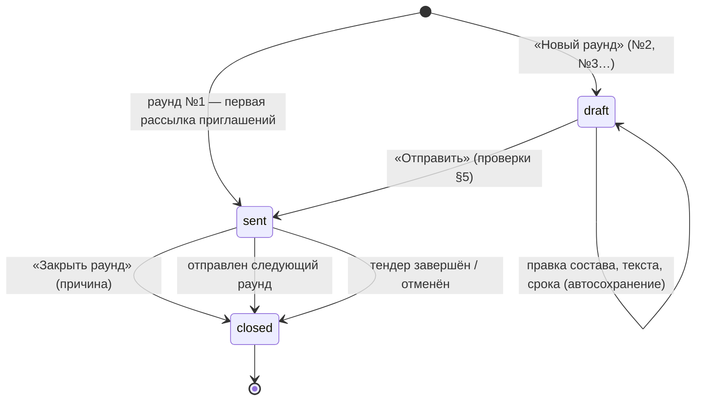

# Раунды (переторжка / уточнение КП)

Раунд — повторный запрос КП у выбранных участников с общим текстом, личными приписками и сроком ответа. Файл описывает раунд №1 (возникает сам), мастер следующего раунда «кому → что → когда», состав и текст письма, предпросмотр «кто получит и кто нет», отправку и доставку, сроки и просрочку, закрытие и состояние участников по раунду.

Связанные разделы: индекс — [tenders.md](tenders.md); подача и переподача КП — [tenders-quotes.md](tenders-quotes.md#83-повторная-подача); приглашения и письма — [tenders-invitations.md](tenders-invitations.md); каскад срока тендера — [tenders-lifecycle.md](tenders-lifecycle.md#71-правка-сроков-после-создания-с-каскадом-на-раунды); динамика в СТ — [tenders-comparison.md](tenders-comparison.md#7-динамика-к-прошлому-раунду); данные — [../05-data-model/tables.md](../05-data-model/tables.md#tender_rounds); API — [../04-api/endpoints-rounds.md](../04-api/endpoints-rounds.md); экран — [../03-screens/tender-card.md](../03-screens/tender-card.md), форма поставщика — [../03-screens/fill.md](../03-screens/fill.md).

Оценка: **M** (модель раундов и правила — S–M; мастер с автосохранением и предпросмотром — M; рассылка и повторная доставка — S).

## 1. Сущности

| Сущность | Таблица | Поля |
|---|---|---|
| Раунд | [tender_rounds](../05-data-model/tables.md#tender_rounds) | тендер, номер (1, 2, …), статус, общий текст `message_all` (до 4 000 символов), срок `deadline_at` (момент времени), автор, дата отправки, закрытие (когда, кто, причина до 500 символов) |
| Адресат раунда | [tender_round_recipients](../05-data-model/tables.md#tender_round_recipients) | раунд, контрагент, «включён», личная приписка (до 4 000), доставка письма (время или текст ошибки), ответ (время и версия КП) |

Номер раунда, в котором подана версия КП, отдельно не хранится — восстанавливается по строке адресата, на которую записана версия (подача вне раунда считается раундом №1).

## 2. Статусы раунда

| Код | Подпись | Смысл |
|---|---|---|
| `draft` | Черновик | Собирается специалистом, поставщикам не виден |
| `sent` | В процессе | Разослан, ждём ответы |
| `closed` | Завершён | Закрыт вручную (с причиной), отправкой следующего раунда или закрытием/отменой тендера |

Одновременно у тендера может быть не более одного черновика; идущим (`sent`) может быть только один раунд — отправка нового закрывает предыдущие идущие. В завершённом/отменённом тендере черновики из списка раундов скрываются.

## 3. Раунд №1

Раунд №1 — исходный сбор КП. Система создаёт его автоматически при первой рассылке приглашений (или при первом открытии списка раундов, если приглашения уже есть): статус «В процессе», адресаты — все живые (не отозванные) приглашённые, без текста и без срока. Письмо-приглашение и есть рассылка раунда №1: его результат записывается в строку адресата. Доприглашённые позже встают в идущий раунд адресатами (без приписки) и, если есть черновик следующего раунда, — в черновик. Напоминание «вы ещё не подали КП» в раунде №1 не добавляется.

## 4. Мастер следующего раунда: «Кому → Что → Когда»

Кнопка «Новый раунд» на вкладке «Раунды» заводит черновик (или открывает существующий). Ограничения: тендер не завершён/не отменён («Тендер в статусе «…» — новый раунд невозможен»), есть хотя бы один живой приглашённый («Сначала пригласите участников — без адресатов раунд завести нельзя»). Номер — максимальный + 1 (заведение защищено от двойного клика блокировкой тендера). По умолчанию: все приглашённые включены, приписок нет, общий текст — стандартный, срок — конец дня окончания сбора КП (23:59 МСК), если эта дата не в прошлом, иначе пусто.

Мастер — боковая панель из трёх шагов; черновик сохраняется сам (правки — локально сразу, на сервер — автосохранением, индикатор «Сохранено / Сохраняем / Ошибка, повторить»); закрыть мастер и вернуться можно в любой момент. Справа — предпросмотр письма и уведомления, собранный сервером по сохранённому черновику, и итог «Будет отправлено N из M, не получат: …».

### 4.1. Шаг «Кому»

Список приглашённых с флажком «включён», сводным статусом контрагента, стадией и последним ответом: «<стадия> · <итог КП> ₽ · без цены: N» или «<стадия>, КП нет». Быстрый выбор:

| Пункт | Кого отмечает |
|---|---|
| Все | Всех приглашённых |
| Не ответившие | Кто ещё не подал КП |
| С неполным КП | Подали КП, но не по всем позициям есть цена (отказ ценой не считается) |

Итог КП в строке считается той же функцией, что итог в СТ. У каждого адресата видно, уйдёт ли письмо: при проблеме — причина («Нет адреса», «Почта выключена», «Почтовый сервер не настроен», …); кабинетное уведомление адресат получит в любом случае.

### 4.2. Шаг «Что»

- **Общий текст** — один на раунд (до 4 000 символов). Стандартный текст: «Просим подать уточнённое коммерческое предложение по тендеру. Форма предзаполнена вашими предыдущими значениями — измените только то, что нужно.» Готовые заготовки:
  - «Уточнение цены»: «Просим подать уточнённое коммерческое предложение по тендеру {тендер} до {срок}. Форма предзаполнена вашими предыдущими значениями — измените только то, что нужно.»
  - «Продление срока»: «Срок подачи КП по тендеру {тендер} продлён до {срок}. Если хотите улучшить предложение — форма открыта.»
  - «Корректировка ФКП»: «В тендере {тендер} скорректирована ФКП (объёмы и состав позиций). Просим проверить изменённые позиции и подать КП по актуальной версии до {срок}.»
- **Личная приписка** — у адресата сверх общего текста (до 4 000).
- **Переменные** (подставляются в общий текст и приписку при предпросмотре и отправке): `{тендер}` → «<название>» (<номер>), `{срок}` → «ДД.ММ.ГГГГ ЧЧ:ММ (МСК)» или «не указан», `{контрагент}` → название контрагента. Кнопка вставляет переменную в позицию курсора.
- Текст адресату = общий текст, пустая строка, приписка (пустые части пропускаются).
- **Напоминание неподавшему**: если к старту раунда (№2 и далее) адресат не подавал КП (нет КП в статусах «Подано», «На доработке», «Принят»), перед текстом добавляется «Напоминаем: вы ещё не подали коммерческое предложение по этому тендеру.» (не дублируется, если текст уже с него начинается).

### 4.3. Шаг «Когда»

Срок ответа — дата и время по Москве. Быстрые варианты: «Конец рабочего дня» (сегодня 18:00), «+3 дня» (18:00), «+1 неделя» (18:00). Предупреждения интерфейса: срок в выходной (суббота/воскресенье по МСК), срок в прошлом. Срок необязателен (раунд без срока допустим).

## 5. Предпросмотр и отправка

**Предпросмотр** (ничего не пишет) возвращает по каждому адресату: включён ли, итоговый текст (с переменными и напоминанием), тему и тело письма, заголовок и текст уведомления в кабинете, исход и причину; и сводку: всего / выбрано / получат письмо / только кабинет / не получат.

| Исход | Когда | Причина |
|---|---|---|
| Письмо и уведомление | включён, приглашение живое, адрес годен, почта работает | — |
| Только кабинет | включён, но письмо не уйдёт | «Нет адреса», «Адрес не расшифрован», «Адрес не принимается», «Почта выключена», «Почта выключена в настройках», «Почтовый сервер не настроен» |
| Не получит | не включён | «Не выбран» |
| Не получит | приглашение отозвано | «Приглашение отозвано — ссылки на форму нет» |

**Письмо раунда** (шаблон `round`, правится администратором): тема «Раунд №{раунд} — {номер}», текст «Здравствуйте! По тендеру «{название}» открыт раунд №{раунд}. Срок ответа: {срок}. {сообщение} Открыть форму: {ссылка}». **Уведомление в кабинете**: «Раунд №N: запрошено уточнение КП», текст «<название>: <первые 180 символов сообщения>».

**Отправка** (кнопка «Отправить», блокируется интерфейсом при: «Не выбран ни один адресат», «Нет текста сообщения» / «Без текста: «…»», «Текст длиннее 4000 символов», «Срок ответа уже прошёл»). Сервер проверяет:

| Проверка | Текст |
|---|---|
| Раунд — черновик | «Отправить можно только черновик» |
| Тендер не завершён/отменён | «Тендер в статусе «…» — рассылка раунда невозможна» |
| Срок не в прошлом | «Срок ответа уже прошёл — выберите другой» |
| Есть включённые адресаты | «Выберите хотя бы одного адресата раунда» |
| У каждого включённого непустой текст | «Пустое сообщение для: «…», «…». Напишите общий текст или приписку» |

При отправке система должна: закрыть предыдущие идущие раунды; перевести раунд в «В процессе» с датой отправки; каждому включённому адресату создать уведомление в кабинете и отправить письмо (результат: «Отправлено» — письмо принял почтовый сервер, иначе текст ошибки; адресату с отозванным приглашением — ошибка доставки без письма); записать по каждому адресату событие `round_invited` (видно этому поставщику) и сводное `round_sent` (адресатов, исключено, доставлено, сбоев). Ответ — раунд, число доставленных и сбоев.

**Повторная отправка** (для идущего и закрытого раунда): выбранным адресатам или, по умолчанию, всем, кому отправить не удалось; ответ — сколько повторено, доставлено, сбоев.

## 6. Ответ поставщика и состояние участников по раунду

- Адресат идущего раунда, ещё не ответивший в нём, может переподать КП (даже если КП уже подано); форма открыта, предзаполнена его текущими ценами и показывает текст раунда с подставленными переменными, срок и изменение каждой ставки к прошлому значению. Сохранение черновика тоже разрешено.
- Подача фиксирует ответ: время и версию КП в строке адресата. Поставщик после подачи видит строку «Раунд №N · версия КП №V · подано ДД.ММ.ГГГГ ЧЧ:ММ» и состояние набора: «Набор полный — ответили все приглашённые.» или «Ваша подача учтена. Ещё не ответили: K.» (число адресатов без ответа сообщается, имена — нет); специалист видит счётчик ответивших («2 из 3»). Автоматически раунд по ответу всех адресатов не закрывается (подсказка формы «раунд закрывается по ответу всех приглашённых» с этим расходится — см. открытые вопросы).
- Невключённый в раунд участник, уже подавший КП, переподать не может (409 «КП уже подано — повторная отправка недоступна»).
- **Срок мягкий**: после истечения срока, пока раунд не закрыт, подача ещё принимается; раунд помечается «просрочен».

| Показатель по адресату | Источник |
|---|---|
| Стадия | общая подпись участника (отправлено / доставлено / заполняет / подано / подано повторно) |
| Доставка | «Отправлено» / «Не удалось отправить» / «Нет данных» |
| Ответил | время ответа и номер версии КП |
| Итог КП, «без цены: N», полное ли | для черновика раунда (подбор адресатов) |

Показатели раунда: адресатов (включённых), ответивших, счётчики доставки, «просрочен» = статус «В процессе» и срок прошёл, «идёт N-й день» (номер дня с даты отправки, цифрой: «идёт 1-й день», «идёт 13-й день»).

## 7. Сроки: продление, каскад, закрытие

- **Продлить до срока тендера** (идущий раунд): новый срок = дата окончания сбора КП тендера 23:59 МСК. Ошибки: «Продлить можно только идущий раунд», «У тендера не задан срок сбора КП», «Срок сбора КП тендера уже прошёл — сначала измените его в окне «Изменить тендер»», «Срок тендера не позже дедлайна раунда — продлевать нечего». Адресатам (включённым, с живым приглашением, кроме отказавшихся) — уведомление «Раунд №N: срок подачи КП продлён» («<название>: подать КП можно до ДД.ММ.ГГГГ.») и письмо «Срок продлён — раунд №N, <номер>»; сбой одного письма не отменяет остальные. Событие `round_deadline_extended` (с/на, сколько уведомлено).
- Срок отправленного раунда молча не меняется: любой сдвиг сопровождается уведомлением; срок отправленного раунда нельзя сократить ни правкой раунда, ни каскадом от тендера («Срок отправленного раунда №N сократить нельзя. Закройте раунд и создайте новый»). Каскад от даты окончания тендера — [tenders-lifecycle.md §7.1](tenders-lifecycle.md#71-правка-сроков-после-создания-с-каскадом-на-раунды).
- **Закрыть раунд** (идущий; «Закрыть можно только идущий раунд»): причина обязательна («Укажите причину закрытия раунда», не длиннее 500 символов — «Причина длиннее 500 символов»). Пишутся время, автор, причина; событие `round_closed`. После закрытия идущего раунда нет: переподача возможна только по доработке/дозаполнению или в следующем раунде.
- Правка раунда — только черновика («Редактировать можно только черновик»); некорректный срок — «Некорректный дедлайн раунда»; адресатом черновика может стать только действующий участник.

## 8. Права

| Действие | Админ | Тендерный специалист | СБ / юрист | Поставщик |
|---|---|---|---|---|
| Список раундов, заведение, правка, предпросмотр, отправка, повторная доставка, продление, закрытие | да | да (доступ к объекту) | технически да при доступе к объекту — проверяется только доступ к объекту (см. открытые вопросы) | нет |
| Видеть свой раунд, текст и срок в форме, ответить | — | — | — | да (адресат) |

## 9. События и уведомления

| Событие ленты | Видно поставщику | Уведомления |
|---|---|---|
| `round_invited` | да (адресату) | кабинет + письмо по шаблону `round` |
| `round_sent` | нет | — |
| `round_deadline_extended` | нет | кабинет + письмо «Срок продлён…» |
| `round_closed` | нет | — |

## 10. Граничные случаи

- Отзыв участника удаляет его из черновика раунда; из отправленного — нет (история). Отправка на отозванного даёт ошибку доставки «Приглашение отозвано — ссылки на форму нет».
- Черновик раунда, заведённый до закрытия тендера, не отправляется и в истории завершённого тендера не показывается.
- Почта выключена: раунд отправляется, все адресаты получают только кабинетное уведомление, в строках — причина; повторная доставка доступна после включения почты.
- Раунд без срока: в письме «Срок ответа: .» не выводится (переменная пуста), просрочки нет.
- Доприглашение в идущий раунд: новый адресат получает обычное письмо-приглашение, а не письмо раунда.

## 11. Пример

Тендер `T-2026-111`, после раунда №1 лидер — Гамма (897 000 ₽), Альфа вторая (965 000 ₽, Δ +7,58 %). Специалист заводит раунд №2: шаг «Кому» — «Все» (3 из 3), шаг «Что» — заготовка «Уточнение цены», приписка Альфе «Просим пересмотреть цену по стяжке (позиция 1)», шаг «Когда» — «+3 дня» (срок 18.10.2026 18:00 МСК). Предпросмотр: «Будет отправлено 3 из 3». После отправки раунд №1 закрыт, №2 «В процессе». Альфа переподаёт КП (версия 2: стяжка 450 + 300 = 750 ₽/м², трап 4 000 + 1 200 = 5 200 ₽/шт.) → ответ зафиксирован, «1 из 3». Бета и Гамма не отвечают; 18.10 в 18:01 раунд помечен «просрочен»; специалист закрывает его с причиной «Переторжка завершена». Расчёт после раунда — [end-to-end-scenarios.md](end-to-end-scenarios.md#сценарий-1-тендер-от-создания-до-протокола).
