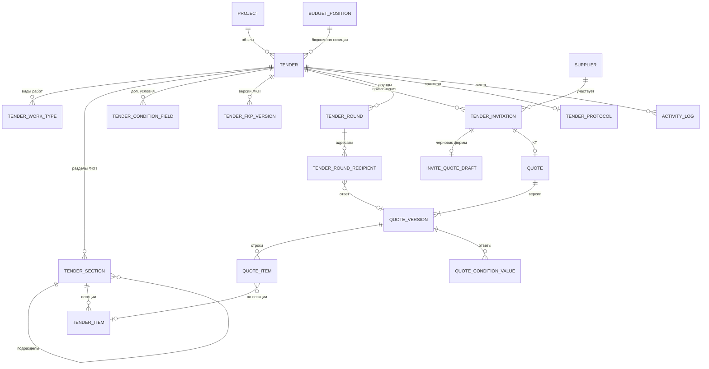
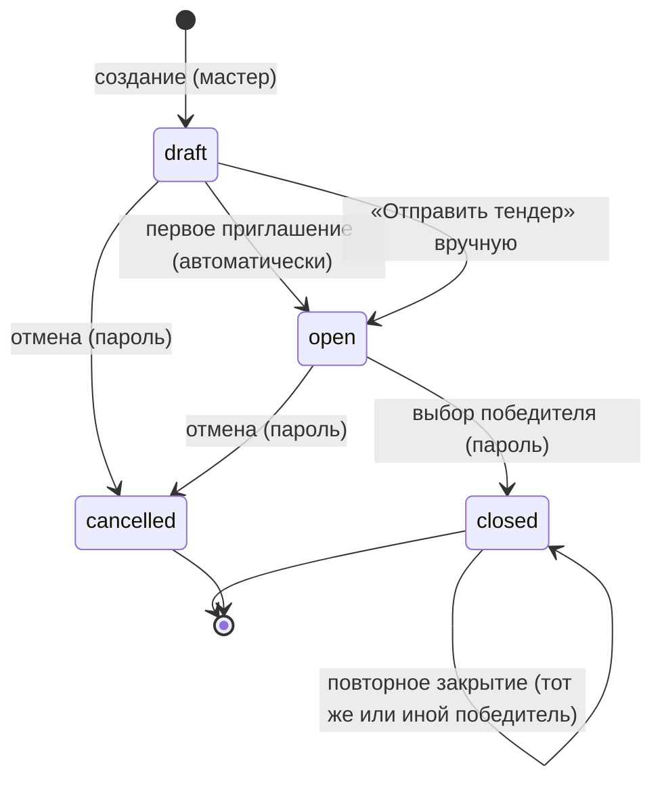

# Домен «Тендеры» — индекс

Тендер — закупка работ под конкретный объект: состав работ (ФКП), приглашённые контрагенты, их коммерческие предложения (КП), сравнительная таблица (СТ), раунды переторжки, выбор победителя и протокол. Этот файл — карта домена: назначение, сущности, общая статусная модель, флаг «требует внимания», права и ссылки на подробные разделы.

Связанные разделы: модель данных — [../05-data-model/tables.md](../05-data-model/tables.md#tenders); API — [../04-api/endpoints-tenders.md](../04-api/endpoints-tenders.md), [../04-api/endpoints-rounds.md](../04-api/endpoints-rounds.md), [../04-api/endpoints-quotes.md](../04-api/endpoints-quotes.md); экраны — [../03-screens/tenders-registry.md](../03-screens/tenders-registry.md), [../03-screens/tender-create.md](../03-screens/tender-create.md), [../03-screens/tender-card.md](../03-screens/tender-card.md), [../03-screens/quotes-inbox.md](../03-screens/quotes-inbox.md), [../03-screens/quote-card.md](../03-screens/quote-card.md), [../03-screens/templates.md](../03-screens/templates.md), [../03-screens/fill.md](../03-screens/fill.md), [../03-screens/cabinet.md](../03-screens/cabinet.md).

## 1. Подразделы домена

| Файл | Что в нём | Сложность |
|---|---|---|
| [tenders-lifecycle.md](tenders-lifecycle.md) | Создание (мастер, черновики мастера, шаблоны), поля и валидации, номер, сроки, смена статусов, закрытие с победителем, отмена, правка ФКП и версии ФКП, заметки, «требует внимания» | L |
| [tenders-invitations.md](tenders-invitations.md) | Приглашение участников, персональная ссылка (magic-link), стадии участника, письма, черновик КП по ссылке, регистрация нового контрагента | M |
| [tenders-quotes.md](tenders-quotes.md) | КП и версии КП, ставки и стоимость, корректировки, доп. условия, НДС, «заполнено», подача и повторная подача, загрузка Excel-файла КП, входящие КП, решения по КП | L |
| [tenders-comparison.md](tenders-comparison.md) | Сравнительная таблица: все формулы (итоги, полнота, медиана, отклонение, MIN/MAX, Δ к лидеру, «честный минимум», потенциал, разброс, вес, ключевые позиции, аномалии, динамика), сортировки, фильтры, экспорт СТ, маска контактов | XL |
| [tenders-rounds.md](tenders-rounds.md) | Раунды (переторжка/уточнение): мастер «кому → что → когда», письма, предпросмотр, доставка, сроки, просрочка, закрытие | M |
| [tenders-documents.md](tenders-documents.md) | Пакет документов тендера, протокол (docx), выгрузки и штампы | L |
| [end-to-end-scenarios.md](end-to-end-scenarios.md) | Сквозные сценарии с числами: от создания тендера до протокола; регистрация подрядчика; тендер из шаблона; работа поставщика | — |

Смежные домены: разбор Excel-ведомости в ФКП — [fkp-import.md](fkp-import.md); контрагенты, анкета и квалификация — [suppliers.md](suppliers.md); обсуждения ячеек и позиций — [comments.md](comments.md); пороги аналитики и шаблоны писем — [settings.md](settings.md).

## 2. Назначение домена

Система должна позволять тендерному специалисту:

1. завести тендер внутри объекта (портфель → проект → тендер) из Excel-ведомости или шаблона, задав виды работ, бюджетную позицию, плановую сумму и срок сбора КП;
2. пригласить контрагентов из реестра; каждый получает персональную ссылку на онлайн-форму КП (ФКП) без логина;
3. получать КП онлайн: поставщик вводит ставки материалов и работ за единицу, может отказаться от позиции, предложить свой объём или свою позицию, ответить на доп. условия, подтвердить НДС и подать;
4. видеть все КП в сравнительной таблице с автоматически рассчитанными итогами, медианами, отклонениями, разбросом, аномалиями и потенциалом экономии;
5. принимать решения по корректировкам, запрашивать доработку, проводить раунды переторжки;
6. выбрать победителя, завершить тендер, выгрузить СТ (Excel) и протокол (docx).

Решение о победителе всегда принимает человек: ни подсветка, ни аналитика, ни ИИ победителя не назначают.

## 3. Сущности

| Сущность | Таблица | Кратко |
|---|---|---|
| Тендер | [tenders](../05-data-model/tables.md#tenders) | Номер, название, объект, бюджетная позиция и плановая сумма, ответственный, срок сбора КП, системный и пользовательский статус, флаг «требует внимания», победитель, пакет документов, заметка сотрудников, ревизия |
| Вид работ тендера | [tender_work_types](../05-data-model/tables.md#tender_work_types) | Один или несколько видов работ (связь многие-ко-многим) |
| Раздел ФКП | [tender_sections](../05-data-model/tables.md#tender_sections) | Дерево любой глубины; номер раздела из файла, справочные ед. и объём подраздела, место подраздела среди позиций родителя |
| Позиция | [tender_items](../05-data-model/tables.md#tender_items) | Наименование, ед. изм., объём; исходный объём, признаки «снята» и «скорректирована»; атрибуты строки ведомости |
| Доп. условие | [tender_condition_fields](../05-data-model/tables.md#tender_condition_fields) | Нецифровой вопрос поставщику: срок, аванс, гарантия… |
| Версия ФКП | [tender_fkp_versions](../05-data-model/tables.md#tender_fkp_versions) | Снимок структуры после каждой правки состава; дата рассылки участникам |
| Приглашение | [tender_invitations](../05-data-model/tables.md#tender_invitations) | Связь «тендер × контрагент», персональный токен ссылки, стадия участника |
| Черновик КП по ссылке | [invite_quote_drafts](../05-data-model/tables.md#invite_quote_drafts) | Последнее состояние формы поставщика до подачи (одна строка на приглашение) |
| КП | [quotes](../05-data-model/tables.md#quotes) | Одно КП на приглашение; статус, пользовательский статус, автор, комментарий доработки, отметка «просмотрено» |
| Версия КП | [quote_versions](../05-data-model/tables.md#quote_versions) | Неизменяемый снимок подачи: номер, «текущая», дата, версия ФКП, подтверждение НДС, кто подал |
| Строка КП | [quote_items](../05-data-model/tables.md#quote_items) | Ставки материалов и работ за единицу, отказ, свой объём, своя позиция, решение специалиста, комментарий поставщика, признак «дозаполнить» |
| Ответ на доп. условие | [quote_condition_values](../05-data-model/tables.md#quote_condition_values) | Текст ответа поставщика по версии КП |
| Раунд | [tender_rounds](../05-data-model/tables.md#tender_rounds) | Номер, статус (черновик / в процессе / завершён), общий текст, срок, закрытие с причиной |
| Адресат раунда | [tender_round_recipients](../05-data-model/tables.md#tender_round_recipients) | Включён ли, личная приписка, доставка письма, ответ (версия КП) |
| Шаблон тендера | [tender_templates](../05-data-model/tables.md#tender_templates) | Слепок структуры (разделы, позиции, доп. условия, вид работ, карта колонок) |
| Черновик мастера создания | [tender_creation_drafts](../05-data-model/tables.md#tender_creation_drafts) | Незавершённое создание тендера: шаги, разобранная структура, исходный файл |
| Протокол | [tender_protocols](../05-data-model/tables.md#tender_protocols) | Реквизиты протокола, введённые пользователем (один JSON на тендер) |
| Лента активности | [activity_log](../05-data-model/tables.md#activity_log) | События тендера для ленты сотрудника и (частично) кабинета поставщика |
| Дефолты вида работ в объекте | [project_work_type_configs](../05-data-model/tables.md#project_work_type_configs) | Подсказка мастеру: даты сбора КП и шаблон по умолчанию для пары «объект × вид работ» |

## 4. Статусная модель тендера

### 4.1. Системные статусы

В коде системных статусов **четыре**. Отдельного статуса «На рассмотрении» нет: тендер остаётся в «Сборе предложений» до выбора победителя или отмены, а прохождение срока сбора КП показывается признаком «Соблюдение сроков» (§4.4). Вопрос о введении пятого статуса — в открытых вопросах.

| Код | Подпись | Тон капсулы | Смысл | Что разрешено |
|---|---|---|---|---|
| `draft` | Черновик | нейтральный | Тендер создан, никого не пригласили | Править всё; приглашать (первое приглашение переводит в `open`) |
| `open` | Сбор предложений | информационный | Приглашения разосланы, идёт приём КП и раунды | Подача/переподача КП, раунды, корректировки, правка ФКП |
| `closed` | Завершён | успех | Выбран победитель | Только чтение, сравнение, выгрузки, протокол, переписка |
| `cancelled` | Отменён | опасность | Закупка не состоялась | То же, что у `closed` |

| Переход | Кто | Условия и проверки | Побочные эффекты |
|---|---|---|---|
| `draft → open` (авто) | система | При создании первого приглашения | Заводится раунд №1 «В процессе» со всеми приглашёнными; дата смены статуса обновляется; в ленту событие не пишется |
| `draft → open` (вручную) | право `tenders.manage` | Интерфейс перед переводом проверяет чек-лист: есть приглашённые («Не приглашены контрагенты»), есть позиции («В тендере нет позиций»), задан срок («Не указан срок сбора КП»). Сервер этих проверок не делает | Событие `tender_status_changed` |
| `open → closed` | право `tenders.manage` + повторный ввод пароля | Победитель обязателен и должен быть участником (приглашение не отозвано); неаккредитованный победитель — только с подтверждением и комментарием | КП победителя → `accepted`; идущие раунды закрываются; уведомления — см. [tenders-lifecycle.md §8](tenders-lifecycle.md#8-закрытие-тендера-и-выбор-победителя) |
| `draft/open → cancelled` | право `tenders.manage` + пароль | — | `closed_at` = сейчас; идущие раунды закрываются; событие в ленту; писем участникам нет |
| `closed/cancelled → *` | — | Запрещено: «Переход из «Завершён»/«Отменён» запрещён без административного восстановления с причиной» | Механизма административного восстановления в системе нет (см. открытые вопросы) |
| `open → draft` | — | Интерфейс не предлагает; сервер не запрещает (см. открытые вопросы) | — |

Каждая смена статуса записывает время смены (`status_changed_at`) — колонка реестра «Дата изменения статуса».

### 4.2. Пользовательский статус

Поверх системного статуса тендеру и КП можно поставить пользовательский статус из справочника статусов (администратор ведёт его в «Справочниках»). Это ярлык без логики: свой текст и один из пяти тонов (`info`, `success`, `warning`, `danger`, `neutral`). Ставится в карточке тендера, проверяется по справочнику («Неизвестный статус тендера» / «Неизвестный статус КП»), смена пишется в ленту (`tender_custom_status_changed`, `quote_status_changed`), контрагенту не видна. Реестр тендеров фильтрует и группирует по нему, входящие КП фильтруют. Сводка «сколько записей помечено каждым статусом» — отдельный запрос (используется справочником при архивации статуса).

### 4.3. Флаг «Требует внимания»

Флаг — хранимый признак тендера (`needs_attention`), не статус. Система должна выставлять его в `true` при:

| Событие | Где |
|---|---|
| Поставщик подал КП с изменённым объёмом хотя бы по одной позиции | подача КП |
| Специалист дополнил ФКП разделами/позициями/условиями | правка структуры |
| Специалист изменил объём или снял позиции | правка позиций |
| Специалист вставил позицию | вставка позиции |

Сбрасывающего действия в текущей реализации нет — флаг остаётся `true` до конца жизни тендера (см. открытые вопросы). Интерфейс показывает флажок только у тендеров в статусах «Черновик» и «Сбор предложений»; в реестре есть переключатель-фильтр «Требует внимания» (один клик), на главной — блок тендеров, требующих внимания.

### 4.4. Соблюдение сроков (вычисляемо)

| Статус тендера | Условие | Значение |
|---|---|---|
| `open` | сегодня (МСК) > даты окончания сбора КП | «Просрочен» |
| `open` | иначе | «В срок» |
| `closed` | московский день завершения ≤ даты окончания | «В срок» |
| `closed` | иначе | «С опозданием» |
| `draft`, `cancelled`, тендер без даты окончания | — | пусто |

### 4.5. Заморозка после завершения

В статусах «Завершён» и «Отменён» система должна запрещать: приглашение участников, подачу и переподачу КП, сохранение черновика КП, правку состава ФКП (разделы, позиции, условия, пересборка разделов), правку названия/сроков/видов работ, заведение, правку и рассылку раундов, продление срока раунда, отклонение КП. Остаются доступны: чтение карточки и СТ, выгрузки, протокол, переписка, лента, пользовательский статус. Тексты отказов — в [tenders-lifecycle.md](tenders-lifecycle.md#18-ошибки-и-тексты-отказов).

## 5. Права (роль × действие)

Доступ к конкретному тендеру дополнительно ограничен доступом к его объекту: сотрудник видит тендер, только если проект тендера входит в его доступные проекты (гранты на портфель/проект с подпроектами); администратор видит всё. Нет доступа → 403 «Нет доступа к тендерам этого проекта»; нет тендера → 404 «Тендер не найден». Права роли по умолчанию: тендерный специалист — `tenders.manage`, `quotes.manage`, `portfolios.manage`, `reports.view`, `budget.view`, `suppliers.contacts.view`; СБ — `security.manage`, `suppliers.contacts.view`; юрист — `suppliers.contacts.view`; администратор — все. Право видеть цены (`finance.view`) складывается по ИЛИ с персональным флагом пользователя «видит финансы».

| Действие | Админ | Тендерный специалист | СБ / юрист | Поставщик (по ссылке) |
|---|---|---|---|---|
| Создать тендер, править поля и статус, пригласить, перевыпустить/отозвать ссылку, сохранить протокол | да | да (`tenders.manage`) | нет | нет |
| Дополнить ФКП, править/вставить позиции, раунды, документы, заметки | да | да | технически да при доступе к объекту (см. открытые вопросы) | нет |
| Входящие КП, карточка КП, отклонить КП, пользовательский статус КП | да | да (`quotes.manage`) | нет | нет |
| Решение по корректировке, запрос доработки, версии КП | да | да | технически да при доступе к объекту | нет |
| Смотреть СТ и выгружать её | да | да | при доступе к объекту | нет |
| Видеть цены в СТ, плановую сумму, протокол | да | при `finance.view` или флаге | при `finance.view` или флаге | только своё КП |
| Видеть полные ИНН/почту/телефон участников | да | да | да | — |
| Заполнить и подать своё КП, загрузить файл КП, приложить документы | — | — | — | да |

## 6. Сквозные правила

- Все суммы — в рублях с НДС (ставка из настройки `VAT_RATE_PCT`, по умолчанию 22 %); пересчёта «без НДС» нет.
- Время в письмах, сроках раундов, подписях — московское (UTC+3); в API даты — ISO 8601 UTC.
- Ревизия тендера (`tender_revision`) растёт при правке состава, решениях по корректировкам и подаче КП и вместе с отпечатком КП служит ключом кэша СТ и цен реестра (см. [tenders-comparison.md](tenders-comparison.md#14-кэширование-и-производительность)).
- Персональные данные и контакты участников в СТ маскируются по настройке `CONTACTS_MASK_ENABLED` (см. [tenders-comparison.md](tenders-comparison.md#13-маска-контактов-и-маскировка-цен)).

## 7. Фоновые задачи домена

| Задача | Где | Описание |
|---|---|---|
| Разбор Excel-ведомости (задание `parse_excel`) | очередь фоновых заданий в БД | Мастер создания отправляет файл и получает id задания; разбор идёт фоном, клиент опрашивает статус; дедупликация по хешу файла 30 дней; таймаут зависания и число попыток — настройки `PARSE_JOB_HANG_SECONDS` (600 с), `PARSE_JOB_MAX_ATTEMPTS` (3). Подробно — [fkp-import.md](fkp-import.md) |
| Периодических задач у домена нет | — | Просрочка раундов, соблюдение сроков, «новые КП» вычисляются при чтении |

## 8. Флаги конфигурации домена (только имена)

`VAT_RATE_PCT`, `CREATION_DRAFT_TTL_DAYS`, `FKP_FORM_LOCKED`, `CONTACTS_MASK_ENABLED`, `PROTOCOL_PLACE`, `PROTOCOL_CHAIRMAN`, `CLIENT_NAME`, `BRAND_NAME`, `PUBLIC_APP_URL`, `MAIL_ENABLED`, `HEAVY_READ_RATE_LIMIT`, `HEAVY_READ_RATE_WINDOW`, `PARSE_JOB_HANG_SECONDS`, `PARSE_JOB_MAX_ATTEMPTS`. Пороги аналитики СТ хранятся не в конфиге, а в системных настройках (таблица `app_settings`), их правит администратор.

## 9. Оценка

Домен целиком — **XL** (самый крупный в системе): ~20 тыс. строк серверной логики, сложная арифметика СТ, Excel-выгрузка с формулами, мастер создания, публичная форма поставщика. Разбивка — в таблице §1.
