# Карточка бюджетной позиции (`/budget/:id`)

Дочерний экран раздела «Бюджет»: одна статья бюджета на выбранный год — освоение, четыре метрики, тендеры, привязанные к позиции, подпозиции и история изменений выделенной суммы.

Связанные разделы: формулы — [../02-business-logic/budget.md §5](../02-business-logic/budget.md#5-расчёты-и-формулы); API — [GET /budget-positions/{id}](../04-api/endpoints-catalog.md#get-budget-positionsitem_id); раздел — [budget.md](budget.md); справочник позиций — [catalog-budget-positions.md](catalog-budget-positions.md).

## Маршрут

- `/budget/:id`, `:id` — числовой id позиции. Год («Период») и вкладка — состояние страницы; при открытии — текущий год и вкладка «Обзор».
- Крошки «Бюджет / <код позиции>» (без кода — id).

## Назначение

Разобрать одну статью: сколько на неё выделено в году, сколько связано тендерами и израсходовано, какие тендеры её тратят, как распределена сумма по подпозициям и кто и когда менял выделенную сумму.

## Роли и права

| Роль | Доступ |
|---|---|
| Администратор, тендерный специалист | Да; экран только для чтения (правок здесь нет) |
| СБ, юрист | Нет — адрес раздела «Тендеры», перенаправление на `/home` (хотя API карточки им доступен — [BL §6](../02-business-logic/budget.md#6-права-доступа)) |
| Поставщик, лид, владелец площадки | Нет |

## Как попасть

Ссылки на позицию в таблицах «Обзор» и «Бюджеты», в сигналах раздела «Бюджет», в справочнике «Позиции», из вкладки «Состав» другой позиции.

## Компоновка

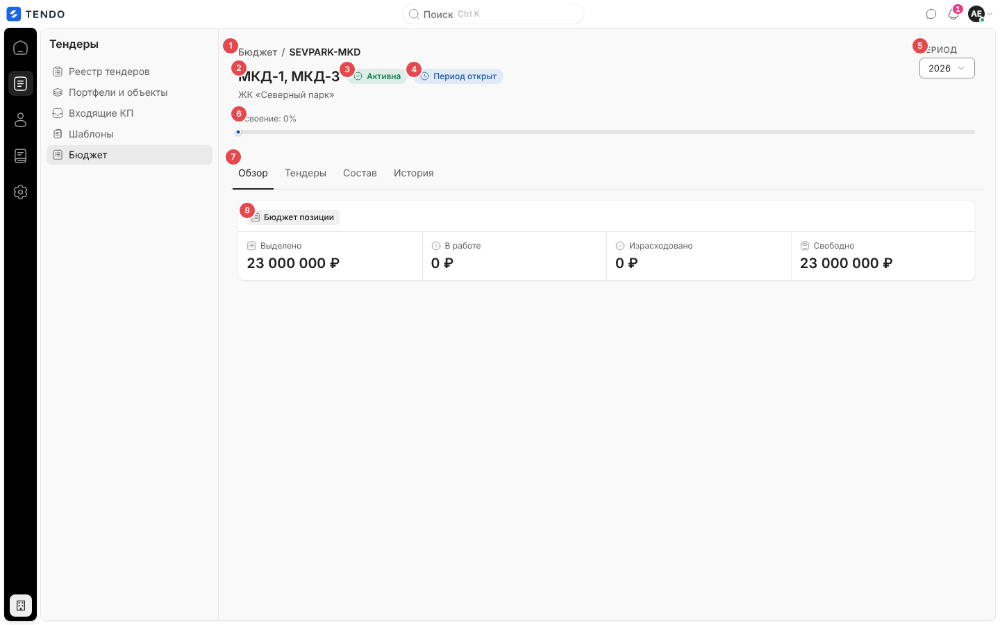

| № | Элемент | Поведение |
|---|---|---|
| ① | Крошки «Бюджет / <код>» | «Бюджет» — ссылка на `/budget` |
| ② | Название позиции (`h1`) | Под ним — путь **только по предкам** (« › »); у корневой позиции подписи нет |
| ③ | Капсула «Активна» / «Архив» | — |
| ④ | Капсула «Период открыт» / «Период закрыт» | Только если на выбранный год есть назначение |
| ⑤ | «Период» | Прошлый / текущий / следующий год; перечитывает карточку |
| ⑥ | «Освоение: N%» + полоса | `min(100, round((в работе + израсходовано) / выделено × 100))`, при выделено = 0 — 0%; при «Свободно» < 0 рядом красная капсула «Превышение» (цвет полосы не меняется) |
| ⑦ | Вкладки «Обзор · Тендеры · Состав · История» | — |
| ⑧ | «Бюджет позиции» | «Выделено», «В работе», «Израсходовано», «Свободно» (< 0 — красным) — **собственные** значения позиции на год |

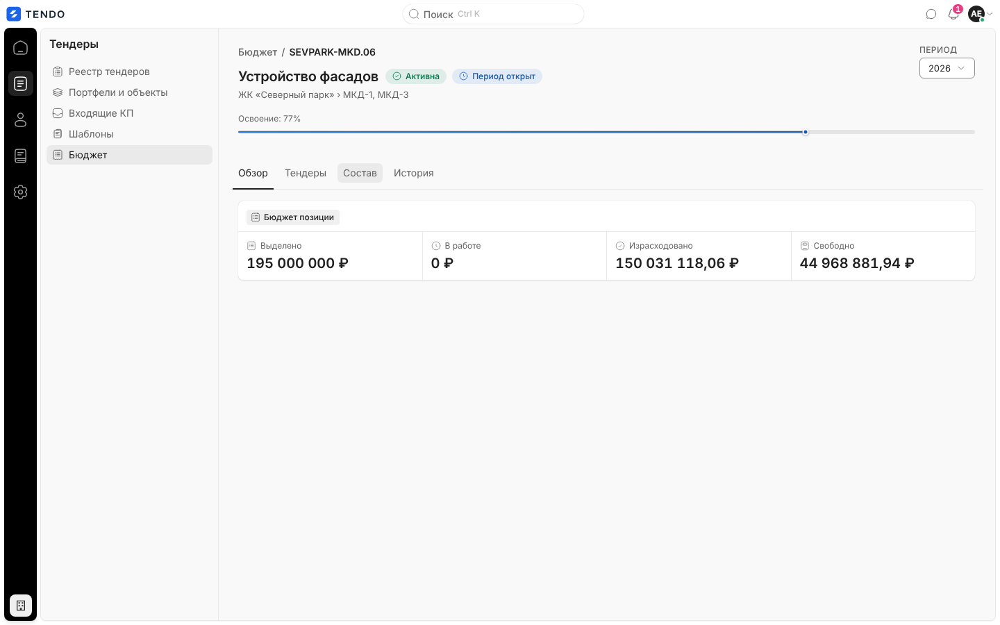

## Вкладки

| Вкладка | Содержимое | Пусто |
|---|---|---|
| Обзор | Полоса четырёх метрик | — |
| Тендеры | «Тендер» (`T-2026-100 · название`, ссылка на карточку тендера), «Проект», «Статус» (капсула), «План» (плановый бюджет тендера, ₽ или «—»); подпись «Тендеров: N» | «Тендеров нет» / «В выбранном периоде к позиции ничего не привязано.» |
| Состав | Подпозиции: «Название» (ссылка на их карточку), «Выделено», «Свободно» (< 0 — красным); «Подпозиций: N» | «Подпозиций нет» / «Дочерние статьи появятся здесь.» |
| История | Изменения выделенной суммы за год: «Когда» (дата-время МСК), «Было», «Стало», «Комментарий» (например, «Перенос на подпозицию «…» (−15000000.00)»); «Записей: N» | «Истории нет» / «Изменения выделенной суммы появятся здесь.» |

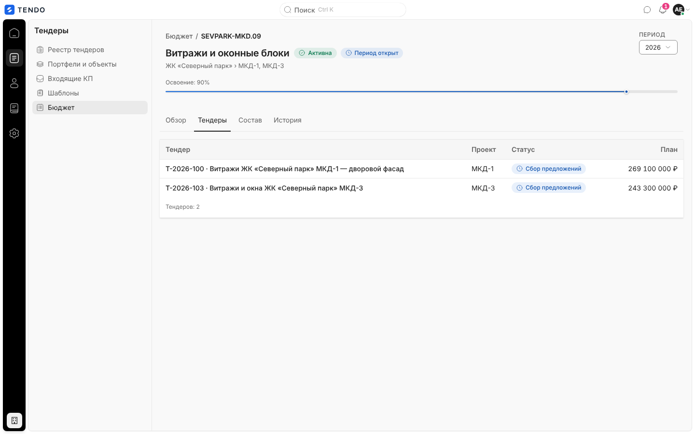

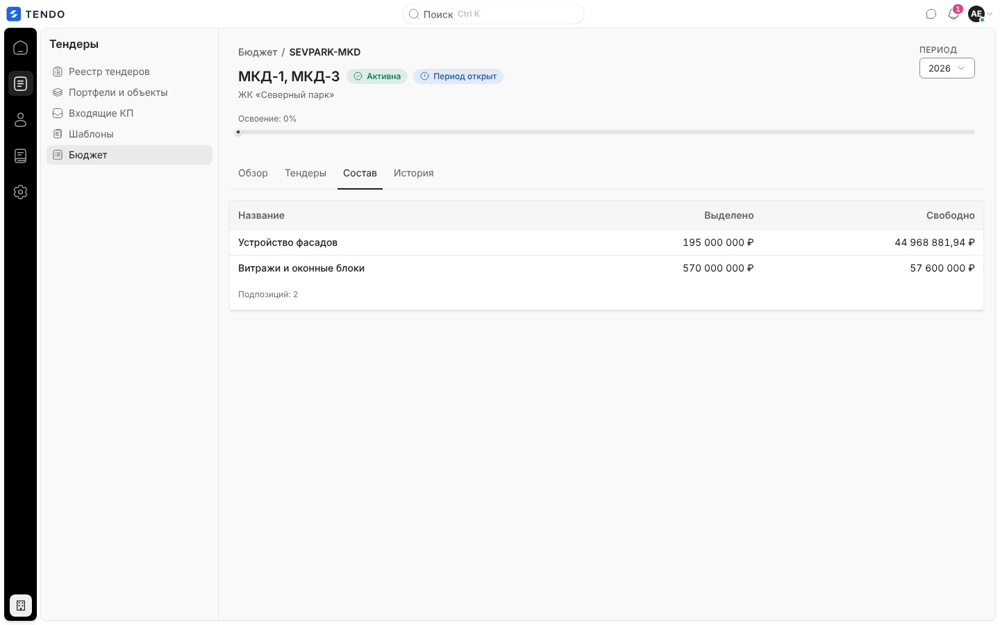

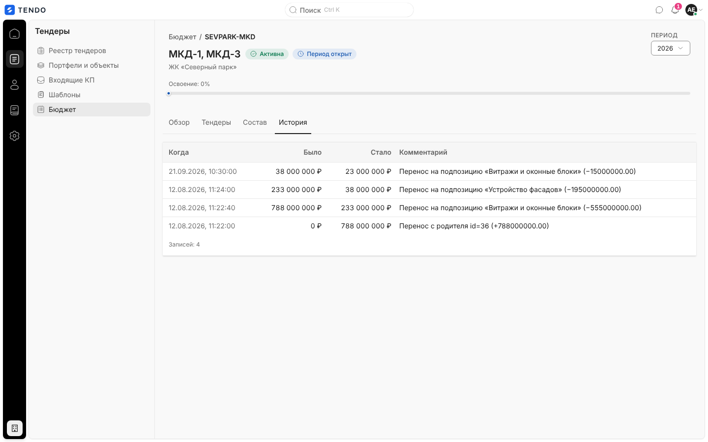

Сортировок, фильтров, пагинации, действий и выгрузок на экране нет.

## Данные

`GET /budget-positions/{id}?year=` — метрики позиции на год, путь, статус периода, тендеры, подпозиции, история ([описание](../04-api/endpoints-catalog.md#get-budget-positionsitem_id)).

## Состояния

| Состояние | Что видит пользователь | Снимок |
|---|---|---|
| Загрузка | Кольцо «Загружаем позицию…» по центру | 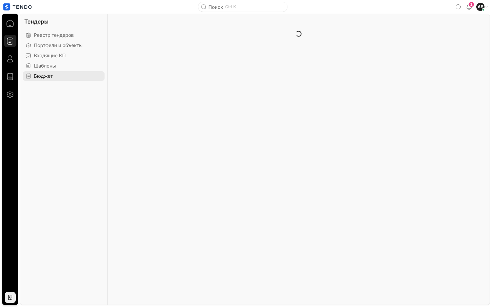 |
| Не найдена (404) | «Такой позиции бюджета нет», «Позицию удалили из справочника, или в ссылке ошибка. Все статьи — в разделе «Бюджет».», «К бюджету», «Код 404 · <путь>» | 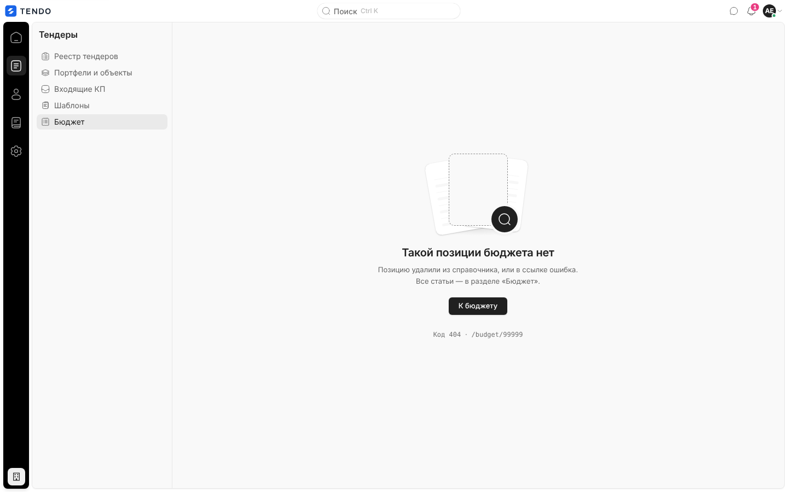 |
| Ошибка | «Позиция не загрузилась» + текст, «Повторить», «К бюджету» (без сети — иллюстрация «нет связи») | 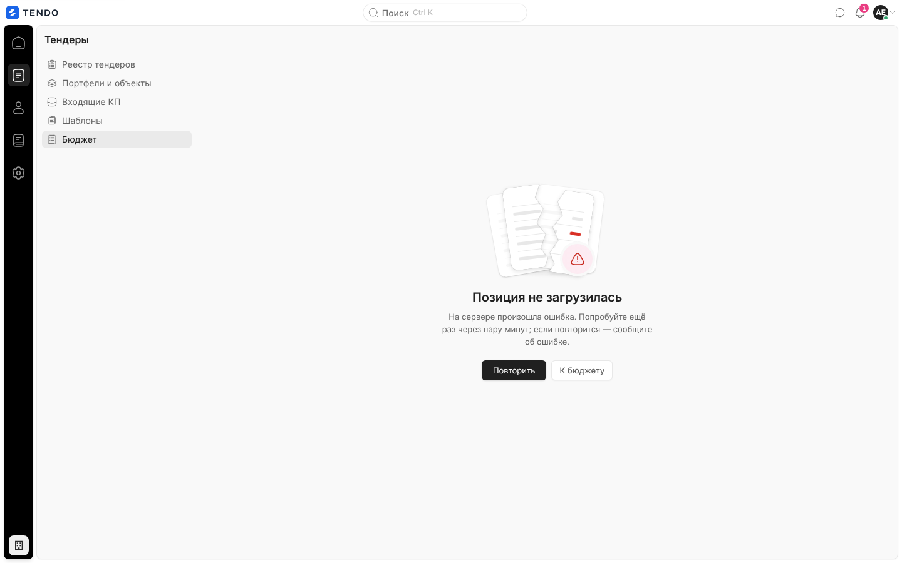 |
| Год без назначения | Метрики нули, капсулы периода нет | 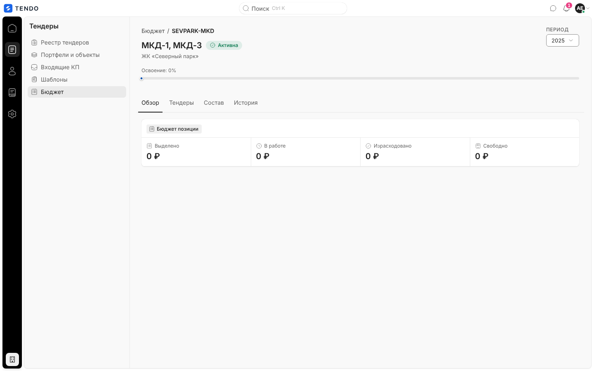 |
| Пустые вкладки | см. таблицу вкладок | 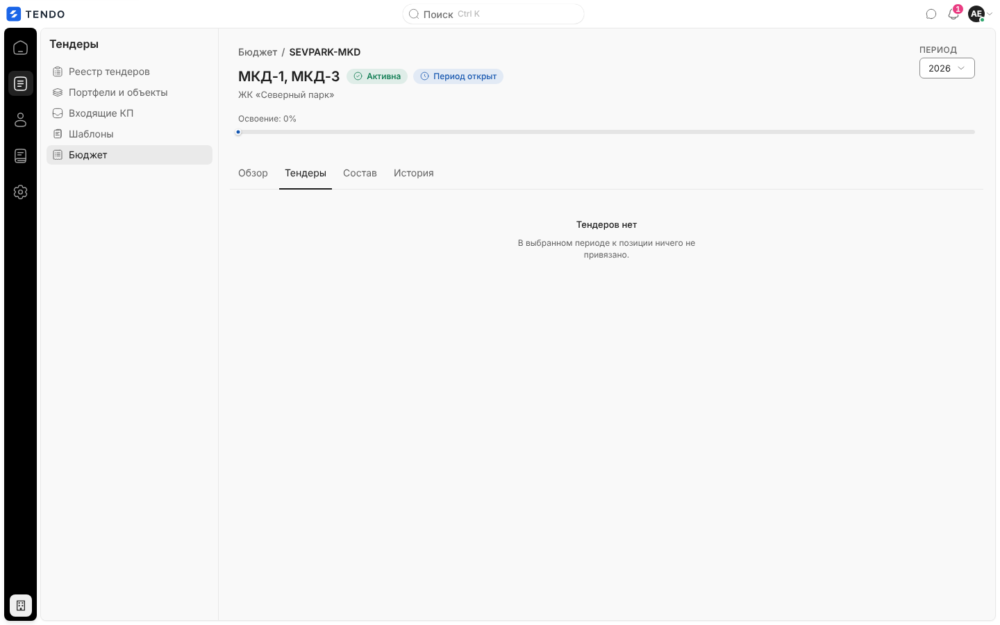 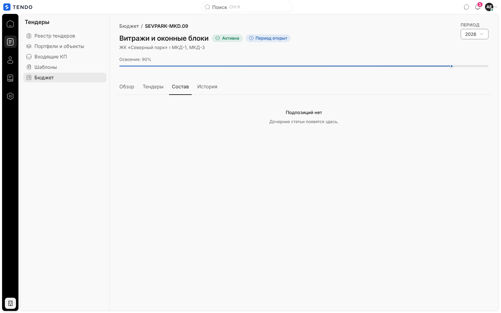 |

## Переходы

| Откуда | Куда |
|---|---|
| Крошка «Бюджет», «К бюджету» | `/budget` |
| Строка тендера | `/tenders/<id>` |
| Подпозиция | `/budget/<id подпозиции>` |

## Сложность

**S–M**.
