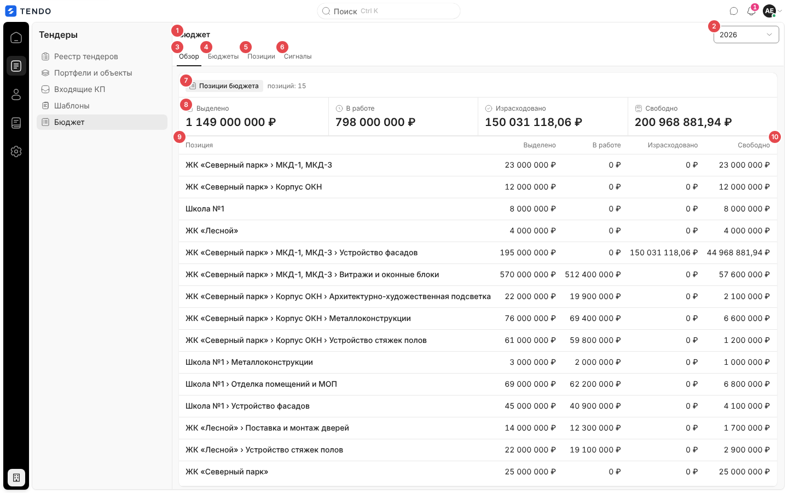
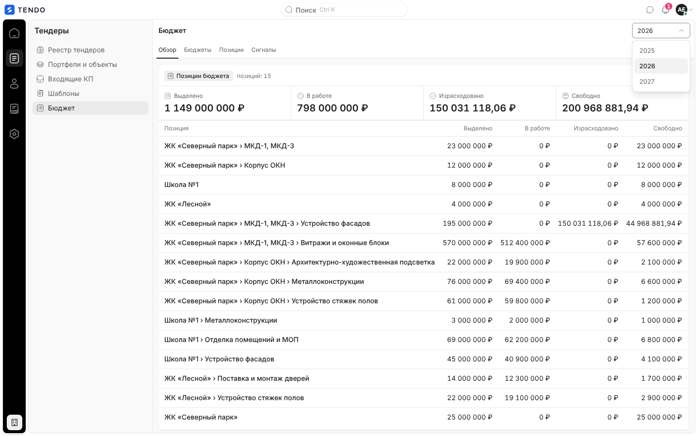
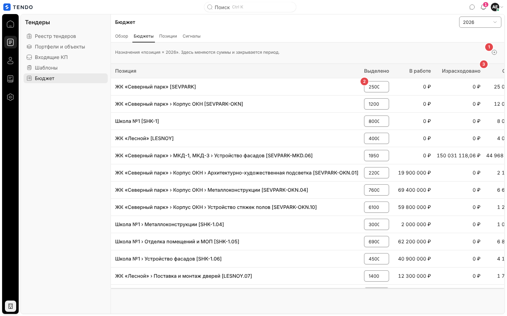
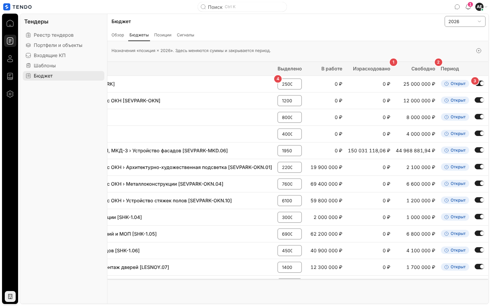
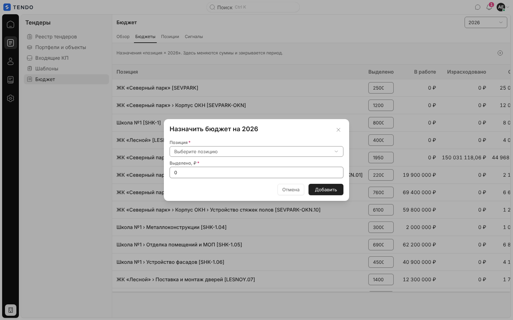
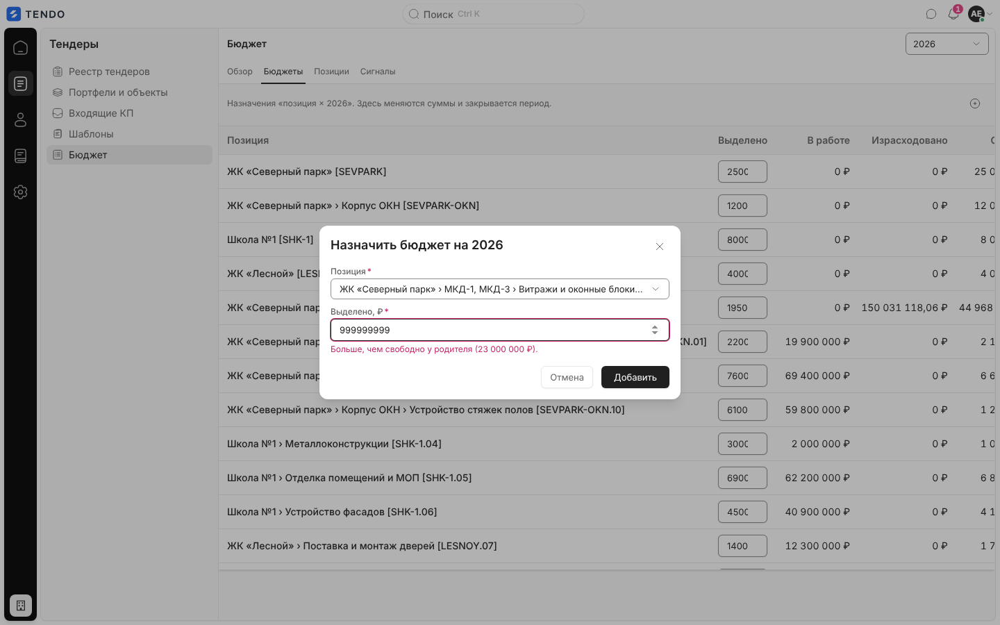
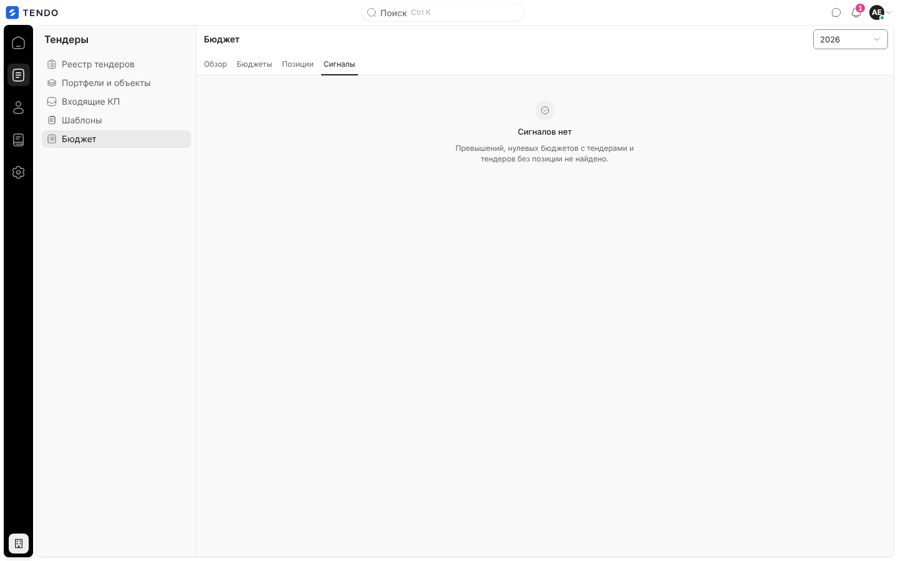
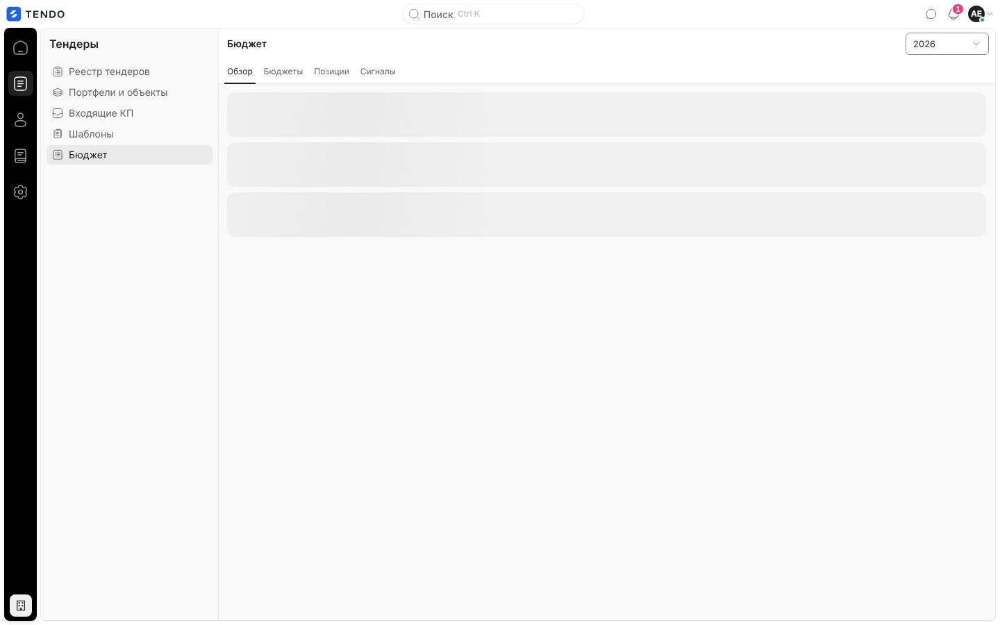
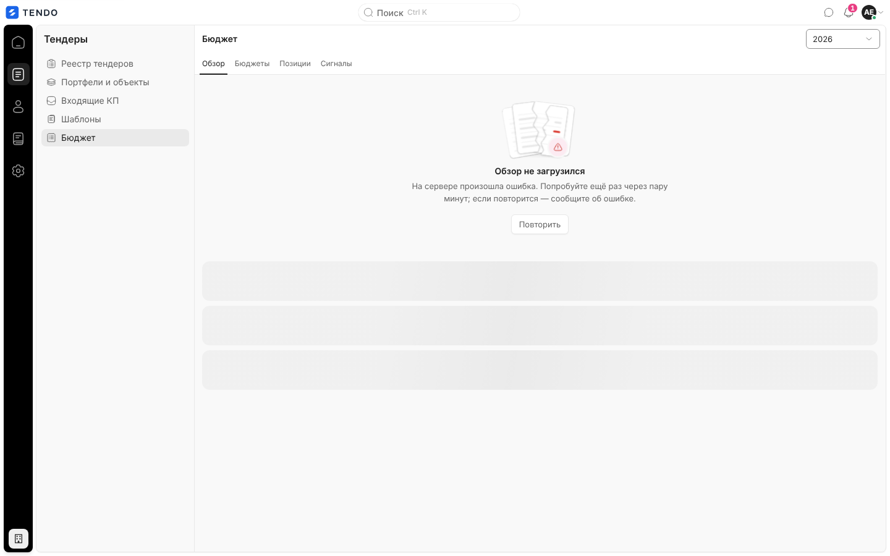
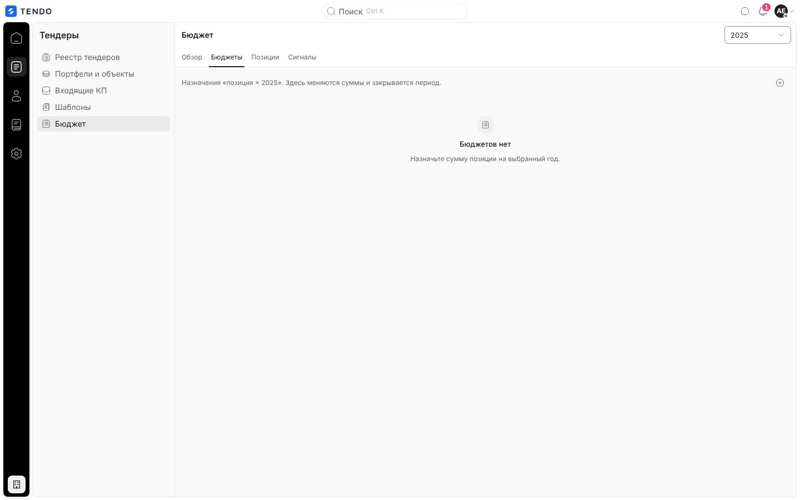

# Бюджет (`/budget`)

Раздел бюджета закупок на выбранный год: сводка по бюджетным позициям («Выделено / В работе / Израсходовано / Свободно»), назначения сумм «позиция × год» с закрытием периода, справочник позиций деревом и сигналы (перерасход, нулевой бюджет при тендерах, тендеры без позиции).

Связанные разделы: бизнес-логика и формулы — [../02-business-logic/budget.md](../02-business-logic/budget.md) (§5 «Расчёты и формулы»); API — [../04-api/endpoints-budget.md](../04-api/endpoints-budget.md), позиции — [../04-api/endpoints-catalog.md#бюджетные-позиции](../04-api/endpoints-catalog.md#бюджетные-позиции); вкладка «Позиции» — [catalog-budget-positions.md](catalog-budget-positions.md); карточка позиции — [budget-position.md](budget-position.md); манометр бюджета на главной — [home.md](home.md).

## Маршрут

- `/budget`. Вкладка и год — состояние страницы (в адрес не пишутся); при открытии — вкладка «Обзор» и **текущий календарный год**.
- Старый адрес `/catalog/budget-positions` перенаправляет сюда (заменой записи истории) — см. [catalog-budget-positions.md](catalog-budget-positions.md).
- Заголовок — «Бюджет».

## Назначение

Ответить на вопрос «хватает ли денег по статьям»: сколько выделено на год, сколько связано идущими тендерами, сколько ушло по завершённым, где перерасход; распределить деньги по позициям и закрыть период, когда год сведён.

## Роли и права

| Роль | Доступ | Что меняется |
|---|---|---|
| Администратор | Да | Все действия |
| Тендерный специалист | Да | Видит то же самое; правка сумм, назначение и закрытие периода требуют права `budget.manage` (по умолчанию **не выдано**) — интерфейс поля и переключатели не блокирует, отказ сервера показывается окном «Не удалось сохранить» / «Не удалось изменить статус периода» / «Не удалось назначить бюджет» с текстом 403 |
| СБ, юрист | Нет | Раздел «Тендеры» скрыт; `/budget` уводит на `/home` |
| Поставщик, лид, владелец площадки | Нет | Перенаправление на стартовый экран роли |

Суммы бюджета правом «видит финансы» не маскируются ([BL §6](../02-business-logic/budget.md#6-права-доступа)).

## Как попасть

- Рейл «Тендеры» → «Бюджет».
- Сигналы манометра бюджета на главной; крошка «Бюджет» и кнопка «К бюджету» на карточке позиции.

## Общая компоновка и вкладка «Обзор»

| № | Элемент | Поведение |
|---|---|---|
| ① | Заголовок «Бюджет» | — |
| ② | Выбор года | Прошлый, текущий, следующий год; смена перечитывает все вкладки (пока едут данные нового года, на экране остаются прежние) |
| ③–⑥ | Вкладки «Обзор · Бюджеты · Позиции · Сигналы» | У «Сигналов» — красный счётчик суммы всех сигналов (нет сигналов — без счётчика) |
| ⑦ | Группа «Позиции бюджета» · «позиций: N» | — |
| ⑧ | Полоса итогов | «Выделено», «В работе», «Израсходовано», «Свободно» (₽); «Свободно» < 0 — красным. Итоги — сумма **собственных** значений действующих позиций |
| ⑨ | Таблица позиций | «Позиция» (путь от корня через « › », ссылка на карточку), «Выделено», «В работе», «Израсходовано», «Свободно» (< 0 — красным), «Тендеров» |
| ⑩ | «Тендеров» | Число тендеров позиции за год (кроме отменённых) |

Клик по строке — карточка позиции `/budget/<id>`. Сортировки, фильтров, поиска, пагинации, массовых действий и выгрузки нет; порядок — как отдаёт сервер. Правила расчёта метрик — [BL §5](../02-business-logic/budget.md#5-расчёты-и-формулы).

## Вкладка «Бюджеты»

Назначения «позиция × год»: здесь меняют суммы и закрывают период. Подпись «Назначения «позиция × 2026». Здесь меняются суммы и закрывается период.».

| № | Элемент | Поведение |
|---|---|---|
| ① | «Свободно» | Выделено − в работе − израсходовано; < 0 — красным |
| ② | «Период» | Капсула «Открыт» (синяя, часы) / «Закрыт» (серая, замок) |
| ③ | Переключатель | «Период по позиции … открыт»: выключить — закрыть период (`PATCH /budget/allocations/{id}` `{status:"closed"}`), включить — открыть |
| ④ | Поле «Выделено» | Числовое поле (≥ 0); сохраняется **при уходе из поля**, если значение изменилось (`PATCH … {allocated_amount}`); отрицательное или нечисло — окно «Некорректная сумма»; у закрытого периода поле неактивно |
| — | «+» «Назначить бюджет позиции» (справа над таблицей) | Окно назначения (ниже); неактивна, если активных позиций нет |

Колонки: «Позиция» (путь + `[код]`, ссылка на карточку), «Выделено» (поле), «В работе», «Израсходовано», «Свободно», «Период», переключатель. Подпись таблицы «Назначений: N». После каждой правки данные года перечитываются.

> **Дефект вёрстки.** На ширине 1440 px при раскрытой панели раздела таблица не помещается (уходит вправо с горизонтальной прокруткой), а поле «Выделено» слишком узкое — сумма обрезается («250(»). При воссоздании — поле шириной под 12–13 разрядов с разделителями тысяч, таблица без горизонтальной прокрутки на 1440 px (см. [открытые вопросы](../_oq/SCR-3.md)).

### Окно «Назначить бюджет на <год>»

| Поле | Тип | Обяз. | Поведение |
|---|---|---|---|
| Позиция | выпадающий список с поиском (по названию и коду), плейсхолдер «Выберите позицию» | да | Все **активные** позиции: путь + `[код]`; у позиций, которым бюджет на этот год уже назначен, подсказка «бюджет на 2026 уже назначен: 23 000 000 ₽» — выбор такой позиции меняет её сумму (назначение — upsert). Изначально пусто (чтобы не назначить не той позиции) |
| Выделено, ₽ | число ≥ 0, по умолчанию 0 | да | Если у выбранной позиции есть родитель с бюджетом на тот же год — подсказка «У родителя «<путь>» на <год> свободно <сумма> — столько можно распределить.»; введено больше — ошибка поля «Больше, чем свободно у родителя (<сумма>).» (**только предупреждение на клиенте**: кнопка остаётся активной, сервер остаток родителя не проверяет — [BL §4.2](../02-business-logic/budget.md#42-бюджет-периода)) |

Кнопки «Отмена» / «Добавить». Запрос — `POST /budget-positions/{id}/allocations` `{period_year, allocated_amount, status:"open"}` ([описание](../04-api/endpoints-catalog.md#post-budget-positionsitem_idallocations)); ошибка — окном «Не удалось назначить бюджет».

## Вкладка «Позиции»

Справочник бюджетных позиций деревом — описан отдельно: [catalog-budget-positions.md](catalog-budget-positions.md).

## Вкладка «Сигналы»

Группа «Сигналы бюджета» (тон предупреждения): полоса из трёх счётчиков — «Превышение» (красный, если > 0), «Нулевой бюджет + тендеры», «Тендеры без позиции»; под ней списком:

- «Превышение» (красная капсула) + путь позиции (ссылка на карточку) + « · свободно −N ₽»;
- «Нулевой бюджет» + путь + « · тендеров N»;
- «Без позиции» + «T-2026-… · название» (ссылка на тендер) + капсула статуса тендера (только тендеры доступных пользователю объектов).

Нет сигналов — «Сигналов нет» / «Превышений, нулевых бюджетов с тендерами и тендеров без позиции не найдено.» (так на стенде).

## Данные

Одним ключом на год: `GET /budget/overview?year=` ([описание](../04-api/endpoints-budget.md#get-budgetoverview)) и `GET /budget/allocations?year=` ([описание](../04-api/endpoints-budget.md#get-budgetallocations)) параллельно; правка — `PATCH /budget/allocations/{id}` ([описание](../04-api/endpoints-budget.md#patch-budgetallocationsallocation_id)).

## Состояния

| Состояние | Что видит пользователь | Снимок |
|---|---|---|
| Загрузка | Три полосы-скелетона (Обзор, Сигналы), четыре строки (Бюджеты) |  |
| Ошибка | «Обзор не загрузился» / «Бюджеты не загрузились» / «Сигналы не загрузились» + текст + «Повторить». Дефект: под ошибкой «Обзора» продолжают показываться скелетоны |  |
| Нет назначений на год | «Бюджетов нет» / «Назначьте сумму позиции на выбранный год.» |  |
| Нет доступа | СБ/юрист — перенаправление на `/home` | — |
| Только чтение | Закрытый период: поле суммы неактивно, капсула «Закрыт» | — |

## Переходы

| Откуда | Куда |
|---|---|
| Строка/путь позиции, ссылки сигналов | `/budget/<id>` ([budget-position.md](budget-position.md)) |
| «Без позиции» → тендер | `/tenders/<id>` |

## Сложность

**M** (без вкладки «Позиции»): 3 вкладки с таблицами и полосой итогов, правка суммы на месте, переключатель периода, окно назначения с подсказкой остатка родителя. Вместе с «Позициями» — **L**.
