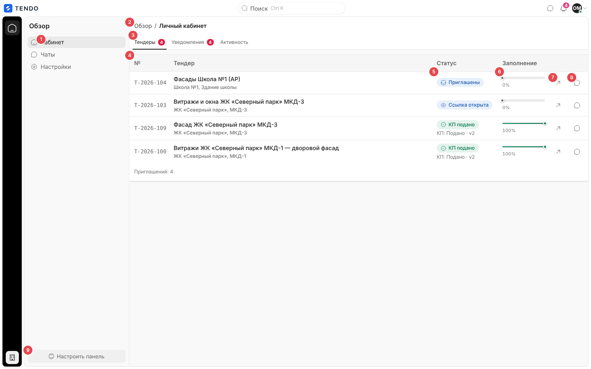
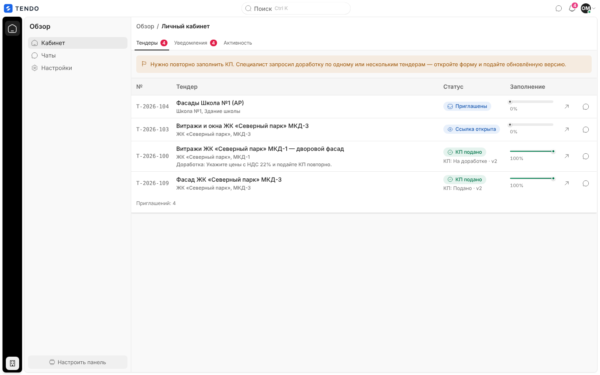
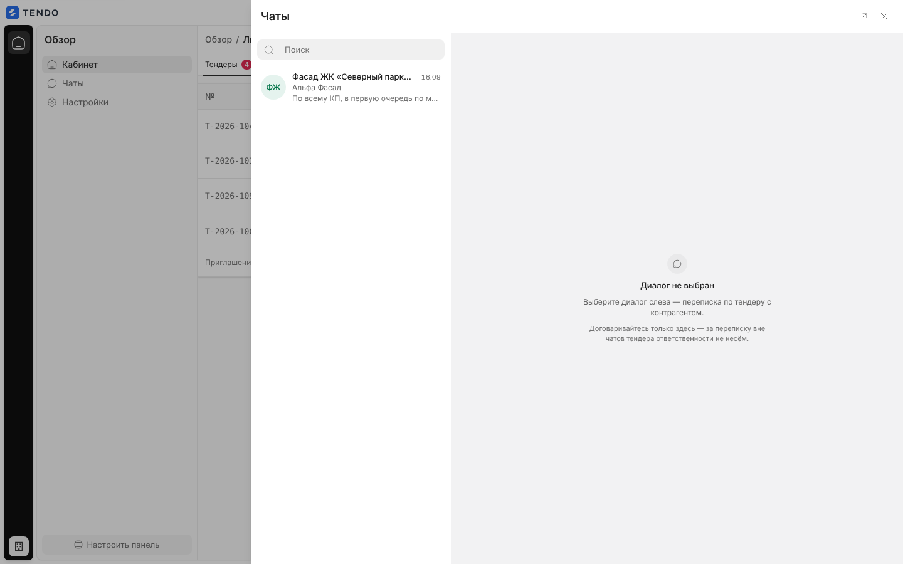
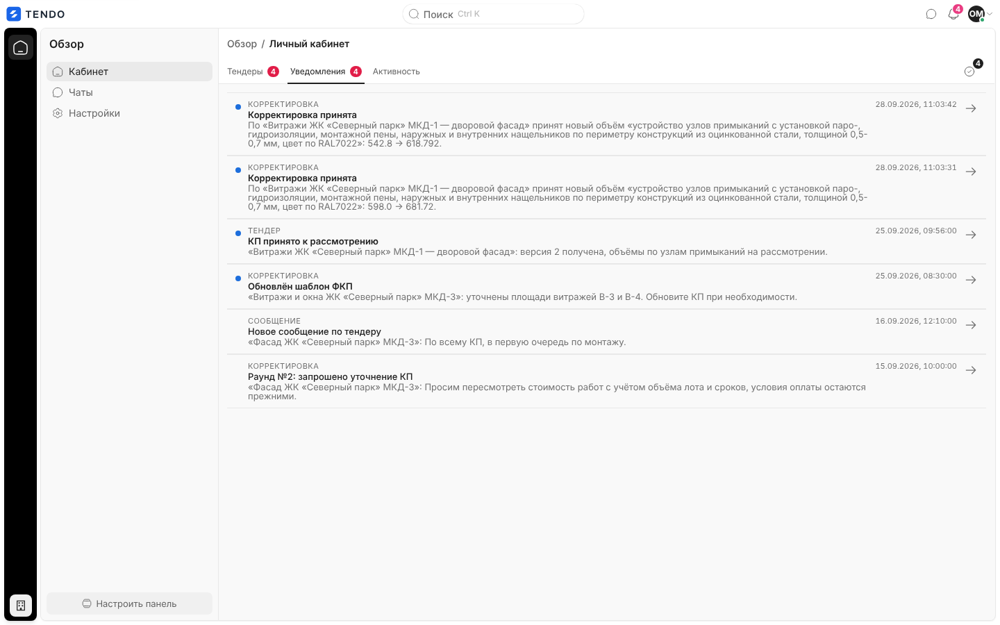
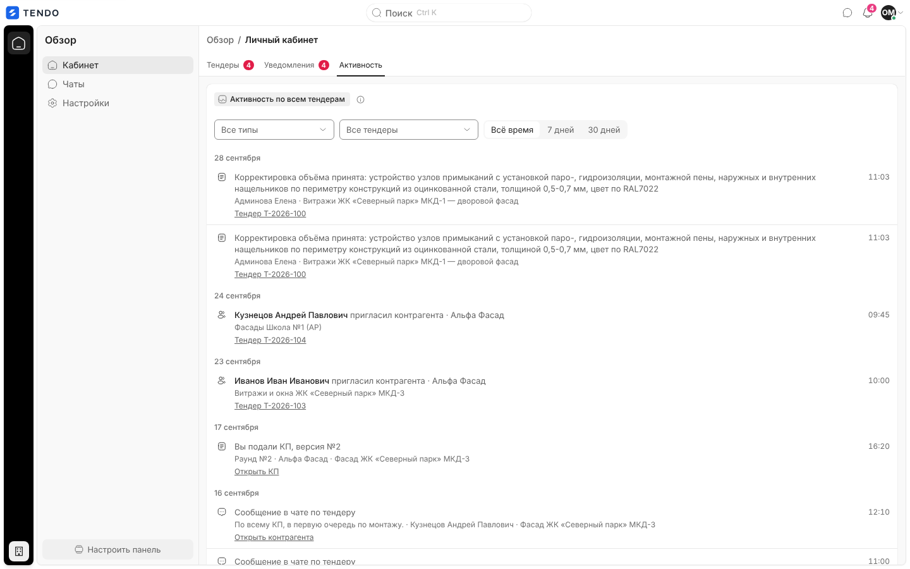
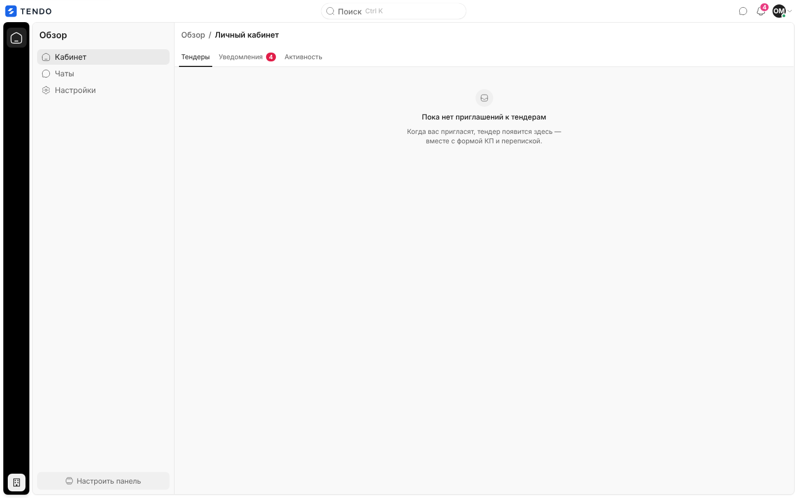
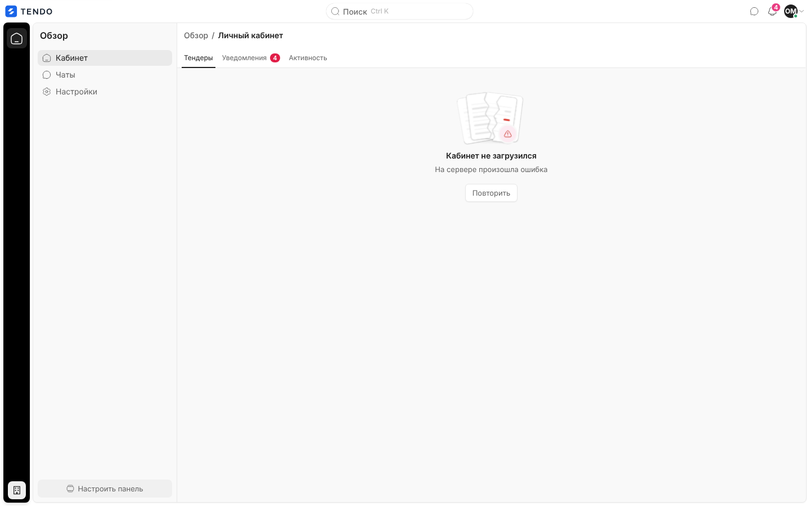

# Личный кабинет поставщика (`/cabinet`)

Стартовый экран пользователя контрагента: список тендеров, куда пригласили его организацию, со статусом участия и прогрессом заполнения КП, переход к форме КП и переписке; вкладки «Уведомления» и «Активность».

Связанные разделы: роль «Контрагент» — [../01-product/users-and-roles.md](../01-product/users-and-roles.md) (§1, §4.5, §6); стадии приглашения и прогресс заполнения — [../02-business-logic/tenders-invitations.md](../02-business-logic/tenders-invitations.md); API кабинета — [../04-api/endpoints-suppliers-registration.md](../04-api/endpoints-suppliers-registration.md#кабинет-поставщика) (`/me/tenders`, `/me/quotes`, `/me/supplier`, `/me/activity`); уведомления — [../04-api/endpoints-notifications.md](../04-api/endpoints-notifications.md); форма КП — [fill.md](fill.md); чаты — [chats.md](chats.md); профиль организации — [profile.md](profile.md#профиль-контрагента).

## Маршрут, роли, как попасть

- `/cabinet`, вкладка — параметр `?tab=notifications` | `?tab=activity` (без параметра — «Тендеры»). Переключение вкладки меняет адрес без перезагрузки.
- **Только роль «Контрагент»** (пользователь контрагента). Сотрудники, лид и владелец площадки на этот адрес не попадают — гейт уводит их на стартовый экран своей роли.
- Как попасть: сразу после входа (стартовый экран роли); логотип в топбаре; пункт «Кабинет» в панели «Обзор»; крошка «Личный кабинет» на форме КП; «Все уведомления» в колокольчике ведёт на `?tab=notifications`; адрес `/notifications` у контрагента сам переадресует сюда.
- Каркас — рабочий ([shell.md](shell.md)): рейл с единственным разделом «Обзор», панель «Обзор» с пунктами «Кабинет», «Чаты», «Настройки» и подвалом «Настроить панель»; в топбаре — поиск (у контрагента не работает, см. [shell.md](shell.md#глобальный-поиск-ctrl-k)), чаты, уведомления, меню профиля.

## Вкладка «Тендеры»

Таблица «Приглашений: N» (фиксированные ширины колонок):

| Колонка | Содержимое |
|---|---|
| № | Номер тендера (моноширинный) |
| Тендер | Название (жирным); под ним — объект; при доработке — «Доработка: <комментарий специалиста>» |
| Статус | Капсула стадии приглашения: «Приглашены» (синяя), «Ссылка открыта» (синяя), «Заполняет» (жёлтая), «КП подано» (зелёная), «Отказ» (красная), «Ссылка обнулена» (нейтральная); под ней, если КП есть, — «КП: Черновик / Подано / На доработке / Отозвано · vN» |
| Заполнение | Полоса на всю ячейку и «N%»: доля позиций с ценой, считает сервер (отказ позицию не закрывает); 100 % — зелёная, > 0 — синяя, 0 — серая. Подсказка «Цены по позициям: X из Y» |
| (Форма КП) | Значок-стрелка «Открыть форму КП по тендеру <номер>» — полный переход на `/fill/<токен>`; если ссылки нет (обнулена) — «—» |
| (Переписка) | Значок чата «Открыть переписку по тендеру <номер>» — панель «Чаты» на диалоге «этот тендер × моя организация» (если диалога ещё нет — он создаётся, `POST /chats/open`) |

- Порядок: сначала «новые» — приглашены, ссылка открыта или КП на доработке; дальше — как пришли с сервера. Сортировки по колонкам, фильтров, поиска и пагинации нет; строки целиком не кликабельны.
- Счётчик на вкладке «Тендеры» — число строк.
- Если хотя бы одно КП на доработке — над таблицей жёлтая плашка «**Нужно повторно заполнить КП.** Специалист запросил доработку по одному или нескольким тендерам — откройте форму и подайте обновлённую версию.».

## Вкладка «Уведомления»

- Лента уведомлений организации и пользователя (те же уведомления, что в колокольчике, `GET /notifications`): строка — точка непрочитанного, надпись вида («Корректировка», «Тендер», «Сообщение», «КП», «Система»), заголовок, текст, дата и время (по Москве), стрелка.
- Клик по строке: отметить прочитанным, затем — открыть диалог в панели «Чаты» (уведомление о сообщении), переключить вкладку кабинета (ссылка `/cabinet?tab=…`), открыть форму КП (`/fill/…`, полный переход, в т. ч. `?item=<позиция>` для решений по корректировке), иначе перейти по ссылке.
- Счётчик на вкладке — непрочитанные. При наличии непрочитанных справа от вкладок — значок «Отметить все прочитанными · N» (`POST /notifications/read-all`).
- Пусто — «Уведомлений нет. Здесь появятся приглашения, запросы доработки и решения по вашим КП.». Ошибка ленты (если ни одной записи не загружено) — блок ошибки с «Повторить»; при ошибке перечитывания прежний список остаётся.
- Лента перечитывается по событиям живого потока каркаса и после действий с уведомлениями.

## Вкладка «Активность»

- Блок «Активность по всем тендерам» (подсказка «Ваши подачи КП, решения по корректировкам и раунды — по всем тендерам, куда вас пригласили.»): фильтры «Все типы» (тип события), «Все тендеры» (тендер), период «Всё время · 7 дней · 30 дней»; события сгруппированы по дням, у события — значок, текст («Вы подали КП, версия №2», «Корректировка объёма принята: …», «<сотрудник> пригласил контрагента · <организация>», «Сообщение в чате по тендеру»), подпись тендера, ссылки «Тендер T-…», «Открыть КП», время.
- Источник — `GET /me/activity` (с подгрузкой). Пусто — «Пока пусто — здесь появятся ваши подачи, решения по вашим корректировкам и открытые раунды.»; фильтр без результатов — «Ничего не нашлось. По выбранным условиям событий нет.» и «Сбросить фильтры»; ошибка — «Не удалось загрузить ленту» / «Не удалось догрузить ленту».
- Ссылки ленты на экраны сотрудников (например, «Тендер T-…», «Открыть КП», «Открыть контрагента» в событиях чата) у контрагента ведут на закрытые для него адреса — гейт уводит обратно в кабинет (см. [открытые вопросы](../_oq/SCR-1.md)).

## Состояния

| Состояние | Что видит пользователь | Снимок |
|---|---|---|
| Загрузка | Четыре серые полосы на месте строк | — |
| Нет приглашений | «Пока нет приглашений к тендерам. Когда вас пригласят, тендер появится здесь — вместе с формой КП и перепиской.» |  |
| Ошибка | «Кабинет не загрузился» + текст ошибки (по умолчанию «Не удалось загрузить кабинет.») и «Повторить» |  |
| Не контрагент | Гейт уводит на стартовый экран роли | — |
| Приостановленная организация | Любой запрос возвращает 403 с текстом о приостановке — пользователь уводится на вход с причиной | — |

## API

`GET /me/tenders` (приглашения с токеном формы, стадией, прогрессом `fill_progress/fill_priced/fill_total`), `GET /me/quotes` (свои КП: статус, версия, комментарий доработки), `GET /me/supplier` (своя организация — для открытия чата), `GET /notifications`, `POST /notifications/{id}/read`, `POST /notifications/read-all`, `GET /me/activity`, `POST /chats/open`. Подробно — [../04-api/endpoints-suppliers-registration.md](../04-api/endpoints-suppliers-registration.md#кабинет-поставщика).

## Сложность

**M**: таблица приглашений с прогрессом и переходами — S; уведомления кабинета — S; лента активности с фильтрами и подгрузкой — M (общий компонент с лентами карточки контрагента и тендера).
