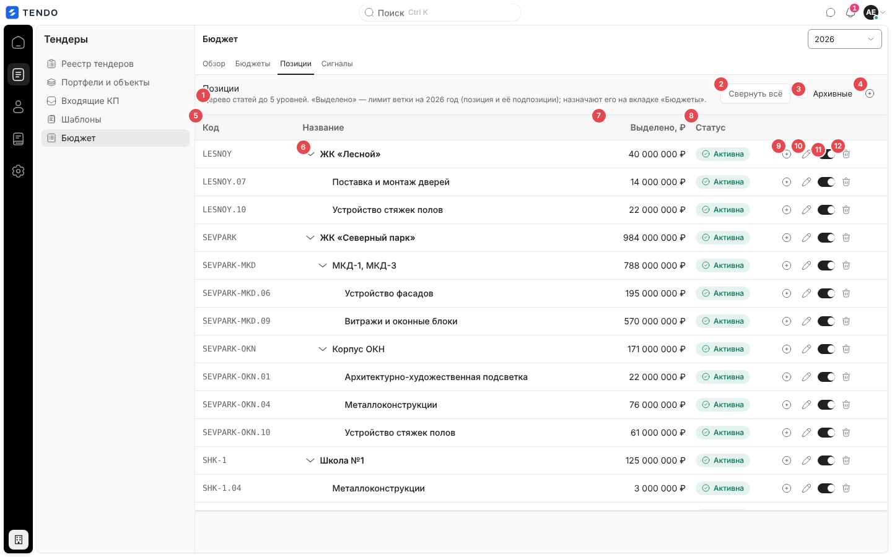
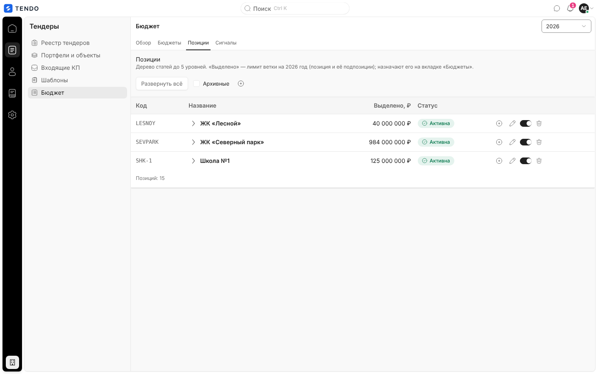
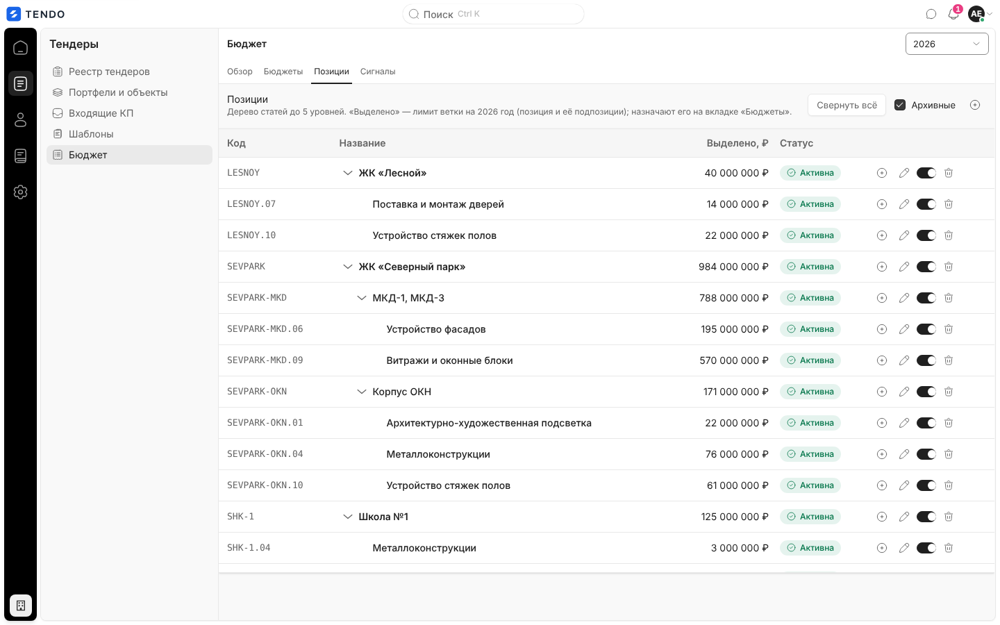
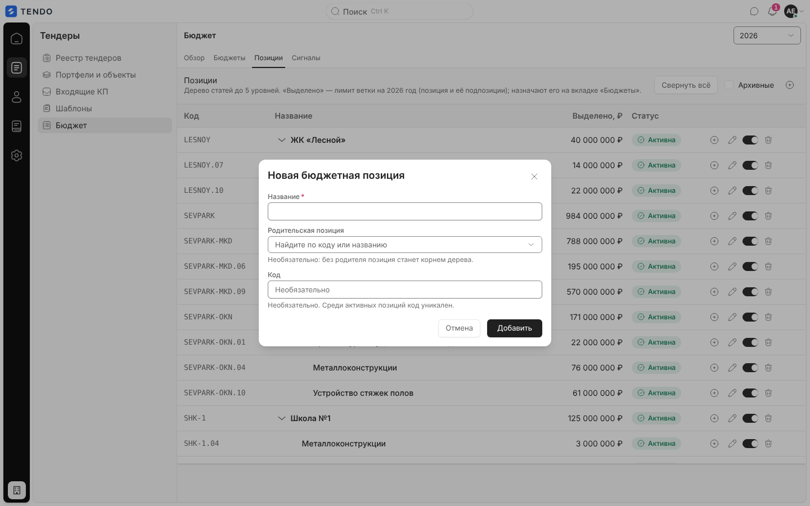
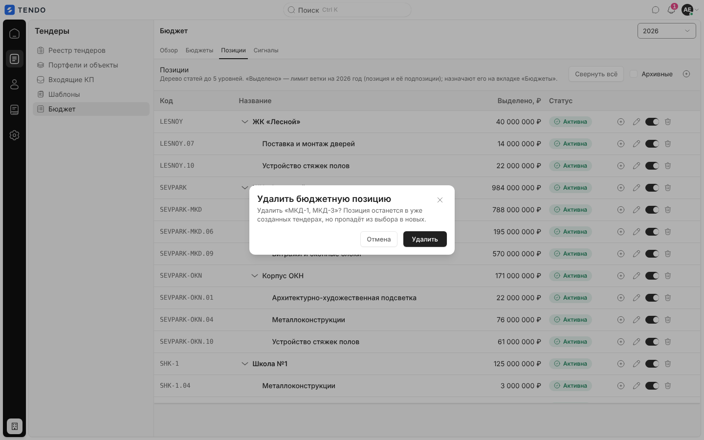
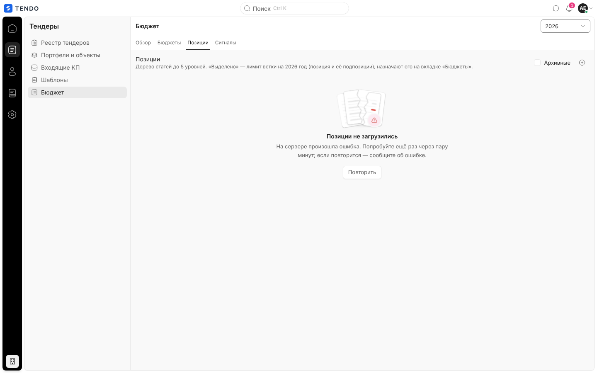

# Справочник бюджетных позиций (`/catalog/budget-positions` → вкладка «Позиции» раздела «Бюджет»)

Дерево статей бюджета до 5 уровней: код, название, лимит ветки на выбранный год, активность; создание, правка (с переносом в другую ветку), архивирование и удаление позиций. Отдельного экрана нет — справочник живёт вкладкой «Позиции» на [budget.md](budget.md).

Связанные разделы: правила позиций — [../02-business-logic/budget.md §4.1, §4.4](../02-business-logic/budget.md#41-позиция); API — [../04-api/endpoints-catalog.md#бюджетные-позиции](../04-api/endpoints-catalog.md#бюджетные-позиции); карточка позиции — [budget-position.md](budget-position.md).

## Маршрут

- `/catalog/budget-positions` — **только перенаправление** на `/budget` (заменой записи истории, без выбора вкладки: открывается «Обзор»). Пункта в меню «Справочники» нет; адрес сохранён для старых ссылок.
- Справочник открывается вкладкой «Позиции» на `/budget`; год берётся из выбора года раздела.

## Назначение

Вести структуру бюджета (ЖК → корпус → вид работ → статья …), к которой привязываются тендеры. Деньги здесь **только читаются**: суммы назначают на вкладке «Бюджеты».

## Роли и права

| Роль | Доступ |
|---|---|
| Администратор | Все действия |
| Тендерный специалист | Видит и может нажать все кнопки; создание/правка/архив требуют `budget.manage` (по умолчанию не выдано) — отказ сервера показывается окном |
| СБ, юрист, поставщик, лид, владелец | Нет (раздел «Бюджет» закрыт; перенаправление на стартовый экран роли) |

## Компоновка

| № | Элемент | Поведение |
|---|---|---|
| ① | «Позиции» и пояснение | «Дерево статей до 5 уровней. «Выделено» — лимит ветки на <год> год (позиция и её подпозиции); назначают его на вкладке «Бюджеты».» |
| ② | «Свернуть всё» / «Развернуть всё» | Только если есть ветки; сворачивает/раскрывает все узлы |
| ③ | Флажок «Архивные» | Показать и архивные позиции (перечитывает список с неактивными) |
| ④ | «+» «Добавить позицию» | Окно «Новая бюджетная позиция» (родитель пуст — корень) |
| ⑤ | «Код» | Моноширинный, «—» если нет |
| ⑥ | Шеврон ветки | «Свернуть / Развернуть «<название>»»; отступ по уровню; корневые позиции — полужирные |
| ⑦ | «Выделено, ₽» | Лимит ветки на год (своё + потомки); 0 — «—» |
| ⑧ | «Статус» | «Активна» (зелёная) / «Архив» (серая) |
| ⑨ | «+» «Добавить подпозицию в «…»» | Только у активных и если уровень < 5; родитель подставлен |
| ⑩ | Карандаш «Изменить позицию» | Окно «Редактировать «<название>»» |
| ⑪ | Переключатель «Позиция «…» активна» | Выключить — архивировать (`PATCH {is_active:false}`), включить — вернуть. Если при архивации у подпозиции был бюджет текущего года — окно «Сумма N ₽ возвращена родителю» ([BL §4.4](../02-business-logic/budget.md#44-возврат-остатка-при-архивации-подпозиции)) |
| ⑫ | Корзина «Удалить позицию» (красная) | Подтверждение «Удалить бюджетную позицию» / «Удалить «<название>»? Позиция останется в уже созданных тендерах, но пропадёт из выбора в новых.» → «Удалить» (`DELETE` = перевод в архив, с тем же возвратом остатка родителю) |

- Порядок братьев: по коду с числовым сравнением («5.4.9» раньше «5.4.10»), позиции без кода — после, по названию. Позиция, чей родитель скрыт (архивный при выключенном флажке), показывается корнем.
- Подпись таблицы — «Позиций: N». Клик по названию — карточка `/budget/<id>`.
- Поиска, фильтров (кроме «Архивные»), пагинации, массовых действий и выгрузки нет.

## Модальные окна

| Окно | Поля | Кнопка | Ошибки |
|---|---|---|---|
| «Новая бюджетная позиция» | «Название» * (автофокус); «Родительская позиция» — список с поиском по коду и названию («Найдите по коду или названию»), пустое значение «— без родителя (корень) —», подсказка «Необязательно: без родителя позиция станет корнем дерева.» (в списке — только активные позиции, под которыми хватит глубины: уровень родителя + 1 ≤ 5); «Код» — «Необязательно. Среди активных позиций код уникален.» | «Добавить» | Пустое название — «Введите название.»; сервер: «Имя уже занято в пределах этого родителя», «Код уже используется активной позицией», «Дерево не глубже 5 уровней» — текстом в окне |
| «Редактировать «<название>»» | те же поля; у родителя подсказка «Смена родителя переносит позицию вместе с подпозициями в другую ветку.» (в списке нет самой позиции и её потомков, и только родители, под которыми поддерево переносимой позиции уложится в 5 уровней) | «Сохранить» | то же + «Нельзя перенести позицию в саму себя или в свою подветку» |

Суммы в окнах нет (перенос суммы при создании подпозиции поддержан API, но интерфейсом не используется — [BL §4.3](../02-business-logic/budget.md#43-перенос-суммы-при-создании-подпозиции)). API: `GET /budget-positions?year=&include_inactive=`, `POST /budget-positions`, `PATCH /budget-positions/{id}`, `DELETE /budget-positions/{id}` — [endpoints-catalog.md](../04-api/endpoints-catalog.md#бюджетные-позиции). После правки сбрасывается общий кэш справочника (его читают мастер тендера и другие экраны).

## Состояния

| Состояние | Что видит пользователь | Снимок |
|---|---|---|
| Загрузка | Четыре строки-скелетона | — |
| Ошибка | «Позиции не загрузились» + текст + «Повторить» |  |
| Пусто | «Справочник пуст» / «Добавьте первую бюджетную позицию.» + «Добавить позицию» | — |

## Сложность

**M**: дерево с раскрытием и отступами, ветковые суммы, две формы с выбором родителя и ограничением глубины, архивирование с возвратом остатка.
