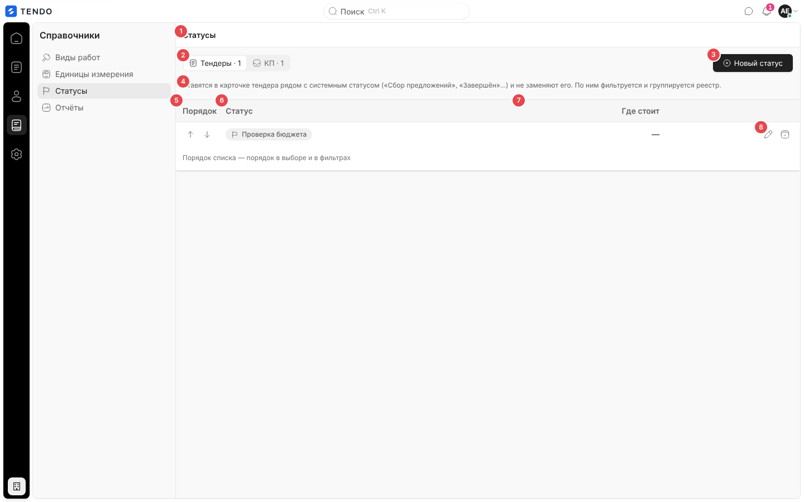
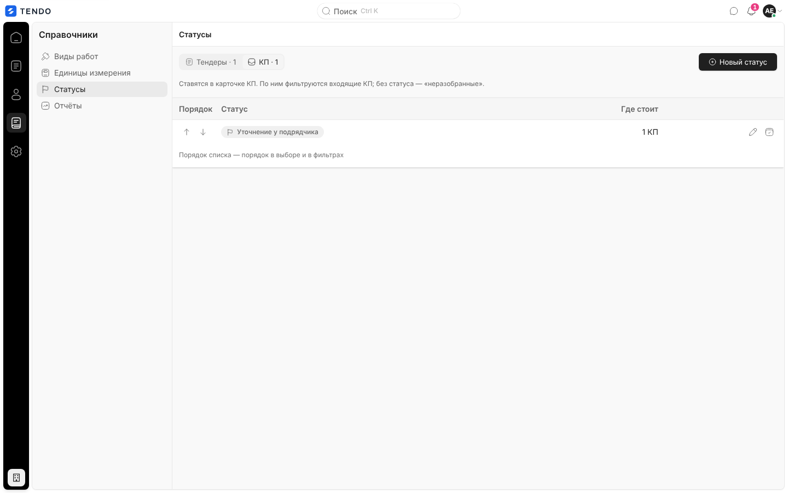
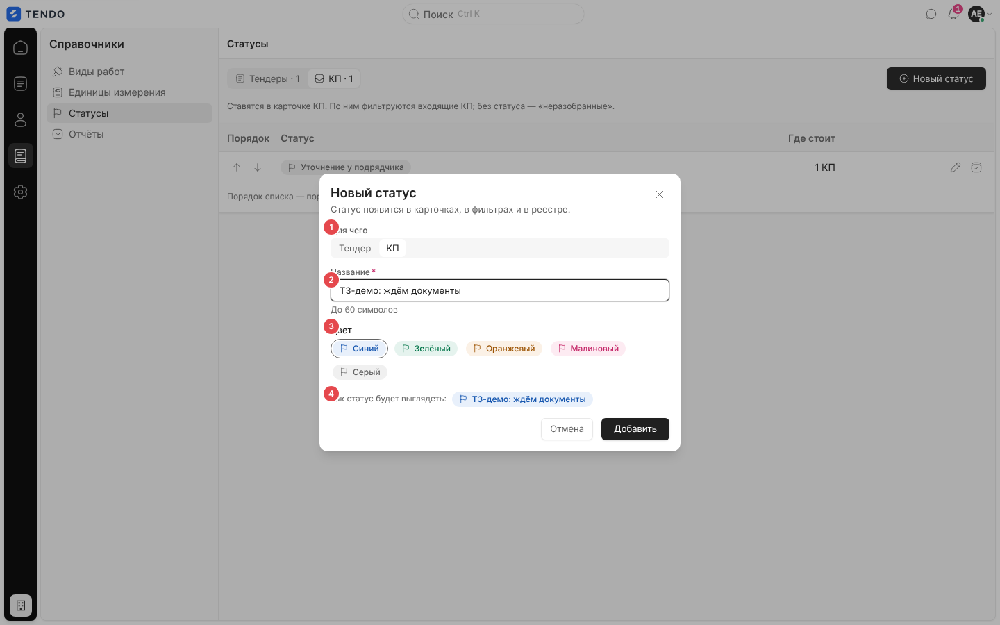
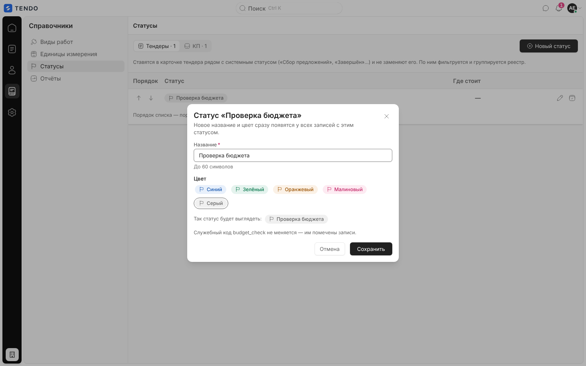
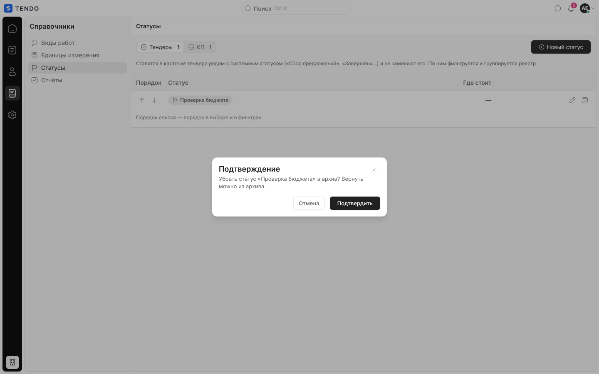
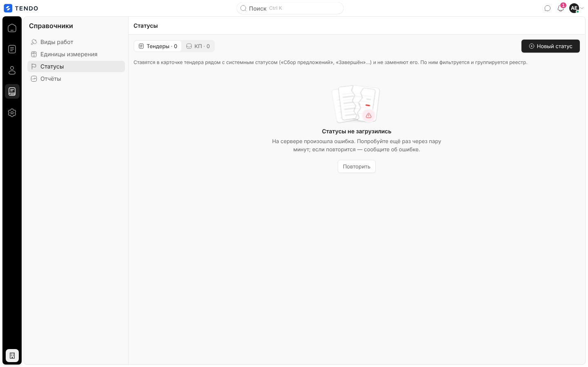

# Справочник «Статусы» (`/catalog/statuses`)

Пользовательские статусы тендеров и КП (дополнительные метки поверх системных статусов): создание с выбором цвета, переименование и перекраска, порядок стрелками, архив с возвратом.

Связанные разделы: правила — [../02-business-logic/catalog.md §4.3](../02-business-logic/catalog.md#43-пользовательские-статусы); API — [../04-api/endpoints-catalog.md#статусы-тендеров-и-кп](../04-api/endpoints-catalog.md#статусы-тендеров-и-кп), счётчик использования — [GET /statuses/usage](../04-api/endpoints-tenders.md#get-statusesusage); где применяются — [tenders-registry.md](tenders-registry.md) (фильтр «Статус»), [tender-card.md](tender-card.md) (капсула пользовательского статуса), [quotes-inbox.md](quotes-inbox.md), [quote-card.md](quote-card.md).

## Маршрут

`/catalog/statuses`; заголовок «Статусы». Рейл «Справочники» → «Статусы». Выбранная вкладка «Тендеры / КП» — состояние страницы.

## Роли и права

| Роль | Доступ |
|---|---|
| Администратор | Все действия |
| Тендерный специалист | Экран открыт, кнопки видны; любые правки требуют `catalogs.manage` (по умолчанию нет) — отказ сервера окном |
| СБ, юрист, поставщик, лид, владелец | Нет (перенаправление на стартовый экран роли) |

## Компоновка

| № | Элемент | Поведение |
|---|---|---|
| ① | Заголовок «Статусы» | — |
| ② | Переключатель «Тендеры · N» / «КП · N» | Чьи статусы показывать; N — число действующих |
| ③ | «Новый статус» | Окно создания; сущность по умолчанию — открытая вкладка |
| ④ | Пояснение | Тендеры: «Ставятся в карточке тендера рядом с системным статусом («Сбор предложений», «Завершён»…) и не заменяют его. По ним фильтруется и группируется реестр.»; КП: «Ставятся в карточке КП. По ним фильтруются входящие КП; без статуса — «неразобранные».» |
| ⑤ | «Порядок» | Стрелки «Поднять «…» выше» / «Опустить «…» ниже» (у крайних — неактивны); порядок = порядок в выборе и в фильтрах; сохраняется целиком (`PUT /statuses/order`) |
| ⑥ | «Статус» | Капсула в своём цвете; у системного — подпись «системный» |
| ⑦ | «Где стоит» | Сколько записей сейчас помечены статусом: «3 тендера», «1 КП», «—» |
| ⑧ | Действия | Карандаш «Изменить статус «…»»; «Убрать статус «…» в архив» (у системных статусов нет) |

Подпись таблицы — «Порядок списка — порядок в выборе и в фильтрах». Пока выполняется действие, все кнопки неактивны. Ниже таблицы — раскрывающийся блок «Архив · N» (если есть архивные): капсула, «где стоит», кнопка «Вернуть статус «…» из архива».

## Окно «Новый статус» / «Статус «<название>»»

| № | Поле | Поведение |
|---|---|---|
| ① | «Для чего» | «Тендер» / «КП» — только при создании (у существующего сущность не меняется) |
| ② | «Название» * | До 60 символов («До 60 символов»), плейсхолдер «Например, «Ждём документы»»; пусто — «Введите название статуса.»; сервер — «Статус с таким названием уже есть» |
| ③ | «Цвет» | Пять вариантов-капсул: «Синий», «Зелёный», «Оранжевый», «Малиновый», «Серый» (радиокнопки; по умолчанию «Синий») |
| ④ | «Так статус будет выглядеть:» | Живое превью капсулы |

- Кода в форме нет — сервер выводит его транслитом из названия. В окне правки — строка «Служебный код `budget_check` не меняется — им помечены записи.» и описание «Новое название и цвет сразу появятся у всех записей с этим статусом.».
- Кнопки «Отмена» / «Добавить» («Сохранить» при правке). Ошибка — красной строкой в окне («Не удалось создать статус» / «Не удалось сохранить статус» или текст сервера). После сохранения открывается вкладка сущности статуса.

## Архив

«Убрать в архив» — подтверждение «Убрать статус «<название>» в архив? [Сейчас он стоит у N тендеров — там он останется, но выбрать его снова будет нельзя.] Вернуть можно из архива.» → `DELETE /statuses/{id}` (мягко). Возврат — без подтверждения (`PATCH {is_active:true}`; конфликт названия — «Действующий статус с таким названием уже есть — переименуйте один из них»).

## Состояния

| Состояние | Что видит пользователь | Снимок |
|---|---|---|
| Загрузка | Три строки-скелетона | — |
| Ошибка | «Статусы не загрузились» + текст + «Повторить» |  |
| Пусто | «Своих статусов тендеров пока нет» / «Например, «Ждём документы», «На согласовании у финдира», «Пауза по объекту».» (для КП — «Своих статусов КП пока нет» / «Например, «Уточнение у подрядчика», «На проверке у сметчика», «Лучшая цена».») + «Добавить статус» | — |

## Сложность

**S–M**.
