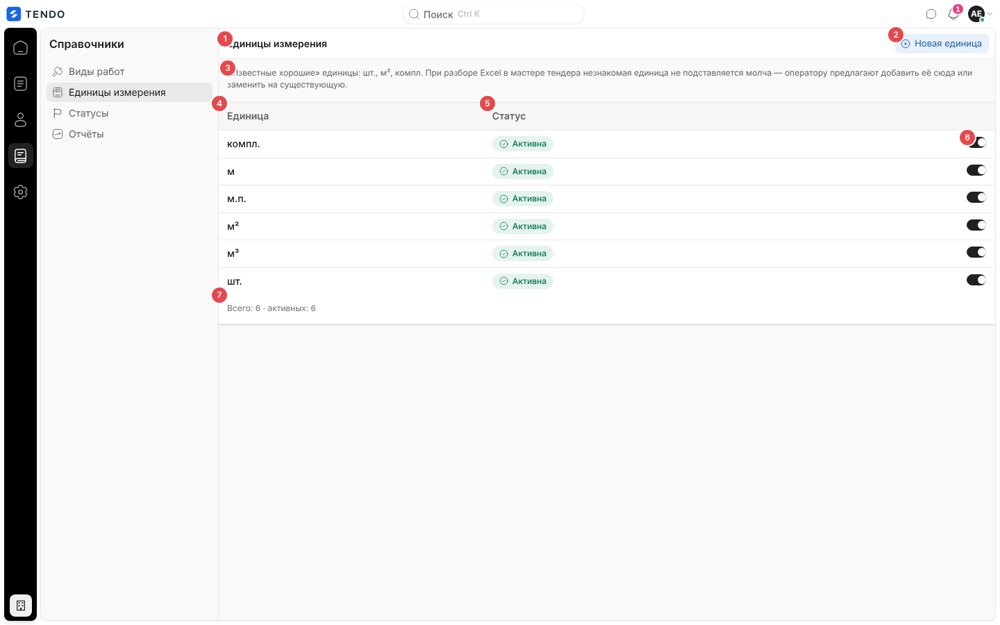
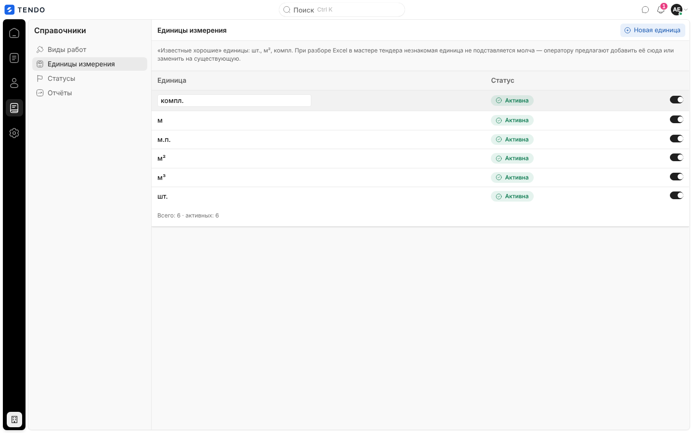
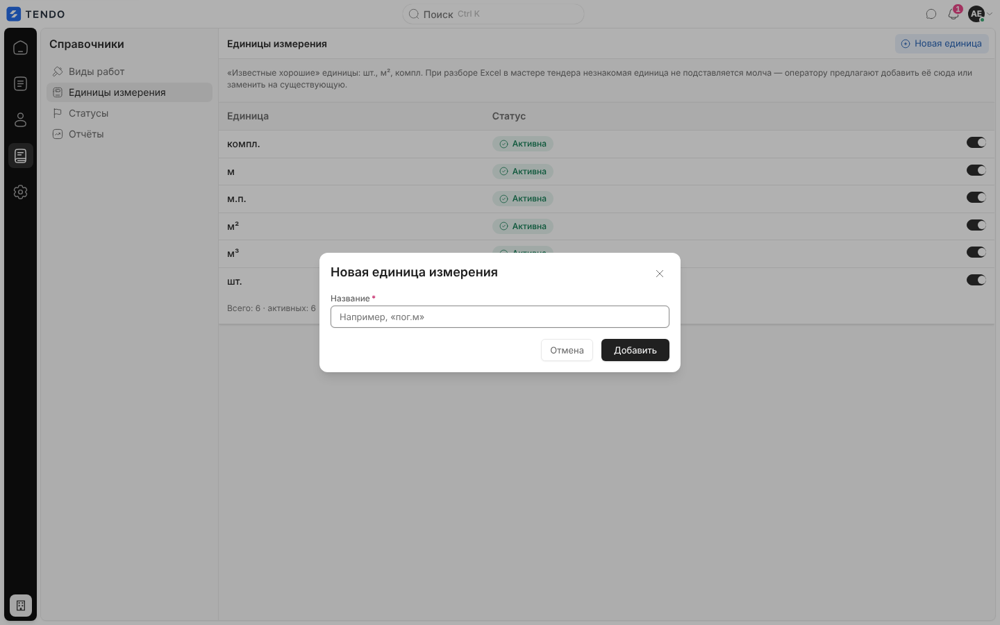
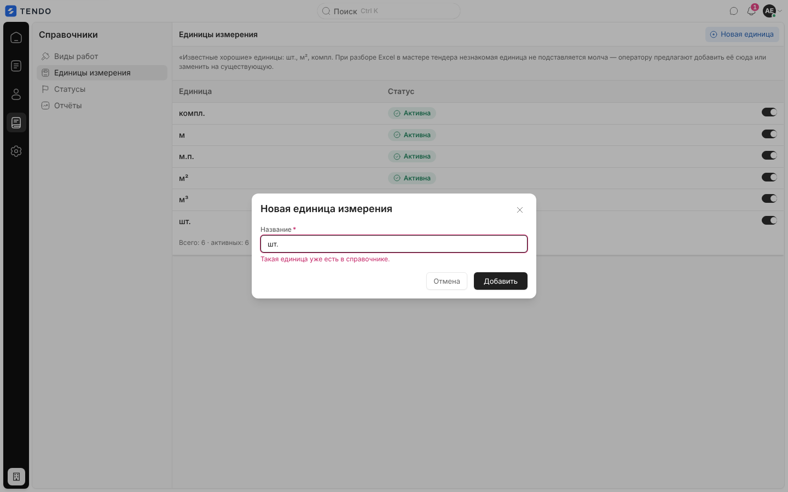
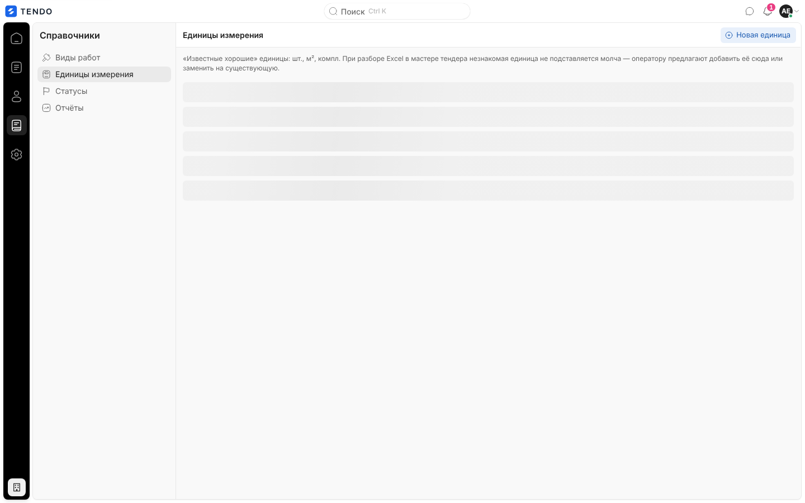
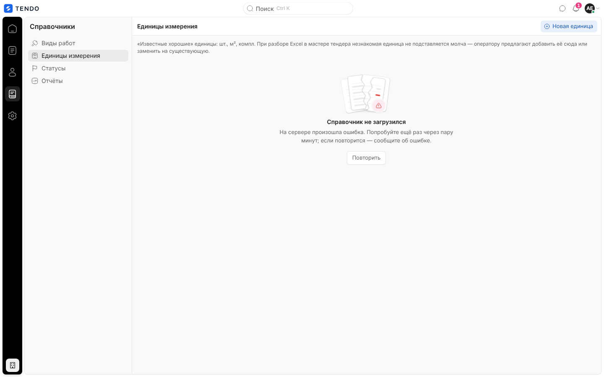

# Справочник «Единицы измерения» (`/catalog/units`)

Список единиц измерения, к которым приводятся единицы из Excel-файла при создании тендера: добавление, переименование на месте, отключение.

Связанные разделы: правила единиц и синонимов — [../02-business-logic/catalog.md §4.2](../02-business-logic/catalog.md#42-единицы-измерения-и-синонимы); API — [../04-api/endpoints-catalog.md#единицы-измерения](../04-api/endpoints-catalog.md#единицы-измерения); где используются — мастер создания тендера [tender-create.md](tender-create.md).

## Маршрут

`/catalog/units`; заголовок «Единицы измерения». Рейл «Справочники» → «Единицы измерения».

## Роли и права

| Роль | Доступ |
|---|---|
| Администратор | Все действия |
| Тендерный специалист | Экран открыт; добавить единицу может (это разрешено любому сотруднику); переименование и отключение требуют `catalogs.manage` (по умолчанию нет) — интерфейс кнопки не прячет, отказ сервера показывается окном |
| СБ, юрист | Нет: раздел «Справочники» скрыт, переход уводит на `/home` |
| Поставщик, лид, владелец площадки | Нет |

## Компоновка

| № | Элемент | Поведение |
|---|---|---|
| ① | Заголовок «Единицы измерения» | — |
| ② | «Новая единица» | Окно добавления |
| ③ | Пояснение | «Известные хорошие» единицы: шт., м², компл. При разборе Excel в мастере тендера незнакомая единица не подставляется молча — оператору предлагают добавить её сюда или заменить на существующую. |
| ④ | «Единица» | Название; клик — правка на месте (поле, Enter/уход — сохранить `PATCH /units/{id} {name}`, Esc — отмена) |
| ⑤ | «Статус» | «Активна» (зелёная) / «Отключена» (серая) |
| ⑥ | Переключатель «Единица «…» активна» | `PATCH /units/{id} {is_active}`; ошибка — окном «Не удалось изменить статус» |
| ⑦ | Подпись «Всего: N · активных: M» | — |

Порядок строк — как отдаёт сервер. Поиска, фильтров, сортировки, пагинации, массовых действий и выгрузки нет. Синонимы написаний («м3» = «м³») на экране **не показываются и не редактируются** — они запоминаются только в мастере тендера (см. [открытые вопросы](../_oq/SCR-3.md)).

## Окно «Новая единица измерения»

| Поле | Тип | Обяз. | Проверка |
|---|---|---|---|
| Название | текст, плейсхолдер «Например, «пог.м»», автофокус; Enter — отправить | да | Пусто — «Введите единицу измерения.»; совпадает (без учёта регистра) с уже загруженной — «Такая единица уже есть в справочнике.»; ошибка сервера — «Не удалось добавить единицу измерения» или текст сервера |

Кнопки «Отмена» / «Добавить». Запрос `POST /units` ([описание](../04-api/endpoints-catalog.md#post-units)); новая строка добавляется в конец, общий кэш единиц (мастер тендера, шаблоны) сбрасывается.

## Состояния

| Состояние | Что видит пользователь | Снимок |
|---|---|---|
| Загрузка | Пять строк-скелетонов |  |
| Ошибка | «Справочник не загрузился» + текст + «Повторить» (перечитывает на месте) |  |
| Пусто | «Справочник пуст» / «Добавьте первую единицу измерения — шт., м², компл. и другие.» + «Добавить единицу» | — |

## Сложность

**S**.
