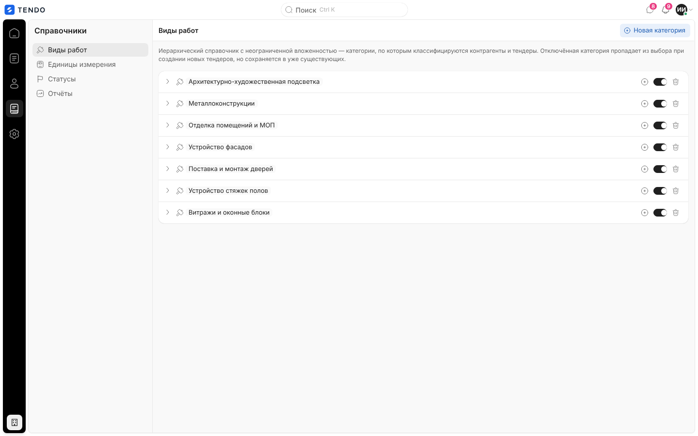
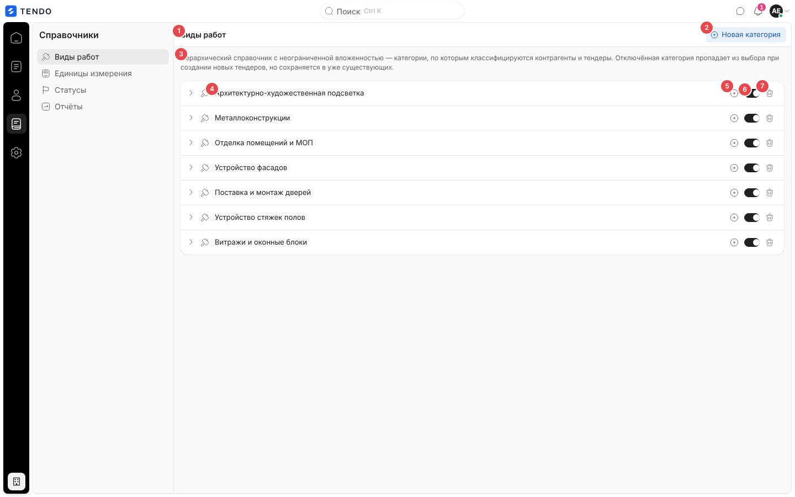
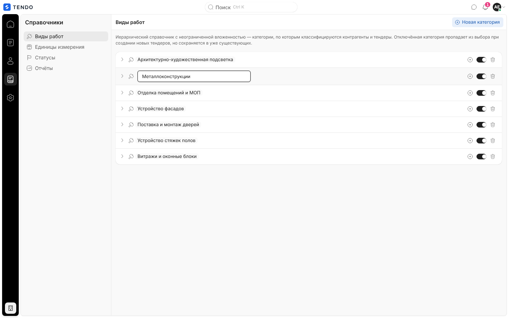
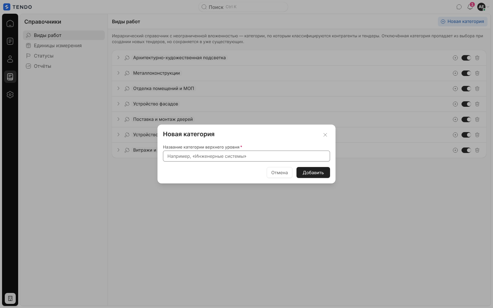
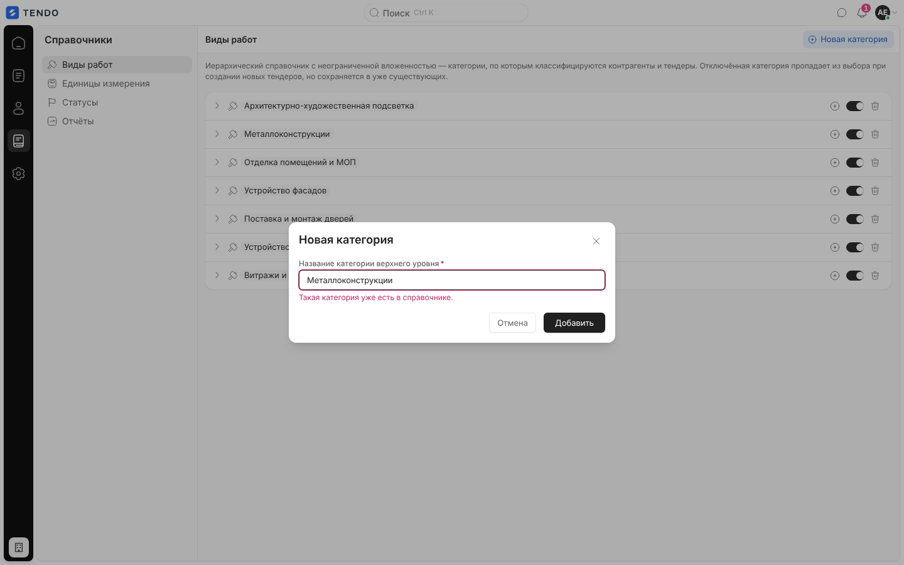
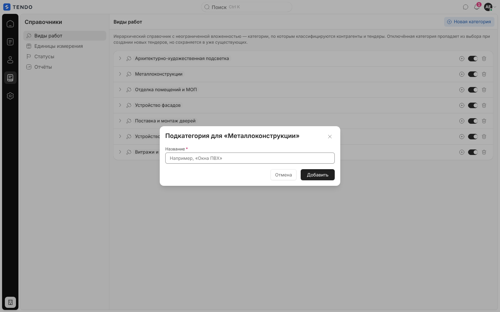
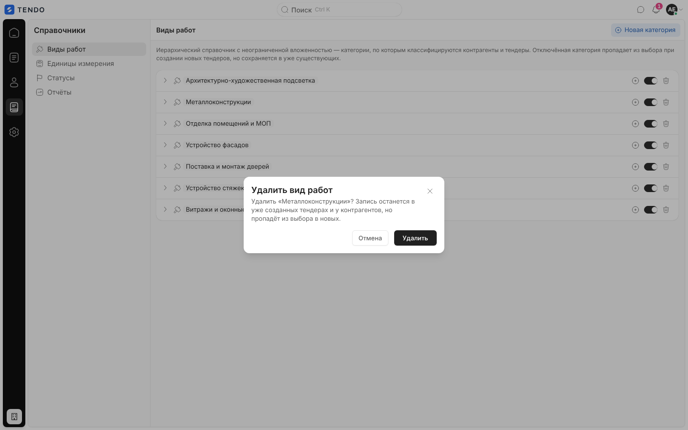
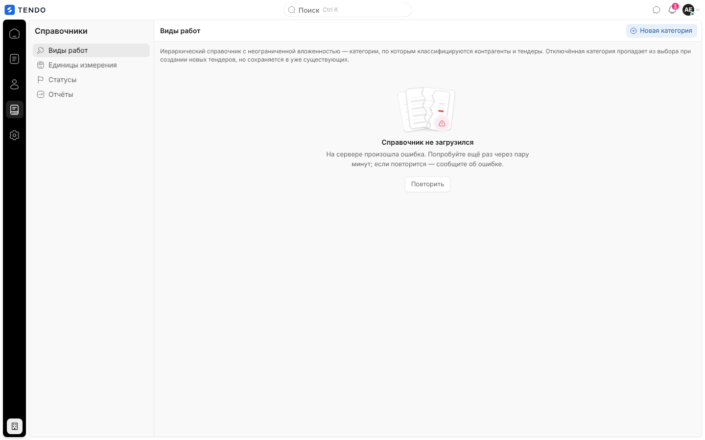

# Справочник «Виды работ» (`/catalog/work-types`)

Иерархический справочник видов работ (категории и подкатегории без ограничения вложенности), по которому классифицируются тендеры и контрагенты: добавление, переименование на месте, отключение, удаление.

Связанные разделы: правила — [../02-business-logic/catalog.md §4.1](../02-business-logic/catalog.md#41-виды-работ); API — [../04-api/endpoints-catalog.md#виды-работ](../04-api/endpoints-catalog.md#виды-работ); где используются — мастер тендера [tender-create.md](tender-create.md), реестр и карточка контрагента [suppliers.md](suppliers.md), [supplier-card.md](supplier-card.md), анкета саморегистрации.

## Маршрут

`/catalog/work-types`; заголовок «Виды работ». Рейл «Справочники» → «Виды работ» (первый пункт раздела, раздел открывается на нём).

## Роли и права

| Роль | Доступ |
|---|---|
| Администратор | Все действия |
| Тендерный специалист | Тот же экран и кнопки; правки требуют `catalogs.manage` (по умолчанию нет) — отказ сервера окном |
| СБ, юрист, поставщик, лид, владелец | Нет (перенаправление на стартовый экран роли) |

## Компоновка

| № | Элемент | Поведение |
|---|---|---|
| ① | Заголовок «Виды работ» | — |
| ② | «Новая категория» | Окно новой категории верхнего уровня |
| ③ | Пояснение | «Иерархический справочник с неограниченной вложенностью — категории, по которым классифицируются контрагенты и тендеры. Отключённая категория пропадает из выбора при создании новых тендеров, но сохраняется в уже существующих.» |
| ④ | Название узла | Кнопка «Переименовать «…»»: клик — поле на месте, Enter или уход — сохранить (`PATCH /work-types/{id} {name}`), пустое или прежнее — без запроса; ошибка — окном «Не удалось переименовать» и откат |
| ⑤ | «+» «Добавить подкатегорию в «…»» | Окно «Подкатегория для «…»» |
| ⑥ | Переключатель «Категория «…» активна» | Отключить / включить (`PATCH {is_active}`); у отключённой — капсула «Отключена» |
| ⑦ | Корзина «Удалить категорию «…»» | Подтверждение «Удалить вид работ» / «Удалить «…»? Запись останется в уже созданных тендерах и у контрагентов, но пропадёт из выбора в новых.» → `DELETE /work-types/{id}` (по факту — то же отключение) |

- Строка-узел: шеврон раскрытия (кнопка «Подкатегории «…»», только если есть дети), значок, название, капсула «N подкатегорий» (если есть), действия. Клик по строке раскрывает ветку.
- **Все ветки свёрнуты** при каждом заходе (раскрытие не запоминается); добавление подкатегории раскрывает свою ветку.
- Порядок — порядок создания (по id). Поиска, фильтров, сортировки, пагинации, массовых действий и выгрузки нет. Перенос узла в другую ветку интерфейсом не поддержан (в API есть — `parent_id`).
- После любой правки сбрасывается общий кэш справочника (мастер тендера, реестр и карточка контрагента).

## Модальные окна

| Окно | Поле | Проверки |
|---|---|---|
| «Новая категория» | «Название категории верхнего уровня» * (плейсхолдер «Например, «Инженерные системы»», Enter — отправить) | Пусто — «Введите название категории.»; совпадает с корневой категорией без учёта регистра — «Такая категория уже есть в справочнике.»; сервер (409 «Такой вид работ уже есть в справочнике», в т.ч. среди архивных) — текстом под полем |
| «Подкатегория для «<родитель>»» | «Название» * («Например, «Окна ПВХ»») | Пусто — «Введите название подкатегории.»; дубль среди детей — «Такая подкатегория уже есть.» |

Кнопки «Отмена» / «Добавить». API — `POST /work-types` ([описание](../04-api/endpoints-catalog.md#post-work-types)).

## Состояния

| Состояние | Что видит пользователь | Снимок |
|---|---|---|
| Загрузка | Четыре строки-скелетона | — |
| Ошибка | «Справочник не загрузился» + текст + «Повторить» |  |
| Пусто | «Справочник пуст» / «Добавьте первую категорию верхнего уровня — от неё можно будет строить подкатегории.» + «Добавить категорию» | — |

## Сложность

**S–M**: дерево с ленивым раскрытием и правкой на месте, два окна.
