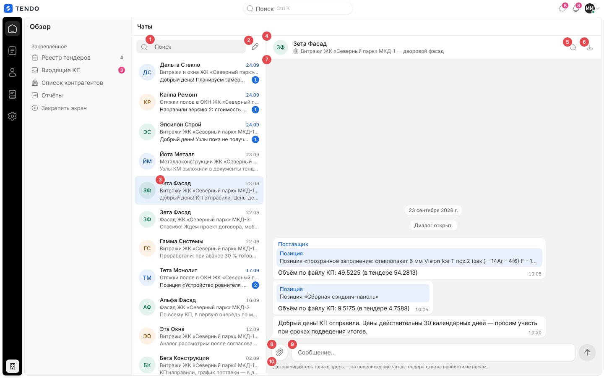
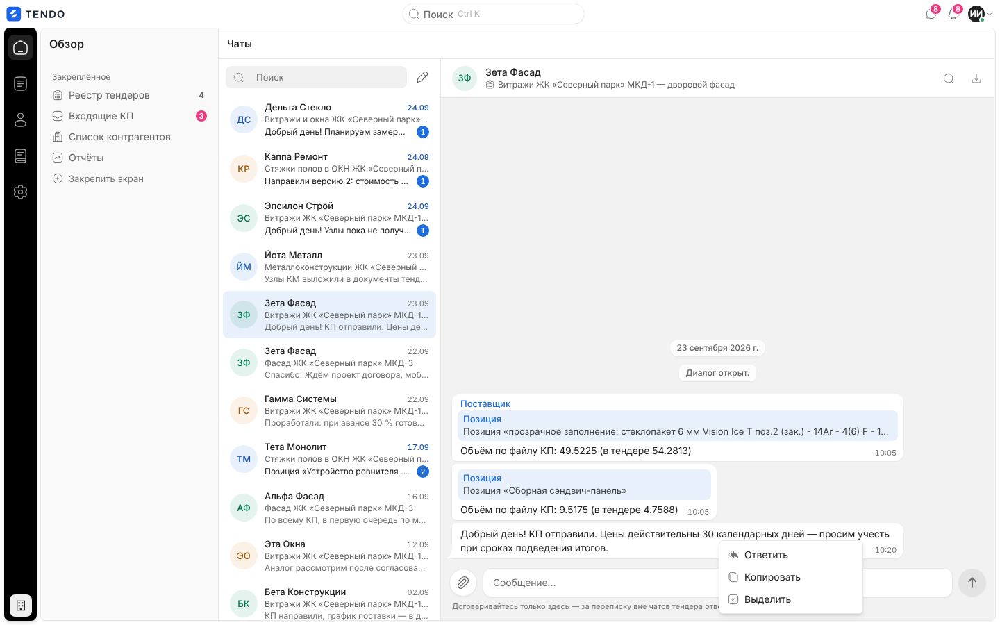
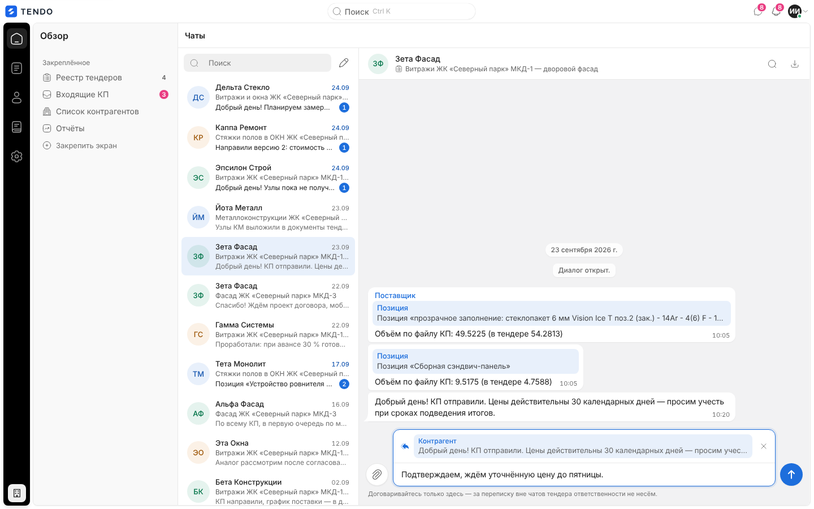
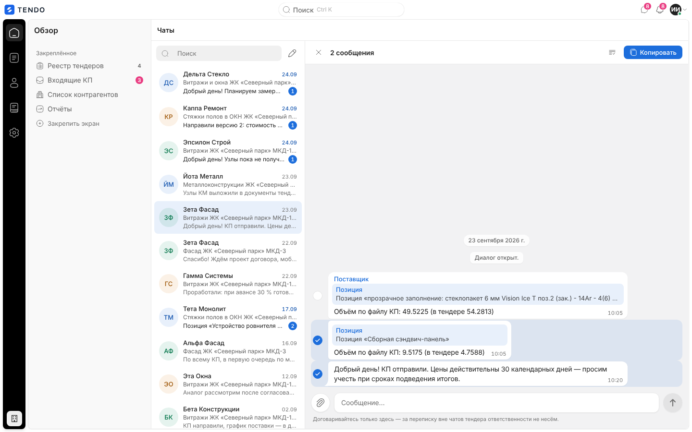
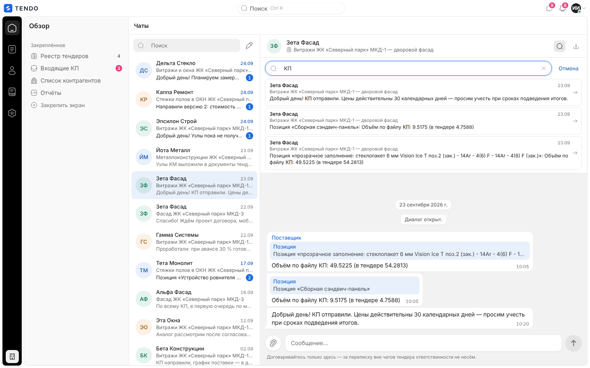
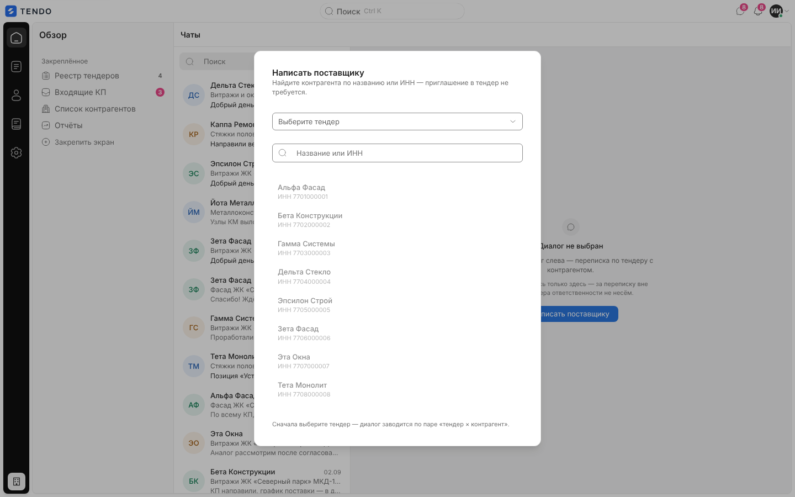
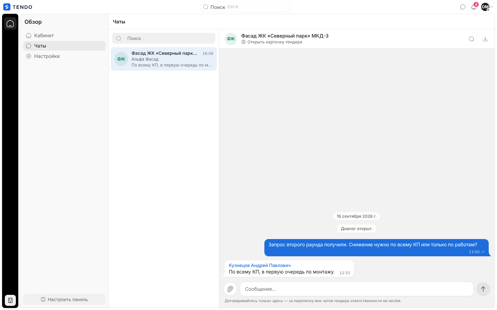
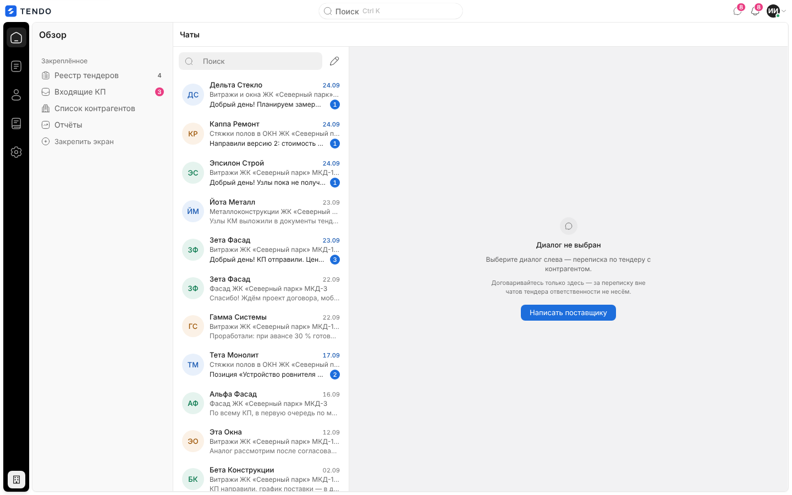
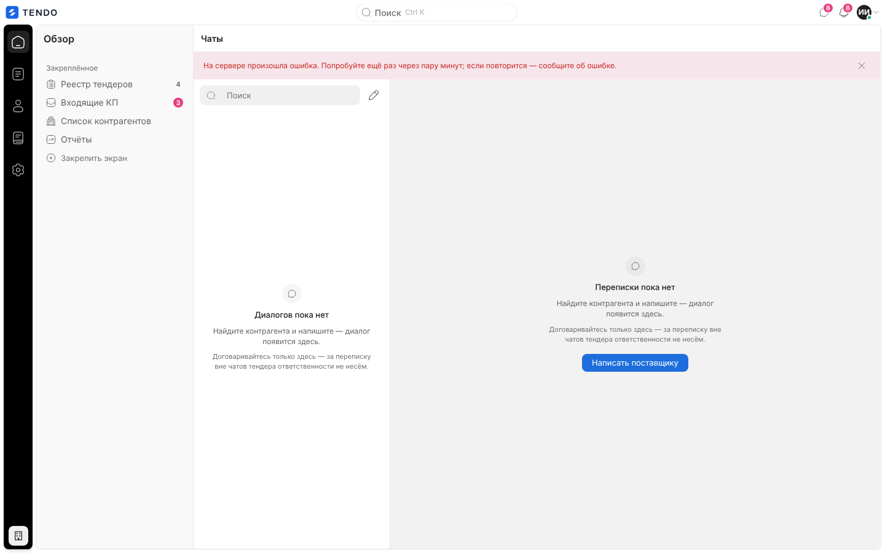

# Чаты (`/chats`)

Мессенджер переписки по тендерам между сотрудниками Заказчика и контрагентами: один диалог на пару «тендер × контрагент». Слева — список диалогов с поиском, справа — переписка с поиском по тексту, выгрузкой, ответами, правкой/удалением своих реплик, вложениями, выделением и копированием. Тот же мессенджер открывается панелью «Чаты» поверх любого экрана ([shell.md](shell.md#панель-чаты)) и во вкладке «Сообщения» карточки тендера ([tender-card-messages.md](tender-card-messages.md)); у контрагента по ссылке — облегчённый чат формы КП ([fill.md](fill.md#чат-по-ссылке)).

Связанные разделы: правила переписки — [../02-business-logic/chat.md](../02-business-logic/chat.md); API — [../04-api/endpoints-chat.md](../04-api/endpoints-chat.md); комментарии к ячейкам и мост «ячейка → чат» — [../02-business-logic/comments.md](../02-business-logic/comments.md), [tender-card-comparison.md](tender-card-comparison.md).

## Маршрут, роли, как попасть

- `/chats`; заголовок «Чаты». Параметры адреса `?tender_id=<id>&supplier_id=<id>` — открыть (или создать) диалог этой пары; так ведут уведомления о сообщениях.
- **Роли:** администратор и тендерный специалист (в топбаре — иконка чатов, адрес открыт), контрагент (пункт «Чаты» в панели «Обзор»). **СБ и юрист** — адрес закрыт, уводятся на `/home` (сервер треды им формально отдаёт по грантам — см. [users-and-roles.md §4.5](../01-product/users-and-roles.md)); иконка чатов в топбаре у них при этом есть и открывает панель «Чаты» (без грантов на объекты — пустую, с кнопкой «Написать поставщику») — см. [открытые вопросы](../_oq/SCR-1.md). Лиду и владельцу площадки недоступен (владельцу иконка не показывается).
- Видимость диалогов: администратор — все; другой сотрудник — диалоги тендеров объектов из своих грантов; контрагент — диалоги своей организации по тендерам с действующим приглашением.
- Как попасть: «Открыть во весь экран» в панели «Чаты»; пункт «Чаты» у контрагента; ссылка из уведомления; прямой адрес.

## Экран сотрудника

| № | Блок | Поведение |
|---|---|---|
| ① | Поиск «Поиск» по диалогам | Фильтр списка по контрагенту или тендеру (на клиенте); нет совпадений — «По запросу «…» диалогов нет.» |
| ② | Значок-карандаш «Написать поставщику» | Только у сотрудников — окно выбора контрагента ([ниже](#написать-поставщику)) |
| ③ | Список диалогов | Строка: аватар с инициалами (тон по имени), у сотрудника — название контрагента, у контрагента — название тендера; вторая строка — тендер (у сотрудника) / организация; превью последней реплики («Нет сообщений»); дата (ДД.ММ, синим — если есть непрочитанные); синий счётчик непрочитанных. Порядок — свежие сверху (по времени последнего изменения диалога, страницами по 50). Подгрузка следующей страницы при прокрутке к концу списка |
| ④ | Шапка диалога | Аватар и имя собеседника; подзаголовок-ссылка: у сотрудника — название тендера (→ `/tenders/$id`), у контрагента — «Открыть карточку тендера» |
| ⑤ | «Поиск по переписке» | Строка поиска внутри диалога ([ниже](#поиск-по-переписке)) |
| ⑥ | «Выгрузить переписку» | Скачивает файл `переписка-<id>.md` (Markdown, `GET /chats/{id}/export`); ошибка — «Не удалось выгрузить» |
| ⑦ | Лента | Плашки дней («23 сентября 2026 г.»), системные реплики («Диалог открыт.», «Подана КП…»), свои реплики справа (синие), чужие слева с именем автора; время и у своих — статус (отправляется / доставлено / прочитано ✓✓), пометка «изменено»; удалённые — «Сообщение удалено». Реплики из комментариев к ячейкам сравнения несут карточку «Позиция «…»» и строку объёма — клик «Перейти к позиции» открывает карточку тендера с подсветкой ячейки. Длинные реплики сворачиваются («Показать полностью» / «Свернуть»), ссылки в тексте кликабельны. Разделитель «Непрочитанные»; подгрузка истории вверх при прокрутке («Выше — более ранние сообщения»); кнопка «Вниз, новых: N» / «К последним сообщениям» |
| ⑧ | «Прикрепить файл (до 25 МБ)» | Выбор одного или нескольких файлов; больше 25 МБ — «“<имя>” больше 25 МБ — файл не приложен». Допустимые типы — PNG, JPEG, GIF, WEBP, PDF, DOC, DOCX, XLS, XLSX, ZIP, TXT, CSV (проверяет сервер). Вложения — капсулами над полем с кнопкой «Убрать <имя>» |
| ⑨ | Поле «Сообщение…» | До 4000 символов; растёт до 6 строк; **Enter — отправить, Shift+Enter — перенос**, Esc — снять ответ/правку. Вставка текста длиннее 4000 символов прикладывается файлом («Вставленный текст длиннее 4000 символов. Он приложен файлом — так он дойдёт целиком.»). Черновик хранится по диалогу (переживает перезагрузку). Кнопка «Отправить (Enter)» |
| ⑩ | Дисклеймер | «Договаривайтесь только здесь — за переписку вне чатов тендера ответственности не несём.» |

Отправка оптимистична: реплика сразу встаёт в ленту «отправляется»; при сбое сети уходит в очередь исходящих (хранится в браузере) с повторами; у неудачной — «Отправить заново» и «Убрать неотправленное сообщение» (в меню: «Повторить отправку», «Убрать из очереди»). Новые реплики, прочтение и «печатает…» приходят живым потоком каркаса; при открытии диалога он отмечается прочитанным до последнего события (`POST /chats/{id}/read`), во время набора уходит сигнал «печатает» (`POST /chats/{id}/typing`).

### Действия с репликой

Контекстное меню реплики («Действия с сообщением», открывается правым кликом):

| Пункт | Кому | Действие |
|---|---|---|
| Ответить | любая реплика | Над полем — цитата «В ответ на <автор>: …» с крестиком «Отменить ответ»; в ленте ответ ссылается на исходную реплику («Перейти к исходной реплике») |
| Копировать | любая | Текст в буфер |
| Выделить | любая | Режим выделения ([ниже](#выделение)) |
| Перейти к позиции | реплика с карточкой ячейки | Карточка тендера с подсветкой ячейки сравнения |
| Изменить | своя, не старше 15 минут, обычная (не системная, не мост ячейки, кроме ответа контрагента на вопрос по ячейке) | Поле переходит в режим «Редактирование» («Сохранить (Enter)», «Отменить редактирование (Esc)») → `PATCH /chats/{thread}/messages/{id}`; в ленте — «изменено» |
| Удалить | то же | Подтверждение → `DELETE …`; на месте реплики у всех — «Сообщение удалено» |

 

### Выделение

Полоса выделения заменяет шапку диалога: «N сообщений», «Выделить все (Ctrl+A)», «Копировать выделенное (Ctrl+C)» (кнопка «Копировать»), «Снять выделение (Esc)». Клик по реплике добавляет/снимает её, Shift — диапазон. Копирование — текст выделенных реплик с автором и временем каждой; результат — строка «Скопировано» / «Не удалось скопировать» на 2 с.

### Поиск по переписке

Строка под шапкой: поле «Поиск по тексту переписки», «Отмена» («Закрыть поиск (Esc)»). От 2 символов, с паузой после ввода — `GET /chats/search` по этому диалогу; результаты — список совпадений (автор, тендер, фрагмент с подсветкой слов, дата); клик — прокрутка ленты к реплике. «По запросу «…» ничего не найдено.»; ошибка — «Поиск не удался»; во время запроса — «Ищем».

### Написать поставщику

Окно «Написать поставщику»: «Найдите контрагента по названию или ИНН — приглашение в тендер не требуется.»; выбор тендера («Загружаем тендеры…» / «Выберите тендер», с поиском; список доступных тендеров «название · объект»; при открытии с карточки тендера тендер уже известен и поля нет); поиск «Название или ИНН»; список контрагентов (приглашённые в тендер — сверху, остальные с пометкой «не приглашён»; «По запросу «…» контрагентов нет.»). Пока тендер не выбран — подсказка «Сначала выберите тендер — диалог заводится по паре «тендер × контрагент».», строки неактивны. Выбор — открыть существующий диалог пары или создать (`POST /chats/open`, при создании — системная реплика «Диалог открыт.»). Ошибки: «Не удалось загрузить справочник», «Тендеры не загрузились» (с повтором), «Не удалось открыть диалог».

## Экран контрагента

Тот же мессенджер без кнопки «Написать поставщику»: список — диалоги своей организации (название тендера в первой строке), начать новый диалог из этого экрана нельзя (диалог заводится из кабинета по тендеру — значок переписки в таблице приглашений — или сотрудником). Шапка диалога — название тендера и ссылка «Открыть карточку тендера», которая ведёт на закрытый контрагенту адрес и возвращает его в кабинет — см. [открытые вопросы](../_oq/SCR-1.md).

## Состояния

| Состояние | Что видит пользователь | Снимок |
|---|---|---|
| До ответа `/auth/me` | Пять серых полос | — |
| Диалог не выбран | Значок, «Диалог не выбран», «Выберите диалог слева — переписка по тендеру с контрагентом.», дисклеймер, у сотрудника — кнопка «Написать поставщику» |  |
| Диалогов нет | Слева «Диалогов пока нет» + подсказка «Найдите контрагента и напишите — диалог появится здесь.»; справа «Переписки пока нет» и та же кнопка | — |
| Пустой диалог | «Сообщений пока нет», «Напишите первое — ответ придёт сюда же.» | — |
| Ошибка | Красная полоса сверху с текстом ошибки и крестиком «Скрыть ошибку»; список пуст |  |
| Нет доступа (СБ, юрист и др.) | Увод на стартовый экран роли | — |

## API

`GET /chats` (снимок списка), `GET /chats/updates?since=` (дельта по курсору из живого потока), `GET /chats/{id}/messages?before_seq=` (история вверх), `POST /chats/{id}/messages`, `POST /chats/{id}/messages/file` (с вложением), `PATCH`/`DELETE /chats/{id}/messages/{mid}`, `POST /chats/{id}/read`, `POST /chats/{id}/typing`, `GET /chats/search`, `GET /chats/{id}/export`, `POST /chats/open`. Подробно — [../04-api/endpoints-chat.md](../04-api/endpoints-chat.md).

## Сложность

**L** (UI): список с подгрузкой и поиском — S; лента с днями, группами, непрочитанным, подгрузкой вверх, карточками ячеек — M; композер (вложения, черновики, ответ, правка, лимиты) — M; очередь исходящих с повторами — M; выделение и копирование, поиск, выгрузка — S. Протокол синхронизации и realtime — в оценке API ([endpoints-chat.md](../04-api/endpoints-chat.md)).
