# Форма КП поставщика по ссылке (`/fill/$token`)

Рабочее место контрагента в тендере: онлайн-форма коммерческого предложения (ФКП), открываемая по персональной ссылке-приглашению без входа (или из личного кабинета). Позиции по разделам с ценами за единицу (материалы/работы), отказ от позиции, изменение объёма (корректировка), свои позиции, комментарии к позициям, дополнительные условия, обязательные документы к КП, загрузка заполненного Excel-шаблона, черновик с автосохранением, подача и повторная подача (доработка, раунд, дозаполнение), документы тендера, история, чат с заказчиком.

Связанные разделы: правила заполнения, корректировок, НДС, подачи, авторства, версий, загрузки Excel — [../02-business-logic/tenders-quotes.md](../02-business-logic/tenders-quotes.md); ссылка, стадии участника, черновик, ознакомление с изменениями — [../02-business-logic/tenders-invitations.md](../02-business-logic/tenders-invitations.md); раунды — [../02-business-logic/tenders-rounds.md](../02-business-logic/tenders-rounds.md); разбор Excel — [../02-business-logic/fkp-import.md](../02-business-logic/fkp-import.md); комментарии к позициям — [../02-business-logic/comments.md](../02-business-logic/comments.md); API — [../04-api/endpoints-tenders-invite.md](../04-api/endpoints-tenders-invite.md), чат по ссылке — [../04-api/endpoints-chat.md](../04-api/endpoints-chat.md#публичный-контур-по-ссылке-приглашению); как это видит специалист — [tender-card-participants.md](tender-card-participants.md), [tender-card-comparison.md](tender-card-comparison.md); кабинет — [cabinet.md](cabinet.md).

> На снимках в правом нижнем углу рядом с кнопкой чата может быть виден круглый значок отладки dev-сборки — в продукт не входит.

## Маршрут, доступ, как попасть

- `/fill/$token`, где `$token` — UUID приглашения участника. Необязательный параметр `?item=<id позиции>` — после загрузки прокрутить к строке позиции и поставить фокус в цену (так ведут уведомления о решении по корректировке).
- **Доступ решает токен**, а не роль и не сессия: страница вне гейта входа. Ссылку может открыть кто угодно, у кого она есть; сервер проверяет токен на каждом запросе (общие отказы — [ниже](#загрузка-и-ошибки-ссылки)).
- Как попасть: ссылка в письме-приглашении и письмах раунда/новой версии ФКП; кнопка «Открыть форму КП» в кабинете контрагента ([cabinet.md](cabinet.md)); уведомления кабинета; специалист может открыть ту же ссылку из карточки тендера (вкладка «Контрагенты»).
- Заголовок вкладки браузера — **название тендера** (до загрузки — «Подача КП»).

## Каркас: гость и вошедший

Каркас выбирается по сессии (проверка «пробой» `/auth/me`: протухшая сессия = гость, без увода на вход):

| Кто | Каркас | Отличия |
|---|---|---|
| Проверка сессии (только если в браузере есть метка входа) | «Проверяем доступ…» по центру | — |
| **Гость** (нет сессии) | Гостевой: полоса с логотипом (не ссылка), справа — название организации-участника и кнопка «Вход» (подсказка «Учётная запись выдаётся после регистрации контрагента — ссылку на анкету присылает менеджер. Подать КП можно и без входа, прямо по этой ссылке.»); рейл: активный значок «Подача КП» и разделы кабинета («Кабинет», «Чаты», «Настройки») под замком с подсказкой «… — доступно после регистрации», внизу — логотип клиента; панель «Подача КП» с одной строкой «Форма КП по приглашению» и пояснением «Остальные разделы откроются после регистрации — их видно в рейле слева.» | Плавающая кнопка «Чат по тендеру» (чат по токену); крошки «Подача КП / <номер тендера>» без ссылки |
| **Вошедший** пользователь (любая роль) | Рабочий каркас ([shell.md](shell.md)) — топбар с поиском, чатами, уведомлениями; у контрагента — его рейл и сайдбар кабинета | Крошки «Личный кабинет / <номер>», где «Личный кабинет» ведёт в `/cabinet`; чат — через панель «Чаты» каркаса (плавающей кнопки нет) |

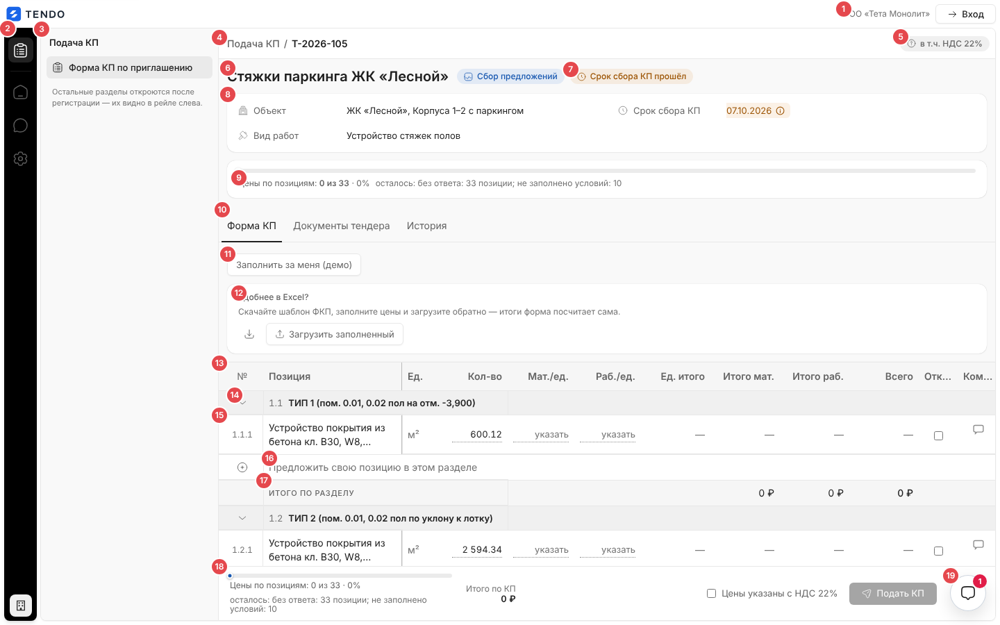

| № | Блок | Поведение |
|---|---|---|
| ① | Название организации-участника и «Вход» | см. таблицу выше. Если в браузере осталась метка входа, но сессия истекла (форма открылась гостевой), кнопка подписана «Мой кабинет» и ведёт в `/cabinet` (подсказка «Личный кабинет: тендеры, куда вас пригласили, поданные КП и переписка.») |
| ② | Рейл гостя | Разделы под замком, не кликаются |
| ③ | Панель «Подача КП» | Неинтерактивна |
| ④ | Хлебные крошки | «Подача КП / T-2026-105» (номер тендера) |
| ⑤ | Капсула «в т.ч. НДС 22%» | Правило всей формы; подсказка «Все цены в таблицах указываются в рублях, в т.ч. НДС 22%.» Ставка — `vat_rate_pct` из ответа (по умолчанию 22) |
| ⑥ | Заголовок — название тендера, капсула системного статуса тендера | — |
| ⑦ | «Срок сбора КП прошёл» | Только если срок прошёл; клик — поповер ([ниже](#срок-сбора)) |
| ⑧ | Сводка | «Объект» (объект/проект), «Вид работ», «Срок сбора КП» (ДД.ММ.ГГГГ; при просрочке — оранжевая дата со значком «i», клик — тот же поповер). Ответственный, бюджет и плановая сумма поставщику **не показываются** |
| ⑨ | Ход заполнения | Полоса и «Цены по позициям: X из Y · P%» (+ « · нулевых цен: N»), подсказка готовности, справа «сохраняем…» / «сохранено в ЧЧ:ММ:СС». После подачи блок скрыт |
| ⑩ | Вкладки | «Форма КП» · «Документы тендера» · «История»; переключение вкладки сохраняет черновик |
| ⑪ | «Заполнить за меня (демо)» | Только при флаге сборки `VITE_DEMO_TOOLS=1` и пока КП не подано: проставляет случайные ставки всем позициям без ответа, комментарии к отказам/изменённым объёмам, значения условий |
| ⑫ | «Удобнее в Excel?» | Загрузка заполненного шаблона ([ниже](#загрузка-заполненного-excel)); после подачи панели нет |
| ⑬ | Шапка таблицы позиций | Колонки — [ниже](#таблица-позиций) |
| ⑭ | Строка раздела | Шеврон «свернуть/развернуть раздел», номер и название раздела |
| ⑮ | Строка позиции | Ввод цен, отказ, объём, комментарий |
| ⑯ | «Предложить свою позицию в этом разделе» | Добавляет пустую свою позицию в конец раздела |
| ⑰ | «Итого по разделу» | Суммы материалов, работ и всего по разделу |
| ⑱ | Нижняя полоса подачи | Ход заполнения, «Итого по КП», галочка НДС, «Подать КП» ([ниже](#подача-кп)) |
| ⑲ | Кнопка «Чат по тендеру» | Только у гостя; счётчик непрочитанных ([ниже](#чат-по-ссылке)) |

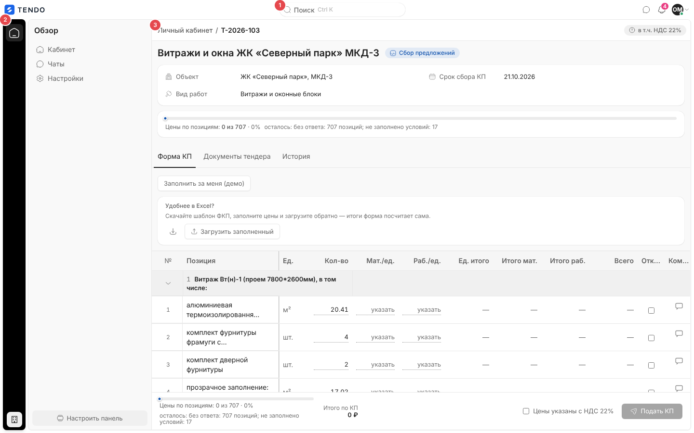

## Срок сбора

Срок сбора — ориентир, а не запрет: подачу закрывает только статус тендера. Поповер «Срок сбора КП прошёл»: «Ориентировочный срок сбора КП уже прошёл, но форма остаётся открытой: приём КП завершает специалист, а не календарь. Подавайте КП как обычно. Если вам прислали новую версию формы — заполните и подайте её.»

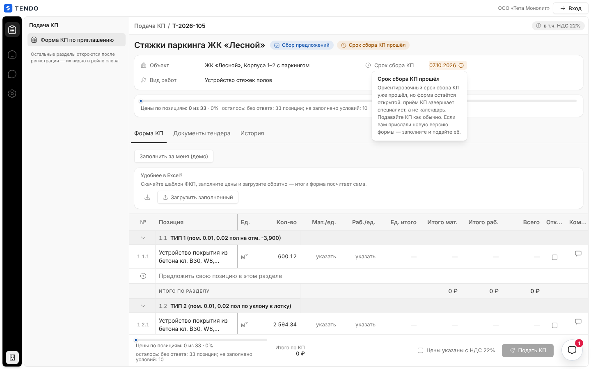

Со второго раунда под заголовком выводится строка «Раунд №N · приглашает: <имя>» (имя пригласившего или ответственного).

## Таблица позиций

Позиции идут в порядке ФКП: разделы любой вложенности, позиции раздела и его подразделы вперемешку, как в файле. Если раздел прерывается подразделом, продолжение помечается « · продолжение». Таблица одна на все разделы (подпись для скринридера «Позиций в форме: N»); строка раздела показывает номер и название, полный путь родительских разделов — в подсказке; раздел сворачивается шевроном. Две левые колонки («№», «Позиция») закреплены при горизонтальной прокрутке.

| Колонка | Содержимое и правила |
|---|---|
| № | Номер позиции из файла ФКП (если есть), иначе порядковый |
| Позиция | Название (до 2 строк, полное — по наведению вместе с доп. атрибутами); капсулы «Отказ», «Изменено» (позиция скорректирована специалистом), «Дозаполнить», «Нет в файле», «Загружено»; снятые специалистом позиции — зачёркнуты и в расчёт не входят |
| Доп. | Дополнительные атрибуты позиции из ФКП (колонка есть, только если хоть у одной позиции они заданы) |
| Ед. | Единица измерения |
| Кол-во | Объём по ФКП, **редактируемый** (подсказка «Кол-во можно изменить»). Изменённый объём = корректировка: строка подсвечивается, под числом «в тендере: N», знак комментария становится обязательным (подсказка «Объём изменён — укажите комментарий»). Если объём правился специалистом — «было: N». Нерассмотренная корректировка после подачи — «<объём> на рассмотрении» |
| Мат./ед. | Цена материалов за единицу, ₽ с НДС; поле-«указать» (подсказка «Цена материалов за единицу — нажмите, чтобы ввести»); число с разрядами. При активном раунде под полем — «было <прошлая цена> · ±N%» |
| Раб./ед. | То же для работ |
| Ед. итого | Материалы + работы за единицу (серым) |
| Итого мат. / Итого раб. / Всего | Цена × применённый объём (если введён свой объём — он, иначе объём ФКП); пустая строка — «—» |
| Отказ | Чекбокс «Отказ от позиции «…»». Отказ блокирует цены и объём (но не комментарий), строка помечается капсулой «Отказ», комментарий обязателен |
| Комментарий | Знак комментариев «Комментарии (N)» (подсветка, если обязателен: «… · обязателен: <причина>»); клик — панель комментария ([ниже](#комментарий-к-позиции)) |

Под таблицей — «Итого по КП» по всем разделам (в нижней полосе). Подытог раздела с подразделами подписан «Итого по разделу <номер> с подразделами» (подсказка «Позиции раздела «…» и всех его подразделов — как итог раздела в ФКП и в сравнении»).

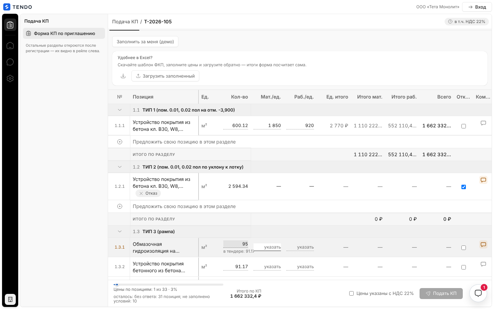

- Недопустимое число при уходе из поля — пометка «Недопустимое значение» у строки.
- Пустое поле цены ≠ 0: введённый «0» — это цена (засчитывается в заполнение и отдельно считается в «нулевых ценах»), пустое — «нет ответа».
- Колонки ограничены минимальной шириной; при нехватке места таблица прокручивается горизонтально.

### Своя позиция

«Предложить свою позицию в этом разделе» (или «+» в колонке «№») добавляет в конец раздела строку «Ваша позиция»: наименование (плейсхолдер «наименование своей позиции»), единица («ед.»), количество («кол-во»), цены за единицу («указать»), комментарий (обязателен), кнопка «Убрать свою позицию». Кнопки нет у поданного КП и при точечном дозаполнении.

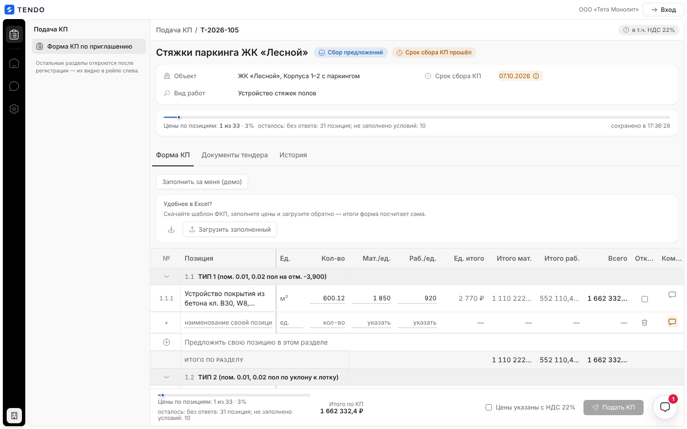

### Комментарий к позиции

Панель (поповер) у знака комментария: полное название позиции и организация; лента — собственный комментарий контрагента к этой позиции (запись «черновик, ещё не подан» или версия КП, в которой подан) и адресованный ему ответ специалиста по корректировке; поле «Написать комментарий…» (до 1000 символов). Отправка из поля **не создаёт реплику**, а задаёт комментарий строки (у позиции одной версии КП — один текст); ответ на запись специалиста дописывается цитатой. Действие «в чат» дублирует фразу в переписку по тендеру (`POST /chats/invite/{token}/messages`). Внутреннее обсуждение ячейки сотрудниками контрагенту не показывается.

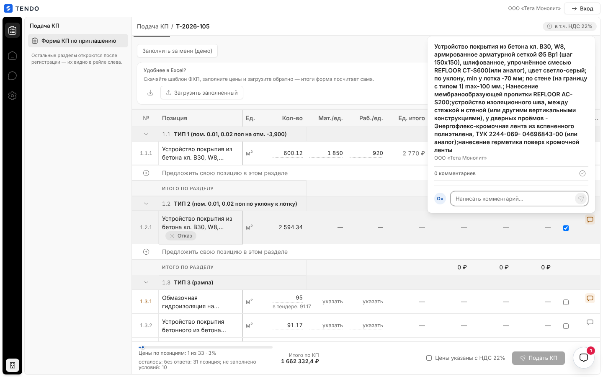 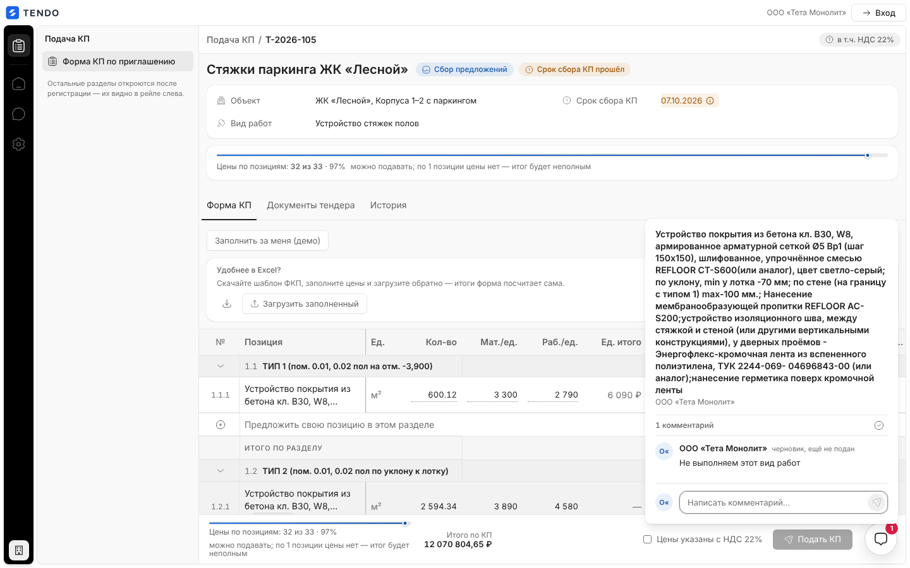

## Дополнительные условия и документы к КП

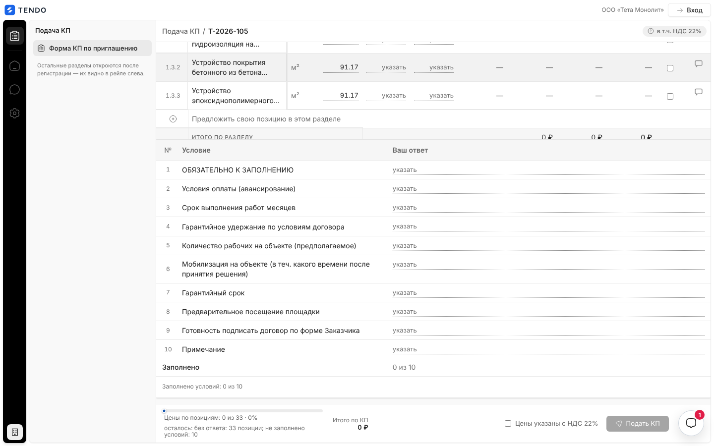

- **Дополнительные условия** (если у тендера заданы поля условий): колонки «№», «Условие», «Ваш ответ»; тип ответа по типу поля: текст («указать»), число (с разрядами), дата (календарь), да/нет (переключатель «Да / Нет»). Итоговая строка «Заполнено N из M». Условия в процент заполнения не входят, но учитываются в подсказке готовности.
- **Документы к КП** (группа «Документы к КП», подсказка «Приложите запрошенные документы — без них КП отправить нельзя.»): появляется, только если в пакете документов тендера заказчик приложил «Шаблон типового договора СМР» и/или «Договор личного поручительства» — их контрагент должен вернуть. Таблица «Документ · Файл · Действие»: «не приложено», имя · размер · дата, «загружается…», ошибка загрузки; «Загрузить» (форматы PDF, DOC, DOCX, XLS, XLSX), «Скачать «…»», «Удалить «…»» (только до подачи). Файлы уходят **после** подачи КП; упавшие остаются в списке, в шапке группы появляется «Дозагрузить файлы», статус «КП подано <дата>. Часть файлов не загрузилась — нажмите «Дозагрузить».».

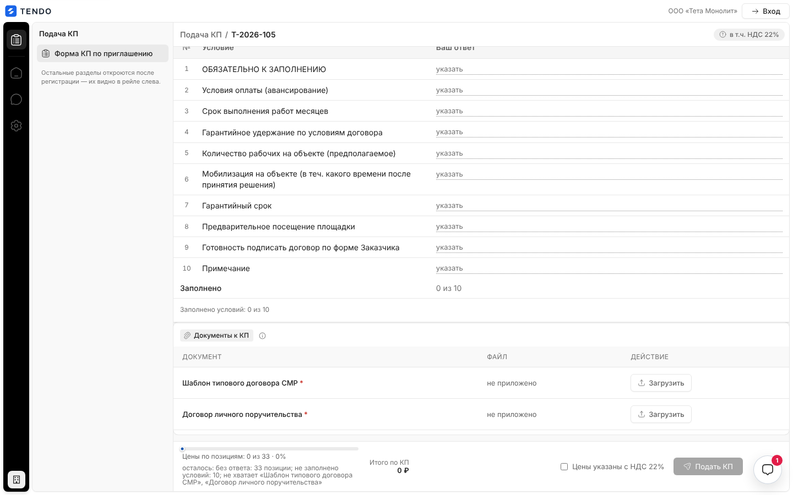

## Загрузка заполненного Excel

Второй равноправный способ заполнения: скачать исходную ведомость тендера («Шаблон ФКП» — при `FKP_FORM_LOCKED` с защитой листа, открыты только ячейки ввода), проставить цены и загрузить файл обратно. Разбор **только подставляет** цены и ответы на условия в форму — позиций не создаёт (кроме предложенных), строк не удаляет, тендер не меняет.

- Панель «Удобнее в Excel?» — «Скачайте шаблон ФКП, заполните цены и загрузите обратно — итоги форма посчитает сама.»; значок «Скачать шаблон ФКП» (если шаблон есть), «Загрузить заполненный» (файлы .xlsx/.xlsm; после загрузки — «Загрузить другой файл»; во время разбора — «Разбираем…»).
- `POST /invite/{token}/quote-import` возвращает отчёт без записи. Если в форме уже есть цены — окно «Заменить введённое?» «В форме уже есть введённые вами цены. Заменить их значениями из файла?» («Заменить» / «Оставить своё»).
- Перед подстановкой форма запоминает снимок (цены, условия, свои позиции) — **«Отменить загрузку»** возвращает к нему (тост «Загрузка отменена — Цены, условия и позиции из файла вернулись к тому, что было до разбора.»).
- Итоги — тост «Подставлено цен: N» («Файл «…» разобран полностью.» либо «Часть строк требует внимания — смотрите капсулы над таблицей.», плюс «Ответов на условия: N», «Ставок рассчитано из сумм по строке: N», «Из файла добавлено предложенных позиций: N») и капсулы в панели:

| Капсула | Что раскрывает |
|---|---|
| «Подставлено N» (зелёная) | Подсказка «Разобран файл «…», лист «…»» |
| «Условий N» | Ответы на доп. условия из подвала файла |
| «Рассчитано N» | Поповер «Ставок рассчитано: N» — откуда ставка: «из сумм по строке: сумма ÷ объём», «из итога по строке — целиком в работы», «из общей цены за единицу — целиком в работы» |
| «Не разобрано N» (жёлтая) | Поповер «Не разобрано ячеек: N — Цены в этих строках заполните руками.», список строк с переходом к строке формы |
| «Расхождения N» (жёлтая/красная) | Поповер «Расхождений: N»: «Структура файла разошлась с выданной формой» (блокирующие ошибки), строки, которых нет в тендере (добавлены как свои позиции «… — нет в тендере, добавлена как «…»»), позиции, которых нет в файле, изменённый объём, неразобранные условия |

- Кнопки панели: «Только загруженные строки» (фильтр таблицы), «Отменить загрузку», «Скрыть итоги загрузки». Строки из файла подсвечиваются; строки с изменённым в файле объёмом или отсутствующие в файле требуют комментария при подаче («объём в файле отличается от тендерного», «позиции нет в загруженном файле»).
- Файл не подошёл (структура разошлась, колонки цен не найдены, «похоже, файл другого тендера», изменены строки/объёмы защищённой формы) — ничего не подставляется, тост «Файл не подошёл — Структура «…» разошлась с выданной формой — подробности в капсуле «Расхождений».»; колонки цен можно указать вручную номерами и перечитать файл. Нечитаемый файл — тост «Файл не разобран» с текстом сервера (например, «Не удалось прочитать файл: …»).

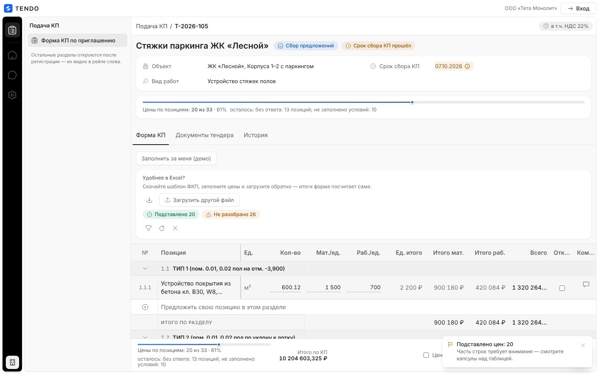

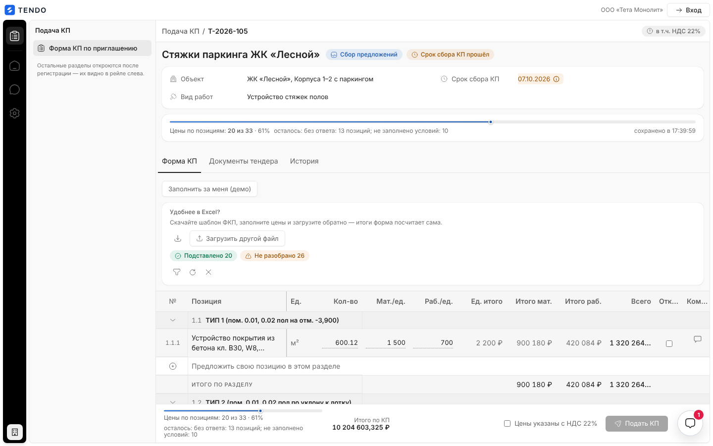

## Черновик и автосохранение

- Каждое изменение сразу пишется в браузер (localStorage по токену), на сервер — `PUT /invite/{token}/draft` через 5 с после последнего ввода, а также при уходе из поля, переключении вкладки, скрытии вкладки браузера и уходе со страницы. В сводке — «сохраняем…» / «сохранено в ЧЧ:ММ:СС».
- При открытии берётся **более свежий** из локального и серверного черновиков (можно продолжить с другого устройства) и показывается тост «Восстановлен незаконченный черновик» («Он сохранялся автоматически на сервере…» / «Он сохранился в этом браузере…»). Черновик не применяется поверх уже поданного КП.
- Пока КП подано и переподача не открыта — черновик не сохраняется.
- После подачи черновик очищается локально и на сервере.

## Подача КП

- Нижняя полоса (не перекрывает таблицу): полоса прогресса «Цены по позициям: X из Y · P%» и подсказка готовности; «Итого по КП»; галочка **«Цены указаны с НДС 22%»** (всегда снята при открытии, в т. ч. при повторной подаче); кнопка «Подать КП» → «Отправляем…» — активна только при отмеченной галочке.
- Подсказка готовности: «осталось: без ответа: N позиций; не заполнено условий: N; не хватает «<документ>»», либо «можно подавать; по N позициям цены нет — итог будет неполным», либо «форма заполнена — можно подавать».
- Проверки на клиенте **до** отправки, по порядку строк (первая найденная ошибка — красная плашка «КП не отправлено» над вкладками и в полосе, строка подсвечивается):

| Условие | Текст |
|---|---|
| Строка дозаполнения без количества | «Укажите количество: «<позиция>»» |
| Нет ни цены, ни отказа | «Укажите цену или откажитесь от позиции: «<позиция>»» |
| Объём изменён без комментария | «Укажите комментарий при изменении объёма: «<позиция>»» |
| После загрузки файла объём разошёлся / позиции нет в файле, без комментария | «Укажите комментарий (объём в файле отличается от тендерного / позиции нет в загруженном файле): «<позиция>»» |
| Отказ без комментария | «Укажите комментарий при отказе от позиции: «<позиция>»» |
| Нечисловая цена | «Недопустимое значение в поле «Цена за ед., материалы» (работа) у «<позиция>»» |
| Своя позиция без названия / объёма и единицы / комментария | «Укажите название своей позиции»; «Укажите количество и единицу для «<имя>»»; «Укажите комментарий для новой позиции «<имя>»» |
| Не приложены обязательные документы | «Приложите документы: «…», «…»» |
| Не подтверждён НДС | «Подтвердите, что цены указаны с НДС 22%» |

- Есть отказы (позиции без цены) — окно «Итог будет неполным»: «По N позициям цены нет — итог будет неполным. Подать КП так?» («Подать КП» / «Вернуться к форме»).
- Отправка `POST /invite/{token}/quote`: нетронутые строки не отправляются вовсе; пустая ставка уходит как `null` (не ноль); строки с отказом, комментарием или своим объёмом — всегда; свои позиции — с объёмом и единицей; ответы на условия; ловушка для ботов. Ошибки сервера (тот же формат плашки): «КП уже подано — повторная отправка недоступна», «КП подал другой сотрудник вашей организации — править и переподавать может только он.», «Комментарий длиннее 1000 символов», тексты 410/403 по ссылке, лимит 10 подач в минуту. Полный перечень — [API](../04-api/endpoints-tenders-invite.md#post-invitetokenquote).
- Успех: форма становится только для чтения, плашка «КП подано, ожидает рассмотрения» со строкой «Раунд №N · версия КП №V · подано ДД.ММ.ГГГГ, ЧЧ:ММ» и «Ваша подача учтена. Ещё не ответили: N.» / «Набор полный — ответили все приглашённые.»; затем загружаются файлы к КП.

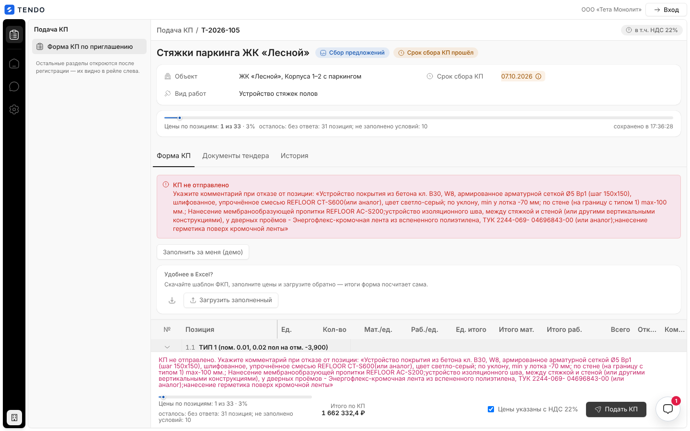

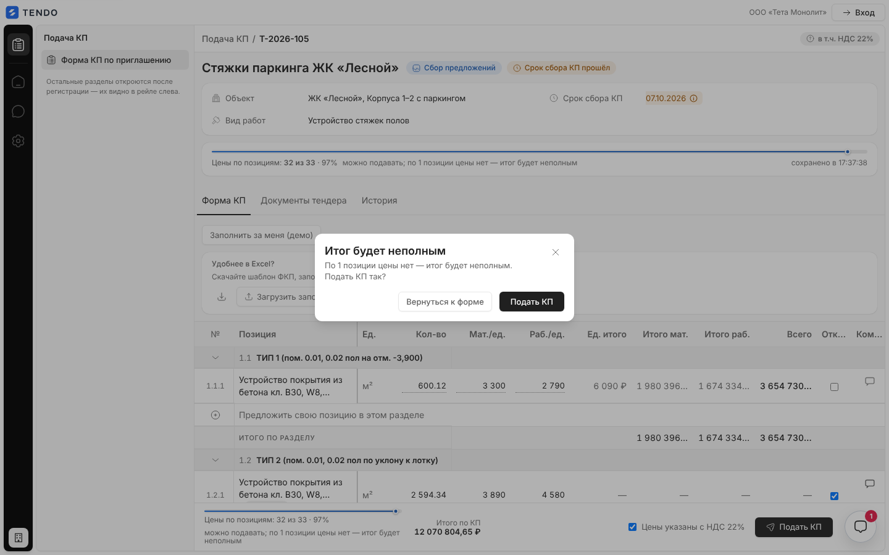

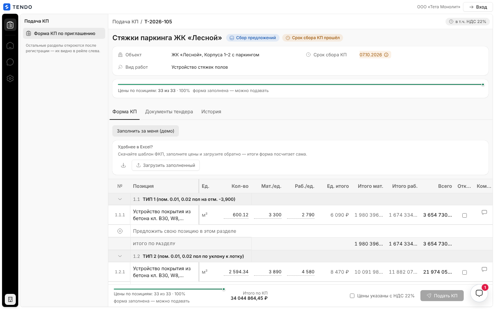

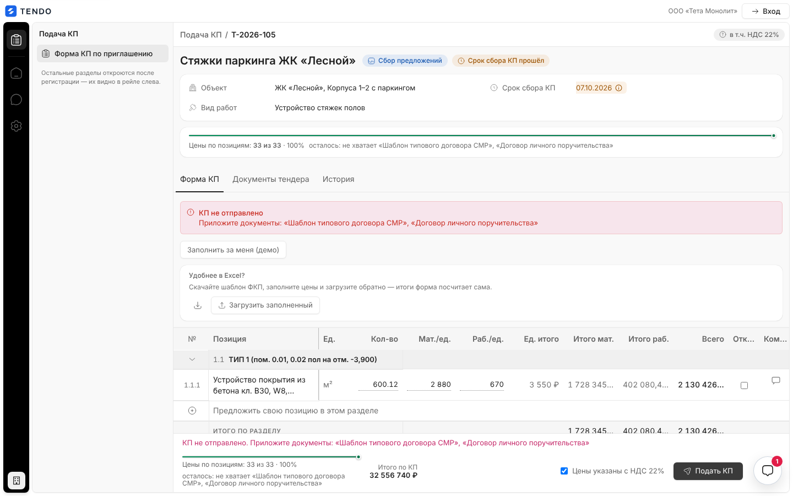

## Режимы формы

| Режим | Когда | Что видно и что можно |
|---|---|---|
| Новое КП | Приглашение без поданного КП | Всё редактируемо |
| **Подано** (только просмотр) | КП подано, нет доработки, раунда и дозаполнения | Зелёная плашка «КП подано, ожидает рассмотрения» (или «КП подано — часть файлов не загрузилась»): «Форма только для просмотра — повторная подача недоступна. Корректировок объёма на рассмотрении: N.» + строка раунда/версии/даты. Все поля заблокированы, панели Excel и полосы подачи нет. Комментарии поданной версии видны в панелях комментариев |
| **Ответ на раунд** | Отправлен раунд №2+, контрагент — адресат и ещё не ответил | Синяя плашка «Раунд №N: запрошено уточнение КП»: «Порядок подачи не влияет на разбор — раунд закрывается по ответу всех приглашённых.», текст раунда (общий/личный) и «Ниже — ваши предыдущие позиции как основа для правки (версия КП №V). При изменении цены под ячейкой виден прирост к прошлому раунду.». Форма предзаполнена прошлым КП, под ценами — «было … · ±N%» |
| **Доработка** | Специалист вернул КП на доработку | Форма открыта целиком, комментарий доработки в плашке «Требуется дозаполнение» |
| **Дозаполнение строк** | Специалист изменил объём позиций или отклонил корректировку | Оранжевая плашка «Требуется дозаполнение» с сообщением и группами: «Изменён объём по позициям» («Специалист изменил количество — проверьте и дозаполните эти строки, прежняя цена по ним снята.», строки «<позиция> (было → стало)») и «Корректировка объёма отклонена» («Ваше предложение по объёму не принято — заполните строки по количеству из шаблона.», «<позиция> (запрошено X, остаётся Y) — <комментарий>»). Открыты **только** затронутые строки (капсула «Дозаполнить», количество пустое и обязательное); свои позиции заблокированы |
| **Изменения в позициях** | Специалист снял или изменил позиции, ознакомление не подтверждено | Жёлтая плашка «Изменения в позициях тендера — Часть позиций отменена или изменена специалистом. Ознакомьтесь с ними в таблице (зачёркнутые — отменены) и подтвердите.» и кнопка «Принято к сведению» (`POST /invite/{token}/ack-corrections`) |
| **Новая версия ФКП** | Есть содержательная версия ФКП с изменениями | Синяя плашка «Изменения ФКП (vN)» со сводкой и списком «Добавлено: …», «Изменено: … (было → стало)», «Снято: …»; если КП подано по старой версии — жёлтая «Форма обновилась — Ваше КП подано по ФКП vX, актуальна vY.» |
| Тендер завершён/отменён | Статус тендера «Завершён»/«Отменён» | Форма загружается (капсула статуса тендера в заголовке); поданное КП — только просмотр. Сохранение черновика и подачу сервер отклоняет с 410 «Тендер закрыт или отменён — подача и правки КП недоступны…»; отказ подачи выводится в плашке «КП не отправлено» |

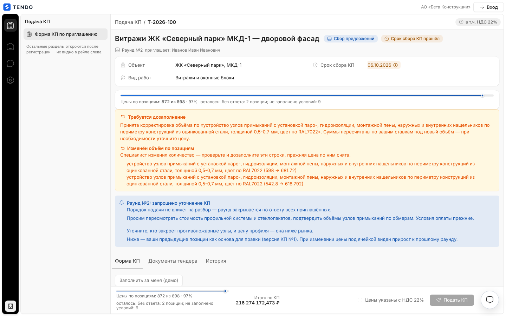

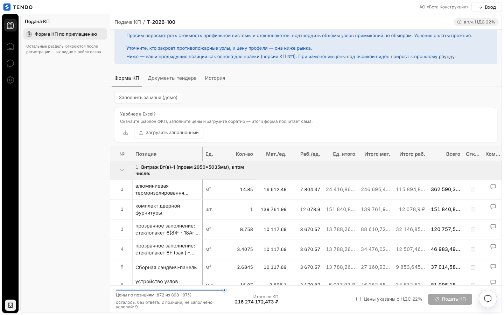

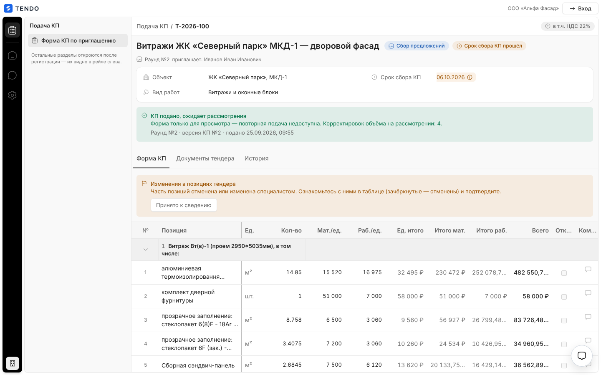

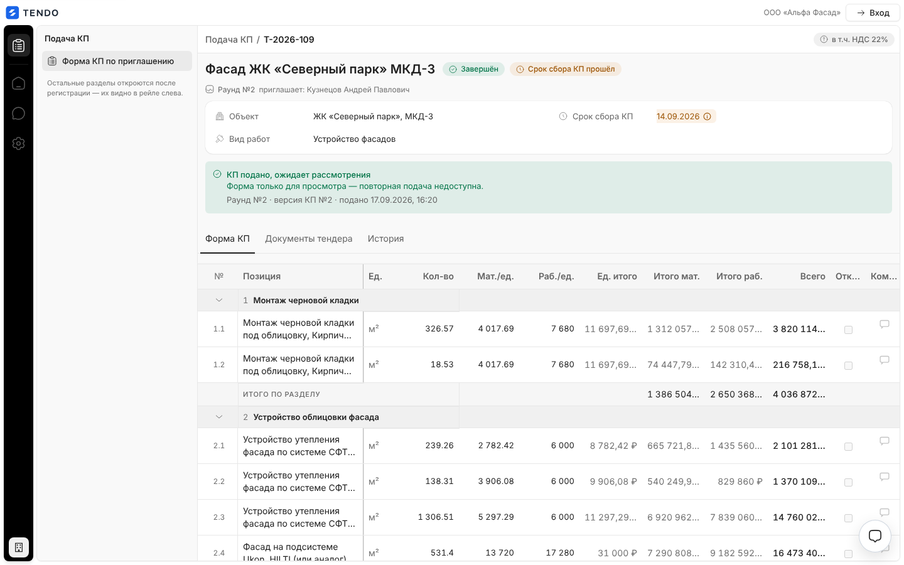

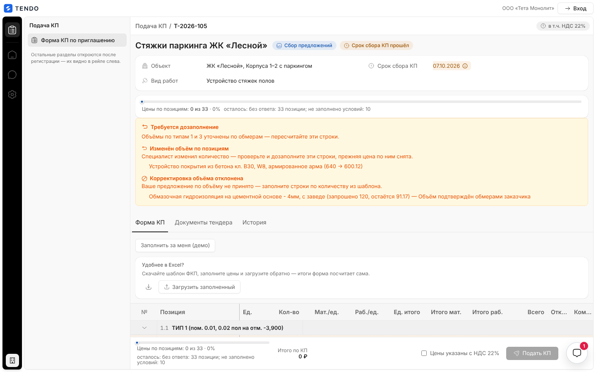

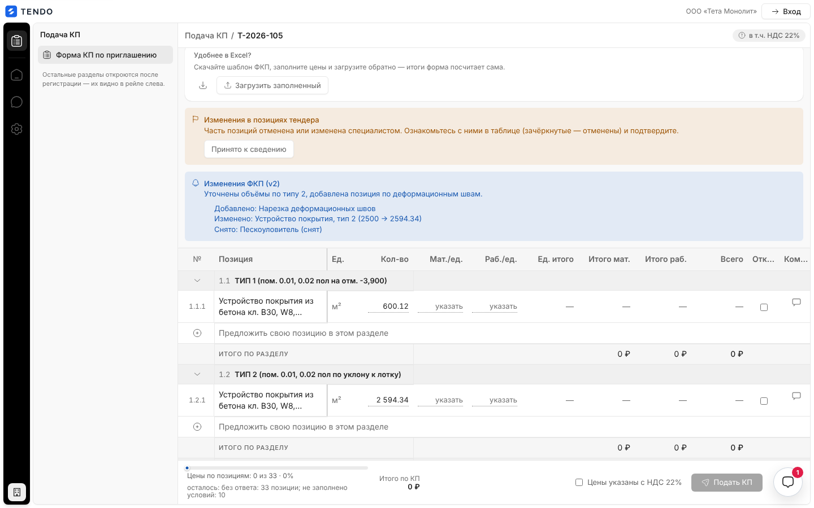

## Вкладки «Документы тендера» и «История»

- **Документы тендера** — пакет документов тендера только для чтения ([tender-card-documents.md](tender-card-documents.md)): «Рабочая документация (РД)» (ссылка), «Техническое задание», «Шаблон типового договора СМР», «Договор личного поручительства», «Шаблон ФКП»; у каждого — «не приложено» или имя файла с датой и кнопкой скачивания (`GET /invite/{token}/documents/{id}`). Пакета нет — «Документы тендера пока не приложены.».
- **История** — «История по тендеру»: события тендера, касающиеся контрагента, сгруппированные по дням (сообщения в чате, приглашения, подачи КП, решения по корректировкам, раунды) — `GET /invite/{token}/activity`.

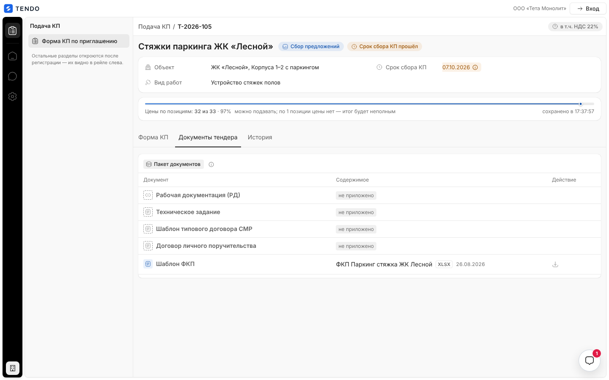 

## Чат по ссылке

У гостя — плавающая кнопка «Чат по тендеру» (правый нижний угол, над полосой подачи) со счётчиком непрочитанных. Панель «Чат по тендеру» (подзаголовок «<тендер> · <организация>»): лента переписки с представителями заказчика (дни, системная реплика «Диалог открыт.», входящие с именем сотрудника, свои справа со статусом прочтения), поле «Сообщение…», скрепка (файл до 25 МБ), отправка, подпись «Договаривайтесь только здесь — за переписку вне чатов тендера ответственности не несём.», пустая лента — «Напишите вопрос по тендеру — ответ придёт сюда же.». Свои сообщения можно изменить или удалить в течение 15 минут (подтверждение «Удалить сообщение? У заказчика на его месте останется пометка «Сообщение удалено».»); на вопрос специалиста по позиции — «Ответить на вопрос» (переход из реплики к строке формы). Обновления — свой SSE-поток по токену. Пока панель закрыта, новое сообщение показывается всплывашкой «Новое сообщение по тендеру». Подробно — [chats.md](chats.md), API — [endpoints-chat.md](../04-api/endpoints-chat.md#публичный-контур-по-ссылке-приглашению).

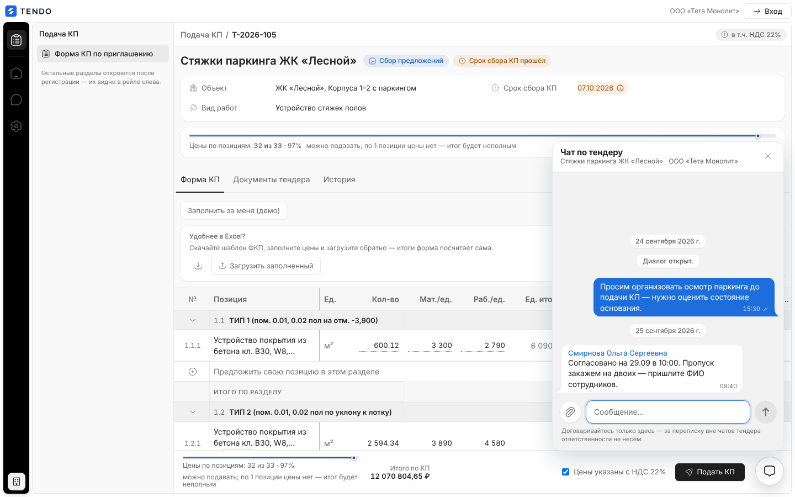

## Загрузка и ошибки ссылки

| Состояние | Текст | Снимок |
|---|---|---|
| Загрузка | В каркасе — заголовок «Подача КП» и «Загружаем…» | 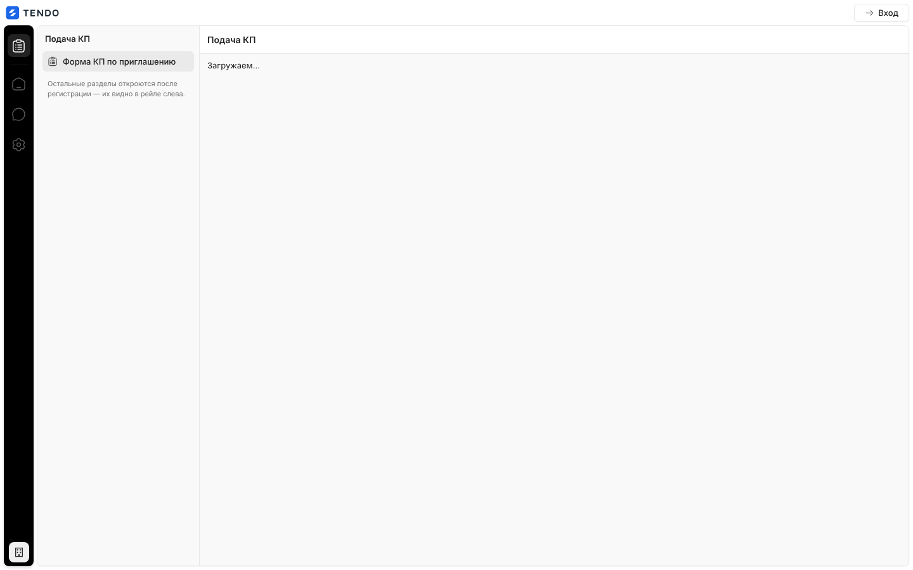 |
| Неизвестный токен (403) | «Ссылка недоступна» + текст сервера «Ссылка недействительна или устарела» | 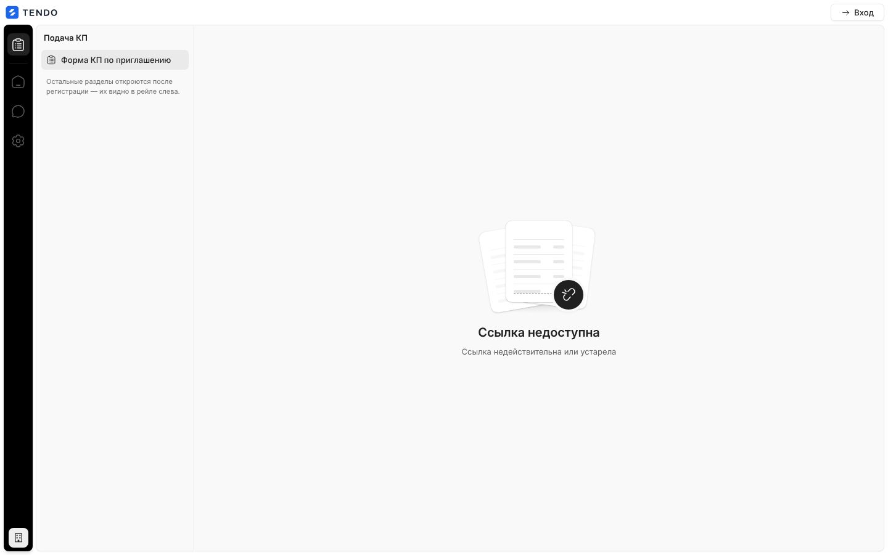 |
| Приглашение отозвано (410) | «Ссылка больше не действует» — «Приглашение отозвано. Запросите новую ссылку у представителя <клиента>.» | 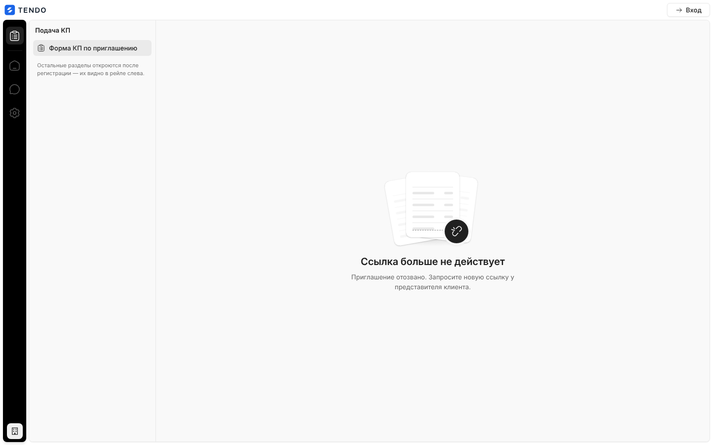 |
| Тендер закрыт/отменён (если сервер ответил 410 уже на загрузке формы; по текущим правилам API загрузка разрешена — см. режим «Тендер завершён/отменён») | «Тендер закрыт» — «Тендер закрыт или отменён — подача и правки КП больше не принимаются. Вопросы задайте представителю <клиента>.» | 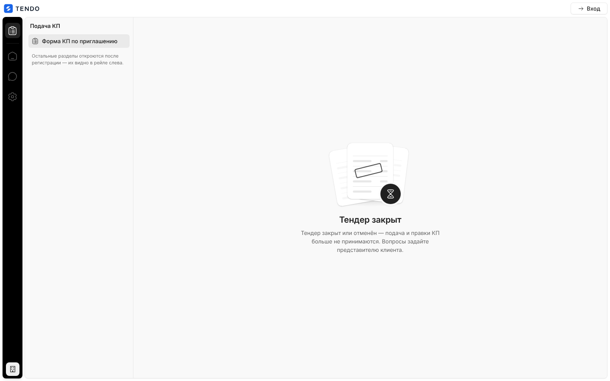 |
| Организация приостановлена (403) | «Доступ организации приостановлен» — «Обратитесь к администратору системы. Когда доступ вернут, форма откроется, а сохранённый черновик останется на месте.» | 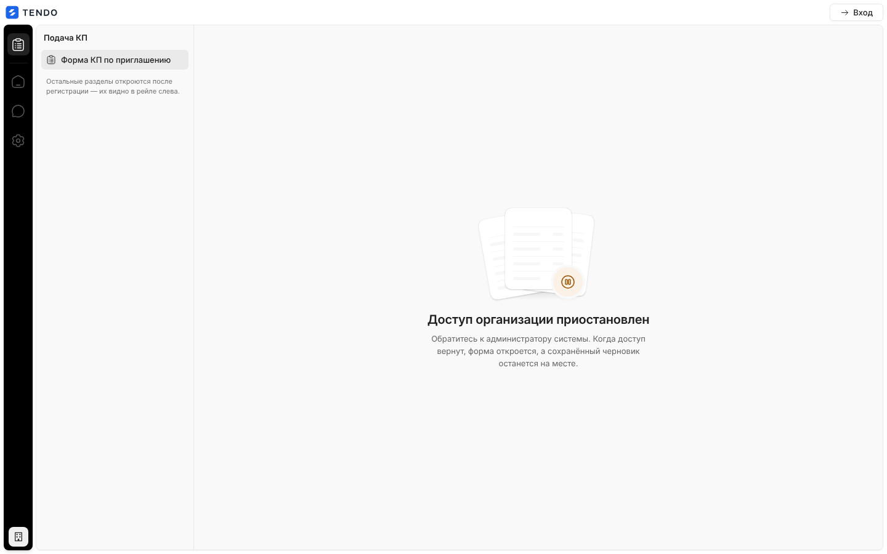 |
| Нет связи | «Форма не загрузилась» + текст ошибки сети, «Повторить» | 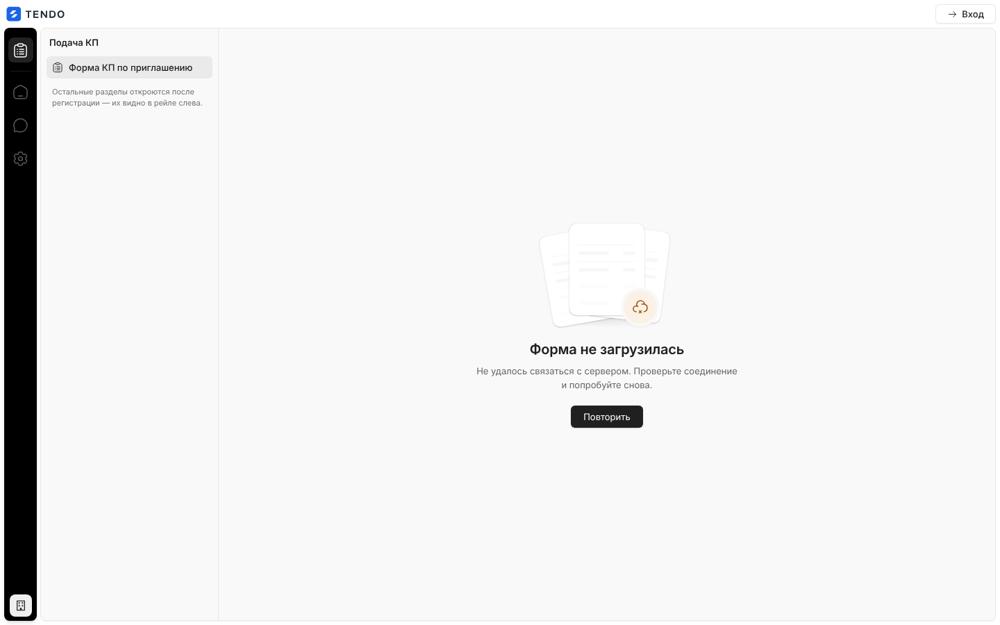 |
| Лимит частоты | 429 «Слишком много запросов — попробуйте немного позже» (30 запросов/мин на чтение, 10/мин на подачу) | — |

Экраны ошибок рисуются внутри каркаса (гостевого или рабочего), иллюстрация соответствует причине.

## API экрана

| Действие | Запрос |
|---|---|
| Данные формы | `GET /invite/{token}`; черновик `GET/PUT /invite/{token}/draft`; файлы КП `GET /invite/{token}/attachments` |
| Подача | `POST /invite/{token}/quote` |
| Ознакомление с изменениями | `POST /invite/{token}/ack-corrections` |
| Excel | `POST /invite/{token}/quote-import`; шаблон — `GET /invite/{token}/documents/{id}` |
| Файлы к КП | `POST /invite/{token}/files/presign-upload` → загрузка → `…/files/confirm` (или `POST /invite/{token}/files`), `DELETE /invite/{token}/files/{id}` |
| История | `GET /invite/{token}/activity` |
| Чат | `/chats/invite/{token}/*` |
| Сессия (оформление) | `GET /auth/me` пробой |

## Сложность

**XL**: таблица на сотни позиций с вводом, расчётами, разделами любой вложенности и корректировками (L); режимы (раунд, доработка, дозаполнение, просмотр, изменения ФКП) (L); загрузка Excel с отчётом, откатом и ручным указанием колонок (L); черновик локально+сервер с выбором свежего (M); подача с проверками и файлами после подачи (M); два каркаса, чат по ссылке (M).
