# Главная (`/home`)

Стартовый экран сотрудника после входа: у тендерного специалиста и администратора — «рабочий стол закупщика» (сроки сбора КП, бюджет года, тендеры, требующие внимания, новые КП), у службы безопасности и юриста — очередь анкет контрагентов на проверку. Поставщик, лид и владелец площадки сюда не попадают — у них свой стартовый экран.

Связанные разделы: роли и разделы — [../01-product/users-and-roles.md](../01-product/users-and-roles.md); флаг «Требует внимания» и сроки — [../02-business-logic/tenders.md](../02-business-logic/tenders.md#43-флаг-требует-внимания); бюджет — [../04-api/endpoints-budget.md](../04-api/endpoints-budget.md#get-budgetoverview); реестр тендеров (источник строк) — [../04-api/endpoints-portfolios.md](../04-api/endpoints-portfolios.md#get-portfolios); входящие КП — [../04-api/endpoints-quotes.md](../04-api/endpoints-quotes.md#get-quotes); лента уведомлений — [../04-api/endpoints-notifications.md](../04-api/endpoints-notifications.md#get-notifications); сообщение о баге — [../04-api/endpoints-bug-reports.md](../04-api/endpoints-bug-reports.md); соседние экраны — [tenders-registry.md](tenders-registry.md), [quotes-inbox.md](quotes-inbox.md), [tender-create.md](tender-create.md).

> На снимках в правом нижнем углу может быть виден круглый значок — инструмент отладки dev-сборки стенда, в продукт не входит. Всплывающие карточки в правом нижнем углу («Новая версия КП…») — живые уведомления каркаса приложения, к экрану не относятся.

## Маршрут

- `/home`. Корень сайта `/` всегда перенаправляет на `/home`.
- Пункт рейла «Обзор» (иконка домика) и логотип ведут на стартовый экран **своей роли** (см. ниже).
- Заголовок вкладки браузера — общий заголовок приложения; в шапке экрана подпись «Главная» (не заголовок первого уровня — им служит приветствие).

## Назначение

Ответить сотруднику на вопрос «что требует моего внимания прямо сейчас», не заставляя открывать реестры: какие сроки сбора КП горят, сколько денег года свободно, какие тендеры помечены «Требует внимания», какие КП ещё никто не открыл, что пришло с прошлого визита. Для ролей аккредитации — какие анкеты ждут их проверки и сколько дней.

## Роли и что видит каждая

| Роль | Что на главной | Снимок |
|---|---|---|
| Тендерный специалист | Рабочий стол закупщика: строка «С прошлого визита», «Сроки сбора КП», «Бюджет {год}» (только при праве видеть финансы), «Требуют внимания», «Новые КП», кнопка «Новый тендер» в шапке | [home--specialist](#рабочий-стол-закупщика) |
| Администратор | То же, что специалист; данные — по всем объектам (без ограничения доступа к проектам) | 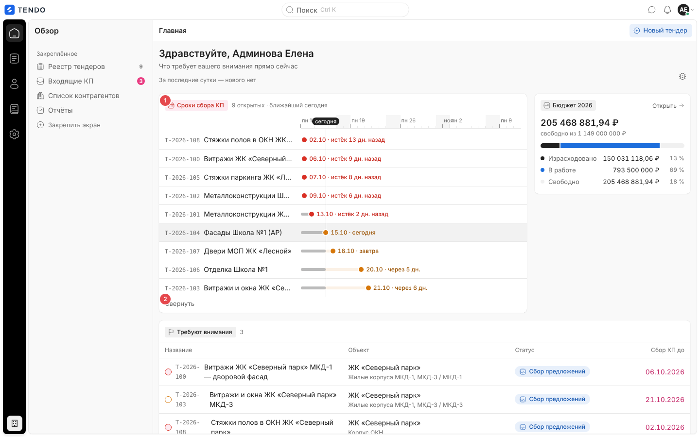 |
| Служба безопасности (СБ) | Очередь анкет СБ: «Очередь службы безопасности»; кнопки «Новый тендер» нет | [home--security](#очередь-аккредитации-сб-и-юрист) |
| Юрист | Очередь анкет юриста: «Очередь юриста»; кнопки «Новый тендер» нет | [home--lawyer](#очередь-аккредитации-сб-и-юрист) |
| Поставщик (пользователь контрагента) | Экран недоступен: при заходе на `/home` система перенаправляет на `/cabinet` (кабинет контрагента) | 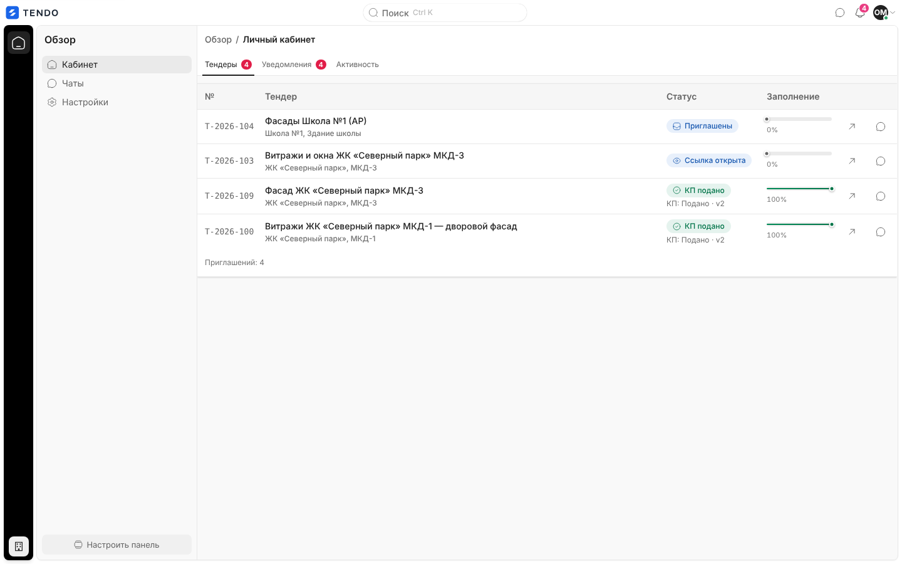 |
| Лид (заявка с лендинга) | Перенаправление на `/welcome` (ожидание назначения роли) | — |
| Владелец площадки | Перенаправление на `/owner/costs` | — |

Правила допуска:

- Стартовый экран роли: владелец площадки → `/owner/costs`, лид → `/welcome`, поставщик → `/cabinet`, остальные → `/home`. Это же правило применяет гейт входа к любому адресу, закрытому для роли.
- Пока роль пользователя неизвестна (идёт запрос `GET /auth/me`) или пользователя сейчас перенаправят, экран показывает заголовок «Главная» и скелетон, **не запрашивая** данные сотрудника (иначе в журнале безопасности появлялись бы отказы в доступе).
- Запросы сотрудника (реестр, входящие КП) делаются только для специалиста и администратора; очередь аккредитации — только для СБ и юриста; бюджет — только для специалиста/администратора с флагом пользователя «Видит финансы» (`can_view_finance`).

## Как попасть

- Сразу после входа (если до входа не был запрошен другой адрес).
- Пункт рейла «Обзор», логотип, адрес `/`.
- Перенаправление гейта при попытке открыть раздел, закрытый для роли (например, СБ открывает `/tenders` — попадает на `/home`).

## Рабочий стол закупщика

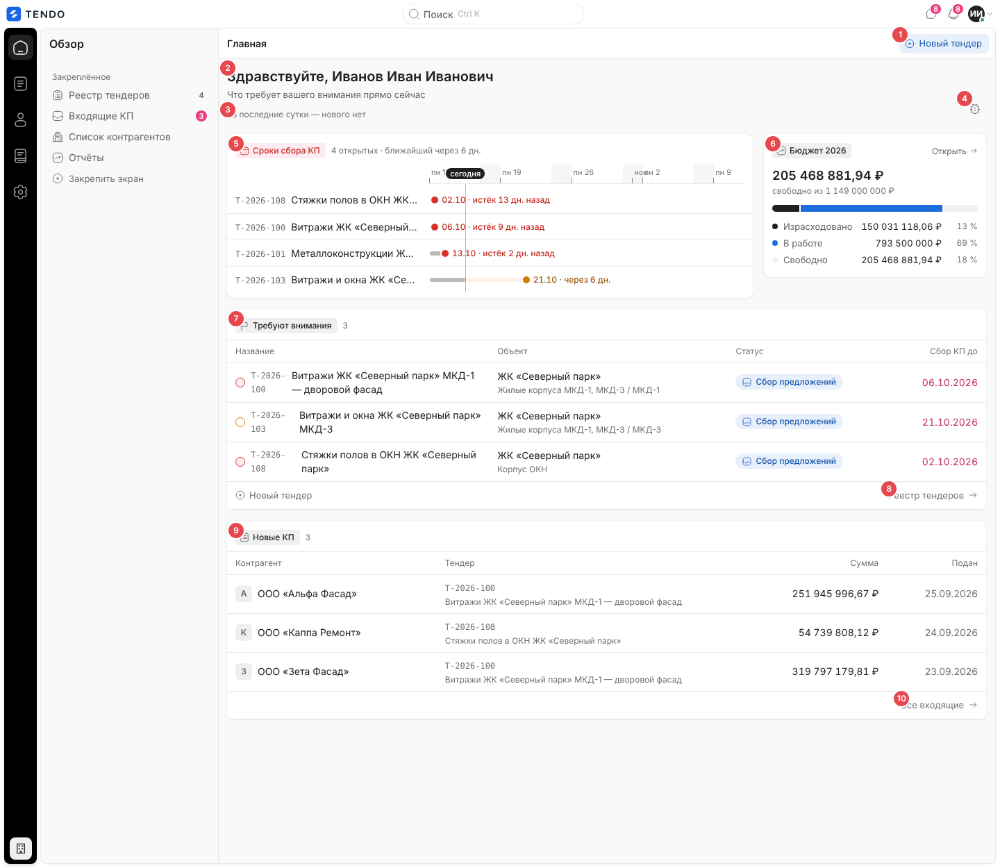

| № | Блок | Поведение |
|---|---|---|
| ① | «Новый тендер» (кнопка-чип в шапке) | Открывает мастер создания `/tenders/new` ([tender-create.md](tender-create.md)). Есть у специалиста и администратора, нет у СБ и юриста |
| ② | Приветствие «Здравствуйте, {ФИО}» | Заголовок экрана (`h1`). Подзаголовок: «Что требует вашего внимания прямо сейчас» (у СБ/юриста — «Анкеты, ожидающие вашей проверки») |
| ③ | Строка «С прошлого визита» | Сколько событий пришло с прошлого визита на главную — см. [ниже](#строка-с-прошлого-визита) |
| ④ | Значок «Сообщить о баге» | Открывает окно сообщения о баге — см. [ниже](#окно-сообщить-о-баге) |
| ⑤ | «Сроки сбора КП» | Полоса сроков открытых тендеров на ближайший месяц — см. [ниже](#полоса-сроки-сбора-кп) |
| ⑥ | «Бюджет {год}» | Манометр бюджета текущего года — см. [ниже](#манометр-бюджет-год). Только при праве видеть финансы |
| ⑦ | «Требуют внимания» · N | Таблица тендеров с флагом «Требует внимания» (до 5 строк) |
| ⑧ | Строка-хвост таблицы | Слева «+ Новый тендер» (→ `/tenders/new`), справа «Реестр тендеров →» или «Все N →», если тендеров с флагом больше 5 (ведёт на `/tenders` без фильтра) |
| ⑨ | «Новые КП» · N | Таблица непросмотренных КП (до 5 строк) |
| ⑩ | «Все входящие →» | Ведёт на `/quotes` |

Раскладка: верхний ряд — полоса сроков (широкая) и манометр (узкий, справа); без права на финансы полоса занимает всю ширину. Ниже — две группы друг под другом. Экран прокручивается целиком; шапка «Главная» закреплена.

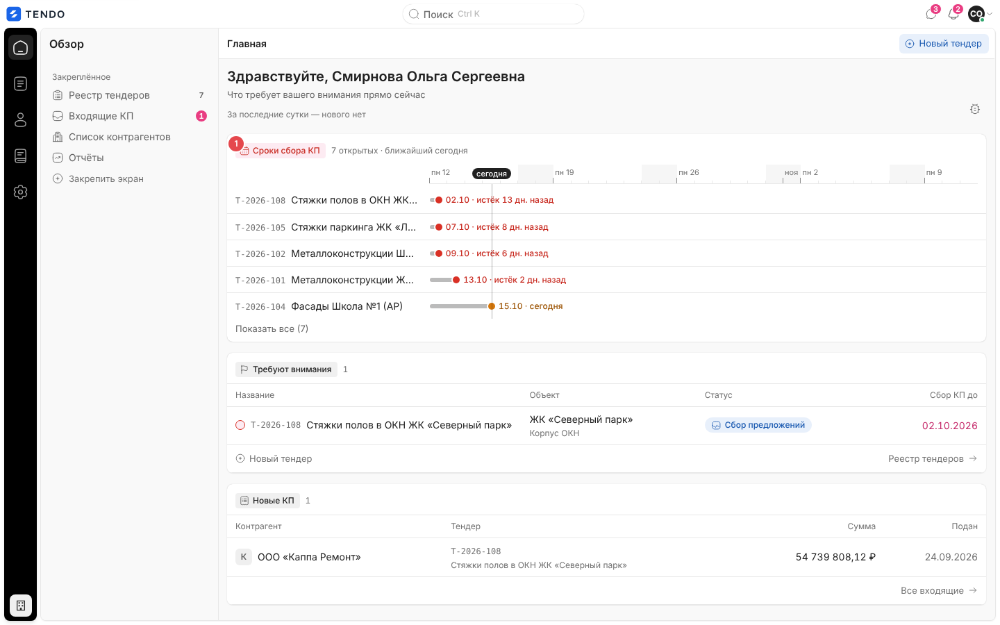

### Строка «С прошлого визита»

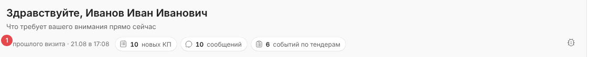

- Показывается только специалисту и администратору.
- Момент прошлого визита хранится **в браузере** пользователя (ключ на пользователя); читается один раз при открытии главной и не меняется, пока человек на ней; новый момент записывается при уходе с главной (переход на другой экран, закрытие вкладки). Потеря значения не критична.
- Первый визит (значения нет) — окно «За последние сутки».
- Подпись: «За последние сутки» или «С прошлого визита · сегодня в 09:12» / «вчера в 18:40» / «28.09 в 10:00» (московское время).
- Считаются уведомления ленты сотрудника (`GET /notifications`), созданные позже момента визита, по видам:

| Вид уведомления | Чип | Куда ведёт |
|---|---|---|
| `quote` | «N новое КП / новых КП» | `/quotes` |
| `message` | «N сообщение / сообщения / сообщений» | `/chats` |
| `revision` | «N корректировка / корректировки / корректировок» | `/notifications` |
| `tender` | «N событие / события / событий по тендерам» | `/notifications` |

  Прочие виды (например, комментарии) в строке не считаются. Чипы с нулём не показываются; если нового нет — «… — нового нет».
- Пока лента грузится или при ошибке строка не показывается вовсе.

### Полоса «Сроки сбора КП»

- Источник — те же строки, что у реестра тендеров (`GET /portfolios`, см. [tenders-registry.md](tenders-registry.md#данные)); берутся тендеры в статусе «Сбор предложений» с распознаваемой датой окончания сбора КП. Тендер без даты на шкале не показывается. Сортировка — по сроку по возрастанию.
- Заголовок группы: «Сроки сбора КП · N открытых · ближайший через N дн.» (или «сегодня», «завтра»); если открытых нет — «открытых тендеров нет». Тон заголовка: красный, если есть просроченный срок; янтарный, если есть срок через 7 дней и меньше.
- Шкала: 31 день, начиная за 3 дня до сегодня. Деления по дням; подписи — у понедельников («пн 19») и первых чисел месяца («ноя»); подписи в двух днях от «сегодня» скрываются, чтобы не наползать на флажок «сегодня». Выходные затенены. Вертикаль «сегодня» проходит через все дорожки.
- Дорожка тендера: слева номер (`T-2026-108`) и название (в одну строку с многоточием) — это ссылка на карточку тендера `/tenders/{id}`; справа — полоса от даты начала текущего круга сбора (дата начала тендера; если она позже срока — прижимается к сроку) до срока; прожитая часть полосы темнее. На конце — точка и метка «02.10 · истёк 13 дн. назад» / «21.10 · через 6 дн.» / «сегодня» / «завтра». Метка ставится справа от точки, у правого края — слева. Срок за горизонтом: полоса до края и метка «ДД.ММ →».
- Цвет только у срока: истёк — красный, 7 дней и меньше (включая сегодня) — янтарный, иначе графитовый (правило «цвет — это смысл»).
- Сразу видно 5 ближайших сроков; кнопка «Показать все (N)» / «Свернуть».
- Анимация роста дорожек отключается при системной настройке «уменьшить движение».
- Пусто: «Открытых тендеров нет — шкале нечего показывать. Создать тендер» (ссылка на `/tenders/new`).
- Доступность: каждая дорожка — ссылка с полным текстом «номер, название, фраза срока»; шкала скрыта от экранного диктора.

Фразы срока (одни и те же в полосе, таблице «Требуют внимания» и карточке тендера):

| Условие | Режим | Фраза |
|---|---|---|
| Срок прошёл | истёк | «Срок истёк N дней назад. Приём коммерческих предложений закрыт.» |
| Сегодня | срочно | «Сегодня последний день приёма коммерческих предложений.» |
| ≤ 7 дней | срочно | «Осталось N дней. Приём коммерческих предложений скоро закроется.» |
| 8–30 / > 30 дней | спокойно | «Осталось N дней до конца приёма коммерческих предложений.» |
| Черновик | — | «Черновик не опубликован — отсчёт до срока сбора КП ещё не начат.» |
| Завершён / отменён | — | «Тендер завершён — приём коммерческих предложений завершён.» (подставляется название статуса) |

### Манометр «Бюджет {год}»

- Запрос `GET /budget/overview?year={текущий год}` ([endpoints-budget.md](../04-api/endpoints-budget.md#get-budgetoverview)). Показывается только при праве видеть финансы.
- Крупное число — **свободный остаток** года: «205 468 881,94 ₽ / свободно из 1 149 000 000 ₽». При перерасходе — «−N ₽ / перерасход из …» красным, тон группы — красный.
- Полоса из трёх сегментов в долях от `max(выделено, израсходовано + в работе)`: «Израсходовано» (графит), «В работе» (синий — деньги заняты открытыми тендерами), «Свободно» (светлый) или «Перерасход» (красный хвост).
- Легенда: по строке на сегмент — подпись, сумма ₽, процент от выделенного.
- Сигналы (показываются только ненулевые, каждый — ссылка на `/budget`): «N позиций в перерасходе» (красный), «N тендеров без бюджетной позиции», «N позиций с тендерами, но без бюджета» (янтарные).
- Ссылка «Открыть →» в заголовке — на экран «Бюджет» (`/budget`).
- Загрузка — скелетон высотой с прибор; ошибка — «Бюджет не загрузился» + «Повторить» (остальная главная работает).
- Доступность: полоса имеет текстовую альтернативу целой фразой («Выделено … ₽: израсходовано 13 %, в работе 69 %, свободно 18 %»).

### Таблица «Требуют внимания»

| Колонка | Содержимое |
|---|---|
| Название | Кружок срока (пунктир — спокойно, янтарный — ≤ 7 дней, красный — истёк), номер тендера моноширинным, название — ссылка на карточку |
| Объект | Портфель; второй строкой серым — путь проекта |
| Статус | Капсула системного статуса (цвет + значок + подпись, как в реестре) |
| Сбор КП до | Дата окончания сбора КП `ДД.ММ.ГГГГ`; красная при режиме «истёк»/«срочно»; подсказка по наведению — фраза срока |

- Строки — тендеры с флагом `needs_attention` (смысл флага — [tenders.md §4.3](../02-business-logic/tenders.md#43-флаг-требует-внимания)), в порядке, в каком пришли из реестра, не более 5. Кликабельна вся строка (переход в карточку тендера); настоящая ссылка — на названии (работает средняя кнопка мыши и «открыть в новой вкладке»).
- Счётчик в заголовке группы — общее число тендеров с флагом.
- Пусто: «Тендеров, требующих внимания, нет. Открытых сейчас: N.»

### Таблица «Новые КП»

| Колонка | Содержимое |
|---|---|
| Контрагент | Аватар с первой буквой названия организации + название — ссылка на карточку КП `/quotes/{id}` |
| Тендер | Номер моноширинным, ниже серым — название |
| Сумма | Итог текущей версии КП, `251 945 996,67 ₽` |
| Подан | Дата подачи текущей версии `ДД.ММ.ГГГГ` (московский день) |

- Строки — КП с флагом «новое» (`is_new`: подано и ещё не открыто либо переподано после последнего открытия; см. [endpoints-quotes.md](../04-api/endpoints-quotes.md#статусы-кп)), до 5; порядок — как отдаёт сервер (свежие подачи сверху). Клик по строке открывает карточку КП (флаг «новое» при этом снимается — см. [quote-card.md](quote-card.md#загрузка-данных)).
- Пусто: «Непросмотренных КП нет — новые появятся здесь, как только поставщики их подадут.»

### Окно «Сообщить о баге»

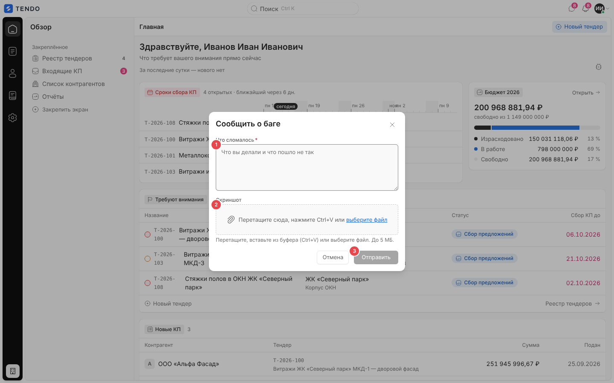

| Поле | Тип | Обязательность | Правила |
|---|---|---|---|
| Что сломалось | Многострочный текст, 5 строк, плейсхолдер «Что вы делали и что пошло не так» | Да (звёздочка) | Пока пусто — кнопка «Отправить» неактивна |
| Скриншот | Зона: «Перетащите сюда, нажмите Ctrl+V или выберите файл»; подсказка «Перетащите, вставьте из буфера (Ctrl+V) или выберите файл. До 5 МБ.» | Нет | Только изображения; > 5 МБ — «Скриншот больше 5 МБ»; не картинка — «Скриншот должен быть картинкой». Вставка из буфера работает, пока окно открыто, в любом месте окна (буфер без картинки не перехватывается). Выбранный снимок показывается миниатюрой с именем, размером и кнопкой «Убрать скриншот» |

- Кнопки: «Отмена», «Отправить» («Отправляем…» во время отправки; окно нельзя закрыть, пока идёт отправка).
- Отправка: `POST /bug-reports` с описанием, адресом текущей страницы, снимком (data URL) и техническим окружением браузера, которое собирается автоматически и в форме не показывается ([endpoints-bug-reports.md](../04-api/endpoints-bug-reports.md)). Заголовок репорта сервер берёт из первой строки описания.
- Успех: зелёная плашка «Спасибо, мы с вами свяжемся» + «Разработчики увидят репорт в трекере.» и единственная кнопка «Закрыть». Номер репорта пользователю не показывается.
- Ошибка: красная плашка с текстом сервера или «Ошибка отправки».
- Это же окно открывается из меню пользователя в топбаре (общий компонент каркаса).

## Очередь аккредитации (СБ и юрист)

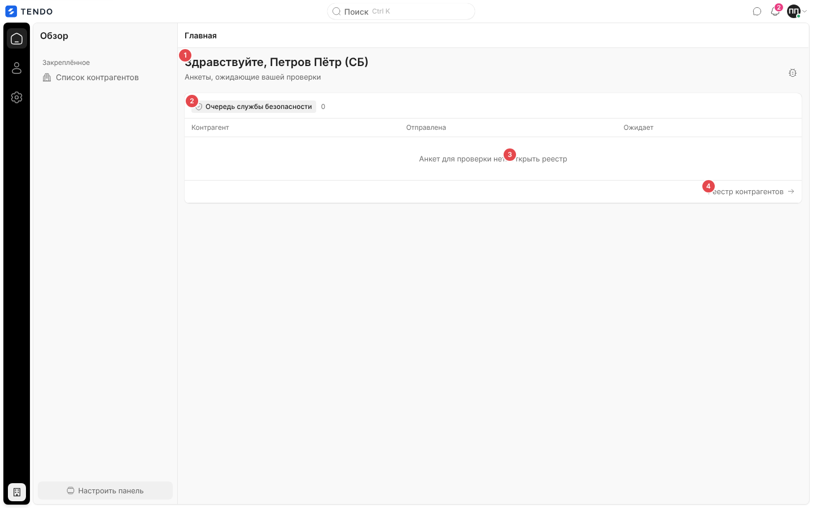

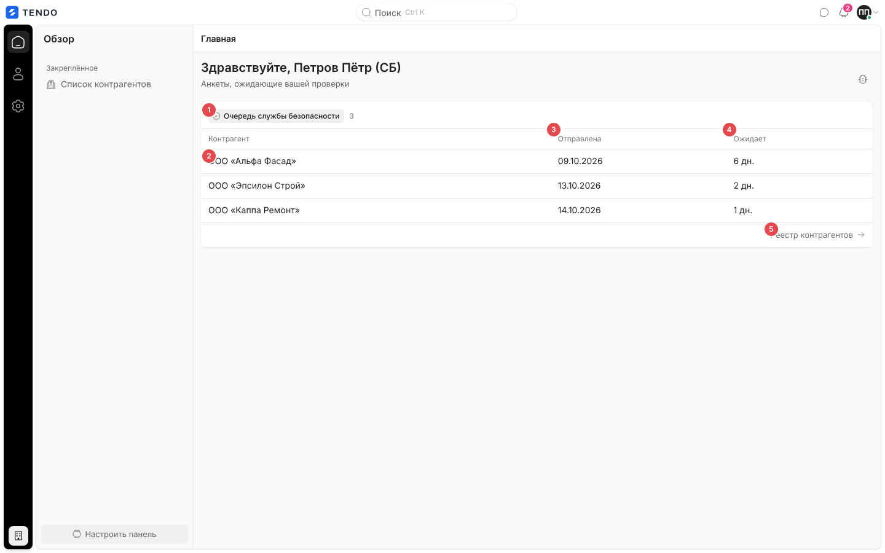

| № | Элемент | Поведение |
|---|---|---|
| ① | Группа «Очередь службы безопасности» / «Очередь юриста» · N | Счётчик — сколько анкет ждёт проверки этой роли |
| ② | Контрагент | Юридическое название — ссылка сразу на вкладку «Документы и файлы» карточки контрагента: `/suppliers/{id}?tab=documents` |
| ③ | Отправлена | Дата отправки анкеты контрагентом `ДД.ММ.ГГГГ` (московский день) или «—» |
| ④ | Ожидает | «N дн.» — сколько дней анкета ждёт; «—», если неизвестно |
| ⑤ | «Реестр контрагентов →» | Ведёт на `/suppliers` |

- Данные: `GET /suppliers/queue/security` или `GET /suppliers/queue/lawyer` (все страницы) — см. [endpoints-suppliers.md](../04-api/endpoints-suppliers.md). Показываются первые 5 строк в порядке сервера.
- Пусто: «Анкет для проверки нет. Открыть реестр» (ссылка на `/suppliers`).
- Кнопки «Новый тендер», полосы сроков, бюджета и строки «С прошлого визита» у этих ролей нет.

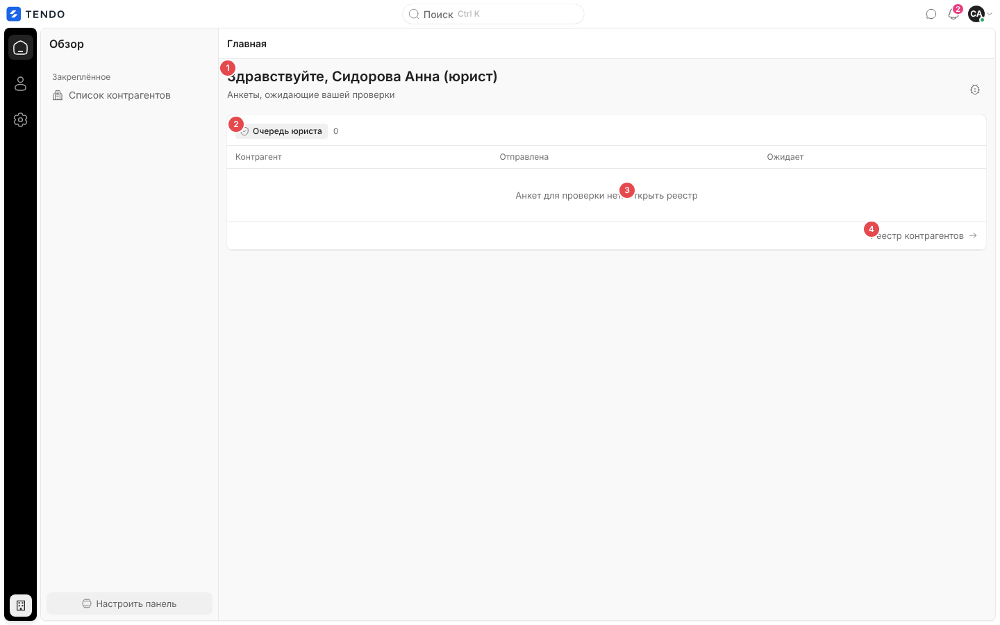

## Данные

| Блок | Запрос | Кэш |
|---|---|---|
| Реестр (полоса сроков, «Требуют внимания») | `GET /portfolios` → плоский список тендеров (тот же, что у реестра; общий ключ кэша, свежесть 10 с — переход «Главная → Тендеры» не перекачивает дерево) | общий с `/tenders` |
| «Новые КП» | `GET /quotes` (весь срез входящих, фильтр `is_new` на клиенте) | общий ключ входящих |
| «С прошлого визита» | `GET /notifications` | общий с центром уведомлений |
| Бюджет | `GET /budget/overview?year=` | отдельно |
| Очередь аккредитации | `GET /suppliers/queue/security` / `…/lawyer` | отдельно |

Сводка закупщика считается загруженной, когда пришли и реестр, и входящие КП; ошибка любого из двух — экран ошибки сводки (частичную сводку числами показывать нельзя).

## Состояния

| Состояние | Что видит пользователь | Снимок |
|---|---|---|
| Роль ещё неизвестна | Заголовок «Главная» и общий скелетон | — |
| Загрузка | Приветствие и строка визита на месте; вместо групп — группа «Требуют внимания» (у СБ/юриста — «Очередь проверок») с тремя полосами-скелетонами | 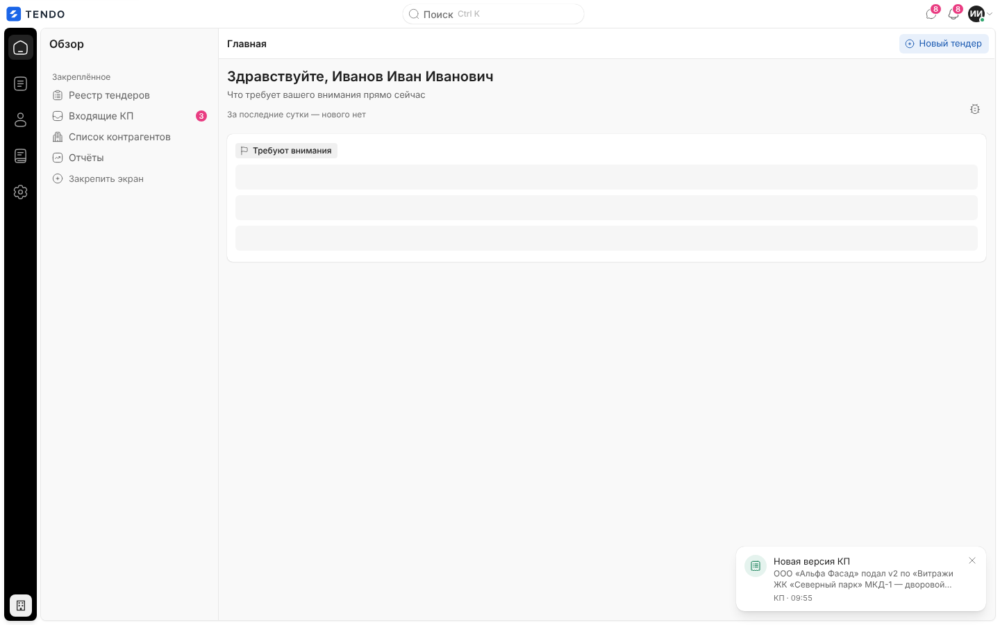 |
| Ошибка сводки | Иллюстрация, «Сводка не загрузилась», «Часть данных не приехала. Показывать неполную сводку числами нельзя — это тихая ложь.», кнопка «Повторить» (перезапрашивает только упавшие/не пришедшие источники) | 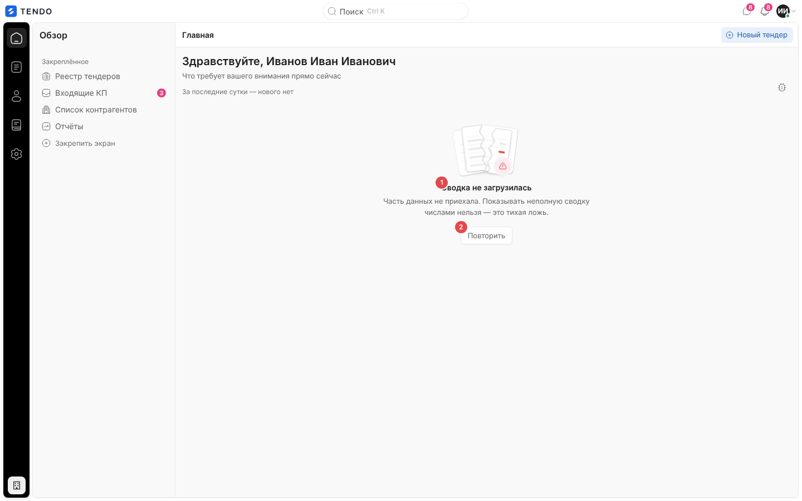 |
| Ошибка бюджета | В месте манометра — «Бюджет не загрузился» + «Повторить»; остальное работает | — |
| Пусто | Тексты пустых состояний групп (см. выше) |  |
| Нет доступа | Поставщик / лид / владелец — перенаправление на свой стартовый экран |  |

## Переходы

| Откуда | Куда |
|---|---|
| «Новый тендер» (шапка, хвост таблицы, пустая полоса) | `/tenders/new` |
| Дорожка полосы сроков, строка/название в «Требуют внимания» | `/tenders/{id}` |
| «Реестр тендеров» / «Все N» | `/tenders` |
| Строка «Новые КП» | `/quotes/{id}` |
| «Все входящие», чип «новых КП» | `/quotes` |
| Чип «сообщений» | `/chats` |
| Чипы «корректировок», «событий по тендерам» | `/notifications` |
| «Открыть» в манометре, сигналы бюджета | `/budget` |
| Строка очереди аккредитации | `/suppliers/{id}?tab=documents` |
| «Реестр контрагентов», «Открыть реестр» | `/suppliers` |

## Сложность

**M** в целом: каркас и две таблицы — S; полоса сроков (шкала, дорожки, цвета, доступность) — M; манометр бюджета — S; строка «С прошлого визита» — S; окно бага с вставкой из буфера — S; ветка аккредитации — S.
