# Вход (`/login`)

Единственная точка входа в систему для всех ролей: двухшаговая форма «email → пароль», шаг второго фактора (MFA), задание первого пароля по ссылке активации, запрос восстановления пароля, демо-подсказки (только на демо-стенде), сообщения об ошибках и паузе после неудачных попыток.

Связанные разделы: правила входа, паузы, MFA, паролей и сессий — [../02-business-logic/identity.md](../02-business-logic/identity.md) (§3.3, §4.2–4.4); API — [../04-api/endpoints-identity.md](../04-api/endpoints-identity.md) (`/auth/login`, `/auth/login/check-email`, `/auth/login/mfa`, `/auth/login/set-initial-password`, `/auth/password-reset/request`); новый пароль по ссылке — [reset-password.md](reset-password.md); куда ведёт вход — [screen-map.md](screen-map.md); безопасность — [../07-architecture/security.md](../07-architecture/security.md).

## Маршрут и параметры

- `/login` — публичный, без каркаса.
- Параметры адреса:

| Параметр | Назначение |
|---|---|
| `reason` | Текст причины, по которой пользователь оказался на входе (истёкшая сессия, отключённая учётная запись, приостановленная организация) — показывается над кнопкой как общая ошибка |
| `activation_token` + `email` | Ссылка из письма-приглашения нового пользователя: форма сразу открывается на шаге «Задайте пароль» с подставленным email |

- Шаги — состояние **одной** страницы, а не разные адреса. Заголовок вкладки по шагу: «Вход», «Задание пароля», «Подтверждение входа», «Восстановление пароля».

## Роли

Экран публичный: открывается всем, в том числе уже вошедшим (автоматического увода вошедшего с `/login` нет). После успешного входа пользователь попадает на **стартовый экран своей роли** (не через главную): администратор, специалист, СБ, юрист — `/home`; контрагент — `/cabinet`; лид — `/welcome`; владелец площадки — `/owner/costs`. Если профиль после входа не загрузился — переход на `/home`, дальше гейт уведёт по роли.

## Шаг 1 — email

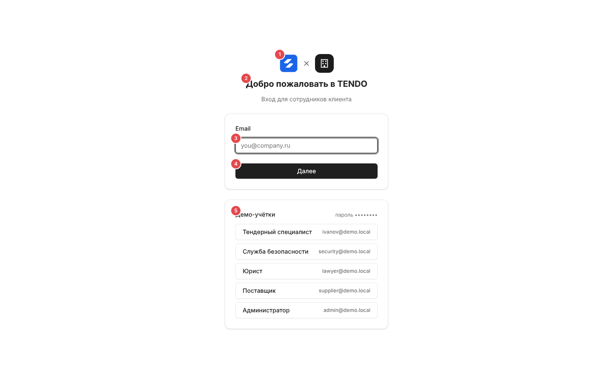

| № | Элемент | Поведение |
|---|---|---|
| ① | Пара логотипов «знак продукта × логотип организации-клиента» | Логотип клиента — настройка сборки `VITE_CLIENT_LOGO` |
| ② | «Добро пожаловать в TENDO», подзаголовок «Вход для сотрудников <клиента>» | Название клиента в родительном падеже — настройка `VITE_CLIENT_GENITIVE` |
| ③ | Email | `type=email`, обязательное, плейсхолдер «you@company.ru», автофокус, автозаполнение «username». Формат проверяет браузер (встроенная подсказка) |
| ④ | «Далее» → «Проверяем…» | `POST /auth/login/check-email`. Сервер **всегда** отвечает «введите пароль» (по ответу нельзя узнать, есть ли учётная запись); ошибка — под полем (по умолчанию «Ошибка проверки email») |
| ⑤ | Карточка «Демо-учётки» | Только при флаге сборки `VITE_DEMO_TOOLS=1` (локальный и демо-стенд): заголовок, подсказка с паролем демо-учёток (на снимке скрыт), кнопки «роль · email» для пяти ролей (специалист, СБ, юрист, поставщик, администратор). Клик — вход одним нажатием тем же запросом `/auth/login`. В боевой сборке карточки нет |

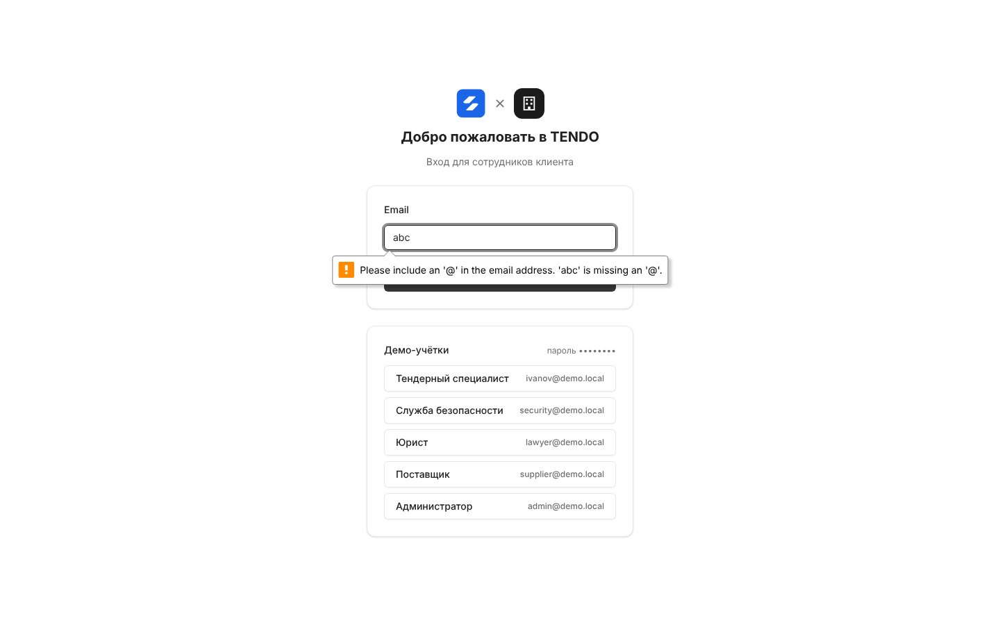

## Шаг 2 — пароль

Поле пароля появляется **под тем же заголовком** (без перехода на «другой экран»), фокус переводится в него. Изменение email возвращает на шаг 1 и очищает пароль.

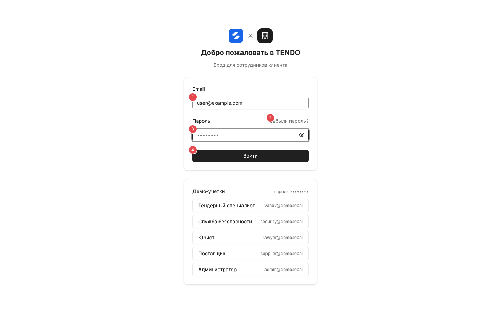

| Поле / кнопка | Правила |
|---|---|
| Пароль | Обязательное, плейсхолдер «••••••••», автозаполнение «current-password», кнопка-глаз «показать/скрыть» |
| «Забыли пароль?» | Переход на шаг восстановления ([ниже](#восстановление-пароля)) |
| «Войти» → «Входим…» | `POST /auth/login {email, password}`. Ответ `{mfa_required:false}` — сессия открыта, переход на стартовый экран роли; `{mfa_required:true}` — шаг MFA |

## Шаг MFA

Появляется, если у пользователя включён второй фактор и на сервере включено требование MFA (`MFA_ENFORCED`; на демо-стенде выключено — снимки получены подменой ответа API).

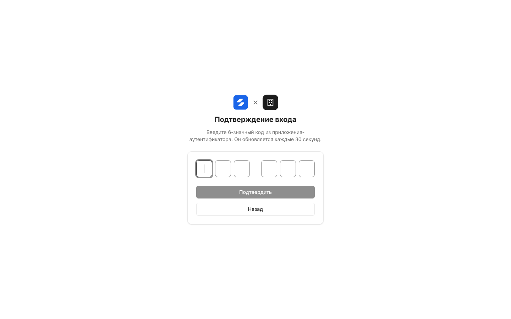

- Заголовок «Подтверждение входа», подсказка «Введите 6-значный код из приложения-аутентификатора. Он обновляется каждые 30 секунд.».
- Поле — 6 ячеек (3 + 3 через разделитель), только цифры, атрибут автозаполнения «one-time-code», автофокус. **Отправка автоматически при вводе шестой цифры**; кнопка «Подтвердить» («Проверяем…») активна только при 6 цифрах; «Назад» — к паролю (код и ошибка сбрасываются).
- `POST /auth/login/mfa {code}`. Ответы и поведение:

| Ответ | Текст | Поведение |
|---|---|---|
| 200 | — | Переход на стартовый экран роли |
| 400 | «Неверный код подтверждения. Осталось попыток: N» | Ячейки очищаются, фокус возвращается — можно ввести снова |
| 401 | «Слишком много неверных кодов — войдите заново» / «Время на ввод кода вышло — войдите заново» | Ячейки скрываются, подзаголовок «Не получилось подтвердить вход», одна кнопка «Войти заново» (→ шаг пароля) |

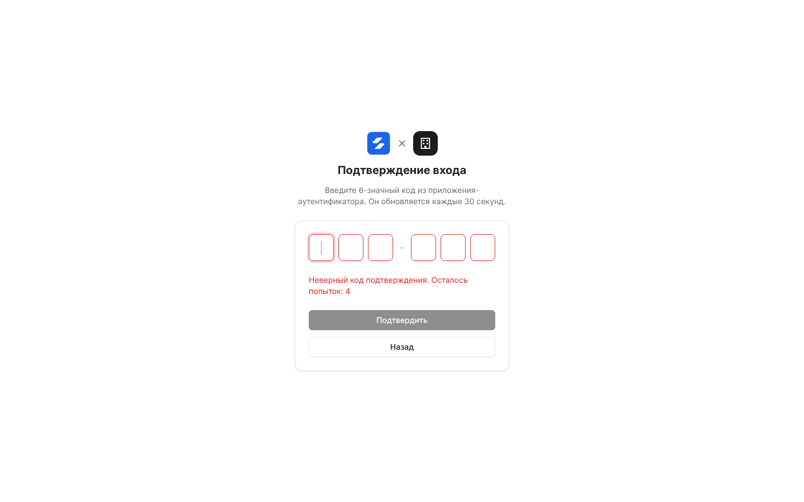 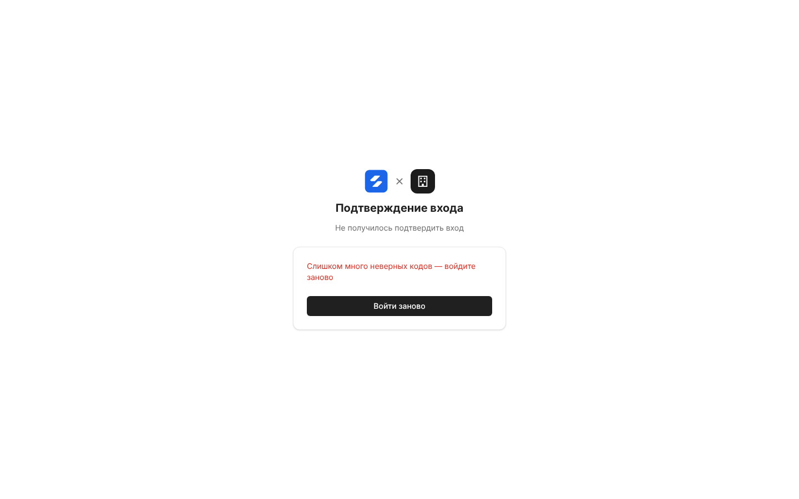

## Первый вход — задание пароля

Открывается по ссылке активации из письма-приглашения (`/login?activation_token=…&email=…`, срок ссылки 72 ч).

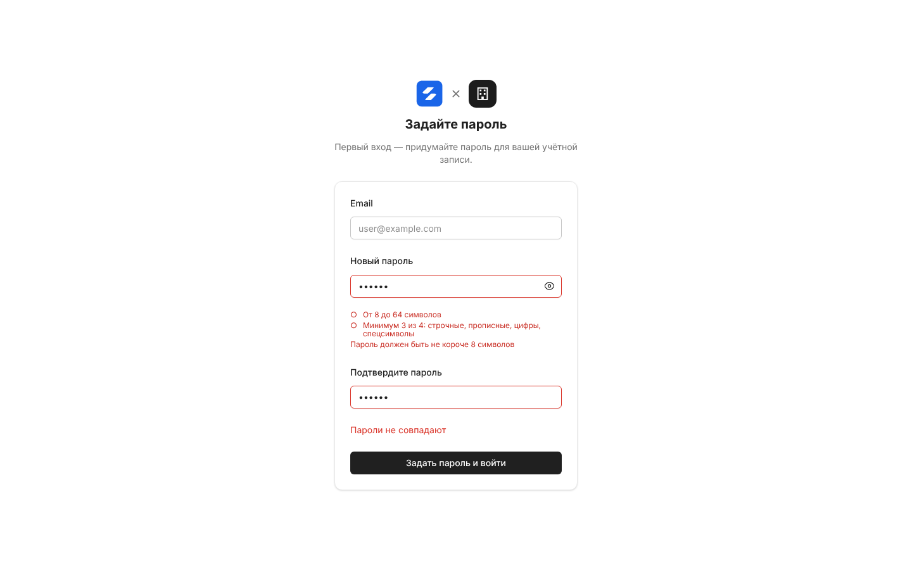

| Поле | Правила |
|---|---|
| Email | Только чтение, из ссылки |
| Новый пароль | Обязательное, плейсхолдер «Не короче 8 символов», кнопка показа, автофокус. Под полем живой чек-лист: «От 8 до 64 символов», «Минимум 3 из 4: строчные, прописные, цифры, спецсимволы» (○ → ✓ зелёным; после ввода невыполненные — красным) и строка первой нарушенной проверки политики (с учётом email) — тексты политики в [identity.md §4.4](../02-business-logic/identity.md#44-пароли) |
| Подтвердите пароль | Обязательное, плейсхолдер «Ещё раз»; несовпадение — «Пароли не совпадают» |

- «Задать пароль и войти» → «Сохраняем…»: `POST /auth/login/set-initial-password {email, token, new_password}`, затем сразу `POST /auth/login` (и, если нужно, шаг MFA).
- Ссылка без токена — «Ссылка активации недействительна. Обратитесь к администратору.»; токен истёк/использован — текст сервера «Ссылка недействительна или истекла. Запросите новую ссылку активации от администратора.».

## Восстановление пароля

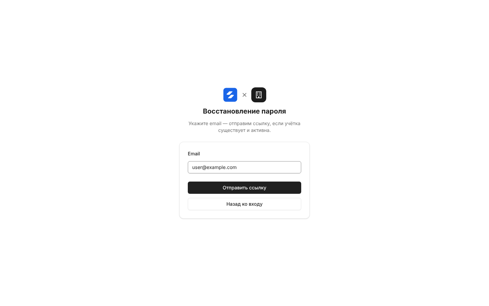 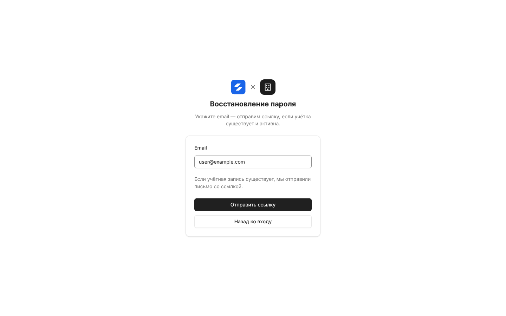

- Заголовок «Восстановление пароля», подсказка «Укажите email — отправим ссылку, если учётка существует и активна.»; поле Email (обязательное, плейсхолдер «you@company.ru»); «Отправить ссылку» («Отправляем…»); «Назад ко входу».
- `POST /auth/password-reset/request {email}`. Ответ **всегда одинаковый**: «Если учётная запись существует, мы отправили письмо со ссылкой.» — выводится под полем (живая область для скринридера), без смены шага. Ссылка в письме ведёт на [reset-password.md](reset-password.md).

## Состояния и ошибки

Ошибка выводится одной красной строкой над кнопкой и привязывается к полю, к которому относится (поле получает красную рамку); общие ошибки (причина из `?reason=`, битая ссылка активации) — без привязки к полю.

| Ситуация | Код | Текст (из ответа сервера) | Снимок |
|---|---|---|---|
| Неверный email или пароль (одинаково для несуществующего адреса) | 401 | «Неверный email или пароль» | 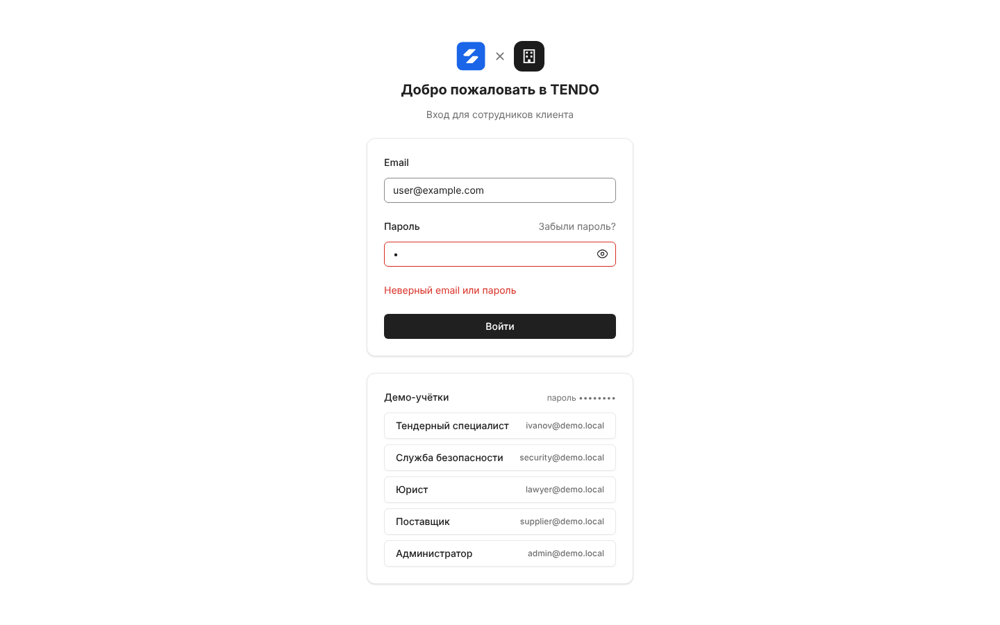 |
| Пауза после 5 неудач подряд по паре «email + IP» (1, 2, 4 … ≤ 60 мин) | 429 | «Слишком много неудачных попыток входа. Повторите через N мин.» | 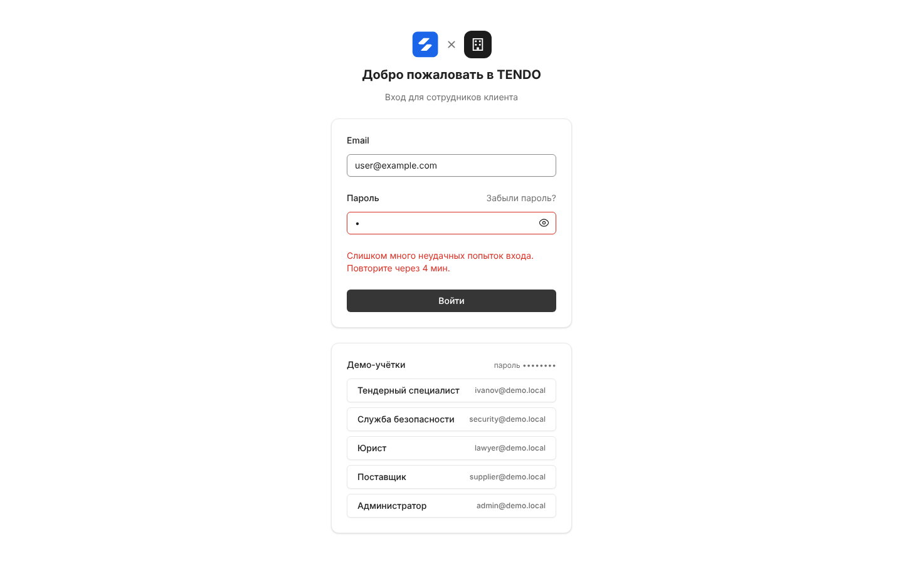 |
| Лимит частоты по IP (20 входов/мин) | 429 | «Слишком много запросов — попробуйте немного позже» | — |
| Учётная запись отключена (пароль верный) | 403 | «Учётная запись отключена. Обратитесь к администратору системы.» | — |
| Организация контрагента приостановлена | 403 | «Доступ организации приостановлен. Обратитесь к администратору системы.» | — |
| Хранилище счётчиков недоступно | 503 | «Сервис временно недоступен — попробуйте позже» | — |
| Пришёл с истёкшей/закрытой сессией | — | текст из `?reason=`, например «Сессия завершена из-за неактивности. Войдите снова.» | 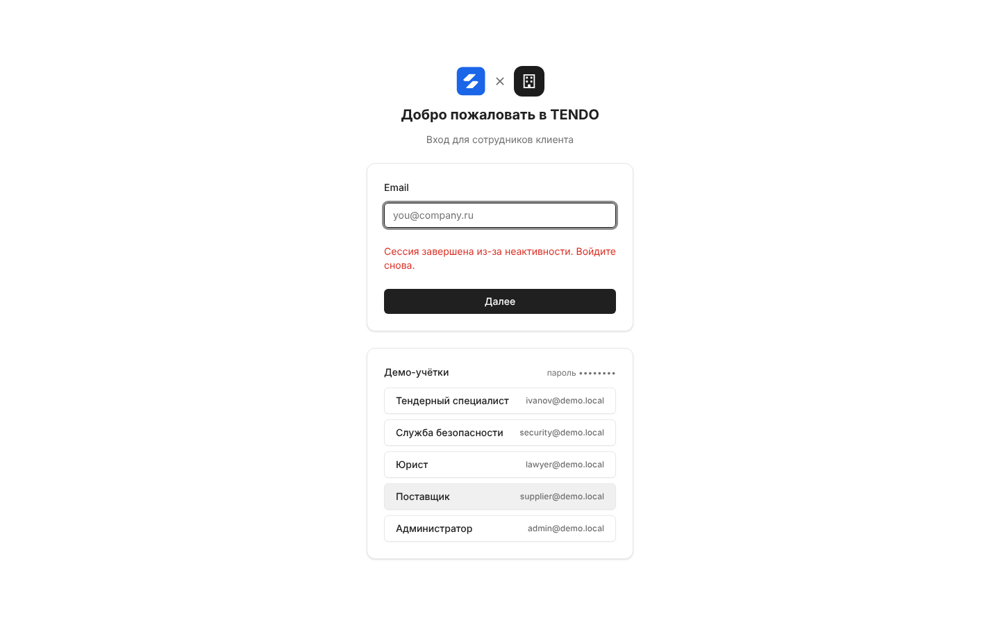 |
| Ожидание ответа | — | Кнопка в состоянии «Проверяем…» / «Входим…» / «Сохраняем…», повторное нажатие заблокировано | — |
| Загрузка страницы | — | «Загрузка…» по центру | — |

Пока действует пауза, сервер не проверяет пароль вовсе; учётная запись целиком не блокируется. Клиент заголовок `Retry-After` не использует — время берётся из текста.

## Адаптив

Колонка формы — до 384 px по центру, поля страницы 24 px (на широком экране 40 px), прокрутка внутри страницы (длинные шаги с правилами пароля не обрезаются).

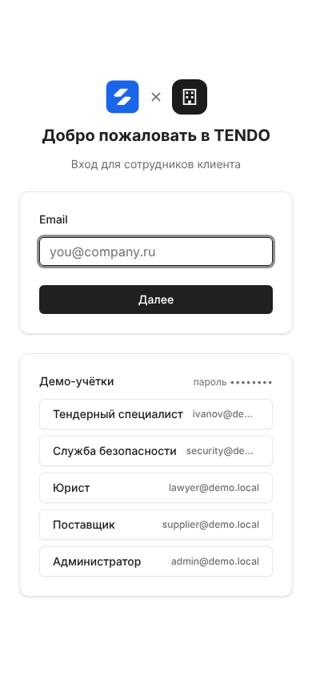

## Сложность

**M**: два шага с сохранением email, шаг MFA с автоотправкой и тремя исходами, первый пароль с живой проверкой политики, восстановление с единым ответом, демо-подсказки под флагом, маршрутизация на стартовый экран роли.
