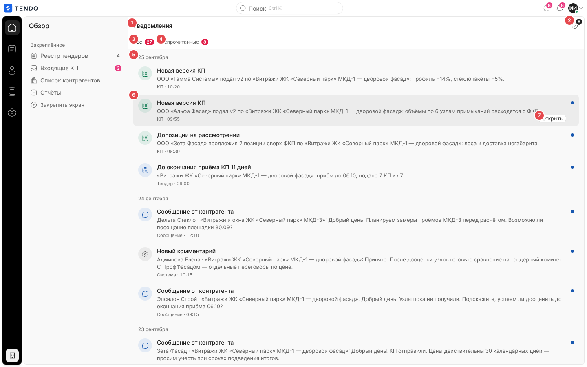
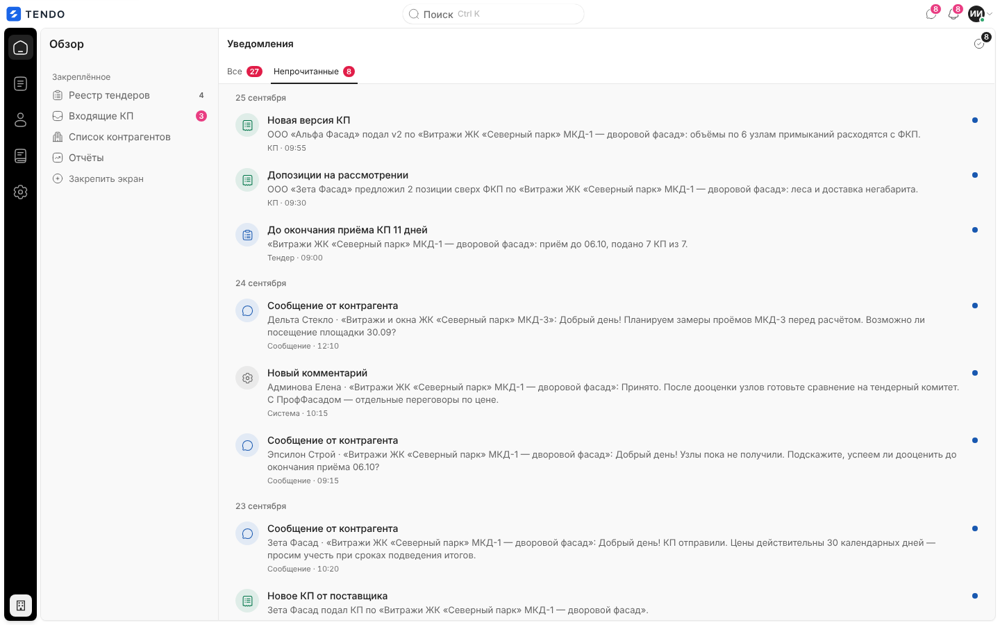
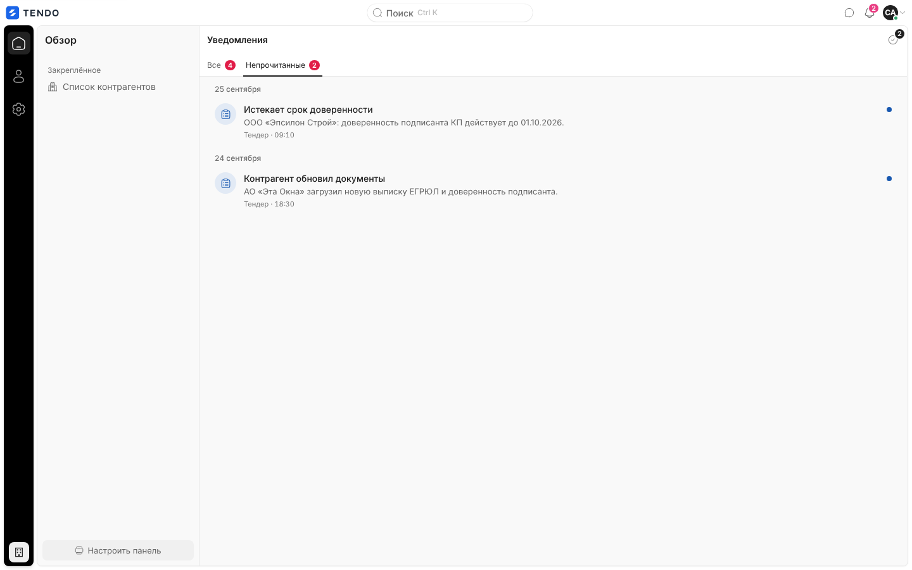
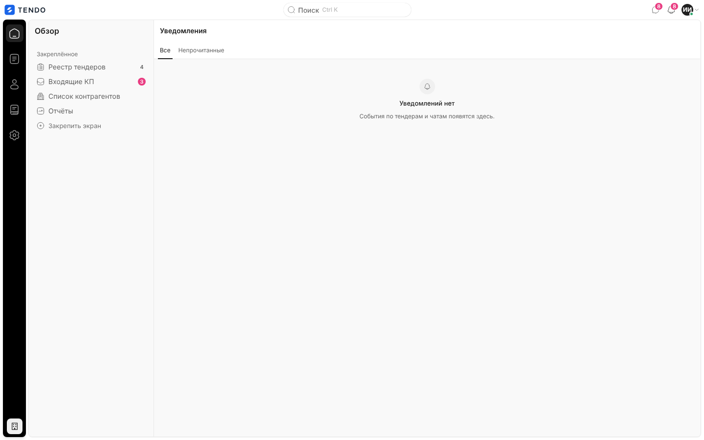
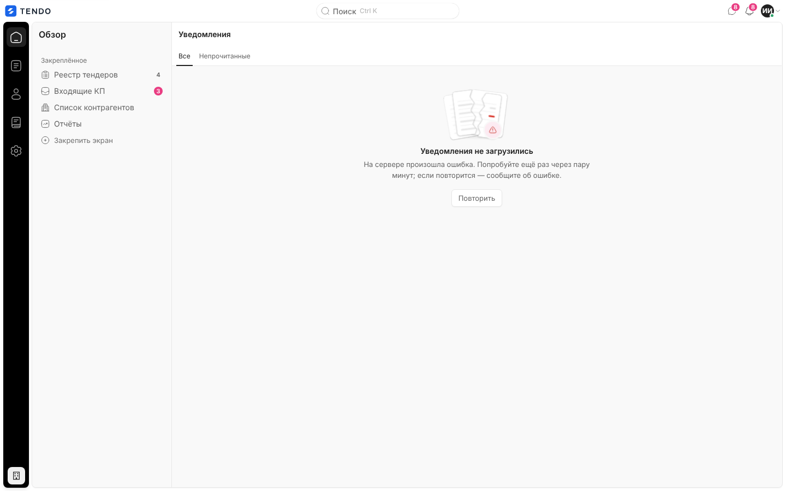
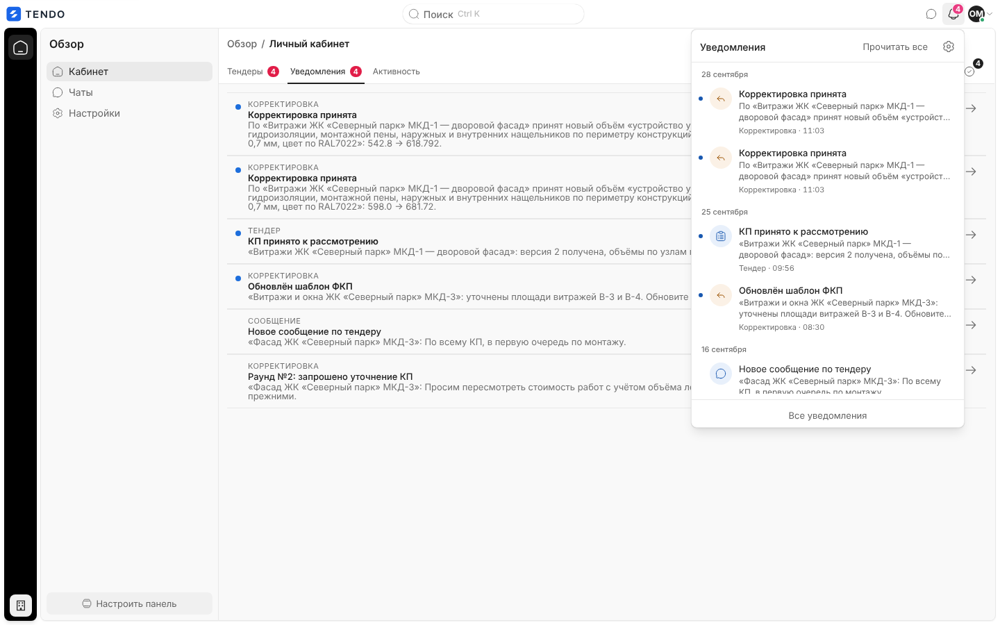

# Уведомления (`/notifications`)

Полная лента уведомлений сотрудника: все события, адресованные пользователю (новые и скорректированные КП, сообщения контрагентов, комментарии, сроки, анкеты и проверки, инциденты ИБ), с разбивкой по дням, фильтром «непрочитанные», отметкой прочитанного и переходом к объекту. Краткая лента и счётчик — колокольчик топбара ([shell.md](shell.md#уведомления-колокольчик)).

Связанные разделы: модель, адресация, каталог событий — [../02-business-logic/notifications.md](../02-business-logic/notifications.md); API — [../04-api/endpoints-notifications.md](../04-api/endpoints-notifications.md); уведомления контрагента — вкладка кабинета [cabinet.md](cabinet.md#вкладка-уведомления); почтовые копии — [profile.md](profile.md#письма-на-почту).

## Маршрут, роли, как попасть

- `/notifications`; заголовок «Уведомления».
- Открыт сотрудникам: администратор, специалист, СБ, юрист. **Контрагента** экран сам переадресует на `/cabinet?tab=notifications`. Лиду и владельцу площадки адрес закрыт (гейт уводит на их стартовый экран).
- Как попасть: «Все уведомления» в колокольчике; прямая ссылка. В рейле отдельного пункта нет (активен «Обзор»).

## Экран

| № | Элемент | Поведение |
|---|---|---|
| ① | Заголовок «Уведомления» | — |
| ② | Значок «Отметить все прочитанными · N» со счётчиком | Только при наличии непрочитанных; `POST /notifications/read-all`, затем перечитывание |
| ③ | Вкладка «Все» со счётчиком всех записей | — |
| ④ | Вкладка «Непрочитанные» со счётчиком непрочитанных | Фильтр на клиенте |
| ⑤ | Разделитель дня | «Сегодня», «Вчера», «25 сентября»; в прошлом году — с годом; по московскому времени |
| ⑥ | Строка | Кружок вида (иконка и тон: тендер — список, сообщение — облачко, корректировка — стрелка ответа (жёлтый), КП — счёт (зелёный), прочее — шестерёнка), заголовок, текст, «вид · ЧЧ:ММ»; у непрочитанных — синяя точка справа (для скринридера «Непрочитанное») и жирный заголовок |
| ⑦ | «Открыть» | Обычная ссылка на объект (работает средний клик / «в новой вкладке»); не меняет прочитанность |

Виды и подписи: «Тендер», «Сообщение», «Корректировка», «КП», «Система» (комментарии, инциденты ИБ и прочие виды сервера показываются как «Система»).

**Клик по строке**: пометить прочитанным (`POST /notifications/{id}/read`), затем — для уведомления о сообщении открыть панель «Чаты» на нужном диалоге без перехода; иначе перейти по ссылке уведомления (`href`), а если её нет — на `/tenders/<tender_id>`; без ссылки — только перечитать ленту.

- Источник — `GET /notifications` (без параметров: последние записи в пределах потолка сервера — **200**; постраничной подгрузки на экране нет, см. [открытые вопросы](../_oq/SCR-1.md)). Ответ поддерживает условный запрос (ETag/304).
- Лента перечитывается при каждом кадре живого потока топбара (новое событие, изменение счётчика) и после действий с уведомлениями.
- Прочитанность хранится на записи: широковещательное уведомление сотрудников, прочитанное одним, гаснет у всех ([API](../04-api/endpoints-notifications.md#модель-и-адресация)).
- Сортировка — новые сверху; поиска, фильтра по виду и массового выбора нет.

## Состояния

| Состояние | Что видит пользователь | Снимок |
|---|---|---|
| Загрузка | Пять серых карточек | — |
| Пусто | Колокольчик, «Уведомлений нет», «События по тендерам и чатам появятся здесь.» |  |
| Пусто в «Непрочитанных» | «Непрочитанных нет», «Все входящие уже прочитаны.», кнопка «Показать все» | — |
| Ошибка | «Уведомления не загрузились» + текст («На сервере произошла ошибка. Попробуйте ещё раз через пару минут; если повторится — сообщите об ошибке.») и «Повторить» |  |
| Контрагент | Переадресация на `/cabinet?tab=notifications` (колокольчик контрагента ведёт туда же) |  |

## Сложность

**S** (экран); живой поток и лидер вкладок учтены в каркасе и домене уведомлений.
