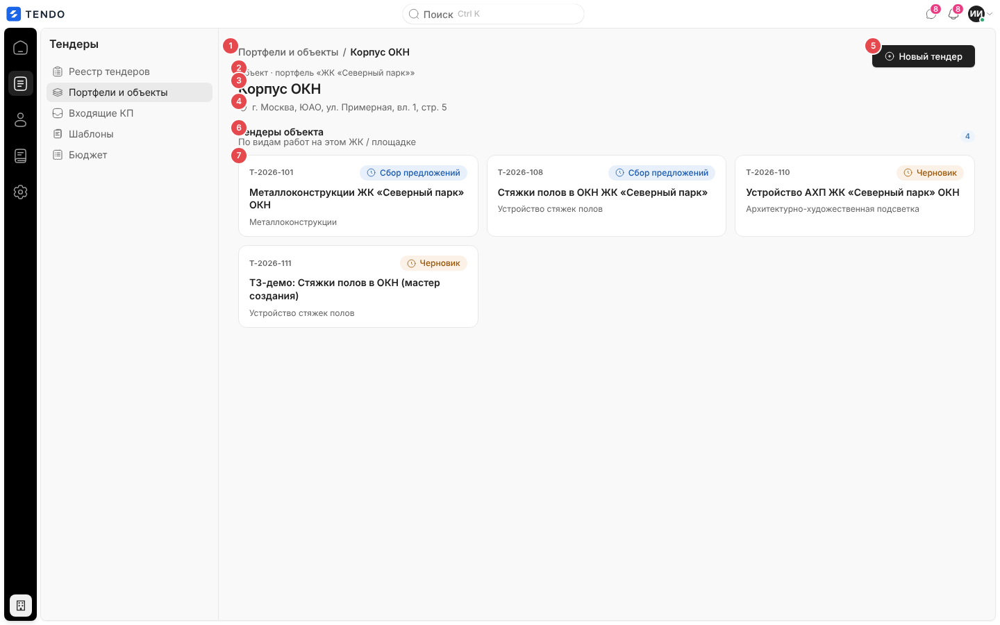
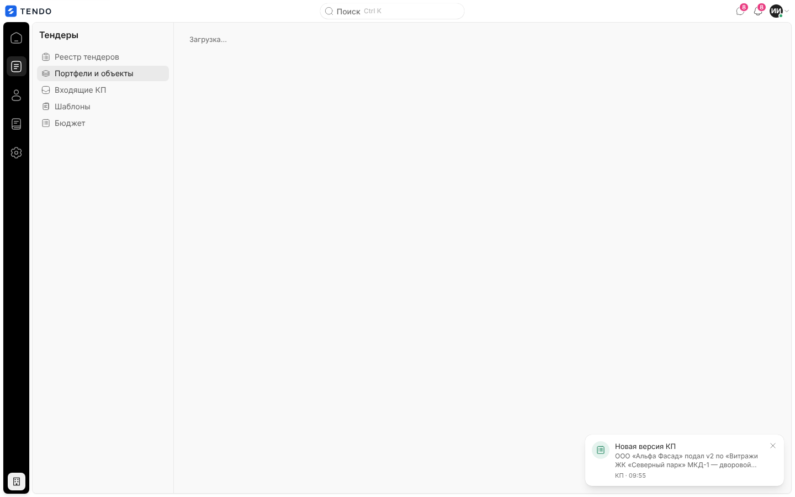
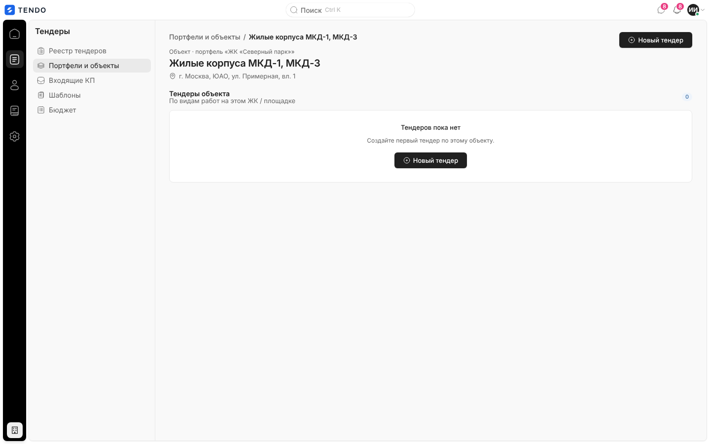
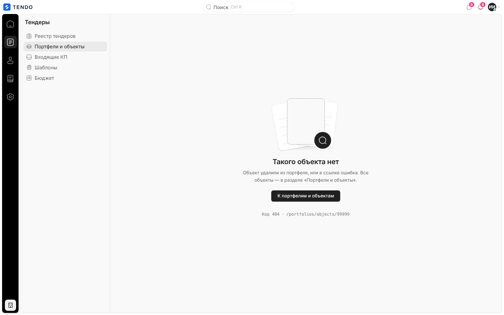
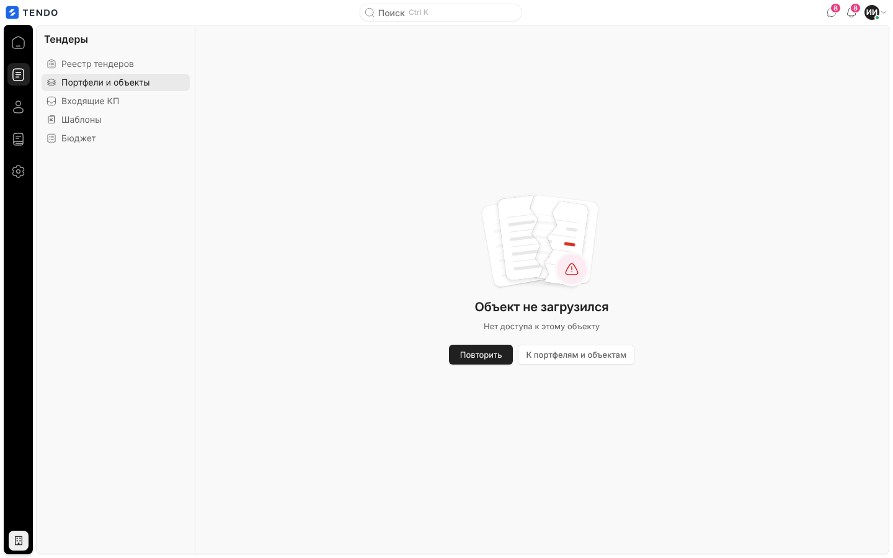
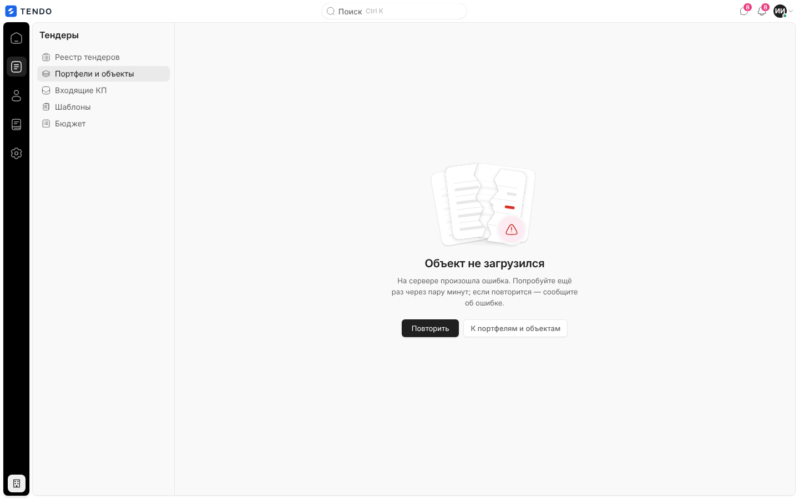

# Карточка объекта (`/portfolios/objects/:id`)

Отдельная страница одного объекта (проекта) портфеля: название, портфель, адрес и плитки тендеров объекта со ссылкой на мастер нового тендера. Упрощённый «двойник» режима объекта на экране [portfolios.md](portfolios.md).

Связанные разделы: бизнес-логика — [../02-business-logic/portfolios.md](../02-business-logic/portfolios.md); API — [../04-api/endpoints-portfolios.md#get-projectsproject_id](../04-api/endpoints-portfolios.md#get-projectsproject_id); соседние экраны — [portfolios.md](portfolios.md), [tender-card.md](tender-card.md), [tender-create.md](tender-create.md), [security-log.md](security-log.md).

## Маршрут

- `/portfolios/objects/:id`, `:id` — числовой идентификатор объекта (проекта). Нечисловой или ≤ 0 id — сразу состояние «не найден», без запроса.
- В рейле подсвечивается раздел «Тендеры» → «Портфели и объекты».

## Назначение

Постоянная ссылка на объект: открыть объект из внешнего места (журнал ИБ) и увидеть его тендеры одним списком. Подобъекты и сводные показатели здесь не показываются — для работы с деревом используется [portfolios.md](portfolios.md).

## Роли и права

| Роль | Доступ | Что меняется |
|---|---|---|
| Тендерный специалист | Да, если объект входит в его гранты (с учётом предков и потомков — [portfolios.md §4.3 BL](../02-business-logic/portfolios.md#43-гранты-и-доступ)) | Без гранта — состояние ошибки «Нет доступа к этому объекту» |
| Администратор | Да, к любому объекту | — |
| СБ, юрист | Нет: адрес принадлежит разделу «Тендеры», переход уводит на `/home` | — |
| Поставщик, лид, владелец площадки | Нет: перенаправление на стартовый экран роли | — |

Кнопка «Новый тендер» показывается всем, кто видит карточку; право `tenders.manage` проверяется уже в мастере/на сервере.

## Как попасть

- Ссылка «Объект» в колонке «Ресурс» журнала событий ИБ ([security-log.md](security-log.md)).
- Прямая ссылка. Из интерфейса раздела «Портфели и объекты» на эту страницу ссылок нет (там объект открывается в правой колонке) — см. [открытые вопросы](../_oq/SCR-3.md).

## Компоновка

| № | Элемент | Поведение |
|---|---|---|
| ① | Крошки «Портфели и объекты / <объект>» | Первый сегмент — ссылка на `/portfolios` |
| ② | Надзаголовок «Объект · портфель «<портфель>»» | Только текст |
| ③ | Название объекта (`h1`) | — |
| ④ | Адрес | Значок метки + адрес или «Адрес не указан» |
| ⑤ | «Новый тендер» (основная кнопка) | Переход в мастер `/tenders/new?projectId=<id>` |
| ⑥ | «Тендеры объекта» / «По видам работ на этом ЖК / площадке» + счётчик | Счётчик — число **собственных** тендеров объекта (без подобъектов) |
| ⑦ | Плитки тендеров | Сетка карточек: номер, капсула системного статуса, название, вид работ или «Вид работ не указан». Вся плитка — ссылка на `/tenders/<id>`. Порядок — как отдаёт сервер |

Фильтров, поиска, сортировки, пагинации, массовых действий и выгрузок на экране нет. Тендеры подобъектов **не** показываются (в отличие от режима объекта на `/portfolios`, где счётчики включают подобъекты).

## Данные

`GET /projects/{id}` → `{item: ProjectNode, portfolio: {id, name}}` ([описание](../04-api/endpoints-portfolios.md#get-projectsproject_id)). Права проверяет сервер (403 «Нет доступа к этому объекту», 404 — нет или в архиве).

## Состояния

| Состояние | Что видит пользователь | Снимок |
|---|---|---|
| Загрузка | Строка «Загрузка…» вместо содержимого |  |
| Тендеров нет | Пустая карточка «Тендеров пока нет» / «Создайте первый тендер по этому объекту.» + кнопка «Новый тендер». Так выглядит и объект, у которого тендеры есть только в подобъектах |  |
| Не найден (404, кривой id) | Иллюстрация, «Такого объекта нет», «Объект удалили из портфеля, или в ссылке ошибка. Все объекты — в разделе «Портфели и объекты».», кнопка «К портфелям и объектам», строка «Код 404 · <путь>» |  |
| Нет доступа к объекту (403) | «Объект не загрузился» + текст сервера «Нет доступа к этому объекту», кнопки «Повторить», «К портфелям и объектам» |  |
| Ошибка сервера / сети | «Объект не загрузился» + «На сервере произошла ошибка. Попробуйте ещё раз через пару минут; если повторится — сообщите об ошибке.»; при обрыве сети — иллюстрация «нет связи» |  |
| Только чтение | Отдельного режима нет | — |

## Переходы

| Откуда | Куда |
|---|---|
| Крошка, «К портфелям и объектам» | `/portfolios` |
| «Новый тендер» | `/tenders/new?projectId=<id>` |
| Плитка тендера | `/tenders/<id>` |

## Замечания для воссоздания

Экран оформлен устаревшими глобальными стилями (сетка плиток, заголовок блока) и не совпадает по виду с режимом объекта на `/portfolios`. Рекомендуется либо собрать карточку из тех же компонентов, что режим объекта (сводка, группы по статусам, тендеры подобъектов), либо заменить маршрут перенаправлением на `/portfolios?portfolio=<id>&object=<id>` — решение за Заказчиком (см. [открытые вопросы](../_oq/SCR-3.md)).

## Сложность

**S**.
