# Портфели и объекты (`/portfolios`)

Рабочий экран дерева «портфель → объект (проект) → подобъект → тендеры»: список портфелей слева, справа — сводка выбранного портфеля с таблицей объектов или тендеры выбранного объекта, сгруппированные по статусу. Здесь же заводят, переименовывают, переносят и архивируют портфели и объекты.

Связанные разделы: бизнес-логика дерева и грантов — [../02-business-logic/portfolios.md](../02-business-logic/portfolios.md); API — [../04-api/endpoints-portfolios.md](../04-api/endpoints-portfolios.md); соседние экраны — [object-card.md](object-card.md) (отдельная карточка объекта), [tenders-registry.md](tenders-registry.md), [tender-card.md](tender-card.md), [tender-create.md](tender-create.md); роли — [../01-product/users-and-roles.md](../01-product/users-and-roles.md).

> В правом нижнем углу снимков иногда видно всплывающее уведомление стенда («Новая версия КП») — это живой поток событий, к экрану не относится.

## Маршрут

- `/portfolios` — без параметров открывается **первый портфель** списка в режиме «сводка портфеля».
- `?portfolio=<id>` — выбранный портфель; `?portfolio=<id>&object=<id>` — выбранный объект (режим «тендеры объекта»). Выбор пишется в адрес **заменой** записи истории (ссылку на объект можно переслать коллеге; кнопка «Назад» браузера не копит каждый клик).
- Поиски, фильтр статуса и порядок портфелей — состояние страницы, в адрес не пишутся.
- Заголовок экрана (`h1`) — название выбранного портфеля, при выбранном объекте — название объекта, если портфелей нет — «Портфели и объекты».

## Назначение

Посмотреть, что происходит на объектах портфеля (сколько тендеров идёт, какие требуют внимания, ближайшие сроки сбора КП, кто ответственный), перейти в нужный тендер, завести новый тендер прямо на объекте и поддерживать само дерево объектов.

## Роли и права

| Роль | Доступ | Что видит / может |
|---|---|---|
| Тендерный специалист | Да | Только портфели, в которых у него есть доступные объекты (гранты), и только доступные объекты. Создание и правка — при праве `portfolios.manage` (выдано по умолчанию); правка портфеля и создание объекта в нём — только при гранте на сам портфель |
| Администратор | Да | Все портфели, включая пустые; все действия |
| СБ, юрист | **Нет** | Раздела «Тендеры» в рейле нет; прямой переход на `/portfolios` уводит на `/home` (интерфейс пускает по роли, хотя сервер выдал бы им дерево по грантам — см. [users-and-roles.md §7](../01-product/users-and-roles.md#7-расхождения-и-рекомендации-для-воссоздания)) |
| Поставщик, лид, владелец площадки | Нет | Перенаправление на стартовый экран своей роли |

- Интерфейс **не прячет** кнопки создания/правки по правам: специалист без `portfolios.manage` или без гранта на портфель увидит все кнопки, а отказ сервера (403) покажется окном с текстом ошибки. См. [открытые вопросы](../_oq/SCR-3.md).

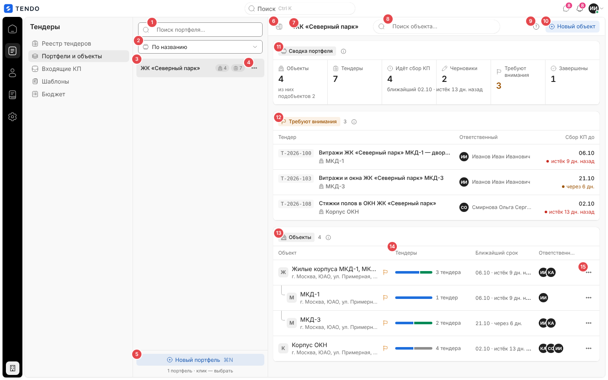

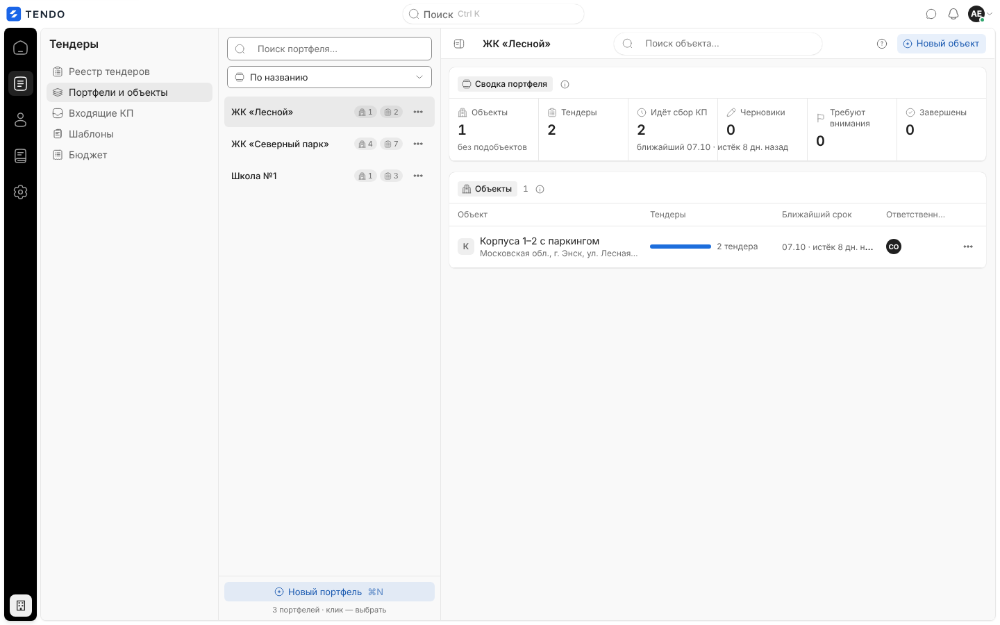

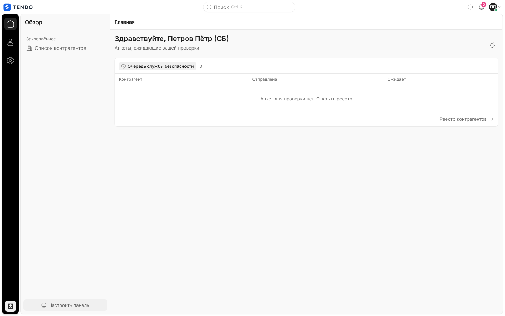

## Как попасть

- Рейл «Тендеры» → пункт «Портфели и объекты» (единственный вход; других ссылок на `/portfolios` в приложении нет, кроме крошек экрана [object-card.md](object-card.md) и кнопок его состояний ошибки).
- Ссылка с параметрами `?portfolio=…&object=…`, присланная коллегой.

## Общая компоновка

Экран — три колонки внутри общего каркаса: (1) панель раздела «Тендеры» каркаса, (2) список портфелей шириной ≈ 320 px, (3) правая рабочая область со своей шапкой.

| № | Элемент | Поведение |
|---|---|---|
| ① | Поиск «Поиск портфеля…» | Подстрока названия портфеля без учёта регистра; запрос на сервер (`q`) уходит через 300 мс после последней клавиши; совпадение в названии подсвечивается |
| ② | Порядок портфелей | Выпадающий список: «По названию» (по умолчанию), «По числу тендеров» (с подобъектами, по убыванию), «Сначала новые» (по дате заведения портфеля) — сортирует сервер (`sort`) |
| ③ | Строка портфеля | Название + две капсулы-счётчика: объекты (значок здания) и тендеры (значок списка, с подобъектами); полная расшифровка («4 объекта», «7 тендеров») — во всплывающей подсказке. Клик или Enter/Пробел — выбрать портфель (сбрасывает выбранный объект). Выбранная строка подсвечена |
| ④ | «…» у портфеля | Меню действий портфеля — см. [Меню строк](#меню-строк) |
| ⑤ | «Новый портфель ⌘N» | Окно «Новый портфель». Горячая клавиша ⌘N / Ctrl+N работает с любого места экрана. Под кнопкой — подпись «N портфелей · клик — выбрать» |
| ⑥ | Кнопка-панель | «Скрыть / Показать список портфелей»: сворачивает колонку ② целиком |
| ⑦ | Крошки и заголовок | В режиме портфеля — только название портфеля; в режиме объекта — «Портфели и объекты / <объект>» (первый сегмент ведёт на `/portfolios`) |
| ⑧ | «Поиск объекта…» | Только в режиме портфеля. Подстрока названия **или адреса** объекта (`object_q`, пауза 300 мс); найденные подобъекты показываются вместе с родителем |
| ⑨ | «?» «Как устроена страница» | Всплывающая подсказка из двух абзацев о структуре страницы |
| ⑩ | Главное действие | В режиме портфеля — «Новый объект» (неактивна, если портфеля нет); в режиме объекта — «Новый тендер» (переход в мастер `/tenders/new?projectId=<id объекта>`) |
| ⑪ | Группа «Сводка портфеля» | Полоса из 6 показателей (см. ниже); «i» — пояснение «Все тендеры портфеля вместе с подобъектами…» |
| ⑫ | Группа «Требуют внимания» | Только если таких тендеров > 0 — см. ниже |
| ⑬ | Группа «Объекты» | Таблица объектов деревом — см. ниже |
| ⑭ | Колонка «Тендеры» | Полоса долей тендеров объекта по статусам + «N тендеров» |
| ⑮ | «…» у объекта | Меню действий объекта |

### Сводка портфеля

| Показатель | Значение | Подпись под числом |
|---|---|---|
| Объекты | Число объектов в дереве портфеля (всех уровней) | «из них подобъектов N» / «без подобъектов» |
| Тендеры | Все тендеры портфеля с подобъектами | — |
| Идёт сбор КП | Тендеры в статусе «Сбор предложений» | «ближайший ДД.ММ · истёк N дн. назад / через N дн.» или «сроков нет» |
| Черновики | Тендеры в статусе «Черновик» | — |
| Требуют внимания | Открытые и черновые тендеры с серверным флагом «требует внимания» ([tenders.md §4.3](../02-business-logic/tenders.md#43-флаг-требует-внимания)); число > 0 — янтарным | — |
| Завершены | Статус «Завершён» | «отменено N», если есть отменённые |

**Ближайший срок** — минимальная дата окончания сбора КП среди тендеров в статусе «Сбор предложений» с корректной датой; истёкший, но не закрытый тендер тоже считается «ближайшим». Тон: истёк — красный, ≤ 7 дней — янтарный, иначе обычный. Отсчёт: «сегодня», «через N дн.», «истёк N дн. назад».

### «Требуют внимания»

Таблица до **5** строк (дальше — подпись «Ещё N — в объектах ниже, строки с флажком»): «Тендер» (номер моноширинным — ссылка на `/tenders/<id>`, название в одну строку с многоточием, второй строкой — кнопка-ссылка на объект с этим тендером, выбирает объект на этой же странице), «Ответственный» (аватар-инициалы + ФИО), «Сбор КП до» (дата ДД.ММ крупно и отсчёт с цветной точкой; у черновика без даты — «черновик»). Клик по строке (мимо ссылок) — переход в карточку тендера.

### Таблица «Объекты»

| Колонка | Содержимое |
|---|---|
| Объект | Буква-аватар, название (кнопка — выбрать объект), адрес второй строкой или «адрес не указан»; подобъекты сдвинуты вправо с уголком-направляющей; флажок «Есть тендеры, которые требуют внимания» |
| Тендеры | Полоса-стадии по статусам тендеров объекта **с подобъектами** (сбор КП — синий, черновики — серый, завершены — зелёный, отменены — штриховка) и «N тендеров»; без тендеров — «нет тендеров» |
| Ближайший срок | «ДД.ММ · через N дн.» с тоном, как в сводке; «—», если идущих нет |
| Ответственные | Стопка до 3 аватаров-инициалов, далее «+N»; ФИО — в подсказке |
| (без подписи) | «…» — меню объекта |

Порядок строк — обход дерева: объект верхнего уровня, затем его подобъекты (внутри уровня — по названию, сортирует сервер). Клик по строке (мимо кнопок) — выбрать объект. Пагинации, сортировки по колонкам и массовых действий нет — показывается всё дерево портфеля. Пусто: «Объектов пока нет» / «Добавьте первый ЖК или площадку кнопкой «Новый объект»»; при поиске — «Ничего не найдено» / «Поиск идёт по названию и адресу объекта.».

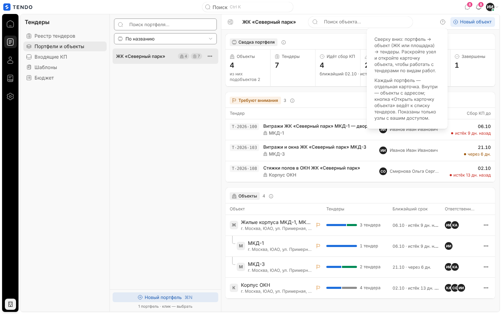

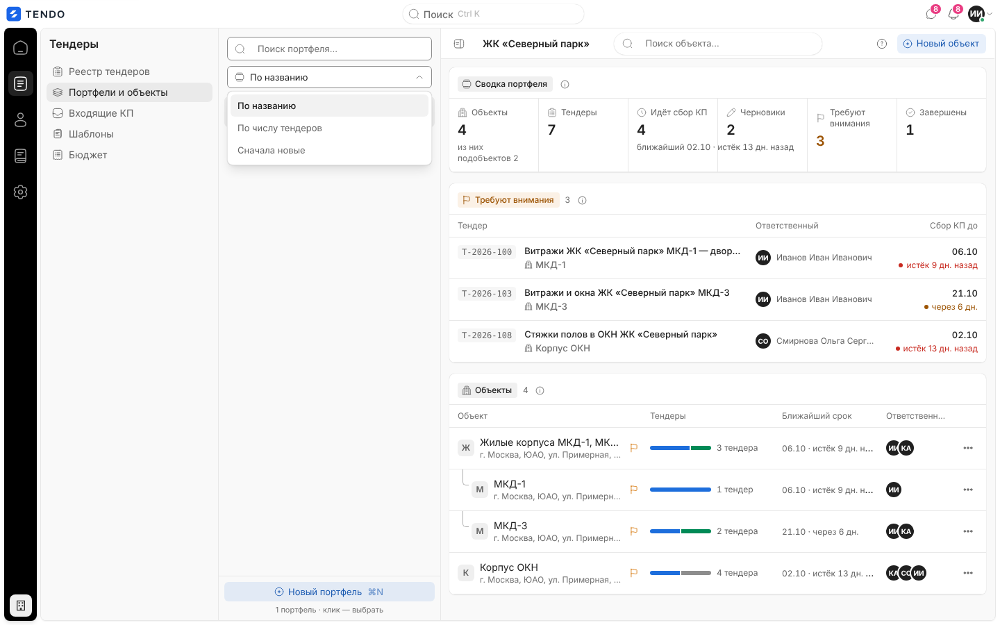

## Режим «тендеры объекта»

Выбор объекта (кнопка-название, клик по строке, ссылка в «Требуют внимания») переключает правую область, не уходя со страницы.

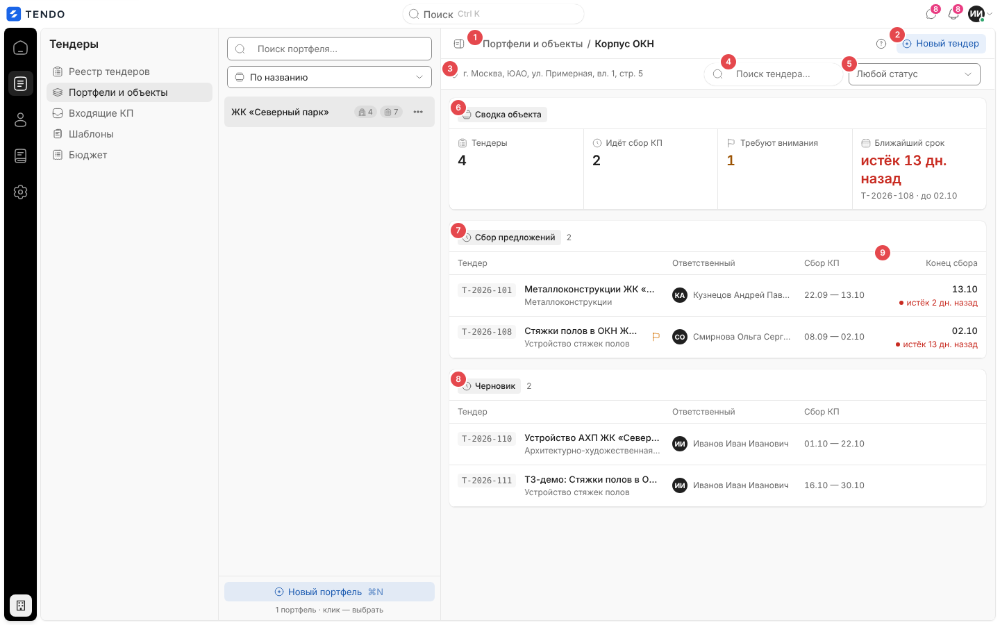

| № | Элемент | Поведение |
|---|---|---|
| ① | Крошки «Портфели и объекты / <объект>» | Первый сегмент возвращает к сводке первого портфеля (`/portfolios`) |
| ② | «Новый тендер» | Переход в мастер `/tenders/new?projectId=<id>` — объект в мастере подставлен |
| ③ | Адрес объекта | Значок метки и адрес или «адрес не указан» |
| ④ | «Поиск тендера…» | Подстрока номера или названия тендера (`tender_q`, пауза 300 мс) |
| ⑤ | Фильтр статуса | «Любой статус» / «Сбор предложений» / «Черновик» / «Завершён» / «Отменён» (`status`); когда фильтр или поиск заданы — появляется сброс |
| ⑥ | «Сводка объекта» | 4 показателя: «Тендеры», «Идёт сбор КП», «Требуют внимания», «Ближайший срок» (отсчёт крупно с тоном, подпись «T-2026-108 · до 02.10» или «нет идущих тендеров») |
| ⑦–⑧ | Группы по статусу | Порядок: «Сбор предложений» → «Черновик» → «Завершён» → «Отменён»; пустые группы не рисуются; у группы — капсула статуса и число |
| ⑨ | Колонка «Конец сбора» | Только в группе «Сбор предложений»: дата и отсчёт с тоном |

Колонки групп: «Тендер» (номер-ссылка, название, вид работ второй строкой или «вид работ не указан», флажок «Требует внимания» у открытых и черновых), «Ответственный», «Сбор КП» (`ДД.ММ — ДД.ММ` или «—»), «Конец сбора». Клик по строке — карточка тендера.

> **Важно для реализации.** Поиск тендера и фильтр статуса отправляются в тот же запрос дерева (`GET /portfolios?tender_q=…&status=…`), поэтому сервер сужает **всё** дерево, в том числе счётчики портфелей в левой колонке.

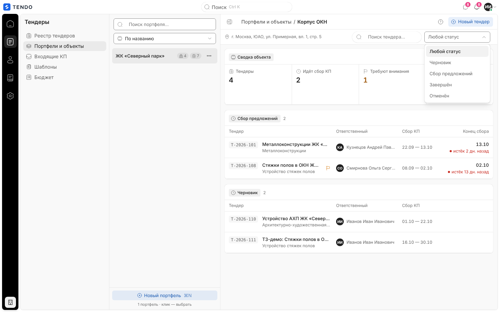

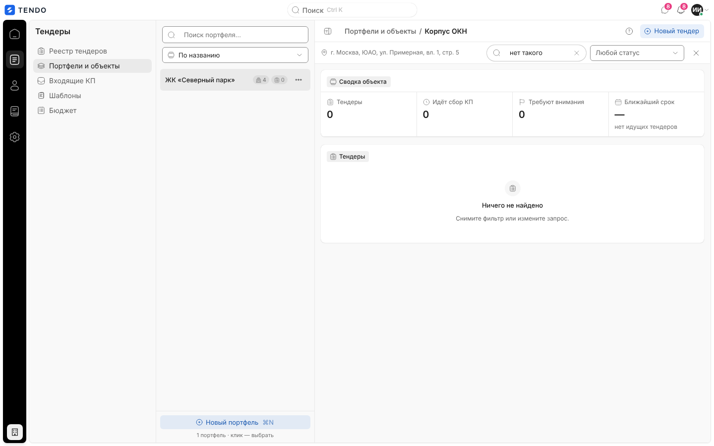

## Меню строк

| Меню | Пункты |
|---|---|
| Портфель («…» в списке слева) | «Переименовать», «Новый объект» (объект верхнего уровня в этом портфеле), «Архивировать» (красным) |
| Объект («…» в таблице) | «Переименовать», «Подобъект» (новый объект внутри этого), «На верхний уровень» — только у подобъектов (перенос на верхний уровень того же портфеля), «Архивировать» |

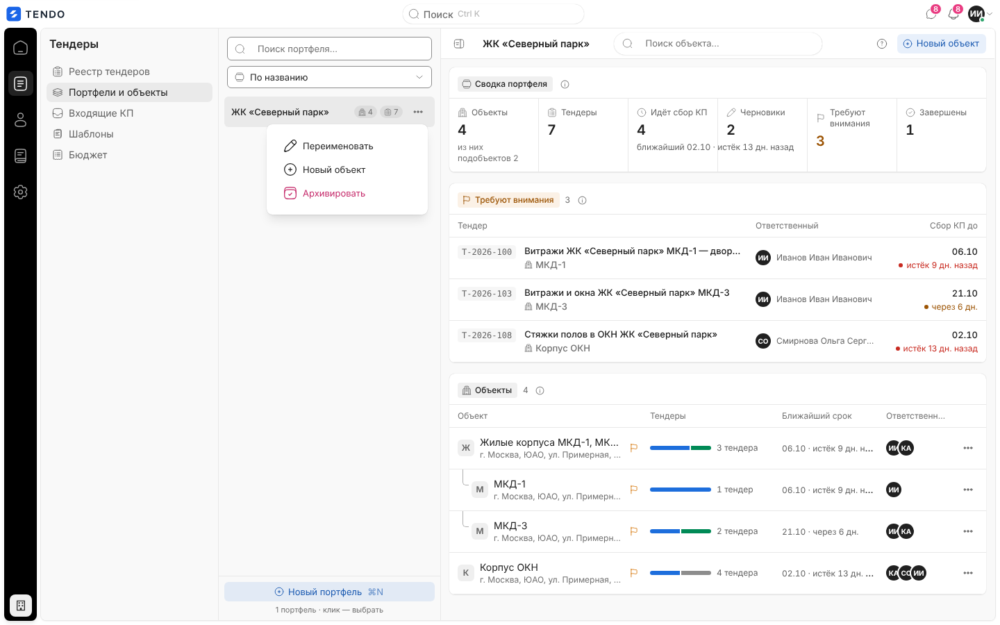

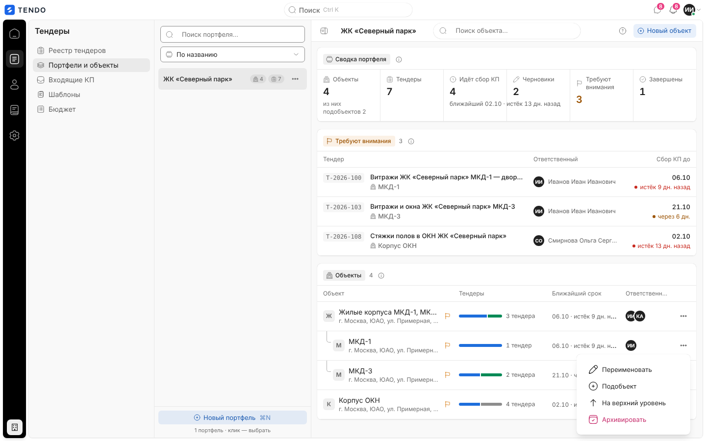

- **Перенос** — только «на верхний уровень»; перенести объект под произвольного родителя или в другой портфель экран не умеет (API `PATCH /projects/{id}` с `parent_project_id` это позволяет — см. [открытые вопросы](../_oq/SCR-3.md)).
- **Архивировать** — окно подтверждения «Архивировать портфель/объект «<название>»? Он пропадёт из списков.» с кнопками «Отмена» / «Подтвердить». После подтверждения узел исчезает из всех списков (строка в БД остаётся). Если архивировали выбранный узел — выбор сбрасывается. Отказ сервера («Сначала удалите или перенесите объекты портфеля», «Сначала удалите подобъекты», «Нельзя удалить объект с тендерами») — окном «Не удалось архивировать портфель/объект» с текстом сервера. Восстановления из архива в интерфейсе нет.

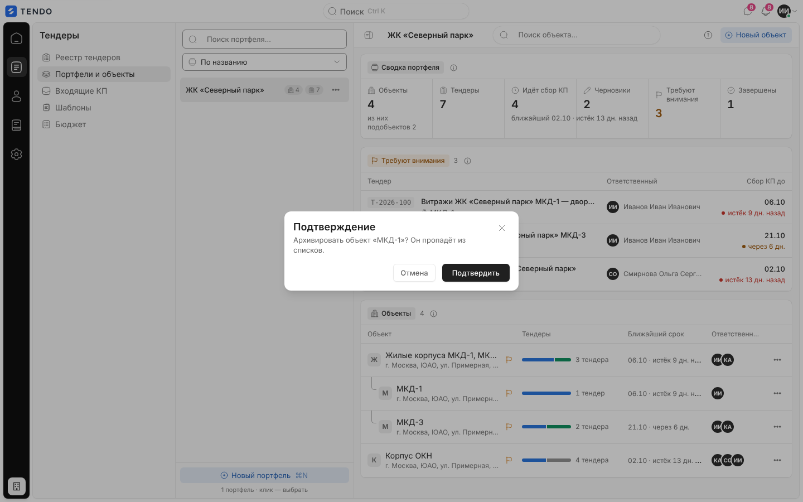

## Модальные окна создания и переименования

Одно окно на четыре операции.

| Окно | Заголовок | Поля | Кнопка |
|---|---|---|---|
| Новый портфель | «Новый портфель» | «Название» * (плейсхолдер «Например, «Жилой квартал „Северный“»») | «Создать» |
| Переименовать портфель | «Переименовать портфель» | «Название» * (подставлено текущее) | «Сохранить» |
| Новый объект / подобъект | «Новый объект» | «Название» * (плейсхолдер «Например, «Корпус 1»»), «Адрес» (необязательно, плейсхолдер «Необязательно») | «Создать» |
| Переименовать объект | «Переименовать объект» | «Название» * | «Сохранить» |

- Название обрезается по краям; пустое — ошибка поля «Укажите название.», кнопка подтверждения неактивна, пока поле пустое. Enter в поле названия отправляет форму. Ограничения длины на форме нет (в БД — 255 символов, см. [открытые вопросы](../_oq/SCR-3.md)).
- Ошибка сервера — окном «Не удалось сохранить» с текстом сервера; окно формы остаётся открытым.
- После сохранения дерево перечитывается; созданный портфель сразу выбирается.
- API: `POST /portfolios`, `PATCH /portfolios/{id}`, `DELETE /portfolios/{id}` (архив), `POST /projects` (`portfolio_id`, `parent_project_id`, `name`, `address`), `PATCH /projects/{id}` (`name` или `parent_project_id: null`), `DELETE /projects/{id}` — [endpoints-portfolios.md](../04-api/endpoints-portfolios.md).

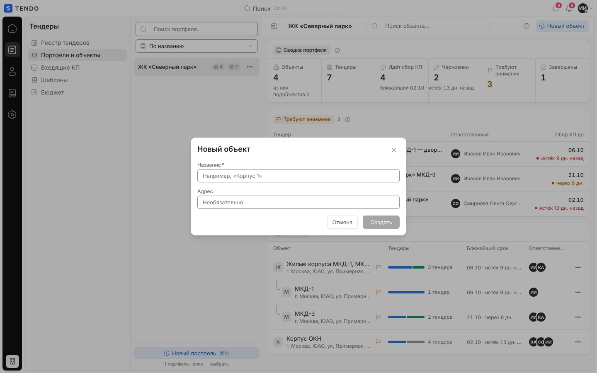

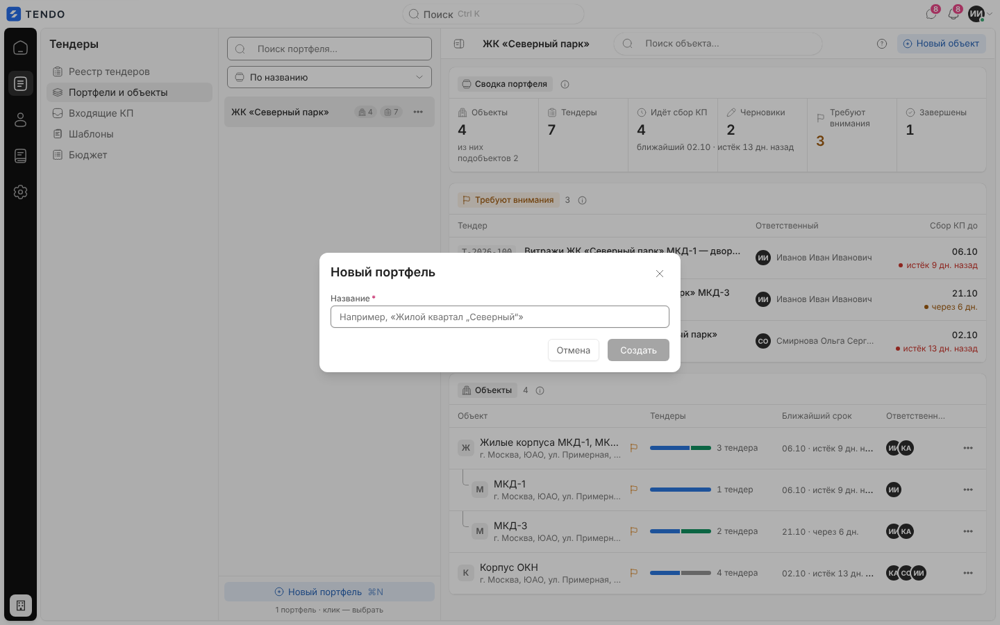

## Данные

Один запрос `GET /portfolios` ([описание](../04-api/endpoints-portfolios.md#get-portfolios)) с параметрами `q`, `object_q`, `tender_q`, `status`, `sort` — дерево целиком (портфели → объекты → подобъекты → строки тендеров). Сводки, полосы стадий, ближайшие сроки и ответственные считаются **на клиенте** из этого дерева. Запрос повторяется при каждом изменении поиска/фильтра/порядка и после каждой мутации.

## Состояния

| Состояние | Что видит пользователь | Снимок |
|---|---|---|
| Загрузка | Скелетоны: 4 строки в списке портфелей, два блока справа | 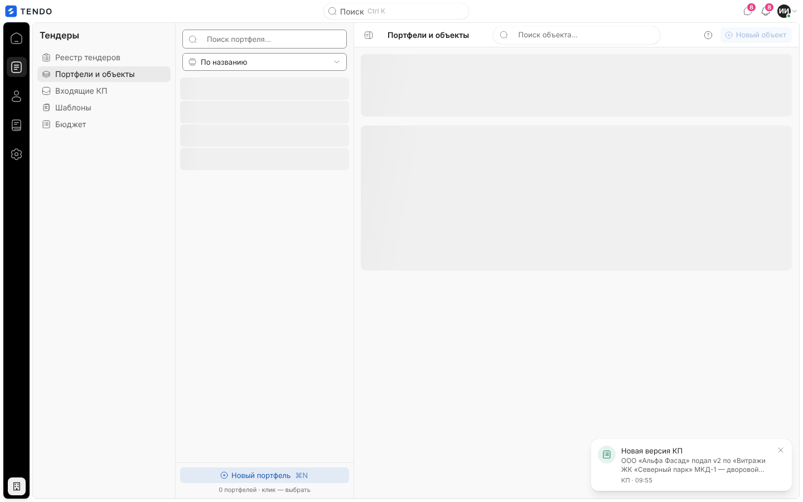 |
| Ошибка загрузки | Справа — «Портфели не загрузились» + текст ошибки сервера + «Повторить». Дефект: левая колонка при этом показывает «Портфелей пока нет» — при воссоздании показывать ошибку и там | 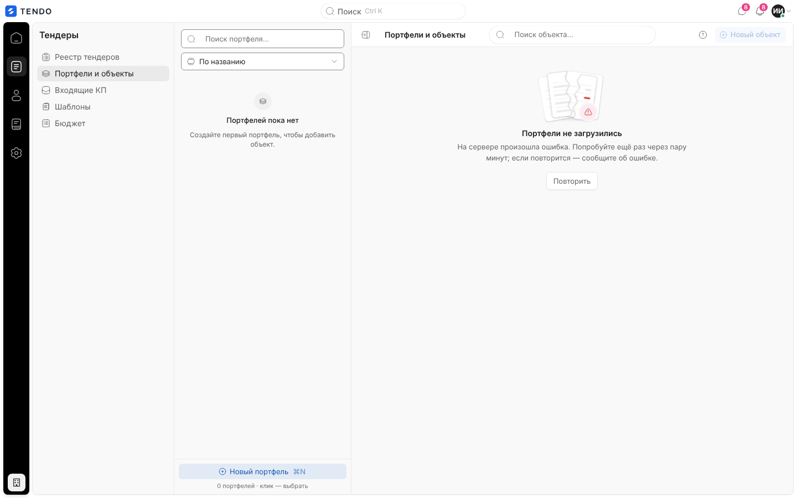 |
| Портфелей нет | В списке — «Портфелей пока нет» / «Создайте первый портфель, чтобы добавить объект.»; справа — «Портфель не выбран» / «Создайте портфель слева — в нём появятся объекты и их тендеры.» | — (на стенде портфели есть) |
| Поиск портфеля без результата | «Ничего не найдено» / «Измените запрос — поиск идёт по названию портфеля.» | 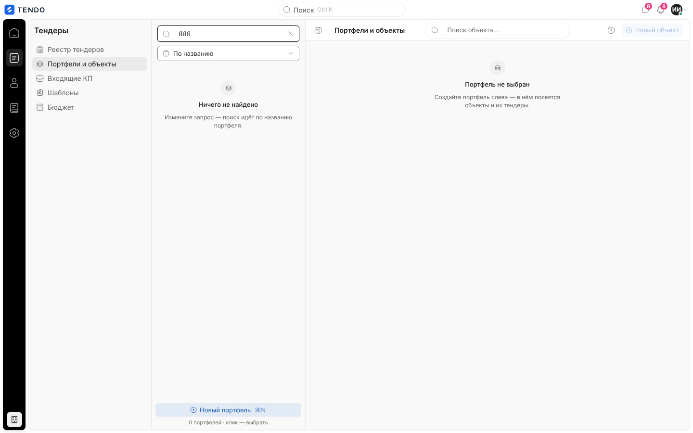 |
| Объектов нет / тендеров нет | «Объектов пока нет» …; «Тендеров по объекту пока нет» / «Создайте первый тендер по объекту «<название>» кнопкой «Новый тендер».»; при фильтре — «Ничего не найдено» / «Снимите фильтр или измените запрос.» | см. выше |
| Нет доступа | СБ/юрист — перенаправление на `/home`; объекты без гранта просто не приходят | см. «Роли» |
| Только чтение | Отдельного режима нет; запреты — ответом сервера | — |

## Адаптивность

На ширине ≤ 720 px список портфелей занимает всю ширину вместо правой области и закрывается выбором портфеля/объекта; крошки сокращаются до текущего сегмента.

## Переходы

| Откуда | Куда |
|---|---|
| Номер / строка тендера | `/tenders/<id>` |
| «Новый тендер» | `/tenders/new?projectId=<id объекта>` |
| Крошка «Портфели и объекты» | `/portfolios` |

## Сложность

**L**: двухколоночная раскладка с деревом, серверные поиск/фильтры/сортировка, клиентские сводки и полосы стадий, 4 модальных сценария + меню + архивирование, состояния и адаптив.
