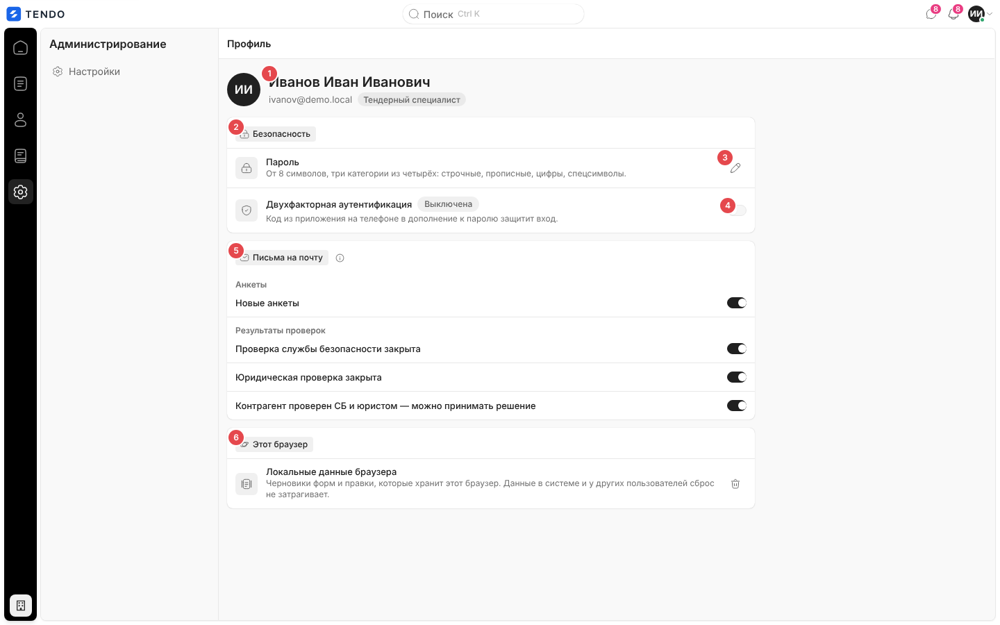
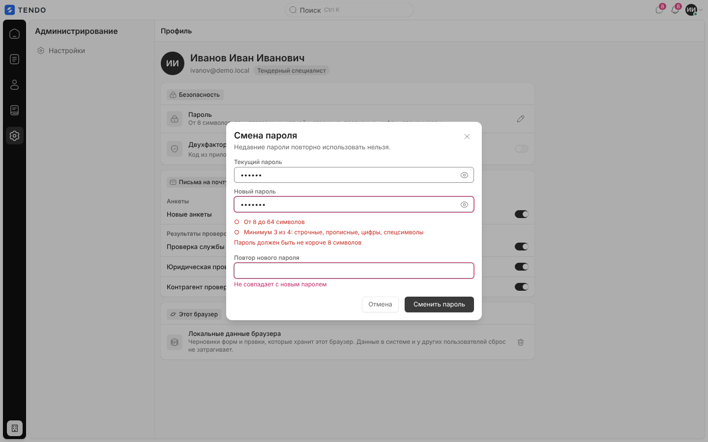
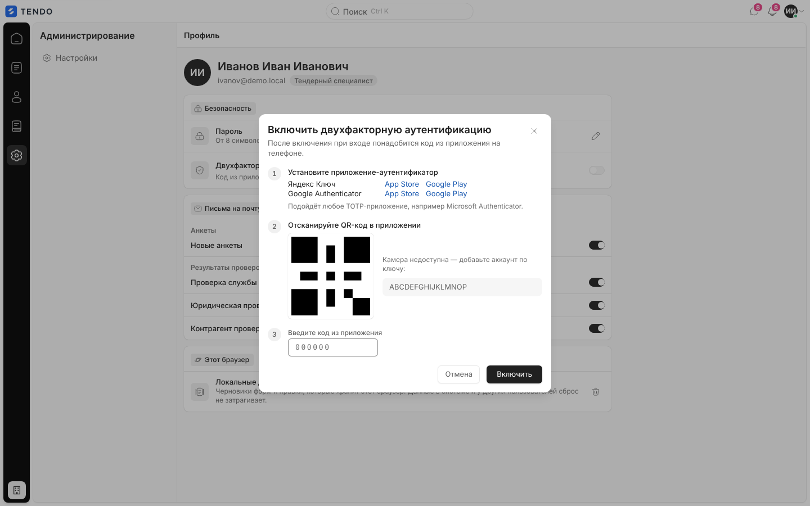
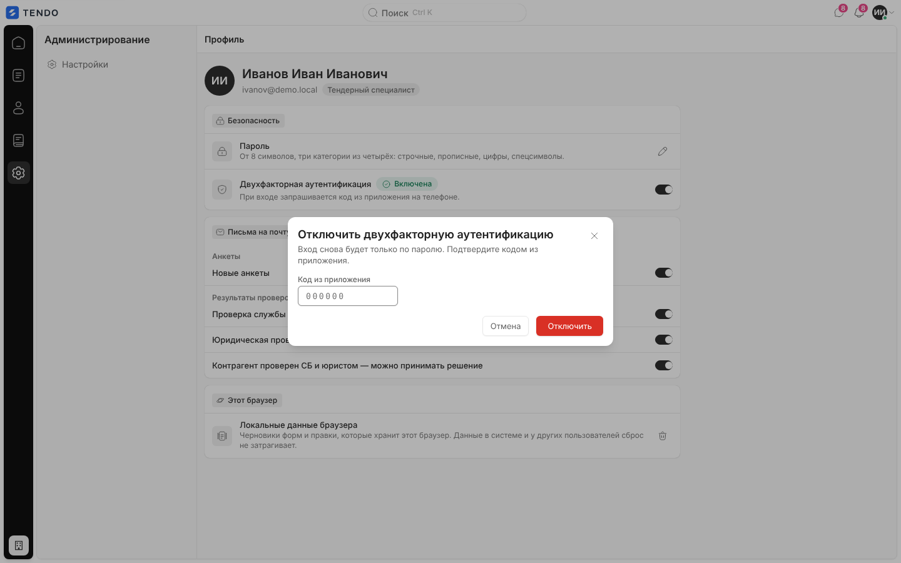
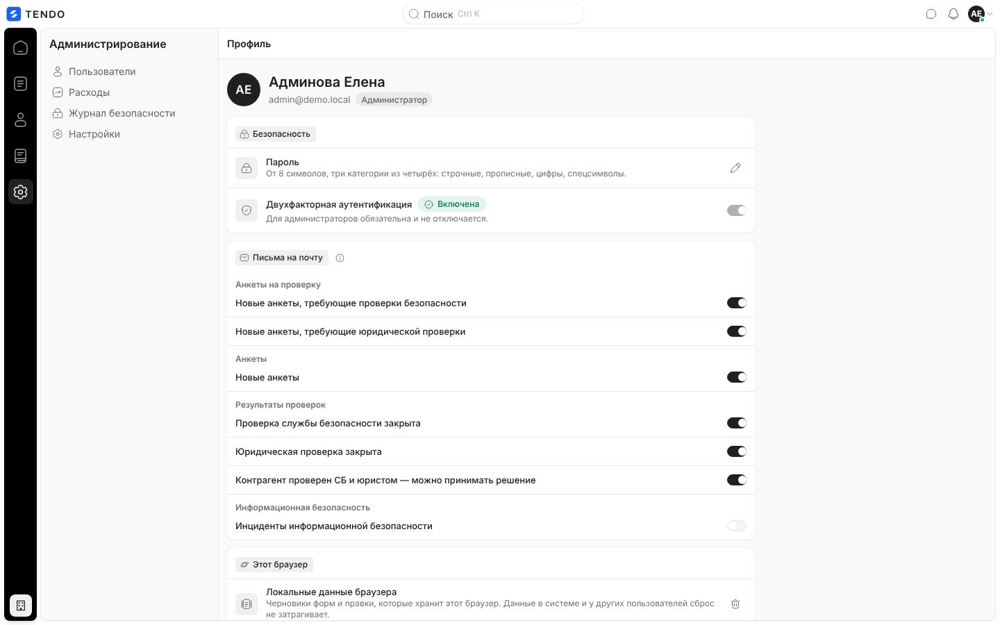
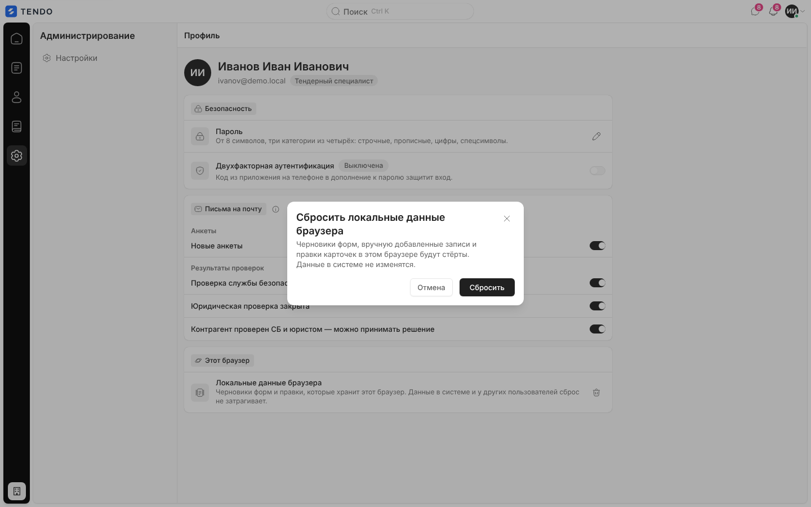
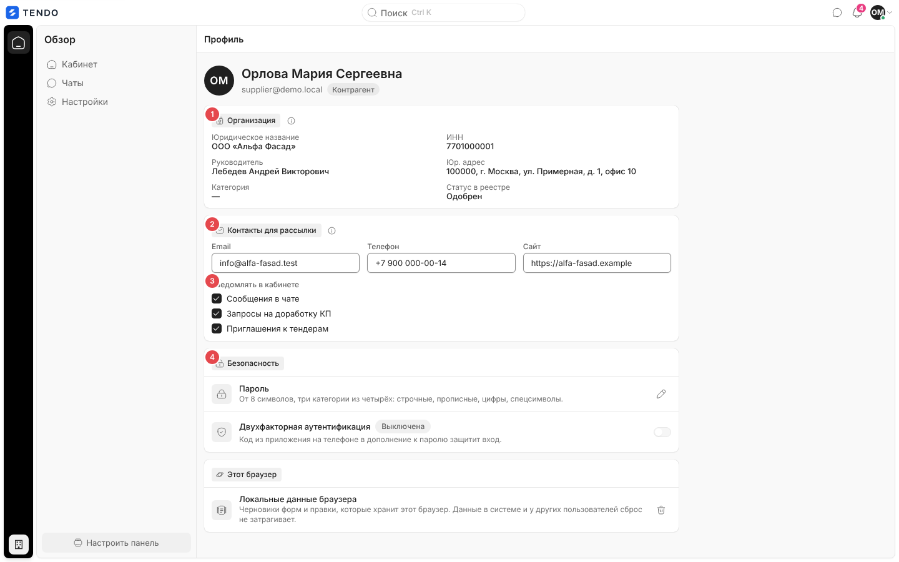
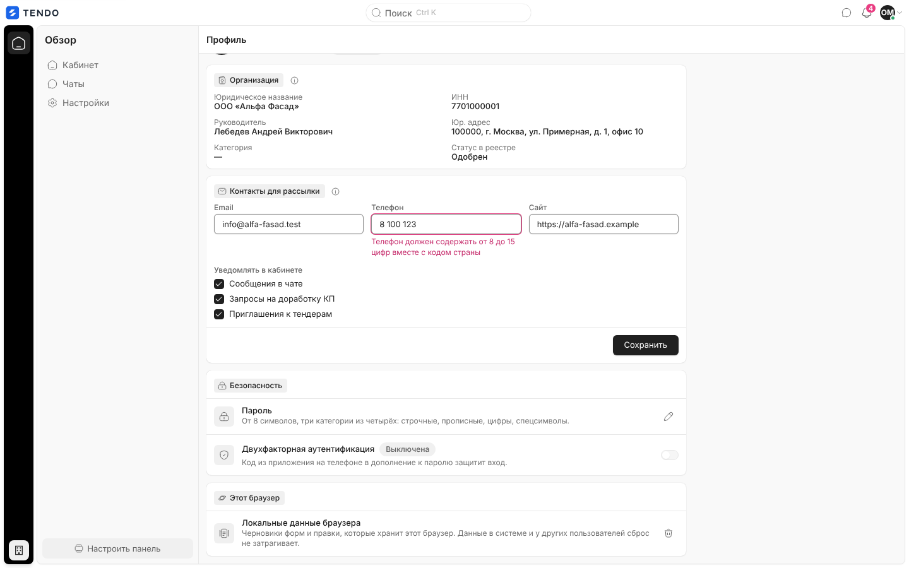

# Профиль (`/profile`)

Личная страница вошедшего пользователя: кто я (ФИО, e-mail, роль), смена пароля, двухфакторная аутентификация (MFA), галочки дублирования уведомлений на почту (сотрудники), у контрагента — карточка организации, контакты для рассылки и настройки уведомлений кабинета; сброс локальных данных браузера.

Связанные разделы: пароли, MFA, сессии — [../02-business-logic/identity.md](../02-business-logic/identity.md) (§4.3, §4.4); API — [../04-api/endpoints-identity.md](../04-api/endpoints-identity.md) (`/auth/password`, `/auth/mfa/*`, `/auth/me/notification-prefs`), [../04-api/endpoints-suppliers-registration.md](../04-api/endpoints-suppliers-registration.md#patch-mesupplier) (`/me/supplier`); каталог уведомлений — [../02-business-logic/notifications.md](../02-business-logic/notifications.md); настройки системы и личные настройки — [settings.md](settings.md).

## Маршрут, роли, как попасть

- `/profile`; заголовок страницы и вкладки — «Профиль».
- Открыт ролям: администратор, тендерный специалист, СБ, юрист, контрагент; формально и лиду (адрес в его белом списке, но ссылок на него у лида нет). **Владельцу площадки закрыт** — переход уводит на `/owner/costs` (свои настройки владелец меняет в [owner-settings.md](owner-settings.md)).
- Как попасть: шапка меню профиля в топбаре (капсула «Профиль»). В рейле отдельного пункта нет; активным подсвечивается раздел «Администрирование».

## Экран сотрудника

| № | Блок | Содержание |
|---|---|---|
| ① | Идентификация | Круг с инициалами, ФИО, e-mail, капсула роли. Пока профиль грузится — серая полоса |
| ② | Группа «Безопасность» | Строки «Пароль» и «Двухфакторная аутентификация» |
| ③ | «Пароль» | Описание «От 8 символов, три категории из четырёх: строчные, прописные, цифры, спецсимволы.», значок-карандаш «Сменить пароль» → окно |
| ④ | «Двухфакторная аутентификация» | Капсула «Включена» / «Выключена», описание, переключатель ([ниже](#двухфакторная-аутентификация)) |
| ⑤ | «Письма на почту» | Только у сотрудников ([ниже](#письма-на-почту)) |
| ⑥ | «Этот браузер» | Строка «Локальные данные браузера» ([ниже](#локальные-данные-браузера)) |

## Смена пароля

Окно «Смена пароля», подзаголовок «Недавние пароли повторно использовать нельзя.».

| Поле | Правила |
|---|---|
| Текущий пароль | Обязательное, кнопка показа, автофокус |
| Новый пароль | Обязательное, кнопка показа; под полем живой чек-лист («От 8 до 64 символов», «Минимум 3 из 4: строчные, прописные, цифры, спецсимволы») и строка первой нарушенной проверки политики |
| Повтор нового пароля | Обязательное; «Не совпадает с новым паролем» |

- Пустые поля — «Заполните текущий и новый пароль». Enter в любом поле отправляет форму.
- «Сменить пароль» → «Сохраняем…» → `POST /auth/password {current_password, new_password}`. Ошибки сервера — под полями: «Текущий пароль указан неверно», «Нельзя повторно использовать недавний пароль», тексты политики (в т. ч. «Пароль не должен повторять email» / «… имя пользователя»).
- Успех: тост «Пароль обновлён», окно закрывается. Остальные сессии пользователя закрываются сервером, текущая продолжает работать.

## Двухфакторная аутентификация

| Ситуация | Строка | Действие |
|---|---|---|
| Выключена | «Выключена», «Код из приложения на телефоне в дополнение к паролю защитит вход.» | Переключатель → `POST /auth/mfa/setup` → окно настройки |
| Включена (не администратор) | «Включена», «При входе запрашивается код из приложения на телефоне.» | Переключатель → окно отключения |
| Включена у администратора (и владельца) | «Включена», «Для администраторов обязательна и не отключается.» | Переключатель заблокирован |
| Принудительная настройка | Капсула «Выключена» красная (экран настроек, см. [shell.md](shell.md#гейт-входа)) | После включения — переход на `/home` |
| Ошибка запуска настройки | Красная строка с текстом (по умолчанию «Не удалось начать настройку») | — |

**Окно «Включить двухфакторную аутентификацию»** («После включения при входе понадобится код из приложения на телефоне.»):
1. «Установите приложение-аутентификатор» — ссылки на App Store / Google Play для двух распространённых приложений; «Подойдёт любое TOTP-приложение, например Microsoft Authenticator.»
2. «Отсканируйте QR-код в приложении» — QR, построенный сервером; «Камера недоступна — добавьте аккаунт по ключу:» и поле-копия ключа.
3. «Введите код из приложения» — 6 цифр; меньше 6 — «Введите шесть цифр из приложения»; неверный — текст сервера («Неверный код — проверьте время на устройстве и попробуйте ещё раз»).

Кнопки «Отмена», «Включить» («Проверяем…») → `POST /auth/mfa/verify {code}`. Повторная настройка при уже включённой MFA требует текущего кода (правило сервера).

**Окно «Отключить двухфакторную аутентификацию»** («Вход снова будет только по паролю. Подтвердите кодом из приложения.»): поле «Код из приложения» (6 цифр), «Отмена», «Отключить» (красная, «Отключаем…») → `POST /auth/mfa/disable {code}`. Ошибки: «Введите шесть цифр из приложения», «Неверный код», «Для администраторов MFA обязательна — отключить нельзя».

## Письма на почту

Группа «Письма на почту» с подсказкой сервера «Уведомления всегда приходят в центр уведомлений. Галочка включает дублирование на email.» (запасной текст на клиенте: «Уведомления всегда приходят в центр уведомлений — отключить их нельзя. Переключатель включает дублирование письмом на вашу почту.»). Секции и переключатели приходят с сервера по роли (`GET /auth/me/notification-prefs`):

| Роль | Секции и переключатели |
|---|---|
| Администратор | все 7: «Анкеты на проверку» (новые анкеты, требующие проверки безопасности / юридической проверки), «Анкеты» (новые анкеты), «Результаты проверок» (проверка СБ закрыта; юридическая проверка закрыта; контрагент проверен СБ и юристом — можно принимать решение), «Информационная безопасность» (инциденты ИБ) |
| Тендерный специалист | 4: «Анкеты» — «Новые анкеты»; «Результаты проверок» — 3 переключателя |
| Служба безопасности | 2: «Новые анкеты, требующие проверки безопасности», «Инциденты информационной безопасности» |
| Юрист | 1: «Новые анкеты, требующие юридической проверки» |
| Контрагент, лид | группа не показывается |

- Переключение сохраняется сразу (`PUT /auth/me/notification-prefs {<код>: bool}`), оптимистично; на время запроса переключатель заблокирован; сбой — откат и тост «Не сохранилось» с текстом ошибки.
- Загрузка — три серые полосы; ошибка — «Настройки писем не загрузились» + «Повторить».

## Локальные данные браузера

Строка «Локальные данные браузера» — «Черновики форм и правки, которые хранит этот браузер. Данные в системе и у других пользователей сброс не затрагивает.», красный значок-корзина. Подтверждение «Сбросить локальные данные браузера»: «Черновики форм, вручную добавленные записи и правки карточек в этом браузере будут стёрты. Данные в системе не изменятся.» («Сбросить» / «Отмена»), затем сообщение «Локальные данные сброшены. Обновите страницу, чтобы увидеть чистое состояние.». Очищает фиксированный набор ключей хранилища браузера (устаревший черновик анкеты, локальные правки прежних версий) — см. [открытые вопросы](../_oq/SCR-1.md): актуальные черновики (анкета регистрации, форма КП, закреплённые пункты, недавние) этим сбросом не затрагиваются.

## Профиль контрагента

- **«Организация»** (подсказка «Реквизиты меняет тендерный специалист. Контакты и уведомления — ниже.»), только чтение: «Юридическое название», «ИНН», «Руководитель», «Юр. адрес», «Категория», «Статус в реестре» (подпись статуса контрагента); пустые — «—». Источник — `GET /me/supplier`.
- **«Контакты для рассылки»** (подсказка «Сюда уходят приглашения к тендерам и запросы по КП.»):

| Поле | Правила |
|---|---|
| Email | При уходе — нормализация и проверка: «Укажите корректный email», «Email длиннее 254 символов»; можно оставить пустым |
| Телефон | Плейсхолдер «+7 900 111-22-33»; при уходе — к виду «+7 900 111-22-33» и проверка (тексты как в анкете — [register.md](register.md#шаг-1--реквизиты-организации)) |
| Сайт | Плейсхолдер «https://»; проверяет сервер («Адрес сайта начинается с http:// или https://» и др.) |
| Уведомлять в кабинете | Галочки «Сообщения в чате», «Запросы на доработку КП», «Приглашения к тендерам» — выключенная галочка подавляет уведомления этого вида в центре уведомлений **для всей организации** |

- Подвал с кнопкой «Сохранить» появляется, только когда есть изменения; «Сохраняем…» → `PATCH /me/supplier`; успех — «Сохранено» на 2 с; ошибка — красная строка (по умолчанию «Не удалось сохранить»). Ошибка загрузки профиля — «Не удалось загрузить профиль».
- Группа «Письма на почту» контрагенту не показывается; «Безопасность» и «Этот браузер» — как у сотрудника.

## Состояния

| Состояние | Поведение |
|---|---|
| Загрузка | Серая полоса вместо идентификации, скелеты в группах |
| Нет доступа (владелец площадки) | Увод на `/owner/costs` |

## Сложность

**M**: смена пароля с живой политикой — S; MFA (QR, ключ, проверка кода, отключение, блокировка для админа) — M; письма по ролям с оптимистичным сохранением — S; профиль контрагента — S.
