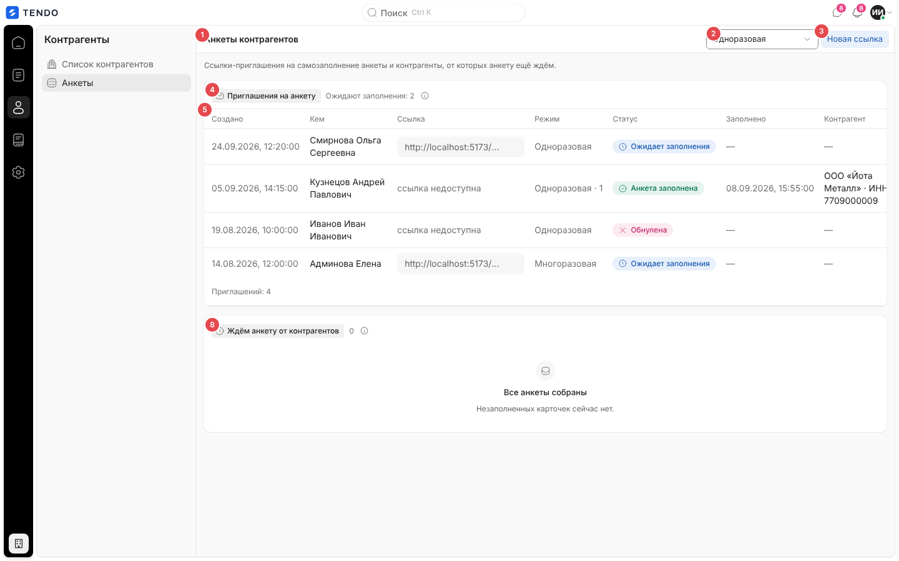
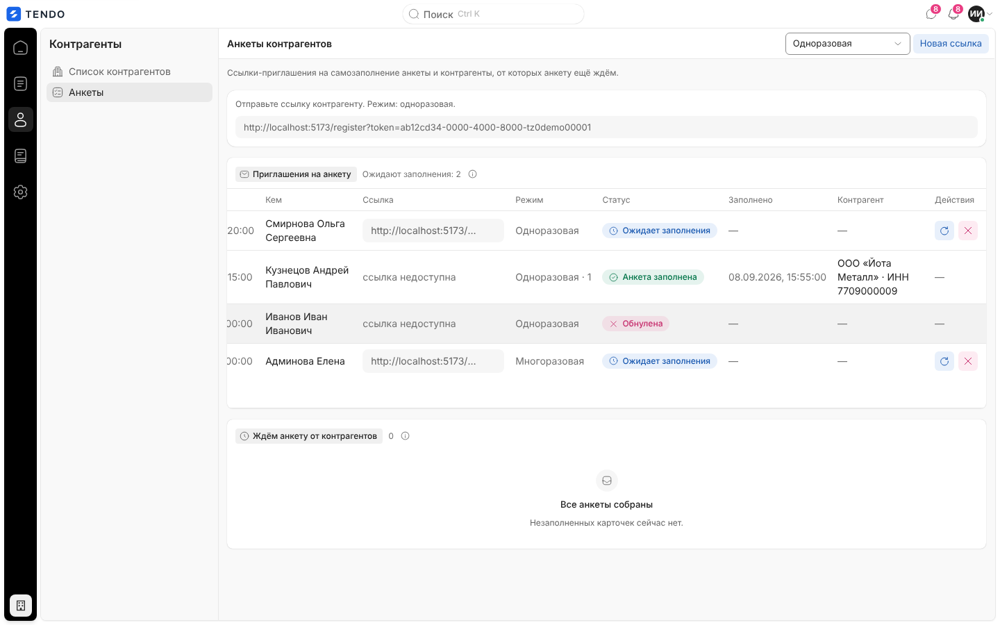
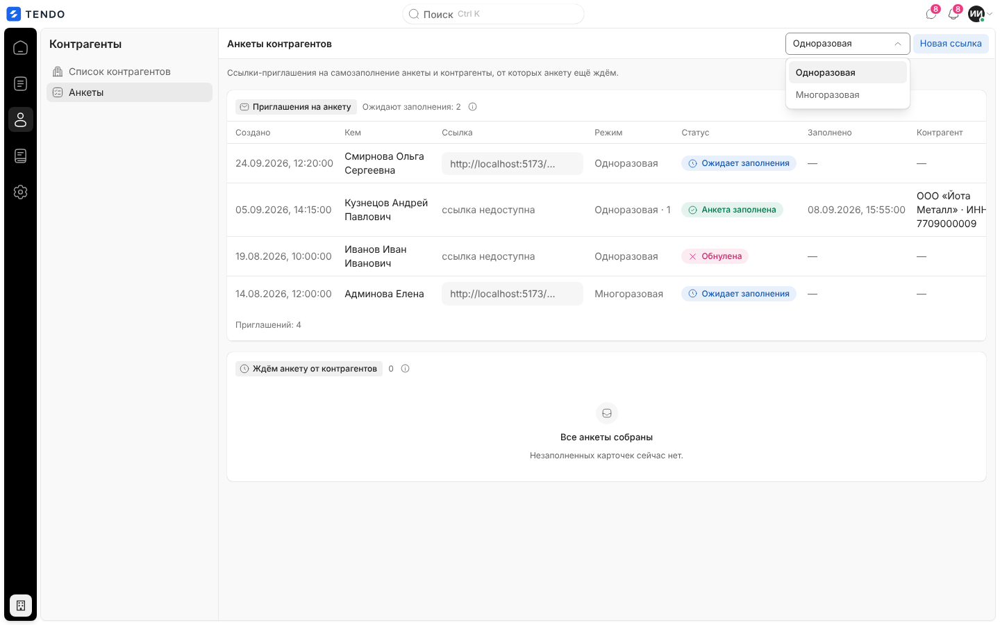
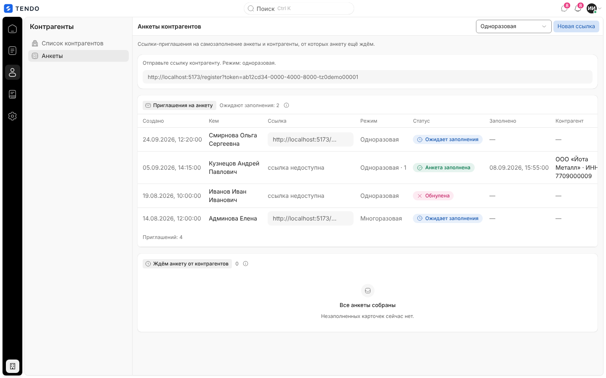
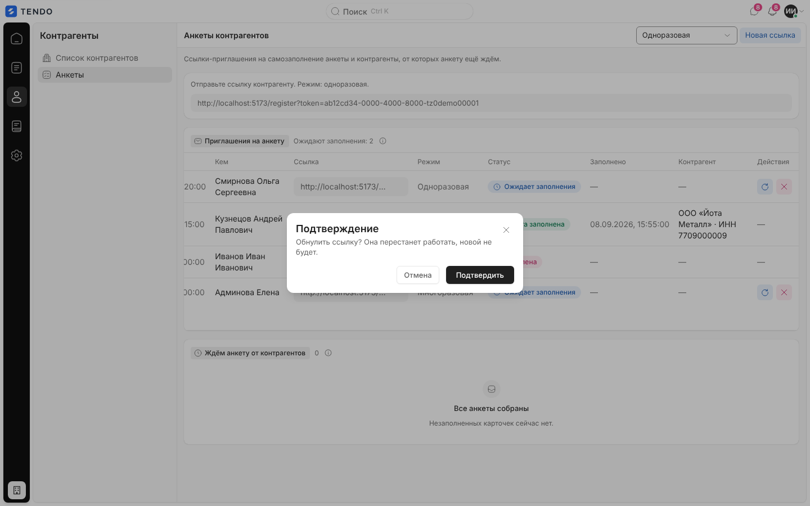
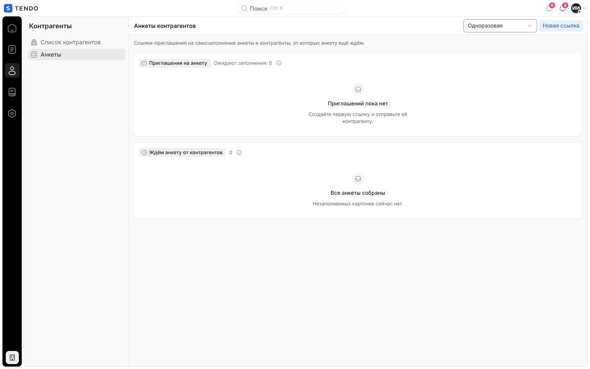

# Анкеты контрагентов (`/questionnaires`)

Рабочий экран выдачи ссылок-приглашений на самостоятельное заполнение анкеты контрагентом ([register.md](register.md)) и контроля, от кого анкету ещё ждут: создать ссылку (одноразовую или многоразовую), скопировать, перевыпустить, обнулить; увидеть, кто и когда заполнил.

Связанные разделы: процесс регистрации и аккредитации — [../02-business-logic/suppliers.md](../02-business-logic/suppliers.md); API — [../04-api/endpoints-suppliers-registration.md](../04-api/endpoints-suppliers-registration.md) (`POST /suppliers/invitations`, `GET /suppliers/invitations/list`, `…/regenerate`, `…/revoke`), реестр контрагентов — [../04-api/endpoints-suppliers.md](../04-api/endpoints-suppliers.md); соседние экраны — [suppliers.md](suppliers.md), [supplier-card.md](supplier-card.md).

## Маршрут, роли, как попасть

- `/questionnaires`; заголовок страницы и вкладки — «Анкеты контрагентов».
- **Кому доступен экран:** администратору и тендерному специалисту (пункт «Анкеты» в разделе рейла «Контрагенты»). Служба безопасности и юрист пункта не видят; прямой переход уводит их на `/home`. Контрагенту, лиду и владельцу площадки адрес закрыт.
- Серверные ручки ссылок открыты **любому сотруднику** (включая СБ и юриста) — интерфейс у них просто не показывает экран ([users-and-roles.md](../01-product/users-and-roles.md), §4.6).
- Как попасть: рейл «Контрагенты» → «Анкеты»; закреплённый ярлык панели «Обзор».

## Экран

| № | Блок | Поведение |
|---|---|---|
| ① | Заголовок «Анкеты контрагентов» и пояснение «Ссылки-приглашения на самозаполнение анкеты и контрагенты, от которых анкету ещё ждём.» | — |
| ② | Выбор режима: «Одноразовая» (по умолчанию) / «Многоразовая» | Режим применяется к следующей созданной ссылке |
| ③ | «Новая ссылка» → «Создаём…» | `POST /suppliers/invitations {mode}`; новая ссылка выводится карточкой над таблицей и **сразу копируется в буфер обмена** |
| ④ | Группа «Приглашения на анкету» | Подсказка «Ссылка-приглашение открывает контрагенту форму анкеты без входа в систему. Одноразовая гаснет после первого заполнения, многоразовую можно разослать нескольким компаниям.»; счётчик «Ожидают заполнения: N» |
| ⑤ | Таблица приглашений | Колонки ниже |
| ⑥⑦ | Действия строки | «Перевыпустить», «Обнулить» — только у ссылок в статусе «Ожидает заполнения» (колонка «Действия» справа, при узком окне таблица прокручивается вбок) |
| ⑧ | Группа «Ждём анкету от контрагентов» | Подсказка «Контрагенты, чья карточка заведена, но анкета ещё не сдана: приглашение не открыто, анкета не дозаполнена или отправлена на доработку.», счётчик |

### Таблица «Приглашения на анкету»

| Колонка | Содержимое |
|---|---|
| Создано | Дата и время (по Москве) |
| Кем | ФИО сотрудника, создавшего ссылку |
| Ссылка | Поле с адресом `<адрес приложения>/register?token=…`, копируется кликом; если токен уже не хранится — «ссылка недоступна» (для ожидающих — «—») |
| Режим | «Одноразовая» / «Многоразовая»; у использованных — « · N» (сколько раз) |
| Статус | «Ожидает заполнения» (синий, часы), «Анкета заполнена» (зелёный), «Обнулена» (красный) |
| Заполнено | Дата и время использования или «—» |
| Контрагент | Ссылка на карточку контрагента «<название> · ИНН …», созданного по этой ссылке, или «—» |
| Действия | Значки «Перевыпустить» (подсказка «Перевыпустить: старая ссылка перестанет работать, появится новая») и «Обнулить» (подсказка «Обнулить: ссылка перестанет работать, новой не будет») |

Сортировки, фильтров, поиска и пагинации нет — выводятся все приглашения в порядке, который отдаёт сервер.

## Действия

| Действие | Что происходит | API |
|---|---|---|
| Новая ссылка | Создаётся приглашение в выбранном режиме; карточка «Отправьте ссылку контрагенту. Режим: одноразовая/многоразовая.» с полем-копией ссылки; ссылка копируется в буфер. Если буфер недоступен — тост «Ссылка не скопировалась — Скопируйте её из поля «Отправьте ссылку контрагенту».» Ошибка — окно с текстом (по умолчанию «Не удалось создать ссылку-приглашение») | `POST /suppliers/invitations` |
| Перевыпустить | Старая ссылка перестаёт работать, создаётся новая с тем же режимом; новая показывается в карточке и копируется. Ошибка — «Не удалось перевыпустить ссылку» | `POST /suppliers/invitations/{id}/regenerate` |
| Обнулить | Подтверждение «Обнулить ссылку? Она перестанет работать, новой не будет.» → статус «Обнулена». Ошибка — «Не удалось обнулить ссылку» | `POST /suppliers/invitations/{id}/revoke` |
| Копировать ссылку | Клик по полю ссылки | — |
| Открыть контрагента | Ссылка в колонке «Контрагент» / строка второй таблицы | → `/suppliers/$id` |

Письмо со ссылкой система **не отправляет**: сотрудник передаёт её сам.

### Таблица «Ждём анкету от контрагентов»

Контрагенты реестра в статусах «ожидает анкету», «новый», «на доработке» (`questionnaire_pending`, `new`, `revision`). Колонки: «Название компании» (ссылка на карточку; пометка «добавлен вручную»), «ИНН», «Статус» (капсула статуса контрагента), «Согласие на ПДн» («получено» / «не получено»), «Действия» («Карточка»). Вся строка кликабельна — переход на карточку. Пусто — «Все анкеты собраны. Незаполненных карточек сейчас нет.». Источник — реестр контрагентов `GET /suppliers` (фильтрация на клиенте).

## Состояния

| Состояние | Что видит пользователь | Снимок |
|---|---|---|
| Загрузка | Три серые полосы в группе приглашений | — |
| Нет приглашений | «Приглашений пока нет. Создайте первую ссылку и отправьте её контрагенту.» |  |
| Ошибка приглашений | «Приглашения не загрузились» + текст + «Повторить»; сбой реестра контрагентов на экран не выводится (вторая таблица просто пуста) | — |
| Действие выполняется | Кнопки строки и «Новая ссылка» неактивны («Создаём…») | — |
| Нет доступа (СБ, юрист и др.) | Увод на стартовый экран роли | — |

## Сложность

**S**.
