# Карточка входящего КП (`/quotes/:id`)

Всё о одном коммерческом предложении поставщика: кто подал и проверен ли он, по какому тендеру, сумма в контексте (к лучшей цене, к прошлой версии), позиции тендера с ответом поставщика по выбранной версии, история подач с изменениями, предложенные поставщиком дополнительные позиции и их сопоставление со сметой, другие КП этого тендера и этого контрагента, доп. условия и обсуждение. Здесь же принимаются решения по КП: принять (= завершить тендер с этим победителем), отклонить, запросить доработку, назначить ответственного, поставить пользовательский статус, решить по доп. позициям.

Связанные разделы: бизнес-логика КП, версий и доработки — [../02-business-logic/tenders-quotes.md](../02-business-logic/tenders-quotes.md); закрытие тендера и выбор победителя — [../02-business-logic/tenders-lifecycle.md](../02-business-logic/tenders-lifecycle.md#8-закрытие-тендера-и-выбор-победителя); API карточки и решений — [../04-api/endpoints-quotes.md](../04-api/endpoints-quotes.md), [../04-api/endpoints-tenders.md](../04-api/endpoints-tenders.md) (доработка, решения по позициям, `PATCH /tenders/{id}`), [../04-api/endpoints-comments.md](../04-api/endpoints-comments.md) (обсуждение), [../04-api/endpoints-files.md](../04-api/endpoints-files.md#get-filesattachment_iddownload) (скачивание файлов); ИИ-сопоставление — [../06-ai/ai-features.md](../06-ai/ai-features.md#33-position_matching--сопоставление-строк-кп-с-ведомостью); список — [quotes-inbox.md](quotes-inbox.md); тендер — [tender-card.md](tender-card.md).

> Круглый значок в правом нижнем углу снимков — инструмент отладки dev-сборки стенда, в продукт не входит.

## Маршрут

- `/quotes/:id`, где `:id` — числовой id КП (на экране — «Q-{id}»).
- Показываемая версия КП — состояние страницы (выбор в шапке таблицы позиций); в адрес не пишется, при открытии показывается версия, которую вернул сервер (текущая).
- Заголовок экрана — название контрагента; в крошках — «Входящие КП / Q-114».

## Назначение

Принять решение по предложению, не открывая всю сравнительную таблицу: сравнить его сумму с лучшей и с собственной прошлой версией, увидеть, где поставщик отказался или ничего не ответил, что поменялось между подачами, что он предложил сверх ведомости, — и сразу действовать.

## Роли и права

| Роль | Доступ | Действия |
|---|---|---|
| Тендерный специалист | Да, к КП тендеров доступных объектов (право `quotes.manage`) | Все действия карточки; «Принять КП» требует права закрывать тендер (`tenders.manage`) и повторного ввода пароля; назначение ответственного — `PATCH /tenders/{id}` (право `tenders.manage`) |
| Администратор | Да, ко всем | То же |
| СБ, юрист | Нет: маршрут закрыт для роли → `/home` | — |
| Поставщик, лид, владелец площадки | Нет → стартовый экран роли | — |

- КП тендера, к объекту которого у пользователя нет доступа, сервер не отдаёт (403 «Нет доступа к проекту этого тендера»); экран показывает состояние ошибки с этим текстом.
- Блок финансовой проверки контрагента («Финансы: …») виден только при праве видеть финансы — сервер не присылает его без права.
- Интерфейс не прячет кнопки по правам — отказ сервера показывается сообщением (см. [открытые вопросы](../_oq/SCR-2b.md)).

## Как попасть

- Строка во «Входящих КП» и в «Новых КП» на главной.
- Ссылки «Открыть КП» в карточке тендера (вкладка «Контрагенты», лента), уведомления о новых КП и версиях.
- Стрелки «Предыдущее / Следующее КП» в самой карточке, строки блоков «Другие КП этого тендера / контрагента».

## Шапка и сводка

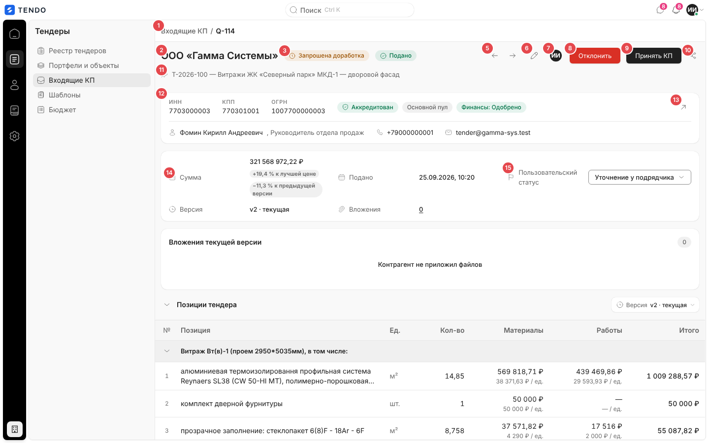

| № | Элемент | Поведение |
|---|---|---|
| ① | Крошки «Входящие КП / Q-114» | Первый сегмент — ссылка на `/quotes`; второй — номер КП (не ссылка) |
| ② | Название контрагента (`h1`) | Ссылка на карточку контрагента `/suppliers/{id}` |
| ③ | «Запрошена доработка» | Капсула (янтарная, часы), только если у КП есть текст запроса доработки; клик раскрывает панель с полным текстом запроса (с переносами, без обрезки) |
| ④ | Статус КП | Капсула статуса ([список статусов](quotes-inbox.md#колонки)). Если КП подано по устаревшей версии ФКП — рядом капсула «подано по ФКП vN (актуальна vM)» с подсказкой «ФКП скорректирована после подачи — цены могут не учитывать правку. Запросите переподачу раундом.» |
| ⑤ | «Предыдущее / Следующее КП» | Стрелки-ссылки на соседние КП этого тендера в порядке блока «Другие КП этого тендера»; у крайних — одна стрелка, если соседей нет — ни одной |
| ⑥ | «Запросить правки КП у поставщика» (карандаш) | Только для КП в статусе «Подано»; окно [«Запросить доработку»](#запросить-доработку) |
| ⑦ | Ответственный за тендер | Аватар с инициалами (подсказка «Ответственный: ФИО — сменить») или значок «Назначить ответственного за тендер»; открывает окно [«Ответственный за тендер»](#ответственный-за-тендер) |
| ⑧ | «Отклонить» (красная) | Окно [«Отклонить КП»](#отклонить-кп) |
| ⑨ | «Принять КП» (основная) | [Завершение тендера с этим победителем](#принять-кп) |
| ⑩ | «Открыть сравнение на колонке этого поставщика» (значок) | Ссылка на карточку тендера `/tenders/{id}?supplier={id}`; в новой вкладке открывается обычным образом |
| ⑪ | Строка тендера | Значок булавки и «T-2026-100 — Название» — ссылка туда же, что ⑩ |
| ⑫ | Блок контрагента | Реквизиты «ИНН / КПП / ОГРН» (нет — «—»); капсулы: аккредитация («Аккредитован» зелёная со щитом или «Не аккредитован · {статус}»: на проверке — янтарная, отклонён — красная, иначе нейтральная), пул контрагента (например, «Основной пул»), финансовая проверка «Финансы: Одобрено / Одобрено с лимитом · до N ₽ / …» (только при праве на финансы). Вторая строка — основной контакт: ФИО, должность, телефон (ссылка `tel:`), e-mail (ссылка `mailto:`); нет контакта — «Контакт не указан» |
| ⑬ | «Досье контрагента» (стрелка ↗) | Ссылка на карточку тендера с параметром `?dossier={id контрагента}` — открывает досье подрядчика в сравнительной таблице ([tender-card-comparison.md](tender-card-comparison.md)) |
| ⑭ | Сводка: «Сумма» | Итог показанной версии + подписи-капсулы: «лучшая цена» (зелёная) или «+19,4 % к лучшей цене»; «−11,3 % к предыдущей версии»; «неполный итог · нет ставок: N» (янтарная). Проценты со знаком и десятичной запятой, минус — типографский |
| ⑮ | «Пользовательский статус» | Выпадающий список статусов КП из справочника (первая строка «Без статуса» — снять). Поле есть, если в справочнике есть действующие статусы или у КП уже стоит статус; архивный текущий статус показан погашенным с пометкой «в архиве» |

Прочие поля сводки: «Версия» — «v2 · текущая»; «Подано» — `25.09.2026, 10:20` (московское время); «Вложения» — число, ссылка-якорь на блок вложений.

Кнопки «Отклонить» и «Принять КП» видны, только если одновременно: тендер не завершён и не отменён, КП в статусе «Подано» или «На доработке», показана **текущая** версия.

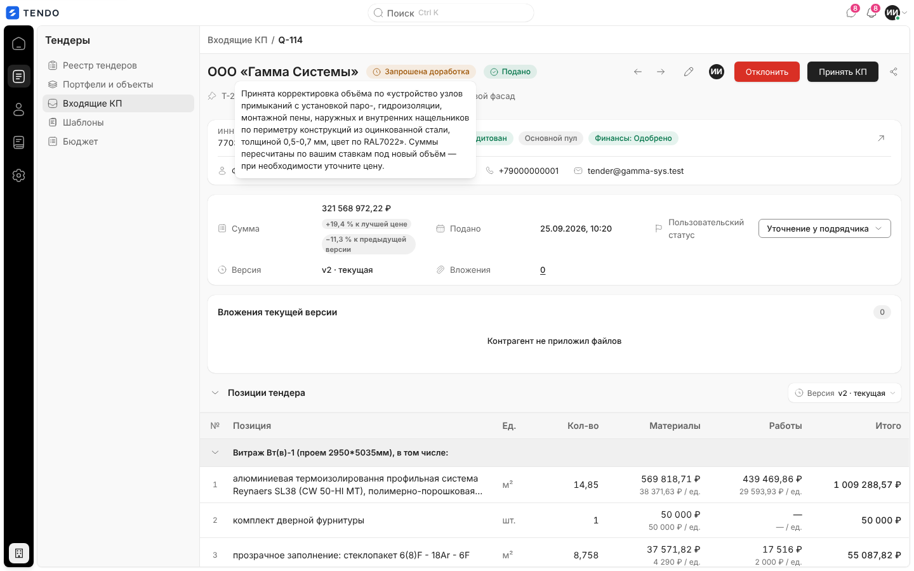

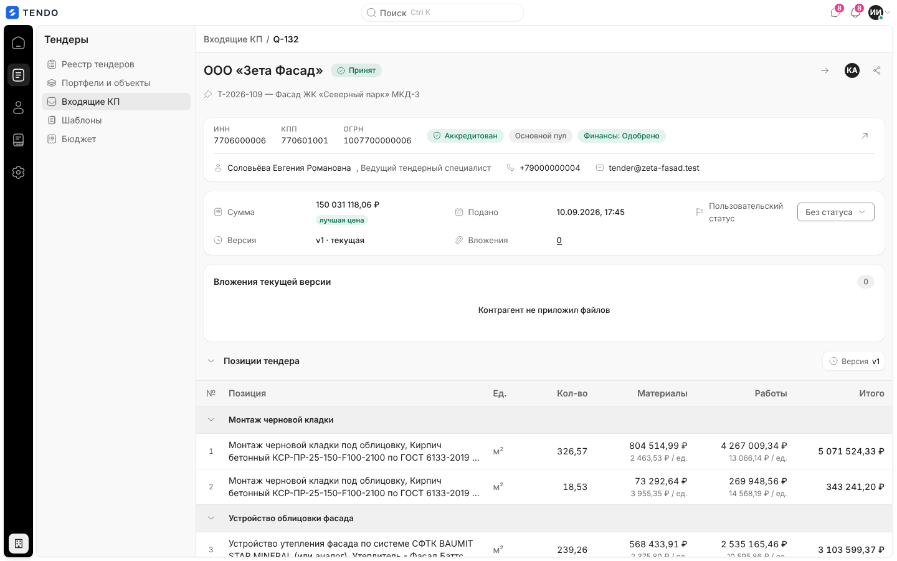

### Пользовательский статус

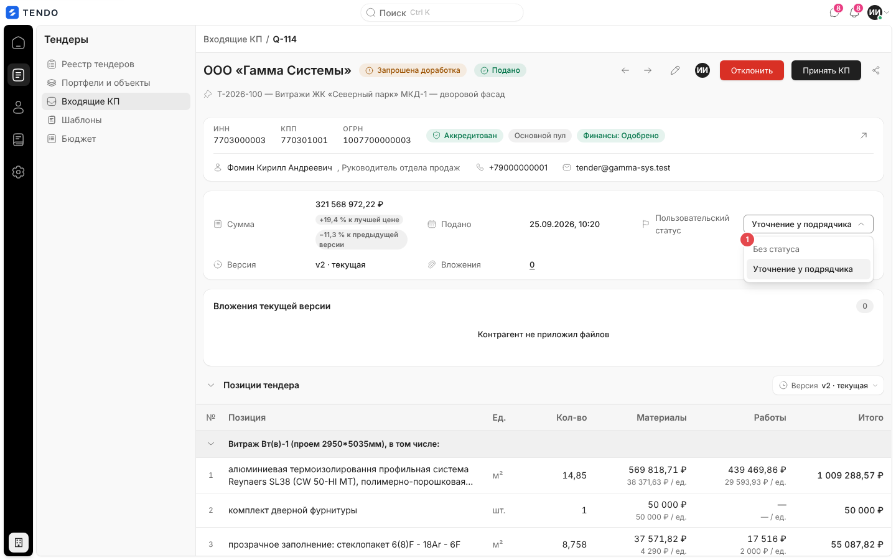

Выбор сразу сохраняется: `PATCH /quotes/{id}/custom-status` `{code}` (или `null` — «Без статуса»); на время запроса поле неактивно; успех — карточка перечитывается; отказ — уведомление «Не удалось назначить статус», прежнее значение остаётся.

## Вложения текущей версии

Блок «Вложения текущей версии» со счётчиком: список файлов показанной версии (имя — кнопка скачивания, справа тип по расширению и размер: «XLSX · 48 КБ», «1,3 МБ»). Пусто — «Контрагент не приложил файлов» (блок не прячется). Ошибка скачивания — уведомление «Не удалось скачать файл» + текст. Скачивание — [endpoints-files.md](../04-api/endpoints-files.md#скачивание).

## Позиции тендера

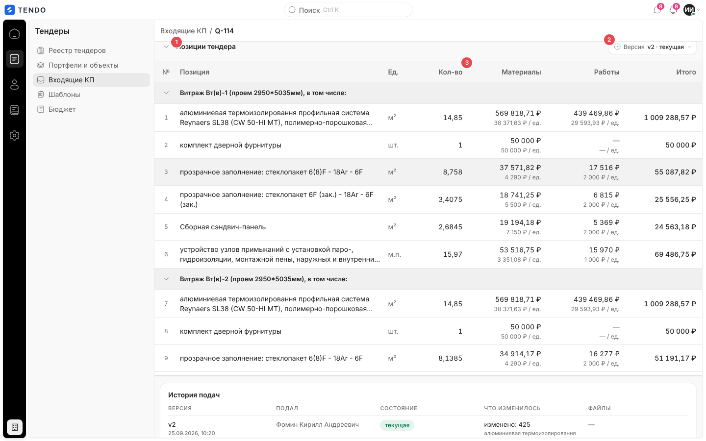

| № | Элемент | Поведение |
|---|---|---|
| ① | «Позиции тендера» + шеврон | Шеврон сворачивает/разворачивает всю таблицу |
| ② | Пилюля «Версия v2 · текущая» | Выбор версии подачи — см. ниже; при одной подаче — пилюля без меню (подсказка «Подача одна — переключать нечего») |
| ③ | Колонки | «№» (сквозной по смете, не сбивается при сворачивании), «Позиция», «Ед.», «Кол-во» (из запроса), «Материалы», «Работы», «Итого» (из ответа поставщика) |
| ④ | Итог (подвал таблицы) | «Итого» по материалам, работам и всего |

- Разделы — строки-заголовки на всю ширину левой части с шевроном сворачивания в колонке «№» (состояние сворачивания живёт до ухода со страницы и переживает смену версии). Подытогов разделов нет.
- Название позиции — до 2 строк, дальше многоточие; полное название и комментарий поставщика к позиции — во всплывающей подсказке.
- «Материалы»/«Работы» — сумма за позицию и второй строкой серым «N ₽ / ед.» (ставка за единицу); «Итого» — полужирным.
- Нет ответа по позиции — одна ячейка «нет ответа» на три денежные колонки; отказ поставщика — красная капсула «Отказ» у названия и «—» во всех деньгах.
- Подпись таблицы: «Позиций в запросе: N». Ширины колонок фиксированы (название — 38 %, деньги — равные доли).

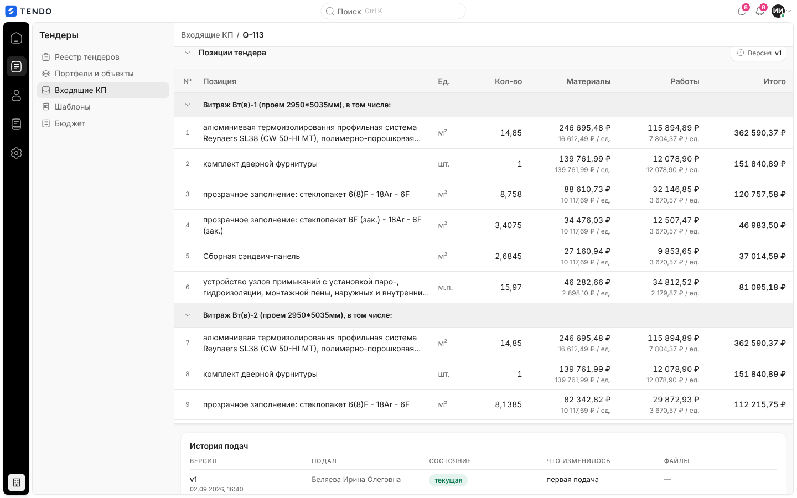

### Выбор версии

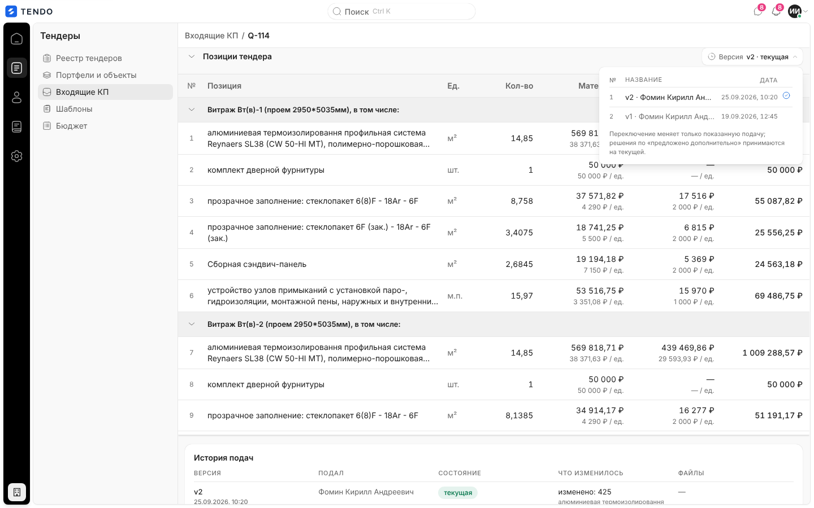

- Строки — от последней подачи к первой; «№» — порядок (1 — действующая), «Название» — «v2 · {автор подачи или название организации}», «Дата» — время подачи. Подсказка внизу: «Переключение меняет только показанную подачу; решения по «предложено дополнительно» принимаются на текущей.»
- Выбор перезапрашивает карточку `GET /quotes/{id}?version=N`; пока едет ответ, на экране остаётся прошлая версия (без мигания скелетоном). Меняются таблица позиций, сумма и её контекст, «Версия», «Подано», вложения; на нетекущей версии скрываются «Принять КП» / «Отклонить», решения по доп. позициям и применение сопоставления.

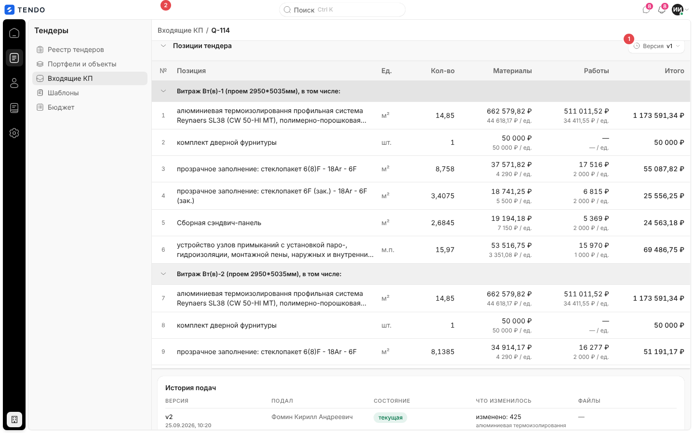

## История подач

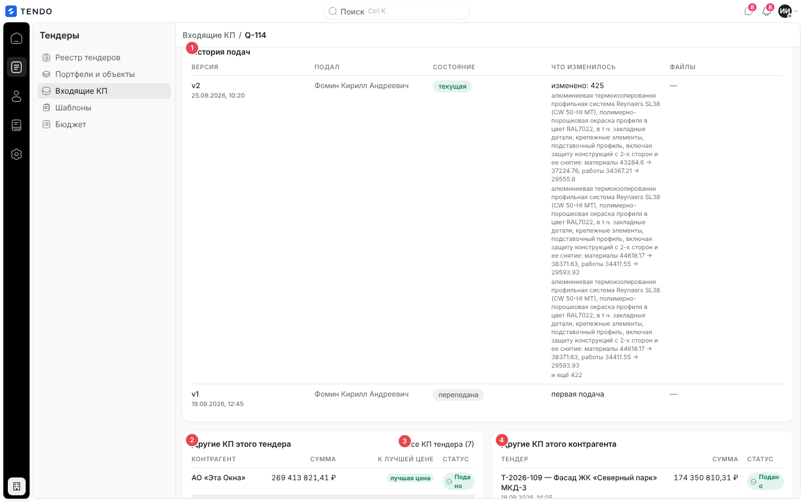

| № | Блок | Содержимое |
|---|---|---|
| ① | «История подач» | Таблица: «Версия» (v2 и время подачи), «Подал» (автор; если неизвестен — название организации; иначе «—»), «Состояние» («текущая» зелёная / «переподана» серая), «Что изменилось», «Файлы» (имена — кнопки скачивания через запятую или «—») |
| ② | «Другие КП этого тендера» | См. ниже |
| ③ | «Все КП тендера (N)» | Ссылка на входящие с фильтром по тендеру `/quotes?tender={id}` |
| ④ | «Другие КП этого контрагента» | См. ниже |

«Что изменилось» — словами, а не цветом: у первой подачи «первая подача»; без изменений — «без изменений»; иначе сводка «изменено: N · добавлено: N · снято: N» и до трёх строк деталей «{позиция}: материалы 100 → 120, работы …» и «и ещё N». Блок не показывается, если версий нет.

## Предложено дополнительно и сопоставление со сметой

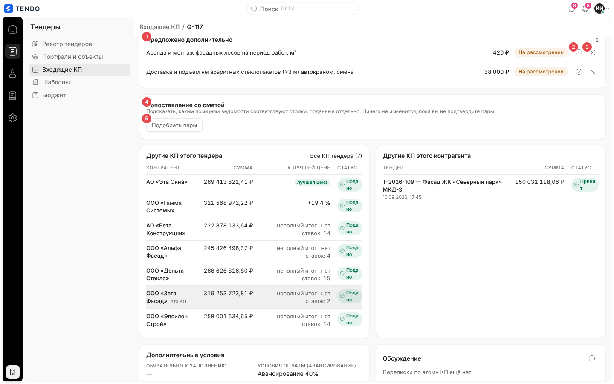

| № | Элемент | Поведение |
|---|---|---|
| ① | «Предложено дополнительно» · N | Позиции, которые поставщик добавил сверх ведомости: название (с многоточием, полное в подсказке), сумма, капсула решения «На рассмотрении» / «Принято» / «Отклонено». Блок только при наличии таких позиций |
| ② | «Принять позицию «…»» (галочка) | Сразу: `POST /tenders/{id}/quote-items/{item_id}/review` `{review_status: "accepted"}` → уведомление «Позиция принята», карточка перечитывается |
| ③ | «Отклонить позицию «…»» (крестик) | Окно «Отклонить позицию» с обязательной причиной — см. ниже |
| ④ | «Сопоставление со сметой» | Подсказка пар «строка КП → позиция ведомости» для этих же строк. Блок есть, только если есть доп. позиции |
| ⑤ | «Подобрать пары» | Запускает подбор (`GET /quotes/{id}/matching`, секунды; кнопка «Считаю…»). Ничего не меняет до подтверждения |

- Кнопки решения есть только у нерассмотренных позиций и только на текущей версии; ошибка — уведомление «Не удалось сохранить решение» / «Попробуйте ещё раз».
- Результат подбора: в заголовке — сводка «N строк сопоставлены уверенно, M требуют подтверждения»; по строке на пару: флажок с названием строки КП, позиция ведомости, капсула вердикта («сопоставлено уверенно» — зелёная, «требует подтверждения» — янтарная, «не сопоставлено» — серая), оценка близости «0.93», для спорных — «почему похожи» и «Отличается: …». Уверенные пары отмечены заранее, спорные — нет; несопоставленные недоступны для выбора. Внизу — строка порогов («уверенно ≥ 0.9, подтверждение ≥ 0.7») и «Применить (N)» → `POST /quotes/{id}/matching/apply` с выбранными парами → карточка перечитывается («Применяю…»). Ошибки — «Не удалось сопоставить строки» / «Не удалось применить сопоставление» красным под блоком.
- ИИ и подбор пар выключены (так на стенде): после «Подобрать пары» блок показывает «Сопоставление позиций выключено в этом окружении». Алгоритм и включение — [ai-features.md §3.3](../06-ai/ai-features.md#33-position_matching--сопоставление-строк-кп-с-ведомостью).

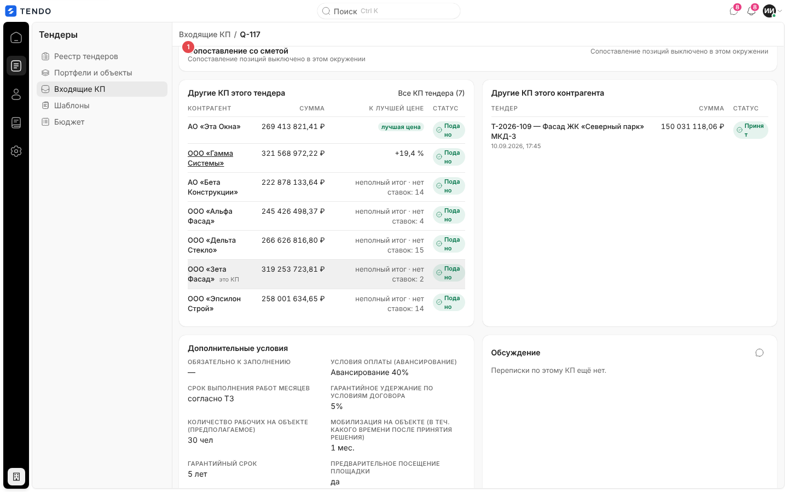

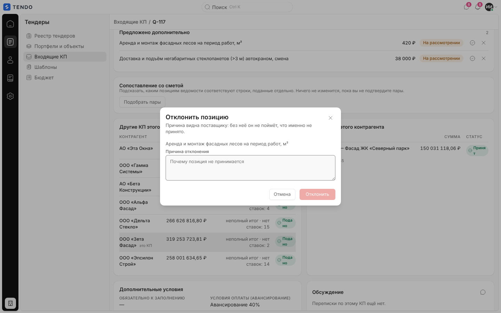

## Другие КП

**Другие КП этого тендера** (на снимке истории — ②): таблица «Контрагент · Сумма · К лучшей цене · Статус» по всем поданным КП тендера в порядке «Обзора» сравнения (полные — от дешёвого к дорогому, неполные — в конце). Текущее КП подсвечено, помечено «это КП» и не является ссылкой; остальные — ссылки на их карточки. «К лучшей цене»: «лучшая цена» (зелёная капсула) / «+19,4 %» / для неполного — «неполный итог · нет ставок: N» серым (процент у неполного не считается). Если других КП нет — «Других КП по этому тендеру пока нет».

**Другие КП этого контрагента**: «Тендер · Сумма · Статус» — его КП по другим тендерам доступных объектов (строка — ссылка на карточку КП, ниже время подачи). Пусто — «Других КП этого контрагента нет».

## Дополнительные условия и обсуждение

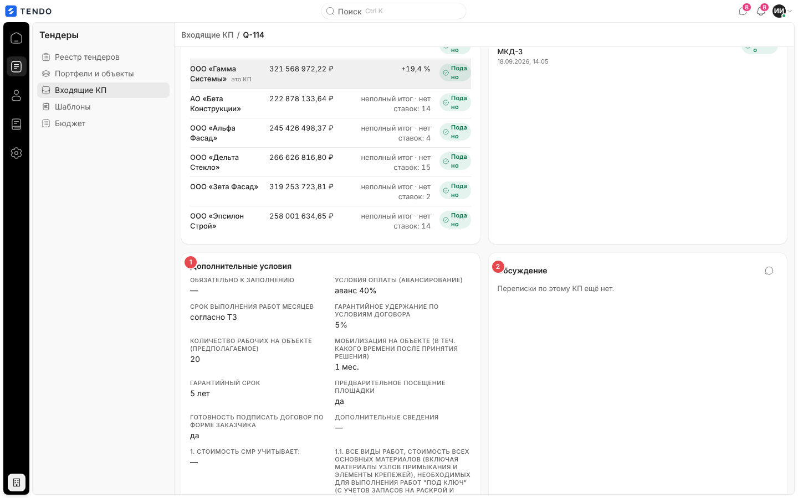

- **Дополнительные условия** (①): ответы поставщика на вопросы тендера — реквизиты в две колонки, подпись капителью над значением; длинный ответ (> 40 символов) занимает обе колонки; пустой ответ — «—». Блок только при наличии условий; тогда он стоит в паре с обсуждением, иначе обсуждение занимает ряд целиком.
- **Обсуждение** (②): внутренняя переписка сотрудников по КП (поставщику не видна). В блоке — последняя реплика (автор, время, текст) и «N записей в треде» или «Переписки по этому КП ещё нет.»; сбой загрузки — «Не удалось загрузить обсуждение.» + «Повторить». Кнопка-значок «Открыть обсуждение · N» / «Написать в обсуждение» раскрывает панель треда рядом с кнопкой.

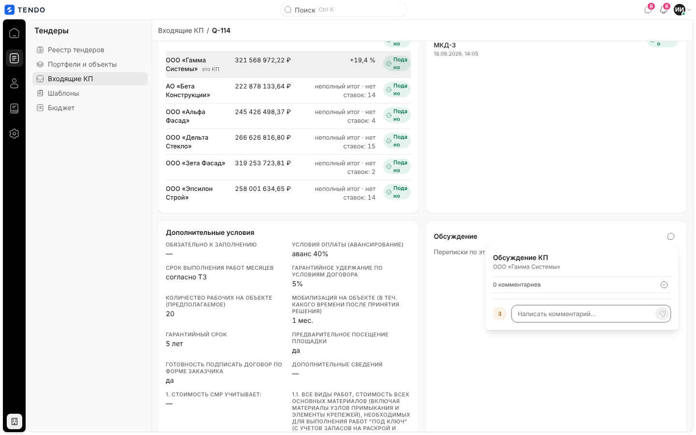

Панель — общий компонент переписки (тот же, что в ячейках сравнительной таблицы, см. [tender-card-comparison.md](tender-card-comparison.md)): список записей с одним уровнем ответов, поле ввода с кнопкой отправки; отправка `POST /comments` (`entity_type = quote`, при ответе — `parent_comment_id`), после успеха тред перечитывается; при отказе текст возвращается в поле. Отметок «прочитано» у обсуждения КП нет.

## Окна решений

### Запросить доработку

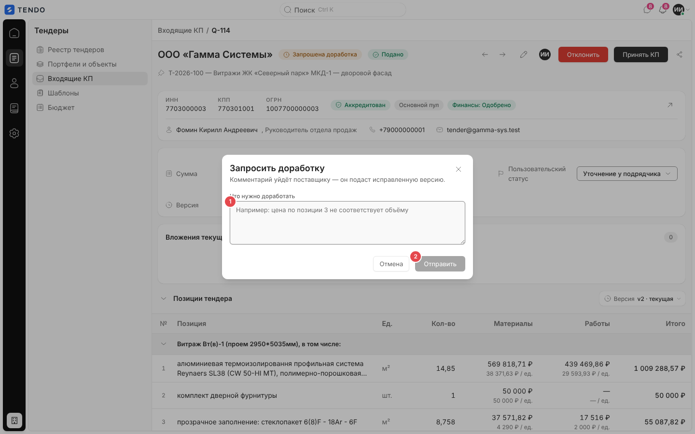

| Поле | Тип | Обязательность |
|---|---|---|
| «Что нужно доработать» | Многострочный текст, 4 строки, плейсхолдер «Например: цена по позиции 3 не соответствует объёму», фокус сразу в поле | Да: «Отправить» неактивна, пока поле пустое |

Описание окна: «Комментарий уйдёт поставщику — он подаст исправленную версию.» Кнопки «Отмена», «Отправить». Отправка: `POST /tenders/{tender_id}/quotes/{quote_id}/request-revision` `{comment}` → окно закрывается → уведомление «Доработка запрошена» / «Поставщик получит комментарий», карточка перечитывается (статус КП → «На доработке», появляется капсула «Запрошена доработка»); ошибка — «Не удалось отправить запрос».

### Отклонить КП

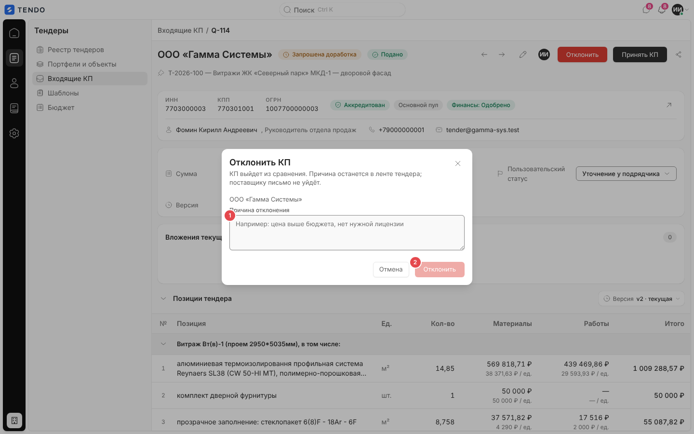

- Описание: «КП выйдет из сравнения. Причина останется в ленте тендера; поставщику письмо не уйдёт.» Над полем — название контрагента.
- Поле «Причина отклонения» (3 строки, плейсхолдер «Например: цена выше бюджета, нет нужной лицензии») — обязательно: «Отклонить» (красная) неактивна, пока пусто.
- Отправка: `POST /quotes/{id}/reject` `{comment}` → уведомление «КП отклонено», карточка перечитывается; ошибка — «Не удалось отклонить КП» + текст сервера, окно остаётся открытым.

### Принять КП

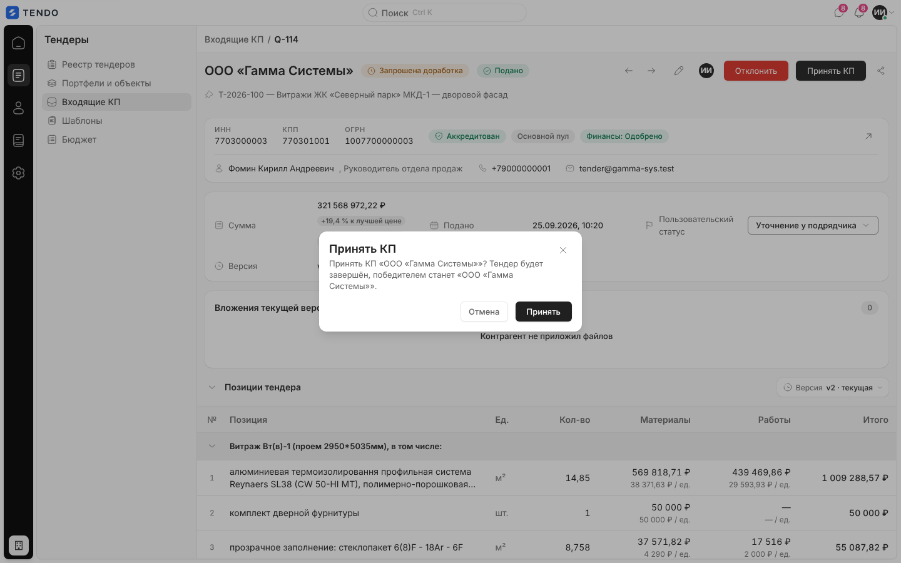

«Принять КП» — это **завершение тендера с этим победителем** (другого «принятия» в системе нет):

1. Подтверждение «Принять КП»: «Принять КП «{контрагент}»? Тендер будет завершён, победителем станет «{контрагент}».» Если контрагент не аккредитован, текст начинается с «Контрагент не аккредитован.» (предупреждение, не запрет). Кнопки «Отмена», «Принять».
2. Повторный ввод пароля (окно «Подтверждение действия»: «Завершить тендер и зафиксировать победителем «{контрагент}»? Отменить это действие нельзя — введите пароль.»). Пустой ввод или отмена — действие прерывается.
3. Запрос смены статуса тендера на «Завершён» с победителем и паролем в заголовке подтверждения — тот же, что из карточки тендера ([tender-card-lifecycle.md](tender-card-lifecycle.md#выбор-победителя)).
4. Успех — уведомление «КП принято» / «Тендер завершён», карточка перечитывается (КП → «Принят», кнопки решения исчезают). Отказ сервера (неверный пароль, нет права и т. п.) — окно-сообщение с текстом ошибки.

### Ответственный за тендер

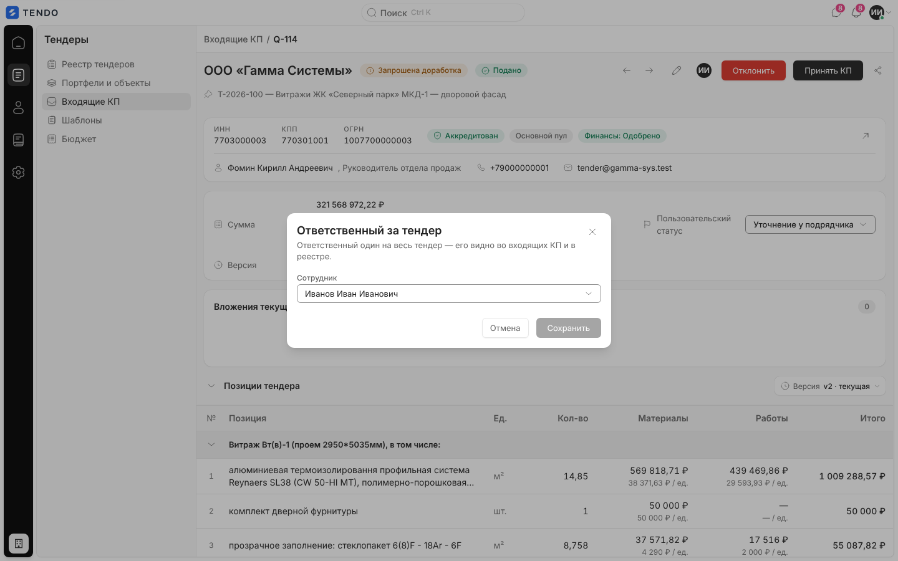

- Описание: «Ответственный один на весь тендер — его видно во входящих КП и в реестре.»
- Поле «Сотрудник» — выпадающий список действующих сотрудников (`GET /users/staff`), пустое значение «Не назначен» (снять ответственного). Пока список грузится — поле неактивно; сбой — «Не удалось загрузить сотрудников. Закройте окно и попробуйте ещё раз.»
- «Сохранить» активна, только если выбор отличается от текущего. Отправка: `PATCH /tenders/{tender_id}` `{responsible_user_id}` → уведомление «Ответственный назначен» / «Ответственный снят», карточка перечитывается; ошибка — «Не удалось назначить ответственного» + текст.

## Загрузка данных

- `GET /quotes/{id}` (или `?version=N`) — одна карточка: КП, тендер (номер, название, статус, ответственный), контрагент (реквизиты, аккредитация, пул, финансы при праве, контакт), `price_context`, `versions` (история с диффами и файлами), показанная `version`, `fkp` (версия ФКП подачи), `tender_items` с ответами, `new_items`, `condition_fields`, `totals`, `tender_quotes` (соседи и «Другие КП этого тендера»), `supplier_quotes`. Контракт — [endpoints-quotes.md](../04-api/endpoints-quotes.md#get-quotesquote_id).
- При открытии карточки — `POST /quotes/{id}/mark-viewed` (снимает флаг «новое» — флаг общий для всех сотрудников) и событие окна для счётчика новых КП в боковой панели; сбой отметки не мешает чтению.
- `GET /comments?entity_type=quote&entity_id={id}` — обсуждение (сбой не ломает карточку).
- Справочник пользовательских статусов КП.
- После любого решения карточка перечитывается целиком.

## Состояния

| Состояние | Что видит пользователь | Снимок |
|---|---|---|
| Загрузка | Скелетоны заголовка, подзаголовка и пяти строк таблицы; в крошках — id из адреса | 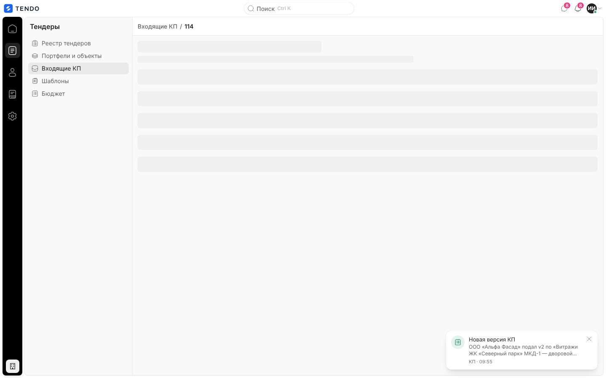 |
| КП не найдено (404) | Иллюстрация, код «404», «Такого КП нет», «Его удалили, или в ссылке ошибка. Все поданные предложения — во входящих КП.», кнопка «Во входящие КП» | 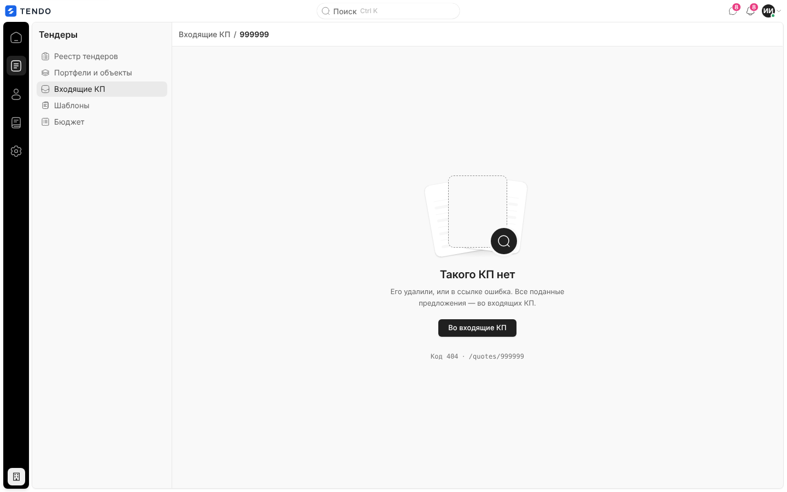 |
| Ошибка (5xx, 403, сеть) | «Карточка КП не загрузилась» + текст сервера или «Данные карточки не пришли. Попробуйте ещё раз.», кнопки «Повторить» и «Во входящие КП»; при обрыве сети — иллюстрация «нет связи» | 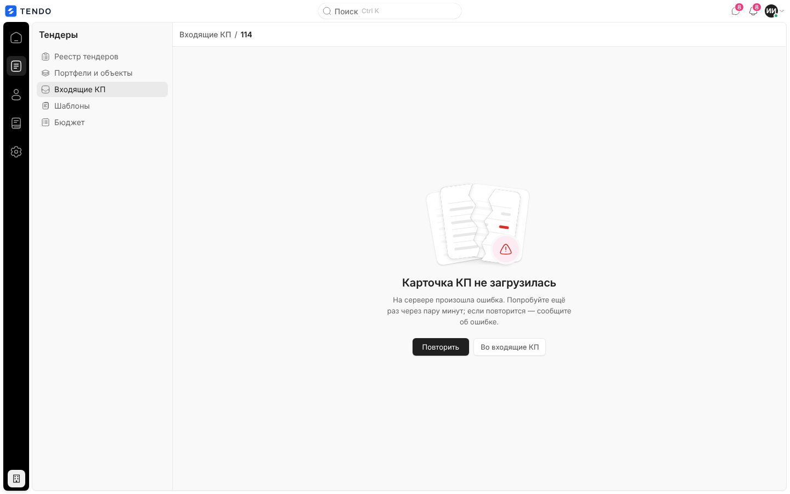 |
| Прошлая версия | Нет кнопок решения, нет решений по доп. позициям, применение пар недоступно | см. «Выбор версии» |
| Тендер завершён / отменён, КП принято / отклонено / отозвано | Нет «Принять КП» / «Отклонить»; карандаш доработки — только у статуса «Подано» |  |
| Нет доступа к разделу | СБ/юрист → `/home`; поставщик → `/cabinet` | — |

## Переходы

| Откуда | Куда |
|---|---|
| Крошка «Входящие КП», «Во входящие КП» | `/quotes` |
| Название контрагента | `/suppliers/{id}` |
| Строка тендера, значок «Открыть сравнение…» | `/tenders/{id}?supplier={id}` (карточка тендера; параметр `supplier` экраном тендера сейчас не обрабатывается — см. [открытые вопросы](../_oq/SCR-2b.md)) |
| «Досье контрагента» | `/tenders/{id}?dossier={supplier_id}` |
| «Предыдущее / Следующее КП», строки «Других КП» | `/quotes/{id}` |
| «Все КП тендера (N)» | `/quotes?tender={id}` |

## Сложность

**L**: шапка с контекстом цены и блоком контрагента — M; таблица позиций с версиями и свёрткой — M; история подач с диффом — S; доп. позиции и сопоставление (UI) — M; окна решений (доработка, отклонение, принятие с паролем, ответственный, статус) — M; соседние КП и обсуждение — S.
