# Входящие КП (`/quotes`)

«Почтовый ящик» коммерческих предложений по всем тендерам доступных объектов: по строке на КП (текущая версия), вкладки «Все / Новые», поиск, фильтры (статус, сумма, дата подачи, тендер, контрагент, объект, вид работ, ответственный, пользовательский статус), сортировка и выбор колонок. Отсюда открывают карточку КП.

Связанные разделы: бизнес-логика КП и «нового» — [../02-business-logic/tenders-quotes.md](../02-business-logic/tenders-quotes.md); API — [../04-api/endpoints-quotes.md](../04-api/endpoints-quotes.md#get-quotes); пользовательские статусы КП — [../04-api/endpoints-catalog.md](../04-api/endpoints-catalog.md#статусы-тендеров-и-кп); карточка — [quote-card.md](quote-card.md); главная («Новые КП») — [home.md](home.md#таблица-новые-кп).

> Круглый значок в правом нижнем углу снимков — инструмент отладки dev-сборки стенда, в продукт не входит.

## Маршрут

- `/quotes` — вкладка «Все»; `/quotes?new=1` — вкладка «Новые». Вкладка живёт **в адресе**: на неё ведут ссылки «новых КП: N», и обновление страницы её не сбрасывает.
- `/quotes?tender={id}` — готовый фильтр по тендеру (ссылка «Все КП тендера» из карточки КП): параметр превращается в обычный фильтр окна «Фильтры» и **снимается из адреса**; если КП этого тендера нет среди строк, параметр просто гасится.
- Фильтры, поиск и сортировка в адрес не пишутся. Набор видимых колонок запоминается в браузере пользователя.

## Назначение

Увидеть всё, что подали поставщики, в одном месте — свежее сверху, с пометкой «Новое» у непросмотренного, — отобрать нужное (по тендеру, объекту, статусу, сумме, дате) и перейти в карточку КП для решения.

## Роли и права

| Роль | Доступ |
|---|---|
| Тендерный специалист | Да — КП по тендерам объектов, к которым выдан доступ; требуется право `quotes.manage` (по умолчанию есть) |
| Администратор | Да — по всем объектам |
| СБ, юрист | Нет: пункт скрыт, прямой переход → `/home` |
| Поставщик, лид, владелец площадки | Нет: перенаправление на свой стартовый экран |

Сервер отвечает 403, если у роли нет права `quotes.manage` (см. [endpoints-quotes.md](../04-api/endpoints-quotes.md)); экран тогда показывает состояние ошибки.

## Как попасть

- Рейл «Тендеры» → «Входящие КП» (с красным счётчиком новых КП в боковой панели).
- «Все входящие →» и чип «N новых КП» на главной.
- Крошка «Входящие КП» и кнопка «Во входящие КП» в карточке КП; ссылка «Все КП тендера (N)» в карточке КП (с фильтром по тендеру).

## Общая компоновка

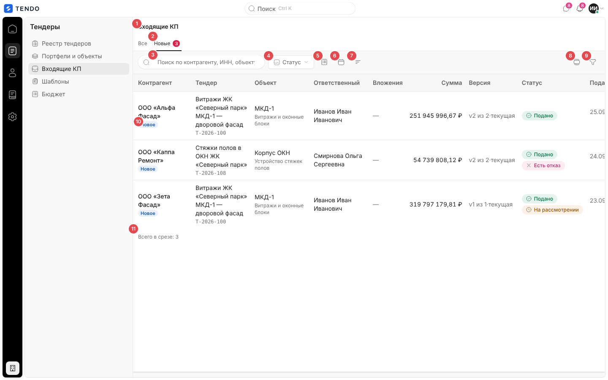

| № | Элемент | Поведение |
|---|---|---|
| ① | Заголовок «Входящие КП» | — |
| ② | Вкладки «Все · Новые (N)» | «Новые» — пресет поверх фильтров: только КП с флагом «новое»; счётчик — сколько их (с учётом открытых в этой сессии) |
| ③ | Поиск «Поиск по контрагенту, ИНН, объекту или файлу» | Подстрока без учёта регистра по названию контрагента, номеру и названию тендера, ИНН, объекту и именам приложенных файлов |
| ④ | «Статус» | Мультивыбор статусов КП |
| ⑤ | «Сумма» (значок) | Диапазон суммы «от / до» |
| ⑥ | «Дата подачи» (значок календаря) | Диапазон дат подачи |
| ⑦ | «Сортировка» (значок) | Порядок строк |
| ⑧ | «Колонки» (значок) | Какие колонки показывать |
| ⑨ | «Фильтры» (воронка) | Окно расширенного фильтра |
| ⑩ | Метка «Новое» | Синяя капсула второй строкой под контрагентом у непросмотренного КП |
| ⑪ | Подпись таблицы | «Всего в срезе: N» / «Показано N из M» |

При активных фильтрах между «Сортировкой» и «Колонками» появляется крестик «Сбросить фильтры · N».

### Автовыбор вкладки

- Первый заход без параметров: как только список пришёл и в нём есть новые КП, экран сам переходит на «Новые» (дописывает `?new=1`, заменяя запись истории). Автовыбор срабатывает **один раз** за жизнь экрана и не срабатывает, если пользователь уже выбрал вкладку или пришёл с `?new=1` / `?tender=`.
- Выбор вкладки пользователем записывается в адрес (без новой записи истории).

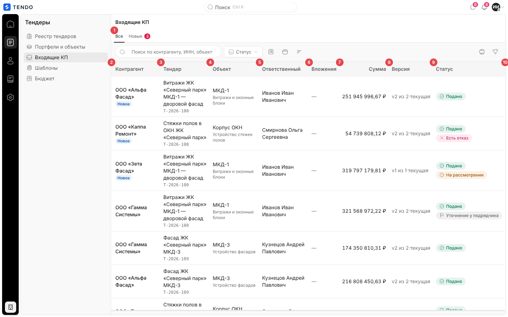

## Колонки

| № на снимке | Колонка | Содержимое | Можно скрыть |
|---|---|---|---|
| ② | Контрагент | Название — ссылка на карточку КП; второй строкой — «Новое» у непросмотренного | Нет (колонка-якорь) |
| ③ | Тендер | Название тендера; второй строкой моноширинным — номер | Да |
| ④ | Объект | Название объекта (проекта); второй строкой — вид работ тендера; нет объекта — «—» | Да |
| ⑤ | Ответственный | ФИО ответственного за тендер или «—» | Да |
| ⑥ | Вложения | «N файл(ов)» (подсказка — имена файлов) или «—»; сами файлы — в карточке | Да |
| ⑦ | Сумма | Итог текущей версии, `251 945 996,67 ₽`, выравнивание вправо | Да |
| ⑧ | Версия | «v2 из 2» и «· текущая», если показана последняя версия | Да |
| ⑨ | Статус | Капсула статуса КП + (если задан) капсула пользовательского статуса + «На рассмотрении» (жёлтая, есть предложенная поставщиком новая позиция без решения) + «Есть отказ» (красная, поставщик отказался от части позиций) | Да |
| ⑩ | Подано | Дата `ДД.ММ.ГГГГ`, второй строкой время `ЧЧ:ММ` (московское); у черновика — «—» | Да |

Статусы КП:

| Код | Подпись | Тон / значок |
|---|---|---|
| `draft` | Черновик | нейтральный, документ |
| `submitted` | Подано | зелёный, галочка |
| `revision_requested` | На доработке | янтарный, часы |
| `accepted` | Принят | зелёный, галочка (КП победителя — так его помечает закрытие тендера) |
| `rejected` | Отклонено | красный, крестик (отклонено специалистом целиком) |
| `withdrawn` | Отозвано | красный, крестик |

Незнакомый код статуса показывается нейтральной капсулой с самим кодом (экран не падает).

- Кликабельна вся строка — открывает карточку КП `/quotes/{id}`; настоящая ссылка — на названии контрагента.
- При открытии **нового** КП метка «Новое» гаснет сразу (локально), вызывается `POST /quotes/{id}/mark-viewed`, счётчик новых в боковой панели обновляется. Сбой отметки не мешает открытию.
- Массовых действий и выбора строк нет.
- Пагинации нет: список приходит целиком, а таблица рисует только видимое окно строк (виртуализация, ориентир высоты строки 52 px), шапка таблицы липкая.

### Меню «Колонки»

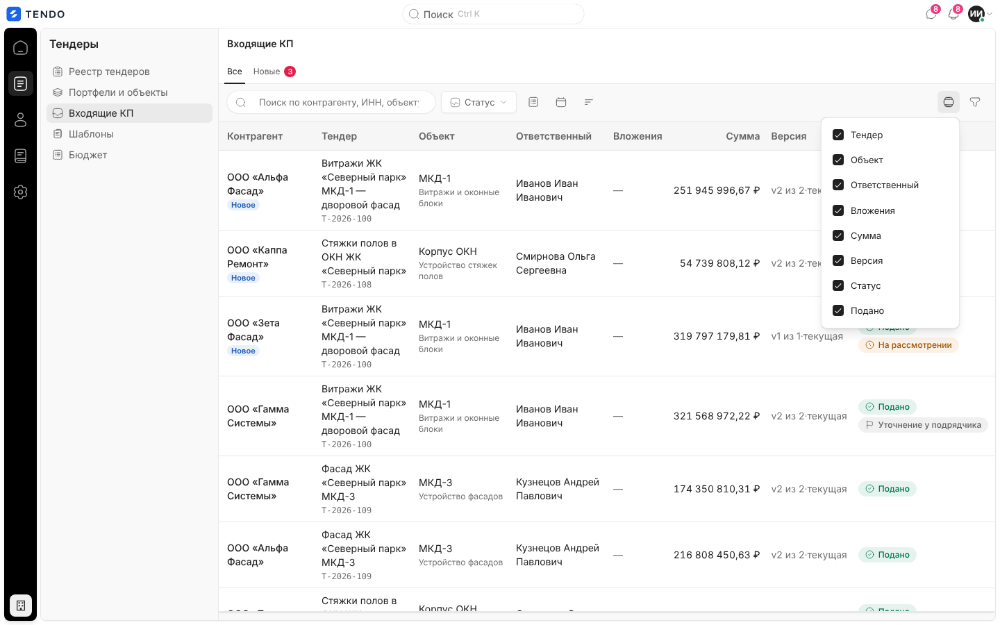

- Флажки по всем колонкам, кроме «Контрагент» (её скрыть нельзя, в меню её нет). Меню не закрывается по клику.
- Подвал «Показать все колонки» появляется, когда что-то скрыто; кнопка подсвечивается и подписывается «Колонки · скрыто N».
- Выбор хранится в браузере пользователя (версионированный ключ: при появлении новой колонки старый сохранённый набор не прячет её навсегда).

## Фильтры, поиск, сортировка

Все условия складываются через «И»; пустой список фильтром не является. Фильтрация — на клиенте по всему пришедшему срезу; поле ввода не ждёт таблицу.

### Статус

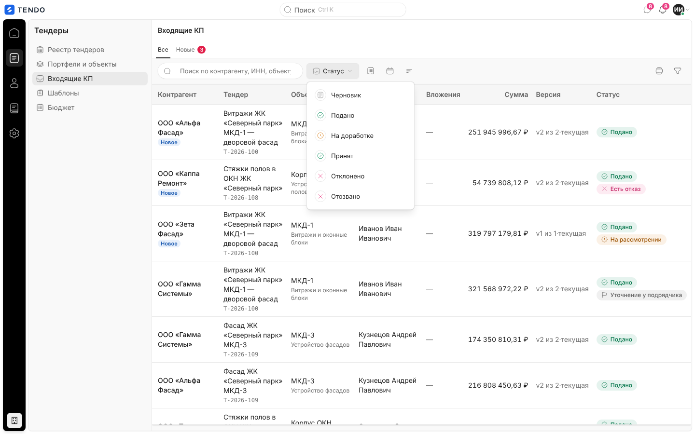

Мультивыбор шести статусов; подпись кнопки «Статус» / «Статус · N», при одном выбранном — его капсула; в подвале «Очистить статусы · N».

### Сумма

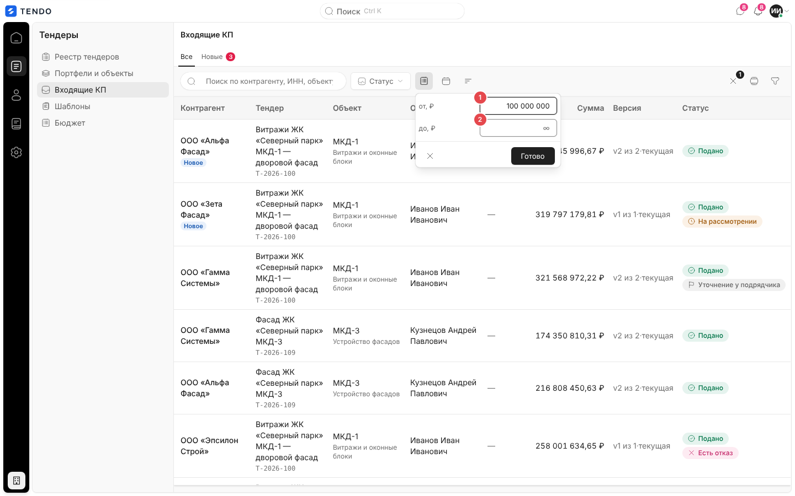

| № | Поле | Формат |
|---|---|---|
| ① | от, ₽ | Число с разделением разрядов при вводе (`100 000 000`), допускается десятичная запятая; плейсхолдер «0» |
| ② | до, ₽ | То же; плейсхолдер «∞» |

- Границы включительные; пустая граница — открытая; нечисловой ввод фильтром не считается.
- Подвал: «Очистить сумму», «Готово». Кнопка-значок подсвечивается, подсказка — «Сумма: от 100 млн» / «1,5 млн – 3 млн» (компактная запись).

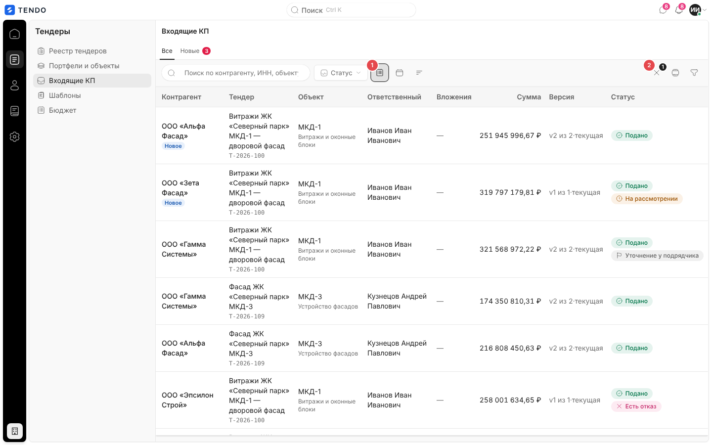

### Дата подачи

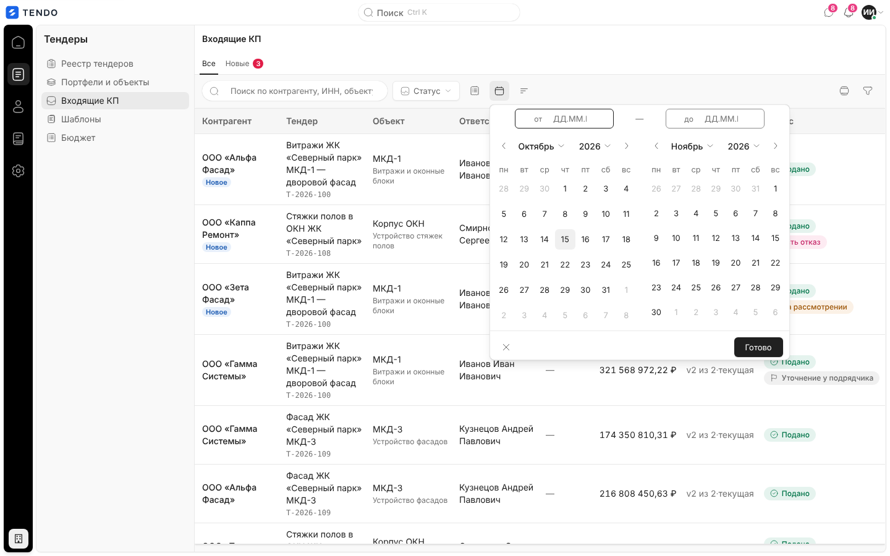

Тот же календарь диапазона, что в реестре тендеров ([tenders-registry.md](tenders-registry.md#фильтр-дат)): две независимые границы, ручной ввод `ДД.ММ.ГГГГ`, два месяца. Сравнивается московский день подачи текущей версии; КП без даты подачи не попадает в срез с верхней границей. Подвал — «Очистить период», «Готово»; на кнопке — точка-индикатор.

### Сортировка

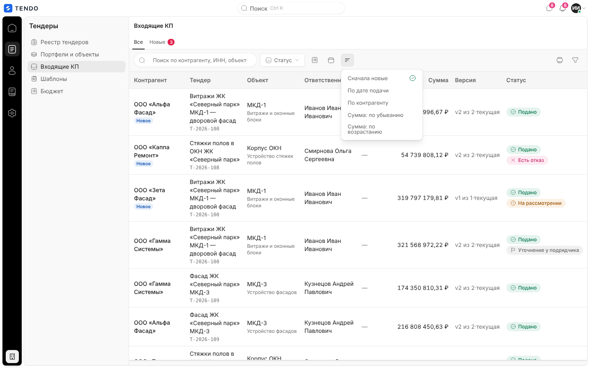

| Вариант | Порядок |
|---|---|
| Сначала новые (по умолчанию) | Новые выше, внутри групп — по времени подачи, свежие сверху |
| По дате подачи | Свежие сверху |
| По контрагенту | По алфавиту, при равенстве — свежие сверху |
| Сумма: по убыванию / по возрастанию | По итогу, при равенстве — свежие сверху |

КП без даты подачи — в конце. Одиночный выбор, меню закрывается; выбранный пункт отмечен галочкой.

### Расширенный фильтр

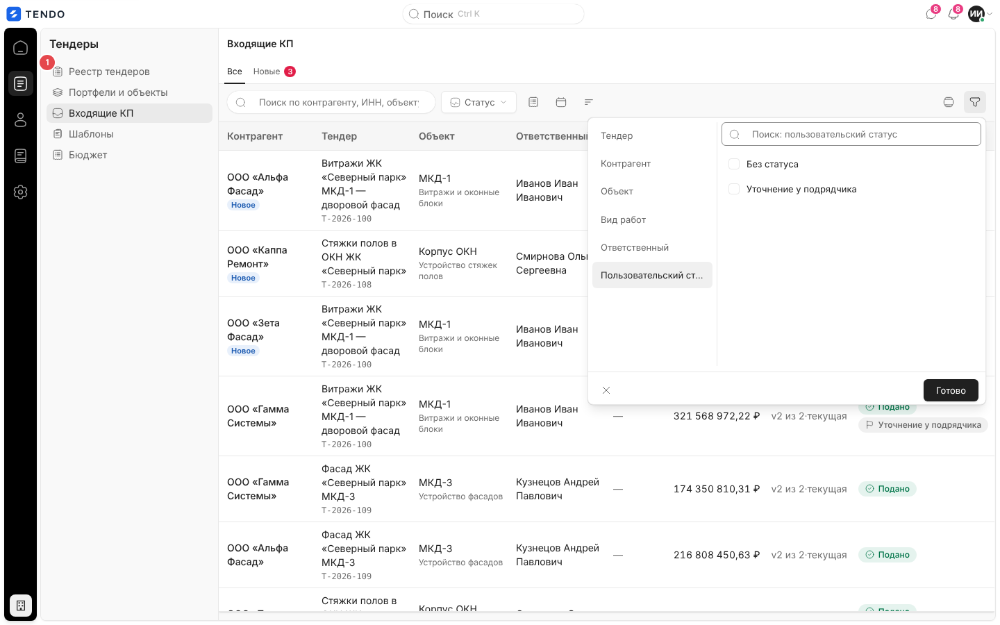

| Критерий | Значения |
|---|---|
| Тендер | «T-2026-100 — Название» по всем тендерам, у которых есть КП (по алфавиту) |
| Контрагент | Названия контрагентов |
| Объект | Названия объектов |
| Вид работ | Строка видов работ тендера |
| Ответственный | ФИО |
| Пользовательский статус | «Без статуса» (первым, всегда) + все **действующие** статусы справочника КП в порядке справочника + архивные, которыми помечены пришедшие КП. Критерий виден, только если в справочнике есть статусы |

- Значения выводятся из пришедших строк (кроме пользовательских статусов — из справочника); критерии без значений не показываются.
- Поведение окна — как в реестре тендеров: поиск по значениям, «Снять N», «Очистить всё · N», «Готово».
- Готовый фильтр по тендеру из адреса (`?tender=`) ставится в этот же критерий и снимается обычным образом.

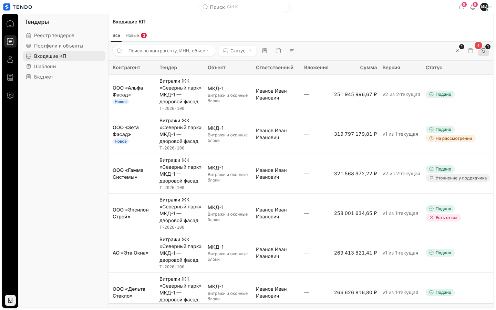

### Сброс и пустой результат

- «Сбросить фильтры · N» сбрасывает поиск, статусы, сумму, дату и все критерии окна (N: сумма — один фильтр, статусы — один, период — один, поиск — один, каждый критерий окна — один). Вкладку не трогает.
- Пусто по фильтрам: строка «Под фильтры не подошло ни одно КП.» + «Сбросить фильтры» (кнопка — только если есть активные фильтры).
- Пусто на вкладке «Новые» без фильтров: «Непросмотренных КП нет — все поступившие уже открыты.»

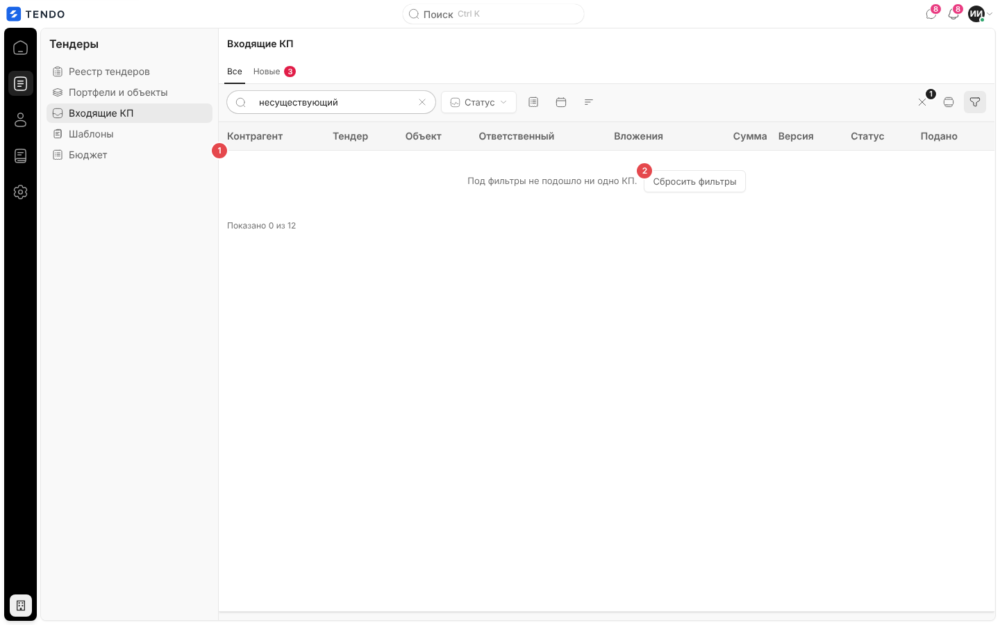

## Данные

- `GET /quotes` без параметров — весь срез доступных КП одним ответом: `items`, `new_count`, `total` ([endpoints-quotes.md](../04-api/endpoints-quotes.md#get-quotes)). Серверные фильтры ручки (`custom_status_code`, `project_id`, `work_type_id`, `responsible_user_id`, `date_from/date_to`, `limit/offset`) экраном не используются — всё фильтруется на клиенте.
- Словарь пользовательских статусов КП (`GET /statuses?entity_type=quote…`) — подписи, цвета капсул и критерий фильтра; сбой словаря не ломает таблицу (нет критерия и капсулы).
- `POST /quotes/{id}/mark-viewed` — при открытии нового КП из списка (и при открытии карточки); после него экран рассылает событие окна, по которому обновляется счётчик новых в боковой панели.

## Состояния

| Состояние | Что видит пользователь | Снимок |
|---|---|---|
| Загрузка | Шесть полос-скелетонов на месте строк | 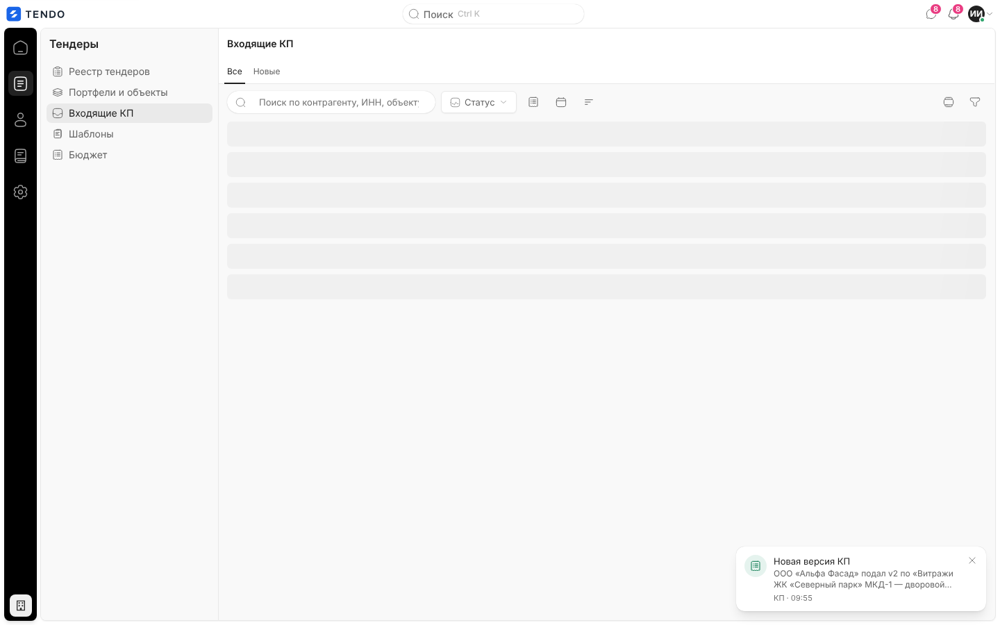 |
| Пусто (КП нет вовсе) | Иллюстрация «Входящих КП пока нет», «Они появятся здесь после подачи по ссылке приглашения.», ссылка «К реестру тендеров» | 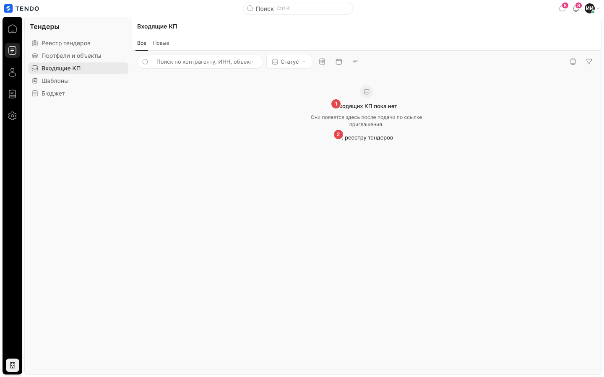 |
| Пусто по фильтрам / на вкладке «Новые» | См. выше | см. выше |
| Ошибка | «Список КП не загрузился», «Входящие коммерческие предложения не приехали. Фильтры при этом настроены.», «Повторить» | 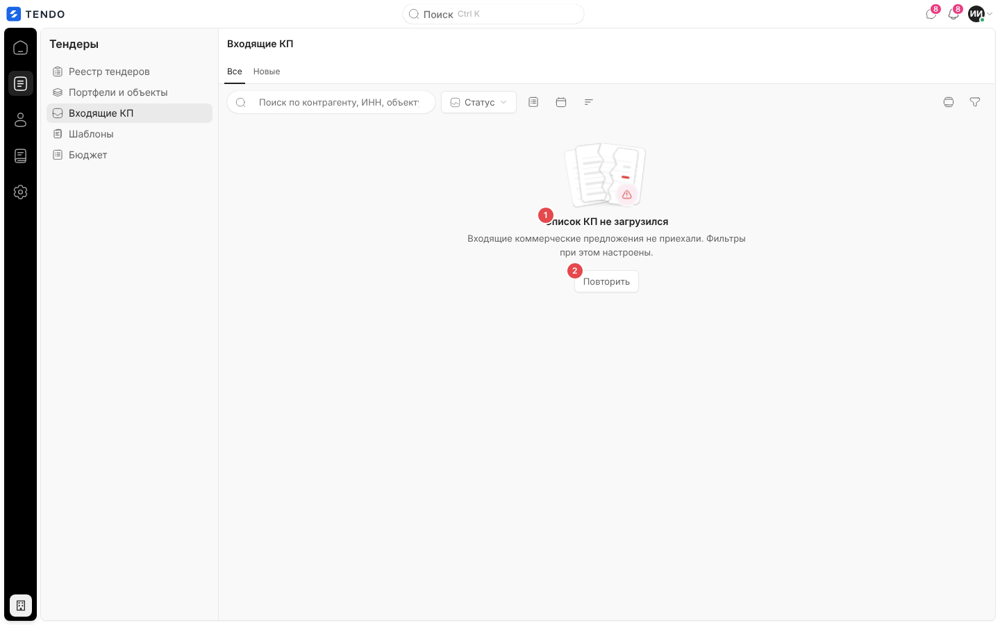 |
| Нет доступа | СБ/юрист → `/home`; поставщик → `/cabinet` | — |

## Переходы

| Откуда | Куда |
|---|---|
| Строка / название контрагента | `/quotes/{id}` (карточка КП) |
| «К реестру тендеров» (пустое состояние) | `/tenders` |

## Сложность

**M**: таблица с виртуализацией и липкой шапкой — S–M; полоса фильтров (статус, сумма с форматированием ввода, период, сортировка, окно критериев, колонки с хранением) — M; вкладка в адресе с автовыбором и готовым фильтром по тендеру — S; снятие «нового» и синхронизация счётчика — S.
