# Анкета саморегистрации контрагента (`/register`)

Публичная пятишаговая анкета, которую контрагент заполняет по ссылке-приглашению без учётной записи: реквизиты и выручка → виды работ и опыт договоров → контактные лица → документы → пароль от кабинета и согласие на обработку ПДн. По итогу создаются карточка контрагента в реестре, учётная запись личного кабинета, документы загружаются, анкета уходит на аккредитацию.

Связанные разделы: процесс регистрации и аккредитации — [../02-business-logic/suppliers.md](../02-business-logic/suppliers.md); API — [../04-api/endpoints-suppliers-registration.md](../04-api/endpoints-suppliers-registration.md) (проверка ссылки, справочник видов работ, отправка, файлы, финализация); выдача ссылок сотрудником — [questionnaires.md](questionnaires.md); кабинет после регистрации — [cabinet.md](cabinet.md); правила полей — общие валидаторы ИНН/ОГРН/КПП/телефона/email/адреса/даты ([../02-business-logic/suppliers.md](../02-business-logic/suppliers.md)), опыт договоров — [../04-api/endpoints-suppliers.md](../04-api/endpoints-suppliers.md#опыт-работ).

## Маршрут, роли, как попасть

- `/register?token=<токен приглашения>` — публичный, вне гейта входа, с **публичным каркасом** (см. ниже). Заголовок вкладки: «Регистрация контрагента» (проверка), «Ссылка не работает», «Анкета отправлена», на форме — «<Название шага> · Регистрация контрагента».
- Доступ решает **токен приглашения**, роль не важна (открыть может кто угодно со ссылкой, в т. ч. вошедший сотрудник).
- Ссылку выдаёт сотрудник на экране «Анкеты» ([questionnaires.md](questionnaires.md)) или в карточке контрагента и передаёт контрагенту сам (письмом, в мессенджере). Режимы ссылки: одноразовая (гаснет после первой регистрации) и многоразовая (до отзыва).

## Публичный каркас

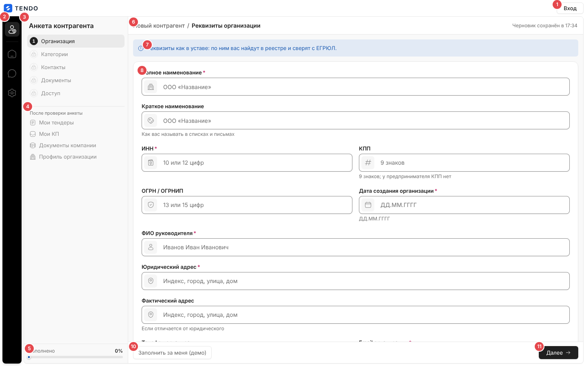

| № | Элемент | Поведение |
|---|---|---|
| ① | Полоса: логотип продукта, кнопка «Вход» (вторичная) | «Вход» → `/login` |
| ② | Рейл | Активный значок «регистрация» и разделы будущего кабинета («Кабинет», «Чаты», «Настройки») под замком с подсказкой «<раздел> — откроется после проверки анкеты»; не кликаются, клавиатура их пропускает |
| ③ | Панель «Анкета контрагента» | Шаги 1–5 («Организация», «Категории», «Контакты», «Документы», «Доступ»): пройденный — зелёная галочка и кликабелен; текущий — номер, выделен, при ошибках — красный счётчик полей с ошибкой; ещё не открытый — замок и подсказка «Откроется, когда будут заполнены предыдущие шаги» |
| ④ | «После проверки анкеты» | Справочный список под замком: «Мои тендеры», «Мои КП», «Документы компании», «Профиль организации» |
| ⑤ | «Заполнено N %» и полоса | Доля заполненности анкеты: 6 обязательных полей шага 1 + выручка за 3 года + хотя бы один вид работ + контакт с ФИО и email + согласие на ПДн + пароль ≥ 8 символов (11 проверок; документы не учитываются); 100 % — полоса зелёная |
| ⑥ | Хлебные крошки | Корень — краткое/полное название организации по мере ввода (пока пусто — «Новый контрагент»), затем пройденные шаги (кликабельны) и текущий шаг полным названием. Справа — «Черновик сохранён в ЧЧ:ММ» |
| ⑦ | Полоса-введение шага | Одна строка о том, откуда данные (тексты ниже) |
| ⑧ | Поля шага | Широкие поля в 2 колонки; у каждого поля значок слева: серый — пусто, синий — заполнено |
| ⑨ | Блок выручки | Только шаг 1 |
| ⑩ | «Заполнить за меня (демо)» | Только при флаге сборки `VITE_DEMO_TOOLS=1`: заполняет всю анкету валидными данными (включая тестовые файлы и пароль) и переводит на последний шаг с плашкой «Анкета заполнена демо-данными. Проверьте шаги слева и отправьте анкету. Вход в кабинет — <email>, пароль <…>.» |
| ⑪ | Нижняя полоса действий (не прокручивается) | «← Назад» (со 2-го шага), капсула «Одно поле требует внимания» / «Полей с ошибкой: N», «Далее →» или на последнем шаге «Отправить анкету» |

Под карточкой полей — лента заметок шага (тексты ниже). Шаг меняется с анимацией въезда.

### Навигация по шагам

- «Далее» проверяет **текущий** шаг; при ошибках остаётся на шаге, поля подсвечиваются, ошибка поля снимается при начале правки этого поля. Успех — открывает следующий шаг.
- Назад и на любой пройденный шаг (панель, крошки) — без проверки.
- «Отправить анкету» перепроверяет **все** шаги: при ошибке открывает первый шаг с ошибкой, прокручивает к первому полю и ставит фокус.

### Черновик

- Анкета автоматически сохраняется в браузере (localStorage) через 600 мс после каждого изменения вместе с текущим шагом; пароль и сами файлы не сохраняются (только имена файлов).
- При повторном открытии на первом шаге — плашка «Черновик восстановлен. Заполнение от ДД.ММ.ГГГГ продолжается с того же места. Начать заново» (крестик закрывает плашку). «Начать заново» — подтверждение «Очистить сохранённый черновик и начать заполнение заново?» и сброс формы.
- Черновик один на браузер (не по токену). После успешной отправки удаляется.

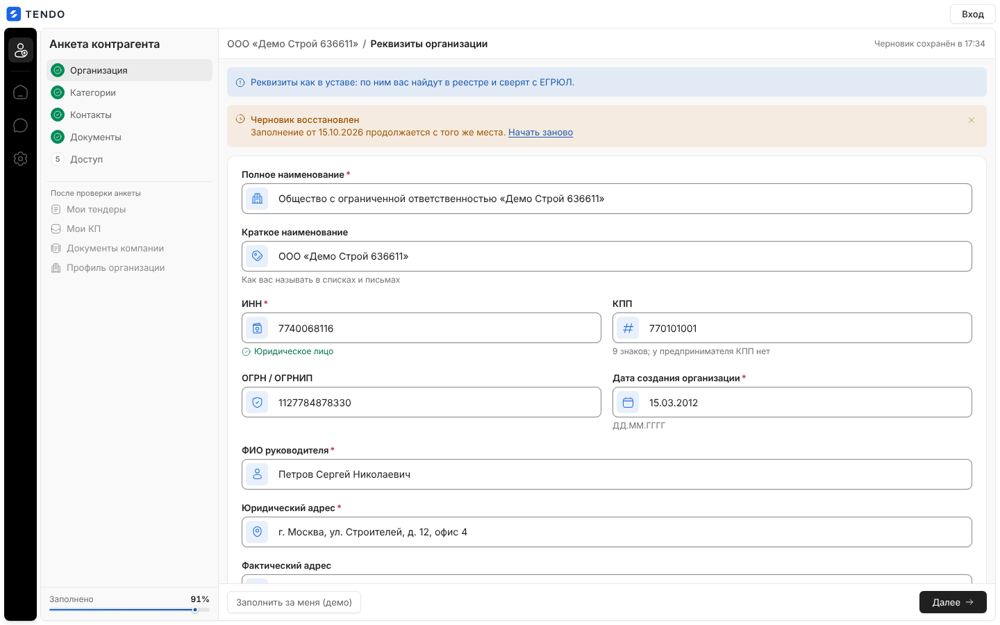

## Шаг 1 — «Реквизиты организации»

Введение: «Реквизиты как в уставе: по ним вас найдут в реестре и сверят с ЕГРЮЛ.»

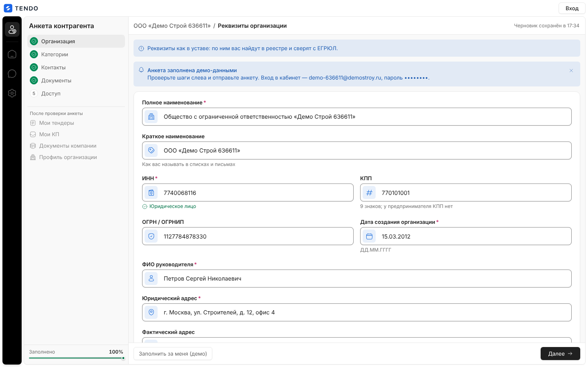

| Поле | Тип / маска | Обяз. | Подсказка | Ошибки |
|---|---|---|---|---|
| Полное наименование | текст, плейсхолдер «ООО «Название»» | да | — | «Укажите полное наименование организации» |
| Краткое наименование | текст | нет | «Как вас называть в списках и письмах» | — |
| ИНН | только цифры (нецифровые символы отбрасываются), до 12 | да | после 10 цифр — «✓ Юридическое лицо», после 12 — «✓ Индивидуальный предприниматель» | «Укажите ИНН»; «ИНН состоит только из цифр»; «ИНН должен содержать 10 цифр у организации или 12 у индивидуального предпринимателя»; «Проверьте ИНН: первые две цифры — код региона, 00 не бывает»; «Проверьте ИНН: контрольная цифра не сходится, скорее всего опечатка» (12 цифр — «контрольные цифры не сходятся…») |
| КПП | до 9 знаков, верхний регистр, без пробелов | нет | «9 знаков; у предпринимателя КПП нет» | «КПП состоит из 9 знаков»; «Проверьте КПП: цифры, кроме 5-й и 6-й позиции»; «Проверьте КПП: 5-я и 6-я позиции — цифры или латинские буквы A-Z»; «Проверьте КПП: первые две цифры — код региона, 00 не бывает» |
| ОГРН / ОГРНИП | только цифры, до 15 | нет | — | «ОГРН состоит только из цифр»; «ОГРН содержит 13 цифр, ОГРНИП — 15»; «Проверьте ОГРН: первая цифра — признак регистрации, нулём она не бывает»; «Проверьте ОГРН: 4-я и 5-я цифры — код региона, 00 не бывает»; «Проверьте ОГРН: контрольная цифра не сходится, скорее всего опечатка» (для 15 цифр — «Проверьте ОГРНИП: …»); согласованность с ИНН: «У организации (ИНН из 10 цифр) ОГРН содержит 13 цифр — здесь указан ОГРНИП», «У предпринимателя (ИНН из 12 цифр) номер называется ОГРНИП и содержит 15 цифр» |
| Дата создания организации | `ДД.ММ.ГГГГ` (до 10 символов) + календарь по клику (будущие даты недоступны) | да | «ДД.ММ.ГГГГ» | «Укажите дату создания организации»; «Формат даты: ДД.ММ.ГГГГ»; «Укажите корректный год: не ранее 1900»; «Дата создания не может быть в будущем» |
| ФИО руководителя | текст, плейсхолдер «Иванов Иван Иванович» | да | — | «Укажите ФИО руководителя» |
| Юридический адрес | текст, плейсхолдер «Индекс, город, улица, дом» | да | — | «Укажите юридический адрес»; «Слишком длинный юридический адрес: не больше 500 символов»; «Слишком короткий юридический адрес — укажите город, улицу и номер дома» (< 10 символов); «Укажите юридический адрес словами, а не одними цифрами»; «В поле «юридический адрес» не хватает номера дома»; «Укажите юридический адрес полностью: город, улица, дом» (< 3 слов) |
| Фактический адрес | то же | нет | «Если отличается от юридического» | те же правила со словами «фактический адрес» |
| Телефон организации | телефон, плейсхолдер «+7 (___) ___-__-__»; при уходе из поля приводится к виду «+7 900 111-22-33» | нет | — | «Укажите телефон без добавочного номера»; «Телефон может содержать только цифры, пробелы и знаки + ( ) -»; «Код страны +8 не существует: для России укажите +7»; «Российский телефон — это 10 цифр после +7, например +7 900 111-22-33»; «Проверьте код города или оператора: он не может начинаться с 0, 1 или 2»; «Проверьте телефон: одинаковые цифры — это не номер»; «Телефон должен содержать от 8 до 15 цифр вместе с кодом страны» |
| Email организации | email; при уходе из поля — нижний регистр, без пробелов | да | «Станет логином в личный кабинет» | «Укажите email — он станет логином в личный кабинет»; «Укажите корректный email — он станет логином в личный кабинет» (домен верхнего уровня ≥ 2 букв); «Email длиннее 254 символов» |

**Блок выручки** — заголовок «Выручка за <Г-1>, <Г-2> и <Г-3> годы, тыс. ₽», пояснение «Укажите выручку за три последних завершённых года, тыс. ₽. Допустим ноль, если компания не вела деятельность.»; три обязательных поля «<год> год» (плейсхолдер «0,00»). Ввод форматируется на лету с разрядами (12 500 000), при уходе из поля — «12 500 000,50». Ошибки: «Укажите выручку за <год> год»; «Укажите числовое значение»; «Выручка не может быть отрицательной»; «Не более двух знаков после запятой»; после смены года при заполненных прошлых годах — «Наступил новый год — внесите выручку за <год>».

Заметки шага: «Откуда брать данные» — «Наименование, ИНН и юридический адрес — как в уставе и выписке ЕГРЮЛ. Расхождение с реестром задержит проверку.»; «Email организации» — «Он же логин в личный кабинет. Пароль вы зададите на последнем шаге — письмо с паролем никуда не уходит.»

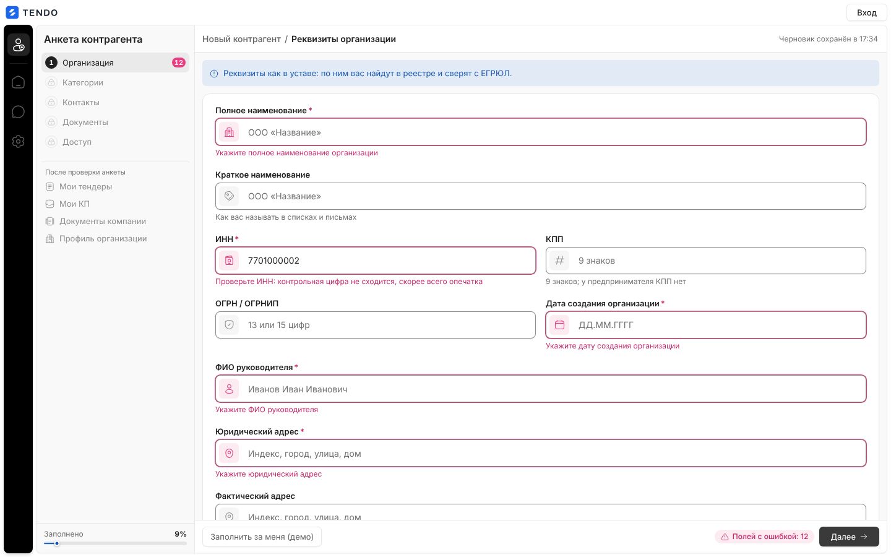

## Шаг 2 — «Виды работ, которые вы выполняете»

Введение: «Отметьте, какие работы вы выполняете — по ним приходят приглашения в тендеры.»

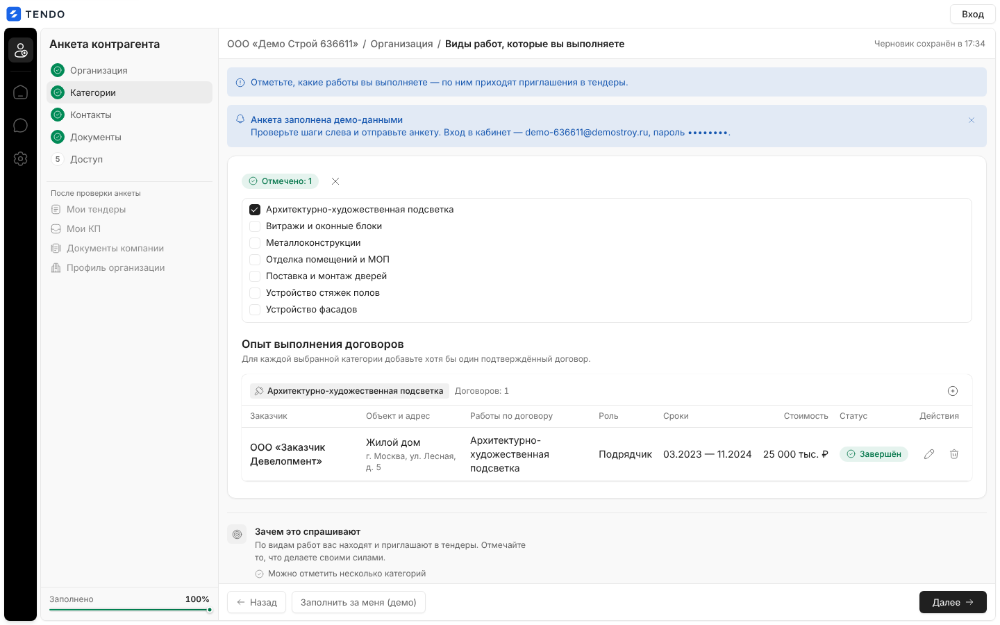

- Капсула «Пока ничего не отмечено» / «Отмечено: N» и крестик «Снять все отметки».
- Список видов работ справочника (активные, иерархия отступами, только чекбоксы, без поиска; высота до 420 px с прокруткой). Справочник загружается по токену приглашения (`GET /suppliers/register/work-types`); сбой — блок «Виды работ не загрузились» с текстом ошибки и «Повторить». Пустой справочник — «Справочник видов работ пуст — заполните его в разделе «Справочники».».
- Ошибка шага: «Отметьте хотя бы один вид работ».
- **«Опыт выполнения договоров»** (появляется, когда отмечен хотя бы один вид): пояснение — при включённой настройке «опыт обязателен» (`require_work_experience` из ответа справочника) «Для каждой выбранной категории добавьте хотя бы один подтверждённый договор.», иначе «Добавьте договоры по выбранным видам работ — чем больше подтверждённого опыта, тем выше оценка анкеты.». По каждому отмеченному виду — группа с названием вида, счётчиком «Договоров: N» (или «Требуется опыт» / «Опыт не заявлен») и кнопкой «Добавить договор: <вид>».
- Таблица договоров вида: «Заказчик», «Объект и адрес», «Работы по договору», «Роль» (Генподрядчик / Подрядчик), «Сроки» («ММ.ГГГГ — ММ.ГГГГ» или «— по н.в.»), «Стоимость» (тыс. ₽), «Статус» («Завершён» — если месяц окончания не позже текущего, иначе «В процессе»), «Действия» (изменить, удалить с подтверждением «Удалить договор с заказчиком «…»?»).
- Ошибка при обязательном опыте: «Укажите опыт работы хотя бы по одному договору для каждого выбранного вида деятельности».
- Снятие вида с договорами — подтверждение «Снятие выбранной категории приведёт к удалению внесённых по ней договоров. Продолжить?»; «Снять все» с договорами — «Снятие всех категорий приведёт к удалению всех внесённых договоров. Продолжить?».
- Заметки: «Зачем это спрашивают» — «По видам работ вас находят и приглашают в тендеры. Отмечайте то, что делаете своими силами.» + «Можно отметить несколько категорий», «Список меняется в кабинете в любой момент».

### Окно «Добавить договор» / «Изменить договор»

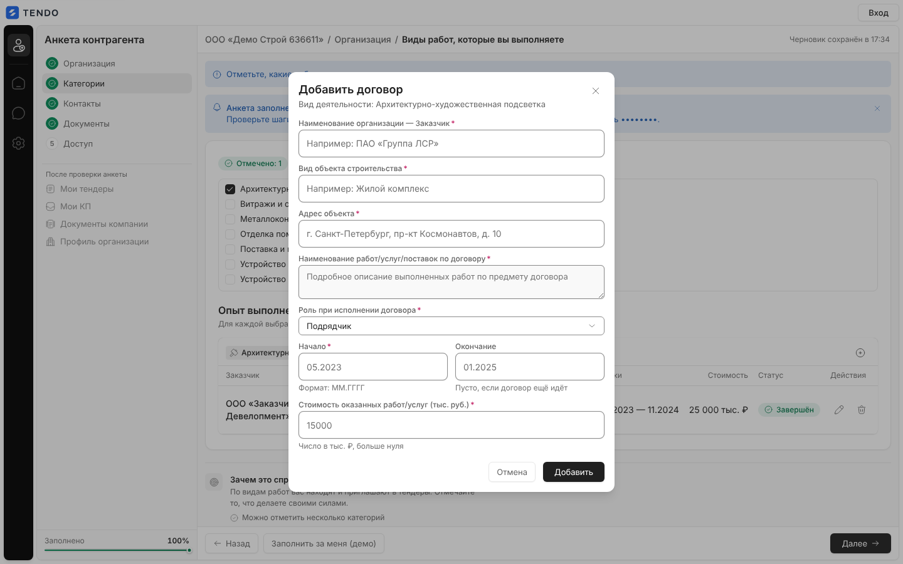

Подзаголовок «Вид деятельности: <вид>». Поля (все обязательны, кроме окончания):

| Поле | Тип | Ошибка |
|---|---|---|
| Вид деятельности | выбор из отмеченных видов (плейсхолдер «Выберите вид деятельности…»; показывается, если вид не задан заранее) | «Выберите вид работ» |
| Наименование организации — Заказчик | текст, «Например: ПАО «…»» | «Укажите наименование заказчика» |
| Вид объекта строительства | текст, «Например: Жилой комплекс» | «Укажите вид объекта строительства» |
| Адрес объекта | текст | «Укажите адрес объекта» |
| Наименование работ/услуг/поставок по договору | многострочный | «Укажите наименование работ по договору» |
| Роль при исполнении договора | выбор: Подрядчик (по умолчанию) / Генподрядчик | «Выберите роль» |
| Начало | `ММ.ГГГГ` + выбор месяца | «Поле обязательно»; «Формат даты: ММ.ГГГГ (например, 05.2024)»; «Месяц должен быть от 01 до 12»; «Укажите корректный год (1900–2100)» |
| Окончание | `ММ.ГГГГ`, подсказка «Пусто, если договор ещё идёт» | те же; «Дата окончания не может быть раньше даты начала» |
| Стоимость оказанных работ/услуг (тыс. руб.) | число, подсказка «Число в тыс. ₽, больше нуля» | «Стоимость должна быть больше нуля» |

Кнопки «Отмена», «Добавить»/«Сохранить». Договоры хранятся в анкете до отправки (на сервер уходят вместе с анкетой).

## Шаг 3 — «Контактные лица»

Введение: «Кому писать по тендерам и по этой анкете.»

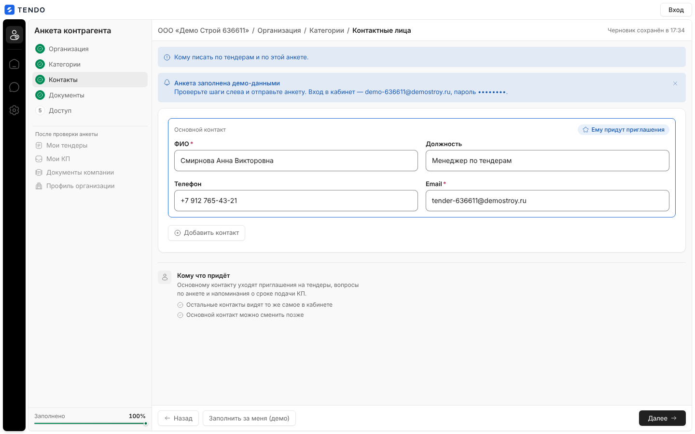

- Карточки контактов: «Основной контакт» (выделен, капсула «★ Ему придут приглашения») и «Контакт N» (кнопка «Сделать основным», «Удалить контакт» — если контактов больше одного; при удалении основного основным становится первый).
- Поля: ФИО (обязательно у основного, плейсхолдер «Петрова Мария Сергеевна»), Должность, Телефон (как у организации, нормализация при уходе), Email (обязательно у основного; нормализация).
- «+ Добавить контакт».
- Проверка: учитываются карточки с ФИО; у них email обязателен и проверяется, телефон — по формату. Ни одной — «Заполните ФИО и email хотя бы одного контактного лица».
- Заметки: «Кому что придёт» — «Основному контакту уходят приглашения на тендеры, вопросы по анкете и напоминания о сроке подачи КП.» + «Остальные контакты видят то же самое в кабинете», «Основной контакт можно сменить позже».

## Шаг 4 — «Документы»

Введение: «Три обязательных документа и всё остальное, что поможет проверке.»

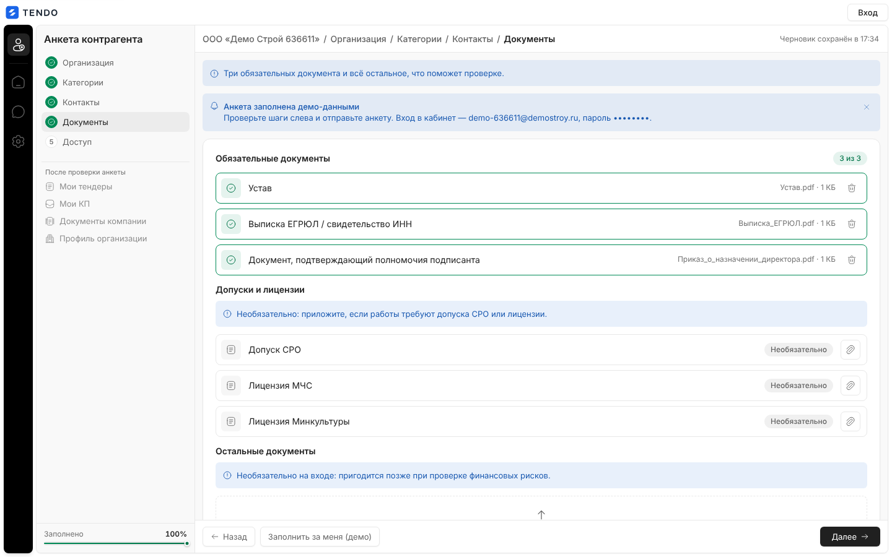

| Группа | Состав | Правила |
|---|---|---|
| Обязательные документы (капсула «N из 3», подсказка «Без этих документов анкету на аккредитацию отправить нельзя.») | «Устав», «Выписка ЕГРЮЛ / свидетельство ИНН», «Документ, подтверждающий полномочия подписанта» | Строка-слот: пустой — красная капсула «Файл не приложен» и скрепка «Выбрать файл: <название>»; заполненный — зелёная галочка, «имя · размер», «Убрать файл». Ошибка шага: «Приложите документ: «<название>»» |
| Допуски и лицензии (плашка «Необязательно: приложите, если работы требуют допуска СРО или лицензии.») | «Допуск СРО», «Лицензия МЧС», «Лицензия Минкультуры» | Капсула «Необязательно» |
| Остальные документы (плашка «Необязательно на входе: пригодится позже при проверке финансовых рисков.») | Зона перетаскивания «Перетащите файлы сюда или выберите на компьютере» (несколько файлов), подсказка «Форматы и лимит — в заметках под формой» | Список выбранных: имя, размер, «Убрать». Повторы по имени не добавляются |

Допустимые форматы — PDF, JPG, PNG (фильтр выбора файла), до 25 МБ на файл (проверяет сервер при загрузке). Заметки: «Что обычно прикладывают» (устав и учредительные документы; выписка ЕГРЮЛ или свидетельство ОГРН; протокол о назначении руководителя; бухгалтерский баланс за последний период; выписка из реестра СРО и лицензии МЧС или Минкультуры, если работы их требуют) и «Форматы» («PDF, JPG, PNG, до 25 МБ на файл. Файлы уходят на сервер вместе с анкетой; в черновике сохраняются только их имена.»).

## Шаг 5 — «Пароль от кабинета и согласие»

Введение: «Последний шаг: пароль от кабинета и согласие на обработку данных.»

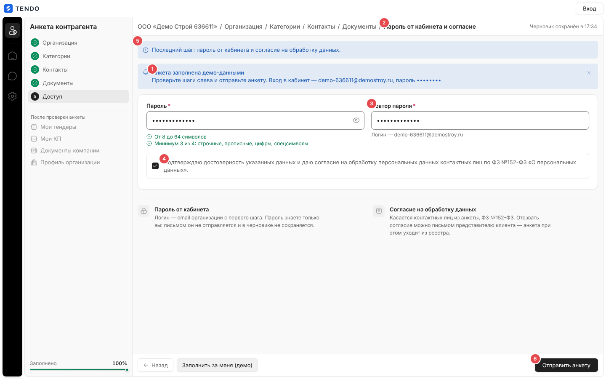

| Поле | Правила |
|---|---|
| Пароль | Обязательное, плейсхолдер «Не короче 8 символов», кнопка показа. Чек-лист «От 8 до 64 символов», «Минимум 3 из 4: строчные, прописные, цифры, спецсимволы»; после ухода из поля — строка первой нарушенной проверки политики (с учётом email организации и ФИО руководителя) |
| Повтор пароля | Обязательное, без кнопки показа; подсказка «Логин — <email организации>» (или «email организации с шага 1»); «Пароли не совпадают» |
| Согласие | Чекбокс «Подтверждаю достоверность указанных данных и даю согласие на обработку персональных данных контактных лиц по ФЗ №152-ФЗ «О персональных данных».»; без него «Отправить анкету» неактивна; ошибка «Без согласия на обработку ПДн анкету принять нельзя» |
| Ловушка для ботов | Скрытое поле, людям не видно; заполненное — сервер отвечает «Не удалось обработать форму» |

Заметки: «Пароль от кабинета» — «Логин — email организации с первого шага. Пароль знаете только вы: письмом он не отправляется и в черновике не сохраняется.»; «Согласие на обработку данных» — «Касается контактных лиц из анкеты, ФЗ №152-ФЗ. Отозвать согласие можно письмом представителю <клиента> — анкета при этом уходит из реестра.»

## Отправка анкеты

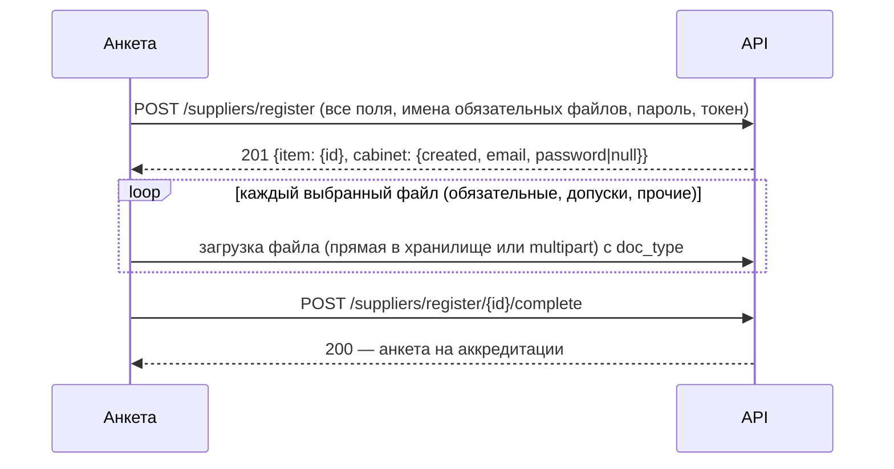

- Кнопка «Отправить анкету» → «Отправляем…». Файлы уходят по одному **после** создания карточки (до неё не к чему привязать). Не загрузился обязательный файл — ошибка «Не загрузились обязательные файлы: <имена>. Без них анкету нельзя отправить на аккредитацию.», финализация не выполняется. Не загрузились прочие — анкета принимается, на итоговом экране предупреждение «Не загрузились дополнительные файлы: <имена>. Пришлите их менеджеру.».
- Ошибки сервера (красная плашка над полосой действий): ошибки полей, «Контрагент с таким ИНН уже есть в реестре», «Эта ссылка уже была использована для регистрации», «Эта ссылка отозвана», лимит 20 запросов/мин, сбой сети — по умолчанию «Не удалось отправить анкету». Полный список — [API](../04-api/endpoints-suppliers-registration.md#post-suppliersregister).

### Экран «Анкета отправлена»

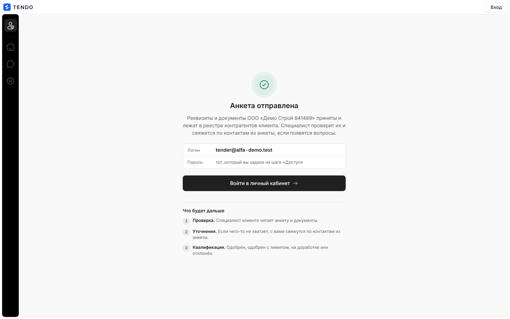

- Галочка, «Анкета отправлена», «Реквизиты и документы <организации> приняты и лежат в реестре контрагентов <клиента>. Специалист проверит их и свяжется по контактам из анкеты, если появятся вопросы.».
- Если учётная запись создана — панель «Логин: <email>», «Пароль: тот, который вы задали на шаге «Доступ»» (если сервер сгенерировал пароль — показывается значение, один раз) и главная кнопка «Войти в личный кабинет →» (`/login`).
- Если учётную запись создать не удалось — предупреждение «Анкета сохранена, но учётную запись создать не удалось: <причина>. Обратитесь к представителю <клиента>.».
- Блок «Что будет дальше»: 1 «Проверка. Специалист <клиента> читает анкету и документы.», 2 «Уточнения. Если чего-то не хватает, с вами свяжутся по контактам из анкеты.», 3 «Квалификация. Одобрен, одобрен с лимитом, на доработке или отклонён.».

## Состояния ссылки

| Состояние | Что видит пользователь | Снимок |
|---|---|---|
| Проверка | Спиннер «Проверяем ссылку-приглашение…» | 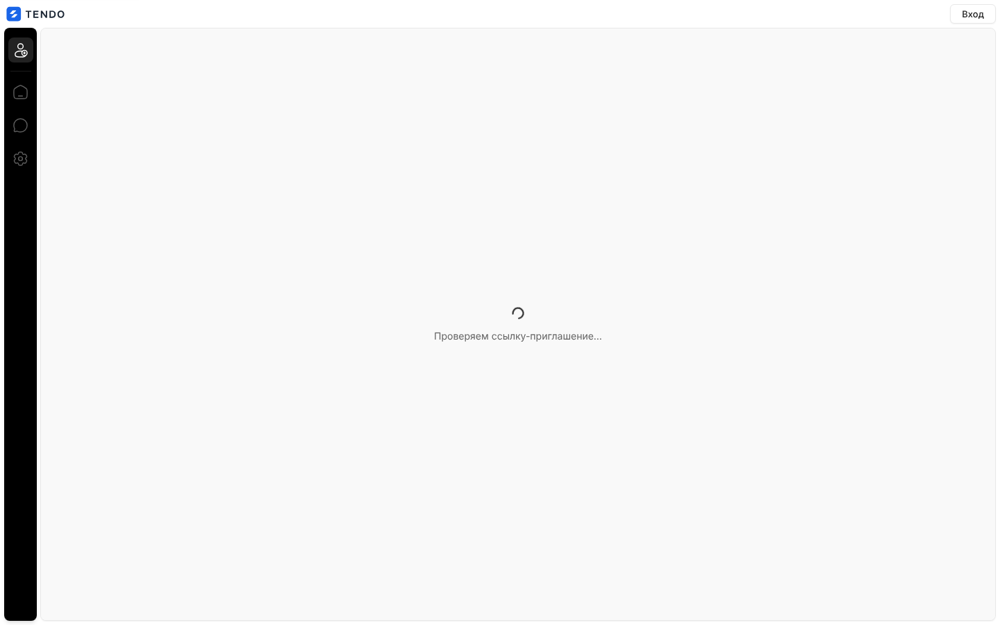 |
| Одноразовая ссылка использована | «Ссылка не работает», «Эта ссылка одноразовая и уже была использована для регистрации.», кнопка «Войти в кабинет» | 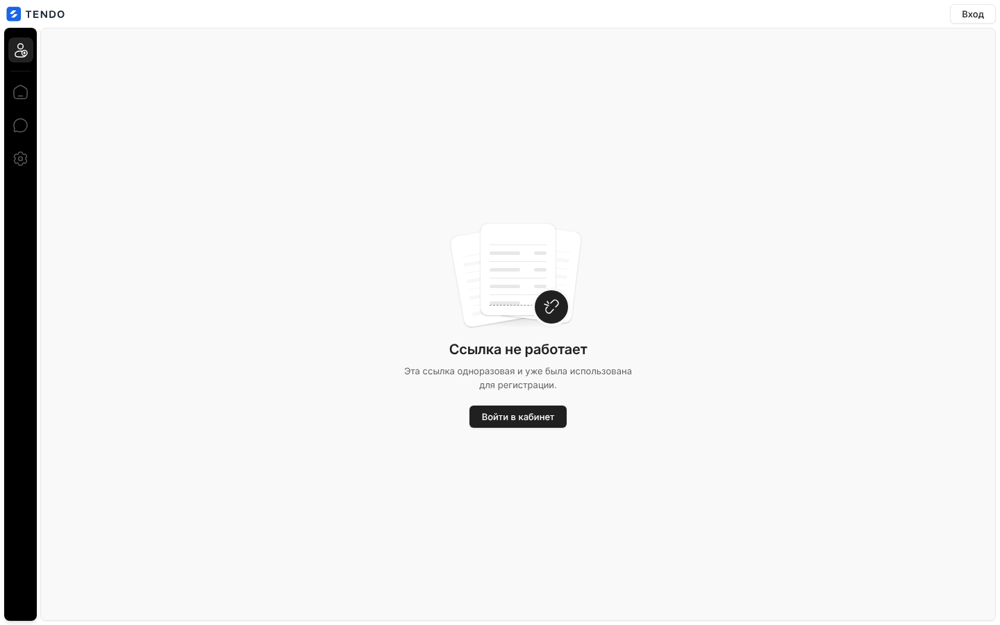 |
| Отозвана | «Ссылку отозвали. Запросите новую у вашего представителя <клиента>.» |  |
| Не найдена | «Ссылка недействительна или устарела. Обратитесь за новой к представителю <клиента>.» |  |
| Без токена | «В ссылке нет токена приглашения. Приглашение выдаётся каждому контрагенту отдельно — запросите его у представителя <клиента>.» | 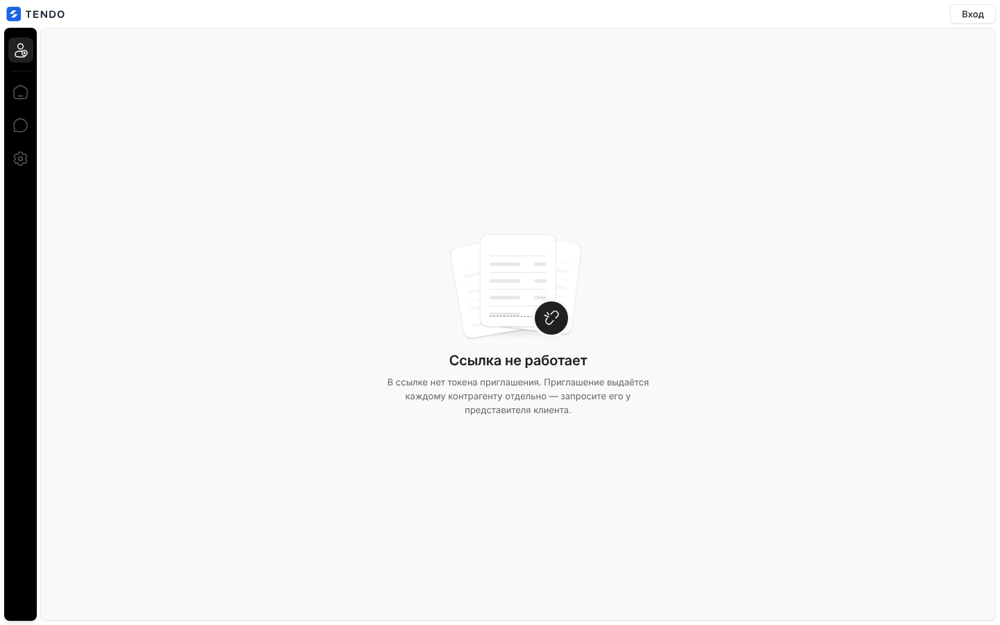 |
| Нет связи при проверке | «Не удалось проверить ссылку», «Не удалось связаться с сервером. Проверьте соединение и попробуйте снова.», «Повторить» | 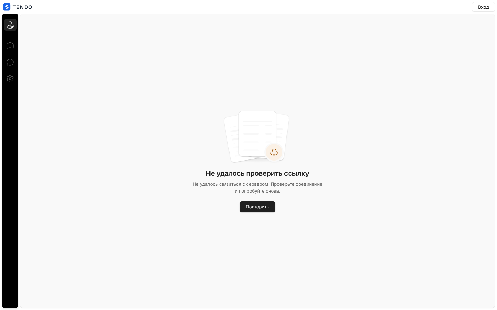 |

Название клиента в родительном падеже — настройка сборки `VITE_CLIENT_GENITIVE`.

## Адаптив

На узком экране рейл скрывается, панель шагов превращается в горизонтальную полосу шагов над формой (прокручивается вбок), поля идут в одну колонку; полоса действий остаётся внизу.

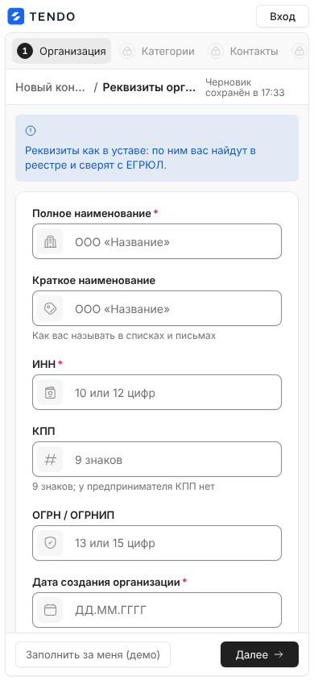

## Сложность

**L**: пять шагов с полной клиентской валидацией (ИНН/ОГРН/КПП с контрольными суммами, адреса, телефоны, выручка), опыт договоров с окном, слоты документов с загрузкой после создания карточки и финализацией, черновик в браузере, публичный каркас, итоговый экран, шесть состояний ссылки.
