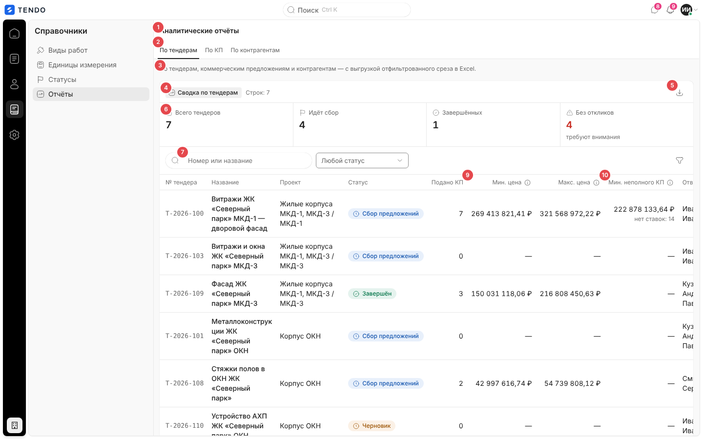
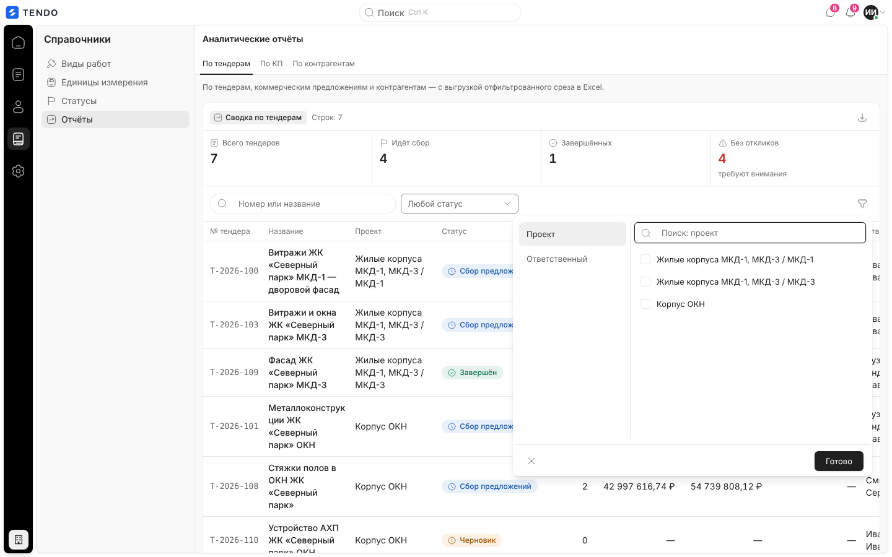
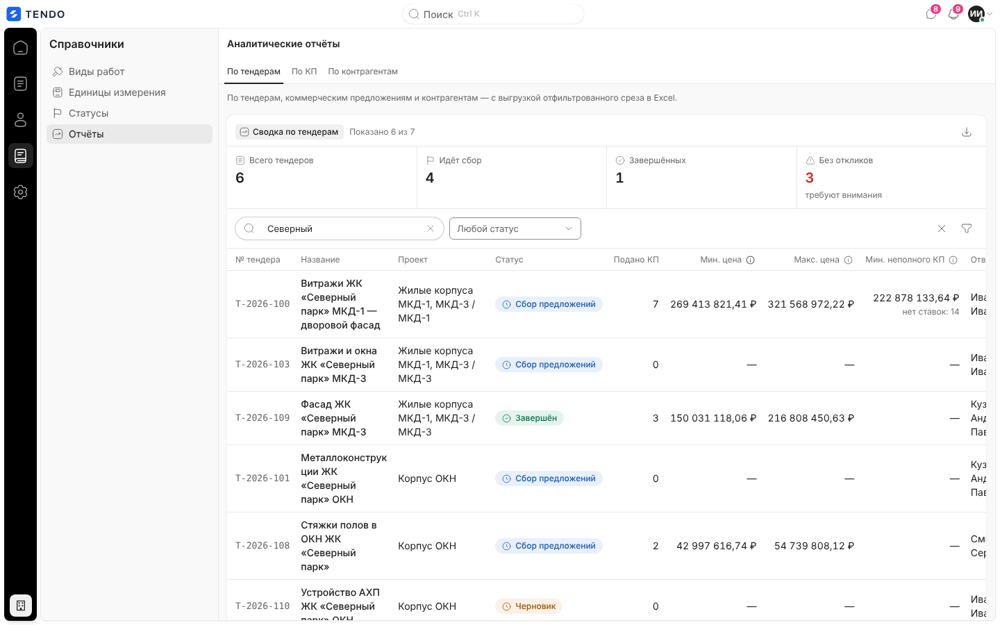
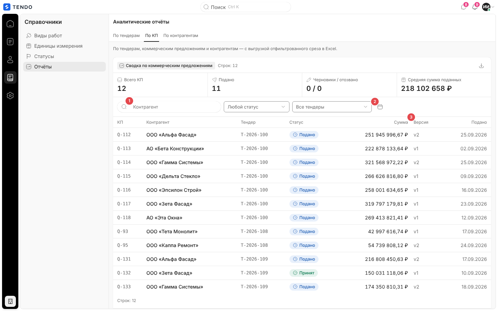
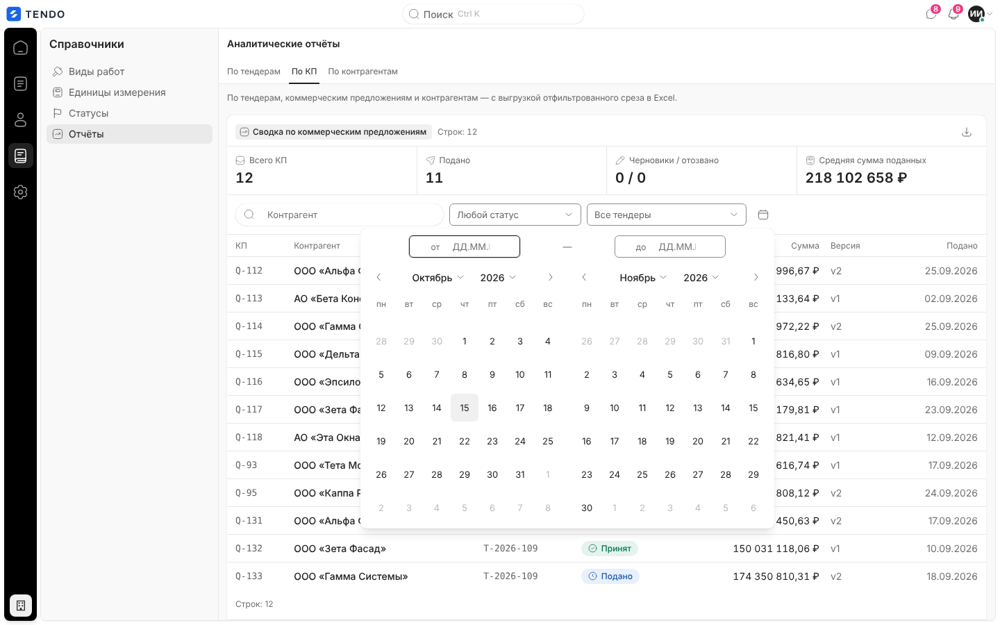
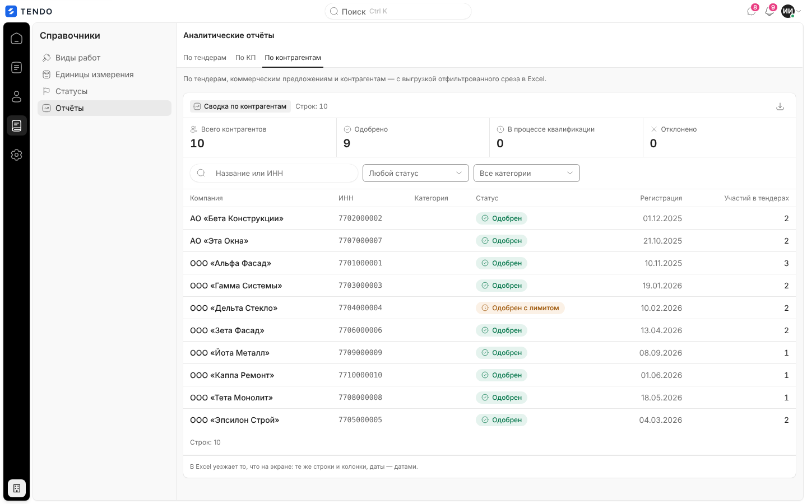
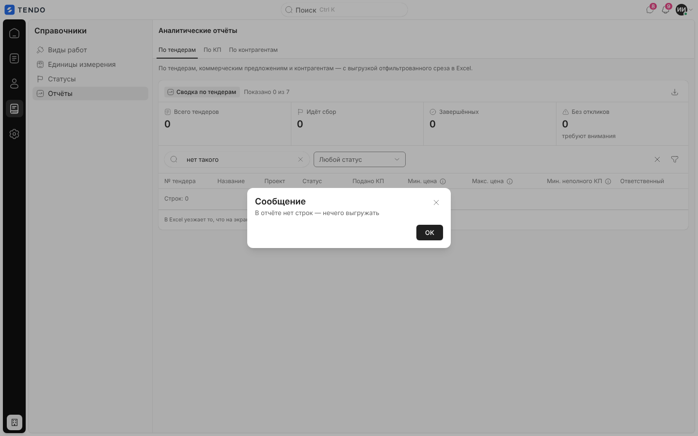
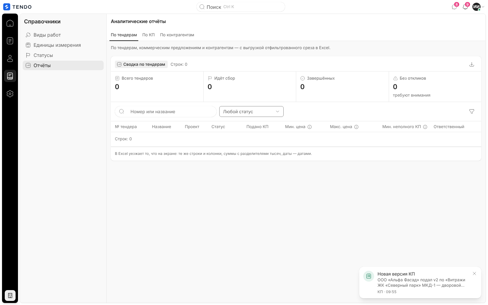
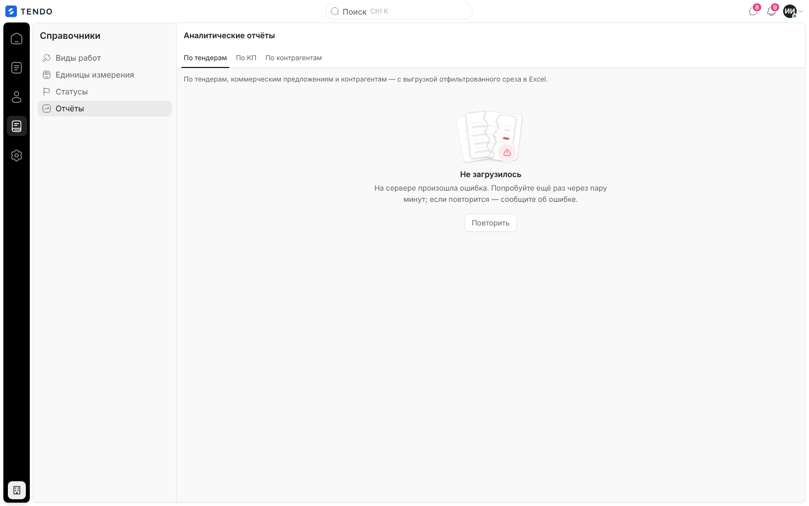

# Аналитические отчёты (`/reports`)

Три табличных отчёта на одном экране — «По тендерам», «По КП», «По контрагентам» — с полосой итогов, клиентскими фильтрами и выгрузкой в Excel ровно того среза, что на экране.

Связанные разделы: API, состав колонок, книга `.xlsx`, гриф, права и маска финансов — [../04-api/endpoints-reports.md](../04-api/endpoints-reports.md); бизнес-логика аналитики — [../02-business-logic/analytics.md](../02-business-logic/analytics.md); выгрузка реестра тендеров (тот же механизм среза) — [tenders-registry.md](tenders-registry.md#выгрузка-среза-в-excel).

## Маршрут

`/reports`; заголовок «Аналитические отчёты». Вкладка — состояние страницы (при открытии — «По тендерам»); фильтры и поиск — состояние каждой вкладки, в адрес не пишутся и при уходе со страницы сбрасываются.

## Назначение

Сводный взгляд на закупки: сколько тендеров идёт и сколько без откликов, какие КП поданы и на какую сумму, сколько контрагентов одобрено — и выгрузка отфильтрованного списка для отчётности.

## Роли и права

| Роль | Доступ | Что меняется |
|---|---|---|
| Администратор | Да | Все строки, денежные колонки |
| Тендерный специалист | Да (право `reports.view` по умолчанию) | Только тендеры/КП доступных объектов; контрагенты — только приглашавшиеся в эти объекты. Без права видеть финансы денежные колонки и плитка «Средняя сумма поданных» скрыты (сервер присылает `null`, в `.xlsx` их нет) |
| СБ, юрист | Нет | Пункт «Отчёты» в разделе «Справочники», раздел им не виден; переход уводит на `/home` |
| Поставщик, лид, владелец площадки | Нет | Перенаправление |

Если у специалиста снять `reports.view` в матрице прав, экран останется в меню, а все три вкладки покажут ошибку 403 (интерфейс не знает о правах — [users-and-roles.md §7](../01-product/users-and-roles.md#7-расхождения-и-рекомендации-для-воссоздания)).

## Как попасть

Рейл «Справочники» → «Отчёты».

## Компоновка (вкладка «По тендерам»)

| № | Элемент | Поведение |
|---|---|---|
| ① | Заголовок «Аналитические отчёты» | — |
| ② | Вкладки «По тендерам · По КП · По контрагентам» | Срезы одного экрана; данные всех трёх загружаются сразу при открытии |
| ③ | Пояснение | «По тендерам, коммерческим предложениям и контрагентам — с выгрузкой отфильтрованного среза в Excel.» |
| ④ | Группа «Сводка по тендерам» + «Строк: N» / «Показано N из M» | — |
| ⑤ | Значок «Скачать отчёт в Excel» | Выгрузка среза (ниже); во время запроса — «Выгрузка…», неактивен |
| ⑥ | Полоса итогов (по отфильтрованному срезу) | «Всего тендеров», «Идёт сбор» (статус «Сбор предложений»), «Завершённых», «Без откликов» (0 поданных КП; подпись «требуют внимания», > 0 — красным) |
| ⑦ | Поиск «Номер или название» | Подстрока номера и названия, мгновенно, на клиенте |
| ⑨ | «Мин. цена» + «i» | Подсказка: «Самый низкий итог среди полных КП — с ценой по каждой позиции. Совпадает с лидером на вкладке «Обзор». Неполные КП сюда не входят: их итог занижен на позиции без цены.» (у «Макс. цена» — «Самый высокий итог среди полных КП — с ценой по каждой позиции.») |
| ⑩ | «Мин. неполного КП» + «i» | Сумма и второй строкой «нет ставок: N» или «разные объёмы»; подсказка «Самый низкий итог среди неполных КП и число позиций, по которым цены нет (отказ тоже не цена). С полными КП такой итог сравнивать нельзя.» |

Фильтры полосы: выпадающий «Любой статус» (значения — только те статусы, что есть в строках отчёта) и воронка «Фильтры» с критериями «Проект» и «Ответственный» (значения тоже из строк, с поиском; «Готово» / очистить). При активных фильтрах появляется сброс. Внизу группы — сноска «В Excel уезжает то, что на экране: те же строки и колонки, суммы с разделителями тысяч, даты — датами.».

> На ширине 1440 px при раскрытой панели раздела таблица «По тендерам» шире области — последняя колонка «Ответственный» уходит под горизонтальную прокрутку.

### Колонки отчётов

| Отчёт | Колонки (в порядке экрана и файла) | Итоги |
|---|---|---|
| По тендерам | № тендера (моноширинный), Название, Проект, Статус (капсула), Подано КП, Мин. цена*, Макс. цена*, Мин. неполного КП*, Ответственный | Всего тендеров · Идёт сбор · Завершённых · Без откликов |
| По КП | КП (`Q-<id>`), Контрагент, Тендер (номер), Статус («Черновик», «Подано», «На доработке», «Отозвано», «Принят»), Сумма*, Версия (`v2`), Подано (дата) | Всего КП · Подано · Черновики / отозвано · Средняя сумма поданных* |
| По контрагентам | Компания, ИНН, Категория, Статус (квалификации: «Новая анкета» … «Отклонён»), Регистрация (дата), Участий в тендерах | Всего контрагентов · Одобрено · В процессе квалификации (новая, на согласовании, проверяется, на доработке) · Отклонено (> 0 — красным) |

\* — только при праве видеть финансы. Деньги — `1 234 567,89 ₽`, даты — `ДД.ММ.ГГГГ`, пусто — «—». Порядок строк — как отдаёт сервер. **Сортировки по колонкам, пагинации и массовых действий нет**; все строки отчёта загружаются целиком (сервер отдаёт страницами, клиент дочитывает).

Фильтры по вкладкам: «По КП» — поиск «Контрагент», «Любой статус», «Все тендеры», значок-календарь «Период подачи» (окно двух месяцев с полями «от / до ДД.ММ.ГГГГ», подпись кнопки «Подано: с … по …»); «По контрагентам» — поиск «Название или ИНН», «Любой статус», «Все категории».

## Выгрузка в Excel

- Значок «Скачать отчёт в Excel» отправляет `POST /reports/<tenders|quotes|suppliers>.xlsx` с телом `{ids: [id строк на экране], columns: [ключи колонок в порядке экрана]}` ([описание](../04-api/endpoints-reports.md#post-reportstendersxlsx)) и сохраняет файл `Отчёт_по_тендерам_ГГГГ-ММ-ДД__ЧЧ-ММ.xlsx` (`Отчёт_по_КП_…`, `Отчёт_по_контрагентам_…`; время московское). Состав книги (лист, гриф «коммерческая тайна» при денежных колонках, форматы) — [endpoints-reports.md](../04-api/endpoints-reports.md#общие-правила-раздела).
- Пустой срез — окно «В отчёте нет строк — нечего выгружать», запрос не отправляется. Ошибка — окном «Не удалось скачать» / текст сервера (в том числе 429 «Слишком много запросов — попробуйте немного позже»).
- Каждая выгрузка пишется в журнал ИБ (`report_export`).

## Состояния

| Состояние | Что видит пользователь | Снимок |
|---|---|---|
| Загрузка | Отдельного состояния **нет**: до прихода данных отчёт показывает нули и пустую таблицу («Строк: 0») — дефект, при воссоздании нужен скелетон (см. [открытые вопросы](../_oq/SCR-3.md)) |  |
| Ошибка вкладки | «Не загрузилось» + текст ошибки + «Повторить» (только для своей вкладки; остальные работают) |  |
| Пусто | Нули в итогах, пустая таблица «Строк: 0» | см. «Загрузка» |
| Нет доступа | СБ/юрист — перенаправление на `/home`; специалист без `reports.view` — ошибка 403 на вкладках | — |

## Переходы

Ссылок из строк нет (номер тендера и контрагент — текст). См. [открытые вопросы](../_oq/SCR-3.md).

## Сложность

**M**: три таблицы с общей рамкой, клиентская фильтрация и итоги, выгрузка среза, маска финансов.
