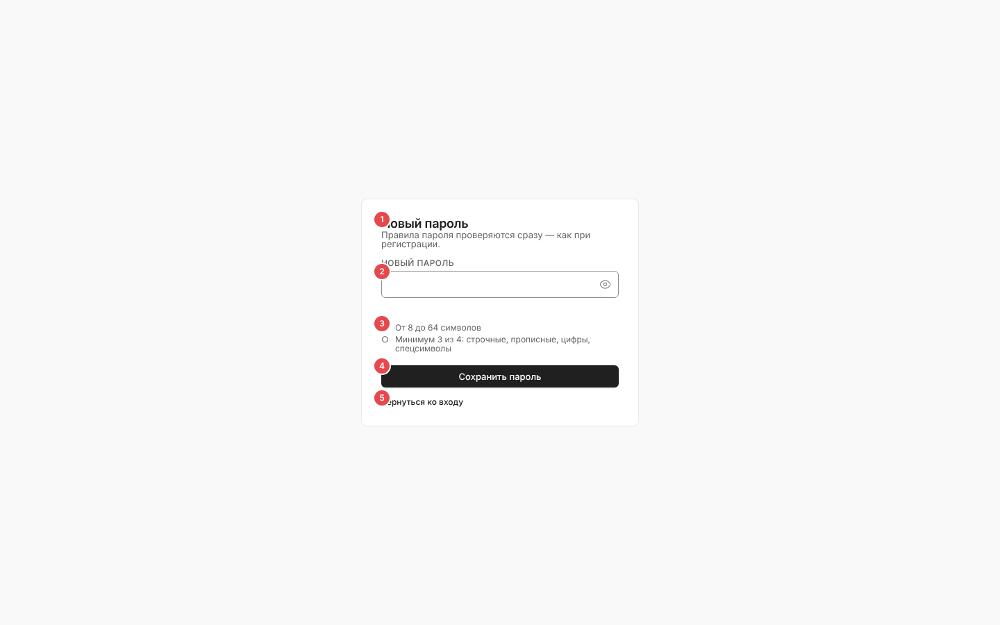
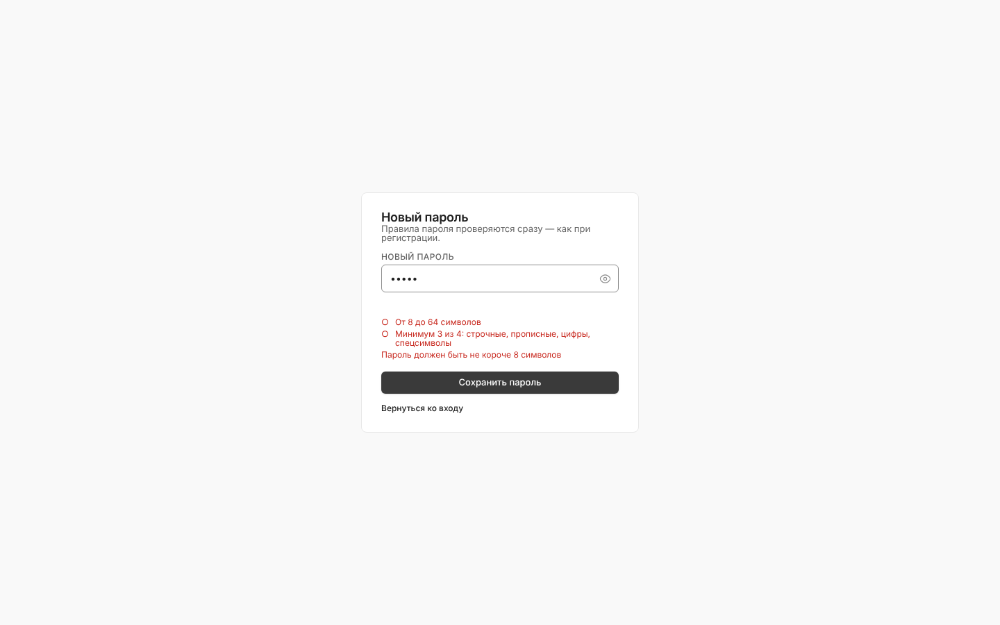
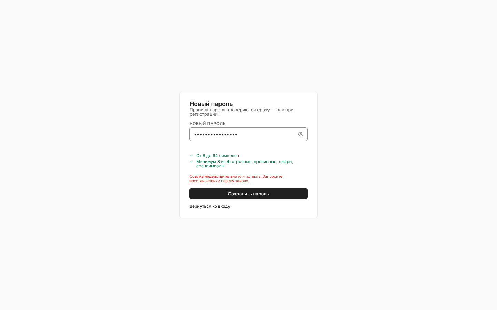
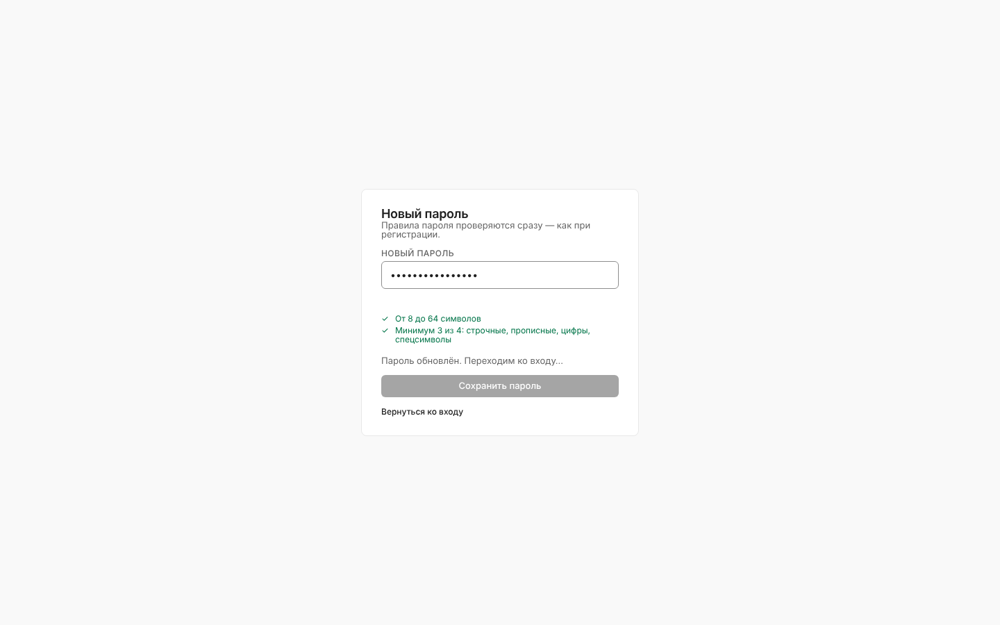
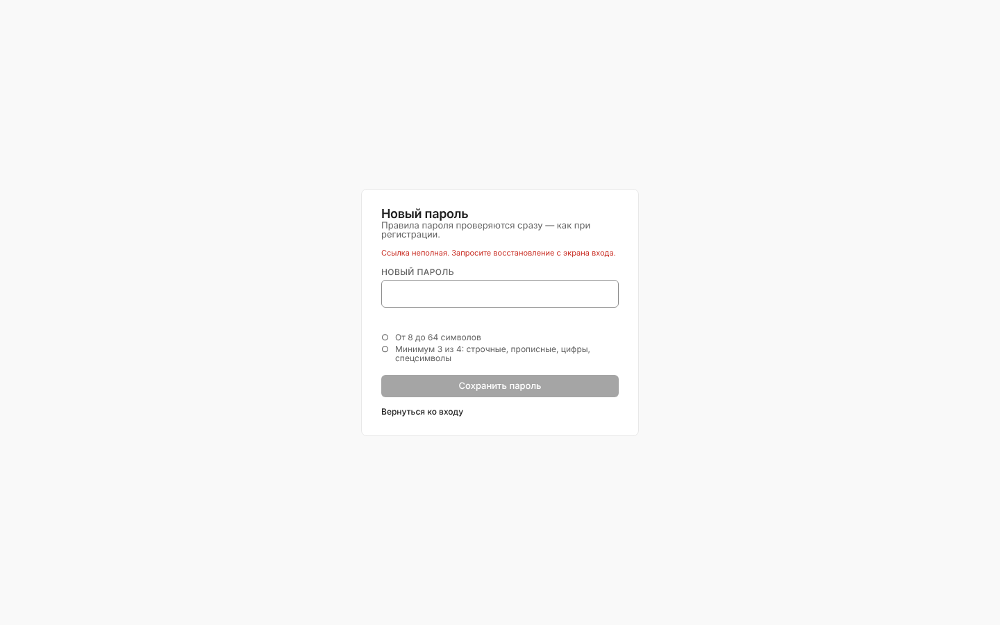
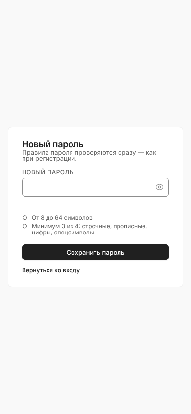

# Новый пароль по ссылке (`/reset-password`)

Страница, на которую ведёт ссылка из письма восстановления пароля: ввод нового пароля с живой проверкой политики и возврат ко входу.

Связанные разделы: запрос ссылки — [login.md](login.md#восстановление-пароля); правила паролей и восстановления — [../02-business-logic/identity.md §4.4](../02-business-logic/identity.md#44-пароли); API — [../04-api/endpoints-identity.md](../04-api/endpoints-identity.md#post-authpassword-resetconfirm).

## Маршрут, роли, как попасть

- `/reset-password?token=<одноразовый токен>` — публичный, без каркаса и без входа; заголовок вкладки «Новый пароль».
- Попадают только по ссылке из письма «восстановление пароля» (ссылка вида `<адрес приложения>/reset-password?token=…`, одноразовая, живёт 2 часа). Роль значения не имеет.

## Экран

| № | Элемент | Поведение |
|---|---|---|
| ① | «Новый пароль», подзаголовок «Правила пароля проверяются сразу — как при регистрации.» | — |
| ② | Поле «Новый пароль» | Обязательное, кнопка показа/скрытия; недоступно без токена и после успеха |
| ③ | Чек-лист | «От 8 до 64 символов», «Минимум 3 из 4: строчные, прописные, цифры, спецсимволы»; после ухода из поля или попытки отправки невыполненные — красным, плюс строка первой нарушенной проверки политики (например, «Пароль должен быть не короче 8 символов») |
| ④ | «Сохранить пароль» → «Сохраняем…» | Неактивна без токена и после успеха. Пароль, не прошедший политику, не отправляется. `POST /auth/password-reset/confirm {token, new_password}` |
| ⑤ | «Вернуться ко входу» | Ссылка на `/login` |

Проверки на клиенте — без учёта email (он неизвестен странице); сервер дополнительно проверяет совпадение с email/ФИО и повтор недавних паролей и возвращает текст ошибки.

## Состояния

| Состояние | Что видит пользователь | Снимок |
|---|---|---|
| Пароль не проходит правила | Красные пункты чек-листа и строка причины |  |
| Ссылка истекла / использована | Красная строка с текстом сервера «Ссылка недействительна или истекла. Запросите восстановление пароля заново.» (ответ подменён для иллюстрации) |  |
| Отключённая учётная запись | 403 с текстом сервера | — |
| Успех | «Пароль обновлён. Переходим ко входу…», поле и кнопка блокируются, через 1,5 с — переход на `/login`. Все сессии пользователя закрыты сервером, MFA сохраняется |  |
| Нет токена в ссылке | Над полем «Ссылка неполная. Запросите восстановление с экрана входа.», поле и кнопка неактивны; при попытке — «В ссылке нет токена. Запросите восстановление заново.» |  |
| Лимит частоты | 429 «Слишком много запросов — попробуйте немного позже» (20 подтверждений в час с IP) | — |

## Адаптив

Карточка шириной «400 px, но не шире экрана», поля страницы 16 px.

## Сложность

**S**.
