# Каркас приложения (общий для вошедшего пользователя)

Общая «рамка» всех экранов за входом: топбар (логотип, глобальный поиск Ctrl K, чаты, уведомления, меню профиля), рейл разделов с превью-флайаутом, сайдбар раздела, панель чатов, окна «Сообщить о баге», «Что нового» и «Настройка панели», гейт входа (проверка сессии и роли), обработка истечения сессии, экраны ошибок (ошибка экрана, новая версия приложения, 404), поведение на узких экранах. Конкретные экраны рисуются внутри области содержимого каркаса.

Связанные разделы: роли, стартовые экраны и доступ к адресам — [../01-product/users-and-roles.md](../01-product/users-and-roles.md) (§1, §6); карта маршрутов и навигация по ролям — [screen-map.md](screen-map.md); вход и сессии — [../02-business-logic/identity.md](../02-business-logic/identity.md), [login.md](login.md); уведомления — [notifications.md](notifications.md), [../02-business-logic/notifications.md](../02-business-logic/notifications.md), [../04-api/endpoints-notifications.md](../04-api/endpoints-notifications.md); чаты — [chats.md](chats.md), [../04-api/endpoints-chat.md](../04-api/endpoints-chat.md); сообщения о багах — [../02-business-logic/bug-reports.md](../02-business-logic/bug-reports.md), [../04-api/endpoints-bug-reports.md](../04-api/endpoints-bug-reports.md); профиль — [profile.md](profile.md).

> На снимках в правом нижнем углу может быть виден круглый значок — инструмент отладки dev-сборки стенда, в продукт не входит. Всплывающие карточки в правом нижнем углу («Новая версия КП…», «Незавершённые тендеры…») — живые уведомления каркаса или конкретного экрана.

## Где применяется

| Вариант каркаса | Где | Чем отличается |
|---|---|---|
| **Рабочий каркас** (этот файл) | Все маршруты за входом: `/home`, `/tenders/*`, `/quotes/*`, `/suppliers/*`, `/cabinet`, `/chats`, `/profile`, `/settings`, `/owner/*` и др. (см. [screen-map.md](screen-map.md)) | Стоит за гейтом входа; монтируется **один раз** и не перемонтируется при переходе между экранами (топбар, рейл, поток уведомлений и чат живут всё время сессии) |
| Тот же каркас без гейта | Форма КП `/fill/$token` у **вошедшего** пользователя контрагента | Пропуск на форму — токен ссылки, сессия решает только оформление ([fill.md](fill.md#каркас-гость-и-вошедший)) |
| Гостевой каркас формы КП | `/fill/$token` без сессии | Тот же силуэт, разделы кабинета под замком, кнопка «Вход» ([fill.md](fill.md#каркас-гость-и-вошедший)) |
| Публичный каркас анкеты | `/register` | Силуэт продукта, разделы кабинета под замком, кнопка «Вход» ([register.md](register.md)) |
| Без каркаса | `/login`, `/reset-password`, `/welcome`, экран 404, корневая ошибка приложения | Отдельные страницы по центру окна |

## Общая компоновка

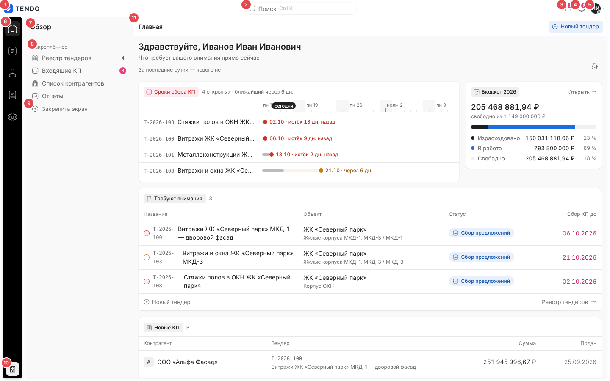

| № | Блок | Поведение |
|---|---|---|
| ① | Логотип продукта | Ссылка на стартовый экран **роли** (сотрудник — `/home`, контрагент — `/cabinet`, владелец площадки — `/owner/costs`); подпись для скринридера «TENDO — на главную» |
| ② | Капсула «Поиск · Ctrl K» | Открывает окно глобального поиска ([ниже](#глобальный-поиск-ctrl-k)); на macOS подпись хоткея «⌘K». У владельца площадки капсулы нет |
| ③ | Чаты | Иконка со счётчиком непрочитанных сообщений во всех диалогах; открывает выезжающую панель «Чаты» поверх текущего экрана ([ниже](#панель-чаты)). У владельца нет |
| ④ | Уведомления (колокольчик) | Счётчик непрочитанных (при нуле не показывается); выпадающая лента ([ниже](#уведомления-колокольчик)). У владельца нет |
| ⑤ | Меню профиля | Аватар с инициалами, точка «в сети», каретка; меню ([ниже](#меню-профиля)) |
| ⑥ | Рейл разделов | Иконки разделов верхнего уровня, состав — по роли ([ниже](#рейл-разделов)); активный раздел подсвечен заливкой |
| ⑦ | Сайдбар (панель раздела) | Заголовок раздела и его дерево; у «Обзора» — личная полка ярлыков ([ниже](#сайдбар-панель-раздела)) |
| ⑧ | «Закреплённое» | Секция панели «Обзор» у администратора и специалиста |
| ⑨ | «Закрепить экран» | Открывает окно «Настройка панели «Обзор»» |
| ⑩ | Логотип организации-клиента | Внизу рейла, не навигация — подпись «чья установка» (файл задаётся настройкой сборки `VITE_CLIENT_LOGO_ON_DARK`) |
| ⑪ | Область экрана | Единственная часть, которая меняется при переходе. Справа от неё может открываться третья колонка — панель «Анализ ИИ» карточки тендера ([tender-card-analysis.md](tender-card-analysis.md)), которая сжимает область, а не перекрывает её |

Заголовок вкладки браузера: «<Название экрана> · Тендерная площадка · Закупки»; без названия — «Тендерная площадка · Закупки». Экран задаёт название сам (обычно — заголовок страницы или название сущности).

Доступность: первая остановка клавиши Tab — скрытая ссылка «Перейти к содержимому» (ведёт в область экрана мимо топбара, рейла и сайдбара); рейл размечен как навигация «Разделы»; активный пункт имеет признак текущей страницы.

## Топбар

### Глобальный поиск (Ctrl K)

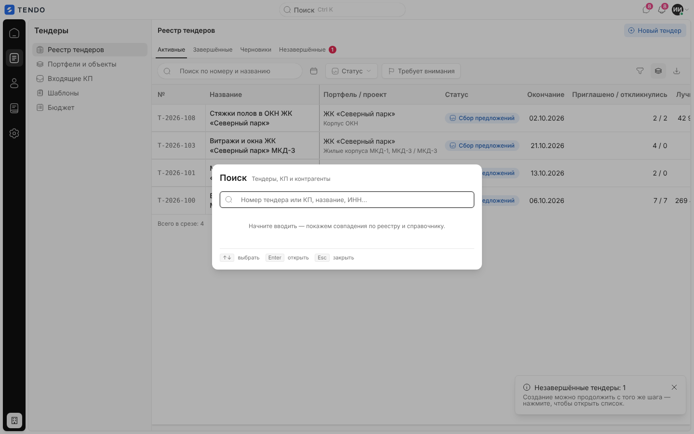

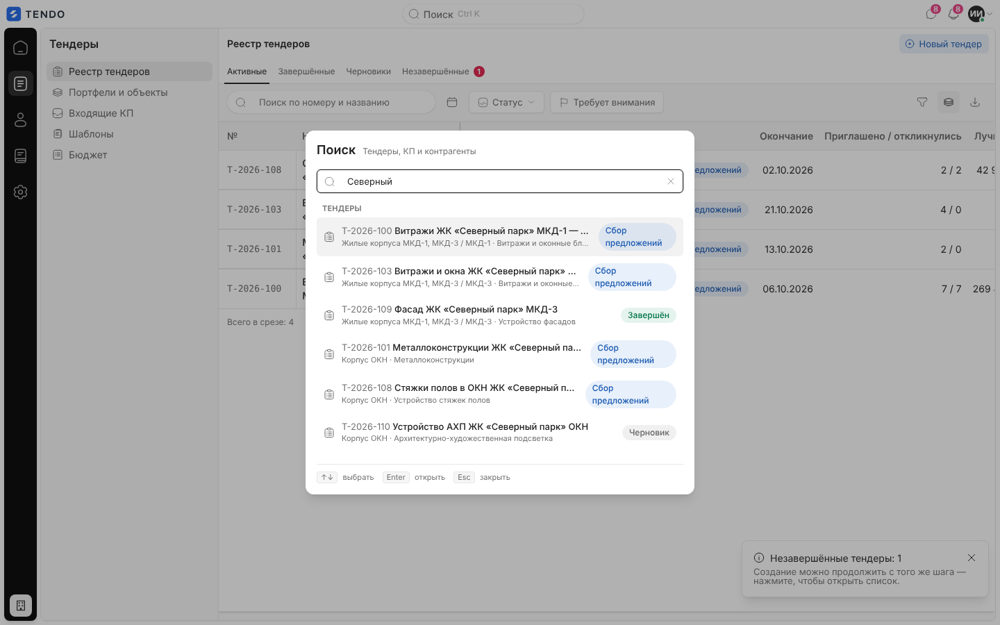

- Открывается кликом по капсуле или сочетанием **Ctrl+K / ⌘K** из любого места, включая поля ввода. Окно модальное: заголовок «Поиск · Тендеры, КП и контрагенты», поле «Номер тендера или КП, название, ИНН…», подвал-подсказка «↑↓ выбрать · Enter открыть · Esc закрыть».
- При первом открытии загружает три справочника целиком: реестр тендеров (тот же запрос, что у реестра и главной, из общего кэша), входящие КП ([../04-api/endpoints-quotes.md](../04-api/endpoints-quotes.md)), реестр контрагентов ([../04-api/endpoints-suppliers.md](../04-api/endpoints-suppliers.md)). Поиск выполняется **на клиенте** по подстроке без учёта регистра и лишних пробелов. После закрытия окно остаётся загруженным (повторное открытие мгновенно).
- Что сопоставляется:

| Группа | Поля поиска | Строка результата | Переход |
|---|---|---|---|
| Тендеры | номер, id, название, портфель, проект, вид работ, ответственный, подпись статуса | «T-2026-100 Название», ниже «проект · вид работ» (или «Без объекта»), капсула статуса | `/tenders/$id` |
| КП | только номер КП («Q-133») | «Q-133 Контрагент», ниже «номер · название тендера», капсула статуса КП | `/quotes/$id` |
| Контрагенты | название, краткое название, ИНН, e-mail, руководитель, категория, сводный статус | название, «ИНН … · категория», капсула статуса | `/suppliers/$id` |

- Не больше **8** результатов в группе. Навигация стрелками по сквозному списку, Enter — открыть, наведение мышью — выделить.
- Состояния: «Загружаем…»; «Начните вводить — покажем совпадения по реестру и справочнику.»; «Ничего не найдено по «<запрос>».»; ошибка — текст ошибки (по умолчанию «Поиск недоступен»). Отказ 403 по входящим КП (нет права `quotes.manage`) не ошибка — группа КП просто пустая.
- **Под контрагентом** капсула поиска в топбаре есть, но поиск отвечает «Доступно только сотрудникам компании» (справочники закрыты контуром роли) — см. снимок и [открытые вопросы](../_oq/SCR-1.md). При воссоздании поиск у контрагента нужно либо убрать, либо ограничить своими тендерами.

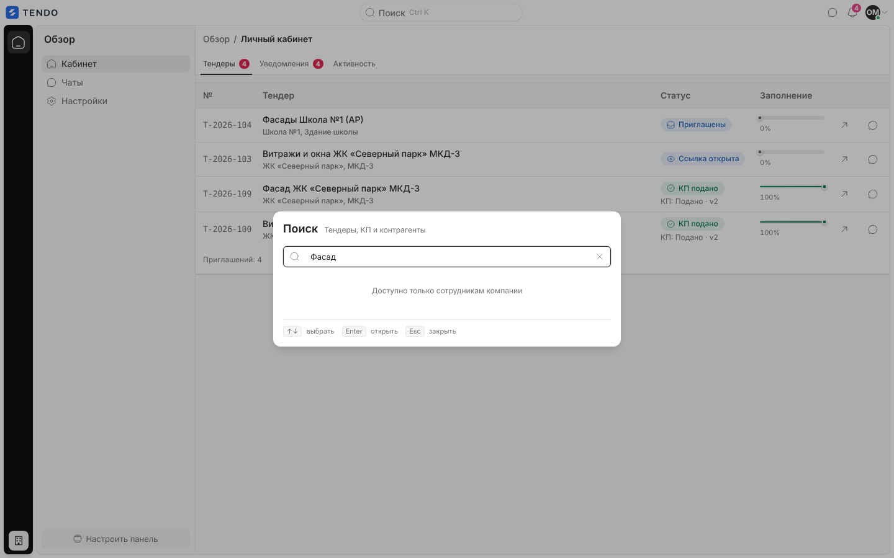

### Уведомления (колокольчик)

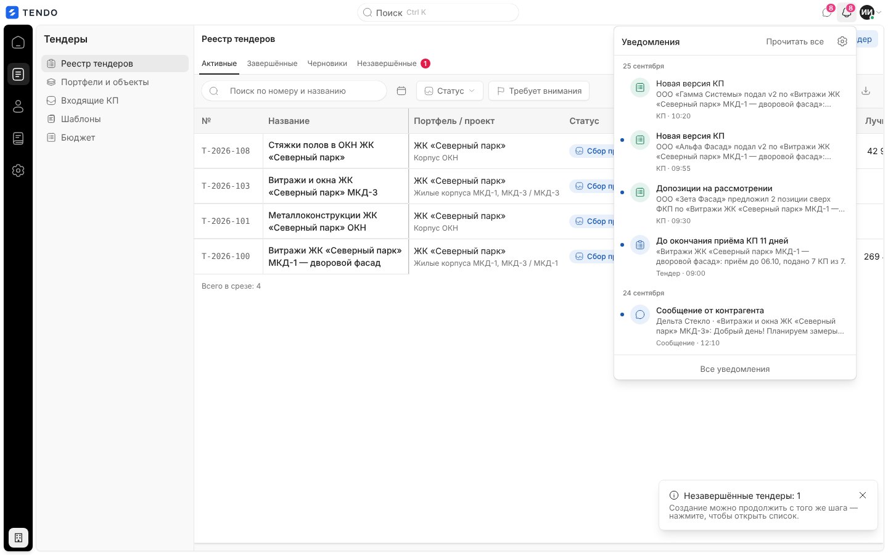

- Счётчик и последние **8** записей приходят живым потоком (один SSE-поток `GET /notifications/stream` на браузер, держит его видимая вкладка; остальные вкладки получают снимки от неё). Если поток не поднялся — разовый запрос `GET /notifications?limit=8` и переподключение с паузой 3 → 6 → … → 30 с. Подробно — [../04-api/endpoints-notifications.md](../04-api/endpoints-notifications.md#get-notificationsstream).
- Меню: липкая шапка «Уведомления», «Прочитать все» (только если есть непрочитанные; `POST /notifications/read-all`), значок-шестерёнка «Настройки уведомлений» → `/settings?tab=notifications`; лента по дням («Сегодня», «Вчера», «25 сентября», в прошлом году — с годом; время по Москве); подвал «Все уведомления» → `/notifications` (у контрагента — `/cabinet?tab=notifications`). Пусто — «Пока пусто. События по тендерам и чатам появятся здесь.».
- Строка: точка непрочитанного у левого края, кружок вида (иконка и тон по виду: тендер, сообщение, корректировка, КП, система), заголовок, текст, «вид · время». Клик — пометить прочитанным (`POST /notifications/{id}/read`) и перейти по ссылке уведомления (если ссылки нет — на `/tenders/<tender_id>`); уведомление о сообщении чата открывает панель «Чаты» на нужном диалоге без перехода.
- **Всплывающая карточка** (правый нижний угол, 8 с): появляется на новое непрочитанное уведомление вида «сообщение» или «КП», выглядит как строка ленты; клик — то же, что клик по строке; крестик «Закрыть уведомление» — закрыть, оставив непрочитанным. Пример — правый нижний угол снимка [shell--app-update](assets/shell--app-update.png).
- Владельцу площадки колокольчик не показывается (поток не открывается).

### Меню профиля

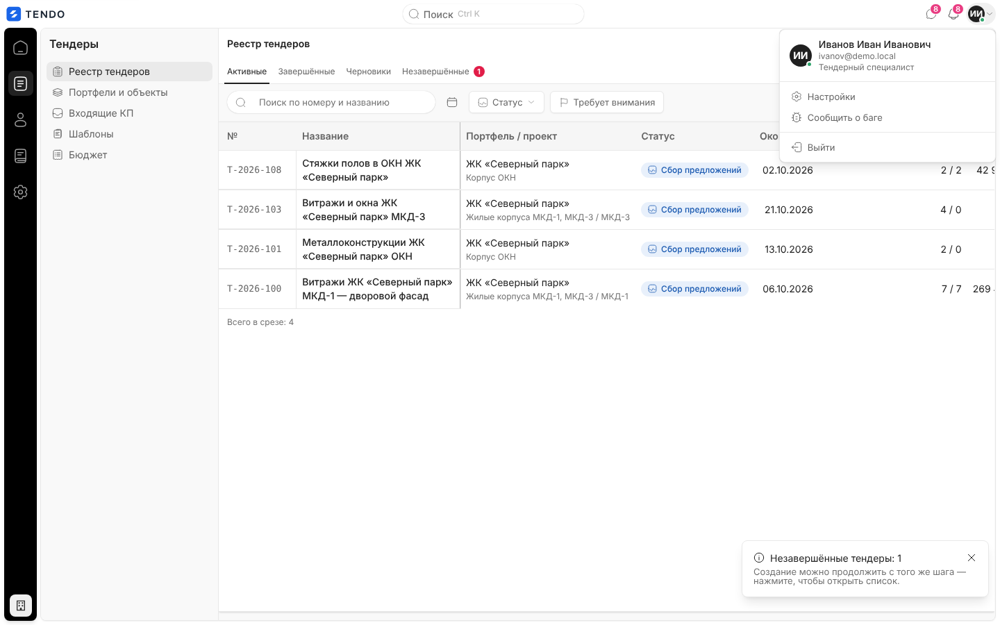

| Пункт | Действие |
|---|---|
| Шапка (имя, e-mail, роль) | Переход в `/profile`; при наведении проявляется капсула «Профиль». У владельца площадки шапка некликабельна (профиля у роли нет) |
| Настройки | `/settings` (у владельца — `/owner/settings`) |
| Сообщить о баге | Окно «Сообщить о баге» ([ниже](#окно-сообщить-о-баге)) |
| Выйти | `POST /auth/logout`, снятие метки входа, полная перезагрузка на `/login`. При сбое сети выход выполняется локально |

Подпись ролей — из [users-and-roles.md §1](../01-product/users-and-roles.md#1-роли).

## Рейл разделов

Состав рейла и деревьев разделов задаётся **ролью** (таблица — [screen-map.md](screen-map.md#навигация-каркаса-по-ролям)). Пункты без подписей: имя раздела — в превью и для скринридера.

- **Клик** по пункту: закрывает панель «Анализ ИИ», делает раздел активным, открывает сайдбар (если у раздела есть дерево) и переходит на **первый пункт дерева для этой роли** (например, «Справочники» → `/catalog/work-types`, «Администрирование» у админа → `/users`, у специалиста → `/settings`). Пункт — ссылка: средний клик открывает раздел в новой вкладке.
- **Превью-флайаут**: при наведении (задержка открытия 90 мс, закрытия 180 мс) или фокусе справа выезжает карточка с деревом раздела; клик по пункту — переход. Для раздела, уже открытого в сайдбаре, превью не показывается.
- **Кнопка «Развернуть боковую панель»** (верх рейла) видна, только когда сайдбар и панель ИИ закрыты.
- Активный раздел вычисляется из адреса (самый длинный совпавший префикс маршрута с учётом роли).
- До ответа `/auth/me` рейл пуст (никаких пунктов «по умолчанию»).

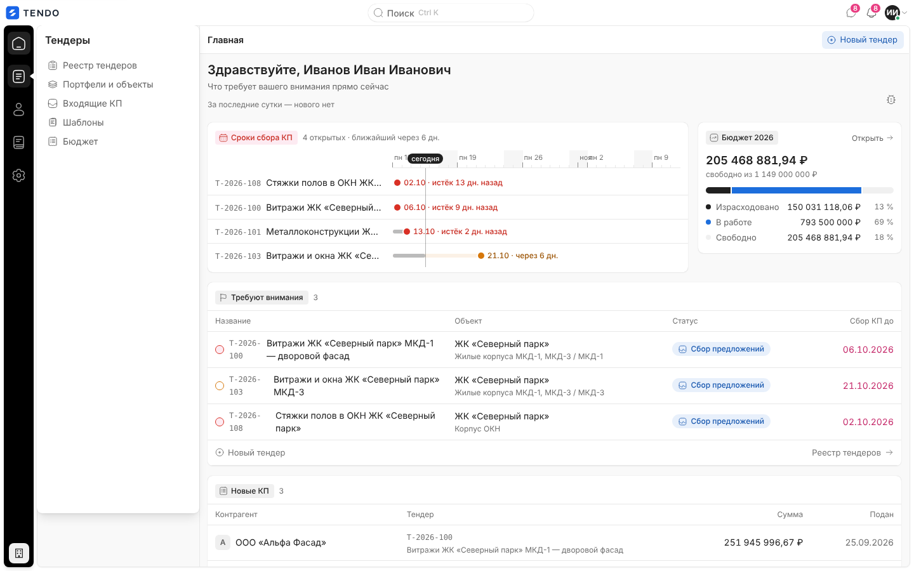

## Сайдбар (панель раздела)

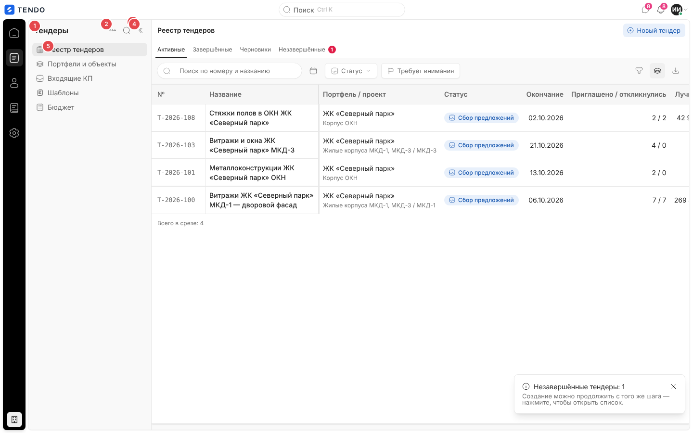

- Шапка: название раздела; группа кнопок, проявляющаяся при наведении/фокусе на панели (на сенсорных экранах видна всегда): «Настройки» (троеточие, → `/settings`), поиск по панели (иконка; по фокусу — поле «Поиск…», фильтрует пункты дерева по названию, Esc — очистить; пусто — «Ничего не найдено»), «Свернуть панель». Шапка получает тень, когда список под ней прокручен.
- Дерево — ссылки раздела с иконками; активный пункт подсвечен.
- Свёрнутая панель схлопывается анимацией в ширину 0; разворот — кнопкой в рейле. Экран сравнения сворачивает панель сам при прокрутке таблицы.

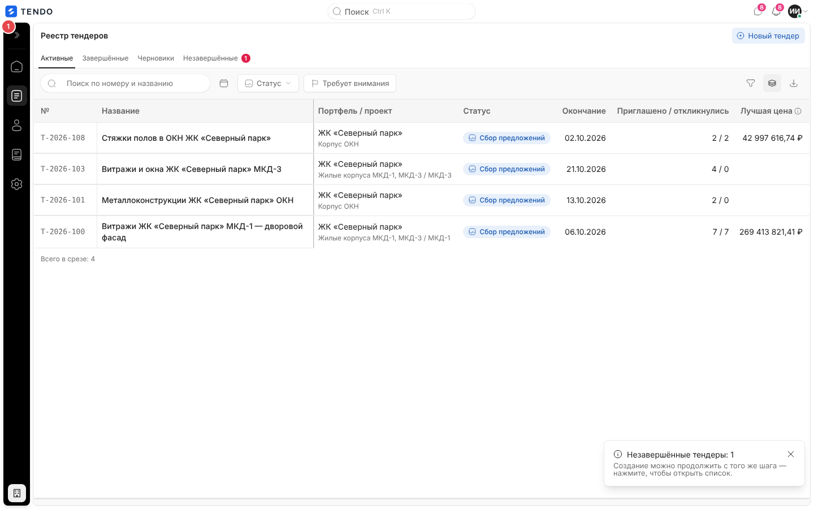

### Панель «Обзор» — личная полка ярлыков

- У **администратора и специалиста**: секция «Закреплённое» (пункты, выбранные пользователем; у «Реестр тендеров» серым — число открытых тендеров, у «Входящие КП» розовым — число новых КП; данные из тех же запросов, что реестр и входящие), строка «+ Закрепить экран» (при пустом списке — «Закрепите экраны, на которые ходите каждый день»), секция «Недавние» — до 5 последних открытых карточек (тендер, контрагент, КП), исключая закреплённые.
- У **СБ и юриста**: дерево закреплённых пунктов и подвал «Настроить панель».
- У **контрагента** «Обзор» — живое дерево кабинета: «Кабинет», «Чаты», «Настройки» и подвал «Настроить панель» (закреплять контрагенту нечего — его каталог пуст).
- Набор по умолчанию: «Реестр тендеров», «Входящие КП», «Список контрагентов», «Отчёты», отфильтрованный тем, что видит роль. Закрепить можно только пункты деревьев разделов, доступные роли. Список закреплённого хранится в браузере (localStorage), «Недавние» — тоже, по пользователю (до 6 записей; имя карточки берётся из заголовка вкладки). Пропажа хранилища ничего не ломает. На сервер настройка не сохраняется (см. [открытые вопросы](../_oq/SCR-1.md)).

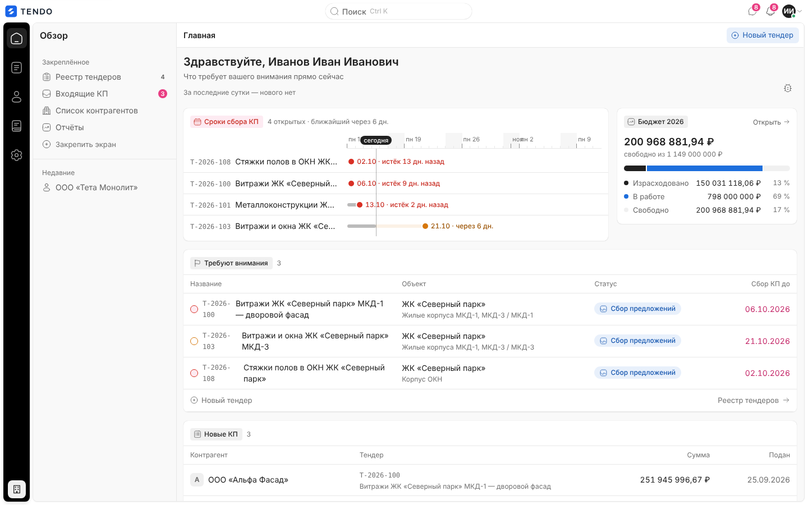

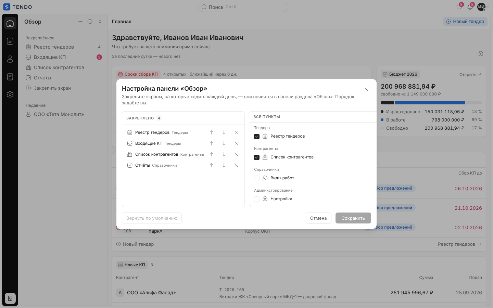

Окно «Настройка панели «Обзор»»: описание «Закрепите экраны, на которые ходите каждый день, — они появятся в панели раздела «Обзор». Порядок задаёте вы.»; колонка «Закреплено N» (перемещение вверх/вниз, снятие), колонка «Все пункты» (галочки по разделам рейла); кнопки «Вернуть по умолчанию», «Отмена», «Сохранить».

## Панель «Чаты»

Выезжает справа поверх экрана по иконке чатов в топбаре, из уведомления о сообщении, из кабинета контрагента и с карточки тендера (тогда показывает только диалоги этого тендера). Шапка «Чаты», кнопки «Открыть во весь экран» (→ `/chats`) и «Закрыть». Содержимое — тот же мессенджер, что на экране `/chats` ([chats.md](chats.md)).

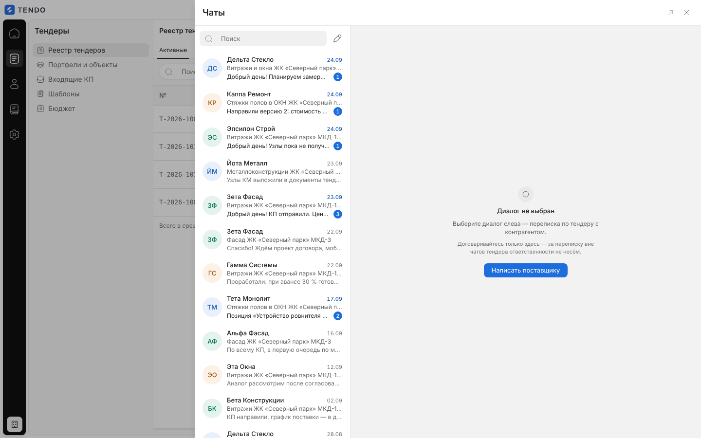

## Окно «Сообщить о баге»

Открывается пунктом меню профиля «Сообщить о баге» (у всех ролей) и значком на главной сотрудника ([home.md](home.md#окно-сообщить-о-баге)). **Отдельной плавающей кнопки «Сообщить об ошибке» в приложении нет** (см. [открытые вопросы](../_oq/SCR-1.md)).

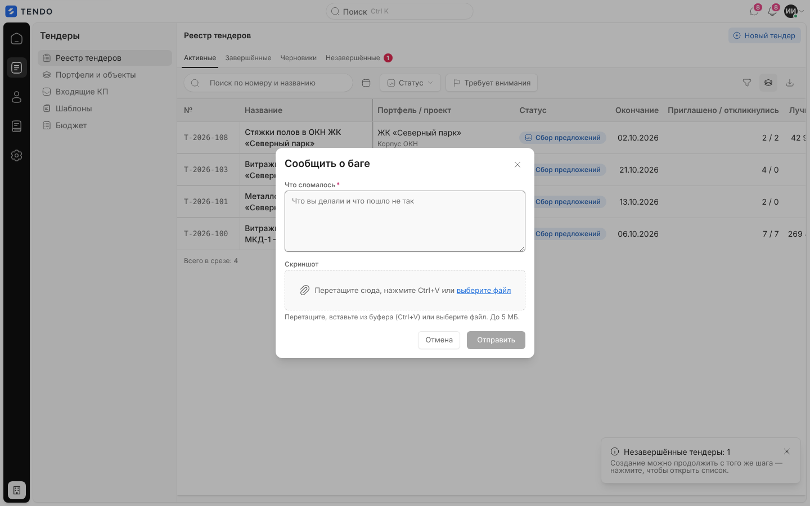

| Поле | Тип | Обяз. | Правила |
|---|---|---|---|
| Что сломалось | многострочный текст (5 строк), плейсхолдер «Что вы делали и что пошло не так» | да | «Отправить» неактивна, пока поле пустое |
| Скриншот | зона-кнопка «Перетащите сюда, нажмите Ctrl+V или выберите файл»; подсказка «Перетащите, вставьте из буфера (Ctrl+V) или выберите файл. До 5 МБ.» | нет | только изображения: «Скриншот должен быть картинкой»; больше 5 МБ — «Скриншот больше 5 МБ». Вставка из буфера работает на всём окне (если в буфере картинка). Выбранный — превью, имя, размер, кнопка «Убрать скриншот» |

- «Отправить» → «Отправляем…» → `POST /bug-reports` с описанием, адресом страницы, скриншотом (data-URI) и автоматически собранным окружением: URL, браузер, ОС, размер окна, версия приложения, время, последние 20 ошибок консоли, идентификатор последнего запроса ([../04-api/endpoints-bug-reports.md](../04-api/endpoints-bug-reports.md)). Заголовок обращения сервер берёт из первой строки описания.
- Успех — «Спасибо, мы с вами свяжемся. Разработчики увидят репорт в трекере.» и кнопка «Закрыть» (номер обращения не показывается). Ошибка — красная плашка с текстом сервера (по умолчанию «Не удалось отправить репорт»). Пока идёт отправка, окно не закрывается.

## Окно «Что нового»

Показывается **один раз** каждому пользователю на каждый выпуск сразу после входа (кроме случая принудительной настройки MFA). Содержание — заметки к выпуску: вводные пункты и разделы с пунктами (жирное начало + текст). Кнопка «Понятно»; закрытие любым способом (кнопка, крестик, Esc, клик мимо) запоминается в браузере по ключу «выпуск + пользователь». Если хранилище браузера недоступно — окно не показывается. Тексты заметок задаются в коде выпуска (наполнение — забота Заказчика при каждом релизе).

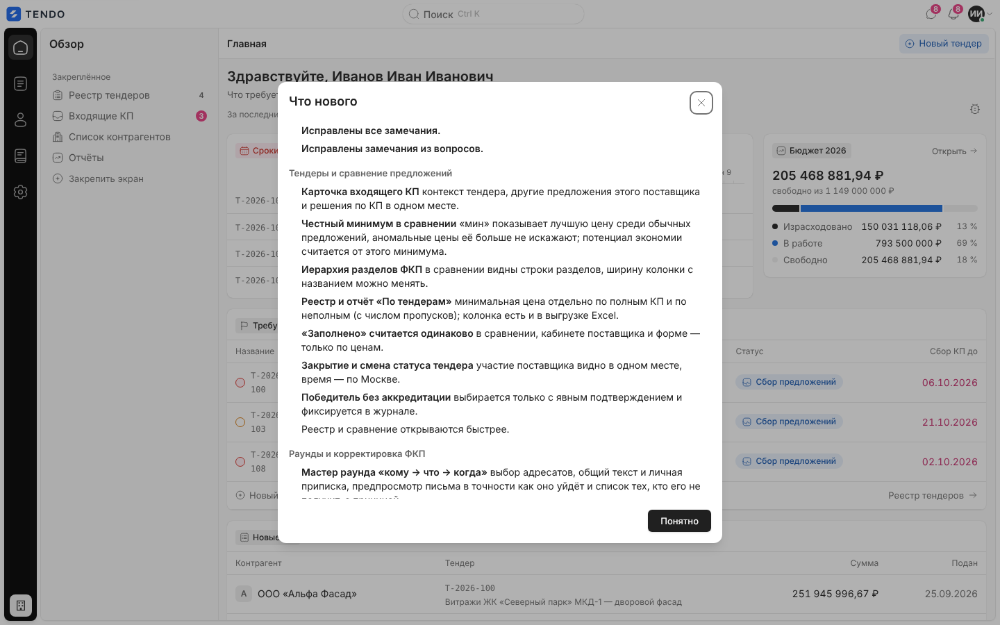

## Гейт входа

Каркас стоит за гейтом, который на **каждой** смене адреса синхронно (без повторного запроса) решает, пускать ли на адрес. Пользователь запрашивается один раз (`GET /auth/me`, кэш на 5 минут, при сбое сети/5xx — 3 повтора с нарастающей паузой).

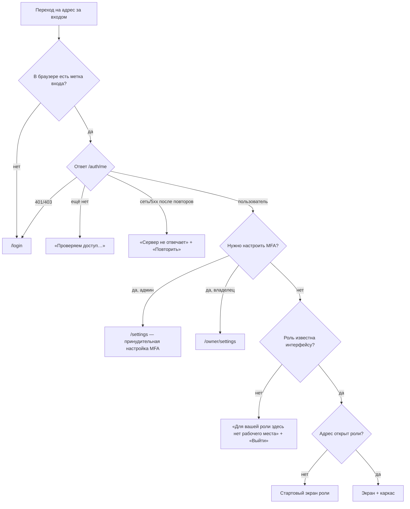

| Состояние | Что видит пользователь | Снимок |
|---|---|---|
| Проверка | По центру окна серым «Проверяем доступ…» (без каркаса) |  |
| Сервер не отвечает | Иллюстрация «нет связи», «Сервер не отвечает», «Не удалось проверить доступ. Сессия при этом не закрыта — повторите, когда связь вернётся.», кнопка «Повторить» | 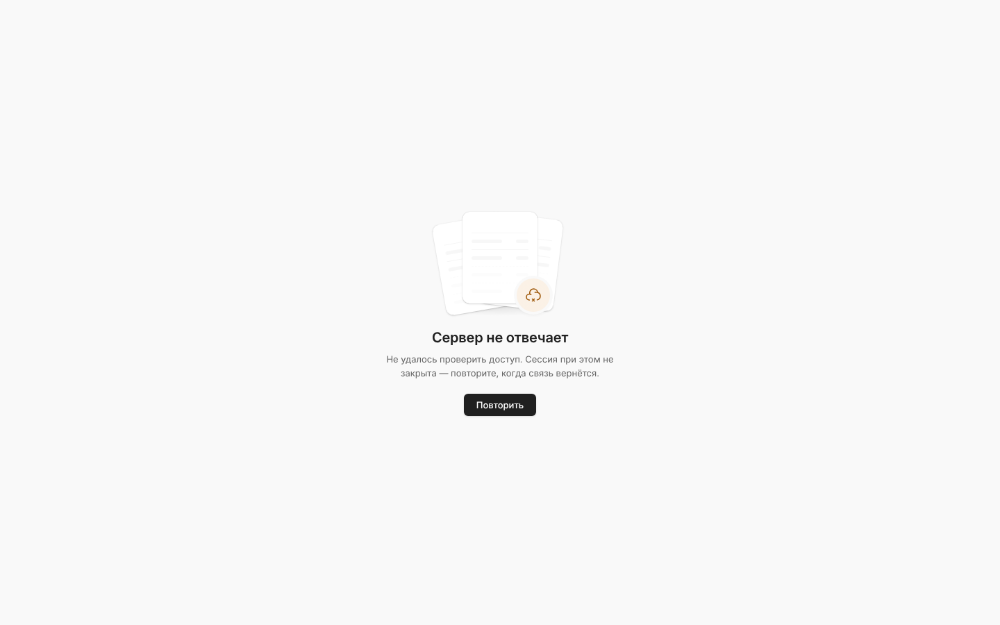 |
| Неизвестная роль | Иллюстрация, «Для вашей роли здесь нет рабочего места», «Роль учётной записи «<код>» не поддерживается этой версией интерфейса. Обратитесь к администратору системы — он сменит роль или подскажет, где работать.», кнопка «Выйти» (ответ API подменён для иллюстрации) | 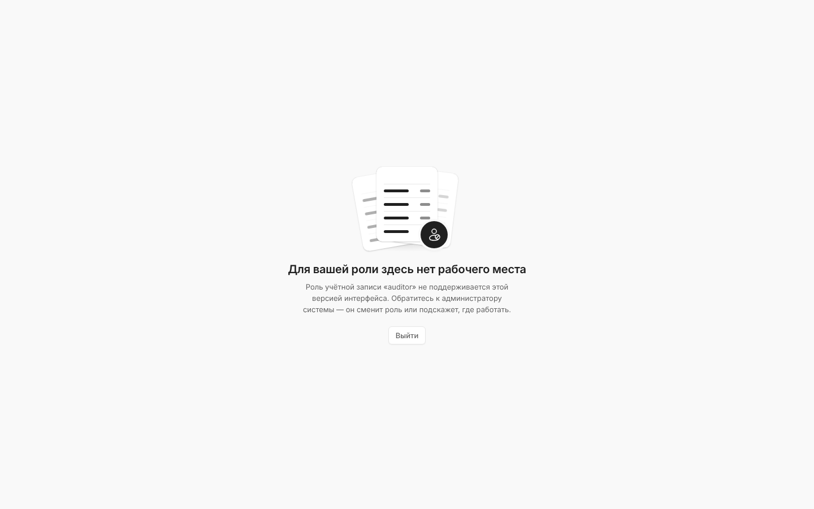 |
| Принудительная MFA | Администратор (и владелец) без MFA при `MFA_ENFORCED=true` с любого адреса уводится на настройки: красная плашка «Для продолжения работы включите двухфакторную аутентификацию. Пока второй фактор не включён, остальные разделы системы недоступны.» и строка MFA ([profile.md](profile.md#двухфакторная-аутентификация)). После включения — переход на `/home` (флаг `mfa_setup_required` подменён в ответе API для иллюстрации) | 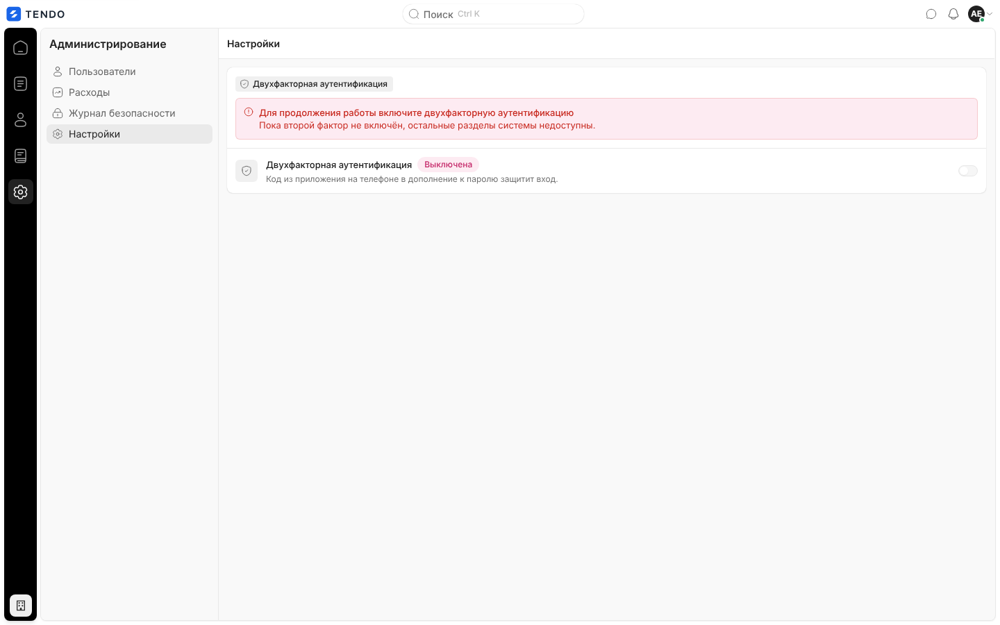 |
| Чужой адрес | Мгновенный увод на стартовый экран роли (без экрана 403). Адрес, неизвестный карте маршрутов, открыт сотрудникам и закрыт контрагенту, лиду, владельцу | — |

Лид в каркас не попадает вовсе: его единственный экран — [welcome.md](welcome.md).

## Сессия: продление и завершение

Сессия — HttpOnly-cookie (токен доступа на 15 минут + refresh), JavaScript токенов не видит; в браузере хранится только метка «этот браузер входил». Подробно — [../02-business-logic/identity.md §4.1](../02-business-logic/identity.md#41-сессия-и-cookie).

- Любой запрос, получивший 401, **один раз** обновляет сессию (`POST /auth/refresh`) и повторяет запрос. Обновление выполняется одним запросом на браузер (очередь между вкладками; вкладка, увидевшая свежее обновление соседней, не обновляет повторно).
- Если обновить нельзя (401/403 от refresh): метка входа снимается, полная перезагрузка на `/login?reason=<текст сервера>`, где текст показывается над формой (например, «Сессия завершена из-за неактивности. Войдите снова.» — [login.md](login.md#состояния-и-ошибки)). Сбой самого обновления (сеть, 5xx) сессию не рвёт.
- Ответ 403 с текстом про отключённую учётную запись или приостановленную организацию на **любом** запросе тоже уводит на `/login?reason=…`.
- Отдельного таймера простоя или предупреждения «сессия скоро истечёт» на клиенте нет: простой и абсолютный срок контролирует сервер (`SESSION_IDLE_DAYS`, `SESSION_ABSOLUTE_DAYS`).
- Страница формы КП (`/fill/$token`) проверяет сессию «пробой»: протухшая сессия там означает «гость», а не увод на вход.

## Ошибки и служебные экраны

| Экран | Когда | Содержание | Снимок |
|---|---|---|---|
| **Ошибка экрана** (внутри каркаса) | Необработанное исключение при отрисовке экрана | Иллюстрация «разорванный лист», «Экран не открылся», «Что-то сломалось при отрисовке страницы. Сохранённые данные не потеряны — попробуйте ещё раз. Если ошибка повторяется, перезагрузите страницу.», кнопки «Попробовать снова» (перерисовать экран без перезагрузки), «Перезагрузить страницу», «На главную» (полная загрузка). Топбар и рейл остаются — можно уйти в другой раздел. Текст исключения пользователю не показывается (только в консоль; в dev-сборке — под спойлером «Подробности (видно только в дев-сборке)») | 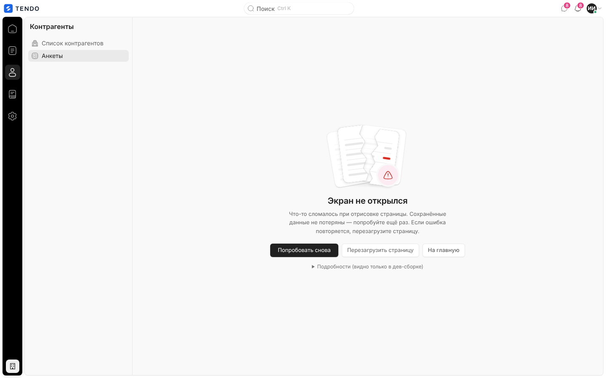 |
| **Новая версия приложения** | Не загрузился фрагмент экрана (после выкатки старые файлы удалены) | Иллюстрация «обновление», «Вышла новая версия приложения», «Эта вкладка открыта до обновления, и часть экрана больше не загружается. Перезагрузите страницу — сохранённые данные на месте.», кнопки «Перезагрузить страницу», «На главную» | 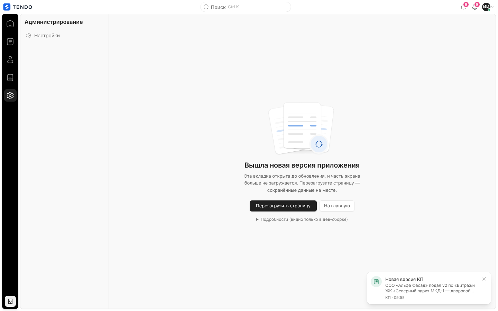 |
| **Корневая ошибка** | Сбой вне каркаса (вход, анкета, форма КП) или самого каркаса | Тот же экран на всё окно | — |
| **Страница не найдена** | Адрес не совпал ни с одним маршрутом (рисуется без каркаса, на всё окно) | Иллюстрация, «Такой страницы нет», «Адрес набран с ошибкой или ссылка устарела: страницу могли переместить или удалить.», кнопка «На главную» (`/home`; без сессии гейт уведёт на вход), строка «Код 404 · <адрес>» моноширинным для письма в поддержку; вкладка «Страница не найдена» | 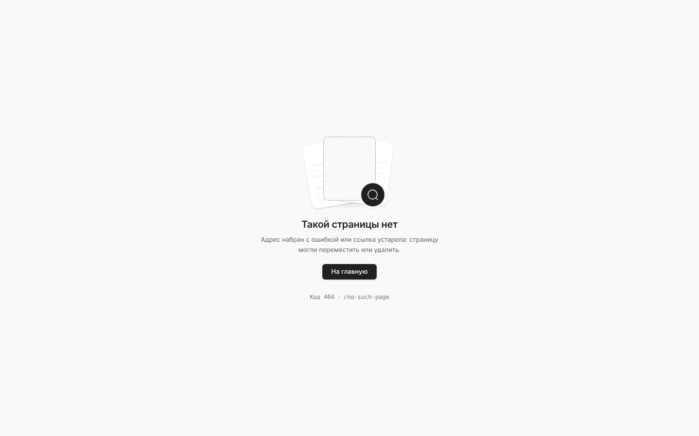 |
| **Загрузка экрана** | Пока догружается код экрана при переходе внутри каркаса | В области экрана серым «Загружаем…», появляется с задержкой 200 мс (быстрая загрузка не мигает). На стенде не воспроизводится стабильно — снимка нет | — |

Тосты (короткие сообщения о результате действий) выводятся в правом нижнем углу, один слой на приложение.

## Адаптив и сенсорные экраны

Каркас рассчитан на настольные экраны (эталон 1440×900); отдельной мобильной вёрстки экранов нет. Правила при ширине окна **≤ 900 px**:

- Сайдбар перестаёт быть колонкой и **всплывает над содержимым** (с тенью, без затемнения); при старте на узком экране он закрыт. Тап мимо панели (прозрачная подложка) закрывает её, первое касание не доходит до страницы. Переход по пункту дерева тоже закрывает панель.
- Панель «Анализ ИИ» так же всплывает справа поверх содержимого (ширина — не больше окна).
- Топбар сжимает логотип и капсулу поиска; иконки справа не сжимаются.
- На устройствах без наведения (`hover: none`) кнопки шапки сайдбара видны всегда; на сенсорных экранах зона нажатия галочки «Отказ» в форме КП увеличена до 44 px.
- Широкие таблицы прокручиваются горизонтально внутри своего блока.
- `prefers-reduced-motion` отключает анимации колонок каркаса.

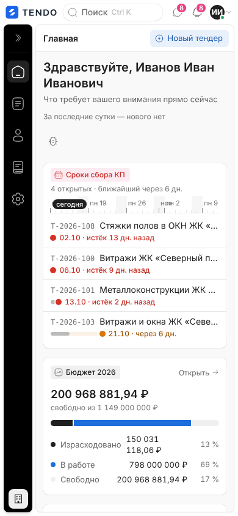 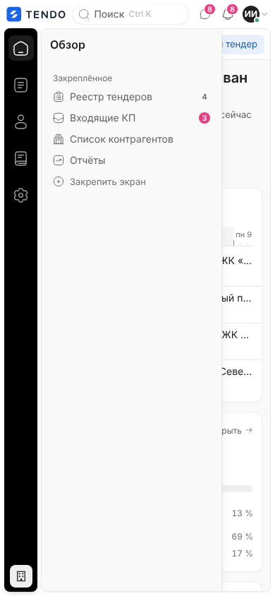

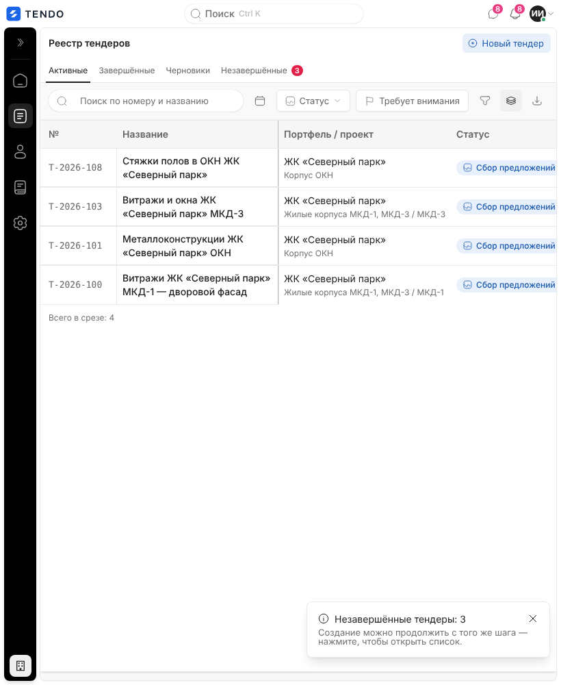

## API каркаса

| Действие | Запрос |
|---|---|
| Кто вошёл | `GET /auth/me` ([../04-api/endpoints-identity.md](../04-api/endpoints-identity.md#get-authme)) |
| Продление / выход | `POST /auth/refresh`, `POST /auth/logout` |
| Поток счётчиков (уведомления, чаты) | `GET /notifications/stream`; запасной `GET /notifications?limit=8` |
| Лента колокольчика, прочитать | `POST /notifications/{id}/read`, `POST /notifications/read-all` |
| Поиск | реестр тендеров, `GET /quotes`, `GET /suppliers` |
| Панель «Обзор» (счётчики) | реестр тендеров, `GET /quotes` |
| Баг-репорт | `POST /bug-reports` |

## Сложность

**L** в целом: топбар с поиском и уведомлениями — M (живой поток с лидером вкладок — M, учтён в домене уведомлений); рейл, флайаут, сайдбар, панель «Обзор» с закреплением и недавними — M; гейт, продление сессии с очередью вкладок — M; экраны ошибок, «Что нового», баг-репорт — S; адаптив ≤ 900 px — S.
