# Реестр контрагентов (`/suppliers`)

Справочник всех организаций-подрядчиков: поиск и серверные фильтры по статусам проверок, пулу, видам работ, региону, сроку работы и выручке; вкладка «Новые» для свежих анкет; приглашение к саморегистрации по ссылке; ручное заведение контрагента с проверкой реквизитов; корзина удалённых.

Связанные разделы: бизнес-логика — [../02-business-logic/suppliers.md](../02-business-logic/suppliers.md) (статусная модель §3.5–3.7, корзина §3.9, ручное заведение §4.4, поиск и фильтры §4.14); API — [../04-api/endpoints-suppliers.md](../04-api/endpoints-suppliers.md), ссылки-приглашения — [../04-api/endpoints-suppliers-registration.md](../04-api/endpoints-suppliers-registration.md); карточка — [supplier-card.md](supplier-card.md); выгрузка списка — отчёт «По контрагентам» на [reports.md](reports.md).

## Маршрут

- `/suppliers`. **Срез живёт в адресе**: поиск и фильтры пишутся в query-параметры заменой записи истории — ссылкой на отфильтрованный реестр можно поделиться: `q`, `overall_status`, `sb_status`, `legal_status`, `finance_status`, `pool`, `status` (квалификация), `work_type_id`, `region`, `operating_period` (значения списков — через запятую), `revenue_year`, `revenue_min`; вкладка «Новые» — `new=1`. Пустые значения в адрес не пишутся.
- Заголовок — «Список контрагентов».

## Назначение

Найти контрагента и перейти в его карточку, увидеть одним взглядом его аккредитацию и пул, отобрать подрядчиков под тендер по виду работ и проверкам, завести нового — по ссылке-анкете или вручную.

## Роли и права

| Роль | Доступ | Отличия |
|---|---|---|
| Тендерный специалист | Да | Без значка «Корзина»; в ручном заведении статус — только «Анкета не заполнена» |
| Администратор | Да | Значок «Корзина»; в ручном заведении доступен статус «Сразу одобрен» |
| СБ, юрист | Да (раздел «Контрагенты» → «Список контрагентов»; пункта «Анкеты» нет) | Как у специалиста: видят «Добавить вручную» и «Пригласить контрагента» — сервер разрешает (см. [users-and-roles.md §7](../01-product/users-and-roles.md#7-расхождения-и-рекомендации-для-воссоздания)) |
| Поставщик, лид, владелец площадки | Нет | Перенаправление на стартовый экран роли |

Корзина и восстановление требуют права `suppliers.manage`; интерфейс показывает значок по роли «администратор».

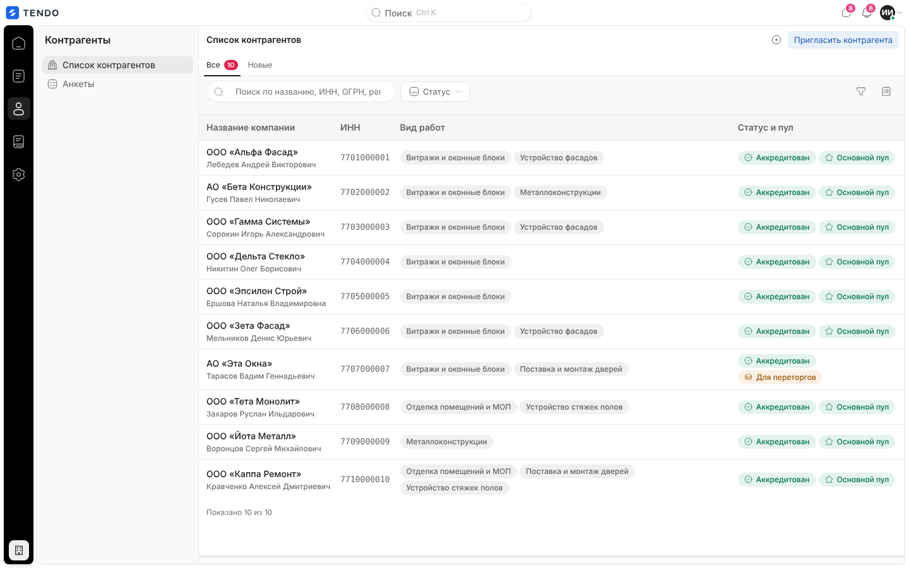

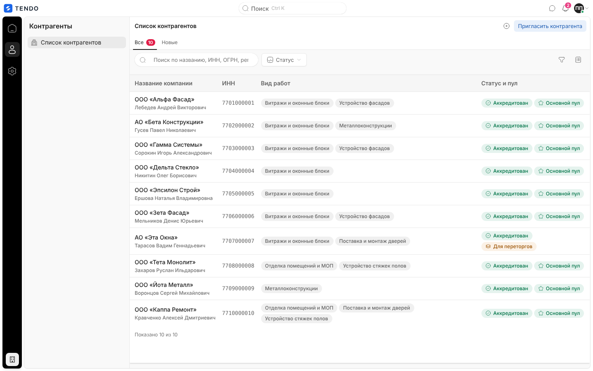

## Как попасть

- Рейл «Контрагенты» → «Список контрагентов».
- Из карточки контрагента — крошка «Список контрагентов»; после удаления контрагента в корзину.

## Общая компоновка

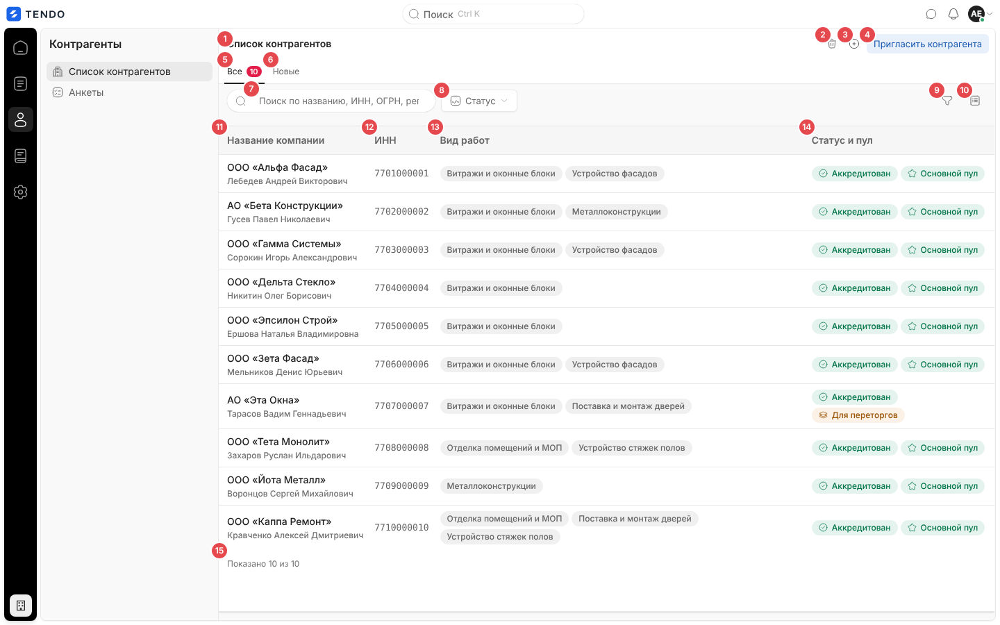

| № | Элемент | Поведение |
|---|---|---|
| ① | Заголовок «Список контрагентов» | — |
| ② | Значок «Корзина» | Только администратор. Окно корзины — см. [Корзина](#корзина) |
| ③ | Значок «+» «Добавить вручную» | Окно ручного заведения — см. [Ручное добавление](#ручное-добавление-контрагента) |
| ④ | «Пригласить контрагента» | Окно ссылки на анкету саморегистрации — см. [Приглашение](#приглашение-к-регистрации) |
| ⑤ | Вкладка «Все» + счётчик | Все строки текущего среза |
| ⑥ | Вкладка «Новые» + счётчик | Только строки со статусом квалификации «Новая анкета» (`new`). Если при первом открытии такие есть — экран сам открывается на «Новых» |
| ⑦ | Поиск «Поиск по названию, ИНН, ОГРН, региону, ФИО» | Серверный (`q`), уходит через 250 мс после последней клавиши; совпадения в названии, ИНН и ФИО руководителя подсвечиваются. Сервер ищет также по краткому названию и опыту работ ([BL §4.14](../02-business-logic/suppliers.md#414-реестр-поиск-и-фильтры)) |
| ⑧ | «Статус» | Мультивыбор сводного статуса — см. [Фильтры](#фильтры) |
| ⑨ | «Фильтры» (воронка) | Окно фасетных фильтров; при активных — счётчик |
| ⑩ | «Выручка» | Окно фильтра по выручке; при активном — точка |
| ⑪–⑭ | Колонки таблицы | см. [Колонки](#колонки) |
| ⑮ | Подпись «Показано N из M» | N — строки на вкладке, M — всего в срезе |

## Колонки

| Колонка | Содержимое |
|---|---|
| Название компании | Полное наименование — ссылка на карточку `/suppliers/<id>`; вторыми строками серым: «добавлен вручную», «заполнена по старой ссылке» (анкета пришла по перевыпущенной/старой ссылке), ФИО руководителя |
| ИНН | Моноширинным |
| Вид работ | Капсулы видов работ контрагента; нет — «—» |
| Статус и пул | Капсула сводного статуса («Анкета не заполнена», «Черновик анкеты», «На проверке», «Аккредитован», «Отклонён») + капсула пула («Основной пул», «Для переторгов», «Вне пулов») — те же слова и цвета, что в карточке |

- Кликабельна вся строка; настоящая ссылка — на названии (средняя кнопка, «открыть в новой вкладке»).
- Порядок — как отдаёт сервер (по id), но строки «Новая анкета» поднимаются наверх.
- **Сортировки по колонкам нет. Пагинации нет**: реестр загружается целиком (сервер отдаёт страницами до 200, клиент дочитывает все), строки рисуются виртуализированно (в DOM — только видимое окно, высота строки ≈ 56 px).
- **Массовых действий нет** (строки не выделяются). **Выгрузки нет** — список контрагентов выгружается отчётом «По контрагентам» ([reports.md](reports.md)).

## Фильтры

Все фильтры серверные и складываются через «И»; внутри одного фильтра значения — через «ИЛИ». Значения критериев берутся из `GET /suppliers/status-facets` (полный словарь со счётчиками по живому реестру, включая нулевые), а не из текущей выдачи.

### «Статус» (сводный)

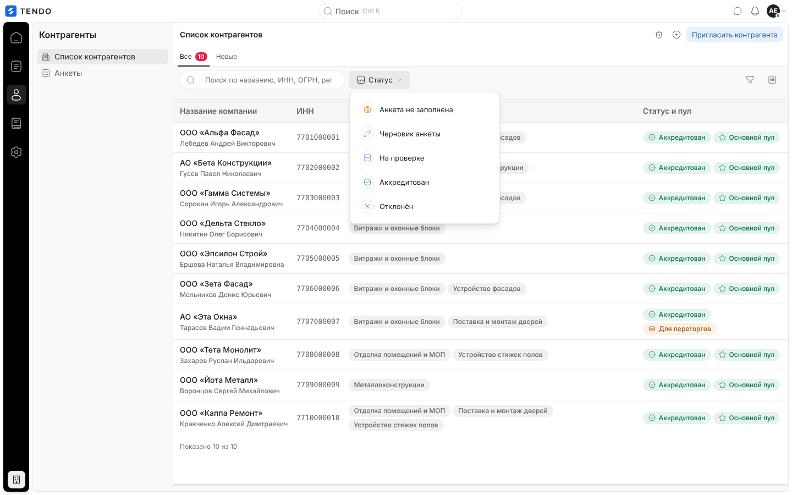

Пять значений сводного статуса с цветом и значком; меню не закрывается по клику. Подпись кнопки: «Статус», «Статус · N», при одном выбранном — сама капсула. В подвале — «Очистить статусы · N».

### Окно «Фильтры»

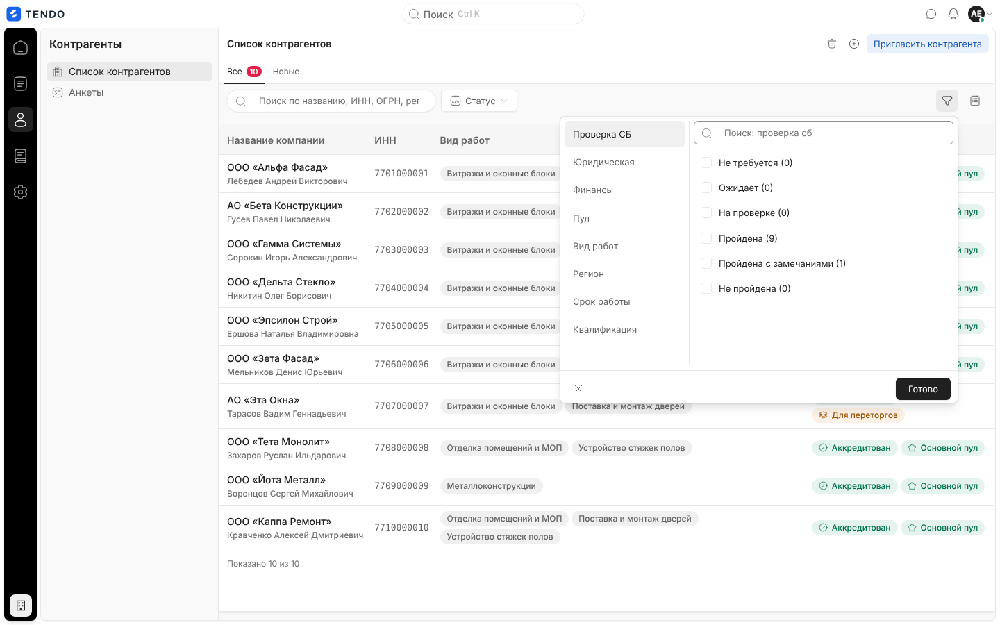

| Критерий | Значения |
|---|---|
| Проверка СБ | «Не требуется», «Ожидает», «На проверке», «Пройдена», «Пройдена с замечаниями», «Не пройдена» (со счётчиками) |
| Юридическая | та же шкала |
| Финансы | «Ожидает», «Одобрено», «Одобрено с лимитом», «Отказ» |
| Пул | «Основной пул», «Для переторгов», «Вне пулов» |
| Вид работ | Активные виды работ справочника деревом (уровень — отступ «— ») |
| Регион | Различные регионы живого реестра со счётчиками |
| Срок работы | «Меньше 1 года», «1–3 года», «3–5 лет», «5–10 лет», «Больше 10 лет», «Дата не указана» |
| Квалификация | «Новая анкета», «Анкета не заполнена», «На согласовании», «Проверяется», «На доработке», «Одобрен», «Одобрен с лимитом», «Отклонён» |

Слева — список критериев, справа — поиск по значениям критерия («Поиск: проверка сб») и флажки. Применяется сразу, без «Применить»; внизу — «Очистить всё» и «Готово».

> **Дефект.** Вид работ можно отметить несколько, но сервер принимает один `work_type_id` — в запрос уходит только первый выбранный (см. [открытые вопросы](../_oq/SCR-3.md)).

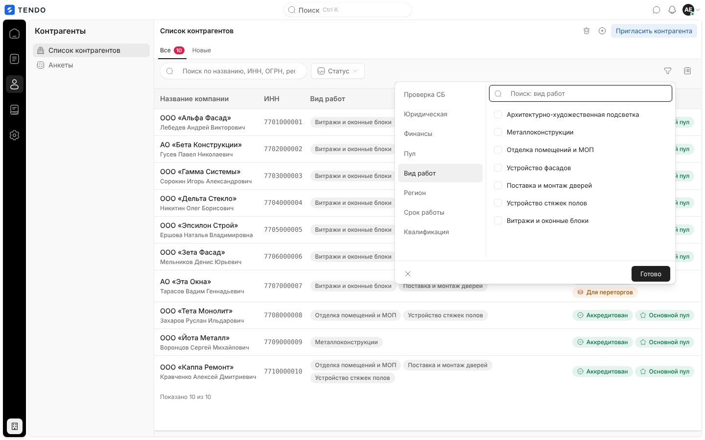

### «Выручка»

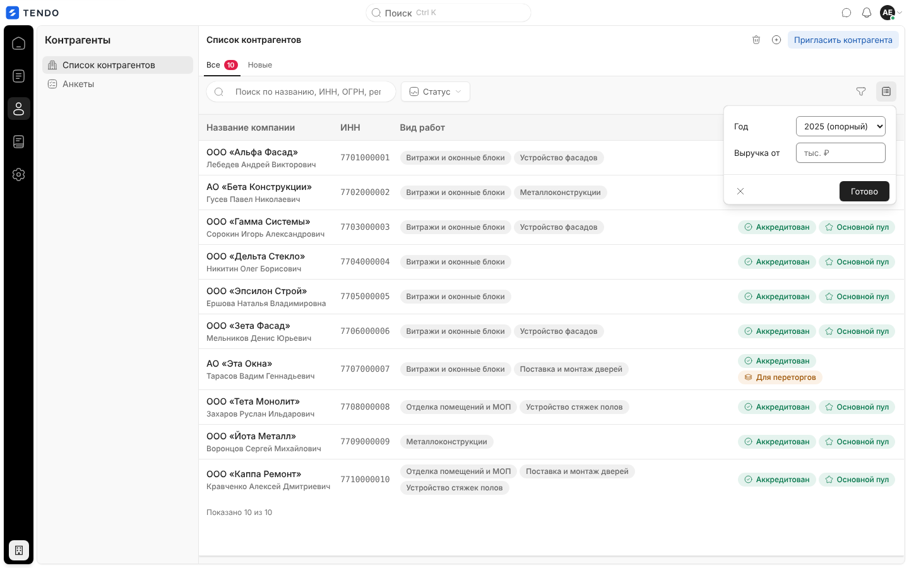

«Год» — выпадающий список: следующий, опорный (прошлый, помечен «(опорный)»), три предыдущих; «Выручка от» — число в тыс. ₽. Внизу — «Очистить выручку» и «Готово». Без строки выручки за выбранный год контрагент в выдачу не попадает.

### Активные фильтры

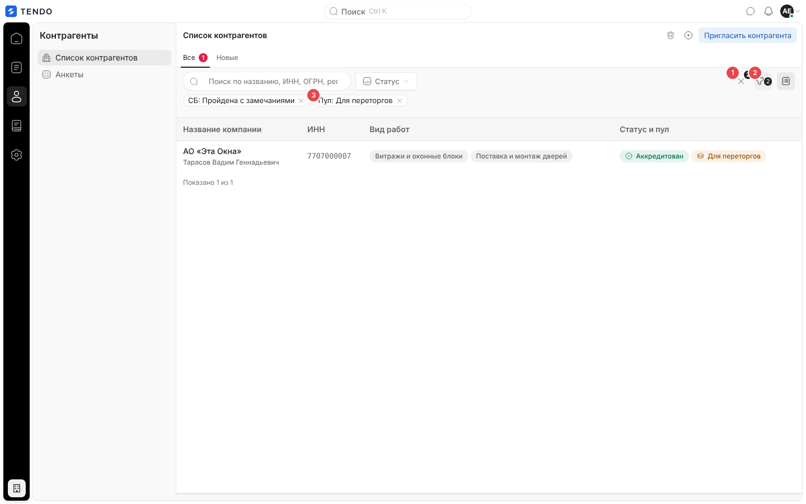

| № | Элемент | Поведение |
|---|---|---|
| ① | Крестик «Сбросить фильтры · N» | Снимает все фильтры, **кроме поиска** |
| ② | «Фильтры · N» | Кнопка подсвечена, счётчик активных значений |
| ③ | Чипы «СБ: Пройдена с замечаниями», «Пул: Для переторгов», «Выручка за 2025 от 1000»… | Клик по чипу снимает одно значение, не открывая окно |

Счётчик N — число выбранных значений во всех списках + поиск + «Выручка от».

## Приглашение к регистрации

Ссылка открывает публичную анкету саморегистрации (`/register?token=…`). Правила ссылок — [BL §3.2](../02-business-logic/suppliers.md#32-ссылка-на-анкету-саморегистрации), API — [POST /suppliers/invitations](../04-api/endpoints-suppliers-registration.md#post-suppliersinvitations), [regenerate](../04-api/endpoints-suppliers-registration.md#post-suppliersinvitationsinvitation_idregenerate), [revoke](../04-api/endpoints-suppliers-registration.md#post-suppliersinvitationsinvitation_idrevoke).

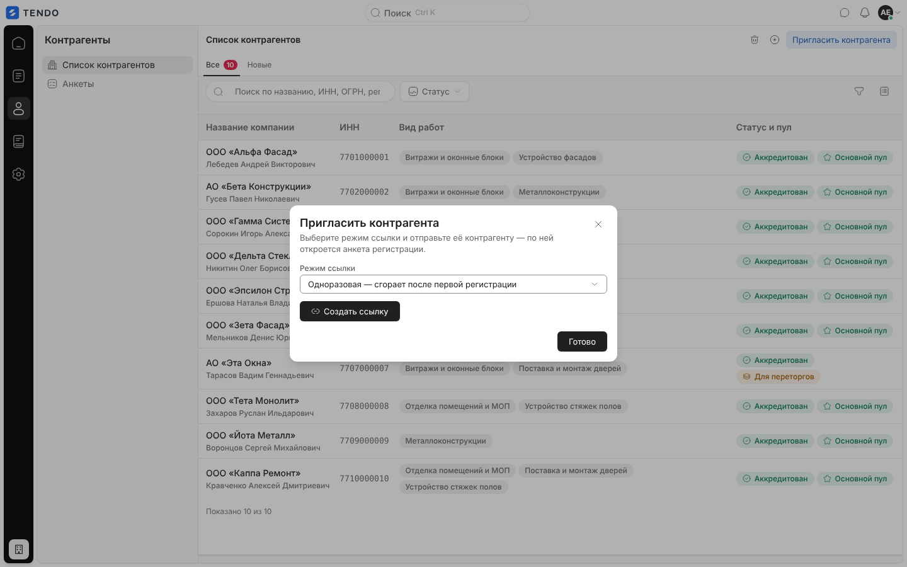

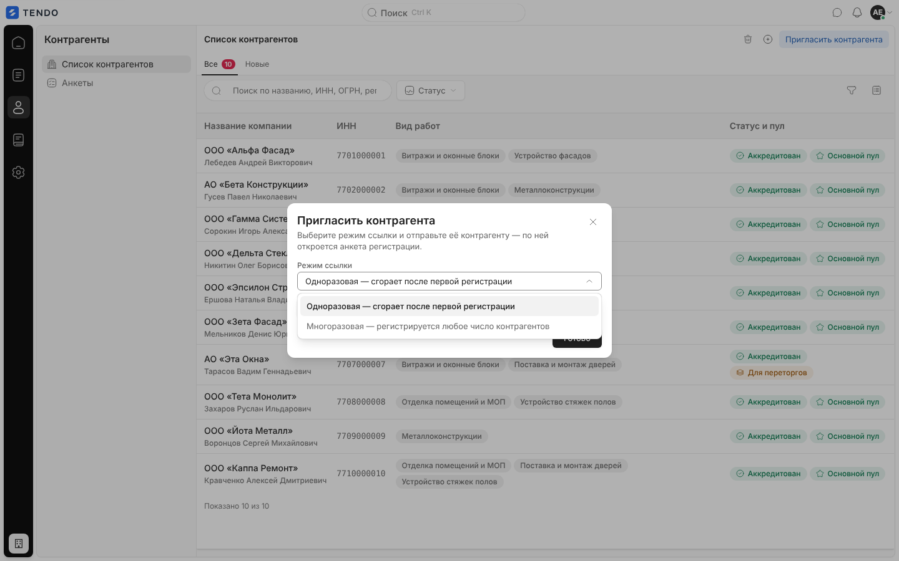

1. Окно «Пригласить контрагента» / «Выберите режим ссылки и отправьте её контрагенту — по ней откроется анкета регистрации.».
2. «Режим ссылки»: «Одноразовая — сгорает после первой регистрации» (по умолчанию) или «Многоразовая — регистрируется любое число контрагентов».
3. «Создать ссылку» (во время запроса — «Создаём…») → поле «Ссылка-приглашение» с кнопкой копирования и подписью «Режим: одноразовая/многоразовая.»; выбор режима блокируется с подсказкой «Режим уже зафиксирован в созданной ссылке.».

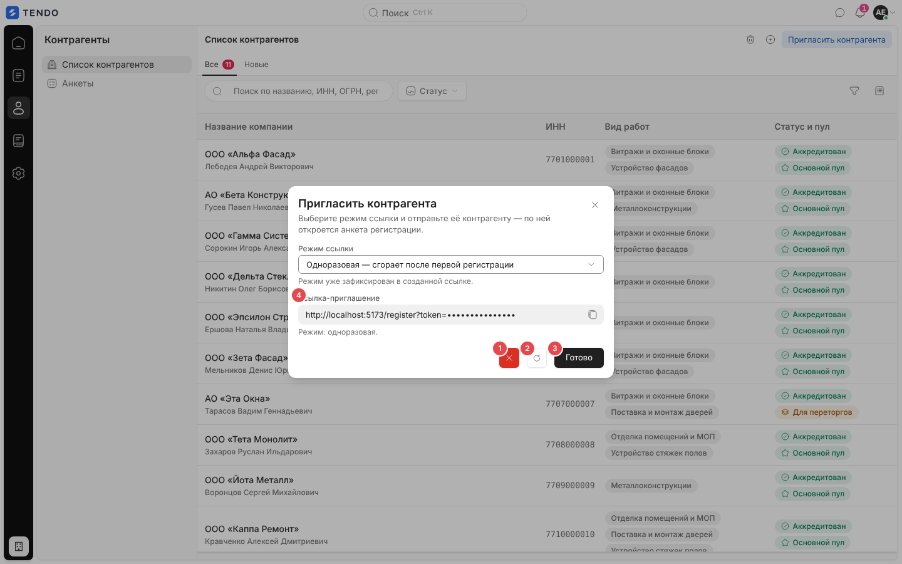

| № | Элемент | Поведение |
|---|---|---|
| ① | Значок «Обнулить» (красный) | Подтверждение «Обнулить ссылку? Она перестанет работать, новой не будет.» → ссылка гаснет, поле очищается, можно создать новую |
| ② | Значок «Перевыпустить» | Старая ссылка перестаёт работать, в поле — новая |
| ③ | «Готово» | Закрывает окно |
| ④ | Поле ссылки | Только чтение + «Скопировать» |

Ошибка создания — красный текст под кнопкой («Не удалось создать ссылку-приглашение» или текст сервера). Письмо из окна не отправляется — ссылку копируют и пересылают сами. Журнал выданных ссылок (`GET /suppliers/invitations/list`) на этом экране не показывается.

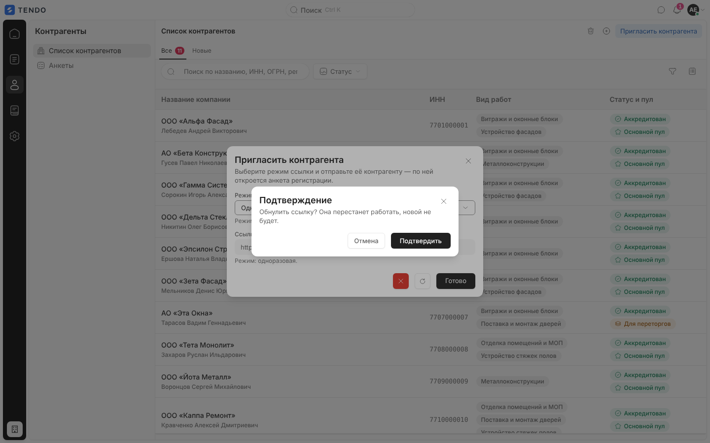

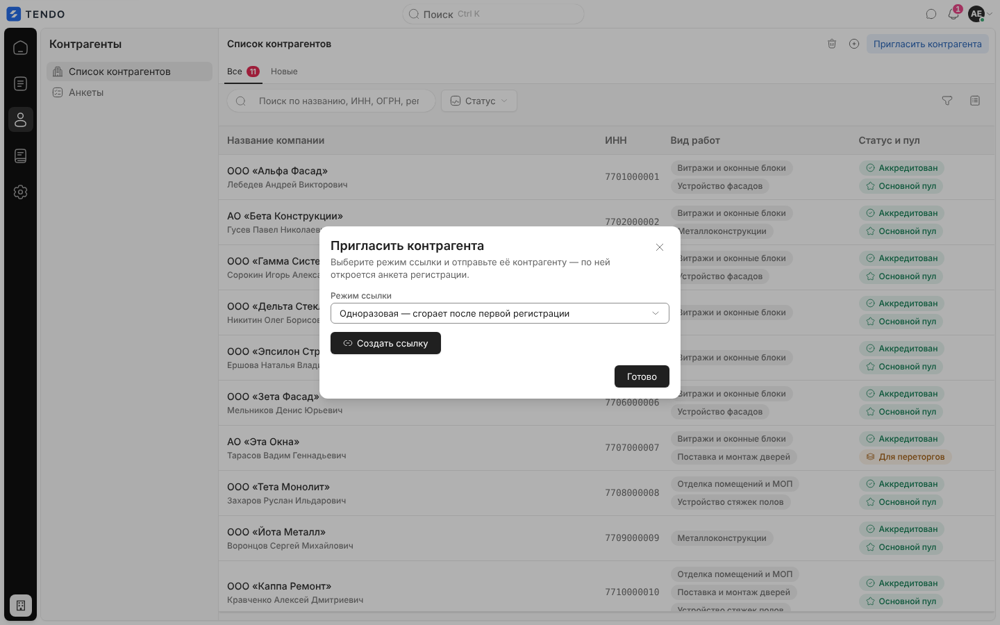

## Ручное добавление контрагента

Окно «Добавить контрагента вручную» / «Реквизиты проверяются так же, как в анкете. Заполнить их можно по ИНН из ЕГРЮЛ.»; у заголовка — бирка «Без анкеты» с подсказкой «Анкету и согласие на обработку персональных данных система не соберёт — запись создаётся напрямую. Запросить их можно позже отдельным приглашением.». API — [POST /suppliers](../04-api/endpoints-suppliers.md#post-suppliers), [GET /suppliers/inn-lookup](../04-api/endpoints-suppliers.md#get-suppliersinn-lookup).

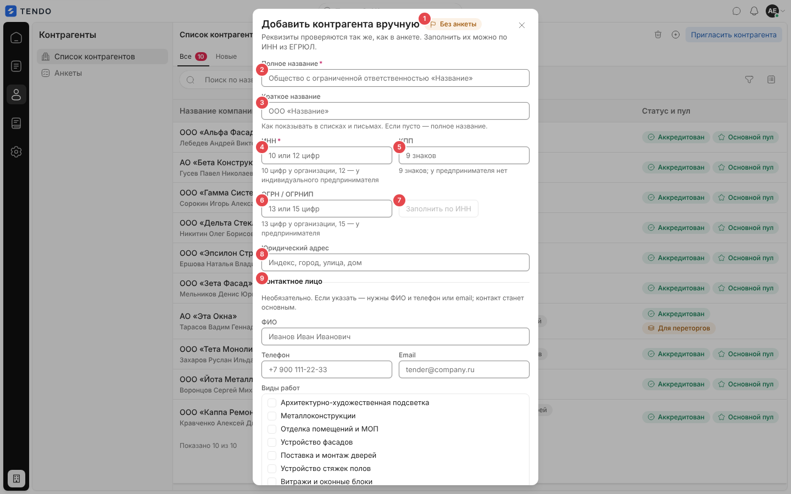

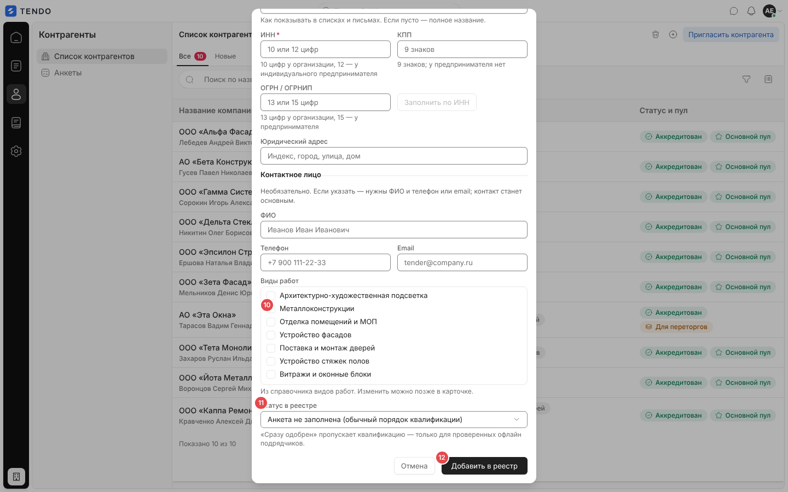

| № | Поле | Тип / формат | Обяз. | Проверка и тексты ошибок |
|---|---|---|---|---|
| ① | Бирка «Без анкеты» | подсказка | — | — |
| ② | Полное название | текст, плейсхолдер «Общество с ограниченной ответственностью «Название»» | да | пусто — «Укажите название компании» |
| ③ | Краткое название | текст, «ООО «Название»»; подсказка «Как показывать в списках и письмах. Если пусто — полное название.» | нет | — |
| ④ | ИНН | только цифры (прочее отбрасывается при вводе), максимум 12; подсказка «10 цифр у организации, 12 — у индивидуального предпринимателя» | да | «Укажите ИНН»; «ИНН состоит только из цифр»; «ИНН должен содержать 10 цифр у организации или 12 у индивидуального предпринимателя»; «Проверьте ИНН: первые две цифры — код региона, 00 не бывает»; «Проверьте ИНН: контрольная цифра (контрольные цифры) не сходится(-ятся), скорее всего опечатка». **При уходе из поля** ИНН проверяется на дубль на сервере (см. ниже) |
| ⑤ | КПП | 9 знаков, приводится к верхнему регистру, пробелы удаляются; подсказка «9 знаков; у предпринимателя нет» | нет | «КПП состоит из 9 знаков»; «Проверьте КПП: цифры, кроме 5-й и 6-й позиции»; «Проверьте КПП: 5-я и 6-я позиции — цифры или латинские буквы A-Z»; «Проверьте КПП: первые две цифры — код региона, 00 не бывает» |
| ⑥ | ОГРН / ОГРНИП | только цифры, максимум 15; подсказка «13 цифр у организации, 15 — у предпринимателя» | нет | «ОГРН состоит только из цифр»; «ОГРН содержит 13 цифр, ОГРНИП — 15»; «Проверьте ОГРН: первая цифра — признак регистрации, нулём она не бывает»; «Проверьте ОГРН: 4-я и 5-я цифры — код региона, 00 не бывает»; «Проверьте ОГРН/ОГРНИП: контрольная цифра не сходится, скорее всего опечатка»; пара с ИНН: «У организации (ИНН из 10 цифр) ОГРН содержит 13 цифр — здесь указан ОГРНИП» / «У предпринимателя (ИНН из 12 цифр) номер называется ОГРНИП и содержит 15 цифр» |
| ⑦ | «Заполнить по ИНН» | кнопка; неактивна без ИНН | — | см. ниже |
| ⑧ | Юридический адрес | текст, «Индекс, город, улица, дом» | нет | «Слишком длинный юридический адрес: не больше N символов»; «Слишком короткий юридический адрес — укажите город, улицу и номер дома»; «Укажите юридический адрес словами, а не одними цифрами»; «В поле «юридический адрес» не хватает номера дома»; «Укажите юридический адрес полностью: город, улица, дом» |
| ⑨ | Группа «Контактное лицо»: ФИО, Телефон, Email | «Необязательно. Если указать — нужны ФИО и телефон или email; контакт станет основным.» | условно | ФИО: «Укажите ФИО», «ФИО может содержать только буквы, пробелы, дефис и точку», «Укажите ФИО полностью — минимум фамилию и имя»; телефон (плейсхолдер «+7 900 111-22-33», при уходе из поля приводится к виду `+7 900 111-22-33`): «Укажите телефон без добавочного номера», «Телефон может содержать только цифры, пробелы и знаки + ( ) -», «Код страны +8 не существует: для России укажите +7», «Российский телефон — это 10 цифр после +7, например +7 900 111-22-33», «Проверьте код города или оператора: он не может начинаться с 0, 1 или 2», «Проверьте телефон: одинаковые цифры — это не номер», «Телефон должен содержать от 8 до 15 цифр вместе с кодом страны»; email (обрезается при уходе): «Укажите корректный email», «Email длиннее N символов»; ни телефона, ни email — «Укажите телефон или email контакта» |
| ⑩ | Виды работ | список флажков из справочника (высота 180 px, прокрутка); подсказка «Выбрано: N. Изменить можно позже в карточке.» | нет | — |
| ⑪ | Статус в реестре | выпадающий список: «Анкета не заполнена (обычный порядок квалификации)» (по умолчанию); администратору — ещё «Сразу одобрен (проверенный офлайн подрядчик)» с подсказкой «… только для проверенных офлайн подрядчиков.» | да | — |
| ⑫ | «Добавить в реестр» | кнопка (во время запроса — «Сохраняю…»); неактивна, пока показан дубль ИНН | — | — |

Правила ввода — общие для анкеты и сервера ([BL §4.1–4.2](../02-business-logic/suppliers.md#41-реквизиты-организации)); проверка выполняется до отправки, ошибки сервера (`400 {detail: {fieldErrors}}`) ложатся в те же поля, прочие — красной плашкой вверху окна («Не удалось добавить контрагента»).

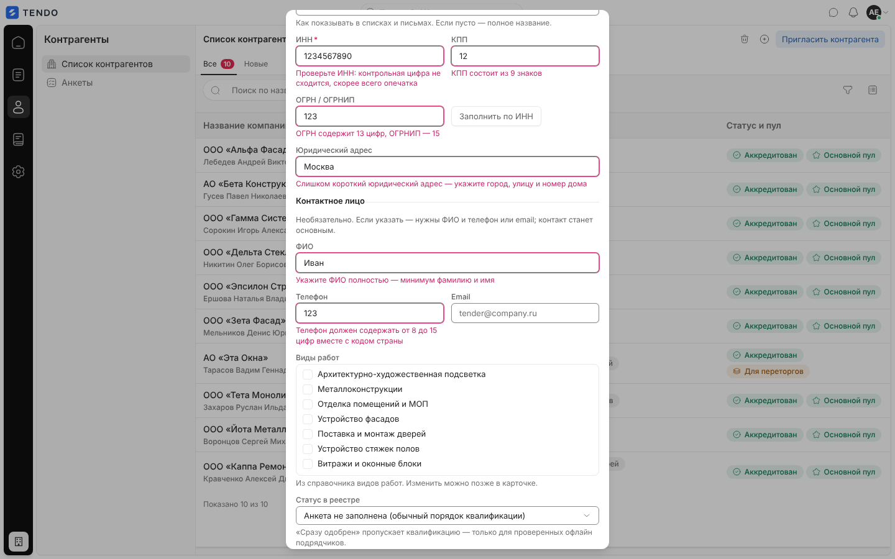

- **Дубль ИНН.** При уходе из поля ИНН (если он сам по себе корректен) сервер проверяет реестр: занят — под полем «Контрагент с таким ИНН уже есть: <название> → Открыть» (ссылка на карточку); в корзине — «Контрагент с таким ИНН уже есть в корзине: <название>. Восстановите его вместо новой карточки.». Кнопка «Добавить в реестр» при этом неактивна.
- **«Заполнить по ИНН».** Запрос в публичный реестр ЕГРЮЛ/ЕГРИП ([BL §4.5](../02-business-logic/suppliers.md#45-заполнить-по-инн)), подпись кнопки на время запроса — «Ищем в ЕГРЮЛ…». Найдено — окно «Подставить сведения ЕГРЮЛ?» со списком (название, краткое название, ОГРН, КПП, адрес, «Внимание: организация, похоже, недействующая.») и «Заполненные поля будут заменены.» → «Подставить». Не найдено или реестр недоступен — строка под кнопкой «<сводка>. Заполните поля вручную.» (на стенде: «Таймаут ЕГРЮЛ; контрольная сумма ИНН верна. Заполните поля вручную.»).

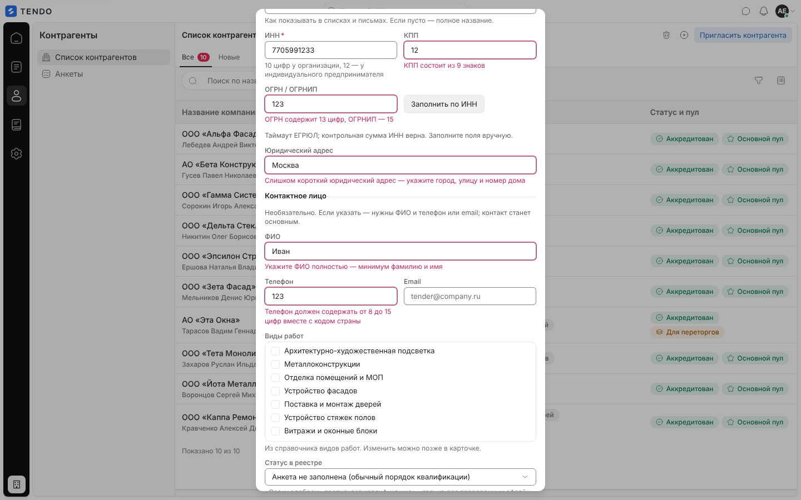

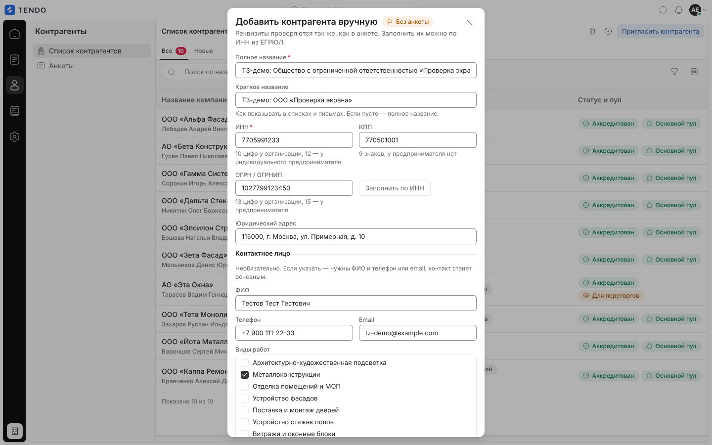

После создания строка добавляется в конец текущего среза без перечитывания реестра, окно закрывается и очищается; у строки — пометка «добавлен вручную», сводный статус «Анкета не заполнена».

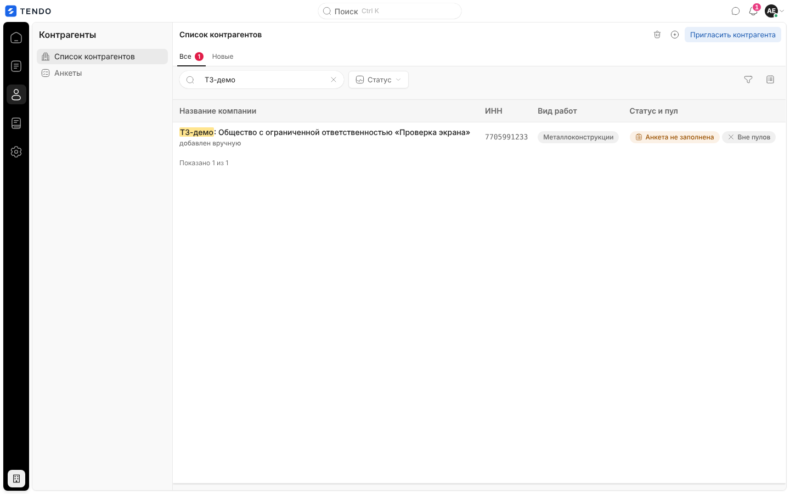

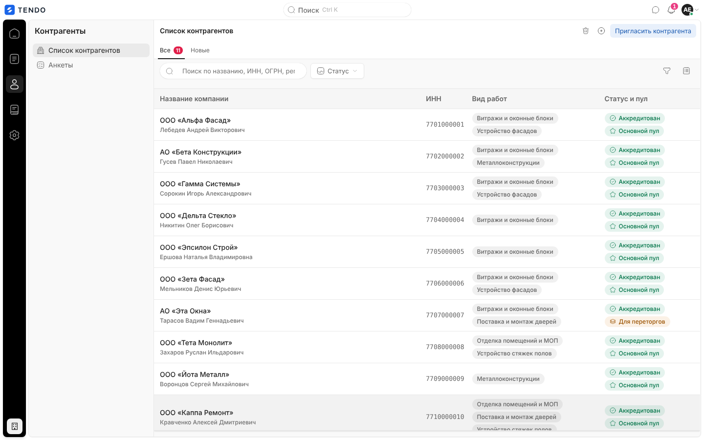

## Корзина

Окно «Корзина» / «Удалённые контрагенты — данные не стёрты, восстановление возвращает их в общий реестр.» (только администратор; API — [корзина](../04-api/endpoints-suppliers.md#корзина)). Список: название, «ИНН …», справа значки:

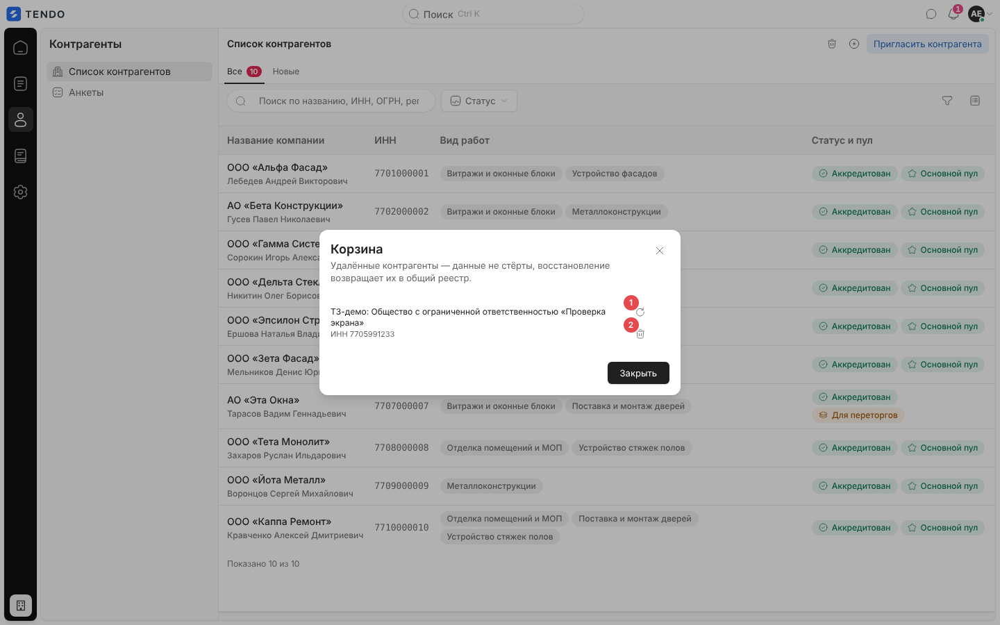

| № | Действие | Поведение |
|---|---|---|
| ① | «Восстановить «<название>»» | Без подтверждения; строка уходит из корзины и добавляется в реестр |
| ② | «Удалить навсегда «<название>»» (красный) | Подтверждение «Удалить «<название>» безвозвратно? Карточка, контакты и вложения будут стёрты из базы — отменить это нельзя.» → `DELETE /suppliers/{id}/hard` |

Пустая корзина — «Корзина пуста.»; загрузка — «Загружаем…»; сбой — «Корзина не загрузилась» + «Повторить». Ошибки действий — окном «Не удалось восстановить контрагента» / «Не удалось удалить контрагента безвозвратно» (сервер может отказать, если у контрагента есть связи — [BL §3.9](../02-business-logic/suppliers.md#39-корзина-и-удаление)).

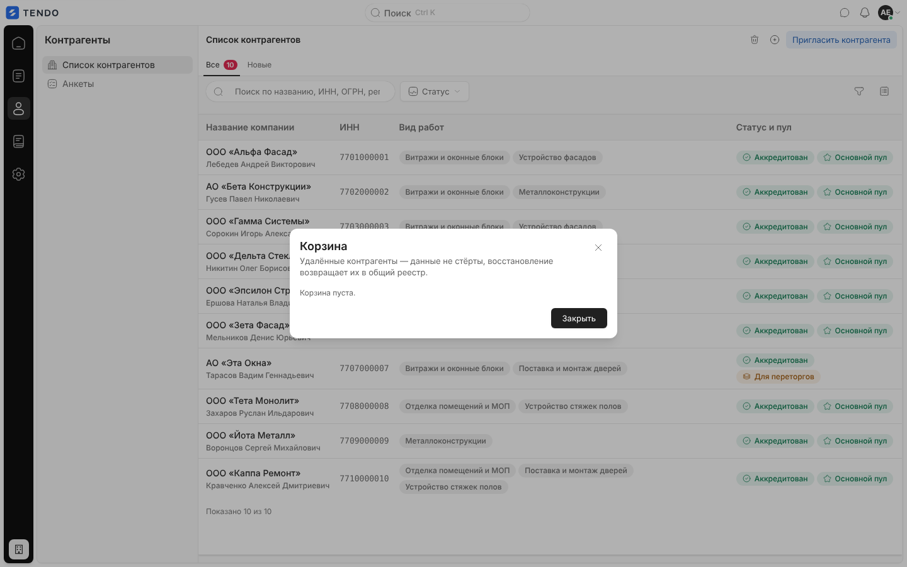

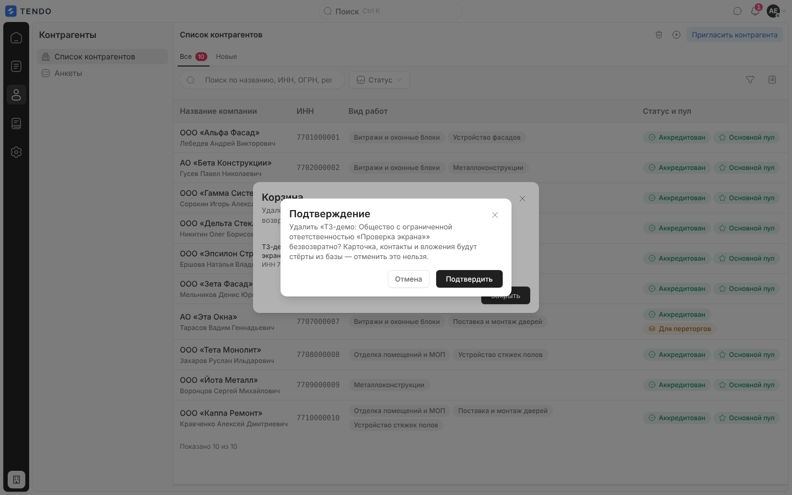

## Данные

`GET /suppliers` с параметрами среза (все страницы), `GET /suppliers/status-facets` (один раз при открытии), справочник видов работ из общего кэша. При возврате на экран показывается кэш и тут же перечитывается. Во время загрузки нового среза на экране остаётся прежний (таблица не мигает).

## Состояния

| Состояние | Что видит пользователь | Снимок |
|---|---|---|
| Загрузка | 4 полосы-скелетона в таблице (для скринридера — «Загружаем список контрагентов…») | 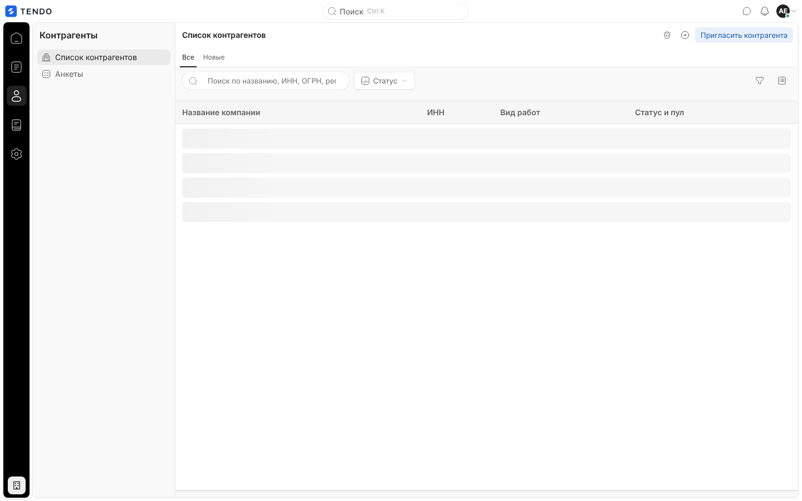 |
| Ошибка | Над таблицей — «Контрагенты не загрузились» + текст + «Повторить»; таблица пуста | 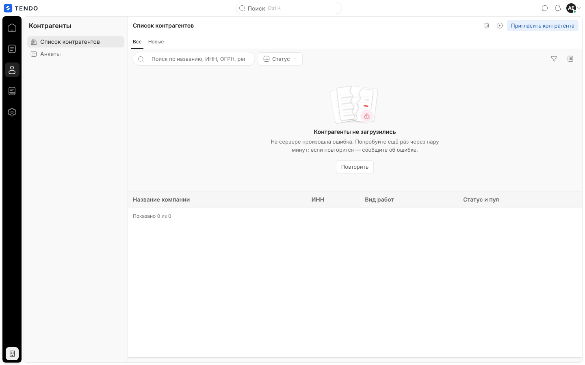 |
| Реестр пуст | «Контрагентов пока нет» / «Добавьте контрагента вручную или отправьте ссылку на саморегистрацию.» | — |
| Ничего не найдено | «Ничего не найдено» / «По запросу «…» совпадений нет.» или «Попробуйте изменить фильтр или строку поиска.» | 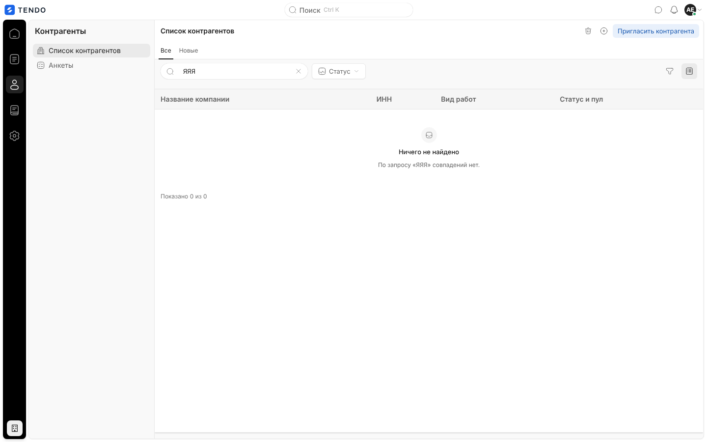 |
| Вкладка «Новые» пуста | «Новых анкет нет» / «В этой вкладке пока нет новых анкет.» | 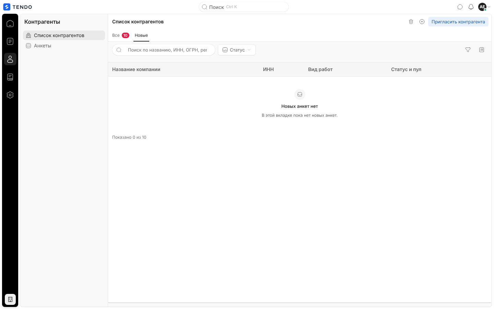 |
| Поиск с подсветкой | Совпадение выделено в названии | 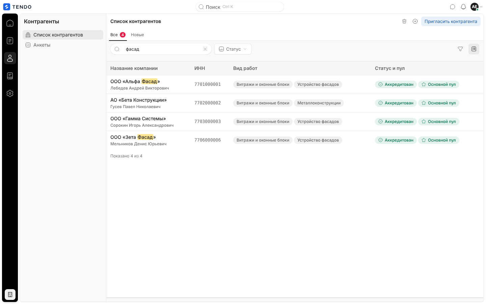 |
| Нет доступа | Роли вне сотрудников и СБ/юриста — перенаправление | — |

## Переходы

| Откуда | Куда |
|---|---|
| Строка / название | `/suppliers/<id>` ([supplier-card.md](supplier-card.md)) |
| «→ Открыть» в ошибке дубля ИНН | карточка найденного контрагента |

## Сложность

**L**: серверные фильтры с фасетами и состоянием в адресе, виртуализированная таблица, три модальных сценария (приглашение со ссылкой, ручное заведение с проверками реквизитов, дублем и ЕГРЮЛ, корзина).
