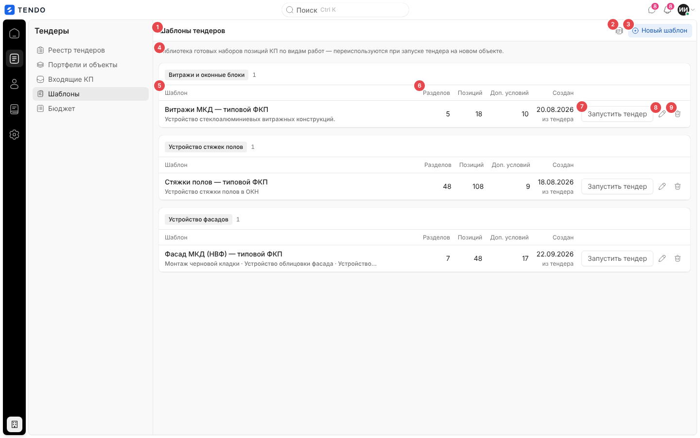
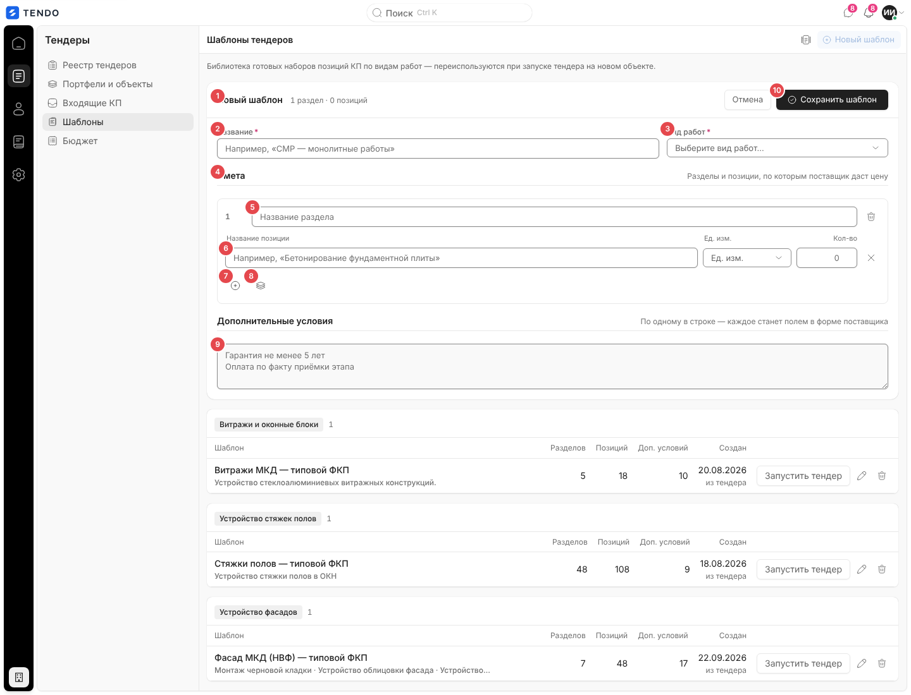
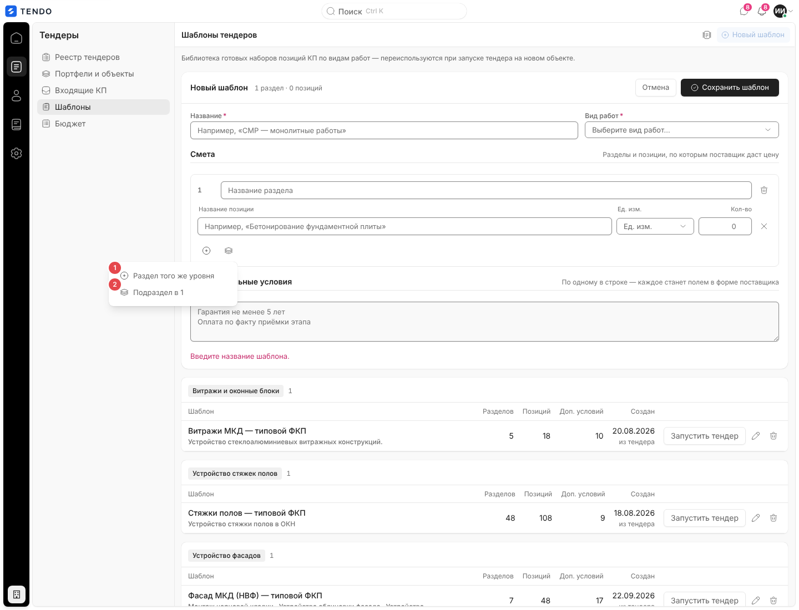
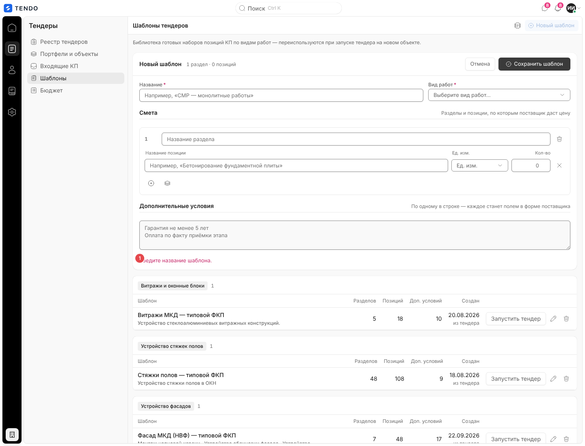
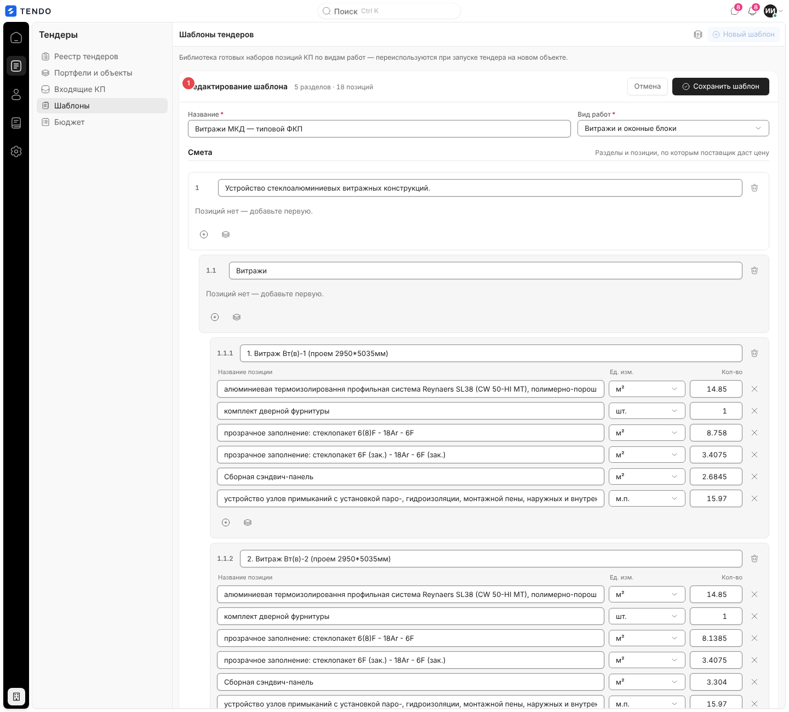
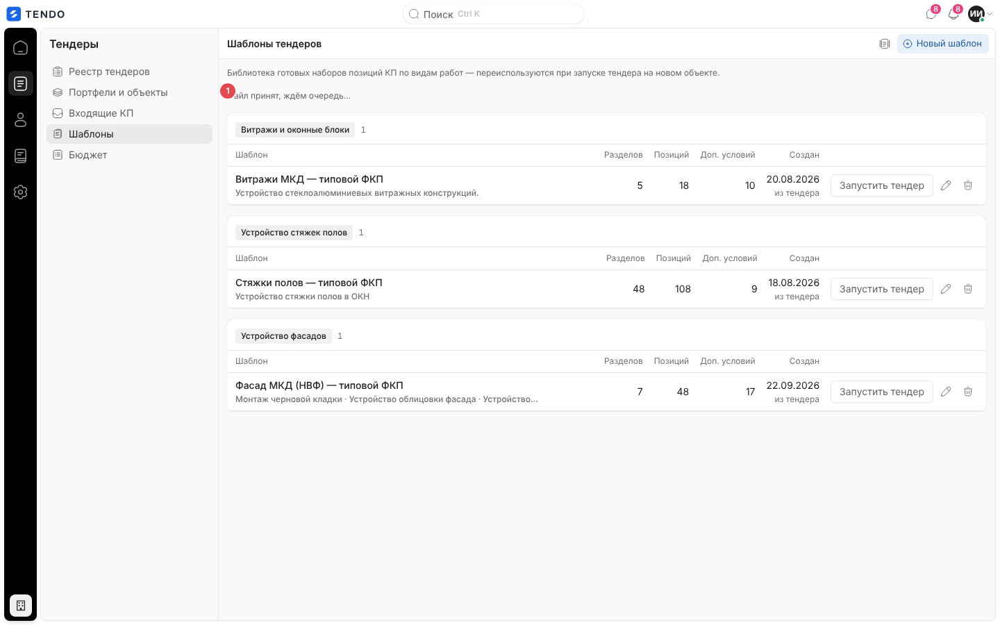
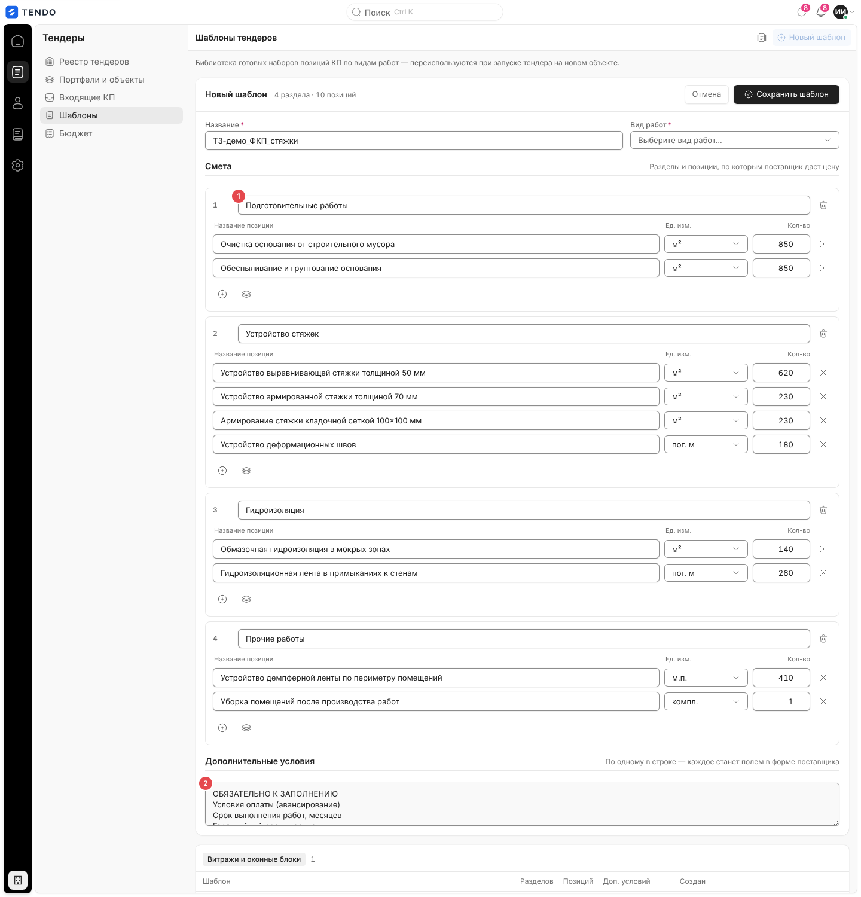
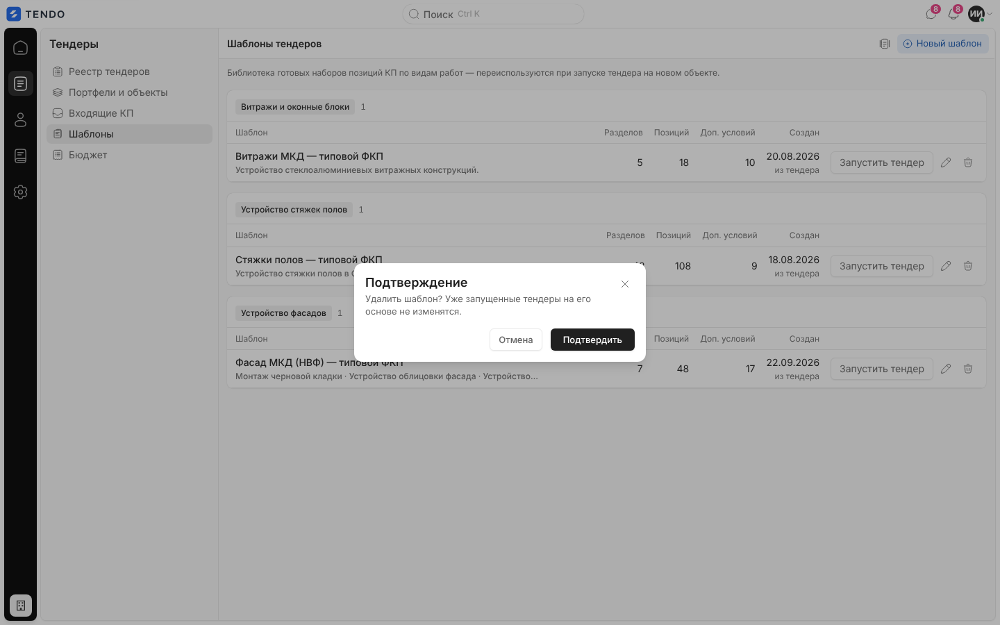
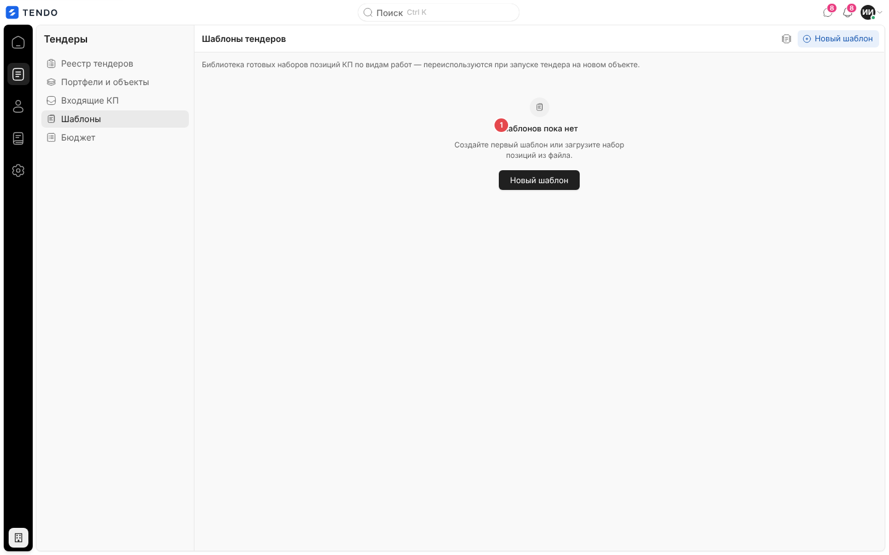
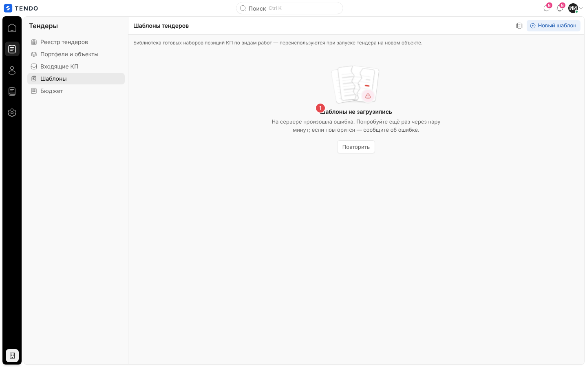

# Шаблоны тендеров (`/templates`)

Библиотека готовых составов ФКП, сгруппированных по видам работ: список шаблонов, конструктор шаблона (создание и правка, в том числе из Excel-файла), удаление и запуск нового тендера по шаблону.

Связанные разделы: правила шаблонов — [../02-business-logic/tenders-lifecycle.md](../02-business-logic/tenders-lifecycle.md#4-шаблоны-тендеров); API — [../04-api/endpoints-tenders.md](../04-api/endpoints-tenders.md) (группа `templates`: `GET/POST /templates`, `PUT/DELETE /templates/{id}`, `POST /templates/from-tender/{id}`, `PATCH /templates/{id}/column-map`; разбор файла — `POST /tenders/parse-excel`); запуск тендера по шаблону — [tender-create.md](tender-create.md#создание-из-шаблона); «Сохранить как шаблон» из карточки тендера — [tender-card-lifecycle.md](tender-card-lifecycle.md#сохранить-как-шаблон); виды работ и единицы — [../04-api/endpoints-catalog.md](../04-api/endpoints-catalog.md).

> Круглый значок в правом нижнем углу снимков — инструмент отладки dev-сборки стенда, в продукт не входит.

## Маршрут

- `/templates`. Открытая форма конструктора, разбор файла — состояние страницы, в адрес не пишутся.
- Заголовок экрана — «Шаблоны тендеров».

## Назначение

Не собирать заново состав однотипных тендеров: хранить «типовой ФКП» по виду работ (разделы, позиции с единицами и объёмами, доп. условия) и запускать по нему новый тендер на другом объекте в один клик. Шаблон — это ровно тот набор разделов, который принимает создание тендера, поэтому «сохранить из тендера» и «запустить из шаблона» — копирование без потерь иерархии.

## Роли и права

| Роль | Доступ |
|---|---|
| Тендерный специалист, администратор | Да: просмотр, создание, правка, удаление, запуск тендера (запуск дальше требует права `tenders.manage` при создании тендера) |
| СБ, юрист | Нет: пункт скрыт, прямой переход → `/home` |
| Поставщик, лид, владелец площадки | Нет → стартовый экран роли |

Шаблоны общие для всей компании (не привязаны к объекту и автору).

## Как попасть

- Рейл «Тендеры» → «Шаблоны».
- «Назад» на шаге 2 мастера, запущенного из шаблона, возвращает сюда.

## Список шаблонов

| № | Элемент | Поведение |
|---|---|---|
| ① | Заголовок «Шаблоны тендеров» | — |
| ② | «Создать шаблон из файла» (значок документа) | Выбор Excel/CSV-файла (`.xlsx, .xls, .csv`) и разбор в форму конструктора — см. [Шаблон из файла](#шаблон-из-файла). Во время разбора значок неактивен, подсказка — статус разбора |
| ③ | «Новый шаблон» | Открывает пустой конструктор над списком; пока форма открыта — неактивна |
| ④ | Пояснение | «Библиотека готовых наборов позиций КП по видам работ — переиспользуются при запуске тендера на новом объекте.» |
| ⑤ | Группа «{вид работ} · N» | Шаблоны сгруппированы по виду работ (группы по алфавиту; без вида — «Без вида работ»); внутри — таблица |
| ⑥ | Колонки | «Шаблон» (название; второй строкой серым — названия разделов верхнего уровня через « · », с многоточием, полностью в подсказке), «Разделов» (все уровни), «Позиций», «Доп. условий» (подсказка — список условий; нет — «—»), «Создан» (дата; второй строкой «из тендера», если шаблон сохранён из тендера) |
| ⑦ | «Запустить тендер» | Переход в мастер `/tenders/new?fromTemplate={id}` с подставленным составом — см. [tender-create.md](tender-create.md#создание-из-шаблона) |
| ⑧ | «Изменить шаблон «…»» (карандаш) | Открывает конструктор с данными шаблона |
| ⑨ | «Удалить шаблон «…»» (корзина, красная по наведению) | Подтверждение — см. [Удаление](#удаление) |

- Состав шаблона в списке не раскрывается — его смотрят и правят в конструкторе.
- Сортировки, поиска, фильтров и пагинации нет: загружаются все шаблоны (`GET /templates`, все страницы).

## Конструктор шаблона

Форма открывается над списком (список остаётся ниже). Шапка формы закреплена при прокрутке.

| № | Элемент | Тип / правила |
|---|---|---|
| ① | Заголовок «Новый шаблон» / «Редактирование шаблона» + счётчик «N разделов · M позиций» | Позиции считаются только с непустым названием |
| ② | «Название» * | Текст, обязательное; плейсхолдер «Например, «СМР — монолитные работы»» |
| ③ | «Вид работ» * | Выпадающий список активных видов работ справочника (с иерархией в подписи), обязательное; хранится **названием** вида работ |
| ④ | «Смета» | Подпись «Разделы и позиции, по которым поставщик даст цену» |
| ⑤ | Раздел | Номер по иерархии («1», «1.1», «1.1.1»), поле «Название раздела» / «Название подраздела», «Убрать раздел вместе с его позициями» (корзина). Подразделы смещены вправо |
| ⑥ | Позиции раздела | Одна шапка колонок на раздел: «Название позиции» (плейсхолдер «Например, «Бетонирование фундаментной плиты»»), «Ед. изм.» (выпадающий список активных единиц справочника, пустое — «—»), «Кол-во» (число, плейсхолдер «0»), «Убрать позицию» (крестик). Раздел без позиций — «Позиций нет — добавьте первую.» |
| ⑦ | «Добавить позицию в раздел N» (плюс) | Пустая строка позиции в конец раздела |
| ⑧ | «Добавить раздел после N» (значок слоёв) | Меню: «Раздел того же уровня» (встаёт после раздела со всеми его подразделами), «Подраздел в N» (на уровень глубже, последним) |
| ⑨ | «Дополнительные условия» | Многострочное поле, по одному условию в строке (подпись «По одному в строке — каждое станет полем в форме поставщика»); плейсхолдер «Гарантия не менее 5 лет / Оплата по факту приёмки этапа». Тип условия при сохранении — тот, что был у условия с таким же названием, иначе «текст» |
| ⑩ | «Сохранить шаблон» / «Отмена» | Сохранение — см. ниже; «Отмена» закрывает форму без вопросов |

- Новый шаблон открывается с одним пустым разделом и одной пустой позицией. Если все разделы удалены — кнопка «Первый раздел».
- При удалении раздела его подразделы поднимаются к разделу выше; при удалении позиции подразделы, стоявшие между позициями, сохраняют своё место (порядок ФКП, в котором позиции и подразделы идут вперемешку).
- Номер раздела из файла, справочная единица/объём подраздела и место подраздела среди позиций в конструкторе не редактируются, но сохраняются.

### Сохранение и ошибки

Проверки до отправки (текст под формой, красным; первая сработавшая):

| Условие | Текст |
|---|---|
| Пустое название | «Введите название шаблона.» |
| Не выбран вид работ | «Выберите вид работ.» |
| Нет ни одной позиции с названием | «Добавьте хотя бы одну позицию КП.» |

- Позиции без названия при сохранении отбрасываются; пустое имя раздела становится «Раздел».
- Создание — `POST /templates`, правка — `PUT /templates/{id}` с полем `version` (оптимистическая блокировка: если шаблон изменили в другом окне — 409 «Шаблон изменён в другом окне — обновите страницу»). Название уникально без учёта регистра (409 «Шаблон с таким названием уже есть»). Ошибка сервера показывается тем же текстом под формой (или «Не удалось сохранить шаблон»). Во время сохранения кнопки неактивны, подпись «Сохраняем…».
- Успех — форма закрывается, список перечитывается.

## Шаблон из файла

1. «Создать шаблон из файла» → выбор файла → тот же фоновый разбор, что в мастере создания тендера (`POST /tenders/parse-excel` и опрос задания, без черновика). Под пояснением — строка статуса: «Файл принят, ждём очередь…», «Файл принят, распознаём… Если структура нестандартная — подключаем ИИ.»
2. После разбора открывается конструктор «Новый шаблон», заполненный деревом разделов из файла (с подразделами и их местом среди позиций), позициями (только с названием; номер позиции сохраняется), доп. условиями; название — имя файла без расширения; вид работ — пустой (выбрать вручную).
3. Ошибка разбора — окно-сообщение с текстом сервера или «Не удалось создать шаблон из файла».

Особенность: единицы из файла, которых нет в справочнике (на снимке — «пог. м»), в конструкторе показываются как есть и при сохранении шаблона не проверяются; сопоставление со справочником произойдёт при запуске тендера (см. [открытые вопросы](../_oq/SCR-2b.md)).

## Удаление

Окно подтверждения «Удалить шаблон? Уже запущенные тендеры на его основе не изменятся.» → `DELETE /templates/{id}` (физическое удаление) → список перечитывается; ошибка — окно-сообщение «Не удалось удалить шаблон» или текст сервера.

## Запуск тендера по шаблону

«Запустить тендер» кладёт снимок шаблона (id, название, вид работ, разделы, условия) во временное хранилище вкладки и открывает `/tenders/new?fromTemplate={id}`; мастер сразу открывается на шаге 2 с подставленным составом (если временного снимка нет — шаблон перечитывается с сервера по id). Подробно — [tender-create.md](tender-create.md#создание-из-шаблона).

Подтверждённая в мастере карта колонок Excel сохраняется в шаблон-источник (`PATCH /templates/{id}/column-map`, без участия пользователя) и при следующей загрузке файла с той же шапкой применяется молча.

## Состояния

| Состояние | Что видит пользователь | Снимок |
|---|---|---|
| Загрузка | Три прямоугольника-скелетона высотой с группу | — |
| Пусто | Иллюстрация «Шаблонов пока нет», «Создайте первый шаблон или загрузите набор позиций из файла.», кнопка «Новый шаблон» |  |
| Ошибка списка | «Шаблоны не загрузились» + текст + «Повторить» |  |
| Ошибка справочников формы | При открытой форме — «Справочники не загрузились» + «Не удалось загрузить виды работ и единицы измерения.» + «Повторить» (форма без списка видов работ иначе выглядела бы как «видов работ нет») | — |
| Нет доступа | СБ/юрист → `/home` | — |

## Переходы

| Откуда | Куда |
|---|---|
| «Запустить тендер» | `/tenders/new?fromTemplate={id}` |

## Сложность

**M**: список с группировкой — S; конструктор дерева разделов с позициями, вставкой подразделов и сохранением порядка ФКП — M; шаблон из файла (переиспользует разбор мастера) — S; оптимистическая блокировка и ошибки — S.
