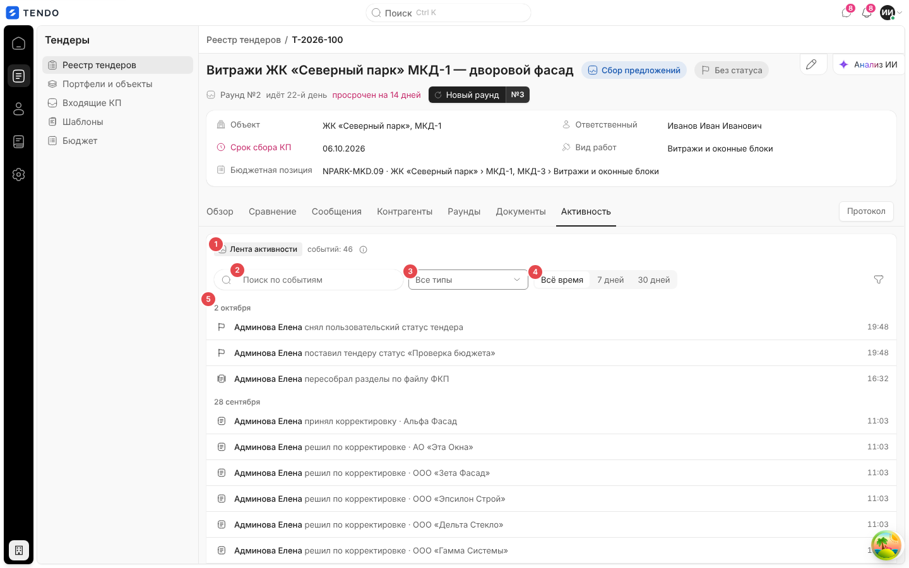
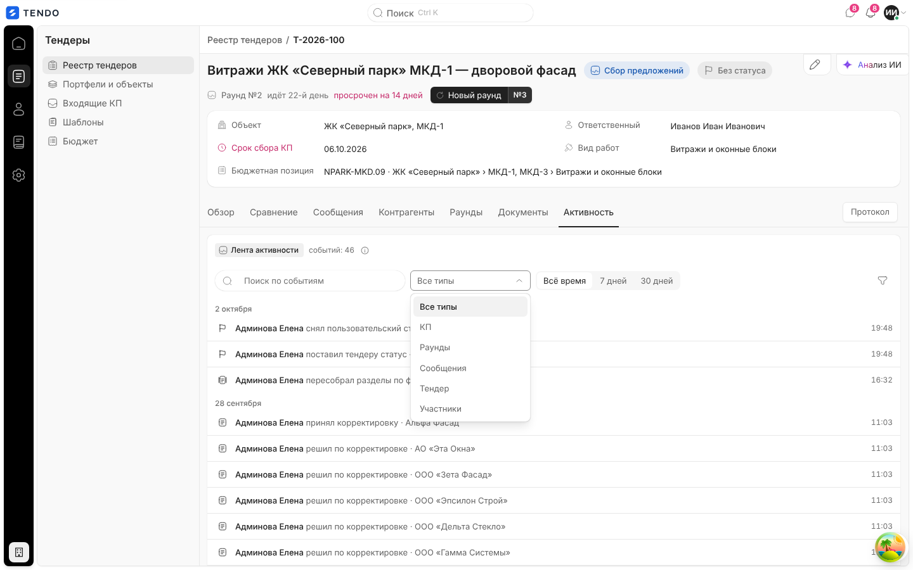
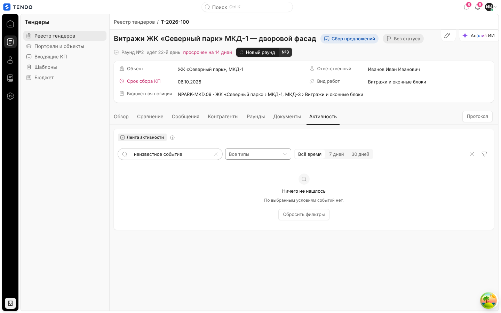

# Карточка тендера — вкладка «Активность»

Полная лента событий по тендеру — кто что сделал: приглашения, подачи КП, решения по корректировкам, раунды, переписка, изменения тендера — с поиском, фильтрами и постраничной подгрузкой.

Связанные разделы: обзор экрана — [tender-card.md](tender-card.md); короткие ленты на «Обзоре», «Контрагентах», «Документах» — [tender-card-overview.md](tender-card-overview.md); API — [../04-api/endpoints-tenders.md](../04-api/endpoints-tenders.md) (`GET /tenders/{id}/activity`); данные — [../05-data-model/tables.md#tenders](../05-data-model/tables.md#tenders) (`activity_log`).

## Маршрут, роли, как попасть

- `/tenders/:id`, вкладка «Активность» (последняя в ряду: журнал, а не рабочий экран).
- Роли: тендерный специалист, администратор.
- Попасть: вкладка; ссылка «Вся →» в боковых лентах других вкладок — тогда вкладка открывается с уже выбранными типами событий этой ленты («События участия» → «Участники»+«КП», «История пакета» → «Тендер»+«Раунды»).

## Снимок

| № | Элемент | Поведение |
|---|---|---|
| ① | Группа «Лента активности» | Счётчик «событий: N» — общее число под текущими фильтрами (сервер). Подсказка: «Кто что сделал по тендеру: приглашения, подачи КП, запросы доработки, отправленные раунды и переписка.» |
| ② | Поиск «Поиск по событиям» | По тексту события и автору; отправляется на сервер через 300 мс после окончания ввода; до 100 символов |
| ③ | «Тип события» (мультивыбор, «Все типы») | КП, Раунды, Сообщения, Тендер, Участники |
| ④ | «Период» | «Всё время · 7 дней · 30 дней» (по Москве, «7 дней» включает сегодня) |
| ⑤ | Лента | Группировка по дням («2 октября», «28 сентября»); строка: значок типа, «**Автор** действие · объект», время ЧЧ:ММ, ссылки «Открыть КП» / «Открыть контрагента» |

Значок «Фильтры» справа раскрывает дополнительные фильтры «Автор» («Любой автор») и «Контрагент» («Все контрагенты»); их значения — из ответа сервера (авторы и контрагенты, встречающиеся в ленте). Крестик — «Сбросить» все фильтры.

### Типы событий (группы фильтра)

| Группа | Действия |
|---|---|
| КП | подача КП, запрос доработки, смена статуса КП, решение по корректировке |
| Раунды | отправка раунда, доприглашение в раунд, продление срока, закрытие раунда, рассылка версии ФКП |
| Сообщения | сообщение в чате с контрагентом |
| Тендер | изменение структуры, пересборка разделов, обновление документов, смена статуса, подтверждение победителя без аккредитации, смена пользовательского статуса, смена ответственного, изменение реквизитов |
| Участники | приглашение, приглашение неодобренного, перевыпуск ссылки, отзыв доступа, восстановление доступа |

## Загрузка

`GET /tenders/{id}/activity?limit=50[&before_id=…][&groups=…][&author_id=…][&supplier_id=…][&q=…][&since=ГГГГ-ММ-ДД][&until=…]` — курсорная пагинация (`next_before_id`), в ответе `items`, `total`, `authors`, `suppliers`. Внизу ленты — «Показать ещё» (догружает следующую страницу по 50). При смене фильтров прежние строки остаются на экране до прихода новых.

## Состояния

| Состояние | Поведение | Снимок |
|---|---|---|
| Загрузка | Скелетон | — |
| Ошибка | «Активность не загрузилась» + текст + «Повторить»; ошибка догрузки — строкой «Не удалось догрузить ленту» | — |
| Пусто без фильтров | «Пока пусто — приглашения, чаты и корректировки появятся здесь.» | — |
| Пусто с фильтрами | «Ничего не нашлось» · «По выбранным условиям событий нет.» · «Сбросить фильтры» |  |

## Сложность

**S** — лента с фильтрами и курсорной подгрузкой; основная работа — на сервере (журнал событий всех доменов с человекочитаемыми формулировками).
