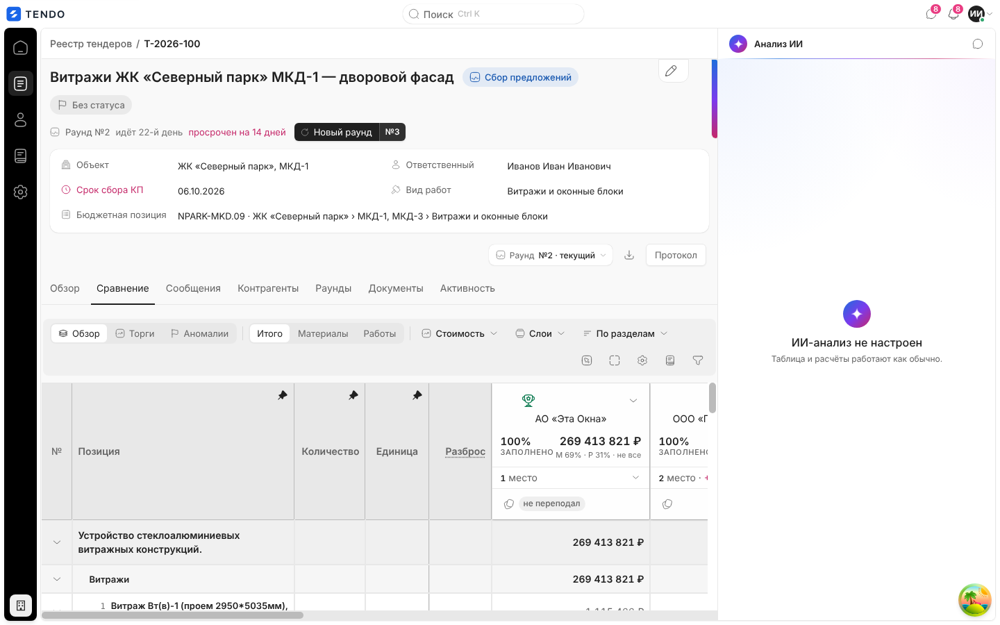
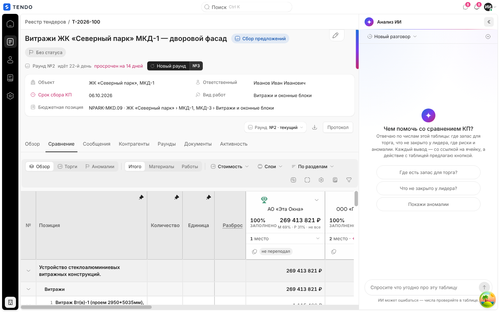

# Карточка тендера — панель «Анализ ИИ»

Правая панель карточки тендера с ИИ-разбором сравнения КП: запуск → «разбор идёт» → результат; разбор пары отмеченных подрядчиков; чат «Спросить по таблице» с действиями над таблицей; черновик письма поставщику. Описан интерфейс; пайплайны, промпты, верификация чисел и биллинг токенов — в [../06-ai/](../06-ai/).

Связанные разделы: обзор экрана — [tender-card.md](tender-card.md); переходы «анализ → таблица» — [tender-card-comparison.md](tender-card-comparison.md); чаты с контрагентами — [tender-card-messages.md](tender-card-messages.md); API ИИ — [../04-api/endpoints-tenders.md](../04-api/endpoints-tenders.md) (`/tenders/{id}/insights/*`), ИИ-слой — [../06-ai/](../06-ai/).

## Маршрут, роли, как попасть

- Панель на `/tenders/:id`, открывается биркой «Анализ ИИ» в правом верхнем углу (на любой вкладке). Это **не вкладка**: панель — третья колонка каркаса справа, при открытии сжимает основную область (не накрывает её), левое меню при этом сворачивается. Закрытие — та же бирка (превращается в язычок на кромке панели), Esc. Фокус при открытии — на заголовок панели.
- Панель монтируется при первом открытии и только после загрузки снимка сравнения; дальше живёт до ухода со страницы (история чата и открытый разбор переживают закрытие панели и переключение вкладок). Пока панель открыта, плавающая кнопка чата скрыта.
- Роли: тендерный специалист, администратор. Запуск расходует токены клиента (биллинг ИИ); при исчерпании баланса — предупреждение; у администратора — ссылка «Запросить пополнение» (`/expenses`).
- На демо-стенде ИИ выключен (не задан ключ провайдера `AI_API_KEY`) — панель показывает режим «ИИ-анализ не настроен».

## Экраны панели (ровно один в каждый момент)

Шапка панели: значок ИИ (анимируется, пока идёт генерация), «Анализ ИИ», кнопка-переключатель режима «Спросить по таблице» / «Вернуться к разбору».

### 1. Запуск

| Условие | Содержимое |
|---|---|
| Нет ни одного поданного КП | «Разбирать нечего» · «По тендеру не подано ни одного КП — сравнивать не с чем. Разбор станет доступен с первым предложением.» |
| ИИ не настроен (`ai_ready = false`) | «ИИ-анализ не настроен» · «Таблица и расчёты работают как обычно.» |
| Норма, разбора ещё не было | «Разбор ещё не запускали» · «Разбор строится по КП, поданным на момент запуска.» · кнопка «Проанализировать» |
| Был прошлый разбор | кнопка «Проанализировать» + строка «Прошлый разбор от ДД.ММ ЧЧ:ММ · устарел: {причина} · показать» («открываю…») |
| Баланс исчерпан (ответ 402 или `tokens_exhausted`) | Жёлтая плашка «Баланс токенов исчерпан» · «Анализ не запущен. Обратитесь к администратору — он может запросить пополнение в разделе «Расходы».» (+ ссылка у администратора) |

Данные: `GET /tenders/{id}/insights/run` (статус прогона, `ai_ready`, прошлый результат). Запуск — `POST /tenders/{id}/insights/run`.

### 2. Разбор идёт

Фраза текущего шага с многоточием и «шаг N из M»; до старта — «Ждём очереди…». Шаги: «Собираю данные тендера», «Смотрю, где расходятся цены», «Читаю комментарии поставщиков», «Формулирую, о чём говорить на торге», «Проверяю состояние тендера», «Сверяю каждое число с таблицей», «Сравниваю условия предложений», «Объясняю, из чего собрана цена»; для пары — «Сравниваю два предложения», «Смотрю, где расходятся эти двое», «Готовлю повестку разговора». Частичных результатов не показывается. Ход опрашивается раз в секунду. Разбор общий на тендер: открывший панель во время чужого прогона видит «Разбор идёт» и тот же результат. Закрытие панели разбор не отменяет.

### 3. Результат

Появляется целиком (`GET /tenders/{id}/insights/run/{result_id}`):

- Шапка: «Разбор от ДД.ММ ЧЧ:ММ», значок «Проанализировать заново».
- Устаревший разбор (поданы новые КП, выбрана другая версия и т.п.): плашка «**Разбор устарел.** {причина}.» и кнопка «Проанализировать заново».
- Неполный: строка «Часть пояснений ИИ не получена»; при отказе модели — «Модель не ответила — показан расчёт» (секции, собранные правилами без ИИ).
- Секции (свёрнуты, порядок фиксирован, счётчик «N пунктов» / «N разделов»): «Что стоит сделать», «Из чего сложена разница», «Разбор пары» (если запускался). В тексте пунктов **слова-сущности** (позиция, подрядчик) подчёркнуты пунктиром; клик применяет к таблице «пресет + фокус» (подсветка строки/ячейки/колонки на ~5 с, вид пользователя сохраняется, на панели СТ появляется «Вернуть мой вид»), а в панели остаётся отметка, от какого слова горит подсветка. У пункта с подрядчиком — действие «написать письмо».
- «Из чего собрана цена» — строка-заголовок со сводкой, клик открывает окно с таблицей «Подрядчик · Материалы · Работы · Итог · Что это значит»; значок «Показать таблицу целиком».
- «Условия предложений · аванс, срок, гарантия» — сравнение условий КП.
- **Пара**: если в СТ отмечены звёздами ровно два подрядчика — блок «{A} и {B}» с кнопкой «Сравнить» → «Разбор идёт» → секция «Разбор пары» (`POST /tenders/{id}/insights/pair`, `GET …/pair?left=&right=`).
- Комментарии ИИ к ячейкам после разбора показываются в сводке ячейки СТ при наведении.

### 4. Ошибка

«Анализ не выполнен» · «{причина}. Таблица и расчёты продолжают работать.» · «Повторить».

## Чат «Спросить по таблице»

- Панель разговоров: «Новый разговор» / название текущего, меню «Прежние разговоры» («Прежних разговоров нет»), «Начать новый разговор», «Удалить этот разговор». Данные — `GET /tenders/{id}/insights/chats`, `GET/DELETE /tenders/{id}/insights/chat?thread=`.
- Пустой разговор: «Чем помочь со сравнением КП?» · «Отвечаю по числам этой таблицы: где запас для торга, что не закрыто у лидера, где риски и аномалии. Каждый вывод — со ссылкой на ячейку, действие с таблицей предлагаю кнопкой.» и подсказки-чипы «Где есть запас для торга?», «Что не закрыто у лидера?», «Покажи аномалии».
- Вопрос — поле «Спросите что угодно про эту таблицу», кнопка «Спросить»; ожидание — «Читаю таблицу…» / «Пишу ответ…»; запрос `POST /tenders/{id}/insights/ask` (синхронная генерация). Подпись внизу: «ИИ может ошибаться — числа проверяйте в таблице.».
- Ответ: текст со ссылками на ячейки («Показать в таблице»), «Скопировать ответ»; при отказе модели — «Модель не ответила — показан расчёт».
- Кнопки-действия, которые предлагает ответ: «Показать в таблице», «Показать этот срез», «Сравнить эту пару», «Запросить разбивку», «Отправить поставщику», «Открыть корректировку объёма», «Выгрузить в Excel», «Разобрать эту ячейку». Результат действия — строка-статус под чатом («Открыл ячейку «…» · {подрядчик}. Решение по объёму принимается в ней.», «Выгрузил таблицу целиком — отбора строк в выгрузке нет», «Не нашёл эту строку в таблице», «Не понял, кому писать — назовите подрядчика из таблицы»).

## Черновик письма поставщику

Окно «Письмо · {подрядчик}» (до готовности — «Письмо поставщику»): «ИИ написал черновик прямо в поле ввода. Правьте как обычное сообщение и отправляйте — уйдёт в чат с контрагентом.». Пока генерируется — «ИИ пишет черновик…». Черновик — `POST /tenders/{id}/insights/letter?…`; если модель не ответила или её числа не сошлись со снимком — пометка «Текст собран по правилам: модель не ответила или её числа не сошлись со снимком.». Кнопка «Отправить» («Отправляю…», «Отправлено») отправляет **отредактированный человеком** текст в чат с контрагентом (`POST /chats/open` + сообщение); ИИ сам поставщикам не пишет. После отправки — «Сообщение отправлено в чат с контрагентом.». Ошибки — «Не удалось составить письмо», «Не удалось отправить сообщение».

## Состояния, не снятые на стенде

На стенде ИИ выключен, поэтому экраны «Разбор идёт», «Результат», «Ошибка», «Баланс исчерпан», ответы чата и письмо описаны по коду; снимки отсутствуют. Чат по таблице в режиме без ключа открывается (снимок выше), ответы не генерируются (см. [открытые вопросы](../_oq/SCR-2a.md)).

## Сложность

**L** (интерфейс панели: четыре экрана, опрос прогона, разбор пары, чат с тредами и действиями над таблицей, письмо с отправкой в чат, переходы «анализ → таблица»). Серверная часть ИИ — отдельная оценка в [../06-ai/](../06-ai/).
