# Карточка тендера — вкладка «Сравнение» (сравнительная таблица, СТ)

Сердце продукта: позиции ФКП строками, подрядчики колонками, в ячейке — цена и её «спутники». Над таблицей — панель вида (пресеты, срез цены, показатель, слои, сортировка, фильтры, параметры, легенда), вокруг — закрепление, выделение с копированием, контекстные меню, разбор ячейки, корректировки, комментарии, досье подрядчика, выгрузка в Excel.

Связанные разделы: обзор экрана — [tender-card.md](tender-card.md); формулы (медиана, отклонение, разброс, аномалия, вклад, ключевые, минимум, потенциал, полнота, ранжир) — [../02-business-logic/tenders-comparison.md](../02-business-logic/tenders-comparison.md); API — [../04-api/endpoints-tenders-comparison.md](../04-api/endpoints-tenders-comparison.md) (`/comparison`, `/comparison/export`, корректировки, версии КП, доработка), [../04-api/endpoints-quotes.md](../04-api/endpoints-quotes.md) (карточка и статус КП), [../04-api/endpoints-comments.md](../04-api/endpoints-comments.md) (комментарии по ячейкам), [../04-api/endpoints-rounds.md](../04-api/endpoints-rounds.md); ИИ-переходы в таблицу — [tender-card-analysis.md](tender-card-analysis.md).

## Маршрут, роли, как попасть

- `/tenders/:id`, вкладка «Сравнение». Вид таблицы пишется в адрес (см. [Ссылка на вид](#ссылка-на-вид)).
- Роли — тендерный специалист и администратор (см. [tender-card.md](tender-card.md#роли-и-права)). Без права видеть финансы — [маска финансов](#маска-финансов). Решения по корректировкам и «Вернуть на доработку: НДС» доступны любому сотруднику с доступом к тендеру (отдельного права сервер не требует).
- Попасть: вкладка «Сравнение»; клик по цифре «Обзора» (возвратный переход с пресетом); слово-сущность в «Анализе ИИ» (подсветка строки/ячейки/колонки); переход из чата к ячейке; ссылка из карточки КП «Досье» (`?dossier=<id>`).

## Данные

- `GET /tenders/{id}/comparison[?versions=<supplier_id>:<версия>,…]` — один снимок: позиции (`items`), дерево разделов (`sections`), поля условий (`condition_fields`), участники (`suppliers` — итоги, цены по позициям, версии, стадия приглашения, полнота заполнения, корректировки, налоговый режим, контакты), `active_round_number`, `fkp_version_current`, `tender_revision`, `winner_supplier_id`, `contacts_masked`, `finance_masked`, `analytics` (серверные ранги, полнота, сопоставимость, разделы). Ответ кэшируется по ETag; запрос рвётся при уходе со страницы.
- `GET /tenders/{id}/rounds` — список раундов для выбора раунда и колонки «Динамика».
- Комментарии по ячейкам: `GET /tenders/{id}/comments` (все страницы), история комментариев поставщика `GET /tenders/{id}/position-comments`, нагрузка «не отработано» `GET /tenders/{id}/comment-workload`.
- Пороги аналитики — **системные** (общие для всех тендеров, правит администратор в настройках): «Разброс заметный» 15 %, «Разброс высокий» 40 %, «Коэффициент аномалии» 3×, «Доля ключевых работ» 80 % (значения по умолчанию). Приходят в снимке; при отсутствии используются умолчания.
- Все производные числа (медиана строки, отклонения, разброс, аномалии, минимум/максимум, вес и ключевые, итоги) считаются **одним проходом** по снимку и выбранным версиям; таблица, фильтры, счётчики, всплывающие подсказки и досье читают одни и те же числа. Производительность: таблица до ~900 строк × 12 колонок без подтормаживаний (виртуализация строк, мемоизация).

## Снимок экрана

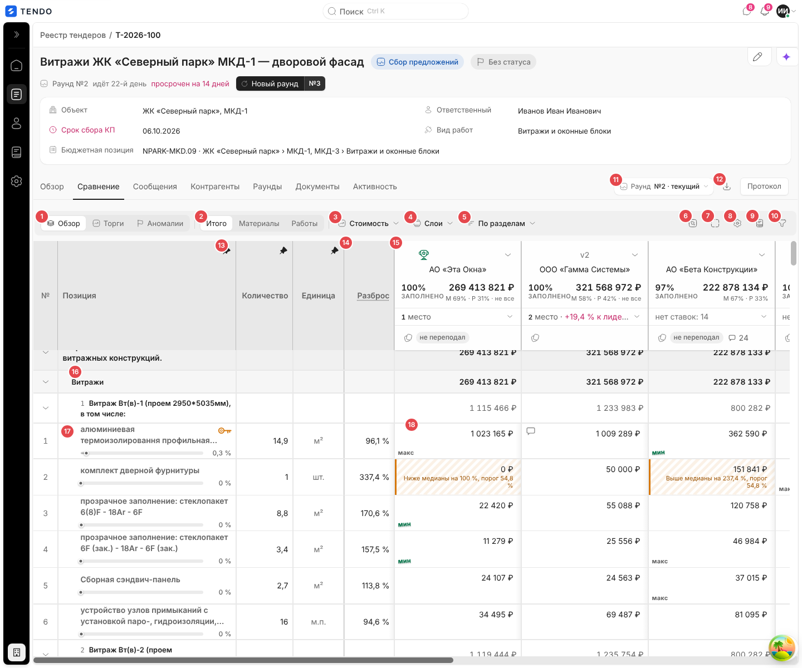

| № | Элемент | Поведение |
|---|---|---|
| ① | Пресеты «Обзор · Торги · Аномалии» | Сегментный переключатель; присваивает показатель, слои, сортировку и фильтры целиком |
| ② | Срез цены «Итого · Материалы · Работы» | В каких деньгах читается таблица; недоступен, если ни один подрядчик не разложил цену («Ни один подрядчик не разложил цену на материалы и работы») |
| ③ | «Основной показатель» | «Стоимость» / «Потенциал» |
| ④ | «Слои» | Спутники ячейки: Отклонение, Динамика, Ставка, Потенциал; на кнопке — число включённых |
| ⑤ | «Сортировка строк» | Исходно «По разделам»; варианты «По весу», «По потенциалу», «По разбросу» |
| ⑥ | Режим выделения ячеек | Значок; включён — подсвечен |
| ⑦ | Таблица во весь экран | Значок |
| ⑧ | «Параметры анализа» | Окно оформления и действующих порогов |
| ⑨ | «Легенда пометок» | Окно-легенда |
| ⑩ | «Фильтры» | Окно предикатов; на кнопке — число активных |
| ⑪ | Выбор раунда «Раунд №2 · текущий» | На строке вкладок; переключает таблицу на КП выбранного раунда |
| ⑫ | «Выгрузить сравнение в Excel» | Окно выгрузки |
| ⑬ | Булавки закрепления в шапке | У «Позиции», «Количества», «Единицы», и (при избранных) у группы ★ |
| ⑭ | Колонка «Разброс» | % разброса строки; подпись-ссылка открывает справку |
| ⑮ | Шапка колонки подрядчика | Карточка подрядчика (см. ниже) |
| ⑯ | Строка раздела | Сворачиваемая; подытоги по подрядчикам |
| ⑰ | Строка позиции | №, название, полоса вклада, ключ ключевой позиции |
| ⑱ | Ячейка КП | Цена и пометки; наведение — сводка, клик — разбор |

Справа от панели (при изменении вида) появляются: чип «скрыто N» (сколько строк спрятано фильтрами; подсказка «Видно N из M позиций · скрыто фильтрами K»), кнопка сброса вида (значок, подсказка «Состояние ушло от базы пресета «…» — показатель, слои и сортировка вернутся к исходной нарезке, фильтры снимутся») или, после перехода из «Обзора»/ИИ, — «Вернуть мой вид».

## Структура таблицы

### Колонки

| Колонка | Содержимое | Примечания |
|---|---|---|
| № | Сквозной номер позиции **в порядке сметы** (не меняется при сортировке) | Закрепляется вместе с «Позицией» |
| Позиция | Название (до 2 строк, хвост — многоточие; полное — по наведению), иерархический номер группы («1», «1.1»), ключ (оранжевый) у ключевой позиции, капсулы «снята» / «предложено поставщиком», полоса вклада позиции и её доля в % (тумблер «Полоса вклада позиции») | Ширину можно тянуть за правую кромку заголовка (запоминается в браузере); двойной клик — сброс. Клик по названию — «паспорт позиции» |
| Количество | Объём по ФКП; у снятой — «—»; если объём правился после публикации — подсказка «Объём сметы правился после публикации: было N» | |
| Единица | Единица измерения | |
| Разброс | `(max − min) / медиана × 100 %` по ценам строки; «—» с подписью «одно КП» (менее 2 цен) или «объём 0»; ярус («низкий/заметный/высокий») — в подсказке | Подпись заголовка открывает справку |
| Потенциал | Максимальный запас торга по строке, ₽ (появляется при слое «Потенциал» или сортировке «По потенциалу») | Наведение: «Потенциал строки — N», «максимум / типично / медиана строки», поимённо; «Запас заявил один участник — торг идёт с ним.» / «Запас заявили N участника: показан максимум, а не сумма — уступит кто-то один.» |
| Колонки подрядчиков | По одной на приглашённого участника; ширина фиксированная (одна константа на все колонки) | Порядок: избранные ★ → ручной порядок → ранжир |
| «Пригласить в тендер» | Колонка-«призрак» в конце: «+ Пригласить в тендер · новая колонка подрядчика» | Только у тендера не в статусе «Завершён»/«Отменён»; открывает [приглашение](tender-card-participants.md#пригласить-участников) |

Ширины: колонки подрядчиков фиксированы; при нехватке места сжимается левый блок и название, дальше включается горизонтальная прокрутка («панорама»). Таблица прокручивается внутри своего блока (страница доскролливает сводку и останавливается); шапка таблицы липкая; справа — вертикальная полоса прокрутки, снизу — горизонтальная. При прокрутке ленты вниз левое меню приложения сворачивается в рейл.

### Строки

- **Строка раздела** (дерево разделов ФКП любой глубины): шеврон сворачивания, название (липкое при горизонтальной прокрутке), объём/единица раздела серым (подсказка «Объём подраздела по ФКП — справка; цену дают позиции раздела»), подытог по каждому подрядчику. Разделы сворачиваются поодиночке; «Свернуть/Развернуть все разделы» — в контекстном меню.
- **Строка позиции** — см. колонки.
- **«Показано: N позиций»** — при активном фильтре под каждым подытогом и над общим итогом выводится сумма видимого среза (тумблер «Строки «Показано»»). Полные итоги фильтр **не** меняет.
- **Итоги** внизу: «Всего материалы», «Всего СМР», «Всего материалы и СМР» по каждому подрядчику (если часть цены без разбивки — подсказка «Без разбивки на материалы и СМР: N»).
- **«Условия поставщиков»** — блок строк под итогами: по строке на поле условий КП (аванс, срок выполнения, гарантийное удержание, гарантийный срок, мобилизация, «да/нет»-поля и т.п.); длинный текст открывается во всплывающем окне.
- **Линия отсечки** (в сортировках): «По весу» — «линия ключевых · N позиций · X % стоимости», ниже — «остальные N позиций» (свёрнуто, раскрывается кликом); «По разбросу» — «высокий разброс · от 40 % …» и хвост «без разброса · N позиций · сравнивать не с чем».
- **Закреплённые строки** — копии выбранных позиций под шапкой (эталон для сверки при прокрутке), фильтр их не прячет; открепляются кликом по номеру или из меню.

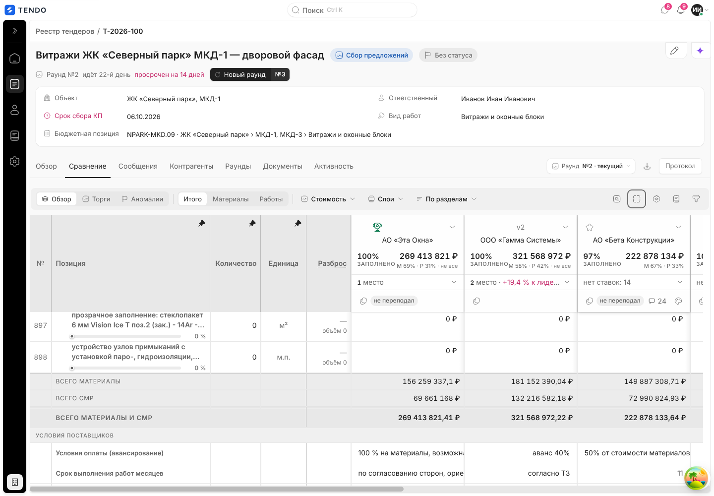

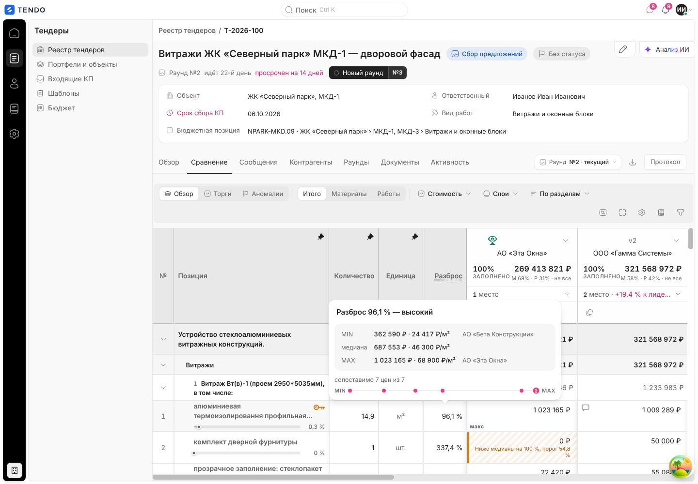

### Шапка колонки подрядчика (карточка)

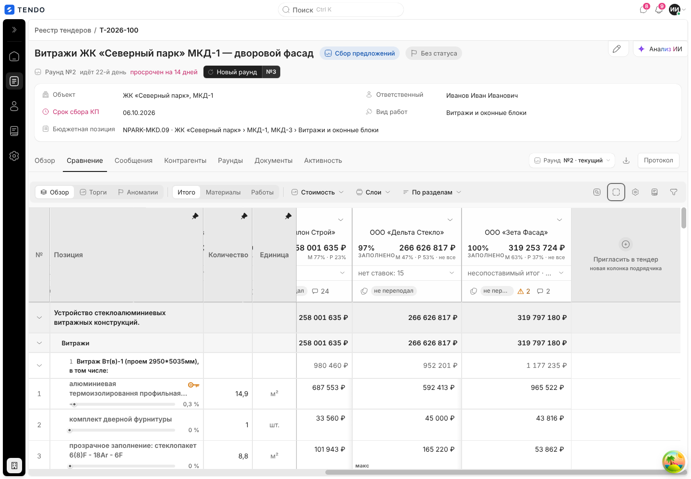

Сверху вниз:

1. **Инструменты**: звезда «В избранное» (проявляется по наведению; ★ поднимает колонку в начало), кубок у лидера (подсказка «Лидер — минимальный итог среди поданных КП»), капсула версии КП («v2» — только если версий > 1; открывает список версий), шеврон «Свернуть/Развернуть все» (сворачивает карточки всех колонок).
2. **Название подрядчика** по центру; длинное — многоточие и подсказка; клик — досье.
3. **Полнота и итог**: «100 % заполнено» и итог КП (крупно), под итогом — структура цены «М 69 % · Р 31 %» (« · не все», если разбили не все позиции). Без поданного КП вместо цифр — стадия: «ждём предложение» (анимированные точки), «черновик, не подан», «отказался от участия».
4. **Строка-факты** (одинаковой высоты у всех): «1 место», «2 место · +19,4 % к лидеру», либо причина вне ранжира («КП неполное», «нет ставок: 14», «несопоставимый итог · разные объёмы»), «КП ещё не подано». Раскрывается шевроном (одно состояние на все колонки): «Δ в деньгах», «мин. цен N из M», «без цены N».
5. **Бейджи**: «ФКП vN · актуальна vM» (КП подано по старой версии ФКП; подсказка «ФКП скорректирована после подачи — цены могут не учитывать правку»); «Режим УСН — проверьте НДС» + кнопка «Вернуть на доработку: НДС» (для поданного КП на упрощённом налоговом режиме).
6. **Подвал**: уголок пометок колонки (наведение раскрывает перечень «мин лучшая цена 120», «аномалии 164», «корректировки», «нет цены», «отказы» — клик подсвечивает **все** такие ячейки колонки и прокручивает к первой, повторный — к следующей); капсула стадии, если она что-то добавляет к полноте («не переподал», «доставлено», «На доработке», «доступ закрыт»…); чип «⚠ N» — корректировки на рассмотрении (1 — сразу переход к ячейке, несколько — мини-список); чип «💬 N» — неотработанные комментарии (так же); палитра «Цвет колонки».

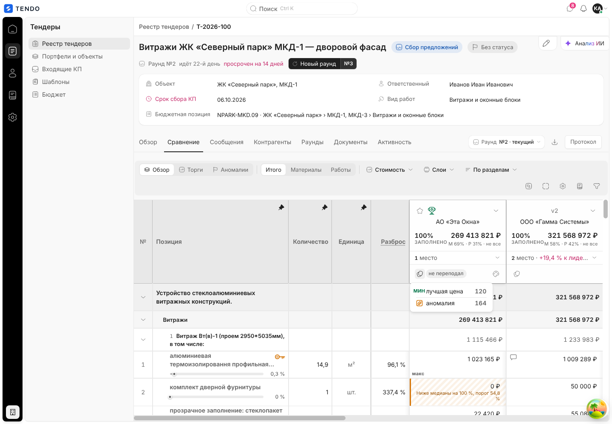

**«Вернуть на доработку: НДС»** → подтверждение «Вернуть КП на доработку: поставщик должен указать цены с НДС 22%?» → `POST /tenders/{id}/quotes/{quote_id}/request-revision` с текстом «Укажите цены с НДС 22% и подайте КП повторно.» → уведомление «КП возвращено на доработку». Ставка НДС на клиенте — 22 (запасное значение; см. [открытые вопросы](../_oq/SCR-2a.md)).

**Версии КП**: окно «Версии КП «…»» — таблица «№ · Название · Дата», 1 — действующая, старые серым, галочка у выбранной; версия без разобранного файла недоступна («— файл не разобран, выбрать нельзя»); подпись «Переключение пересчитывает только эту колонку; новая версия делает сохранённый анализ устаревшим.». Выбор перезапрашивает снимок с `?versions=`.

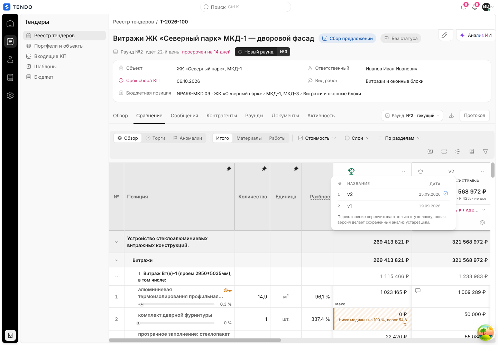

**Цвет колонки**: палитра (HEX/прозрачность, пипетка) и «По ранжиру»; ручной цвет старше подкраски по ранжиру; смысловые тона пометок не перекрашиваются.

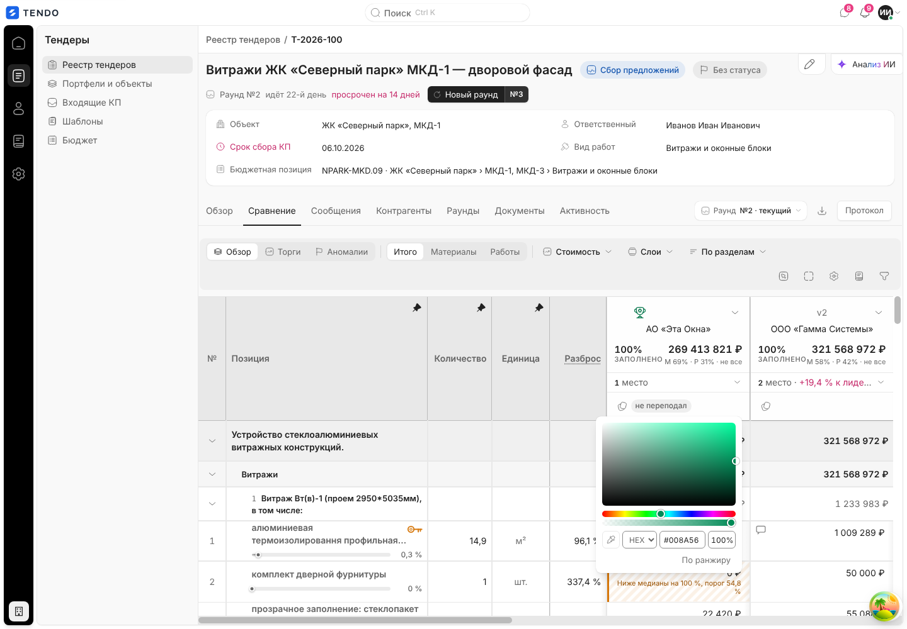

### Ячейка КП

Зоны ячейки фиксированы: левый верхний угол — бар маркеров (⚠ решения по корректировке, бабл комментариев), центр-справа — **цена** (всегда на одной высоте), ниже — база/ставка (по слою или корректировке), левый нижний угол — штамп «мин» или подпись «макс», левая кромка — риска аномалии.

| Состояние | Вид |
|---|---|
| Цена | `1 023 165 ₽` (стоимость позиции = ставка материалов и работ × применённый объём, с НДС) |
| + Отклонение | суффикс «+11,1 %» к медиане строки |
| + Динамика | стрелка и % к последней версии КП этого подрядчика из предыдущего раунда; «—» если сравнивать не с чем; в первом раунде слой недоступен («Изменение к прошлому раунду считается от собственного прошлого КП подрядчика. Идёт первый раунд — базы нет.») |
| + Ставка | строка «≈ 3 213 ₽/м.п.» (ставка за единицу) |
| Потенциал (основной показатель) | запас торга, ₽; монета у числа |
| Минимум | зелёный штамп «мин» — самая низкая **нормальная** (неаномальная) цена при ≥ 2 ценах строки; только в режиме «Стоимость» |
| Максимум | серая подпись «макс» — самая дорогая нормальная цена |
| Аномалия | янтарная штриховка + риска на левой кромке + текст «Ниже медианы на 100 %, порог 54,8 %» / «Выше медианы на 237,4 %, порог 54,8 %» |
| Отказ | нейтральная капсула «× Отказ» |
| Нет цены (пробел) | «—» |
| Ждём ответ | анимированные точки (запрос ушёл, ответа нет) |
| Разбивки нет (срез «Материалы/Работы») | «разбивки нет» |
| Корректировка на рассмотрении | знак ⚠ в баре; цена посчитана за объём поставщика, ставка показывается всегда; строка до решения в сравнение не входит |
| Решение по корректировке | «объём принят» / «корректировка отклонена» (цвет и подсказка) |
| Комментарии | бабл; с красным счётчиком — число неотработанных записей |
| Подсветка перехода | синяя обводка ~5 с (из «Анализа ИИ», чата, пометок колонки) |

Формулы кратко (подробно — [../02-business-logic/tenders-comparison.md](../02-business-logic/tenders-comparison.md)): **медиана** строки — по ценам всех поданных КП; **отклонение** = `(цена − медиана) / медиана`; **разброс** = `(max − min) / медиана`; **аномалия** — `|цена/медиана − 1| ≥ max(k × медиана отклонений остальных цен; порог «заметного» разброса)`, считается при ≥ 3 ценах и ненулевой медиане; **вес позиции** = медианная цена × объём, **ключевые** — минимальный набор самых тяжёлых строк, чья накопленная доля ≥ «Доли ключевых работ» (плюс ручные пометки ФКП); **потенциал** = заявленный подрядчиком запас торга за единицу × объём.

**Наведение на цену** (через 350 мс) — накопительная сводка ячейки (позиция, подрядчик, отклонение, место в строке, причина аномалии, комментарий ИИ к ячейке, если разбор был). У знаков (риска, штамп, ⚠) — своя сводка «что означает знак и какое у него здесь число».

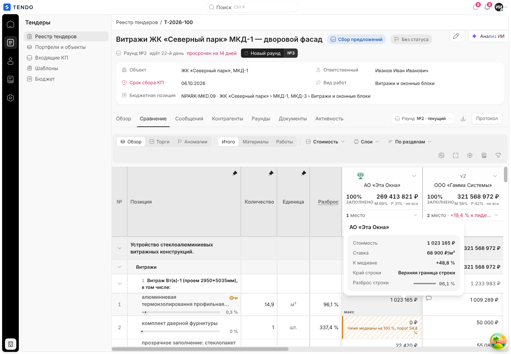

**Клик по цене** — плавающая карточка «Разбор ячейки»: заголовок — позиция и подрядчик, «Версия КП v2 · дата» / «КП от …», «Участвует в расчёте / В расчёте не участвует», «Стоимость позиции», «Применённый объём», «Объём по смете» (если отличается), «Объём принят/отклонён» и «Решение», «Ставка материалов / работ», «Ставка за единицу», «Медиана строки», «Отклонение», «Лучшая цена», «Потенциал», «Разброс цен · N сопоставимых предложений» (шкала с отметкой «◆ здесь»), «Изменение к прошлому раунду» (база: раунд N−1), «Источник» (файл КП или «Файл не приложен»). Кнопки: открыть подрядчика (досье), закрепить карточку (можно закрепить несколько и перетаскивать по экрану), закрыть.

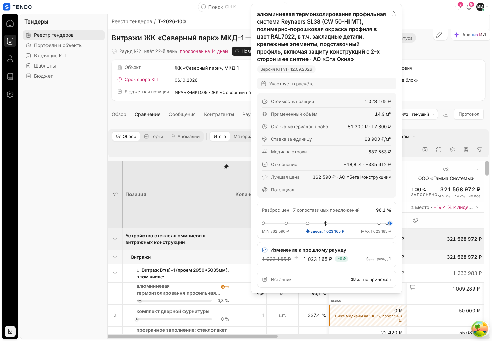

**Паспорт позиции** — наведение/клик по названию позиции: название, путь ФКП («ФКП: раздел › подраздел»), «единица … · шаблонный объём …», «медианная стоимость», поимённо — кто отказался от позиции, кто её пропустил, от кого ждём ответ, «на рассмотрении: иной объём — {подрядчики}». «Копировать паспорт позиции» — в контекстном меню.

## Панель вида

### Пресеты

| Пресет | Показатель | Слои | Сортировка | Фильтр |
|---|---|---|---|---|
| Обзор | Стоимость | — | По разделам | — |
| Торги | Потенциал | Отклонение, Потенциал | По потенциалу | «Есть потенциал» |
| Аномалии | Стоимость | Отклонение | По разбросу | «Аномальные цены» |

Любое ручное изменение показателя, слоёв или сортировки поднимает кнопку сброса к базе пресета (она же снимает фильтры). Тумблеры оформления (подкраска, ширина названий, закрепление и т.п.) на пресет не влияют и сменой пресета не сбрасываются.

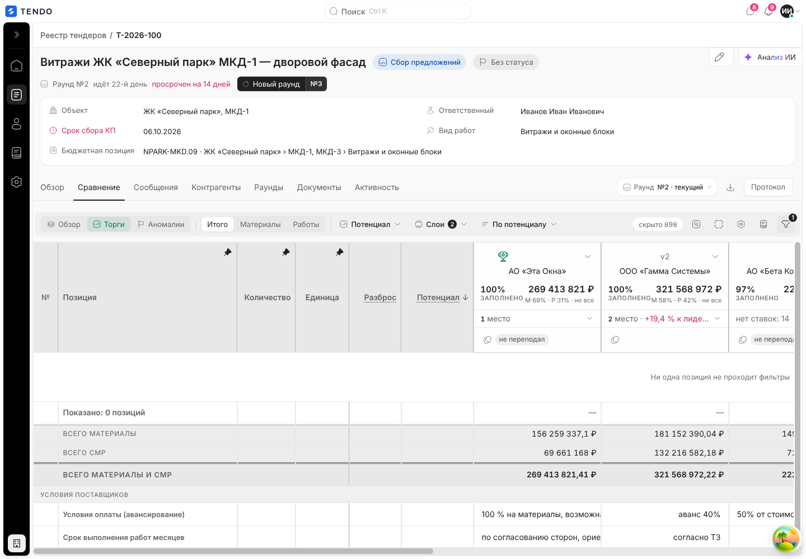

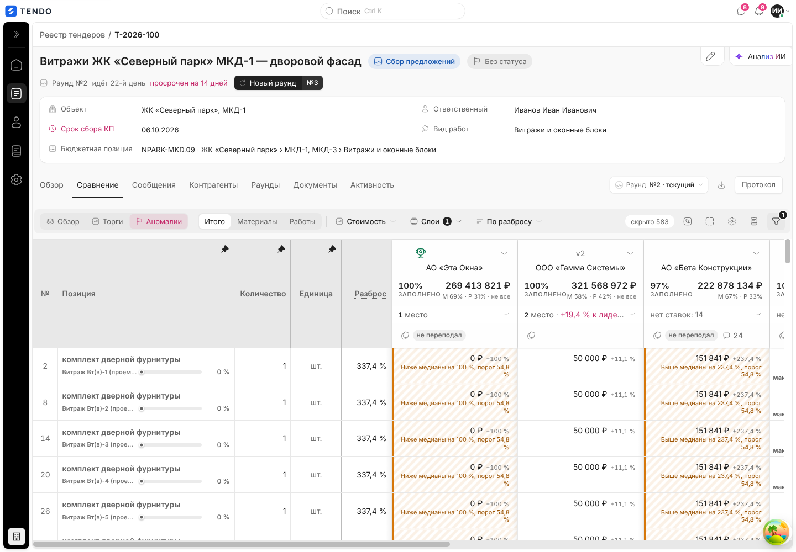

### Срез цены

«Итого / Материалы / Работы»: в срезе «Материалы» и «Работы» все числа (ячейки, подытоги, итоги, ранжир колонок) пересчитываются по соответствующей части цены; у позиций, поданных одной суммой, — «разбивки нет».

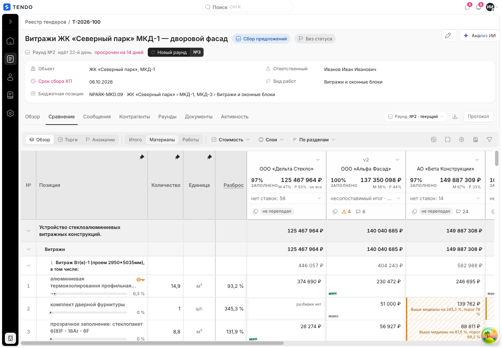

### Основной показатель, слои, сортировка

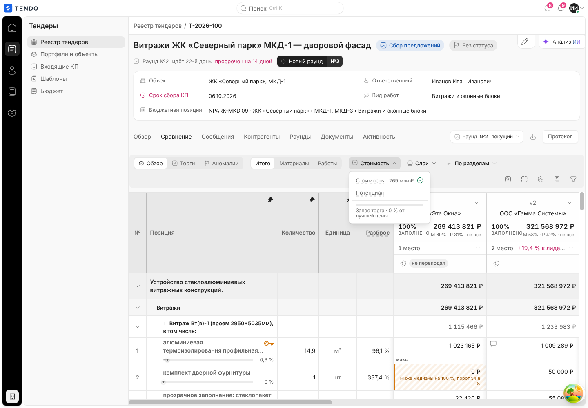

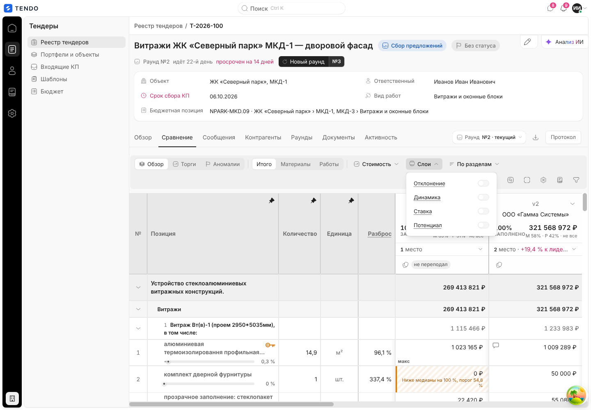

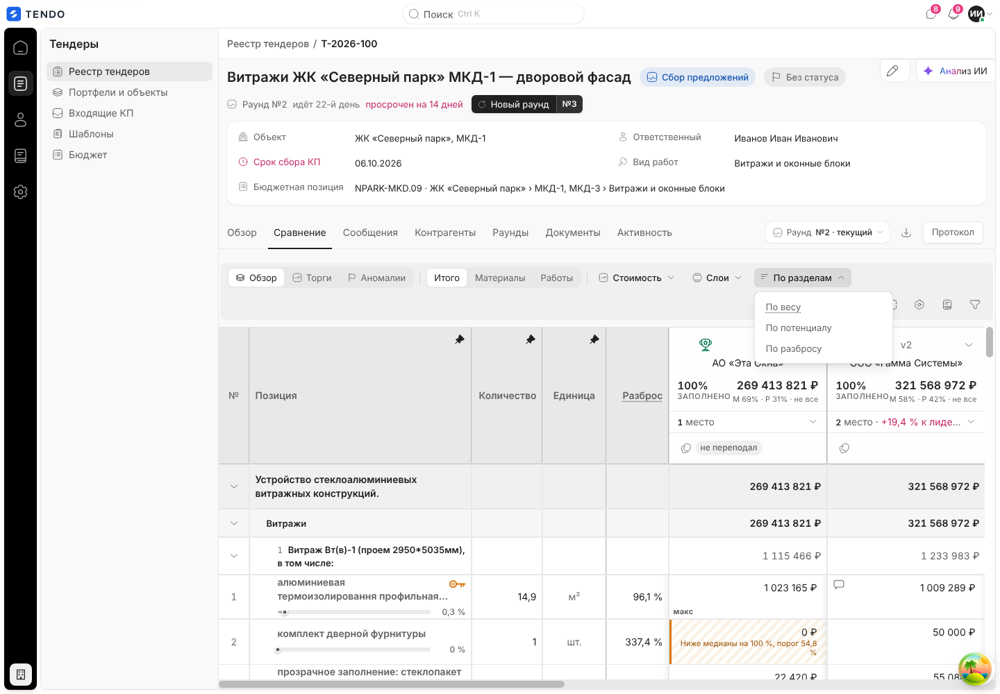

- Подписи пунктов (Стоимость, Потенциал, Отклонение, Динамика, Ставка, По весу) — со справкой по наведению (текст справки — из единого источника help-content, см. ниже).
- Выбор «По потенциалу» автоматически включает колонку «Потенциал» (сортировать по невидимому числу нельзя).
- Сортировки «По весу» и «По разбросу» показывают линию отсечки (см. выше); «По разделам» — исходное состояние, в него сбрасывают.

### Фильтры

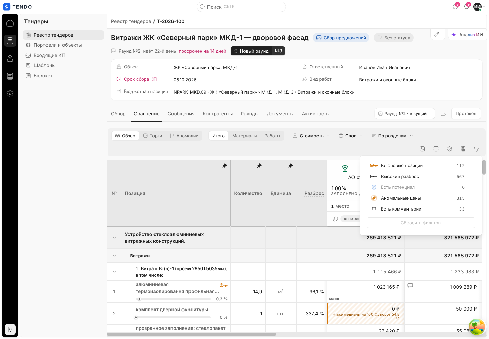

Предикаты (сочетаются по «И»), справа — число строк, проходящих каждый:

| Фильтр | Строка проходит, если |
|---|---|
| Ключевые позиции | позиция ключевая (по правилу доли или ручной пометке) |
| Высокий разброс | разброс ≥ порога «высокого» |
| Есть потенциал | максимальный запас торга по строке ≥ 50 000 ₽ |
| Аномальные цены | в строке есть аномальная цена |
| Есть комментарии | есть переписка хотя бы в одной ячейке строки |

Кнопка «Сбросить фильтры». Пустой результат — «Ни одна позиция не проходит фильтры». Переход к пометке/ячейке (из пометок колонки, мини-списков, чата, ИИ) сам снимает фильтры и раскрывает свёрнутый раздел.

### Параметры анализа

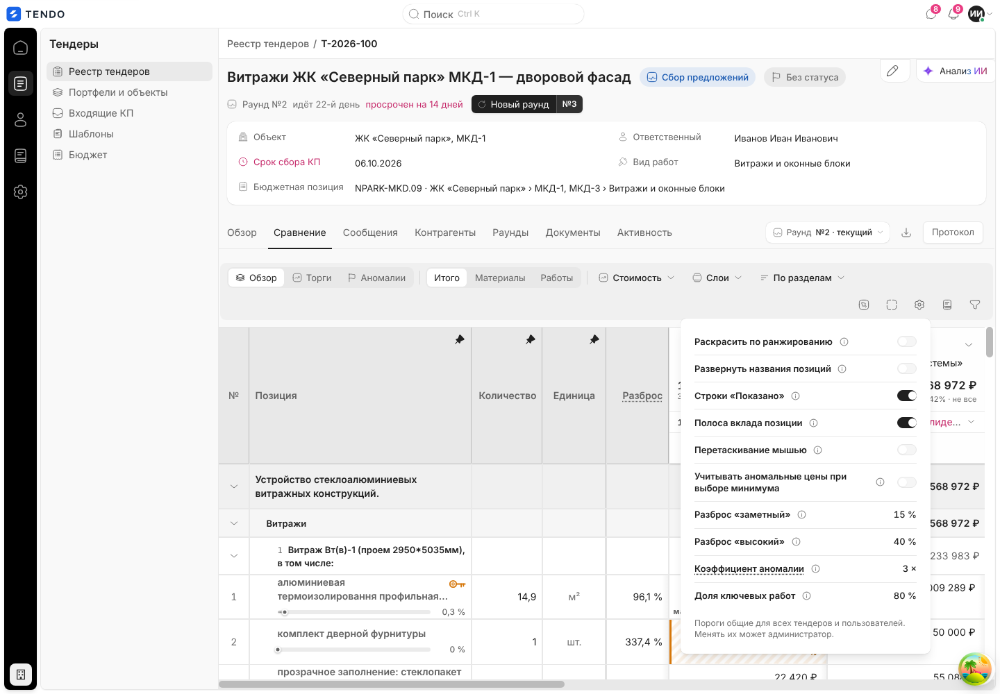

| Настройка | По умолчанию | Описание (подсказка «i») |
|---|---|---|
| Раскрасить по ранжированию | выкл | «Колонки берут цвет своего места: лучший итог — зелёный, худший — красный. Цвет, выбранный палитрой вручную, остаётся как есть.» |
| Развернуть названия позиций | выкл | «Колонка «Позиция» становится шире, и в две строки названия помещается больше. Лента при этом раньше уходит в горизонтальную прокрутку.» |
| Строки «Показано» | вкл | «Под активным фильтром сумма видимого среза выводится строкой у каждого итога — в секции и над итогом всей таблицы.» |
| Полоса вклада позиции | вкл | «Под названием позиции — полоса её веса в тендере и доля в процентах. Выключите, чтобы строки стали ниже.» |
| Перетаскивание мышью | выкл (запоминается в браузере) | «Таблицу можно тянуть левой кнопкой за пустое место ячейки — по обеим осям. Выделить текст в этом режиме — Alt + мышь или двойной клик. Без режима: вбок — Shift + колесо, полоса внизу или зажатое колесо мыши.» |
| Учитывать аномальные цены при выборе минимума | выкл | «Штамп «мин» встанет на самую низкую цену строки, даже если она помечена как аномальная. Выключено — «мин» ищется среди нормальных цен.» |
| Разброс «заметный» / «высокий», Коэффициент аномалии, Доля ключевых работ | 15 % / 40 % / 3× / 80 % | **только чтение**; у коэффициента — формула и пояснение; у доли — сколько позиций сейчас попадает в ключевые |

Подвал: «Пороги общие для всех тендеров и пользователей.» + у администратора ссылка «Изменить в настройках» (`/settings?section=compare`), у остальных — «Менять их может администратор.».

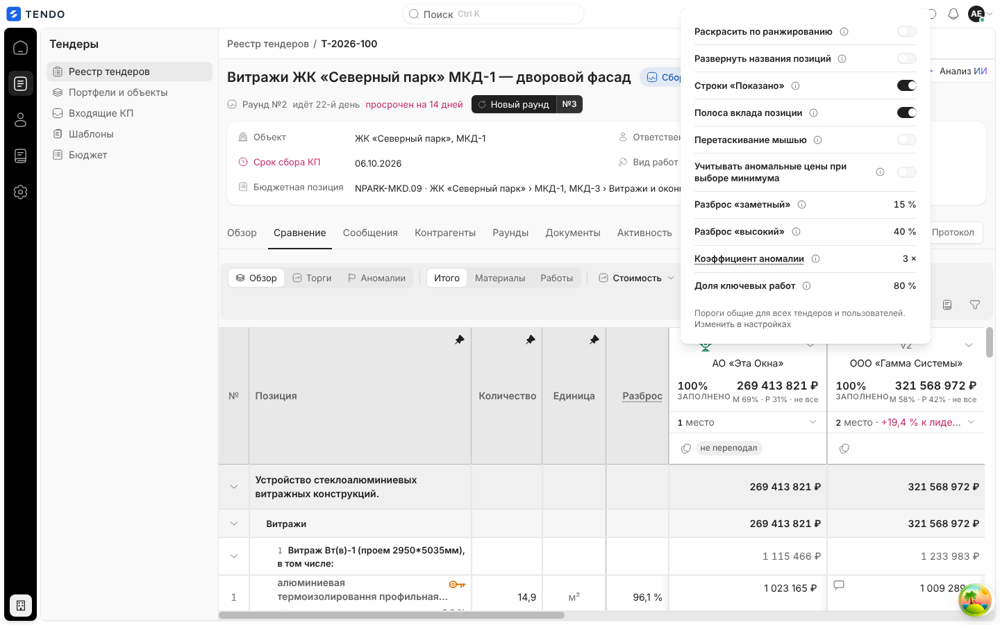

### Легенда пометок

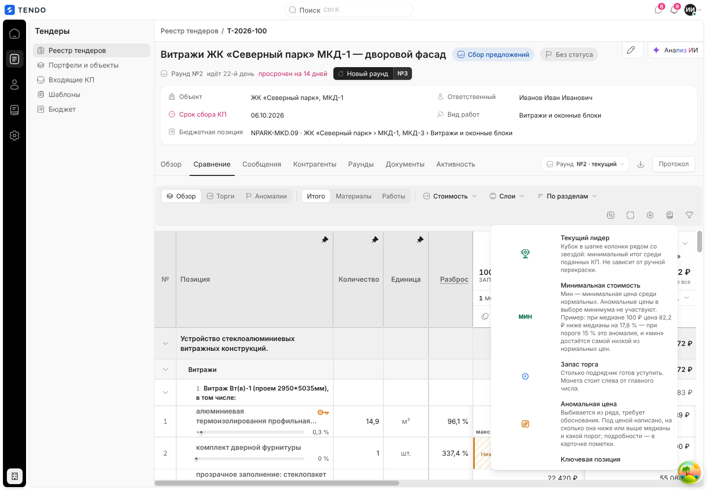

Пункты: Текущий лидер (кубок), Минимальная стоимость («мин» + правило с примером), Запас торга (монета), Аномальная цена (штриховка), Ключевая позиция (ключ), Нет цены («—», «пробел в данных, а не решение подрядчика»), Отказ, Аномалия — риска на кромке, Верхняя граница строки («макс»), Комментарий поставщика (бабл и счётчик), Ждём ответ (точки), Отклонение к медиане, Разброс (три яруса порога), Полоса вклада.

### Справка по показателям (help-content)

Подписи показателей, колонок «Разброс», «Потенциал», сортировки «По весу», порога аномалии — со всплывающей справкой (заголовок, 1–5 абзацев с примерами). Тексты хранятся единым версионируемым источником (генерируется из документа справки) и не дублируются в компонентах. Темы: Минимум строки, Цена, Ставка за единицу, Отклонение, Потенциал, Динамика, Разброс, Аномалия, Вклад позиции.

## Взаимодействия с таблицей

### Закрепление колонок

- Булавки в шапке: «Позиция» (закрепить № + Позиция), «Количество», «Единица», «избранных подрядчиков (★)». Закрепляется **префикс** колонок слева до выбранной включительно; подсказка называет действие («Закрепить слева всё до «Количество» включительно» / «Открепить …» / «Закрепить только до …»).
- «Закрепить колонки по эту» — в меню колонки подрядчика (до 12 колонок).
- Предел: закреплённая часть ≤ 60 % видимой ширины ленты; иначе — «Не помещается: закреплённая часть заняла бы больше 60 % ширины. Разверните таблицу во весь экран или сузьте «Позицию»».
- Закрепление выключено по умолчанию и запоминается в браузере (по тендеру — закрепление «по подрядчика» и закреплённые строки).

### Порядок колонок

Перетаскивание шапки колонки мышью или «Переместить → В начало / Влево / Вправо / В конец» в меню колонки. Ключи порядка: ★ избранные → ручной порядок → ранжир по итогу. Ручной порядок запоминается в браузере (по тендеру); «Вернуть порядок колонок по ранжиру» — в меню таблицы.

### Контекстное меню (правая кнопка, `Shift+F10`/клавиша меню; `Shift` + правая кнопка — системное меню браузера)

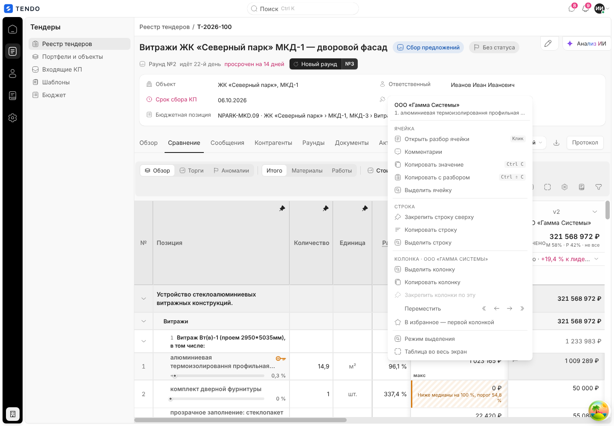

| Цель | Пункты |
|---|---|
| Ячейка (шапка меню: подрядчик, «N. позиция · значение») | Ячейка: «Открыть разбор ячейки» (Клик), «Комментарии»/«Написать комментарий», «Копировать значение» (Ctrl C), «Копировать с разбором» (Ctrl ⇧ C), «Выделить ячейку»; Строка: «Закрепить строку сверху»/«Открепить строку», «Копировать строку», «Выделить строку»; Колонка · {подрядчик}: «Выделить колонку», «Копировать колонку», «Закрепить колонки по эту»/«Снять закрепление колонок», «Переместить ▸», «В избранное — первой колонкой»/«Убрать из избранного»; общие пункты таблицы |
| Позиция | «Копировать паспорт позиции», пункты строки |
| Шапка подрядчика | «Открыть досье», пункты колонки |
| Раздел | «Свернуть раздел»/«Развернуть раздел», «Свернуть все разделы», «Развернуть все разделы» |
| Таблица | «Режим выделения»/«Выйти из режима выделения», «Открепить все строки (N)», «Вернуть порядок колонок по ранжиру», «Таблица во весь экран»/«Выйти из полноэкранного режима» (Esc) |

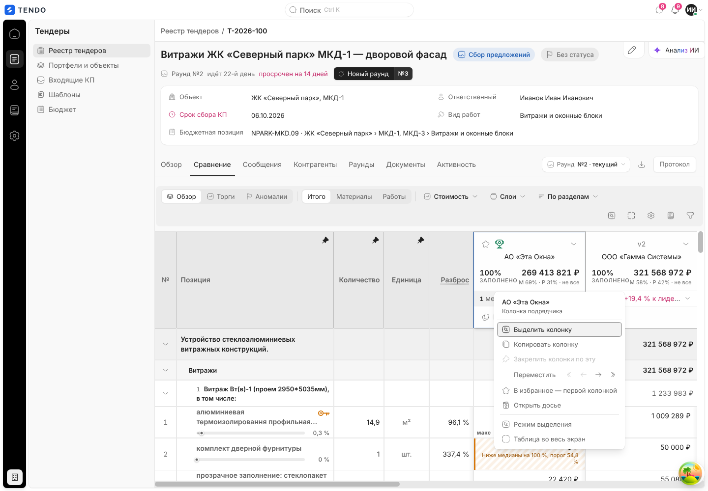

### Режим выделения и копирование

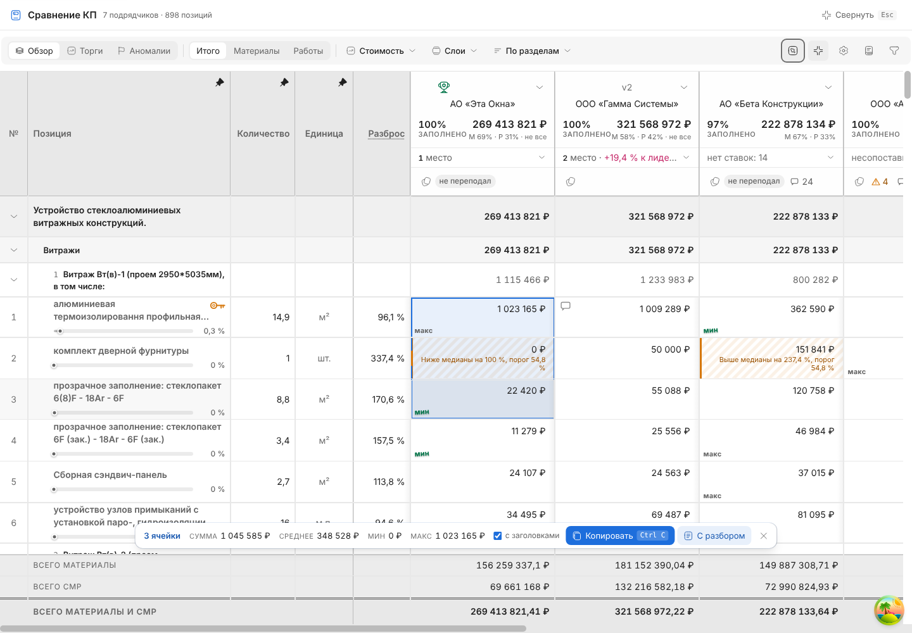

- Включается значком на панели, из меню или пунктом «Выделить …». Подсказка режима: «Клик — ячейка · протяжка — диапазон · Shift — от угла · Ctrl — добавить · клик по названию — строка».
- Нижняя панель: «N ячеек», «Сумма / Среднее / Мин / Макс» по выделенным числам (или «без чисел»), флажок «с заголовками», «Копировать» (Ctrl C), «С разбором» (Ctrl ⇧ C), «Снять выделение» (Esc), «Выйти» (Esc).
- Клавиши: стрелки — сдвиг фокуса, Ctrl A — всё, Esc — снять/выйти.
- Копирование: одна ячейка — значение «1 023 165 ₽»; несколько — таблица (TSV с числами для Excel + HTML с заголовками для документов); «с разбором» — плюс текст сводки каждой ячейки. Уведомление «Скопировано: N ячеек [с разбором]» / «Не удалось скопировать — браузер не дал доступа к буферу».

### Во весь экран

Таблица разворачивается поверх страницы с шапкой «Сравнение КП · 7 подрядчиков · 898 позиций» и кнопкой «Свернуть» (Esc); состояние (прокрутка, выделение) сохраняется.

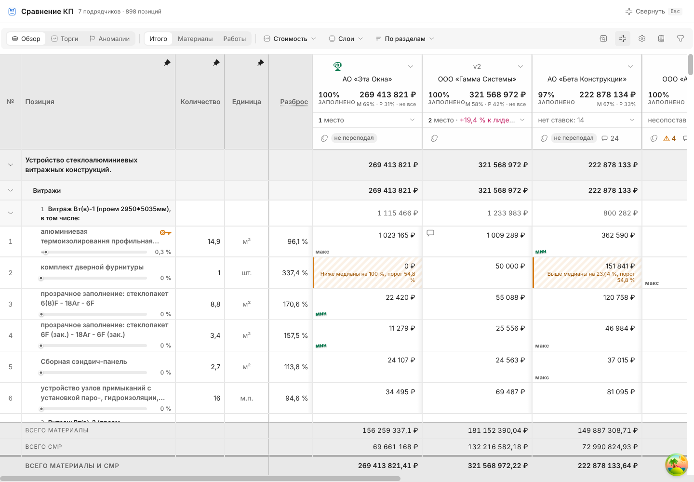

### Выбор раунда

Капсула «Раунд №N · текущий/завершён» на строке вкладок. Если раунд один — неактивна («Пока один раунд — переключать нечего»); раундов нет — «Раунд —» («Раундов пока нет — сначала пригласите участников»). Прошлый раунд показывает КП, поданные к его окончанию (снимок запрашивается с зафиксированными версиями КП).

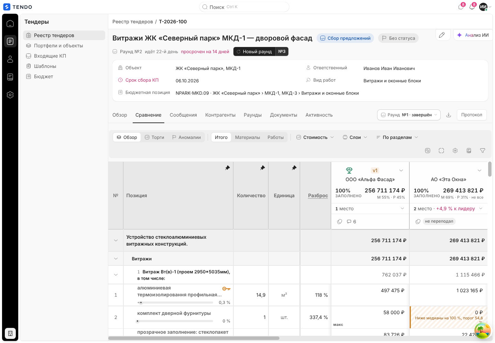

## Корректировки объёма

Поставщик может предложить иной объём позиции («иной объём»). До решения строка у этого поставщика в сравнение не входит.

- Чип «⚠ N» в подвале карточки — мини-список «Корректировки {подрядчик} · N на рассмотрении»: строки «позиция · иной объём →» (переход к ячейке с подсветкой) и кнопка «Принять все (N)».
- «Принять все» → подтверждение прямо в списке: «Объём изменится по N позициям для всех участников. Назвать цену заново попросят ещё M участников.», «Отмена» / «Принять все» → `POST /tenders/{id}/quotes/{quote_id}/review-batch`.
- Знак ⚠ в ячейке: наведение — «Иной объём у поставщика: Смета N · Поставщик считает M» и обоснование; клик — панель решения.

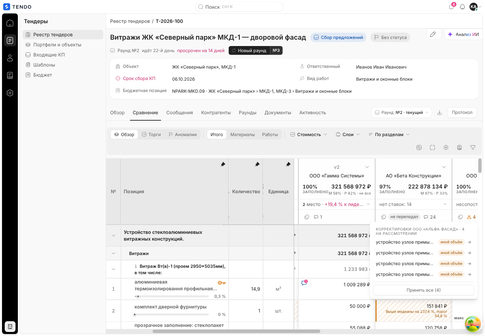

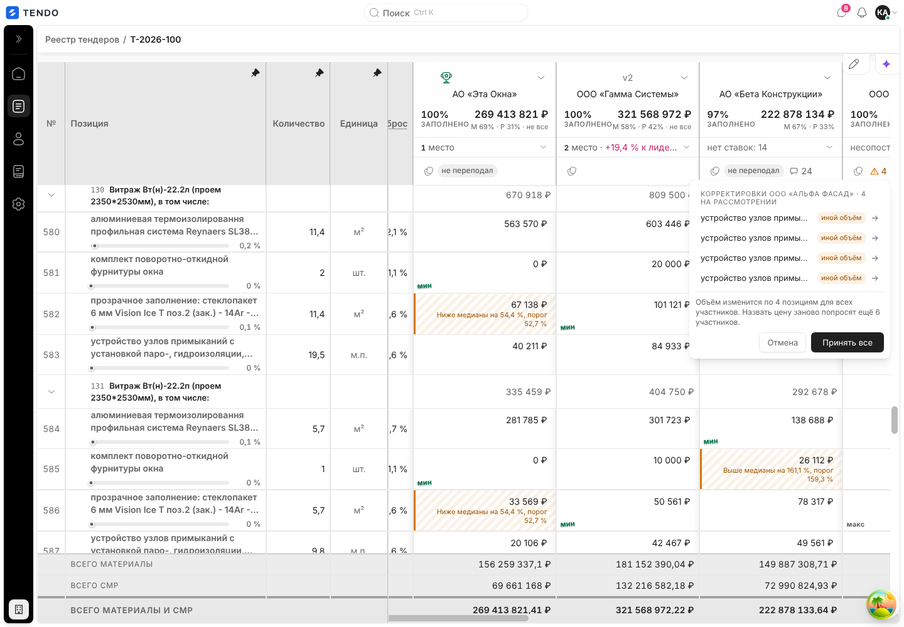

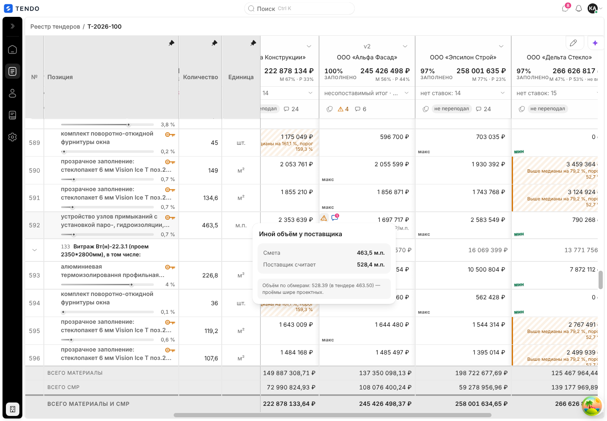

**Панель «Иной объём · на рассмотрении»**: позиция и подрядчик; «Данные»: «В смете», «Поставщик считает», «Стоимость позиции», «Ставка за единицу»; «Обоснование поставщика» (или «Обоснование не приложено — цены посчитаны за разные объёмы.»); необязательное поле примечания к решению; кнопки «Отклонить» и «Принять». «Принять» показывает последствие числом: «Объём позиции станет N {ед}: суммы ещё M участников пересчитаются по их ставкам, им уйдёт просьба уточнить цену. Продолжить?». Запрос `POST /tenders/{id}/quote-items/{item_id}/review` `{decision: accepted|declined, note}`.

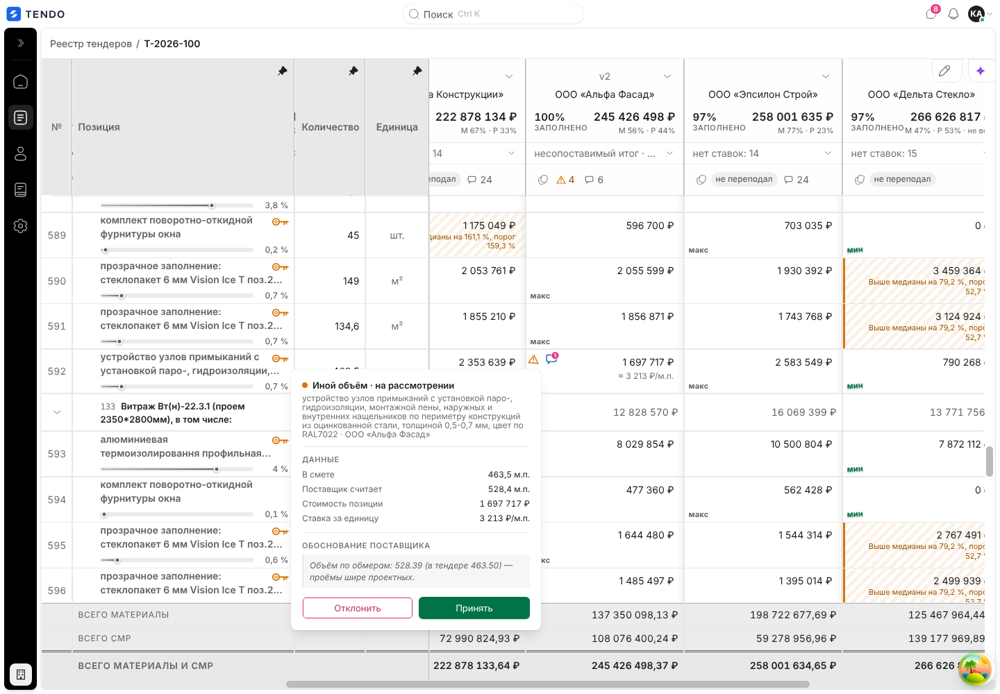

## Комментарии к ячейкам

- Бабл в ячейке — есть переписка; красный счётчик — сколько записей **не отработано** текущим пользователем.
- Клик по баблу (или «Комментарии» в меню) — плавающий тред ячейки: заголовок (позиция, подрядчик), «Комментарий поставщика» (история комментариев поставщика к позиции по версиям КП, от новой к старой; отметка «не просмотрено»; «Отметить просмотренным»; «Ответить контрагенту» — ответ уходит ему в чат с маркировкой ячейки), лента комментариев сотрудников («N комментариев», «Отметить все прочитанными», «Ответить», «Копировать», «Выделить», «Продублировать в чат»), поле «Написать комментарий…».
- Чип «💬 N» в подвале карточки — мини-список «Комментарии {подрядчик} · N не отработано»: «позиция · дата →».
- API: `GET /tenders/{id}/comments`, `POST /comments` (`entity_type`, позиция и КП, `parent_comment_id`), `POST /comments/read`, `GET /tenders/{id}/position-comments`, `POST /tenders/{id}/position-comments/read`, `GET /tenders/{id}/comment-workload`.
- Если комментарии не загрузились — жёлтая плашка над таблицей «Переписка по ячейкам не загрузилась … Знаки комментариев в таблице сейчас могут не показываться.» + «Повторить».

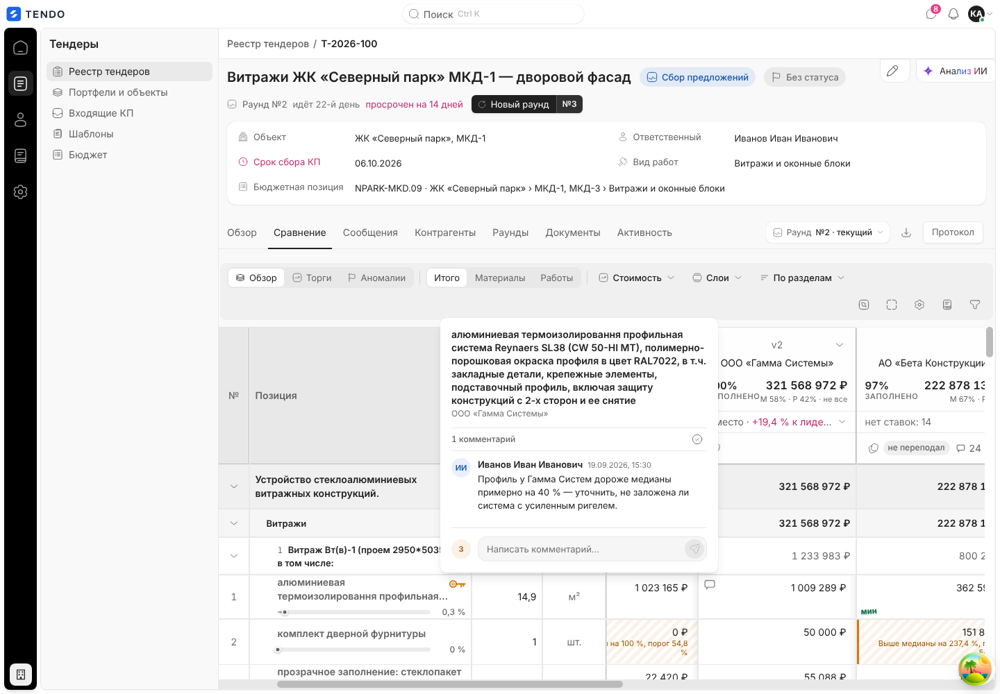

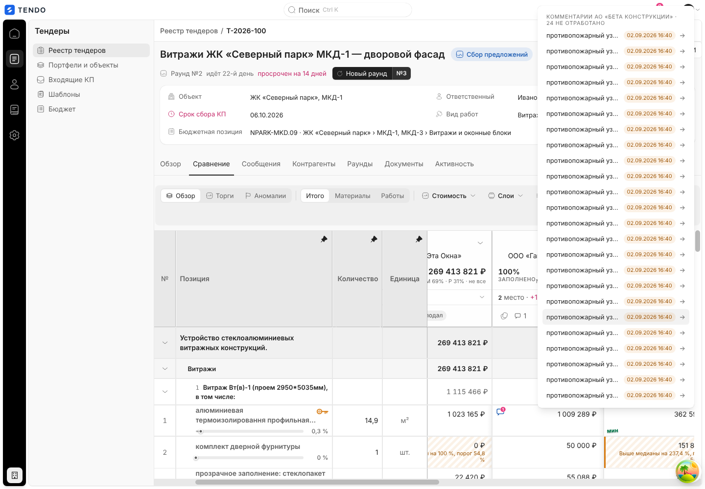

## Досье подрядчика

Клик по названию в шапке колонки или «Открыть досье» в меню. Боковая панель справа:

- Реквизиты: название, капсула стадии («Получено»…), ИНН, «Контактное лицо», «Эл. почта», «Телефон», «КП поступило», «Версия ФКП» (маскируются при включённой маске контактов — [tender-card.md](tender-card.md#роли-и-права));
- «Итог по КП», «Место в сравнении» («Лучшее предложение» / N место / причина), «Заполнено» (%, «N из M позиций», полоса);
- «Условия КП» — все поля условий;
- «В этой колонке» — группы со счётчиками и мини-списками позиций (клик — переход к ячейке): «Аномальные цены», «Выше медианы», «Ниже медианы», «Минимальные цены», «Корректировки на рассмотрении», «Общий потенциал», «Потенциал по ключевым», «Позиции без цены», «Отказы», «Структура стоимости» (позиции, набирающие основную долю стоимости КП, с % );
- кнопки «Написать поставщику» (чат) и «Закрыть».

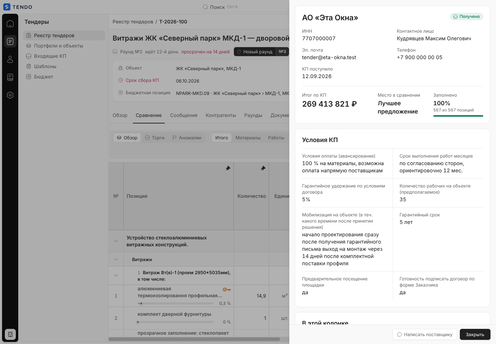

## Выгрузка в Excel

Значок «Выгрузить сравнение в Excel» (подсказка «Выгрузка сравнения в Excel (.xlsx): N позиций, состав всегда полный»). Окно «Выгрузка сравнения», описание «Тендер {id} · N позиций · M поставщиков».

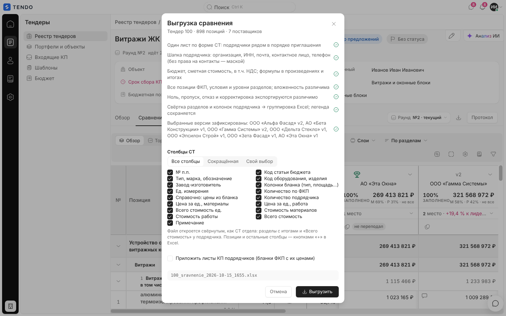

- Чек-лист состава (только информация): «Один лист по форме СТ: подрядчики рядом в порядке приглашения»; «Шапка подрядчика: организация, ИНН, почта, контактное лицо, телефон (без права на контакты — маской)»; «Бюджет, сметная стоимость, в т.ч. НДС; формулы в произведениях и итогах»; «Все позиции ФКП, условия и уровни разделов; вложенность различима»; «Ноль, пропуск, отказ и корректировка экспортируются различимо»; «Свёртка разделов и колонок подрядчика → группировка Excel; легенда сохраняется»; «Выбранные версии зафиксированы: {подрядчик} vN, …».
- «Столбцы СТ»: переключатель «Все столбцы / Сокращённая / Свой выбор» и флажки: № п.п., Код статьи бюджета, Тип/марка/обозначение, Код оборудования/изделия, Завод-изготовитель, Колонки бланка, Ед. измерения, Количество по ФКП, Справочно: цены из бланка, Количество подрядчика, Цена за ед. материалы, Цена за ед. работа, Всего стоимость ед., Стоимость материалов, Стоимость работы, Всего стоимость, Примечание. «Сокращённая» = № п.п., Количество, Стоимость материалов, Стоимость работы, Всего стоимость, Примечание. Наименование выводится всегда. Выбор запоминается в браузере. Подсказка: «Файл откроется свёрнутым, как СТ отдела…» / «Наименование работ выводится всегда. Скрытые столбцы открываются в Excel.».
- Флажок «Приложить листы КП подрядчиков (бланки ФКП с их ценами)» (по умолчанию выкл).
- Имя файла: `{id}_sravnenie_ГГГГ-ММ-ДД_ЧЧММ.xlsx` (московское время), показывается внизу окна.
- «Выгрузить» → `GET /tenders/{id}/comparison/export?full=true[&versions=…][&include_quotes=true][&columns=…]` → скачивание файла; во время сборки — «Собираем файл…», кнопки заблокированы; ошибка — окно остаётся открытым. Фильтры таблицы на состав файла не влияют.

## Маска финансов

Без права видеть финансы: в карточках колонок «Цена скрыта» (подсказка «Цена скрыта: нет права видеть финансы этого тендера»), полнота 0 %, ячейки и итоги — «—», срез цены недоступен, аналитика по ценам не считается, в выгрузке суммы пустые; кнопка «Протокол» отсутствует.

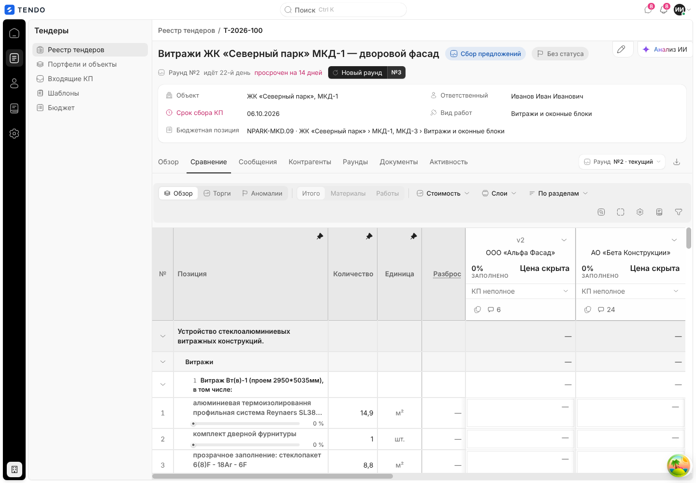

## Ссылка на вид

Состояние вида сериализуется в адрес (заменой истории, без новых записей): `p` (пресет: `overview|bidding|anomalies`), `m` (показатель, если отличается от пресета: `cost|potential`), `dev`, `dyn`, `pot` (`1`/`0`, если отличается от пресета), `sort` (`sections|weight|potential|spread`), `f` (фильтры через запятую: `key,spread,pot,anomaly,cmt`), `slice` (`materials|works`; `total` не пишется). Открытие ссылки восстанавливает вид; мусорные значения игнорируются. Избранные ★, тумблеры оформления, закрепления, выделение в адрес не пишутся.

## Состояния

| Состояние | Поведение | Снимок |
|---|---|---|
| Загрузка | Скелетоны полосы и таблицы | — |
| Ошибка первой загрузки | «Сравнение не загрузилось» · «Остальные разделы карточки работают.» · «Повторить» | — |
| Ошибка пересчёта при наличии данных | Таблица остаётся приглушённой; над ней красная полоса с причиной и «Повторить», под ней «последний подтверждённый срез · {время}» | — |
| Нет КП, есть приглашённые | Колонки участников со стадией («ждём предложение», «доставлено»), во всех ячейках «—», итоги не считаются нулём | 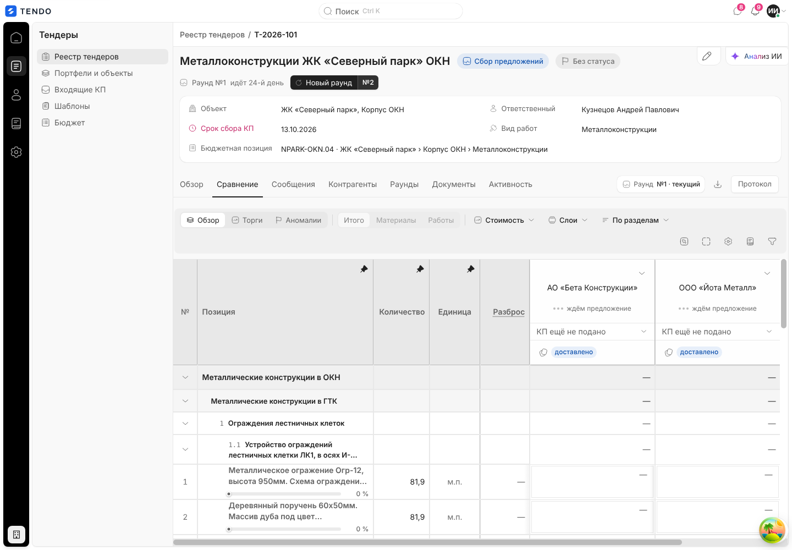 |
| Никого не пригласили | «Ждём предложения» · «Пока никого не пригласили — сравнительная таблица наполнится цифрами после первых подач. Итоги не считаются нулём: без КП в минимуме и максимуме нет участников.» · «Пригласить контрагентов» (+ «Отправить» у черновика). Если приглашены, но КП нет совсем: «Контрагенты приглашены — ждём первые КП. Приглашённые уже видны колонками со стадией (приглашён → открыл → заполняет → подал)…» | 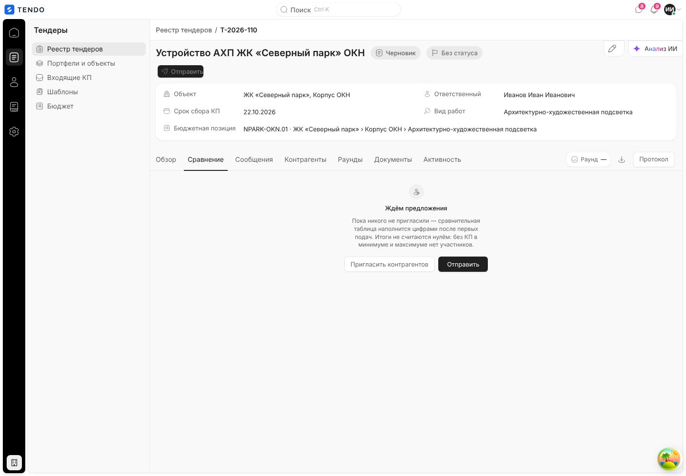 |
| В тендере нет сметы | «В тендере ещё нет сметы — сравнивать нечего.» | — |
| Завершён / отменён | Нет колонки «Пригласить в тендер», нет «Новый раунд»; сравнение и корректировки доступны для просмотра | — |

## Сложность

**XL**: виртуализированная таблица с деревом разделов, липкими шапкой и колонками, расчётной моделью (медианы, аномалии, ключевые, итоги по срезам и версиям), десятком всплывающих панелей, выделением/копированием (TSV+HTML), контекстными меню, перетаскиванием колонок, корректировками, комментариями, досье, выгрузкой Excel на сервере (формулы, группировка, маски) и сериализацией вида в адрес.
