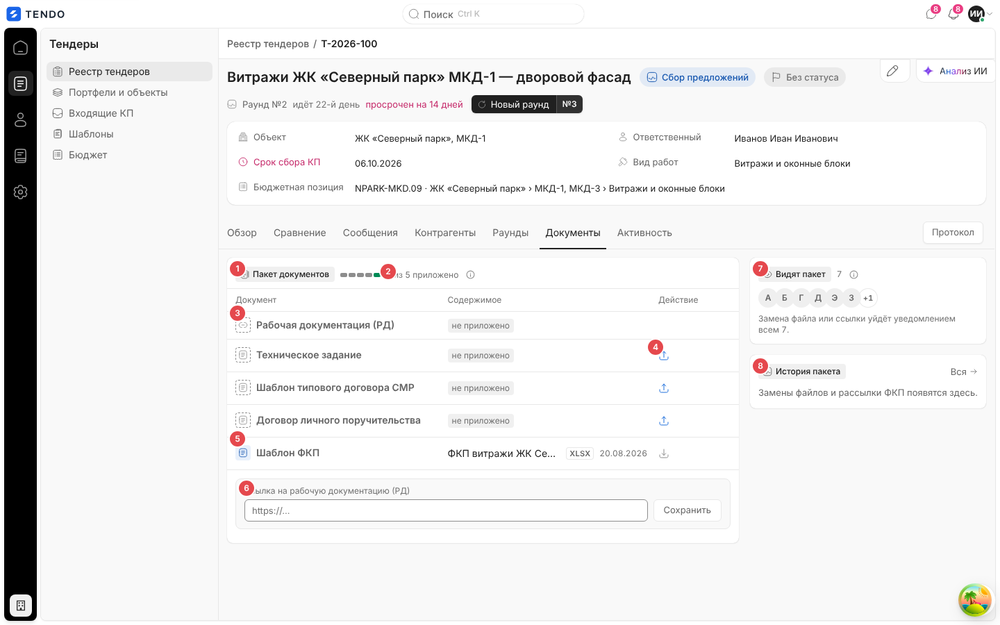
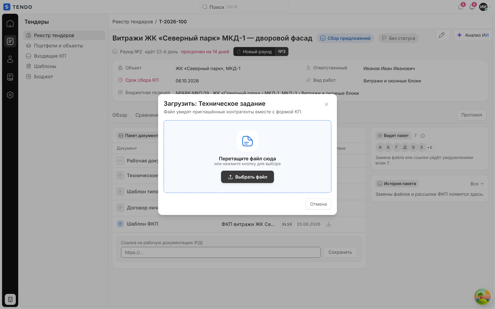
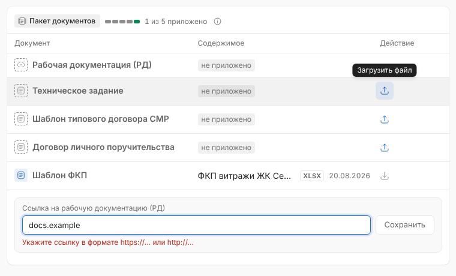
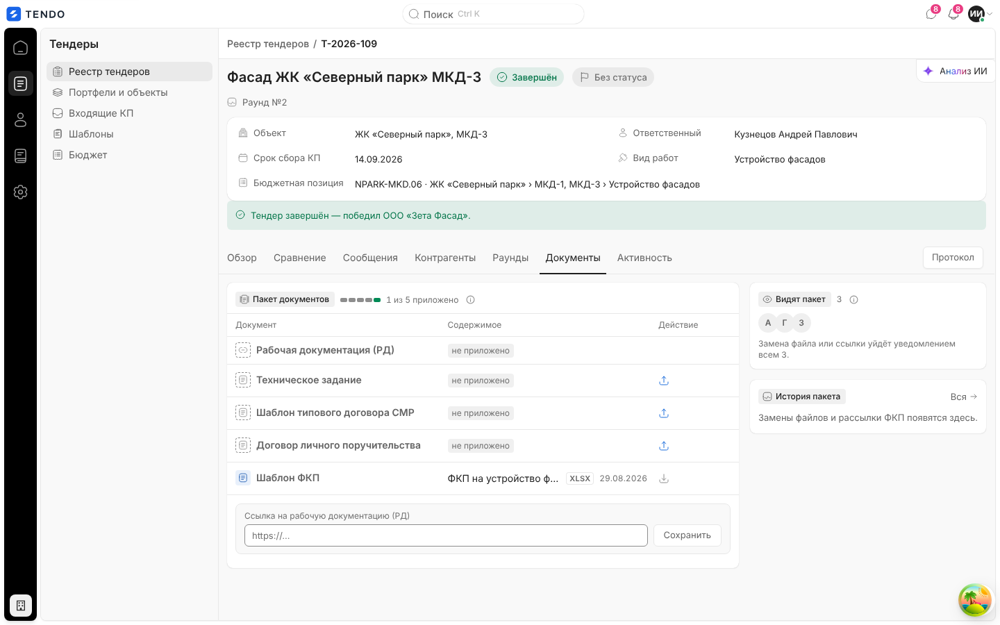
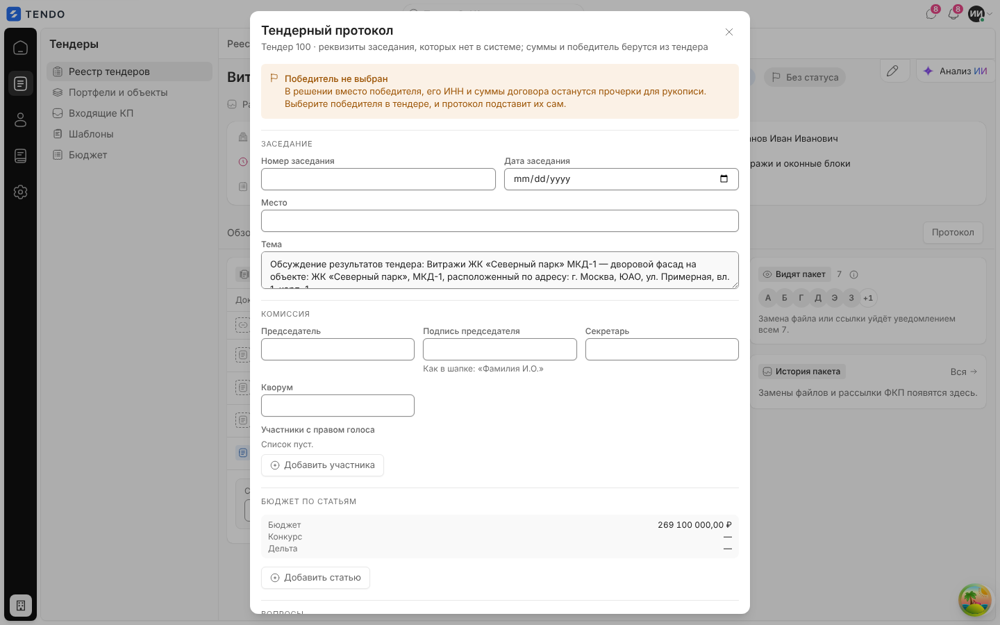
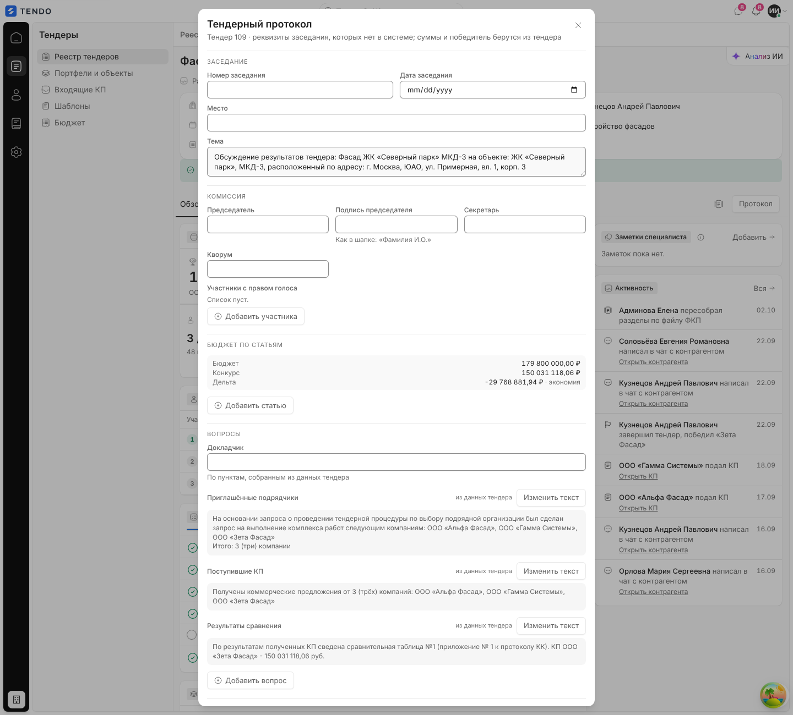
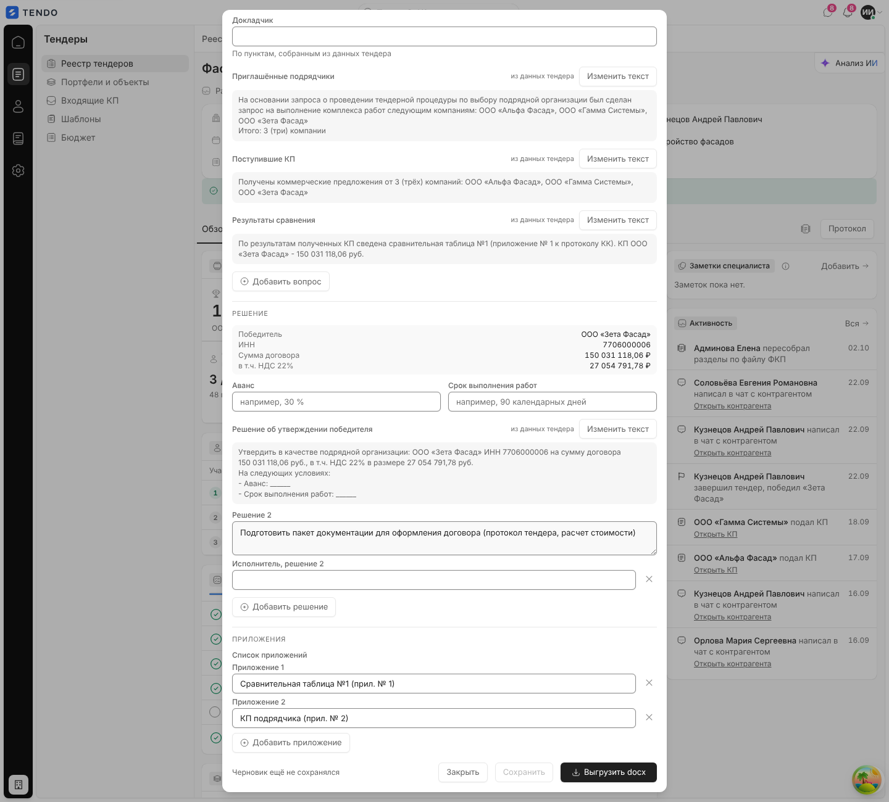

# Карточка тендера — вкладка «Документы» и тендерный протокол

Пакет документов тендера, который видят приглашённые контрагенты вместе с формой КП (ссылка на рабочую документацию, техническое задание, шаблоны договоров, шаблон ФКП), и окно «Тендерный протокол» с выгрузкой в Word (.docx), доступное с любой вкладки.

Связанные разделы: обзор экрана — [tender-card.md](tender-card.md); форма КП поставщика (где пакет виден контрагенту) — экраны поставщика в [03-screens](./); API — [../04-api/endpoints-rounds.md](../04-api/endpoints-rounds.md#get-tenderstender_iddocuments) (`/documents`), [../04-api/endpoints-tenders-comparison.md](../04-api/endpoints-tenders-comparison.md#get-tenderstender_idprotocol) (`/protocol`, `/protocol/export`), файлы — [../04-api/](../04-api/) (загрузка/скачивание вложений); хранилище — [../07-architecture/](../07-architecture/); данные — [../05-data-model/tables.md#tenders](../05-data-model/tables.md#tenders) (`attachments`, `tender_protocols`).

## Маршрут, роли, как попасть

- `/tenders/:id`, вкладка «Документы». Окно протокола — кнопка «Протокол» на строке вкладок (любая вкладка).
- Роли: тендерный специалист, администратор. Протокол — только при праве видеть финансы (иначе кнопки нет, сервер отвечает 403 «Протокол содержит суммы: он доступен ролям с правом видеть цены.»); сохранение протокола — право `tenders.manage`.

## Вкладка «Документы»

| № | Элемент | Поведение |
|---|---|---|
| ① | Группа «Пакет документов» | Подсказка: «Документы тендера: файлы и ссылки, которые видят приглашённые контрагенты вместе с формой КП. Замена файла уведомляет тех, кто уже приглашён.» |
| ② | Полнота пакета | Клетки по числу слотов (зелёная — приложено) и «N из M приложено» |
| ③ | Строка слота | Значок типа (ссылка / файл), название, содержимое, действие |
| ④ | «Загрузить файл» / «Заменить файл» | Окно загрузки |
| ⑤ | «Шаблон ФКП» | Исходный файл, из которого создан тендер; только чтение и скачивание |
| ⑥ | «Ссылка на рабочую документацию (РД)» | Поле URL + «Сохранить» |
| ⑦ | «Видят пакет» | Аватары приглашённых с открытым доступом (до 6 + «+N»), «Замена файла или ссылки уйдёт уведомлением всем N.» (одному — по имени); пусто — «Пока никого — пакет увидят приглашённые вместе с формой КП.»; подсказка «Приглашённые контрагенты с открытым доступом: пакет лежит рядом с их формой КП. Закрытым доступом пакет не показывается.» |
| ⑧ | «История пакета» | Лента событий «документы обновлены», «рассылка версии ФКП», «структура обновлена»; «Вся →»; пусто — «Замены файлов и рассылки ФКП появятся здесь.» |

### Слоты пакета

| Слот | Тип | Редактируется |
|---|---|---|
| Рабочая документация (РД) | ссылка (URL) | да — полем внизу блока; в строке — «Открыть ссылку в новой вкладке» |
| Техническое задание | файл | да |
| Шаблон типового договора СМР | файл | да |
| Договор личного поручительства | файл | да |
| Шаблон ФКП | файл | нет (только скачать) |

Шестой слот сервера «Форма оферты / КП» (тип `offer`) на вкладке не показывается и в счётчик не входит. Содержимое приложенного файла: имя (многоточие + подсказка), капсула расширения («XLSX»), дата загрузки (ДД.ММ.ГГГГ, МСК), «Скачать файл»; не приложенного — капсула «не приложено».

### Загрузка файла

- Окно «Загрузить: {слот}» / «Заменить: {слот}»; описание «Файл увидят приглашённые контрагенты вместе с формой КП.» / «Новый файл встанет на место прежнего. Приглашённые контрагенты получат уведомление о замене.»; зона «Перетащите файл сюда / или нажмите кнопку для выбора», «Выбрать файл»; «Отмена».
- Допустимые форматы (проверка расширения, типа и сигнатуры на сервере): PDF, PNG, JPG/JPEG, GIF, WEBP, DOC, DOCX, XLS, XLSX, XLSM, ZIP, RAR, 7Z, TXT, CSV; размер — до `MAX_UPLOAD_MB` (по умолчанию 25 МБ).
- Загрузка: файл загружается как вложение тендера (локальное хранилище — через API; S3 — прямой загрузкой по предподписанной ссылке с подтверждением), затем слот привязывается: `PATCH /tenders/{id}/documents` `{<слот>: attachment_id}`. Во время загрузки — индикатор «Загружаем документ…» с прогрессом, повтором и отменой.
- Результат: «Файл заменён. Уведомлено: N» (если были приглашённые); ошибка — «Ошибка загрузки» / текст сервера.

### Ссылка на РД

Поле «Ссылка на рабочую документацию (РД)», плейсхолдер `https://…`, кнопка «Сохранить» («Сохраняем…»). Проверка: URL должен начинаться с `http://` или `https://` — иначе «Укажите ссылку в формате https://… или http://…». `PATCH /tenders/{id}/documents` `{rd_url}`; успех — «Ссылка сохранена. Уведомлено: N».

### Скачивание

«Скачать файл» — через API скачивания вложения (в S3-режиме — по предподписанной ссылке); ошибка — «Не удалось скачать файл».

### Состояния

- Загрузка — «Загружаем документы…».
- Завершённый тендер — интерфейс правку пакета не блокирует (см. [открытые вопросы](../_oq/SCR-2a.md)).

## Тендерный протокол

Окно «Тендерный протокол», описание «Тендер {id} · реквизиты заседания, которых нет в системе; суммы и победитель берутся из тендера». Данные: `GET /tenders/{id}/protocol` (черновик протокола + вычисленные автотексты и суммы), сохранение `PUT /tenders/{id}/protocol`, выгрузка `GET /tenders/{id}/protocol/export` → файл `protocol_{id}.docx` (имя может прийти из заголовка ответа).

Если победитель не выбран — жёлтая плашка «Победитель не выбран. В решении вместо победителя, его ИНН и суммы договора останутся прочерки для рукописи. Выберите победителя в тендере, и протокол подставит их сам.».

| Группа | Поле | Тип / ограничение | Умолчание (если пусто) |
|---|---|---|---|
| Заседание | Номер заседания | строка ≤ 50 | — |
| | Дата заседания | дата (ошибка «Дата в формате ДД.ММ.ГГГГ») | — |
| | Место | строка ≤ 300 | значение настройки сервера `PROTOCOL_PLACE` |
| | Тема | текст ≤ 4000 | «Обсуждение результатов тендера: {название} на объекте: {объект}, расположенный по адресу: {адрес}» |
| Комиссия | Председатель | строка ≤ 200 | настройка `PROTOCOL_CHAIRMAN` |
| | Подпись председателя | строка ≤ 200, подсказка «Как в шапке: «Фамилия И.О.»» | как «Председатель» |
| | Секретарь | строка ≤ 200 | — |
| | Кворум | строка ≤ 100 | — |
| | Участники с правом голоса | список строк ≤ 200, до 30; «Добавить участника», «Убрать» | «Список пуст.» |
| Бюджет по статьям | (система) Бюджет / Конкурс / Дельта | только чтение: плановая сумма тендера, итог победителя, разница с пометкой «экономия»/«перерасход» | — |
| | Статья N + Сумма N, ₽ | до 20 строк; статья ≤ 100, сумма ≥ 0, до 2 знаков («Сумма — числом, например 1 250 000,50»); «Добавить статью» | — |
| Вопросы | Докладчик | строка ≤ 200, подсказка «По пунктам, собранным из данных тендера» | — |
| | Приглашённые подрядчики / Поступившие КП / Результаты сравнения | автотекст из данных тендера (метка «из данных тендера»); «Изменить текст» превращает в редактируемое поле (≤ 4000), «Вернуть авто» — обратно | тексты вида «На основании запроса … следующим компаниям: …. Итого: 3 (три) компании», «Получены коммерческие предложения от 3 (трёх) компаний: …», «По результатам полученных КП сведена сравнительная таблица №1 … КП {победитель} - {сумма} руб.» |
| | Свой вопрос N + Докладчик по вопросу N | до 30; «Добавить вопрос» | — |
| Решение | (система) Победитель / ИНН / Сумма договора / в т.ч. НДС 22 % | только чтение | прочерки без победителя |
| | Аванс; Срок выполнения работ | строки ≤ 300 (плейсхолдеры «например, 30 %», «например, 90 календарных дней») | прочерк для рукописи |
| | Решение об утверждении победителя | автотекст («Утвердить в качестве подрядной организации: {победитель} ИНН … на сумму договора … руб., в т.ч. НДС 22% … На следующих условиях: — Аванс: … — Срок выполнения работ: …»), «Изменить текст» | — |
| | Решение N + Исполнитель | до 20; «Добавить решение» | «Подготовить пакет документации для оформления договора (протокол тендера, расчет стоимости)» |
| Приложения | Список приложений | до 20 строк; «Добавить приложение» | «Сравнительная таблица №1 (прил. № 1)», «КП подрядчика (прил. № 2)» |

Общий размер черновика — до 64 КБ («Протокол больше 64 КБ»).

Кнопки и состояние: строка статуса слева — «Черновик ещё не сохранялся» / «Есть несохранённые изменения» / «Сохранено · ДД.ММ.ГГ, ЧЧ:ММ»; «Закрыть»; «Сохранить» (активна только при изменениях; «Сохраняем…»); «Выгрузить docx» («Собираем файл…»; при несохранённых правках сначала сохраняет — подсказка «Сначала сохранит правки», т.к. документ собирается из сохранённого черновика). Ошибки: «Исправьте отмеченные поля.», «Сервер не принял некоторые поля — они отмечены.», «Не удалось сохранить протокол.», «Не удалось собрать протокол.»; ошибка загрузки — «Протокол не загрузился». После сохранения форма перечитывается с сервера (автотекст решения зависит от аванса и срока).

## Сложность

Документы — **S/M** (5 слотов, загрузка с прогрессом, два режима хранилища, уведомление приглашённых). Протокол — **M** (длинная форма со списками, автотексты с переопределением, серверная генерация .docx по шаблону).
